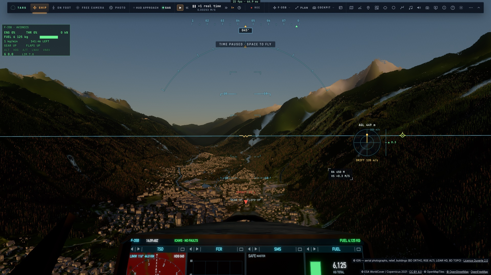
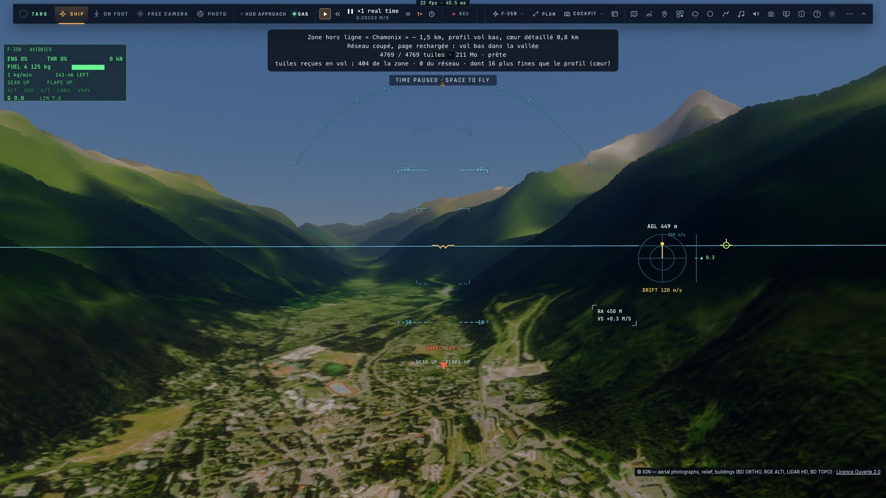
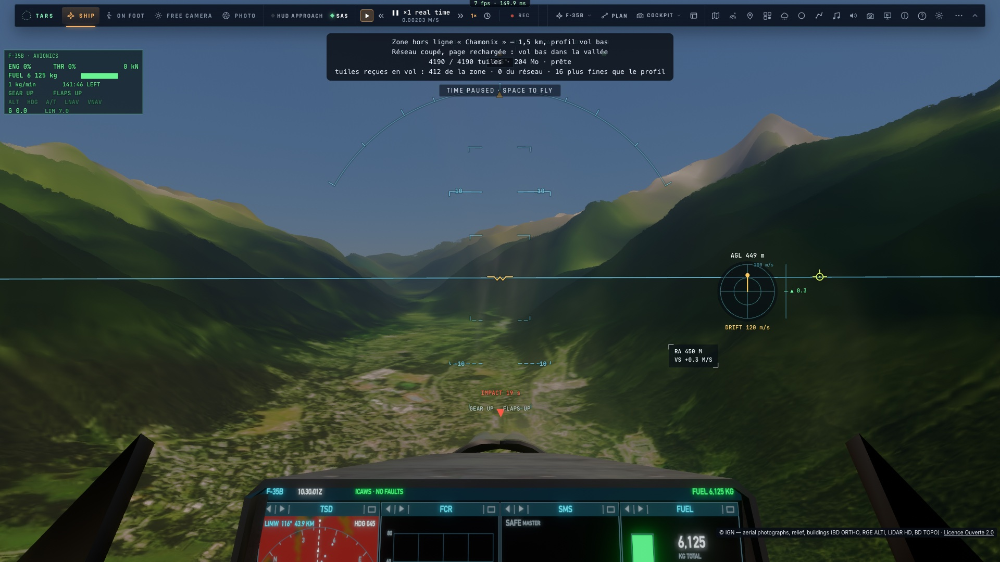
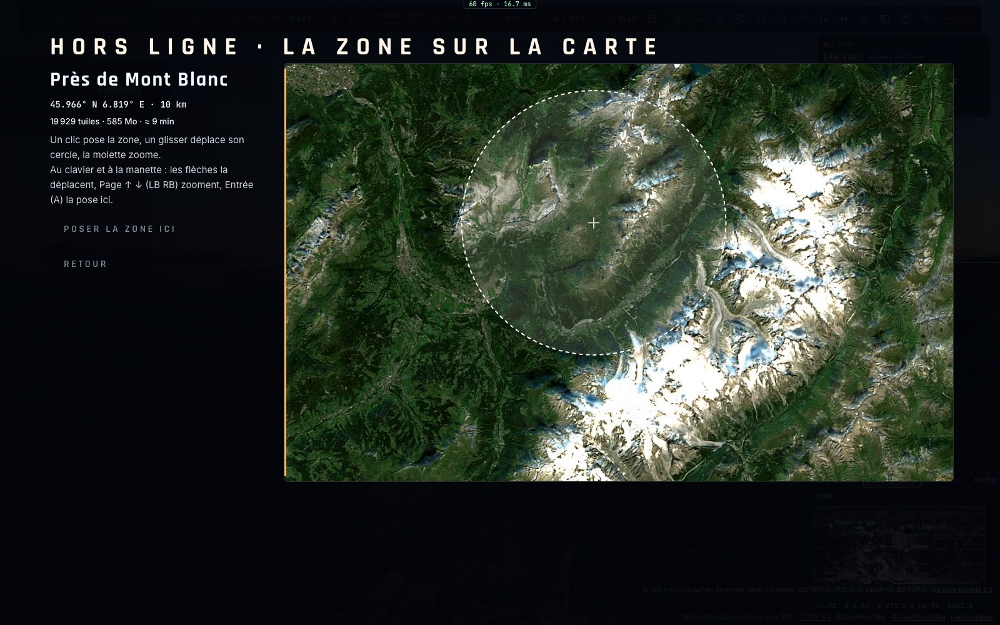
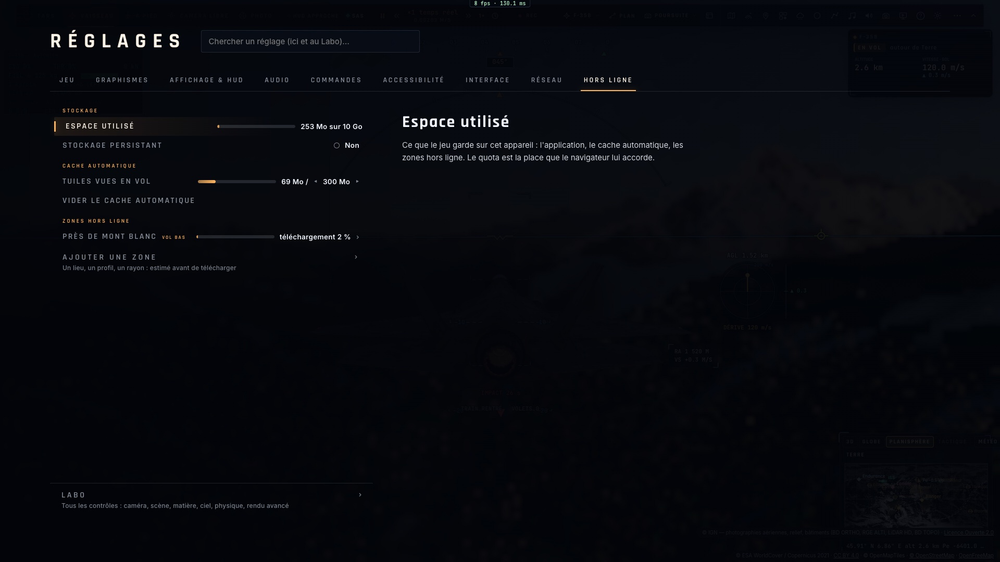

# Analyse — l'IGN et le LiDAR HD dans la Terre de Kerr

Date : **23 octobre 2026**. Base : `main` à `b30ad20a`. Laboratoire examiné : `../test-ortho-IGN-lidar` (Three.js
WebGPU, Paris et Saint-Jean-de-Valériscle, 4 × 4 km détaillés dans 12 × 12 km).

Statut : **analyse, aucune implémentation**. Les services IGN ont été interrogés le 23 octobre 2026 depuis ce Mac
(latences et formats ci-dessous mesurés) ; le rendu de Kerr n'a pas été relancé : ses coûts viennent de
[progress/raster-aaa/ETAPE-1.md](progress/raster-aaa/ETAPE-1.md). Les chiffres marqués *(estimation)* sont des calculs.

## 1. Verdict

**Oui, et c'est le plus gros gain visuel disponible pour le vol bas en France** — il vient des données, pas du moteur.
Le moteur de Kerr (air, nuages, lumière, ombres, raster + `shade`) est déjà au-dessus du labo ; ce qui manque au sol,
c'est la résolution de ce qu'il dessine : **relief SRTM 30 m complété de bruit procédural, imagerie Sentinel‑2 10 m**.
L'IGN donne **0,5 m de relief mesuré et 0,2 m d'orthophoto**, en accès libre, CORS ouvert, sous Licence Ouverte
(usage commercial permis — mieux que l'EOX actuel, CC BY-NC-SA).

Les données entrent **dans les deux chemins (raster et tracé) à la fois** : elles alimentent les mêmes tuiles
(`earth-tiles.ts`) que lisent `earthHeight*` (tracé) et le maillage raster. Mais pour voir le mètre en relief et non
seulement en couleur, **le raster est le chemin à développer** (maillage plus fin près de la caméra) ; le tracé
profite de l'imagerie et des normales sans rien changer.

Ordre recommandé : **géoïde d'abord** (§5, bloquant pour la règle WGS84), puis **orthophoto IGN** (le gain le plus
grand pour le moins de code), puis **relief**, puis **arbres et bâtiments réels**, enfin le **HLOD lointain par MNS**.

## 2. Pourquoi le labo est plus beau

| Couche | Kerr aujourd'hui | Labo IGN | Facteur |
|---|---|---|---|
| Relief | Terrarium z ≤ 14 (6,3 m le texel à Paris), **SRTM 30 m** dessous (`TILE_RES_MIN = 25`) + bruit procédural | MNT LiDAR HD 0,98 m au centre, 3,9 m dans le noyau | ×25–30 |
| Imagerie | EOX Sentinel‑2 cloudless 2021, **10 m** | BD ORTHO 0,49 m (0,24 m en Cinéma) | ×20–40 |
| Bâtiments | OSM (OpenFreeMap), hauteurs souvent absentes | BD TOPO : emprises + hauteurs mesurées ; toits par MNS 1 m | qualitatif |
| Arbres | ESA WorldCover 10 m → classe, hauteur tirée | MNH LiDAR (hauteur réelle du sursol) | qualitatif |

Le labo n'est pas réutilisable tel quel (Three.js, une scène bornée de 4 km, altitudes normales non converties,
préparation par WMS en EPSG:4326) : **sa valeur est la preuve des données et la cible visuelle**, pas son code.

## 3. Ce que l'IGN sert, mesuré le 23/10/2026

| Couche | Service | Résolution | Format | Accès | Latence (1 tuile 256²) |
|---|---|---|---|---|---|
| Orthophoto `ORTHOIMAGERY.ORTHOPHOTOS` | WMTS, **grille PM (Web Mercator)** z 0–19 | z 17 : 0,79 m, z 18 : 0,39 m, z 19 : 0,20 m à Paris | JPEG ≈ 11–16 Ko | CORS `*`, **aucune limite d'usage**, `max-age` 21 j | 0,35–0,42 s |
| RGE ALTI `ELEVATION.ELEVATIONGRIDCOVERAGE.HIGHRES` | WMTS WGS84G z 6–14 / WMS-R | WMTS : 4,8 × 3,3 m ; WMS-R : à la demande | BIL float32 (deflate) | CORS `*` | 0,46 s (WMTS), 0,61 s (WMS-R) |
| MNS `…HIGHRES.MNS` | WMTS WGS84G z 4–17 | 0,6 m | BIL float32 | CORS `*` | 0,60 s |
| MNT / MNS / MNH LiDAR HD `IGNF_LIDAR-HD_*` | **WMS-R seulement** | natif 0,5 m | BIL float32 (non compressé, 256 Ko) | CORS `*`, **40 req/s par IP** | 0,53–0,77 s |
| BD TOPO (bâti, eau) | WFS (30 req/s/IP) ; tuiles vectorielles TMS (sans limite) | vecteur | GeoJSON / MVT | CORS | — |

Vérifié : **le WMS-R accepte `CRS=EPSG:3857` sur la boîte exacte d'une tuile de Kerr** (testé z 17 à Paris, LiDAR
25,8–36,9 m, RGE ALTI 26,9–36,6 m) : une requête = une tuile du clipmap, sans reprojection dans le worker.
Le navigateur décode seul le `Content-Encoding: deflate` du WMTS.

Couverture LiDAR HD : l'objectif IGN est la métropole entière fin 2026 ; des trous subsistent (le labo les signale,
`LIDAR_NODATA`). **Le RGE ALTI couvre tout le territoire** : c'est le repli naturel, le SRTM au-delà des frontières.

Quota : la Géoplateforme annonce 1 To de trafic par an en offre gratuite ; à qui il s'applique sans clé (par IP,
par application) **n'est pas établi** — à vérifier auprès de l'IGN avant une diffusion large.

## 4. Où chaque couche entre dans Kerr

### 4.1 Orthophoto → `earth-tiles.ts` (le gain immédiat)

L'imagerie de Kerr est **déjà en tuiles Web Mercator par niveau** (GIBS ≤ z 8, EOX z 9–14). L'IGN est la même grille :
une troisième source par niveau, choisie quand la tuile est en France (emprise de couverture + test « image vide »,
comme le labo). À ajouter :

- **Niveaux z 15–18** au‑delà de `Z1 = 14` (`LEVELS`, `TILE_PARAM_VEC4S`, tables du traceur). Un niveau de plus :
  une couche 1024² rg32uint, **8 Mio** (32 Mio en portée `far`). z 15–18 : 32 à 128 Mio *(estimation)*. Hors de
  France, ces niveaux restent vides et rien ne change.
- **Le recalage colorimétrique** : l'ortho IGN (saturée, ombres photographiées, millésimes en mosaïque) ne ressemble
  ni à l'EOX ni au Blue Marble. Même méthode que `EOX_FIT` : un ajustement par canal mesuré sur des lieux témoins,
  et un fondu sur 1–2 niveaux pour éviter une couture au bord de la couverture.
- **Les ombres photographiées** : le §4.2 de [ANALYSE-PIPELINE-TERRE-AAA.md](ANALYSE-PIPELINE-TERRE-AAA.md)
  s'applique dix fois plus à 0,5 m (chaque bâtiment, chaque arbre a son ombre peinte). Atténuer les basses
  luminances de l'ortho là où le décor dessine déjà ses ombres.

**Fait le 23/10 (I1).** Quatre niveaux d'imagerie seule z 15–18 (fenêtres de 4 × 4 tuiles, dans des quadrants de
1024² de couches de plus de la texture des tuiles, placés par la table du traceur `TABLE_ORTHO`) ; en France, les niveaux
du relief z 9–14 prennent aussi l'ortho IGN au lieu de l'EOX (net jusqu'aux 6–20 km de leurs fenêtres). Recalage
mesuré sur douze lieux : une courbe de tonalité sur la luminance L′ = 0,811·L^1,475 et des gains de couleur
(0,82 ; 1,10 ; 0,39) estompés sur les surfaces claires (moyennes à 4 % de celles du jeu, le blanc neutre).
L'imagerie IGN passe devant la couche régionale à 10 m et coupe sous elle les matériaux dessinés et les routes OSM
peintes. Réglage « Photographies aériennes (France) », mention « © IGN BD ORTHO · Licence Ouverte 2.0 » à l'écran
quand elles sont dessinées, dans le panneau et l'Atlas ; tuiles gardées par le PWA. Coût mesuré sur kerr-mini : aucun
écart de FPS sensible (dans le bruit). Leçons des e2e : le « flou » des premières captures venait de l'imagerie IGN
cachée sous la couche régionale à 10 m, du repli du raster en tracé (sur le M1 du mini, le régulateur abandonne le
raster pendant les chargements) et d'images prises avant convergence — pas du débruiteur (vérifié : il ne tourne
qu'en image accumulée, où le sol est tracé, pas en raster).

Débit en vol bas *(estimation)* : à 150 m/s, une rangée de 4 tuiles z 17 (200 m) toutes les 1,3 s, ≈ 3 tuiles/s
par niveau, ≈ 15 Ko chacune : **< 0,2 Mo/s** pour toute l'imagerie fine. Latence 0,4 s : `MAX_INFLIGHT` (8) à
augmenter et l'anneau d'avance (`ring`) utilisé dès la portée normale.

### 4.2 Relief → tuiles de hauteur, puis maillage raster

Les hauteurs vont dans les mêmes couches (le canal hauteur de chaque tuile). Source par niveau en France :
RGE ALTI (WMS-R 3857) jusqu'à z 15, **LiDAR HD MNT (WMS-R 3857) z 16–17** près de la caméra.

Trois changements nécessaires :

1. **`TILE_RES_MIN` par source** (25 m aujourd'hui, en dur dans `earth-tiles.ts:44` et `trace.wgsl:5439`) : 1 m sur
   une tuile LiDAR. Sans cela le traceur continue de croire la donnée à 25 m et de la recouvrir de bruit.
2. **Le bruit procédural s'efface là où la donnée est fine.** C'est aussi un **gain de performance** : le détail
   procédural coûte **5,4–7,4 ms** dans `shade` (ETAPE-1, `TUNE_DETAIL` 0). Une donnée mesurée lue en une lecture
   remplace une somme d'octaves.
3. **Le maillage raster plus fin.** Le cache de surface (`terrain-cache-layout.ts`) a son niveau le plus fin à
   `2^22` nœuds par tour, **9,5 m**, sur 129 nœuds (1,2 km). Pour voir des talus, fossés, murets en géométrie :
   deux ou trois niveaux de plus (2,4 m, 1,2 m, éventuellement 0,6 m), et des **normales lues à 0,5 m** pour le reste
   (la normale actuelle à trois lectures de hauteur coûte ≈ 0 ms d'après l'ablation). 129² nœuds par niveau : la
   mémoire est négligeable ; le coût est dans la passe de visibilité (≈ 4,6 ms aujourd'hui), à mesurer.

**Fait le 23/10 (I2).** En France (réglage « Relief IGN (France) »), les niveaux z 11–14 prennent leurs hauteurs à
la RGE ALTI au lieu de Terrarium, et trois niveaux de relief de plus, z 15–17 (3,2 → 0,8 m le texel ; fenêtres de 4
tuiles), viennent de l'IGN seul — le LiDAR HD dès z 16, la RGE ALTI dans ses trous ; là où l'IGN n'a rien (en mer, à
l'étranger), Terrarium (au-delà de son z 15, agrandi). Une requête WMS-R en EPSG:3857 par tuile ; les valeurs que la
RGE ALTI rééchantillonne le long des côtes (jusqu'à −856 m) écartées sous −100 m. La source de chaque hauteur est
dans le dernier bit de son flottant (Terrarium ne l'emploie jamais : ses k/256 tiennent sur 22 bits) : le CPU
(`heightAt`) et le traceur (`tileFine`) en tirent la résolution de la donnée — 1 m pour l'IGN, 25 m pour le reste —,
qui efface le détail procédural plus fin que le relevé. Mesuré à Étretat sur kerr-mini : la falaise à 84° de pente
au lieu de 59°, la résolution de 1,2 m au lieu de 25 m. Pas fait : le maillage raster garde ses niveaux à 9,5 m (le
relief fin n'y est que dans l'ombrage et les intersections affinées, pas dans les silhouettes : I3).

**Fait le 23/10 (I3).** Le cache de surface du raster a deux niveaux de plus, nœuds à 1,2 et 2,4 m
(`TERRAIN_CACHE_ROUNDS` : 2²⁵, 2²⁴, puis 2²² … 2¹², pas par 4) ; le patch se pose sur le plus fin (réglage
`earthTerrainRasterLevel`, 0 par défaut, 155 m de côté) et les niveaux plus grossiers l'entourent en anneaux jusqu'au
niveau 6 (nœuds de 2,4 km) — le trou de chaque anneau au rapport de pas de son voisin (×2 entre 0 et 1, ×4 ensuite).
La tolérance du repère de distance et la cadence réduite des anneaux restent comptées depuis le niveau 4 : les
anneaux 1–4 sont traités comme l'ancien patch. Les normales lisent le relevé dans sa propre grille (`earthSlopeFine` :
le niveau valide le plus fin, texel ≤ 10 m, différences centrées à l'empreinte du pixel, jusqu'au demi-mètre de z 17)
là où l'empreinte passe sous 10 m. Mesuré à Étretat sur kerr-mini (e2e `raster-fine-relief`, vue tenue, mêmes pixels —
échelle 0,75, ombrage un sur deux —, niveau 4 / 0 / 4) : passe de visibilité 1,39 → 1,61 ms (1,38 au retour, soit
**+0,22 ms**), ombrage raster 108,3 → 105,0 ms (−3 % : le repère plus juste raccourcit la marche). Limites : les
directions des nœuds cuites en f32 (≈ 0,4 m à la surface) bruitent un peu le niveau 1,2 m ; les découpes des pistes
ne se font que dans le patch (155 m désormais), les anneaux sont des grilles simples.

Débit *(estimation)* : 256 Ko par tuile non compressée en WMS-R, ≈ 1,5 Mo/s en vol bas à 150 m/s sur z 15–17 :
acceptable sur fibre, lourd en 4G — quantifier à 16 bits (cm) dans le worker avant le cache PWA, et réserver
z 17 au‑dessous de ≈ 1 500 m de hauteur sol. 40 req/s par IP : large pour un joueur (8–16 en vol), **pas pour un
relais serveur commun** — chaque navigateur doit interroger l'IGN lui-même.

### 4.3 Forêts → MNH dans `forest.ts`

Le worker décide la hauteur de chaque cellule de 7 m (`FOREST_CELL`). En France, **la lire dans le MNH** (et la
présence : MNH > 2 m hors bâti BD TOPO et hors eau, comme le labo) au lieu du tirage depuis WorldCover : lisières,
haies du bocage, ripisylves, clairières à leur vraie place. Coût GPU nul (même mot de 32 bits) ; une requête MNH
par tuile de forêt dans le worker.

**Fait le 23/10 (I4).** En France (réglage « Relief IGN »), le worker de la scène lit le MNH du LiDAR HD par blocs
— les tuiles z 14, une requête WMS-R chacune (`src/system/ign-canopy.ts`) — sur le seul disque de la forêt, les plus
proches d'abord : à 512² (3,1 m le texel) dans les 2 premiers km, 256² au-delà ; le sol (MNT LiDAR, RGE ALTI là où ses
trous passent 2 %) à 256² puis 128². Une cellule de 7 m porte un arbre là où la canopée atteint 2 m à portée de sa
couronne (le pied et huit points à son rayon : la couronne déborde sur la haie), sauf dans une emprise de bâtiment OSM
(à 1,5 m près — le MNH porte aussi les toits) ou en classe eau ; l'arbre a la hauteur mesurée, un arbuste sous 4 m,
l'essence du climat au-dessus. Une canopée sous 5 m et plate à 1 m près est une **culture au moment du vol** (maïs, blé :
1,6–2,5 m, 6 % des texels du bocage à Saint-Lô), pas une haie : écartée. Les pieds des arbres et des bâtiments sont sur le
sol IGN — celui du traceur depuis I2 (ils restaient sur Terrarium jusqu'ici, à quelques mètres près). Là où l'IGN n'a
rien, WorldCover comme avant.

Volume mesuré : 13 blocs / 13 Mo pour une scène équilibrée, 41 / 22 Mo pour la plus grande (4,75 km), en cache
navigateur 21 jours. **La limite de 40 req/s de la Géoplateforme se manifeste par des refus immédiats** (HTTP 400,
« LayerNotDefined » : aucun à 8 req/s, 82 % à 75 req/s) — ce que les premiers essais prenaient pour des pannes au hasard. Un
limiteur partagé (`RateGate`, `earth-tiles.ts`) donne 20 req/s aux tuiles de relief et 12 au relevé, avec trois nouvelles
tentatives espacées de 1, 2, 4 s ; un bloc qui échoue quand même retombe sur WorldCover sans dégrader la scène
(`surveyError`). Les tuiles de relief d'I2 retombaient sur Terrarium à chaque refus : corrigé du même coup.

Mesuré au sud de Saint-Lô sur kerr-mini (e2e `ign-canopy`, en raster, comparé à l'ortho IGN z 17, une source à part — un
point y est canopée s'il est sombre et vert) : 1 874 arbres dans 400 m au lieu de 1 008 ; 76 % sur la canopée de la photo
(69 % sans le relevé), 36 % de la canopée de la photo sous un arbre (23 % sans). Le plafond de ce rappel est bas (ombres
et prairies sombres comptées canopée, la photo et le vol LiDAR d'années différentes) : ce sont les écarts qui comptent.
Limites : les arbres au-delà de la limite de bâtiments OSM de la scène (8 000) peuvent pousser sur des toits ; les ponts
et autres ouvrages élevés que porte le MNH ne sont pas écartés.

### 4.4 Bâtiments → BD TOPO dans la scène

`scenery-data.ts` prend OSM. En France, BD TOPO donne **les hauteurs mesurées** de presque tout le bâti (le labo :
26 675 parties sur 4 × 4 km à Paris) ; les tuiles vectorielles de la Géoplateforme évitent la limite du WFS. Les
toits par MNS (le labo en fait 280 à Paris) sont un raffinement ultérieur, pas une priorité.

**Fait le 23/10 (I5).** En France (réglage « Relevé IGN (France) », qui couvre désormais relief, arbres et bâtiments),
le worker de la scène prend les bâtiments de la BD TOPO au lieu de ceux d'OSM (`src/system/bdtopo.ts`). Il lit les tuiles
vectorielles de la Géoplateforme (`tms/1.0.0/BDTOPO/{z}/{x}/{y}.pbf` — en lignes XYZ malgré le nom —, couche `batiment` dès
z 15), les plus proches d'abord, jusqu'à ce que les `limit` bâtiments les plus proches soient tous là. À Paris, une tuile
fait ≈ 300 Ko pour 1 000 bâtiments, et une grande scène en prend 68. La hauteur est `hauteur` (mesurée, présente sur 92 %
du bâti parisien), sinon `nombre_d_etages` × 3 m + 1, sinon les 6 m d'OSM. Les bâtiments détruits, en ruine ou en projet
sont écartés. Un bâtiment à cheval sur deux tuiles arrive dans les deux, avec une marge : chaque copie est découpée au carré
de sa tuile, et les deux prismes se rejoignent au bord. Les routes, l'eau et les pistes restent celles d'OSM ; là où une
tuile BD TOPO échoue, les bâtiments d'OSM de cette tuile sont gardés, sans dégrader la scène (`surveyError`). Les emprises
BD TOPO servent aussi à l'exclusion des arbres d'I4 : elles concordent avec le MNH, qui vient du même relevé.

Mesuré avant le code, hors ligne, sur les mêmes emprises, contre le sursol médian du LiDAR (`MNS − MNT` à 0,76 m sur chaque
emprise) : BD TOPO à 0,9–2,0 m d'écart médian, OSM à 2,7–5,6 m (Nantes centre, Saint-Lô, Front de Seine). Dans le jeu,
sur kerr-mini (e2e `bdtopo`, en raster, Paris 16e/15e de part et d'autre de la Seine, les bâtiments de la scène dans 300 m
de son centre, leur toit moins le sol du jeu) : **1,6 m d'écart médian et 74 % à 3 m près avec la BD TOPO** (257 bâtiments
comparés), **3,8 m et 39 % avec OSM** (412). Limites : les deux mesures du jeu ne portent pas exactement sur les mêmes
bâtiments, car le centre de la scène suit la caméra (550 m d'écart entre les deux arrivées) ; les toits restent des prismes
plats (le MNS les donnerait, I6) ; un bâtiment de plus de 256 sommets est écarté, comme pour OSM.

## 5. Le préalable : le géoïde

**Kerr n'a pas de géoïde** (`AAA-PROGRESS.md` 2.8 : « le niveau de la mer est l'ellipsoïde, à ±100 m près »).
Les hauteurs Terrarium (EGM96) et IGN (altitudes normales IGN69) sont donc posées comme des hauteurs ellipsoïdales :
**le sol de la France est dessiné ≈ 45–55 m trop bas** par rapport aux positions WGS84 (le trafic ADS-B en hauteur
géométrique, un GNSS, la règle de `CLAUDE.md`).

À 30 m de résolution cette erreur se voyait peu ; avec un sol mesuré au décimètre, elle devient l'erreur dominante
(avions réels 50 m trop hauts au-dessus des pistes, ILS, contact). Correction proposée :

- une grille **EGM2008** (2,5′, quelques Mo) appliquée à Terrarium, à l'IGN et **à la mer** (la mer est sur le géoïde) ;
- l'IGN converti au même géoïde (l'écart IGN69/EGM2008 est de l'ordre du décimètre en métropole *(à mesurer)* ;
  la grille RAF20 de l'IGN si l'on veut mieux) ;
- les pistes, aéroports, sites et vols de référence revérifiés (ils sont nivelés sur le relief, donc suivent).

C'est un changement transversal mais borné ; il vaut pour toute la Terre, pas seulement la France.

**Fait le 23/10 (I0).** La grille EGM2008 à 15′ (`assets/earth/geoid-egm2008-15.bin`, 0,92 Mo, construite par
`scripts/build-geoid.py` depuis la grille 5′ de GeographicLib ; 7 cm rms, 2,5 m au pire) est lue de la même façon
par le CPU (`src/system/geoid-grid.ts`) et par le traceur, où elle occupe 4 Mo de sa table (`TABLE_GEOID`,
`trace.wgsl geoidN`). Les données restent des altitudes au-dessus de la mer — le détail procédural, les pistes
nivelées, le cache de surface les lisent ainsi — et N s'ajoute à la sortie : `earthHeightSampler` (CPU),
`earthHeightG`/`earthHeightStep` et le maillage raster (GPU), le décor par un plan du géoïde envoyé au worker. La
mer est la surface h = N (ombrage, vagues, reflets). Les positions restent ellipsoïdales ; les altimètres (HUD,
PFD de l'A320, PCD du F-35), `geoNow().alt` et les tenues d'altitude des pilotes automatiques sont au-dessus de la
mer (`seaAltitudeOver`). Les navires flottent à N ; l'ADS-B barométrique est relevé de N. Non fait : l'atmosphère
standard lit encore la hauteur ellipsoïdale (±0,5 % de densité) ; les étiquettes du trafic montrent sa hauteur
géométrique.

## 6. Raster ou tracé ?

| | Tracé | Raster + `shade` (défaut actuel) |
|---|---|---|
| Ortho IGN | gagne tout de suite (lecture d'imagerie au point touché) | idem |
| Relief fin en couleur et normales | oui | oui |
| Relief fin en géométrie (silhouettes, talus) | marche plus longue sur des données plus fines (pas plus petits, plus de lectures) | **maillage plus fin, coût borné** |
| Bruit procédural retiré | −5 à −7 ms | −5 à −7 ms |

**Le raster est le bon chemin pour la géométrie fine ; les données servent les deux.** Le tracé reste le repli et
la référence (`earthPipeline: "trace"`), sans travail spécifique.

## 7. Mieux encore

1. **Le HLOD lointain des villes et forêts par le MNS.** Le §4.5 de l'analyse AAA note qu'il n'existe pas de
   représentation collective lointaine : les arbres s'arrêtent à 2,5–7 km, le bâti BVH aussi. Le **MNS (0,6 m en
   WMTS)** est exactement cette représentation : au-delà de la portée du décor, lire le sursol `MNS − MNT` comme un
   relief de plus (une hauteur par texel, déjà dans le chemin des tuiles) donne les silhouettes de Paris et des
   massifs forestiers jusqu'à l'horizon, pour le prix d'une lecture. Valable partout où un MNS existe.

   **Fait le 23/10 (I6).** Sur la France (réglage « Silhouettes lointaines (France) », avec le relevé IGN), les niveaux
   z 11–13 portent le sursol de l'IGN : le MNS du LiDAR HD (celui de la RGE ALTI dans ses trous) moins le MNT, au-dessus
   de 2 m (`earth-tiles.ts` `overground`). Le WMS-R **moyenne** ses échantillons : demandée au texel de z 11 (50 m), la
   tour Montparnasse ne monte qu'à 156 m au lieu de 264. Le MNS est donc demandé deux fois plus fin sous z 13 (512²), et
   chaque texel garde le **plus haut** de ses quatre échantillons de sursol (tour Montparnasse : 262 m). On prend le
   maximum du sursol, jamais celui du MNS brut : sur un coteau, le point haut d'un texel est son bord amont (+7 m sur une
   pente de 30 %). Une tuile lointaine coûte environ 1 Mo de plus. Le z 14 et les niveaux plus fins gardent le sol nu,
   sous les bâtiments et les arbres de la scène : le sursol commence au bord de la fenêtre z 14 (≈ 3 km), là où la scène
   s'arrête.

   **Le sursol n'est que dessiné.** Le tableau d'une tuile lointaine porte son sol nu puis son sursol (`drawnHeight`),
   et la texture du traceur reçoit leur somme. Le CPU (contacts, terrain de l'Auto-GCAS, hauteur sol, `sys.groundAt`)
   ne lit que le sol nu. Le premier essai faisait voir les toits et les cimes à l'Auto-GCAS, qui déclenchait une ressource
   en vol bas au-dessus de la banlieue.

   Mesuré sur kerr-mini (e2e `hlod`, en cockpit et en raster, à 20 km au nord-est de Montparnasse, au-dessus des champs
   de Gonesse, à 100 m du sol, cap sur Paris) :
   - sommets dessinés contre le MNS LiDAR : tour Montparnasse 262 m (264), tour First 197 m (215), tour Eiffel 246 m (326,
     le treillis) ; sans le sursol, 36 à 54 m ; le sol de la physique reste nu (55 m sous Montparnasse) ;
   - coût, médianes d'un A/B/A/B aux mêmes pixels, sur la trace, l'ombrage raster et la visibilité : de −0,5 à +0,2 ms
     d'une passe à l'autre (dans le bruit), et +0,1 / +1,2 ms à une sur deux / une sur quatre dans une passe précédente ;
   - mais **+12 ms (+10 %) d'ombrage raster** dans une vue basse vers l'ouest au-dessus de la vallée de la Marne, où la
     plus grande part de l'image est un sol lointain boisé.

   Ce n'est donc pas « le prix d'une lecture » : la cause probable est le repère de distance du raster. Ses anneaux
   lointains sont cuits avec l'empreinte de leurs nœuds (610 m), donc depuis des niveaux plus grossiers que z 11, sans le
   sursol ; la marche d'ombrage doit alors retrouver plus haut la surface relevée. Correction possible, non faite : cuire
   ces anneaux sur le maximum du sursol à leur empreinte.

   **Essayé le 23/10, sans effet — retiré.** Les nœuds de 153 m et plus ont été cuits avec le plus haut sursol relevé sur
   leur empreinte : une grille de 4 × 4 au niveau z 11–13, la hauteur dessinée moins le sol z 10, texels du relevé seuls. Le
   repère majorait donc la surface, ce que la fourchette d'`earthMarchHinted` tolère (jusqu'à 4 `eps` au-delà) mieux qu'un
   repère sous le sol (−3 dès `eps`, puis la marche complète). A/B sur kerr-mini dans la même vue sur la Marne, médianes
   d'un avec / sans / avec / sans à un pixel sur deux : **+14,3 ms (+11,8 %) avec la cuisson, +12,0 ms (+9,9 %) sans**.
   L'hypothèse ne tient pas, ou ne suffit pas ; le correctif est retiré. Un diagnostic en e2e par la vue de coût
   (`costView` 14/15) et la teinte des chemins de marche (`tune: { TUNE_RASTER_PATHS: 2 }`) n'a rien donné d'exploitable :
   variantes pas compilées au moment de la lecture, puis profilage revenu à zéro après les bascules. Le surcoût reste
   gardé par l'e2e `hlod-cost` (sous 15 %). Pistes : refaire ce diagnostic ici, dans le panneau du navigateur, avant de
   toucher au code ; mesurer la part des pixels dont la marche part du repère et de ceux qui la refont entière ; essayer
   une cuisson sur la moyenne du sursol plutôt que son maximum ; vérifier si les marches d'ombre au soleil bas pèsent.

   **Corrigé le 23/10 — diagnostic dans le panneau du navigateur.** La teinte des chemins de marche
   (`tune: { TUNE_RASTER_PATHS: 2 }` : rouge la fourchette, vert la fenêtre rasante, bleu la marche entière) montre une
   large zone **bleue à 1–2 km** avec les silhouettes, absente sans elles (`docs/progress/hlod-cost/hlod-marne-paths-*.jpg`).
   C'est **proche**, non lointain : les pixels y voient le sol nu des fenêtres z 14 et plus fines, mais les anneaux de
   9,5 m et 38 m du cache, cuits au pied de leurs nœuds, lisaient les niveaux z 11–13 — et leur sursol. Le repère passait
   la hauteur d'une forêt **au-dessus** du sol dessiné, et la fourchette, bornée à `(0,02 tM + 3)` m le long du rayon
   (≈ 12 m de haut en rasant à 1,5 km), le manquait : marche entière. Correctif (`terrain-cache.ts`) : sur un relevé
   (résolution de la donnée sous 20 m, `SURVEY_RES` — la France seule), un nœud est cuit sur les tuiles **telles que les
   pixels les lisent** — le niveau le plus fin tenu au nœud (`earthH(q, 1 m)`) au lieu de celui de son empreinte —, le reste
   (détail, pistes) inchangé : nu dans les fenêtres fines, le sursol au-delà, comme dessiné. A/B sur kerr-mini, même vue,
   médianes d'un avec / sans / avec / sans : **+11,8 ms (+10,1 %) → +0,16 ms (+0,1 %)** à un sur deux, **+7,5 ms
   (+10,2 %) → +1,2 ms (+1,6 %)** à un sur quatre ; l'e2e `hlod-cost` garde maintenant 5 %, `raster-fine-relief` (I3)
   inchangé (+0,10 ms). Les comptes de la vue de coût restent illisibles à distance comme ici : la teinte a suffi.

   Au téléobjectif (6°), la silhouette de Paris borde l'horizon
   avec le sursol, et l'horizon est plat sans lui (`docs/progress/hlod/hlod-paris-skyline.jpg`). À 20 km, dans la brume
   d'un soir d'été, elle reste discrète en vue normale.
2. **Une interface « source nationale », pas un cas IGN.** Les mêmes trois couches existent ailleurs, ouvertes :
   **swisstopo** (swissALTI3D 0,5 m, SWISSIMAGE 0,1 m — les Alpes côté Suisse, là où Kerr teste d'abord),
   Espagne (PNOA 0,25 m, LiDAR 2 m — Tarifa), Pays-Bas (AHN 0,5 m), États-Unis (3DEP 1 m, NAIP 0,6 m — Kennedy,
   Edwards). Une source = une emprise, des URL par niveau, une résolution native, un géoïde, une attribution.

   **Fait le 23/10 (I7) : l'interface, et swisstopo.** `src/system/national.ts` définit une source nationale : son
   emprise et sa terre (`holds`), l'URL de ses orthophotos et leur recalage (`OrthoFit`), le premier niveau de son relief,
   les hauteurs d'une tuile Web Mercator au-dessus de la mer (NaN là où elle n'a rien), plus le sursol (I6) si elle a un MNS.
   Chaque tuile prend la source de son **centre**, la plus précise d'abord : `[SWISSTOPO, IGN]`, parce que la boîte de
   l'IGN contient la Suisse. `earth-tiles.ts` construit la source IGN à partir de son code d'I1–I6, et tout ce qui
   supposait la France passe par la source de la tuile : ortho, imagerie des niveaux z 9–14, relief, boîte du traceur
   (désormais l'union des sources).
   - **swisstopo** (Office fédéral de topographie, geo.admin.ch, Géodonnées libres (OGD), CORS ouvert) :
     - **SWISSIMAGE** (10–25 cm) par son WMTS en Web Mercator, z 15–18 et z 9–14 comme l'IGN. Recalage ajusté sur douze
       lieux par la méthode de l'IGN : tonalité (0,867 ; 1,473), gains (0,760 ; 1,101 ; 0,357).
     - **swissALTI3D** (0,5 m) par les maillages **quantized-mesh** du service de terrain, en EPSG:4326 et TMS, jusqu'à
       g 18. `src/system/quantized-mesh.ts` les décode et les rastérise dans la grille de la tuile : la hauteur du
       triangle sous chaque centre de cellule. Une tuile z prend les maillages g = z − 1, une ou deux tuiles dont la
       maille vaut environ deux texels. Une tuile alpine pèse environ 0,6 Mo (non compressée au transfert) et coûte
       13–20 ms de rastérisation, découpée en tranches de 2 ms pour ne pas bloquer le fil principal.
     - Hauteurs au-dessus de la mer (LHN95) : sommet de la Jungfrau à 4 157,8 m pour 4 158 m de cote officielle, à 4 m près
       dès z 12.
   - **Le contour** : swisstopo sert aussi au-delà de la frontière (Chamonix, Annemasse, Aoste), avec une qualité qui n'y
     est pas établie. La terre suisse est donc le contour Natural Earth 1:10 M de la Suisse et du Liechtenstein, simplifié
     à ~300 m (`national-borders.ts`).
   - **La scène** : ses arbres et bâtiments posent leurs pieds sur le sol swisstopo, celui du traceur (`SwissGround` :
     maillages g 13, ~14 m). Le MNH et la BD TOPO de l'IGN n'y sont plus demandés. Les arbres restent ceux de WorldCover
     et les bâtiments ceux d'OSM : swisstopo n'a pas de modèle de canopée en service, et swissBUILDINGS3D n'est pas branché.
   - Réglages renommés « Photographies aériennes (France, Suisse) » et « Relevés nationaux (France, Suisse) » ; mention
     « © swisstopo » quand la caméra est en Suisse ; crédits du titre et du panneau ; tuiles gardées par le PWA (et les
     tuiles BD TOPO d'I5, oubliées jusque-là).
3. **Des packs préparés pour les lieux joués** (aéroports, Chamonix, Paris) : LiDAR 0,5 m pré-tuilé, quantifié,
   compressé, hébergé avec le jeu — pour le hors-ligne PWA et pour ne pas dépendre de la latence du WMS-R au roulage.
   La France entière à 0,5 m ne s'héberge pas (≈ 2 × 10¹² points, plusieurs To même compressés *(estimation)*) : le
   streaming direct depuis l'IGN reste la règle.

## 8. Risques

| Risque | Mesure |
|---|---|
| Couleurs et millésimes de l'ortho en mosaïque, nuages ponctuels | ajustement par canal, fondu entre niveaux, repli EOX sur tuile vide ou incohérente |
| Ombres photographiées + ombres dynamiques (double ombre) | atténuation des basses luminances sous le décor dessiné |
| Trous LiDAR HD | repli RGE ALTI puis Terrarium, par tuile ; jamais de terrain inventé |
| Couture de hauteur au bord de la France | même géoïde des deux côtés, fondu des hauteurs sur une tuile |
| Dépendance au service IGN (panne, quota non établi) | cache PWA, packs des lieux joués, repli mondial intact |
| Coût de la visibilité raster avec des niveaux plus fins | mesuré par `raster-flight` avant/après ; niveaux fins limités en hauteur sol |
| Attribution | « © IGN — Licence Ouverte 2.0 » dans le panneau, l'Atlas et l'aide, comme l'EOX |

## 9. Zones hors ligne : pré-cacher une région dans le PWA

**Possible, et une bonne idée — pour des zones bornées (5 à 50 km de rayon), pas pour la France entière.**

### 9.1 Pourquoi

- **La latence de l'IGN** : 0,35–0,8 s par tuile, contre un S3 plus rapide pour Terrarium. En vol bas, une tuile fine
  arrive après que le sol est déjà sous l'avion. En zone pré-cachée, le service worker répond depuis le disque : le
  détail est là dès la première image.
- **Le hors ligne promis par le PWA** (PLAN-MONDE M1) : aujourd'hui seule la dernière scène jouée l'est, au hasard
  du LRU.
- **Les tests** : un e2e sur une zone pré-cachée, réseau coupé ensuite, ne dépend plus d'Internet. C'est
  précisément la cause des blocages de kerr-mini quand le Wi-Fi tombe.
- **Le jeu en réseau** : chacun a le même sol, chargé d'avance, au départ d'un vol commun.

### 9.2 Ce qui existe

[sw.ts](../src/sw.ts) et [pwa/rules.ts](../src/pwa/rules.ts) : un cache `kerr-tiles-v1` **en cache-first, LRU
sous 300 Mo** (`TILE_BUDGET`), avec un index en IndexedDB (URL, dernier usage, taille). Il couvre Terrarium, GIBS,
EOX, OpenFreeMap, WorldCover (Terrascope), `earth-surface/`, `runways/` et les tuiles OSM de la carte. Le service
worker répond déjà aux messages `stats` et `clear-tiles` (`__bh.pwa`), mais **aucun écran ne les montre**. Les
Réglages ont huit onglets, construits depuis le schéma ([ui/settings/player.ts](../src/ui/settings/player.ts)).
`navigator.storage.persist()` n'est jamais appelé.

### 9.3 Volumes *(estimation, à 46° N)*

Ortho à 13–20 Ko la tuile (mesuré). Relief en WMS-R à 256 Ko la tuile en float32 brut ; quantifié sur 16 bits
puis compressé, ≈ 80 Ko visés — 41–44 Ko mesurés (I8c, ci-dessous). Téléchargement avec 8 requêtes en parallèle à 0,45 s chacune.

| Profil | Rayon | Niveaux (image / relief) | Tuiles | Brut | Relief quantifié | Durée |
|---|---|---|---|---|---|---|
| Aéroport, roulage | 5 km | z 18 / z 17 | ≈ 11 600 | 0,7 Go | **≈ 0,3 Go** | ≈ 11 min |
| Vol bas | 20 km | z 17 / z 16 | ≈ 46 000 | 2,7 Go | **≈ 1,2 Go** | ≈ 45 min |
| Vallée, massif | 50 km | z 16 / z 15 | ≈ 72 500 | 3,8 Go | ≈ 2 Go | ≈ 70 min |
| Région, survol | 100 km | z 15 / z 14 | ≈ 72 500 | 2,0 Go | ≈ 1,5 Go | ≈ 70 min |
| France entière | — | z 15 / z 14 | ≈ 1,3 M | 36 Go | ≈ 25 Go | ≈ 20 h |

Conclusions : la quantification du relief est indispensable, puisqu'il pèse 80 % du brut. Une zone de vol bas tient
dans les quotas des navigateurs : Chrome accorde à une origine jusqu'à ≈ 60 % du disque, Safari et Firefox des
fractions comparables une fois le stockage persistant. **La France entière n'est pas proposée.**

**Fait le 24/10 (I8c) : le relief gardé petit.** `src/pwa/relief-codec.ts` code les grilles WMS-R :
- chaque hauteur est arrondie au centimètre, soit une erreur d'au plus 5 mm ;
- elle est prédite par ses voisines (le prédicteur médian de LOCO-I : la gauche, celle du dessus, leur somme moins
  la diagonale), et seule la différence est gardée, sur 16 bits ;
- une falaise de plus de ±327 m passe par un code d'échappement qui porte la valeur entière, et un trou (ce que le jeu
  lit comme tel) a son propre code ;
- les octets de poids faible et de poids fort sont rangés en deux plans, puis le tout est compressé (deflate).

Le service worker code les grilles quand il les garde, dans les zones comme dans le cache automatique en vol, et les
sert de nouveau en float32, avec la valeur de trou d'origine et l'en-tête `x-kerr-codec: krh1`. Le jeu n'a pas changé.
Le budget du cache tient donc 5 à 6 fois plus de relief.

- **Taille par tuile** (`scripts/relief-codec-bench.ts`, 24 tuiles IGN : Chamonix, Paris, Étretat, la Beauce) : RGE
  ALTI 256² ≈ 41 Ko au lieu de 256 (15,6 %), LiDAR HD 256² ≈ 39 Ko (≈ 15 %), MNS LiDAR 512² ≈ 236 Ko au lieu de
  1 024 (≈ 23 %). Une tuile vide (hors relevé) pèse quelques centaines d'octets.
- **e2e sur kerr-mini** (`tests/e2e/relief-codec.e2e.test.ts`, raster, Chamonix avec le relief IGN) :
  - en vol, 398 grilles 256² gardées à **43,5 Ko** et 81 grilles 512² à **214 Ko** ;
  - six grilles relues par le worker, comparées aux mêmes demandées directement à l'IGN : écart maximal **5,00 mm**,
    trous aux mêmes places (10 850 dans l'une) ;
  - le sol du jeu à 10 points, avant et après un rechargement depuis le cache : écart maximal **4 mm** ;
  - une zone vol bas de 1 km avec le relief : 7 689 chaînes, 464 Mo (513 estimés), grilles à 44 Ko et 137 Ko.
- **Les volumes refaits** (Chamonix, relief et silhouettes IGN, `zoneEstimate` sur les tailles mesurées) :

  | Profil | Rayon | Chaînes | Relief brut | Relief codé | Durée |
  |---|---|---|---|---|---|
  | Aéroport, roulage | 5 km | ≈ 22 000 | 2,3 Go | **0,7 Go** | ≈ 19 min |
  | Vol bas | 20 km | ≈ 63 000 | 5,4 Go | **2,3 Go** | ≈ 41 min |
  | Vallée, massif | 50 km | ≈ 97 000 | 8,1 Go | **3,9 Go** | ≈ 56 min |
  | Survol d'une région | 100 km | ≈ 100 000 | 9,6 Go | **4,3 Go** | ≈ 63 min |

  Le relief n'est plus la plus grosse part : ce qui reste, ce sont les orthophotos et Terrarium. La durée suit le
  WMS-R, qui sert ~5 grilles par seconde (2 987 en 588 s mesurées), et non 8.

**Fait le 24/10 : le vol bas détaillé, un cœur au niveau aérodrome.** Le profil vol bas (orthophotos z 17, relief
z 16) ne tient pas ce que le jeu demande en vrai vol bas. Sous ≈ 1 km du sol en plein écran, `updateOrtho` veut les
orthophotos z 18 (0,4 m) ; sous ≈ 1,7 km, avec le relief IGN, le relief veut z 17. Hors ligne, chacune de ces
requêtes échouait (le jeu dessinait alors le niveau du dessous). Avec une zone mais en ligne, elles partaient au
réseau : l'e2e en comptait 8 à 44 par vol. Mettre z 18 et z 17 partout coûterait trop cher. Pour une zone vol bas de
20 km avec le relief, on passe de 2,3 à 6,8 Go estimés (+ 118 700 orthos z 18 et + 32 400 grilles z 17). On a donc
fait deux choses :

- **Un cœur détaillé** (`ZONE_CORE`, `ZoneRecord.coreKm`) : un disque autour du centre qui prend les niveaux du profil
  aérodrome (orthophotos z 18, relief z 17), avec les mêmes marges de fenêtre que le reste de la zone
  (`zoneTiles(…, core)`). Ailleurs dans la zone, c'est le profil qui s'applique. Dans l'écran d'ajout, la ligne
  « Cœur détaillé » règle son rayon (aucun, 0,5 à 50 km, ou toute la zone) et affiche son surcoût (« 3 km · + 137 Mo »).
  Le vol bas le met à 3 km par défaut ; les autres profils n'en ont pas, et l'aérodrome a déjà ces niveaux partout.
  Sur les cartes, le cœur est tracé en pointillé.
- **Hors ligne, le jeu ne demande que ce que la zone garde** (`zoneLevelsAt` ; `EarthTiles.held`, branché dans
  `main.ts` quand `navigator.onLine` est faux) : caméra dans une zone, les fenêtres s'arrêtent aux niveaux que la zone
  garde à cet endroit (cœur, profil, ou les données mondiales si ses sources étaient coupées). Plus aucune requête
  n'échoue. Hors de toute zone, rien n'est plafonné : le cache automatique a sa chance.

| Zone (Chamonix) | Relief IGN | Sans cœur | Avec cœur | Surcoût |
|---|---|---|---|---|
| Vol bas 10 km, cœur 3 km (le défaut) | oui | 22 174 chaînes, 812 Mo, 18 min | 27 355 chaînes, 949 Mo, 23 min | **+ 17 %** |
| Vol bas 10 km, cœur 3 km | non | 461 Mo, 8 min | 529 Mo, 10 min | + 15 % |
| Vol bas 20 km, cœur 3 km | oui | 2 290 Mo, 41 min | 2 427 Mo, 45 min | + 6 % |
| Vol bas 20 km, cœur = toute la zone | oui | 2 290 Mo | 6 799 Mo, 128 min | × 3 |
| e2e : 1,5 km, cœur 0,8 km | non | 4 190 chaînes, 182 Mo estimés | 4 769 chaînes, 192 Mo estimés, **211 Mo mesurés** | + 5 % estimés |

Les tailles viennent de `zoneEstimate`, qui compte 18 Ko par orthophoto. Mesurées sur 40 tuiles par site, les z 18
pèsent moins que les z 17, parce que chaque tuile est plus uniforme : 11,6 Ko contre 13,5 à Chamonix, 15,7 contre
18,0 à Paris, 8,1 contre 9,1 en Beauce. La part orthophoto du cœur est donc surestimée d'environ un tiers.

- **Test unitaire** (`tests/zones.test.ts`) : une zone vol bas de 3 km avec un cœur de 1,5 km, survolée à 400 m du sol
  (pixel de 0,4 et 1 mrad), dans 8 directions, en regardant de 4 côtés. Toutes les tuiles z 18 et z 17 demandées
  dans le cœur sont dans la zone. Hors du cœur, en ligne, des z 18 sont demandées hors de la zone ; hors ligne, plus
  aucune, et chaque tuile demandée est dans la zone.
- **e2e sur kerr-mini** (`tests/e2e/zones.e2e.test.ts`, ~4 min) : zone de 1,5 km avec un cœur de 0,8 km, réseau
  coupé (`navigator.onLine` faux), page rechargée. Le sol est regardé à 0,6 km du centre, à 398 m au-dessus du fond :
  orthophotos jusqu'à z 18, détail 3,57 contre 3,18 en ligne. Puis vol à 120 m/s jusqu'à 1,38 km du centre, donc
  hors du cœur, où le jeu reste en z 17. Bilan : **493 tuiles servies par la zone, dont 16 orthos z 18 du cœur ;
  0 du réseau, 0 en échec**, sol complet.

### 9.4 Contraintes

- **Les URL doivent être exactement celles du jeu.** Le service worker cherche une tuile par son URL. La liste de
  la zone doit donc sortir des **mêmes fonctions** que `earth-tiles.ts` (`tileUrl`, `eoxUrl`, futures URL IGN) et
  des mêmes règles de niveaux, dans un module pur et testé.
- **Les zones ne sont pas évincées par le LRU.** Il faut un second cache `kerr-zones-v1`, avec son index
  zone → URL, hors `TILE_BUDGET`, que `tile()` consulte en premier. Une tuile partagée par deux zones n'est stockée
  qu'une fois et n'est retirée qu'avec la dernière zone qui la contient.
- **Le stockage persistant** : `navigator.storage.persist()` est demandé au premier téléchargement de zone. Sans
  lui, le navigateur peut tout effacer sous pression d'espace. Safari efface en plus les données d'un site non
  installé après 7 jours sans visite : **installer le PWA** est à conseiller sur l'écran.
- **Le jeu passe avant le téléchargement.** Celui-ci se suspend quand le streaming du jeu a des tuiles en attente
  (vol bas, arrivée sur un lieu). Il se reprend d'où il s'est arrêté, car l'index sait ce qui est déjà là. Il
  respecte la limite de 40 req/s du WMS-R et recule sur une réponse 429.
- **En arrière-plan** : l'API Background Fetch (Chrome seulement) permettrait de continuer page fermée. À traiter
  comme une option plus tard. Le cas normal est un téléchargement pendant que le jeu est ouvert, titre compris.
- **Ce qui ne se télécharge pas** :
  - les tuiles **OSM** de la carte tactique : leur politique interdit le hors ligne et toute récupération anticipée ;
  - l'**EOX** en masse : EOX vend un produit hors ligne (GeoPackage), et l'usage en masse de ses tuiles gratuites
    n'est pas établi. En France, l'IGN le remplace ; ailleurs, c'est à vérifier avant de l'inclure.
  - L'IGN (WMTS sans limite d'usage, WMS-R à 40 req/s), GIBS, Terrarium et OpenFreeMap n'interdisent pas ce
    téléchargement.
- **Les millésimes changent** : une zone garde la date de son téléchargement, et « Mettre à jour » la refait.
  L'ortho IGN se renouvelle par département tous les 3 ans environ.

**Fait le 23/10 (I8a) : le socle.** Le module pur `src/system/zones.ts` liste les tuiles d'une zone (`zoneTiles`) pour un
profil (`ZONE_PROFILES` : aéroport z 18/17, vol bas z 17/16, vallée z 16/15, survol z 15/14, image/relief) avec les
fonctions d'URL du jeu. Sa marge couvre les fenêtres menées au plus loin : `span + 1,5` tuiles autour du disque pour le
relief, `ORTHO_SPAN + 0,5` pour les orthophotos. Un test vérifie que chaque tuile que veulent les fenêtres, et chaque URL
demandée en vol, est dans la liste (`tests/zones.test.ts`).

- **Des chaînes, pas une liste** : une tuile de relief est une chaîne (LiDAR → RGE ALTI → Terrarium ; MNS LiDAR → MNS
  RGE). Le maillon suivant n'est demandé que si le précédent manque (grille trouée, image refusée), comme en vol. Une
  zone ne prend donc que ce que le jeu lirait.
- **Le service worker** : un cache `kerr-zones-v1` hors LRU, indexé tuile → zones dans IndexedDB (`zone-tiles`). Une
  tuile partagée par deux zones n'est stockée qu'une fois (`zoneRelease`). `tile()` le consulte en premier et marque sa
  réponse (`x-kerr-zone: 1`).
- **Le téléchargement** se fait par lots de 64 chaînes, 16 en parallèle, que la page pousse au worker (`zone-fetch`).
  Le WMS-R reste espacé de 125 ms. Les lots attendent que le jeu n'ait plus de tuiles en attente. La pause attend la
  fin du lot en cours. La reprise repart du curseur enregistré, même après un rechargement. Les chaînes en échec sont
  redemandées une fois à la fin. `navigator.storage.persist()` est demandé à l'ajout. L'API : `__bh.pwa.zones`
  (docs/BH-API.md).
- **Mesuré sur kerr-mini** (`tests/e2e/zones.e2e.test.ts`). Zone de 1,5 km sur Chamonix, profil vol bas, relief IGN
  coupé : 4 190 chaînes, estimées à 182 Mo, réelles 204 Mo, téléchargées en ≈ 2 min. Mise en pause à mi-course, puis
  reprise : prête 60 s après la reprise, 0 échec. Puis le cache LRU est vidé, le réseau coupé et la page rechargée :
  vol à 120 m/s, 400 m au-dessus du fond de la vallée. Résultat : **≈ 530 tuiles servies par la zone, 0 par le réseau, le
  sol complet, l'ortho à z 17.** Une zone de 3 km en survol (311 Mo) avait donné le même résultat.
- **Le sol dessiné, pas seulement chargé** : la vue est tenue immobile et chaque pixel ombré (la recette des captures de
  `swisstopo.e2e`), puis le test mesure le détail du fond de vallée à l'écran (écart moyen de luminance entre pixels
  voisins). Hors ligne, il doit valoir au moins 60 % de la même vue en ligne. Une vue en mouvement ne sert pas de
  preuve : le gouverneur la dessine en blocs de 8 pixels, et le sol y paraît lisse.
- **Le 404 passager de l'IGN** : le WMTS répond parfois 404 pour une tuile qu'il a. Le worker redemande donc une fois
  avant de la tenir pour absente. Sans cela, 0 à 5 tuiles par zone manquaient, et le jeu les demandait au réseau en vol.
- **Les volumes, refaits sur les chaînes** (Chamonix) :

  | Profil | Rayon | Relief IGN | Taille |
  |---|---|---|---|
  | Vol bas | 1,5 km | coupé | ≈ 180 Mo |
  | Vol bas | 1,5 km | LiDAR / RGE ALTI | ≈ 470 Mo |
  | Aéroport | 5 km | coupé | ≈ 430 Mo |
  | Aéroport | 5 km | LiDAR / RGE ALTI | **≈ 1,9 Go** |
  | Vol bas | 20 km | LiDAR / RGE ALTI | **≈ 4,8 Go** |

  Les grilles WMS-R en float32 brut (256 Ko, 1 Mo à 512²) font ¾ de la taille. **I8c est donc nécessaire** avant
  d'offrir des zones de relief IGN au-delà de quelques km.
- **Limites connues** :
  - Sous ~1,5 km au-dessus du sol en plein écran, le jeu demande l'ortho z 18. Le profil vol bas s'arrête à z 17
    (0,8 m) ; aller plus loin quadruplerait l'ortho à chaque niveau. Hors ligne, ces tuiles échouent et le jeu dessine
    z 17 à la place. Le test les compte à part.
  - Les décors du monde (`earthScenery`) ne sont pas encore dans les zones.
  - L'émulation hors ligne de Chrome (CDP) ne coupe pas les requêtes du worker lui-même. La preuve du test est donc
    l'en-tête `x-kerr-zone`, pas l'échec des requêtes.

### 9.5 L'écran : Réglages › Hors ligne

Un neuvième onglet, **Hors ligne**. Il n'est pas construit depuis le schéma : c'est un panneau sur mesure, qui garde
le focus, la navigation à la manette, les invites et le français/anglais du menu.

- **Stockage** : ce qui est utilisé et le quota (`navigator.storage.estimate()`), si le stockage est persistant,
  avec un bouton pour le demander, et le conseil d'installer le PWA.
- **Cache automatique** : sa taille, son budget à choisir (300 Mo, 1 Go, 3 Go), un bouton « Vider ».
- **Zones** : une ligne par zone avec son nom, son profil, son rayon, sa taille, sa date et ses sources. Actions :
  « Voir sur la carte », « Mettre à jour », « Supprimer ». Une zone en cours affiche sa progression, avec
  « Suspendre », « Reprendre » et « Annuler ».
- **Ajouter une zone** : le lieu se choisit avec le sélecteur de l'écran À pied
  ([ui/title/foot.ts](../src/ui/title/foot.ts) : destinations de l'Atlas, adresse, coordonnées), ou « la position
  actuelle » depuis la pause. Le profil se choisit parmi Aéroport, Vol bas et Survol, et le rayon est réglable. **Le
  nombre de tuiles, la taille et la durée estimées sont montrés avant de lancer**, avec la place libre. Puis le
  bouton Télécharger.
- **Raccourci** : dans la pause, tiroir Monde, « Garder cette zone hors ligne ».
- Distances en km ou en NM selon `unitsFor()`, tailles en Mo/Go ; textes en français et en anglais.
- Automatisation : `__bh.pwa.zones` (liste, ajout, progression, suppression) pour les e2e et TARS.

**Fait le 24/10 (I8b).** L'onglet est `src/ui/settings/offline.ts`, branché dans les Réglages comme neuvième onglet
(`CUSTOM_TABS` dans `menu.ts` : construit à la main, pas depuis le schéma). Ses lignes sont les éléments des menus :
← → changent une valeur, Entrée ou un clic agissent, la manette les envoie comme ces touches. Ses chiffres sont relus
toutes les 1,5 s tant qu'il est affiché.

- **Stockage** : l'espace utilisé sur le quota, le stockage persistant (Entrée le demande au navigateur) et le
  conseil d'installer le jeu.
- **Cache automatique** : sa taille sur son budget. ← → choisit 300 Mo, 1 Go ou 3 Go. Le service worker garde ce
  budget dans IndexedDB (magasin `meta`, base en version 3) et évince aussitôt au-delà (`__bh.pwa.setBudget`). Un
  bouton le vide sans toucher aux zones.
- **Zones** : une ligne par zone avec sa barre de progression ou sa taille et sa date. Sa fiche donne son profil,
  son rayon, ses sources et ses tuiles. Elle offre Suspendre ou Reprendre, Mettre à jour, Voir sur la carte (l'Atlas),
  et Supprimer ou Annuler, qui demande une confirmation. La mise à jour reprend la zone depuis le début et redemande
  chaque tuile : `zone-fetch` avec `fresh`, et l'ancienne tuile est gardée si le réseau échoue.
- **Ajouter une zone** : le lieu (la position actuelle sous 50 km d'altitude, les destinations de l'Atlas, une
  adresse ou des coordonnées), le profil (Aéroport, Vol bas, Vallée, Survol, chacun avec son rayon par défaut) et le
  rayon de 1 à 100 km, et son cœur détaillé (§9.3). L'estimation affiche les tuiles, la taille et la durée (`zoneDuration` : les grilles WMS-R à 5
  par seconde, le reste à 35 chaînes par seconde), avec la place libre. Télécharger est grisé si la place manque. Une
  zone prise à la position actuelle porte le nom de la destination la plus proche, à moins de 30 km (« Près de Mont
  Blanc »).
- **Raccourci** : pause › Monde › « Garder cette zone hors ligne ». Il n'apparaît qu'au-dessus de la Terre, sous
  50 km d'altitude, et ouvre l'ajout sur la position actuelle. Échap revient à l'onglet, puis à la pause.
- **Sur la carte** (ajouté le 24/10) : « Choisir sur la carte » ouvre, dans les Réglages, la carte de l'Atlas
  (`ui/mapview.ts`). Le cercle de la zone y est tracé à son rayon (en pointillé blanc), au-dessus des zones gardées
  (ambre prête, bleu en téléchargement, gris en pause), avec l'estimation à jour.
  - À la souris : un clic pose la zone, un glisser déplace son cercle, la molette zoome.
  - Au clavier et à la manette : les flèches la déplacent, Page ↑ ↓ (LB RB) zooment, Entrée (A) la pose.

  La zone prend le nom de la destination la plus proche. La fiche d'une zone la montre sur cette carte, d'où l'on peut
  passer à l'Atlas, qui dessine aussi les zones (`AtlasHost.zones`). e2e : `tests/e2e/offline-map.e2e.test.ts`.

- **e2e sur kerr-mini** (`tests/e2e/offline-settings.e2e.test.ts`, ~6 min), à la souris et à la manette, sur
  Chamonix. Depuis la pause, une zone vol bas de 1 km (5 981 chaînes, 343 Mo) est suspendue puis reprise, et prête
  sans échec. Le budget passe à 1 Go puis revient. La zone est supprimée, ses tuiles avec elle. L'onglet est vérifié
  en anglais.
- **Leçon de test** : sur le mini, les Réglages par-dessus une scène qui charge encore ses tuiles ont des images
  lentes. Un appui de manette tenu 250 ms (`pad.e2e`) s'y perdait ; il est tenu 600 ms, sans risque puisqu'un bouton
  n'agit que sur le front de son appui.

## 10. Plan proposé

| Étape | Contenu | Mesure de réussite |
|---|---|---|
| **I0** — fait (23/10) | Géoïde EGM2008 (sol, mer, IGN) — `src/system/geoid.ts`, la table du traceur, `seaAltitudeOver` ; voir §5 | vols de référence et atterrissages inchangés à l'issue près ; trafic ADS-B posé sur les pistes |
| **I1** — fait (23/10) | Ortho IGN z 15–18 dans `earth-tiles.ts`, recalage couleur, attribution — et l'imagerie des niveaux z 9–14 prise à l'IGN en France ; voir §4.1 | captures A/B Chamonix, CdG, Paris en cockpit ; FPS inchangé (`raster-flight`) |
| **I2** — fait (23/10) | Hauteurs RGE ALTI + LiDAR HD (WMS-R 3857), `TILE_RES_MIN` par source, bruit effacé — voir §4.2 | `shade` −5 ms attendu en France ; aucune couture au bord |
| **I3** — fait (23/10) | Niveaux fins du cache de surface (2,4/1,2 m) et normales à 0,5 m — voir §4.2 | passe de visibilité mesurée, cible ≤ +2 ms : +0,22 ms |
| **I4** — fait (23/10) | MNH → forêts, leurs pieds et ceux des bâtiments sur le sol IGN — voir §4.3 | captures de lisières/haies contre l'ortho : 76 % des arbres sur sa canopée (69 sans), 36 % de sa canopée sous un arbre (23 sans) |
| **I5** — fait (23/10) | BD TOPO → bâtiments (tuiles vectorielles z 15), OSM gardé pour les routes et l'eau — voir §4.4 | hauteurs comparées au MNS sur un quartier : 1,6 m d'écart médian, 74 % à 3 m près (OSM : 3,8 m, 39 %) |
| **I6** — fait (23/10) | HLOD lointain par `MNS − MNT` sur z 11–13 (dessin seul, le CPU garde le sol nu) — voir §7 | silhouette de Paris à 20 km : Montparnasse à 262 m (LiDAR 264) ; coût mesuré 0 à +1,2 ms vers Paris ; dans une vue basse sur des forêts +12 ms, ramené à +0,2 / +1,2 ms (cache cuit sur les tuiles que lisent les pixels) |
| **I7** — fait (23/10) | Interface de source nationale (`national.ts`) ; swisstopo : SWISSIMAGE, swissALTI3D par quantized-mesh — voir §7 | Alpes suisses au même niveau : voir le paragraphe |
| **I8a** — fait (23/10) | Zones hors ligne, le socle : module pur `zoneTiles` (mêmes URL que le jeu, testé), cache `kerr-zones-v1` hors LRU dans le service worker, `storage.persist()`, téléchargement suspendable et repris, priorité au streaming du jeu, `__bh.pwa.zones` | test unitaire « URL de la zone = URL demandées en vol » ; e2e : zone pré-cachée, réseau coupé, vol sans aucune requête de tuile et sol complet — voir §9.4 : 529 tuiles de la zone, 0 du réseau |
| **I8b** — fait (24/10) | Réglages › Hors ligne : stockage, cache automatique, liste des zones, ajout avec estimation, progression ; raccourci dans la pause ; FR/EN | e2e à la souris et à la manette ; captures de l'onglet — voir §9.5 |
| **I8c** — fait (24/10) | Relief quantifié sur 16 bits et compressé dans le cache (en vol aussi) | taille par tuile mesurée (cible ≈ 80 Ko) : 41–44 Ko ; hauteurs identiques au centimètre : 5 mm au plus — voir §9.3 |

I1 seul apporte déjà l'essentiel de ce qui frappe dans le labo (le sol photographié à 0,5 m) ; I2–I3 donnent le
relief ; I0 est indispensable avant de faire voler du trafic réel sur un sol mesuré. **I8a–b peuvent se faire dès
la fin d'I1** : ils servent aussi les sources actuelles (Terrarium, GIBS, OpenFreeMap), et I8c suit I2.

## 11. Sources

- [Limites d'usage des API Géoplateforme](https://cartes.gouv.fr/aide/fr/guides-utilisateur/utiliser-les-services-de-la-geoplateforme/limites-d-usage/) — WMTS sans limite, WMS-R 40 req/s, WFS 30 req/s.
- [CGU cartes.gouv.fr](https://cartes.gouv.fr/cgu/)
- [MNT LiDAR HD (data.gouv.fr)](https://www.data.gouv.fr/datasets/mnt-lidar-hd) — dalles 1 km, pas 0,5 m, objectif 2026.
- [Atelier Géoplateforme (OpenIG)](https://openig.org/sites/default/files/2024-11/Atelier_Geoplateforme.pdf) — 1 To/an en offre gratuite.
- [Atelier LiDAR 2025 (OpenIG)](https://www.openig.org/sites/default/files/2025-12/IGN-ATELIER%20LIDAR-2025.pdf)
- `https://data.geopf.fr/wmts?SERVICE=WMTS&REQUEST=GetCapabilities` — couches, grilles et zooms lus le 23/10/2026.
- [Politique d'usage des tuiles OSM](https://operations.osmfoundation.org/policies/tiles/) — hors ligne et récupération anticipée interdits.
- [EOX cloudless, usage](https://cloudless.eox.at/documentation/usage) — le hors ligne vendu en GeoPackage.
