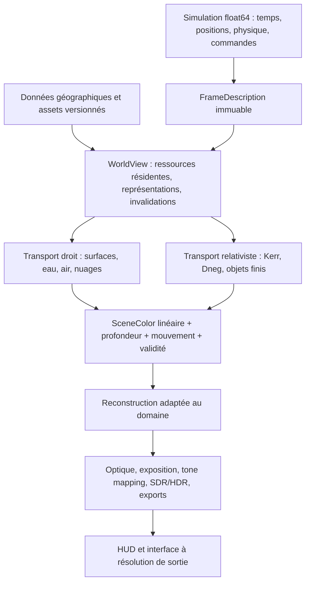
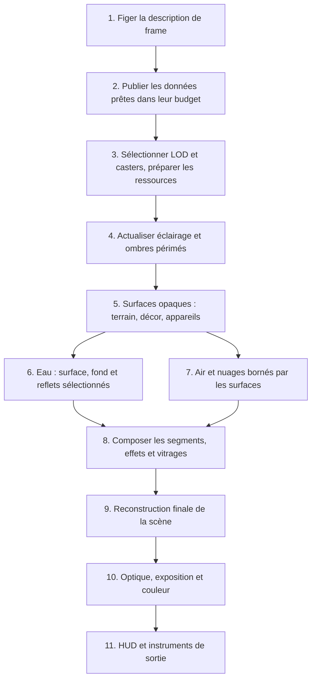
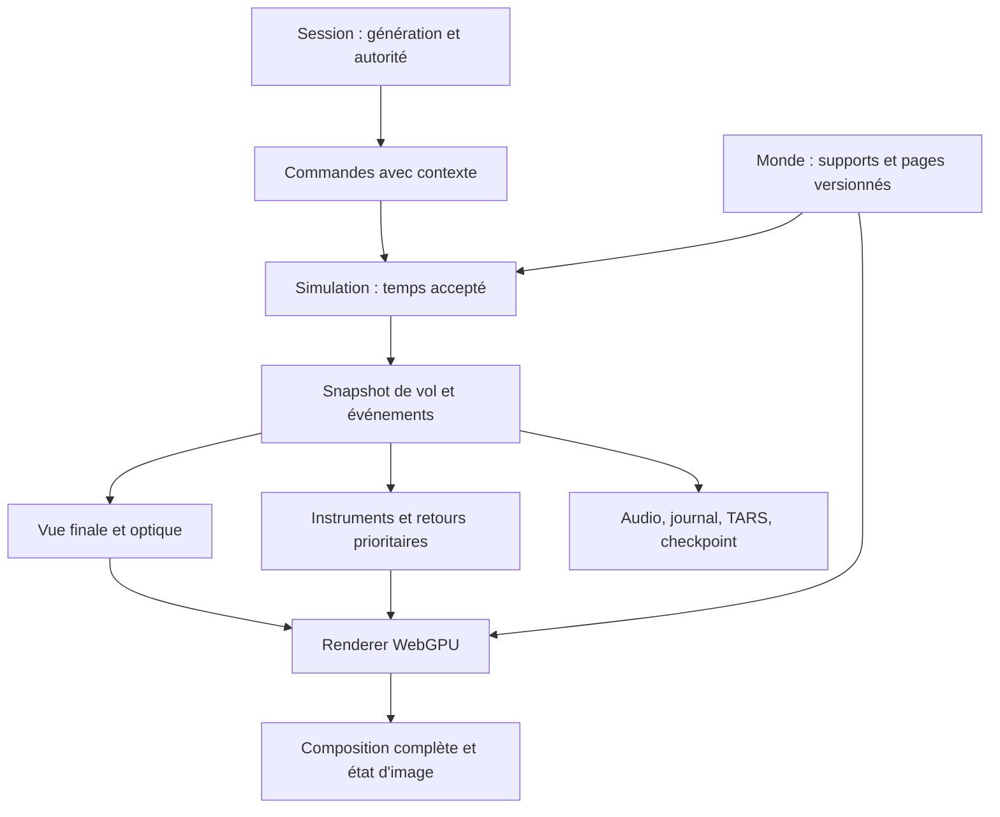

# Rendu : stratégie WebGPU, qualité AAA et architecture de production

**3 novembre 2026 — analyse statique du projet et des résultats archivés.**

**Décision de Sam, mise à jour du 3 novembre 2026 : rester en WebGPU. Objectifs : visuels AAA, performances AAA et pratiques de production de jeu vidéo AAA. La refonte est la destination des travaux actuels et des prochaines sessions ; les 60 images/s sont une cible à atteindre progressivement, avec des paliers intermédiaires acceptables.** La question active est désormais la conception et la livraison de ce renderer, avec le niveau de contenu et la stabilité nécessaires.

**Aucun lancement du jeu, test, e2e, benchmark, build ou mesure nouvelle.** Le premier compte rendu avait ajouté les fichiers HTML demandés. L’approfondissement a modifié ce Markdown ; **à la demande suivante de Sam, la direction permanente est également inscrite dans [CLAUDE.md](../CLAUDE.md)** pour les prochaines sessions, avec le journal obligatoire [progress-to-destination.md](../progress-to-destination.md). Aucun code du jeu, fichier HTML, fichier de test, manifeste ou lockfile n’est modifié par ce travail documentaire. Aucune bibliothèque n’est installée. Les mesures citées restent celles des archives.

Le [compte rendu WebGPU AAA et bibliothèques](STRATEGIE-WEBGPU-AAA-LIBRAIRIES-2026-11-03.html) et les [schémas de la première version](REFONTE-WEBGPU-2026-11-03.html) sont conservés dans leur état précédent ; ils ne reprennent pas le nouvel approfondissement. **La décision et les exigences du présent document font foi.** La refonte détaillée commence en §7, le contrat de performance en §8, la migration en §15 et l’analyse des bibliothèques en §18. **Le §19 approfondit l’expérience complète ; le §20 décrit comment y converger pendant les travaux actuels, par changements livrables.**

## 1. Décision et direction retenue

**WebGPU est la plateforme retenue. Conserver le projet et sa simulation ; construire un renderer de production pour les surfaces et volumes, et conserver le transport relativiste comme un domaine spécialisé. La livraison se fait par scènes complètes, avec une exigence simultanée de qualité et de cadence.**

Le choix de plateforme est acquis. La faisabilité des budgets et le niveau visuel du futur renderer restent à démontrer. Les archives ne mesurent pas cette future architecture. Unity et Unreal restent documentés en §§10–13 comme comparaison historique et sources de pratiques ; leur portage ne fait plus partie du plan actif.

Le problème central n’est pas le manque de bonnes techniques. Il est que leurs représentations, leurs budgets et leurs historiques ne forment pas encore un système suffisamment cohérent. Le raster a déjà remplacé une partie de la visibilité, mais il reste largement branché sur les données, les noyaux et les conventions du traceur. Plusieurs corrections récentes sont utiles ; elles ne ferment pas le budget de la scène complète.

Les décisions de conception proposées pour mettre en œuvre ce choix sont les suivantes :

1. **Une architecture commune de simulation et de données**, indépendante du renderer.
2. **Un renderer de surfaces et de volumes pour le vol, la marche et les planètes**, capable de traiter Terre, Lune et Mars sans importer tout Kerr dans leurs noyaux.
3. **Un transport relativiste spécialisé** pour les régions où les trajectoires courbes comptent, avec une intégration explicite des objets à distance finie.
4. **Un mode photo séparé dans son ordonnanceur**, réutilisant les modèles physiques et les matériaux dont le domaine est compatible. Il reste une référence numérique partielle, jamais une vérité photographique automatique.
5. **Une migration verticale**, prouvée sur une scène complète en mouvement avant de généraliser à tous les mondes.
6. **Un socle graphique raster forward avec matériaux explicites**, des cibles auxiliaires minimales et du compute réservé aux tâches qui le justifient ; les variantes plus complexes exigent une preuve de bénéfice dans la scène complète.
7. **Un contrat AAA observable** : matériaux crédibles, silhouettes et détails stables en mouvement, lumière et volumes cohérents, cadence régulière, latence maîtrisée, chargement progressif et absence de compilation bloquante en vol.
8. **Une chaîne de production des données et du contenu**, avec préparation, LOD, matériaux, caches et limites de complexité. Le shader ne doit pas improviser à chaque pixel tout ce qui peut être préparé une fois.
9. **Une continuité d’expérience indépendante de la qualité graphique** : sol de contact fiable, autorité temporelle explicite, instruments frais, commandes traçables, reprise et sauvegarde à la hauteur des systèmes effectivement simulés. Le §19 précise pourquoi ces contrats doivent accompagner J1, au lieu d’attendre la fin du chantier visuel.

**Une bonne pratique AAA est une méthode pour livrer une image cohérente dans un budget.** Ce n’est pas l’obligation de copier toutes les techniques d’un moteur donné. L’architecture doit permettre la qualité demandée ; les effets et le contenu doivent ensuite être réellement produits. Une scène rapide encore pauvre n’est pas une livraison AAA, et une belle image isolée trop lente ne l’est pas davantage.

## 2. Périmètre, méthode et niveau de certitude

Référence de la première lecture : `a8b9f3927d47b61d71109bab2d4b11593ab44533`. Révision stratégique intermédiaire à `f354c2de`, puis **approfondissement à `d9b7aec8122acf23d82c9883fa866c8d35f193c2`**, incluant `1773ed18` (nuit), `4eab5902` (premier décor et budget réseau commun) et `d9b7aec8` (matériaux des bâtiments raster). Des modifications locales de `horizon.wgsl` et `horizon-maps.ts` sont présentes à l’ouverture de cette lecture ; leur validation ne fait pas partie de cette révision. Les chiffres M0b, Q2 et des campagnes antérieures gardent leur référence d’origine ; ils ne sont pas réétiquetés comme des résultats du dernier commit.

L’examen couvre l’architecture générale, les points de passage simulation/rendu, le traceur et ses variantes, le raster terrestre et planétaire, les données géographiques, le décor, l’eau, l’air, les nuages, le temporel, l’affichage, la compilation, la mémoire et l’instrumentation. Il s’appuie aussi sur les fiches systèmes, les analyses précédentes et un échantillon ciblé des rapports bruts et captures de `remote-results/`. **Il ne prétend pas être une revue ligne par ligne de chaque fonctionnalité du jeu ni de chaque rapport.**

La lecture supplémentaire suit la boucle principale et ses consommateurs : `Simulation.step/applyRender`, `CameraController.update/advance`, vol et sous-pas de contact, marche et hauteur partagée, caméra amortie et cadrage, écrans du cockpit, météo, direction sonore, TARS, sauvegarde, prise et replay, récupération GPU et Service Worker. Les nouveaux constats sont reliés aux fonctions en §19. L’extension est substantielle mais demeure une analyse statique ciblée ; elle ne prouve pas l’absence de défauts ailleurs.

Les conclusions distinguent :

- **Code** : comportement vérifié dans les fichiers lus.
- **Archive** : mesure ou observation déjà enregistrée, avec sa date et ses conditions.
- **Déduction** : explication compatible avec le code et les archives, sans nouvelle vérification dynamique.
- **Proposition** : conception future, à démontrer avant adoption.

Les sources principales sont rassemblées en §17. Les noms de fonctions sont plus durables que les numéros de ligne. Les documents d’octobre décrivent souvent une architecture antérieure : ils servent à comprendre son évolution, pas à affirmer que chaque défaut y est encore présent.

La copie locale de `vr-solar-system` a été consultée en lecture seule : manifeste, conversion des repères et dernière note disponible sur la référence locale `origin/master`. Aucun `fetch`, changement de branche ou lancement Unity n’a été fait. Sa fraîcheur distante n’est donc pas garantie.

## 3. Le projet contient plusieurs produits graphiques

| Domaine | Ce qui fait sa valeur | Ce que son renderer doit privilégier |
|---|---|---|
| Observation de Kerr / trou de ver | Géodésiques, lentilles, disque, redshift, polarisation, modes radio | Erreur du transport, détails angulaires, convergence et modes scientifiques |
| Vol terrestre | Relief réel, météo, avion, cockpit, trafic, navigation | Lisibilité immédiate, netteté en déplacement, silhouettes, latence et cadence régulière |
| Exploration planétaire | Cohérence du sol à l’orbite, variété des mondes | Continuité des représentations, précision locale, lumière et relief |
| Marche / proximité | Contact au sol, personnage, herbe, bâtiments | Géométrie et matériaux proches, désocclusion et interaction |
| Intérieur des géantes | Vol dans des milieux de pression, vents et nuages | Volumes, profondeur, transmission et mouvement du milieu |
| Photo / vidéo | Rendu convergé, HDR, exports, cadrages | Fidélité, reproductibilité, composition et temps de convergence |

Un rayon sophistiqué peut être justifié dans le premier domaine et constituer une dépense évitable dans le second. Un détail qui converge sur une vue fixe peut devenir illisible au premier virage. Une scène de ville crédible à 3 km peut paraître pauvre au roulage même si elle est géographiquement exacte.

**Le contrat actuel est trop large pour un niveau graphique unique.** Il faut choisir un usage de référence pour la refonte. Je propose le vol bas en cockpit, puis sa continuité vers le sol et l’orbite. Ce choix n’abandonne aucun système ; il donne un ordre de livraison.

Le patrimoine à préserver dépasse largement le rendu : mécanique orbitale, aéronautique, éphémérides, WGS84/géoïde, planification, commandes et instruments, missions, réseau, audio, TARS, automatisation et données. Un changement de moteur ferait payer une partie importante de ce patrimoine une deuxième fois.

## 4. Ce que disent réellement les résultats existants

### 4.1 Une référence récente exploitable, avec ses limites

Source brute : [run M0b dans remote-results](../remote-results/20261102-135433-m0b-views/artifacts/remote-results/m0b/plan-views.json), copie documentée : [M0b](progress/refraction-horizons/M0b.md). Run du 2 novembre, `5cdd71fc`, kerr-mini M1, Chrome plein écran. Il précède notamment T6 et T257.

| Vue | Médiane tour 1 / tour 2 | p95 tour 1 / tour 2 | Observation |
|---|---:|---:|---|
| Paris bas | 32,9 / 32,9 ms | 37,6 / 36,0 ms | Cas assez reproductible |
| Chamonix, Soleil bas | 49,2 / 49,4 ms | 52,9 / 54,1 ms | Très loin du budget déclaré de 16 ms |
| Biarritz au coucher | 49,1 / 49,6 ms | 55,0 / 55,2 ms | Eau et lumière rasante coûteuses |
| Côte à 6 km | 44,1 / 43,9 ms | 48,5 / 48,7 ms | La difficulté ne se limite pas au rase-mottes |
| Chamonix, vol de 120 s | 30,1 / 31,8 ms | 37,2 / 39,9 ms | Vue et régime différents de la pose fixe |
| Terre en orbite | 15,2 / 16,3 ms | 16,3 / 17,2 ms | Des domaines sont déjà beaucoup plus légers |

Le champ `image` des poses fixes indique **1920 × 1080**, avec `scale = 0.75` pour les vues terrestres basses. Le test demande initialement une page 1600 × 1000 ; le plein écran change la situation. `GameTools.perf().image` lit la taille du canvas, **pas directement celle de toutes les cibles internes**. Reprendre seulement « 1600 × 1000 » de l’en-tête de la fiche serait insuffisant.

Les médianes proviennent de `completedDurations`, profileur désactivé, puis les passes sont relevées séparément. `Renderer.submit` calcule une durée à partir du callback `onSubmittedWorkDone` et de la dernière complétion. **Ce sont des durées de complétion côté application, pas des timestamps de présentation écran ni des mesures pures d’une passe GPU.** Elles sont utiles pour comparer un protocole stable ; leur inverse ne constitue pas à lui seul un compteur de fps présentés.

Le run contient aussi des vues Cérès noires et Europe masquée par la coque, signalées par sa fiche. Leurs temps sont des observations techniques ; ils ne prouvent pas la performance d’une scène visuellement valide. Les queues de Mars et de la Lune montrent des à-coups importants, sans permettre ici de les attribuer à une cause unique.

### 4.2 Une bonne correction peut ne pas changer le problème global

Dans le [log Q2 après optimisation](../remote-results/20261103-030405-q2cost-after/log), le matériau terrestre à Chamonix est à **23,02 puis 22,98 ms** avec Q2, contre **23,33 puis 23,38 ms** avec tous les termes Q2 coupés. La correction est utile et n’est pas la cause de la lenteur. Le champ de frame reste autour de **46 ms** dans cette sonde avec profilage actif.

Le `summary.json` de ce même run donne environ **50 fps**. Le code de [telemetry.ts](../tests/e2e/lib/telemetry.ts) montre que ce nombre compte les callbacks `requestAnimationFrame` de son enregistreur. **Il ne compte pas les nouvelles images du moteur terminées et présentées.** C’est une découverte importante pour interpréter les archives, pas une preuve que tout le dispositif de mesure est faux.

Autre distinction : `GameTools.perf().gpuFrameMs` reprend `lastGpuMs`, tandis que `gpuPassesMs` vient de la somme du profileur. Les durées des passes peuvent se chevaucher ; leur somme n’est pas le chemin critique de la frame. Un relevé spectaculaire sur « ship: shading » ne suffit donc pas à accuser le cockpit.

### 4.3 Les gains réels à conserver

| Travail | Résultat archivé | Ce qu’il démontre / ne démontre pas |
|---|---|---|
| Noyaux P0–P10 | Démarrage terrestre froid sur mini : image ~19 s, stabilisation ~42 s en fin de campagne | Les compilations ont été fortement améliorées ; leur coût reste une dimension produit. Les temps DXC sont un proxy, pas un jeu Windows exécuté ici |
| Q1 | Boîtes triées, ponts en maillages ; baisse importante de leur coût | Une représentation adaptée peut gagner beaucoup. La version compilée sans arbres n’a pas révélé le gain supplémentaire espéré dans le matériau |
| T4 | Cuissons ~13,3 → ~7,3/s dans l’A/B ; médiane de frame presque inchangée | Moins de travail renouvelé et plus de cohérence, sans prétendre à un gain global équivalent |
| T6 | Cascades de relief et contact ; surcoût ~0,2–0,8 ms selon vue | Les anciennes accusations « presque aucune ombre de relief » sont devenues obsolètes |
| T10 | Texture très lointaine 436 → 235 Mo ; ~192 Mio économisés dans la jauge | Optimisation mémoire importante. Elle ne remplace pas le filtrage matériel de l’imagerie |
| T257 + worker | Crêtes mieux dessinées ; maillage des pistes anticipé ; pics CPU réduits | Les bonnes silhouettes et l’ordonnancement comptent. Les grilles fixes ne deviennent pas pour autant un LOD à erreur projetée |
| Raster des autres mondes P1 | Lune ~9,6 contre 26,6 ms dans l’ancien A/B local | Le raster a une valeur démontrée dans un domaine précis, sans généralisation à tous les mondes et toutes les dates |

Sources : [noyaux](progress/kernels/PROGRESS.md), [Q1](progress/refraction-horizons/Q1.md), [T4](progress/refraction-horizons/T4.md), [T6](progress/refraction-horizons/T6.md), [T10](progress/refraction-horizons/T10.md), [T257](progress/refraction-horizons/T257.md), [planètes P1](progress/planetes-aaa/P1.md).

### 4.4 Ce que permettent les images archivées

Les planches [T257](progress/refraction-horizons/T257/peaks-view.jpg), [Q2](progress/refraction-horizons/Q2/reeclairage.jpg) et [M0b](progress/refraction-horizons/M0b/planche.jpg) ont été inspectées. T257 améliore visiblement les crêtes. Q2 réduit l’excès d’assombrissement de versants. Mais les premiers plans, matériaux, transitions de représentation et différences de qualité entre scènes restent perceptibles dans ces archives.

**Une planche fixe ne démontre ni absence de ghosting, ni stabilité du chargement, ni qualité du virage.** Les mesures de vol archivées apportent autre chose ; il ne faut pas remplacer l’une par l’autre.

### 4.5 Actualisation du diagnostic : bâtiments et préparation CPU

Deux commits postérieurs à la première lecture corrigent des causes concrètes :

- `c0ae6042` : sélection du maillage selon la proximité de l’avion aussi, boîtes lointaines orientées selon les bâtiments, centre du décor plus stable, délais par requête et meilleure conservation d’une réponse partiellement dégradée.
- `f354c2de` : rejet par boîte avant le test point-dans-polygone, index numériques, lectures de canopée sur leur grille et accès synchrone au sol déjà disponible pour une partie importante du travail du worker.

La lecture de `buildingCorner`, `nearOf`, `groundNow`/`heightNow` et `surfaceContains` confirme ces évolutions. **Les anciennes boîtes systématiquement est/nord et certaines sources massives de promesses CPU ne doivent plus être présentées comme des problèmes inchangés.** Aucun nouveau gain chiffré ne leur est attribué ici.

**Ce dernier constat a lui-même évolué avec Q3 (`d9b7aec8`) :** `meshFs` écrit désormais la feuille du bâtiment dans le canal g, à partir d’une table triangle → feuille ; les boîtes portent aussi cette information. `buildingFaceAt` retrouve la face et `shadeLite` appelle `buildingLook`/`roofLook`. L’affirmation initiale « le raster n’a pas l’identité du bâtiment ni ses matériaux » est donc retirée du diagnostic courant. Source contextuelle : [analyse Paris](ANALYSE-PARIS-PIPELINE-2026-11-03.md), à lire avec les corrections, et [fiche Q3](progress/refraction-horizons/Q3.md).

### 4.6 Actualisation : Q3 et premier décor progressif

Le code courant ajoute deux acquis à préserver :

- **Décor en deux temps (`4eab5902`) :** lorsqu’aucune scène affichée ne couvre suffisamment la caméra, `Scenery.update` demande une scène réduite (`QUICK_SHARE = 0.35`), puis la complète. Il ne s’agit plus d’attendre systématiquement un unique décor complet avant toute publication. Le mécanisme reste celui de scènes/buffers successifs, pas encore d’enrichissements indépendants de cellules résidentes.
- **Budget Géoplateforme commun :** `sw.ts/networkFetch` régule les requêtes ordinaires vers `data.geopf.fr` à 25 départs/s et 10 requêtes en vol, avec pause commune sur 429 et reprises bornées. Les réponses des caches de tuiles et des zones passent avant ce portillon. Ces nombres sont les paramètres du code, **pas une garantie de quota fournisseur**. Le parseur de `Retry-After` lu ici traite sa forme numérique ; le comportement sur une date HTTP reste à compléter si nécessaire. La portée reste celle des requêtes effectivement interceptées par le Service Worker.

Les [planches fixes Q3 de jour](progress/refraction-horizons/Q3/murs-toits.jpg) et [de nuit](progress/refraction-horizons/Q3/nuit.jpg) ont été relues. Elles illustrent une variation de toit plus riche et des fenêtres éclairées. Les cadrages et états ne sont pas rigoureusement identiques ; ces images ne constituent ni une mesure isolée du changement, ni une démonstration de stabilité en mouvement. La répétition des façades, le filtrage des détails et le raccord à l’éclairage restent des sujets d’appréciation et de production.

Le diagnostic se déplace : **le matériau existe davantage ; son adressage, son filtrage, son coût et son identité entre deux générations doivent devenir des contrats durables.** `buildingFaceAt` parcourt les plans du toit et les arêtes du contour au point ombré. Porter cette identification de face et ses coordonnées par la géométrie peut éviter de la retrouver par recherche à chaque pixel. C’est une proposition de représentation, pas un gain mesuré. Un offset de feuille du buffer courant n’est pas, à lui seul, une identité stable entre deux reconstructions du décor.

## 5. Évaluation des chemins actuels

### 5.1 Traceur général et temps réel sous-échantillonné

Le traceur contient un investissement rare : Kerr/Dneg, transport fréquentiel, polarisation, disque, corps, atmosphères et mondes proches. Son coût est légitime pour les géodésiques. En visibilité terrestre droite, retrouver le premier sol par une marche puis ses ombres, son air et son décor est souvent une mauvaise allocation.

Un bloc ×6 lance un rayon pour 36 pixels ; ×8, un pour 64. Les silhouettes et détails nouvellement découverts ne peuvent pas tous être inventés par le temporel. Le filtrage à convolution normalisée de `gatherH/resolve` puis le clamp temporel permettent une image utilisable, mais pas une équivalence générale à un échantillon par pixel en mouvement.

**Rôle recommandé :** transport spécialisé, référence numérique, repli temporaire explicitement borné. Ne plus en faire le renderer universel de la proximité.

### 5.2 Indice raster suivi de la marche

Faire commencer la marche près de la profondeur raster est une optimisation logique et déjà mesurée historiquement. Cela conserve cependant les vérifications, les chemins de repli et l’échantillonnage du traceur. Sa bonne fonction est d’accélérer une intersection spécialisée, pas de constituer la destination finale du vol terrestre net.

### 5.3 Raster primaire et matériau `shadeLite`

**C’est la meilleure base existante pour la refonte.** Il faut reconnaître qu’elle est déjà bien plus avancée qu’un simple indice : terrain et une partie du décor sont rastérisés, le matériau terrestre est évalué à chaque pixel interne, l’eau et les nuages ont leurs traitements dédiés, les astres ont des chemins propres.

Ses limites actuelles sont structurelles :

- `shadeLite`, `shadeWater`, `clouds`, `main`, `env` et les fonctions de mondes proches sont encore construits à partir du grand ensemble de `trace.wgsl` et de sa composition.
- La cible de visibilité est une donnée hybride : profondeur de terrain, identifiant d’arbre, profondeur de proxy et code/normal encodés. Elle ne constitue pas toujours la surface opaque finale vue à l’image.
- Q3 a apporté l’identité locale de bâtiment et la réutilisation de `buildingLook`/`roofLook`. Les faces restent retrouvées dans le noyau de shading ; l’identité entre générations, le filtrage par empreinte et le niveau de détail proche/lointain restent à formaliser. La fiche Q3 conserve notamment comme suites les murs mitoyens, l’usage des bâtiments et le traitement des détails au loin.
- `earthImageryAniso` fait un filtrage manuel des couleurs empaquetées dans la texture entière ; la séparation hauteur/imagerie filtrable reste un chantier important.
- `taauOn = false` est explicite. L’ancien essai ajoutait un coût sans battre le résultat courant dans ses conditions ; le rallumer ne constituerait pas une refonte temporelle.
- `main.ts` force encore `want = rasterTop()` quand `rasterLiteActive` : le gouverneur de résolution ne peut pas réagir normalement à ce matériau dominant. Il avait été bloqué pour éviter des pulsations de flou lors des changements d’échelle.

**Attention :** le taux raster affiché 1/16 ne signifie pas que la Terre entière de `shadeLite` ne coûte qu’un pixel sur seize. La branche terrestre se dispatch à chaque pixel ; les chemins résiduels et d’autres mondes ont des taux différents. Un levier de qualité doit nommer le travail qu’il réduit réellement.

### 5.4 Autres corps rocheux

`body-raster.ts` réutilise les fonctions de relief du traceur dans une bibliothèque extraite. Cela préserve la cohérence des formes et a déjà donné de bons gains. Mais les ombres fines et les matériaux restent coûteux ; M0b archive encore 5–14 ms attribuables aux ombres sur certains mondes cratérisés.

Les cartes d’horizon sont une piste sérieuse, **pas une solution déjà validée**. [H1](progress/refraction-horizons/H1.md) trouve des erreurs importantes selon la hauteur de référence, la direction et le filtrage ; la cible angulaire n’est pas tenue par le pilote initial. Une carte estimée peut accélérer une ombre lointaine ; elle ne doit pas devenir sans preuve une borne conservative qui autorise à supprimer toute recherche.

### 5.5 Intérieur des géantes

Le volume répond à un autre problème que le terrain. Ses vents, couches, pressions et champs de densité doivent être conservés. Les archives V7 montrent qu’une lecture naïve des deux phases de bruit peut coûter **+36 à +45 %** au milieu d’un fondu ; choisir stochastiquement une phase par rayon ramène le surcoût relevé à **~4–5 %**. Source : [géantes](progress/geantes-volume.md).

Cette réussite illustre le bon principe : **conserver le modèle utile, changer la représentation et son échantillonnage**. Les puffs d’Alex constituent une autre représentation possible, avec des problèmes propres de tri, grille et lumière. Ils ne prouvent ni que Unity résout le volume, ni que remplacer tous les nuages par des sprites serait souhaitable.

### 5.6 Cockpit, appareils et transparences

Les renderers locaux et le MSAA ont une raison d’être : instruments lisibles, profondeur proche et coût limité à une zone. Les supprimer d’emblée pourrait être une régression.

Leur raccord à la scène doit cependant devenir explicite : profondeur de coque, distance des appareils, atmosphère à leur distance, pré-exposition, mouvement propre, vitrage et effets lumineux. Le post contient `withShip` pour certaines compositions ; l’EXR exporte la cible HDR sans reconstruire automatiquement toutes les mêmes couches que l’affichage. **L’image complète doit devenir une ressource définie, pas une combinaison implicite différente selon son consommateur.**

### 5.7 Photo et convergence

Le mode convergé est précieux pour comparer deux implémentations d’un même modèle. Il ne corrige pas une photo satellite déjà éclairée, une réflectance approximative ou une mauvaise composition de couches. Une image plus convergée peut être plus nettement fausse.

L’objectif futur est de distinguer convergence numérique, fidélité du modèle et qualité perceptive. Les exports doivent aussi déclarer quelles couches sont comprises : monde, vaisseau, particules, vitrage, interface.

## 6. Pourquoi les bonnes techniques ne suffisent pas

### 6.1 L’intégration est devenue le poste de complexité dominant

`renderer.ts` dépasse 10 000 lignes ; `trace.wgsl`, 14 600, avant composition. Le nombre de lignes ne démontre pas une lenteur GPU. Il montre en revanche l’étendue des interactions à considérer pour une nouvelle passe, une variante ou une réutilisation de paramètres.

La source est spécialisée, analysée et réduite avant compilation ; les profils sont stabilisés et les noyaux préchauffés. Ces améliorations sont utiles. Mais maintenir un mécanisme de réduction d’un univers de shaders pour fabriquer chaque petite tâche a un coût d’ingénierie. **Une bibliothèque commune explicite et des programmes par responsabilité permettraient de mutualiser les modèles sans mutualiser tout leur graphe d’exécution.**

Ne pas conclure que découper chaque fonction en un dispatch accélérera le GPU : cela peut ajouter synchronisations, textures temporaires, bande passante et pertes de localité. Q1 a déjà invalidé une partie de l’argument « les arbres grossissent le noyau, donc leur extraction suffira ».

### 6.2 La donnée géographique fait partie du renderer

Le relief peut être MNT, sursol, silhouette lointaine, cache lissé ou terrain en fondu. Une orthophoto mélange couleur et éclairage. Une forêt peut être dessinée par des arbres, déjà présente dans le sursol et dans les ombres de la photo.

Sans règle de propriété, le résultat est soit doublé, soit vide : arbres sur des bosses représentant déjà ces arbres ; ombres ajoutées à une ombre photographique ; disparition de volume au passage d’une portée. Un moteur de jeu ne corrige pas automatiquement ces ambiguïtés de source.

Les progrès T8a puis `4eab5902` sont réels : priorités de relief, anticipation, premier décor réduit, régulation réseau commune et cache servi avant quota. Il reste notamment une validité par fenêtre/rectangle, du décodage et des transferts à organiser, la distinction contenu proche/halo et une publication visuelle à budget maîtrisé. Les descriptions « tous les niveaux grossiers avant les fins dans une seule file » et « aucun budget Géoplateforme commun » ne décrivent plus le code courant.

### 6.3 Le temporel compense des ambiguïtés qu’il ne peut pas résoudre

Le pipeline reconstruit des échantillons manquants, reprojette une image, l’écrête, gère les redimensionnements et possède un essai de TAAU supplémentaire. Mais il ne dispose pas partout d’une surface finale avec identité stable, profondeur précédente et mouvement réel.

Un changement de tuile peut modifier la surface ; une géomorphose déplace les sommets ; l’eau anime sa normale ; les nuages dérivent ; un appareil traverse l’image. Un même historique avec un même poids n’est pas la réponse à ces quatre cas.

**La stabilité doit être produite dès la représentation et le filtrage spatial, puis renforcée par le temporel.** Augmenter l’historique pour cacher une instabilité augmente souvent le flou ou le retard.

### 6.4 La cohérence de la lumière reste incomplète

`AIR_K = 3` reste présent. Il ne suffit pas de le changer en fonction de l’altitude de la caméra : cela rendrait le milieu dépendant de l’observateur. La refonte doit avoir un profil atmosphérique physique unique, des approximations valides du sol à l’espace et un réglage artistique distinct.

Q2 a déjà amélioré l’empreinte sur les pentes, le ciel directionnel et le ré-éclairage partiel. Celui-ci **n’inverse pas réellement l’éclairage de la prise de vue** : il adapte la façon dont on ajoute le nôtre. C’est un compromis utile, avec une confiance par source à expliciter.

Le commit `1773ed18` remplace déjà certains gains de nuit selon l’altitude par des constantes de radiance et une adaptation de l’œil. Il exclut aussi les couronnes et bâtiments de certaines émissions de carte. Q3 recale l’émission des fenêtres dans ce système. Il serait faux de les présenter comme des défauts entièrement inchangés. Il reste à distinguer ces travaux présents de leur validation archivistique et d’une calibration homogène de toute la scène.

### 6.5 La qualité du contenu est un chantier distinct

Un diffuseur plus sophistiqué ne fabrique ni une façade crédible, ni un toit juste, ni une forêt lointaine avec du volume. Les vues proches demandent des matériaux et des représentations cohérents. L’exactitude géographique et l’apparence convaincante sont deux dimensions complémentaires.

Il faut donc réserver une vraie part du travail à la sélection des scènes de référence, aux sources de données et au réglage de leurs raccords, avec la même discipline que pour un shader.

## 7. Refonte WebGPU : ce que « nouveau pipeline » doit signifier

### 7.1 Une frontière nouvelle, pas un second jeu

La refonte ne remplace ni Bun/TypeScript, ni TARS, ni la physique, ni les données. Elle introduit un renderer consommant une **description immuable de frame** et des **ressources de monde versionnées**.

Les noms ci-dessous sont des propositions de conception, **aucun de ces nouveaux fichiers n’a été créé** :

```text
src/render-v2/
  frame.ts                 description de frame, poses actuelle/précédente
  world-view.ts            surfaces et objets visibles, versions de contenu
  resources.ts             allocation, résidence, destruction différée
  schedule.ts              dépendances et tâches de fond à budget borné
  surfaces/                terrain, bâtiments, végétation, appareils
  lighting/                lumière commune, ombres, atmosphère
  volumes/                 nuages terrestres, géantes, effets
  temporal/                validité, reprojection, reconstruction unique
  transport/               adaptateur vers Kerr/Dneg existant
  output/                  exposition, couleur, HDR, exports
```

**Le premier livrable n’est pas cette arborescence.** C’est une scène complète rendue via les contrats ci-dessous, avec un adaptateur minimal autour de l’existant. Créer les dossiers sans changer les responsabilités ne résout rien.

### 7.2 Trois niveaux à séparer



La physique est l’autorité sur l’état ; le streaming est l’autorité sur les versions disponibles ; le renderer est l’autorité sur la représentation choisie et la confiance de son historique. Un shader ne doit pas redécouvrir implicitement ces trois décisions en parcourant un grand tableau partagé.

### 7.3 Le contrat de frame

| Donnée | Contrat proposé | Pourquoi |
|---|---|---|
| Temps | Temps de simulation, temps d’animation, delta réel et identifiant de frame distincts | Un warp ou une pause n’a pas le même effet sur chaque historique |
| Caméra | Pose/projection/jitter actuels et précédents ; FOV et taille interne/sortie | Reprojection reproductible et captures interprétables |
| Origine | Origine globale float64 et transformation actuelle/précédente vers les repères locaux | Recentrer le monde sans mouvement apparent ni perte des petites différences |
| Corps | Figure, axes, orientation, lumière, atmosphère et identifiants stables | Terre WGS84, autres ellipsoïdes et mondes sans sol |
| Exposition | Facteur de pré-exposition de la frame et de chaque historique | Ne pas mélanger des radiances stockées sous des facteurs différents |
| Qualité | Configuration effective par famille et motif de dégradation | Le diagnostic doit dire ce qui est réellement rendu |
| Contenu | Versions de géométrie, matériau et résidence ; zones changées | Rejeter localement l’ancien contenu |
| Transport | Domaine de validité et estimation de l’erreur projetée | Choisir les rayons droits ou courbes pour une raison physique |

Les positions globales restent en float64 sur CPU. Les différences vers une origine locale sont calculées **avant** la conversion float32. Le GPU ne soustrait pas deux coordonnées astronomiques arrondies. Les altitudes restent géodésiques et le géoïde est converti aux frontières déjà définies.

Le déplacement d’origine doit transformer aussi la pose précédente, les casters, les caches de nuages et les objets mobiles. Il ne faut pas le traiter comme une téléportation générale qui invalide toute l’image si le monde visible n’a pas changé.

### 7.4 Le contrat des surfaces : le premier chantier technique

La visibilité actuelle doit rester un adaptateur de migration tant qu’elle contient des proxies. Le nouveau chemin doit produire ou finaliser une **surface visible** exploitable par ses consommateurs.

| Sortie logique | Contenu | Stockage candidat, à arbitrer |
|---|---|---|
| Profondeur opaque finale | Première surface opaque effectivement conservée | `depth32float` pour le raster ; distance linéaire reconstruite ou auxiliaire si nécessaire |
| Identité | Objet/primitive + génération ; zéro réservé à l’absence | `r32uint` ou encodage compact par représentation |
| Normale géométrique | Surface réelle pour biais/contact | Reconstruction contrôlée ou encodage octaédrique |
| Normale d’ombrage | Relief lisse et détail matériel | Interpolée, puis détail filtré ; pas forcément une texture permanente séparée |
| Mouvement | Position du même point dans la frame précédente | Analytique pour terrain rigide ; vecteur pour objets/déformations |
| Validité/réactivité | Contenu nouveau, transparence, spéculaire animé, changement de LOD | Masque compact ou donnée dérivée des versions |
| Couleur de scène | Radiance linéaire pré-exposée | `rgba16float`, avec contrat d’alpha séparé des marqueurs |

**Choix de départ : raster forward pour les opaques, avec profondeur commune, matériaux explicites et auxiliaires nécessaires au temporel.** Les textures filtrées, les dérivées des fragments et l’accès direct à l’identité du matériau en font un socle plus simple pour sortir de l’ombrage universel reconstruit depuis un indice. Le terrain n’est plus ombré par un noyau qui doit reconnaître ce que d’autres passes ont dessiné.

Ce choix ne promet pas un gain GPU par principe. Une prépasse de profondeur, un visibility buffer avec shading différé ou un découpage par familles de matériaux restent des optimisations candidates, chacune conditionnée à un gain de frame complet. Le nouveau contrat des surfaces permet de les remplacer sans réécrire les consommateurs. **Le premier lot implémente une architecture de référence, pas deux pipelines opaques concurrents.**

Le rendu forward ne signifie pas une boucle sur toutes les lumières pour chaque fragment. Le Soleil et le ciel sont le cas principal ; une liste locale par tuile ou cluster devient pertinente quand le nombre réel de lumières ponctuelles le justifie, notamment la nuit. Ne pas construire ce coût pour un simple Soleil.

Ordre de résolution des ambiguïtés :

1. Un proxy d’arbre peut aider à sélectionner des candidats ; il ne devient jamais la profondeur opaque finale si le pixel montre du terrain derrière.
2. Le matériau de bâtiment conserve l’identité locale ajoutée par Q3 et acquiert une identité stable entre publications. La face et ses coordonnées peuvent être préparées/portées par la géométrie, plutôt que retrouvées par recherche dans chaque pixel. L’index est explicite, pas deviné dans la photo.
3. Les objets mobiles fournissent leur transformation précédente. Les surfaces géomorphosées fournissent leur état précédent ou signalent leur changement.
4. L’eau dispose d’une profondeur de surface et d’une transmission distinctes de celles du fond.
5. Les volumes ont leur propre distance effective et intervalle ; ils ne remplacent pas la profondeur opaque.

Éviter les marqueurs sémantiques dans les valeurs de variance/luminance dès qu’un contrat typé peut les remplacer. Les consommateurs doivent pouvoir demander « surface opaque » ou « limite de volume » sans connaître les valeurs magiques d’un autre noyau.

### 7.5 Une frame de vol terrestre, concrètement



Il s’agit d’un ordre de dépendances, **pas de onze dispatchs imposés**. L’air peut être évalué par le matériau opaque à sa distance, les nuages utiliser des caches, le cockpit rester partiellement local et certaines passes raster être fusionnées. Le critère est le coût total et la composition correcte, pas la pureté du diagramme.

Une liste simple de passes déclarant lectures/écritures, tailles et durée de vie suffit au départ. Elle permet de voir les dépendances, de réutiliser des temporaires compatibles et de supprimer des passes inutiles. **Ne pas commencer par réimplémenter tout le Render Graph d’Unreal ou Unity.**

### 7.6 Terrain et streaming : rendre des données prêtes à dessiner

**Garder** `ellipsoid`, géoïde, sources IGN/Terrarium, tuiles et cache existants. **Changer la frontière** : le shader de matériau reçoit des pages résidentes et leurs dérivées, pas l’obligation de refaire l’arbitrage de toutes les sources à chaque pixel.

Une page de surface devrait exposer :

- clé de source/région/niveau, génération et état de résidence ;
- hauteur physique de référence et hauteur visuelle si leur représentation diffère ;
- couleur photographique, provenance et confiance de ré-éclairage ;
- classes matérielles, masque eau et part du sursol ;
- normales macro, bornes de hauteur et erreur admissible ;
- voisinages/gouttières nécessaires à son filtrage ;
- région de l’image à invalider lorsque son contenu change.

**Priorité pratique : séparer hauteurs et couleurs.** Les hauteurs exigent précision, voisinage cohérent et accord CPU/GPU ; les couleurs exigent mipmaps et filtrage matériel en lumière linéaire. Une texture entière `rg32uint` couplant les deux impose de reconstruire ce filtrage à la main et de transférer ensemble des contenus qui n’arrivent pas ensemble.

Pour l’imagerie, étudier un atlas paginé ou un tableau de tuiles filtrables, avec mips, gouttières par niveau et gradients explicites. La compression des pages suffisamment stables est une possibilité, pas une obligation pour les pages venant d’arriver. **Ne pas simplement activer l’anisotropie sur un atlas sans frontières propres** : il ferait fuiter les tuiles voisines à travers les mips.

Le terrain conserverait T3/T4/T5/T257 comme base. Le prolongement nécessaire est une sélection par **erreur projetée**, tenant compte de la pente, du FOV et de la distance réelle, avec un plafond de maillage. Doubler encore toutes les grilles est un levier global coûteux pour corriger quelques crêtes ; des patches sélectionnés doivent à terme concentrer la précision où elle compte.

Les workers préparent/décodent les pages et maillages ; une file de publication applique un budget d’uploads et d’assemblage par frame. Les tâches en retard sont annulées ou ignorées par génération. Les données anciennes cohérentes restent affichées jusqu’à publication d’un ensemble compatible. Un petit budget d’intégration épuisé ne doit pas bloquer la simulation.

Enfin, les contacts physiques ont besoin d’une politique stable. Aujourd’hui la qualité des cartes peut influencer le sol de repli utilisé par les contacts (`earthMapQuality`). Le découplage futur doit conserver l’accord proche avec le sol visible, définir les corrections lorsque le relief s’affine et éviter qu’un simple réglage de qualité graphique change brutalement une piste sous un appareil.

### 7.7 Représentations : chaque échelle possède le volume qu’elle dessine

| Élément | Proche | Intermédiaire | Lointain |
|---|---|---|---|
| Terrain | Patches fins conformes aux pistes et au sol | LOD par erreur projetée + géomorphose | Globe/patchs grossiers et silhouettes conservées |
| Bâtiments | Maillage avec identité et matériau | Maillage simplifié ou prisme orienté | Groupes de silhouettes / représentation de sursol |
| Forêt | Géométrie ou imposteurs avec profondeur fiable | Imposteurs regroupés et ombrés | Canopée collective, densité et auto-ombrage agrégés |
| Routes | Géométrie/décalques et marquages filtrés | Matériau de surface | Imagerie et structure de grands axes |
| Eau | Surface et vagues résolues, fond si utile | Normales spectrales filtrées | Rugosité/variance et reflet agrégé |
| Nuages | Volume local détaillé | Volume moins fréquent + cache de lumière | Couche/volume simplifié selon taille angulaire |

Les distances ne sont pas codées comme une vérité universelle : la décision doit considérer taille projetée, vitesse apparente, scène et budget. Une forêt à l’horizon d’un téléobjectif ne doit pas être traitée comme le même champ de pixels qu’au grand angle.

Le fondu de représentation doit respecter **l’énergie et la couverture**, pas seulement mélanger deux opacités. Pendant la transition forêt/sursol, la propriété du volume et de son ombre change une fois. La donnée de collision peut rester indépendante de ce HLOD visuel.

### 7.8 Lumière et atmosphère communes

Construire un `LightingState` par corps/région : Soleil géométrique, direction incidente réfractée, visibilité solaire/éclipses, radiance du ciel, transmittance, Lune et pré-exposition. Le terrain, les appareils, les arbres, l’eau et les nuages consomment les mêmes grandeurs.

La méthode de [Hillaire 2020](https://diglib.eg.org/items/8a3e5350-18b3-46bd-9274-3add5af88c75) est une référence pertinente pour les LUT de transmittance, diffusion multiple, ciel et perspective aérienne. Elle vise le passage du sol à l’espace avec des tables de faible dimension. Ici, son intérêt est de remplacer des évaluations répétées par des approximations partagées, **sans annoncer leur coût dans notre scène avant implémentation**.

Conserver la réfraction existante et expliciter ses deux directions : la géométrique pour les positions/éphémérides et l’incidente pour l’éclairage. Si une correction optique déplace la visibilité de surfaces finies, sa projection/inverse doit être commune à la profondeur, au matériau, aux mouvements, aux ombres et aux instruments ; un post-effet isolé ne suffit pas.

Les ombres auraient une responsabilité par échelle : cascades proches partagées entre terrain/décor/appareils, horizon lointain estimé lorsque validé, contact local comme complément. Un état « inconnu » reste explicite. Ne pas superposer plusieurs ombres couvrant le même domaine sans règle.

Les premiers enrichissements matériels seraient une classe fiable, une rugosité et un lobe solaire cohérents. L’occlusion du ciel doit porter sur la composante diffuse concernée, sans écraser le Soleil ni répéter l’obscurcissement déjà photographié. La GI générale n’est pas un préalable au premier renderer viable.

### 7.9 Nuages et géantes : mêmes contrats, échantillonnages distincts

Séparer **le champ de densité physique/procédural** de la méthode qui le dessine. Réutiliser météo, vents, phases et composition des couches, sans imposer leur marche complète au matériau du sol.

Pour chaque famille : radiance intégrée, transmittance, distance/intervalle, mouvement du milieu et confiance. Bornes par profondeur opaque pour éviter de marcher sous le terrain. Occupation hiérarchique pour sauter le vide. Cache de lumière actualisé selon l’évolution du Soleil, de la météo et du volume, plutôt qu’une recherche indépendante complète à chaque échantillon.

Le nuage garde un historique local lié au vent. Le milieu des géantes garde ses propres échelles et ses invariants de pression. Un ciel lointain peut recevoir une reconstruction angulaire ; il ne partage pas aveuglément la profondeur moyenne d’un nuage proche.

Le compositeur traite des segments `couleur + transmission` dans leur ordre de profondeur. Une seule profondeur effective est une approximation à déclarer pour des couches superposées ; elle ne suffit pas à ordonner n’importe quel appareil entre deux couches.

### 7.10 Une reconstruction finale, avec des historiques spécialisés en amont

L’objectif n’est pas d’interdire tout historique supplémentaire. Les nuages et les sondes en ont besoin. L’objectif est d’éviter de **reconstruire plusieurs fois la même image opaque sans contrat de confiance**.

Le chemin proposé :

1. Jitter commun à la visibilité et aux échantillons de shading.
2. Reprojection du terrain rigide analytique avec pose/origine précédentes.
3. Mouvements explicites des appareils, personnages et déformations significatives.
4. Test de désocclusion utilisant profondeur précédente et identité/génération.
5. Rejet local des changements de tuiles et matériaux ; aucun effacement global quand une petite page arrive.
6. Masque réactif pour eau, émissions, transparences et contenu animé sans mouvement géométrique suffisant.
7. Accumulation à résolution de sortie si le bénéfice est établi ; sinon TAA à résolution interne puis agrandissement spatial propre.
8. Affûtage limité, après reconstruction ; pas de récupération de fréquence absente par simple contraste.

Commencer sur des opaques simples, sans sous-échantillonnage du matériau. Ajouter ensuite, si utile, un taux de shading adaptatif **local** dans les zones lisses et stables. Les désocclusions et silhouettes proches reçoivent du shading frais. La décision se fonde sur le changement de contenu et le mouvement écran, pas seulement sur la cadence globale.

La documentation [TSR d’Epic](https://dev.epicgames.com/documentation/unreal-engine/temporal-super-resolution-in-unreal-engine) confirme l’importance des mouvements, de la désocclusion et du traitement particulier des transparences. Il s’agit d’un contrat à reproduire dans son principe ; l’intégrer correctement ne revient pas à porter un filtre court.

**Il n’y a aucune promesse d’une image native à partir d’une échelle 0,5.** Les nouveaux pixels découverts n’ont pas encore d’historique. Une géométrie mince qui ne laisse aucun échantillon frais ne sera pas récupérée sûrement.

### 7.11 Transport relativiste : indépendant, mais pas réduit à un fond d’écran

La Terre en vol courant n’a pas à importer les fonctions de Kerr dans son matériau. Inversement, une scène près de Gargantua ne doit pas remplacer les objets finis par une simple cubemap lentillée à l’infini.

Le renderer droit et le renderer relativiste peuvent partager les descriptions d’objets et bibliothèques de matériaux. Ils ne partagent pas forcément la même définition d’un rayon, de sa distance, de sa direction incidente ou de son mouvement à l’écran.

La sélection se fait par **erreur optique projetée et phénomènes actifs**, avec hystérésis. Dans les régions où la courbure compte, le transport spécialisé doit rester l’autorité de visibilité. Les objets proches éventuellement rastérisés sont une approximation locale à borner ; leurs images multiples, occultations et fréquences ne se récupèrent pas par une composition 2D arbitraire.

Le premier lot WebGPU reste donc dans le domaine terrestre où le transport droit est valide. Il expose la frontière future sans prétendre résoudre simultanément toutes les scènes de lentille.

### 7.12 Bibliothèques WGSL et compilation

Extraire des bibliothèques de modèles : géodésie, échantillonnage des pages, BRDF, fonctions de milieu, transport Kerr. Assembler des **programmes racines indépendants** : terrain, décor, eau, atmosphère, nuages, Kerr, post. Le partage porte sur ces bibliothèques, pas sur les buffers globaux de tout le jeu.

Proposition de groupes logiques : frame/caméra, lumière, ressources de monde, objets/matériaux. Les numéros concrets doivent respecter les limites du device ; aucun binding historique n’est imposé au nouveau chemin.

Limiter les variantes structurelles. Un bâtiment qui arrive ne déclenche pas la compilation de la météo et du transport de la scène. Une option qui change peu d’ALU peut rester un paramètre ; une grande famille réellement différente mérite un programme distinct. Les deux cas ont un budget de compilation et de première image.

Le spécialiseur actuel peut rester pour les anciens noyaux et la migration. Il ne faut pas ajouter une autre couche de macros/regex implicites au nouveau renderer. Les offsets de tables doivent être dérivés d’un schéma commun plutôt que recopiés dans plusieurs sources.

Le code actuel demande huit buffers de stockage pour son cœur selon son commentaire de création du device, et adapte les limites demandées. **La mention de dix buffers obligatoires dans certaines anciennes fiches/README est périmée.** La refonte doit se fonder sur les limites réellement demandées, les fonctions optionnelles et les formats de la [spécification WebGPU](https://www.w3.org/TR/webgpu/), avec replis explicites.

### 7.13 Mémoire, bande passante et cycle de vie

Ne pas compacter d’abord pour ajouter ensuite silencieusement dix textures de remplacement. Chaque attache doit avoir un consommateur, une durée de vie et un poste mémoire.

Ordres de grandeur **calculés, pas mesurés** à 1920 × 1080 : une cible à 16 octets/pixel représente ~31,6 Mio ; une cible `rgba16float`, ~15,8 Mio ; une cible à 4 octets/pixel, ~7,9 Mio. Deux historiques couleur représentent donc déjà ~31,6 Mio avant profondeur, validité et temporaires. Les tailles internes réelles changent ce bilan.

Le gestionnaire de ressources doit compter résidents, temporaires, pages CPU décodées, ressources retirées mais encore en vol et pic de redimensionnement. Les anciens buffers ne sont détruits qu’après la fin du travail qui les référence. Réutiliser les temporaires dont les vies ne se chevauchent pas.

Sur Apple, limiter les écritures/lectures plein écran et les ruptures de passes compatibles est une hypothèse importante de conception. Mais un buffer supplémentaire qui évite un shading très cher peut être rentable. La décision est celle de la frame complète, pas celle du plus petit G-buffer sur le papier.

### 7.14 Le gouverneur doit agir sur le poste réellement chargé

| Surcharge | Réponse proposée | Réponse insuffisante seule |
|---|---|---|
| Matériaux par pixel | Échelle interne, LOD matériel, taux local validé | Grossir le bloc du ciel |
| Nuages | Résolution/rate du volume, portée, cache lumière, pas selon empreinte | Réduire la géométrie du terrain |
| Trop de décor | HLOD, culling, coût des casters | Baisser les pixels uniquement |
| Streaming/assemblage | Budget d’intégration, priorité et annulations | Réduire la qualité de l’image entière |
| Ombres renouvelées | Cache, sélection des casters et fréquence cohérente | Supposer un coût proportionnel à la sortie |
| Sortie/post | Réduire les passes et certains effets, préserver le HUD | Réduire les rayons du monde |

Le gouverneur a une hystérésis, mais aussi un plancher de qualité explicite et des compteurs effectifs. Il ne change pas plusieurs leviers à la fois lors de la recherche d’un régime stable. Les profils doivent annoncer résolution de sortie, résolution interne, fréquence visée et concessions.

### 7.15 La qualité AAA à produire réellement

| Domaine | Exigence du renderer de production | Ce qui empêche de déclarer le domaine terminé |
|---|---|---|
| Relief | Silhouettes fines et stables, normales lisses avec détail filtré, raccords invisibles aux changements d’origine/LOD | Une crête qui change de forme, une diagonale éclairée, un contact qui flotte |
| Sol | Imagerie filtrée, fréquence de détail adaptée, transitions photo/matériau cohérentes | Flou proche sans matériau, scintillement des textures rasantes, ombres photographiques incompatibles |
| Bâtiments | Silhouette selon erreur projetée ; identité, façade, toit et fenêtres cohérents ; détail proche et HLOD loin | Boîtes visibles au premier plan, façades anonymes, fenêtres qui glissent au recentrage |
| Végétation | Volume à toutes les échelles utiles, bonne couverture, lumière transmise, ombres et mouvement cohérents | Couronnes pleines artificielles, anneau de disparition, canopée doublée par le sursol |
| Eau | Réponse spectrale filtrée, rugosité des vagues non résolues, côte et fond cohérents | Moiré, motif périodique évident, marches au rivage, reflets sans repli hors écran |
| Ciel/volumes | Même lumière que les surfaces ; nuages lisibles dedans/dehors, transmission et profondeur correctes | Halo au terrain, nuage traversant une coque, soleil qui perce une couche opaque |
| Nuit | Radiance stable du monde, adaptation et couleurs contrôlées, émissions localisées | Changer la luminosité physique d’une ville parce que la caméra monte |
| Mouvement | Contours, routes et instruments lisibles dès la découverte, historique stable sur le contenu inchangé | Traînées, détails qui n’apparaissent qu’à l’arrêt, flou périodique du gouverneur |

Le renderer doit porter une **direction visuelle documentée** : références d’exposition, blanc, ciel, eau, pierre, métal, végétation et météo. Les écarts aux références se décident par système et conditions physiques ; pas par un gain ad hoc ajouté à une scène isolée. La base matérielle doit séparer couleur, normale, rugosité, métal et émission, avec unités et colorimétrie définies. Les photos géographiques gardent une provenance et une confiance ; elles ne deviennent pas des textures d’albédo parfaites par convention.

L’éclairage solaire, la lumière du ciel et leurs occlusions cohérentes passent avant une GI générale. L’ambition AAA comprend les détails proches, les vues cinématiques et les scènes spectaculaires ; leur réalisation se fait par paliers en préservant ces contrats.

### 7.16 Préparer le contenu avant la frame

La chaîne de production doit préparer les données réutilisables : maillages et LOD, index optimisés, normales/tangentes, matériaux, mipmaps, gouttières, bornes et métadonnées. Les assets importés et les données géographiques produites à la volée suivent le même contrat de sortie, mais pas nécessairement les mêmes outils.

Les données géographiques imprévisibles restent décodées/générées en worker. Les régions connues, scènes vitrines et objets statiques peuvent être préconditionnés et mis en cache. Dépenser du calcul à chaque arrivée alors que le résultat dépend d’une clé stable est une dette de production évitable.

Chaque asset ou groupe possède un budget : triangles/sommets, nombre de matériaux, textures résidentes, complexité de shader, nombre de casters et taille d’upload. Les façades, toits et silhouettes se simplifient selon leur erreur à l’écran. Une limite de nombre de bâtiments ne suffit pas à borner leur coût visuel et GPU.

Pour les pages de surface, commencer par un système paginé simple et déterministe. Le feedback GPU du virtual texturing complet devient une étape éventuelle, après preuve d’un gaspillage de résidence significatif. Le SVT de production implique aussi des recherches de page, frontières et mips ; ce n’est pas une optimisation gratuite. Source de référence : [Streaming Virtual Texturing d’Epic](https://dev.epicgames.com/documentation/en-us/unreal-engine/streaming-virtual-texturing-in-unreal-engine).

### 7.17 Utiliser le GPU efficacement dans le navigateur

Décisions de départ :

- Une liste CPU compacte de tâches de frame ; données en tableaux typés et buffers persistants ; pas d’objets temporaires par arbre ou triangle dans la boucle principale.
- Dessins instanciés et, pour les listes qui s’y prêtent, culling GPU et commandes indirectes. Les bâtiments et arbres ne deviennent pas chacun un objet de scène JavaScript avec un draw call.
- Culling par volume puis erreur projetée. Le Hi-Z est un ajout conditionnel : il coûte sa pyramide, ses passes et sa gestion des cas nouvellement visibles.
- Pas de prépasse de profondeur universelle imposée. Elle est retenue lorsqu’elle économise plus de shading qu’elle n’ajoute de géométrie et d’écritures ; le cockpit conserve ses optimisations pertinentes.
- Peu de passes plein écran, attachements utiles seulement, `loadOp`/`storeOp` adaptés à leur vraie durée de vie ; regroupement des draws compatibles.
- `createRenderPipelineAsync`/`createComputePipelineAsync`, cache de programmes et préchauffage du jeu de variantes nécessaire ; aucun nouveau matériau ne déclenche une compilation structurelle pendant un virage.
- Readbacks rares et différés. Une lecture de télémétrie ne met pas la frame dans l’attente de `mapAsync`.

Les GPUs Apple utilisent le TBDR ; Apple documente l’importance de la mémoire locale aux tuiles et des accès mémoire évités. **WebGPU n’expose pas automatiquement les imageblocks, tile shaders ou autres possibilités propres à Metal.** On reprend la discipline de passes/bande passante dans les fonctions standard disponibles. Sources : [architecture Apple](https://developer.apple.com/documentation/metal/tailor-your-apps-for-apple-gpus-and-tile-based-deferred-rendering), [actions de chargement et stockage](https://developer.apple.com/library/archive/documentation/3DDrawing/Conceptual/MTLBestPracticesGuide/LoadandStoreActions.html).

Le contrat de création asynchrone des pipelines et le filtrage anisotrope sont décrits par [WebGPU](https://www.w3.org/TR/webgpu/). Les fonctionnalités optionnelles se détectent et se demandent explicitement ; aucun profil ne dépend implicitement de f16, subgroups, RT ou mesh shaders. La disponibilité d’un matériel ne vaut pas celle d’une API portable dans nos navigateurs.

### 7.18 Reconstruction : composant de production, pas filtre de secours

La référence d’intégration est celle d’un upscaler temporel éprouvé : couleur, profondeur, mouvement, jitter, exposition et réactivité avec conventions stables. [FSR2](https://gpuopen.com/manuals/fidelityfx_sdk/techniques/super-resolution-temporal/) documente notamment le sens des mouvements et les masques des transparences. La refonte doit avoir cette qualité de contrat, qu’elle conserve un reconstructeur interne ou porte ensuite un algorithme existant.

**Décision :** commencer par un TAA correct sur opaques, puis en faire une reconstruction à résolution de sortie ; considérer le portage d’un algorithme éprouvé comme un chantier identifié. L’intégration FSR2/équivalent en WGSL n’est ni déjà disponible dans le projet ni validée ici. Son coût mémoire et GPU doit entrer dans le budget de sortie.

Le cockpit et les écrans ont une stratégie dédiée : intérieur rigide, appareil extérieur, vitrages et surfaces émissives ne partagent pas aveuglément leurs historiques. Les feuilles animées, vagues et effets ont besoin d’une représentation de leur état précédent ou d’une réactivité explicite. Le flou de mouvement reste réglable ; il ne sert pas de critère de netteté.

Éviter de reconstruire deux fois avec des historiques longs la même fréquence d’image. Conserver les historiques locaux de volumes quand ils apportent un bénéfice, en transmettant leur confiance au compositeur. La génération d’images n’est pas le remède initial : elle ne réduit ni le coût des images réelles ni la latence du pilotage.

### 7.19 Streaming progressif et continuité de service

L’unité de résidence à viser est la cellule/page stable, avec enrichissements indépendants : sol grossier immédiatement, relief fin, couverture, bâtiments, matériau, végétation et lumière dérivée. L’ancienne scène cohérente reste jusqu’à publication d’une amélioration ; une réponse isolée en échec ne jette pas le travail utile.

La priorité combine œil, mouvement prédit, champ de vision et temps avant apparition. Elle garde une réserve derrière la caméra pour permettre un regard brusque sans tout recharger. Le proche ne doit pas être défavorisé parce que le centre de demande regarde loin devant — la correction récente des bâtiments illustre cette exigence.

Un ordonnanceur de ressources sépare : cache local, réseau par fournisseur, décodage, génération de géométrie, upload et publication. Leurs files ont des limites **en octets et en travail**, pas seulement en nombre de promesses. Les réponses en cache ne consomment pas artificiellement un quota réseau. La pression se propage vers l’amont : un GPU saturé en uploads ralentit le décodage et les requêtes non urgentes.

Le premier décor réduit et la régulation commune du Service Worker sont déjà des étapes dans cette direction (§4.6). La proposition consiste à les prolonger vers des unités résidentes et une priorité de bout en bout ; elle ne suppose pas de refaire un quota réseau indépendant dans chaque nouveau service.

Un scope de demande périmé annule les opérations réellement annulables ; il invalide les résultats tardifs des autres. La libération d’une ressource GPU attend sa dernière utilisation soumise. Ce protocole reste nécessaire quelle que soit la bibliothèque d’orchestration choisie (§18).

### 7.20 Qualité scalable, même identité visuelle

Le profil de base conserve les mécanismes qui font l’image : surfaces et matériaux cohérents, relief, lumière partagée, nuages convaincants, représentation lointaine et stabilité temporelle. Les profils supérieurs augmentent précision, portée et finesse selon des budgets connus. Ils ne remplacent pas le monde par un autre assemblage d’effets.

Les améliorations coûteuses — ombres plus lointaines, réflexions plus riches, volumes plus fins, lumière indirecte plus détaillée — ont chacune un fallback cohérent. L’eau conserve un reflet d’environnement quand le SSR ne sait plus répondre. La forêt lointaine conserve un volume collectif quand les arbres individuels sortent du budget.

Un shader par responsabilité et un catalogue réduit de variantes remplacent la multiplication incontrôlée des combinaisons. La dégradation de qualité reste visible dans les diagnostics et accessible à TARS. Aucun profil ne gagne sa cadence en supprimant silencieusement des phénomènes de son domaine déclaré.

## 8. Contrat de performances AAA : objectifs, budgets et livraison

### 8.1 Cibles de produit proposées

La demande AAA est acquise ; les valeurs suivantes la rendent opératoire sans prétendre avoir été validées :

**Précision de Sam : la cible 60 images/s peut être atteinte progressivement.** Une étape utile peut être livrée à une cadence inférieure lorsqu’elle améliore l’expérience ou ferme une dépendance vers la cible, avec qualité effective et état de preuve déclarés. Les seuils du profil final ne constituent pas une obligation à satisfaire à chaque commit. Conserver des paliers intermédiaires explicites et réévaluer leur budget ; ne pas transformer un palier en validation du profil 60.

- **Profil principal desktop : sortie 1920 × 1080, 60 images réelles/s sur M1 Max**, image nette en mouvement et contenu complet du profil. Le 4K/Retina est une cible de sortie distincte, avec reconstruction et budget de sortie explicités.
- **Profil matériel plus modeste : rechercher d’abord 60 images/s avec une précision/portée adaptées**, en conservant l’identité visuelle. Un mode 30 images/s stable peut être proposé comme choix qualité ; il ne sert pas à déclarer la cible 60 atteinte.
- **120 images/s : profil ultérieur**, après la maîtrise du 60, avec son propre budget de 8,33 ms ; aucune promesse sur tous les appareils.
- La cadence de présentation respecte l’affichage : le mini actuellement documenté à 50 Hz ne peut pas prouver une présentation à 60 Hz. Il faut séparer capacité du renderer et écran disponible.

Résolution interne, sortie, fréquence et taux de shading sont toujours distincts. Un plancher initial de résolution interne de l’ordre de **2/3 par axe** est une hypothèse raisonnable de départ pour le profil qualité, à juger sur les détails du projet. L’abaisser à 0,5 exige sa propre preuve de qualité, notamment après désocclusion.

### 8.2 Une enveloppe de conception, pas une prévision

Pour une cible 60 Hz, exemple d’enveloppe GPU **prescriptive, non mesurée** :

| Famille | Enveloppe maximale proposée |
|---|---:|
| Publication/visibilité et travail terrain régulier | 2,0 ms |
| Matériaux opaques et éclairage, appareils compris | 4,0 ms |
| Eau et reflets sélectionnés | 1,0 ms |
| Air et nuages | 2,5 ms |
| Reconstruction et sortie | 2,0 ms |
| Ombres/sondes et fond amortis | 1,5 ms |
| **Total de conception** | **13,0 ms** |
| **Marge nominale jusqu’à 16,67 ms** | **3,67 ms** |

Cette répartition sert à rendre les arbitrages concrets. Elle ne prouve ni la faisabilité de chaque passe ni une présentation à 60 Hz. Les pointes, le CPU, l’ordonnancement et le navigateur restent à contrôler séparément ; les temps CPU/GPU ne s’additionnent pas aveuglément lorsqu’ils se chevauchent. Un profil 30 Hz se conçoit séparément : certains coûts ne changent pas et doubler uniformément chaque case serait simpliste.

À partir de M0b, passer de ~49 ms à une enveloppe ~16 ms demande un changement d’ordre **×3** sur ce protocole, pas quelques pour cent. Ce rapport arithmétique n’est pas un objectif de gain garanti. Les gains de corrections qui ciblent le même travail ne s’additionnent pas sans preuve.

Chaque jalon doit avoir trois résultats distincts : coût à qualité comparable, qualité à coût comparable, comportement durant les transitions. Sans ces trois lectures, une baisse de résolution peut être prise pour une optimisation et une image figée convergée pour une amélioration du vol.

### 8.3 Régularité, latence et temps jusqu’à une scène utile

Les critères de livraison doivent porter sur des séquences réelles incluant chargement, virages et météo, après distinction explicite du démarrage initial. Proposition de seuils de travail pour le profil 60, **à valider ultérieurement et non satisfaits par cette analyse** :

- p95 de l’intervalle d’images nouvelles livrées compatible avec 16,67 ms, p99 visant au plus ~25 ms ; suivre aussi le nombre et la durée des épisodes au-delà de 33,3 ms. La médiane seule ne valide pas le profil.
- Au plus ~4 ms de travail principal CPU par frame au p95 dans la scène de référence ; publication/assemblage inclus dans ce budget, sans blocage prolongé lors d’une arrivée de données.
- File GPU bornée ; choisir une ou deux images en vol selon la marge de latence et le débit réel. Empiler des frames pour augmenter un compteur de soumissions n’est pas un gain de pilotage.
- Aucun shader nouveau ne bloque le vol nominal ; les programmes indispensables sont prêts avant l’entrée dans leur domaine. Une première image utile ne doit pas attendre le décor complet ni les fonctions scientifiques non utilisées.
- Relever séparément première image, image pilotable, couverture géographique utile et détail complet. Un écran « prêt » lorsque le monde est encore vide n’est pas un succès de chargement.
- Tenir le profil dans un état thermique stabilisé et sous mémoire bornée ; conserver les pics de publication/redimensionnement dans le bilan. Une courte pointe de fréquence GPU ne définit pas la cadence soutenue.

Les durées de présentation et la latence bout en bout ne sont pas directement prouvées par `onSubmittedWorkDone`. L’observabilité doit nommer ce qui est réellement connu : rAF, soumissions, complétions, timestamps GPU, état des ressources et observations de présentation disponibles. Ne pas rebaptiser un compteur de boucle en fps du jeu.

### 8.4 Méthode AAA de livraison

Une fiche de référence accompagne chaque profil : matériel, OS, navigateur/backend, écran, sortie, tailles internes, météo/date, contenu présent, état de cache, shaders prêts, qualité effective, radiométrie et séquence. Les mêmes scènes servent à l’architecture, au contenu et à l’acceptation visuelle.

La qualité est jugée sur silhouettes, matériaux, occlusions, premier instant après découverte et stabilité des détails. Les comparaisons numériques utilisent une référence pertinente pour le phénomène. Le PSNR contre l’ancien traceur n’autorise pas à reproduire ses propres erreurs de matériau ou d’éclairage.

Les inspections GPU approfondies servent à attribuer le travail ; les relevés de livraison se font ensuite dans des conditions représentatives. Les mesures de passes ne sont pas additionnées si elles se chevauchent, et les modes de diagnostic ne changent pas silencieusement le chemin rendu. **Ces vérifications sont des exigences futures ; aucune n’est lancée dans cette session.**

## 9. Migration : réutiliser sans reconduire les dépendances

| Existant | Décision recommandée |
|---|---|
| Simulation, contrôleurs, missions, réseau, audio, TARS | Conserver ; rendre la description de frame indépendante de leur cadence/UI |
| Géodésie, géoïde, sources de relief, éphémérides | Conserver comme autorités |
| Terrain cache, géomorphose, normales, worker de maillage | Réutiliser via un adaptateur et une publication versionnée |
| Chargement de tuiles, PWA, cache | Conserver les sources et acquis ; séparer scheduling/publication et données prêtes à dessiner |
| FFT de mer et modèles de nuages | Conserver les modèles ; changer leurs lecteurs et budgets |
| Modèles 3D et renderers locaux | Réutiliser ; raccorder profondeur, mouvement et lumière |
| `trace.wgsl` | Garder le transport et la référence ; extraire progressivement les bibliothèques nécessaires |
| `post.wgsl` / `display.wgsl` | Réutiliser exposition/couleur/effets utiles ; remplacer les dépendances aux marqueurs et historiques ambigus |
| `renderer.ts` | Garder l’ancien pour comparaison ; déplacer de vraies responsabilités vers le nouveau chemin |
| `__bh`, profils et diagnostics | Conserver ; ajouter pipeline effectif, qualité effective et validité des données |

Le renderer historique est un témoin de migration. **Il ne doit pas devenir un second produit terrestre à enrichir indéfiniment.** Une fois les critères remplis pour un domaine, figer son ancien chemin et conserver seulement les références nécessaires. Éviter de rendre les deux en permanence : le mode comparaison est une fonction de diagnostic.

Cette migration peut se faire dans le produit actuel : données et services communs évoluent d’abord, puis une responsabilité de rendu bascule derrière une interface explicite. Il n’est pas nécessaire de construire une copie complète du renderer avant de commencer. Le §20 relie cette progression aux chantiers T/Q/H/R déjà engagés et fixe la sortie de chaque transition.

Toutes les fonctions produit doivent rester accessibles à TARS. Un contrôle de qualité graphique ne doit pas vivre uniquement dans une propriété cachée du renderer.

## 10. Comparaison historique : Unity

**Statut après décision : hors du plan actif.** Cette section conserve le raisonnement initial sur le coût d’un changement de moteur ; elle ne recommande plus un chantier de portage. Les pratiques utiles de ces moteurs peuvent inspirer le renderer WebGPU.

### 10.1 Unity URP natif sur Mac/PC

L’intérêt principal serait de déléguer davantage de travail moteur : import d’assets, matériaux et passes standard, animation, outillage d’édition, profilage, culling et intégration plateforme. Le projet garderait du code spécifique pour la géographie, l’espace, Kerr, les volumes particuliers et les raccords du globe.

Le dépôt voisin `vr-solar-system` utilise déjà URP 17.6, Burst, Mathematics et des shaders spécifiques d’atmosphère/nuages. `Frames.cs` soustrait l’origine en double avant conversion float, ce qui constitue un exemple directement pertinent. **Il ne constitue pas une base de portage de l’ensemble F-35/TARS/réseau/missions**, et ses choix Quest ne sont pas une preuve de performance équivalente sur Mac.

Unity URP serait mon premier candidat natif si Mac et appareils modestes restent prioritaires. Il faut accepter qu’une partie du rendu naturel demeure sur mesure. Un SRP entièrement personnalisé recréerait une grande partie du travail renderer ; l’avantage moteur diminuerait alors.

### 10.2 Unity HDRP natif

HDRP apporte un ensemble plus riche de fonctions de rendu et un workflow adapté à la qualité desktop. Il est à considérer pour une cible native et un travail important sur le contenu. Sa charge et ses fonctionnalités doivent être évaluées sur les Macs visés ; « supporté » ne signifie pas « tient notre scène à 60 Hz ».

La matrice officielle indique le support de macOS, et réserve WebGPU à URP, **sans HDRP WebGPU**. Passer d’un pipeline Unity à l’autre n’est donc pas une simple graduation de qualité. Source : [comparaison des render pipelines Unity 6.6](https://docs.unity.com/en-us/engine/6000.6/manual/render-pipelines/choose-a-render-pipeline/feature-comparison).

### 10.3 Unity dans le navigateur

**Unity 6.6 a rendu WebGPU officiellement supporté.** Ce n’est plus juste une expérimentation à écarter. Source : [annonce officielle Unity](https://discussions.unity.com/t/webgpu-out-of-experimental-in-unity-6-6/1734694).

Mais cette option garde des contraintes navigateur et un runtime supplémentaire. La documentation 6.6 signale notamment l’absence d’async compute, de résolution dynamique intégrée et de cubemap arrays sur ce backend. Ce sont des limites de l’intégration Unity documentée, **pas l’affirmation que notre propre WebGPU ne peut pas redimensionner ses cibles**. Source : [Unity WebGPU, fonctionnalités](https://docs.unity.com/en-us/engine/6000.6/manual/platform-specific/webgl/develop/graphics/web-gpu/features).

Les threads C# managés ne sont pas disponibles sur la plateforme Web ; des possibilités existent pour le moteur natif et les jobs Burst sous conditions. Le réseau et l’audio ont leurs restrictions. Le portage des workers, WebRTC, voix, PWA et HOTAS doit donc être examiné fonction par fonction. Source : [limites techniques Unity Web](https://docs.unity.com/en-us/engine/6000.6/manual/platform-specific/webgl/intro/technical-overview).

**Conclusion de la comparaison initiale, conservée pour mémoire :** Unity WebGPU mériterait une évaluation si l’on voulait surtout le workflow Unity. Le choisir uniquement pour échapper aux limites GPU du navigateur ne serait pas cohérent : on resterait dans ce navigateur en payant le portage. Cette évaluation ne fait pas partie du plan retenu.

## 11. Comparaison historique : Unreal

**Statut après décision : hors du plan actif.** Les outils d’Unreal restent des références de production, sans obligation de reproduire ses structures ou toutes ses fonctionnalités.

Unreal apporte des systèmes intégrés de matériaux, ombres, atmosphère, volumes, reconstruction et outillage qui réduisent le nombre de briques générales à maintenir. Pour un produit PC visuellement ambitieux, avec un vrai travail d’assets et une équipe qui maîtrise le moteur, c’est un argument fort.

**Réserve décisive ici : le matériel.** La documentation macOS d’Epic donne Lumen logiciel et TSR sur M1+, mais Nanite et Virtual Shadow Maps sur M2+ ; les possibilités de ray tracing matériel sont en outre versionnées et ne doivent pas être promises sur M1. Les variantes de la page officielle consultées ne sont pas uniformes sur le statut du RT des machines plus récentes. Le point robuste pour ce projet reste : **M1/M1 Max ne reçoivent pas l’ensemble des fonctions qui motive souvent l’argument “passons à UE5”.** Source : [exigences macOS Unreal](https://dev.epicgames.com/documentation/en-us/unreal-engine/macos-development-requirements-for-unreal-engine).

Large World Coordinates apporte une infrastructure utile, mais Epic documente toujours le coût des calculs étendus et recommande le monde translaté relatif à la caméra. Cela ne remplace ni l’ellipsoïde, ni les repères tournants, ni les unités SI/relativistes. Source : [rendu LWC](https://dev.epicgames.com/documentation/unreal-engine/large-world-coordinates-rendering-in-unreal-engine-5).

Kerr ne devient pas du ray tracing matériel standard en activant une option. Les accélérations de visibilité triangulaire concernent des segments droits ; intégrer une géodésique, les objets finis, redshift et polarisation reste du travail spécialisé.

Pour un accès navigateur, la solution officielle examinée est Pixel Streaming : application exécutée ailleurs, images et audio transmis par WebRTC. Cela change latence, coûts de serveur, disponibilité et fonctionnement hors ligne ; ce n’est pas le même produit que la PWA exécutée localement. Source : [Pixel Streaming](https://dev.epicgames.com/documentation/en-us/unreal-engine/pixel-streaming-in-unreal-engine).

**Conclusion de la comparaison initiale, conservée pour mémoire :** Unreal serait un candidat majeur pour un simulateur natif PC haut de gamme, avec navigateur secondaire et intégration à refaire. Pour garder le jeu Web autonome et M1 comme cible majeure, sa valeur relative diminue fortement. Le portage n’est plus une option active du présent plan.

## 12. Un globe dans Unity/Unreal ne résout pas tout le simulateur

Cesium peut fournir une infrastructure géographique et du streaming utile dans les moteurs natifs. Ses propres documents expliquent les ancrages, l’origine locale et les précautions de précision dans Unity, ainsi que les directions de gravité et repères locaux dans Unreal. Sources : [Cesium Unity](https://cesium.com/learn/unity/unity-placing-objects/), [Cesium Unreal](https://cesium.com/learn/unreal/unreal-placing-objects/).

Cela ne fournit pas automatiquement les sources exactes, le géoïde, les pistes nivelées, les collisions, le multijoueur, les autres planètes ou la physique du projet. Il faut aussi vérifier le support des plugins sur la plateforme choisie ; **ne pas déduire qu’un plugin natif sera disponible pour Unity WebGPU**.

De la photogrammétrie peut enrichir une zone mais conserve une lumière photographiée, des géométries imparfaites et une dépendance aux droits/données. Elle n’est pas synonyme de matériaux dynamiques physiquement cohérents. Ne pas transformer cette question en promesse de monde AAA gratuit par branchement d’une source.

## 13. Le véritable coût d’un portage intégral

| Système | Réutilisation possible | Travail à prévoir dans un moteur |
|---|---|---|
| Assets, cartes, éphémérides et données | Bonne réutilisation conceptuelle et de fichiers | Import, compression, streaming et conventions |
| Géodésie / mécanique orbitale | Algorithmes et références conservables | Portage C#/C++, repères, temps et validation numérique |
| WGSL | Modèles et formules réutilisables | HLSL, bindings, précision, variantes et composition à réécrire |
| Pilotage F-35 / vaisseaux | Lois existantes précieuses | Séparer le vol du système de transforms/physique du moteur |
| Cockpit / HUD / menus | Visuels et logique partiellement réutilisables | Interaction, rendu des écrans et UI souvent reconstruits |
| TARS / commandes / connaissances | Schémas et connaissances conservables | Pont de commandes, état, audio et fonctions plateforme |
| Réseau / crew | Protocoles et serveur potentiellement conservés | Clients, synchronisation, voix et intégration |
| PWA / offline / tests `__bh` | Scénarios et critères réutilisables | Infrastructure largement différente en natif |

Ce serait **une réimplémentation substantielle**, pas une conversion du renderer. Les tests de physique existants peuvent fournir des jeux d’entrée/sortie pour le portage ; ils ne prouvent pas seuls l’équivalence d’un nouveau runtime et de ses cadences.

Conserver le noyau TypeScript derrière un service et afficher dans un moteur est une option de prototype, avec des coûts de synchronisation et de déploiement. À long terme, faire dialoguer en permanence deux autorités de simulation risquerait de compliquer le jeu. Si l’objectif est le partage natif/Web, un noyau portable ou WASM se justifie seulement après mesure de cette frontière ; **ce n’est pas un préalable à la refonte du rendu**.

Il faut comparer les coûts d’entretien futurs, pas se laisser guider uniquement par le code déjà écrit. Mais il faut également comparer les mêmes fonctionnalités : une belle vallée Unity sans instruments, missions, météo et transitions astronomiques n’est pas encore le successeur de ce projet.

## 14. Décisions actives pour WebGPU

La comparaison historique a servi à choisir. **Elle ne constitue plus une bifurcation de chaque jalon.** Les arbitrages actifs sont ceux du renderer WebGPU :

| Sujet | Direction retenue ou choix de départ proposé | Condition d’évolution |
|---|---|---|
| Plateforme | WebGPU, Bun/TypeScript et systèmes conservés | Nouvelle décision explicite de Sam pour changer de plateforme |
| Opaques | Raster forward, matériaux explicites et auxiliaires minimaux | Gain de frame complet pour toute complexification |
| Visibilité spécialisée | Kerr/Dneg conservés dans leur domaine | Erreur optique et parité des phénomènes définies |
| Imagerie | Pages filtrables, mips/gouttières et provenance | Feedback virtuel complet seulement si son bénéfice justifie son coût |
| Temporel | Contrats de production puis TAA/reconstruction à résolution de sortie | Aucun taux réduit imposé avant maîtrise des désocclusions |
| Éclairage | Soleil/ciel/éclipses partagés, ombres par échelle | GI plus riche après matériaux, stabilité et budget |
| Scène | Résidence et publication progressives | HLOD/culling plus avancés selon coût démontré |
| Bibliothèques | Outils ciblés, frontières explicites (§18) | Aucun changement global de paradigme comme préalable |

Le socle est construit pour permettre la qualité AAA sur l’ensemble du jeu, avec des profils adaptés au matériel. La progression par scènes est une méthode de livraison, pas une réduction permanente de cette ambition.

## 15. Plan concret de réalisation et critères de passage

Les étapes suivantes sont **des propositions futures**. Aucune n’a été exécutée pendant cette analyse. J0–J5 décrivent des états de livraison ; elles peuvent être atteintes en poursuivant les travaux actuels, selon la migration progressive du §20. Elles n’imposent pas six blocs de réécriture isolés.

### J0 — Fixer le contrat produit et les références

Acter WebGPU dans le contrat de projet ; préciser appareils, résolutions de sortie, cadence et qualité minimale à partir du §8. Retenir un petit ensemble de scènes : ville basse, montagne en virage, côte/eau au soleil rasant, traversée de nuages, proximité au sol, transition orbitale ; ajouter une scène Kerr pour la non-régression du transport spécialisé.

Une référence synthétique sans réseau isole le renderer ; la même famille de vues avec données réelles évalue la résidence et la publication. Figer date, météo, exposition et contenu attendu. La capture d’une zone vide ne peut pas valider une scène chargée.

**Sortie :** exigences lisibles et critères de qualité en mouvement. Ajouter dès ce jalon les contrats du §19 : temps, sol de contact, contrôle, visibilité des instruments et reprise. Les corrections urgentes et les travaux compatibles continuent ; fixer les dépendances d’un nouvel effet avant d’en étendre l’intégration.

### J1 — Une scène opaque verticale dans le nouveau contrat

Prendre terrain + quelques bâtiments + un appareil, lumière simple contrôlée, sans nuage ni eau. Réutiliser le terrain cache et les maillages ; construire le forward de référence et produire profondeur finale, identité, poses précédentes et couleur de scène. Brancher le renderer à une description de frame figée. Ajouter un export de cette couleur complète. Fixer la représentation CPU/GPU des contrats ; choisir ici l’outillage de layout (§18) avant de multiplier les structures.

**Sortie :** visibilité et contacts cohérents, décalage d’origine sans saut, première image sans dépendre des compilations Kerr. Le snapshot du vol et celui de la vue sont distincts ; les changements de profil graphique ne modifient pas implicitement le terrain de contact. Si ces responsabilités restent intriquées au monolithe, le jalon n’est pas terminé.

### J2 — Pages d’imagerie filtrables et reconstruction

Séparer hauteurs/couleurs, mips/gouttières, gradients, publication versionnée. Ajouter la désocclusion et les invalidations locales. Autoriser ensuite la variation de résolution sans pulsation récurrente.

**Sortie :** avantage démontré à qualité comparable et en virage ; absence de fuite entre pages ; pas de flou intermittent à chaque changement d’échelle. C’est ici que se juge une grande partie du choix de représentation et de filtrage.

**Critère de passage proposé :** une amélioration intermédiaire peut être utile, mais J2 doit disposer d’un coût de frame complet et d’un chemin crédible vers le contrat §8. Le précédent seuil de ~25 % ne constitue plus un critère de livraison suffisant : gagner 25 % sur une frame à ~49 ms laisserait ~37 ms, loin du 60. La performance doit être accompagnée de la qualité minimale en mouvement ; aucune des deux ne remplace l’autre.

### J3 — Lumière, ombres et cockpit cohérents

Raccorder un état lumineux partagé, cascades et profondeurs des objets ; préserver les instruments ; attribuer correctement l’air aux distances ; conserver les corrections de réfraction dans leur portée. Ajouter les matériaux de bâtiments identifiés, le détail de surface et les premiers assets préparés par une chaîne de production reproductible (§18).

**Sortie :** scène complète de ville ou montagne crédible de jour, sans réglage compensatoire propre à chaque cadrage.

### J4 — Eau et volumes à budgets propres

Porter les lecteurs de FFT et nuages vers les nouveaux contrats ; caches de lumière, limites opaques, mouvements et confiance. Introduire ensuite les représentations collectives de végétation lointaine et le profil météo lourd.

**Sortie :** côte, reflet et traversée de nuages dans une enveloppe explicite ; pas d’annonce de réussite sur le seul ciel clair.

### J5 — Généralisation contrôlée

Étendre aux autres corps droits, à la marche puis aux transitions. Finaliser HDR/SDR/exports. Conserver les phénomènes scientifiques sur le chemin spécialisé. Retirer les portions terrestres historiques devenues redondantes après validation de la parité nécessaire.

**Sortie :** un renderer produit principal par domaine, pas une nouvelle option permanente parmi cinq compromis.

### Si un jalon manque ses objectifs

Rester dans la décision WebGPU et identifier le coût réel : représentation, matériau, streaming, ombre, volume, reconstruction, compilation ou sortie. Modifier une hypothèse ciblée ; maintenir les scènes et le niveau visuel nécessaires au jugement. Un gain intermédiaire ne justifie pas de généraliser une architecture qui reste hors budget.

Les sujets à remettre en cause peuvent être le découpage de passes, les représentations ou le niveau d’un profil matériel. Si les exigences et le matériel sont incompatibles, documenter précisément l’écart et l’arbitrage produit à prendre ; ne pas réduire silencieusement la qualité ni annoncer un objectif atteint. Le changement de plateforme demanderait une nouvelle décision de Sam.

Un calendrier sérieux n’est pas déductible du nombre de cases. Les premiers contrats et l’imagerie constituent déjà une refonte substantielle ; les lentilles sur objets finis et les volumes planétaires sont des sujets de recherche. Décider sur les sorties de jalons, pas sur une promesse de quelques jours.

## 16. Conclusions

Le projet n’a pas besoin de renoncer à ses systèmes intéressants. Il a besoin de **cesser de demander à une même organisation de rendu de porter tous leurs coûts et toutes leurs conventions**.

Le raster est déjà une bonne direction et plusieurs corrections récentes sont fondées. Ce qui manque à son aboutissement est surtout une surface finale sans ambiguïté, des ressources filtrables, une lumière commune, une reconstruction qui connaît les changements et des budgets gouvernés par famille. Les données et les assets gardent leur propre chantier de qualité.

**La stratégie retenue est une refonte des contrats et du renderer WebGPU, avec réutilisation sélective des modèles et du terrain existant.** Son premier résultat probant doit être une scène de vol complète qui progresse vers le contrat AAA en qualité et en cadence. La généralisation suit cette preuve.

Les pratiques à reprendre des productions AAA sont surtout la préparation du contenu, les budgets par famille, la maîtrise des représentations à chaque échelle, les contrats de surface/temporalité et l’observation des transitions. Les techniques sophistiquées viennent quand leur bénéfice ferme ce bilan.

**Le choix WebGPU est acquis ; les choix d’implémentation restent révisables sur preuve.** L’objectif est de préserver la valeur scientifique et ludique du projet et de lui donner une image de jeu AAA soutenue en mouvement, avec les outils et contenus nécessaires à sa production. Aucun résultat de cette future architecture n’est revendiqué dans cette analyse.

L’approfondissement conduit à une exigence supplémentaire : **le renderer doit améliorer la perception du monde sans décider implicitement du sol physique, de l’écoulement du vol ni de l’état que l’on retrouve après une interruption.** Les priorités du §19 rapprochent l’architecture graphique d’un produit réellement pilotable, lisible et continu. Une très belle scène accompagnée d’un atterrissage dépendant des tuiles ou d’une reprise incomplète manquerait encore l’objectif.

## 17. Sources et points de lecture

### Code actuel

- [renderer.ts](../src/renderer.ts) : `createGraphics`, `writeParams`, `frame`, `submit`, `encodeTemporal`, `encodeTaau`, `encodePost`, exports et variantes.
- [main.ts](../src/main.ts) : description de scène et gouverneur, notamment `rasterTop` et `rasterLiteActive`.
- [Simulation](../src/sim.ts), [horloge de frame](../src/frameclock.ts), [horloge de scène](../src/clock.ts), [pas du contrôleur](../src/controller/lens.ts), [vol](../src/controller/piloting.ts), [contacts et intégration](../src/controller/motion.ts).
- [Marche](../src/controller/character.ts), [sol local partagé](../src/controller/walking-ground.ts), [sol des corps](../src/system/our-surface.ts), [contacts du décor](../src/system/scenery-contact.ts), [BVH](../src/system/collide.ts), [caméra amortie](../src/controller/camrig.ts), [suivi](../src/cine/follow.ts).
- [Écrans](../src/ui/cockpitscreens.ts), [PCD](../src/f35/pcd.ts), [HUD](../src/ui/flighthud.ts), [sauvegarde](../src/game/save.ts), [snapshot/load](../src/game/tools.ts), [replay](../src/game/replay.ts), [prise](../src/take.ts).
- [Météo](../src/realweather.ts), [direction sonore](../src/audio/director.ts), [voix](../src/audio/voice.ts), [TARS](../src/ai/tars-agent.ts), [exécution de ses outils](../src/ai/agent.ts), [Service Worker](../src/sw.ts), [PWA](../src/pwa.ts), [entrée dans une scène](../src/ui/entry.ts).
- [trace.wgsl](../src/shaders/trace.wgsl) : `traceLook`, `earthMarch`, `earthImageryAniso`, `photoRelightK`, `shadeLite`, `shadeWater`, `bodyLite`, `giantInside`.
- [post.wgsl](../src/shaders/post.wgsl), [display.wgsl](../src/shaders/display.wgsl) : reconstruction, reprojection, pré-exposition et sortie.
- [tracer-kernels.ts](../src/system/tracer-kernels.ts), [tracer-source.ts](../src/system/tracer-source.ts), [body-raster.ts](../src/system/body-raster.ts) : familles de noyaux et bibliothèques extraites.
- [terrain-raster-hint.ts](../src/system/terrain-raster-hint.ts), [terrain-cache-layout.ts](../src/system/terrain-cache-layout.ts), [terrain-raster.ts](../src/system/terrain-raster.ts) : visibilité hybride, normales, grilles et ombres.
- [earth-tiles.ts](../src/system/earth-tiles.ts), [earth-air.ts](../src/system/earth-air.ts), [quality-policy.ts](../src/quality-policy.ts), [FFT mer](../src/sea/fft-gpu.ts).
- [gpuprof.ts](../src/gpuprof.ts), [perf.ts](../src/perf.ts), [GameTools.perf](../src/game/tools.ts), [telemetry.ts](../tests/e2e/lib/telemetry.ts), [plan-views](../tests/e2e/plan-views.e2e.test.ts) : sémantique des compteurs et des données archivées.

### Archives et analyses rapprochées du code

- [M0b brut](../remote-results/20261102-135433-m0b-views/artifacts/remote-results/m0b/plan-views.json), [copie M0b](progress/refraction-horizons/M0b/plan-views.json), [fiche](progress/refraction-horizons/M0b.md).
- [Q2 avant, log](../remote-results/20261103-025944-q2cost-before/log), [Q2 après, log](../remote-results/20261103-030405-q2cost-after/log), [métadonnées](../remote-results/20261103-030405-q2cost-after/meta.json), [fiche Q2](progress/refraction-horizons/Q2.md).
- [T1/T2/T8a](progress/refraction-horizons/T1-T2-T8a.md), [T3/T5](progress/refraction-horizons/T3-T5.md), [T4](progress/refraction-horizons/T4.md), [T6](progress/refraction-horizons/T6.md), [T10](progress/refraction-horizons/T10.md), [T257](progress/refraction-horizons/T257.md), [H1](progress/refraction-horizons/H1.md), [Q1](progress/refraction-horizons/Q1.md).
- [Noyaux : progression](progress/kernels/PROGRESS.md), [références et limites du proxy](progress/kernels/BASELINE.md).
- [Planètes P1](progress/planetes-aaa/P1.md), [géantes](progress/geantes-volume.md), [ancien relevé raster M1 Max](progress/raster-aaa/PERF-2026-10-21.md).
- [Analyse raster du 2 novembre](ANALYSE-TERRE-RASTER-2026-11-02.md), [analyse Terre Unreal](ANALYSE-TERRE-UNREAL-2026-11-02.md), [challenge de cette analyse](CHALLENGE-ANALYSE-TERRE-UNREAL-2026-11-02.md).
- [Plan commun actuel](PLAN-REFRACTION-HORIZONS.md), [plan pipeline initial](PLAN-PIPELINE-TERRE-AAA.md), [fiches systèmes](systemes/README.md).
- [Q3](progress/refraction-horizons/Q3.md), [matériaux Q3 de jour](progress/refraction-horizons/Q3/murs-toits.jpg), [fenêtres Q3 de nuit](progress/refraction-horizons/Q3/nuit.jpg). Pas de coût GPU du HEAD courant déduit de ces captures.

### Documentation externe

Les liens officiels sont placés près des affirmations qu’ils soutiennent : Unity 6.6 (URP/HDRP, WebGPU, limites Web), Epic (macOS, LWC, TSR, Pixel Streaming), Cesium (repères) et W3C WebGPU. Consultation le 3 novembre 2026. Les performances des moteurs et du pipeline proposé ne sont pas déduites de leurs listes de fonctionnalités.

La révision AAA ajoute les sources primaires Apple, AMD GPUOpen et Epic en §§7–8, ainsi que les documentations et dépôts des bibliothèques ci-dessous. Les métadonnées de versions sont lues dans le registre npm ; aucun paquet n’a été installé ou exécuté pour les évaluer.

L’approfondissement §19 ajoute les références officielles sur les [sous-pas physiques](https://dev.epicgames.com/documentation/unreal-engine/physics-sub-stepping-in-unreal-engine), la [boucle de rendu HTML](https://html.spec.whatwg.org/multipage/webappapis.html#update-the-rendering), la [perte de device WebGPU](https://www.w3.org/TR/webgpu/#dom-gpudevice-lost) et les [réglages de mouvement et de confort](https://learn.microsoft.com/en-us/xbox/accessibility/xbox-accessibility-guidelines/117). Elles éclairent les propositions ; elles ne remplacent pas l’examen des chemins du projet.

## 18. Bibliothèques et outillage : où acheter de la fiabilité plutôt que réinventer

### 18.1 État actuel et recommandation immédiate

Le manifeste contient peu de dépendances d’exécution : `@mapbox/vector-tile`, `pbf` et `thinking-orbs`. Zod, TypeScript, Bun et les outils de qualité sont déjà présents. Les recherches dans le manifeste, le lockfile et les imports n’ont pas trouvé les candidats listés ci-dessous. Cela n’empêche pas que certaines capacités soient déjà implémentées localement :

- Basis Universal est déjà livré dans `vendor/basis`, avec KTX2 et worker de transcodage ; `scripts/build-ktx2.ts` prépare déjà des textures compressées et des mips.
- `src/system/earcut.ts` est une triangulation locale, pas la dépendance Mapbox Earcut. Son commentaire décrit un repli en éventail lorsque l’algorithme ne termine pas.
- `AsyncResource` et `CompileQueue` existent dans `src/util/async-resource.ts` ; plusieurs chargeurs ont déjà annulations, tentatives et délais.
- `gpu-tables.ts` dérive des offsets, mais les lecteurs WGSL restent couplés à des dispositions et conventions à synchroniser.
- `scripts/build-ranger.ts` prépare déjà un format binaire, des normales et de l’AO. Il signale que les textures PBR du modèle source n’ont pas le bon layout UV et ne sont pas utilisées : **un optimiseur de GLB ne répare pas ce défaut de contenu**.

**Priorité : outiller les contrats CPU/GPU et la préparation des maillages ; évaluer Effect sur un périmètre asynchrone borné.** Le meilleur gain d’une dépendance peut être un format moins fragile, des données plus légères ou moins de tâches inutiles, sans réduction directe d’une formule de shading.

### 18.2 Sélection et ordre d’adoption proposé

Les verdicts sont des recommandations d’intégration issues du code et des documentations, **pas des gains mesurés**.

| Candidat | Utilité précise ici | Emplacement | Verdict |
|---|---|---|---|
| **meshoptimizer** | Indexation/localité, quantification contrôlée, simplification et compression de maillages | Préparation d’assets ; worker pour contenus générés si rentable | **Prioritaire pour la chaîne de géométrie** |
| **webgpu-utils** | Layouts de données et helpers depuis WGSL existant | Génération/initialisation des contrats du nouveau renderer | **Premier candidat pour une adoption minimale** |
| **TypeGPU** | Schémas typés et interop WebGPU ; possibilité de shaders TypeScript | Petits modules nouveaux et contrats CPU/GPU | **Alternative à comparer pour le même besoin, avant de verrouiller J1** |
| **Effect** | Erreurs typées, concurrence structurée, ressources, retries, backpressure | Ordonnanceur de streaming hors boucle critique | **Pilote ciblé recommandé, pas migration générale préalable** |
| **glTF Transform** | Inspection, préparation et transformations des assets glTF/GLB | Outils de production en amont du format du jeu | **Utile pour les sources adaptées ; option de tooling** |
| **Mapbox Earcut** | Triangulation éprouvée des polygones de bâtiments/toits | Worker de géométrie | **Candidat de remplacement local, avec règles de validité** |
| **wgsl_reflect** | Réflexion, inventaire des bindings et offsets | Outils de génération/inspection | **Option ciblée ; éviter de doubler le parseur déjà utilisé par un helper** |
| **WebGPU Inspector** | Inspection de ressources, commandes et shaders | Outil de développement hors bundle produit | **À prévoir dans l’outillage futur** |
| **Basis/KTX2** | Compression et transcodage des textures | Déjà présents | **Consolider et étendre, ne pas annoncer une nouveauté** |

Il ne faut pas installer simultanément trois systèmes de schémas GPU et deux chaînes concurrentes de traitement d’assets. Choisir un propriétaire par responsabilité. Aucun de ces paquets ne fournit à lui seul le renderer planétaire AAA décrit ici.

### 18.3 Effect : oui pour les demandes de monde, avec une frontière stricte

Les garanties d’Effect concernent la structure des programmes asynchrones : erreurs, dépendances, concurrence, retries, ressources et observabilité. C’est cohérent avec la multiplication des états et files de `earth-tiles`, `scenery`, `earth-surface` et des workers. Source : [documentation Effect 4](https://effect.website/docs/v4/onboarding).

**Pilote proposé : un coordinateur de demandes de pages/scène**, avec un service par source et une génération de demande. Il doit :

1. Chercher dans les caches, puis demander au réseau avec le budget du fournisseur.
2. Distinguer erreur réseau temporaire, quota, donnée absente, contenu invalide, annulation et erreur de programmation.
3. Borner séparément requêtes, décodages et publications ; ralentir l’amont lorsque les octets prêts à envoyer s’accumulent.
4. Annuler une demande périmée sans arrêter les pages encore partagées avec la vue actuelle.
5. Publier un résultat cohérent avec une génération ; conserver une réponse partielle utile et ignorer le retard devenu sans objet.
6. Produire une trace de demande exploitable : cache, attente quota, réseau, décodage, worker, upload, publication.

**Ce qui reste du code spécifique :** la priorité géographique, les octets résidents, les règles de qualité, l’ordre de publication et la compatibilité des générations. Une bibliothèque de concurrence ne les devine pas.

**Ce qu’Effect ne fait pas :** rendre une compilation WebGPU annulable, interrompre magiquement une Promise sans adaptateur, déplacer du calcul CPU sur un autre cœur, ou rendre sûr un `destroy()` alors qu’un buffer est encore en vol. Le `fetch` doit être relié à un signal, le worker à son protocole d’arrêt, et le retrait GPU à la fin du dernier travail qui utilise la ressource. Les fibers sont une organisation du travail ; le parallélisme CPU réel reste celui des workers.

Le renderer reste une fonction de frame rapide consommant des structures figées. Pas de fiber, de log ou de schéma créé par pixel, sommet, arbre ou draw. Les frontières Effect/Promise s’établissent aux services et aux tâches suffisamment grosses. Les sous-systèmes qui fonctionnent peuvent rester en API native derrière ces adaptateurs.

**Coût et réserve :** nouveau paradigme, migration des erreurs et cycles de vie, taille de bundle et allocations à évaluer. Le projet possède déjà des solutions partielles : l’adoption doit les simplifier réellement, pas ajouter un deuxième superviseur autour de chacune. Ne pas remplacer Zod ou tous les services Bun dans ce chantier pour uniformiser l’écosystème.

**Actualisation :** le budget Géoplateforme commun et le premier décor réduit existent désormais (§4.6). Un pilote Effect ne doit pas les doubler. Sa valeur éventuelle se juge sur la coordination cache/décodage/publication, les générations et les tâches partagées, au-dessus de ces acquis.

**Verdict :** pertinent pour la fiabilité du streaming et les pics évitables ; secondaire face au coût GPU de `shadeLite`, du filtrage et des volumes. Effect ne doit pas être la dépendance qui bloque le premier opaque de J1. Son adoption peut se faire au coordinateur de streaming pendant J2, après définition de la propriété des tâches et ressources.

### 18.4 meshoptimizer : le candidat le plus directement lié à la production géométrique

La bibliothèque propose optimisation des données de maillage, réduction de complexité et compression ; une partie est accessible en JavaScript/WASM. Source : [meshoptimizer](https://github.com/zeux/meshoptimizer), [API JavaScript](https://github.com/zeux/meshoptimizer/blob/master/js/README.md).

Applications au projet : préparer les modèles importés, variantes de LOD et groupes de bâtiments ; organiser sommets/indices avant sérialisation ; limiter les données à transférer. La frontière recommandée est le build d’assets, puis éventuellement les workers pour les maillages géographiques générés. Ne pas lancer une simplification générale dans la frame.

Conserver les identités, coutures de matériaux et attributs utiles. Les erreurs de simplification doivent se convertir en erreur projetée. Les bords conformes aux pistes, contraintes de contact et transitions de terrain ne sont pas des sommets ordinaires à fusionner. L’optimisation des assets ne remplace pas la sélection de LOD du renderer, et une simplification destructive n’est pas une amélioration universelle.

**Verdict :** adopter ses composants nécessaires dans la chaîne de production, à l’étape où les formats et budgets sont figés. Aucun pourcentage de réduction de mémoire ou de temps d’image n’est établi sur les assets actuels.

### 18.5 Contrats GPU : webgpu-utils, TypeGPU ou réflexion dédiée

**webgpu-utils** sait extraire les définitions de données WGSL et construire des vues structurées, ainsi que des descriptions de layouts. Cela répond directement aux uniformes et offsets à écrire correctement sans changer tout le langage des shaders. Source : [webgpu-utils](https://github.com/greggman/webgpu-utils).

Je le privilégierais pour une adoption minimale : analyser/générer au build ou à l’initialisation, réutiliser les vues/buffers en frame, et garder un encodage direct dans les zones réellement critiques. Il ne remplace ni le graphe de passes ni le gestionnaire de résidence.

**TypeGPU** propose des schémas et ressources typés, une génération de WGSL et une intégration partielle avec WebGPU brut. Sources : [projet](https://github.com/software-mansion/TypeGPU), [interopérabilité](https://docs.swmansion.com/TypeGPU/integration/webgpu-interoperability/). Son intérêt est plus large si le nouveau renderer veut une source commune TS/GPU pour de petits noyaux et des contrats très typés.

Sa contrepartie est une couche de génération et, selon les fonctions retenues, un outillage à intégrer au build Bun. **Ne pas porter d’un coup les 14 000 lignes du traceur en TypeScript GPU.** La précision, les offsets, les sources générées, les temps de compilation et les diagnostics doivent rester maîtrisables.

**wgsl_reflect** expose structures, bindings et tailles/offsets. Source : [dépôt](https://github.com/brendan-duncan/wgsl_reflect). Cela peut aider la génération et l’inspection des noyaux existants. Sa réflexion n’est pas une preuve d’équivalence d’un optimiseur de shaders, ni le compilateur de référence des navigateurs. Ne pas l’ajouter en plus si le chemin retenu pour les contrats couvre déjà ces besoins.

**Choix proposé :** webgpu-utils pour garder le WGSL comme source immédiate ; TypeGPU comme alternative à décider sur un petit contrat de J1, avant multiplication des modules. Une seule de ces deux approches doit devenir l’autorité des nouveaux layouts. Les bibliothèques mathématiques généralistes ne sont pas prioritaires : remplacer `vec3.ts` n’enlève pas les erreurs de repère ou de précision.

### 18.6 glTF Transform, Earcut et textures : outils ciblés

**glTF Transform** fournit inspection, déduplication, transformations, tangentes, simplification et compression des glTF. Sa documentation précise que l’optimisation générique n’a pas les bons choix pour toutes les scènes. Source : [CLI officiel](https://gltf-transform.dev/cli). Il s’intègre en amont des convertisseurs actuels pour les assets glTF/GLB ; il ne traite pas directement le relief mondial, les paramètres de Kerr ni tous les formats binaires du jeu. Pour le Ranger en OBJ et sans UV PBR correspondants, réparer/importer la source reste nécessaire. Son CLI annonce un moteur Node et utilise notamment Sharp : **la compatibilité des opérations choisies avec Bun et leurs outils externes doit être vérifiée plus tard**, sans remplacer les règles Bun du projet.

**Mapbox Earcut** est pertinent face à l’implémentation locale et à son fallback. Il est conçu pour des polygones pratiques avec trous, mais ne garantit pas une triangulation correcte de toute entrée arbitraire ni un maillage conforme pour tous les usages. Source : [Earcut](https://github.com/mapbox/earcut). Il faut donc nettoyer les contours, conserver les identifiants et contrôler les sorties. Le maillage de piste étanche et les contraintes de terrain ne doivent pas lui être confiés comme à un solveur de triangulation contrainte universel.

**Basis/KTX2** est déjà un acquis. Les outils [KTX-Software](https://github.com/KhronosGroup/KTX-Software) peuvent compléter la chaîne si une fonction manque. L’enjeu principal est maintenant de couvrir les bonnes classes de textures : couleurs, normales et rugosités avec colorimétrie adaptée, mips et filtrage corrects. Les nouvelles pages dynamiques peuvent être initialement non compressées ; ne pas mettre un encodeur coûteux sur leur chemin urgent.

### 18.7 Ce que je ne choisirais pas comme raccourci

- **Three.js WebGPURenderer ou Babylon.js :** ce sont de vrais candidats WebGPU, pas des moteurs à écarter parce qu’ils seraient limités à WebGL. Sources : [Three.js](https://threejs.org/docs/pages/WebGPURenderer.html), [Babylon.js](https://doc.babylonjs.com/setup/support/webGPU). Ils pourraient fournir davantage de matériaux, chargement et outils si on leur confiait la scène. Mais ce serait le choix d’un renderer/framework, avec intégration des passes, ressources, profondeur, précision et transport existants ; pas une petite dépendance d’optimisation. Pour cette refonte, je garde WebGPU direct avec modules ciblés. Réexaminer ce choix interne est possible si un moteur WebGPU réduit effectivement le travail total ; ne pas faire tourner deux renderers opaques complets en parallèle.
- **Un port FSR ou une solution neuronale présentés comme un paquet magique :** l’algorithme ne remplace pas les contrats temporels. Le portage WGSL et sa validation sont un chantier ; une génération d’images ne valide pas le 60 images réelles/s.
- **detect-gpu comme gouverneur principal :** ses classes issues d’un corpus de benchmarks WebGL ne décrivent pas le coût réel de nos passes WebGPU. Source : [projet](https://github.com/pmndrs/detect-gpu). Au mieux un indice initial ; les capacités demandées et le comportement du renderer restent l’autorité.
- **Un ECS ou un nouveau moteur physique comme préalable :** les points coûteux examinés concernent représentations, données, préparation et shaders. Une migration globale du gameplay n’a pas de bénéfice établi pour ce problème.

### 18.8 Versions et adoption : état de la recherche

Lecture du registre npm le **3 novembre 2026**, tag `latest` observé. **Ce sont des repères de recherche, pas des versions installées ni une validation de compatibilité.**

| Paquet | Version observée | Licence indiquée au registre |
|---|---:|---|
| [effect](https://registry.npmjs.org/effect/latest) | 4.1.2 | MIT |
| [meshoptimizer](https://registry.npmjs.org/meshoptimizer/latest) | 1.3.0 | MIT |
| [webgpu-utils](https://registry.npmjs.org/webgpu-utils/latest) | 2.1.1 | MIT |
| [typegpu](https://registry.npmjs.org/typegpu/latest) | 0.12.9 | MIT |
| [wgsl_reflect](https://registry.npmjs.org/wgsl_reflect/latest) | 1.6.0 | MIT |
| [earcut](https://registry.npmjs.org/earcut/latest) | 3.2.4 | ISC |
| [@gltf-transform/cli](https://registry.npmjs.org/@gltf-transform%2fcli/latest) | 4.5.1 | MIT |

Point de vigilance actuel : les anciens liens de documentation Effect redirigent parfois vers la **v3**, alors que le registre indique la **v4**. Pour une adoption nouvelle, examiner les API et modules de la version effectivement figée ; ne pas mélanger des recettes v3 avec les imports v4. Aucune stabilité de patch, taille de bundle ou performance sur Bun/navigateur n’est déduite du numéro de version.

Pour chaque dépendance retenue ultérieurement : périmètre et propriétaire clairs, version exacte au lockfile, données représentatives, coût de bundle/worker, maintien des diagnostics et possibilité de retrait par un adaptateur mince. Le choix initial est **meshoptimizer pour les assets, un outil unique pour les layouts GPU, Effect seulement au coordinateur asynchrone si son pilote simplifie réellement le système**.

**Le gain stratégique attendu est de concentrer le code propre sur ce qui distingue le jeu : géographie, vol, lumière planétaire et transport relativiste.** Les layouts, codecs et outils génériques ont de bons candidats existants ; ils ne justifient plus systématiquement une nouvelle implémentation locale.

## 19. Approfondissement : livrer une expérience complète et continue

### 19.1 Ce que signifie viser une expérience « parfaite »

Une expérience sans défaut sur tout appareil, toute date et toute région n’est pas une propriété démontrable par cette lecture. L’ambition utile est plus exigeante qu’une belle capture : **le joueur doit comprendre ce qu’il voit, prévoir la réponse des commandes et retrouver un monde cohérent après chaque transition.** Les défauts qui détruisent cette confiance comptent autant qu’une passe GPU trop lente.

Le produit combine au moins six usages : piloter un avion près du sol, manœuvrer un véhicule spatial, marcher près de son appareil, observer des phénomènes astronomiques, explorer librement et produire des images. Leurs exigences ne sont pas identiques. Une caméra de réalisateur peut amortir fortement un mouvement ; le regard d’un pilote en finale doit répondre directement. Une approximation de relief acceptable depuis l’orbite ne convient pas sous un train d’atterrissage. Une accélération temporelle de transfert ne doit pas être exécutée comme un long pas de contact.

Il faut donc définir une qualité commune — continuité, cohérence, réactivité, lisibilité — puis des exigences propres à chaque usage. Les modes « simulation », « assistance » et « cinéma » doivent annoncer les règles qu’ils changent. Un éclairage artistique peut être un choix ; modifier silencieusement le résultat physique pour maintenir une image ou un score ne l’est pas.

### 19.2 Nouveaux constats prioritaires, avec leur niveau de preuve

Les lignes suivantes synthétisent la lecture supplémentaire. **P0 signifie que le contrat doit être résolu avant de généraliser le nouveau renderer ; ce n’est pas la déclaration d’un crash reproduit.**

| Sujet | Constat dans le code | Conséquence ou risque déduit | Priorité proposée |
|---|---|---|---|
| Sol et qualité | `earthMapQuality` dépend du matériel ; `requestEarthMaps` installe le sampler de contact depuis les hauteurs choisies et les tuiles disponibles | Le terrain physique peut dépendre du profil et du chargement. Le visuel et le contact sont volontairement cohérents aujourd’hui, mais cette cohérence reste gouvernée par la résidence graphique | P0 : propriété du sol et révisions de contact |
| Temps | `loop` borne `dt` à 0,1 s ; le vol avance depuis ce pas et le renderer peut ne pas produire d’image | Les longs trous ne sont pas rattrapés intégralement ; la politique de temps et la disponibilité de l’image doivent être séparées | P0 : autorité temporelle et interruptions |
| Reprise GPU | `recoverGpu` recrée le renderer ; la condition de `sim.step` n’inclut pas `recovering` | Le vol peut continuer pendant une période sans image utilisable. Le mécanisme de reconstruction existe, mais sa politique de pilotage reste implicite | P0 : reprise de session |
| Fraîcheur cockpit | `renderer.frame` est appelé avant une partie des dessins et uploads PCD/DU ; le PCD combine données à 100 ms, régions à périodes propres et regroupement d’uploads à 66 ms | La cadence du monde ne décrit pas l’âge des instruments. L’ordre courant peut reporter un changement de texture à l’image suivante | P0/P1 selon l’information : contrat de fraîcheur |
| Sauvegarde | `GameSave` et `snapshot` conservent beaucoup d’état de navigation ; `load` appelle `newFlight`, qui réinitialise chaleur, train, météo dynamique, carburants et systèmes A320 | Une sauvegarde de situation n’est pas un checkpoint complet des systèmes. L’undo et le retour après rendu héritent de cette limite | P0 pour reprise fidèle ; portée à préciser par appareil |
| Identité des bâtiments | Q3 transmet un offset de feuille et retrouve les faces au shading | Le défaut initial de matériaux est partiellement résolu ; l’identité stable entre publications et la préparation des faces restent à construire | P1 : données et filtrage |
| Streaming | Avance cinématique plafonnée à 650 m ; regard anticipé séparément ; un premier décor réduit existe | Le « six secondes » est un maximum, pas une couverture garantie. Une caméra ailleurs et l’appareil actif peuvent réclamer deux régions critiques | P0 pour contacts, P1 pour détails visuels |
| Caméra | Amortissement et transitions sont déjà riches ; `camRigStep` transmet un aspect fixe 16/9 au compositeur | Le cadrage décentré est inexact hors de cet aspect ; la vérification des obstacles doit aussi couvrir les caméras de vol et transitions, pas seulement la marche | P1 : cadrage et confort |
| Replay et prise | Replay terrestre interpolé ; prise par échantillon le plus proche ; données de rendu optionnelles non toutes copiées par `Take.capture` | Replay, film de caméra et restauration de simulation ont des fidélités distinctes. Les confondre crée des promesses impossibles à tenir | P1 : contrats de capture |
| Événements | Une partie du son/haptique est déclenchée depuis des textes du journal ; TARS et l’UI partagent des actions mais n’ont pas un contrat temporel unique démontré | Traduction, retard asynchrone et changement de scène peuvent désynchroniser une action et son retour perceptible | P1 : événements et commandes structurés |

### 19.3 Séparer le temps simulé, la frame et le temps perçu

**Ce qui existe.** `Simulation.step` constitue déjà un passage commun au live, au pas automatisé et à la vidéo. `clock.ts` distingue rythme demandé et rythme de salle ; `frameclock.ts` rend les attentes de vol dépendantes du temps effectivement avancé. `CameraController.advance` proportionne `subCap` au pas de frame. `flyHome` utilise des sous-pas adaptés à la dynamique et descend jusqu’à 4 ms près du train. La marche intègre à 120 Hz avec accumulateur. **Le projet n’est donc pas une physique naïve sans sous-pas.**

**Ce qui reste couplé.** Dans `main.ts/loop`, le même `dt` borné alimente l’avancement, des animations, le replay et des rythmes d’interface. Le plafonnement évite un rattrapage violent après un blocage ; il choisit aussi de ne pas simuler toute la durée murale écoulée. Le plafonnement de fréquence de rendu intervient après la simulation. Dans `flyShip`, guidages, commandes d’attitude et certains systèmes travaillent au pas externe, tandis que translation et contacts ont leurs sous-pas. La présence de sous-pas ne prouve donc pas, seule, une invariance de tout l’avion à la cadence externe.

**Proposition : quatre domaines de temps nommés.**

| Domaine | Usage | Règle |
|---|---|---|
| Monotone de session | Latence, réseau, UI, délais d’attente | Ne pas le tronquer pour mesurer une interruption |
| Simulation de scène | Positions, météo dynamique, systèmes, événements | Avance acceptée par l’intégrateur et autorité de salle explicites |
| Temps propre | Consommation et phénomènes qui l’exigent | Reste distinct de l’horloge de scène ; aucune substitution générale par le temps de frame |
| Présentation | Caméra finale, interpolation, historique et affichage | Référence un état simulé connu et une image effectivement soumise ; ne décide pas de la physique |

Pour le vol proche, définir un tick extérieur borné pour les contrôles et systèmes, avec accumulateur et politique de surcharge, puis conserver les sous-pas utiles aux forces/contact. **Ne pas imposer 120 Hz à toutes les éphémérides, tous les transferts et toutes les géodésiques.** Les propagations orbitales et le transport spécialisé ont des contraintes différentes. Les forces, commandes et impulsions doivent être appliquées sur leur durée correcte ; les événements de contact doivent être consolidés une seule fois. La documentation Epic décrit précisément le compromis stabilité/coût et le traitement des forces entre sous-pas ; c’est une pratique à reprendre, sans importer son moteur. [Source officielle](https://dev.epicgames.com/documentation/unreal-engine/physics-sub-stepping-in-unreal-engine).

Un rendu interpolé entre deux états complets peut stabiliser les mouvements des objets. Il introduit souvent un retard d’un tick : cette dette doit être explicite. Le regard manuel peut utiliser l’entrée récente au moment de finaliser la vue, tout en gardant picking, HUD et transformations dans la même pose finale. Ce traitement ne doit ni faire tourner physiquement l’appareil deux fois, ni extrapoler librement sa collision.

En surcharge, borner le travail et annoncer l’état de retard plutôt que lancer une spirale de rattrapage. En solo, une suspension explicite peut être préférable à un atterrissage calculé sans image. En salle, l’horloge partagée ne peut pas être gelée localement comme si tout le monde s’arrêtait : distinguer perte de contrôle, état distant, resynchronisation et éventuelle reprise autorisée.

**Instrumentation à corriger conceptuellement :** le compteur `fps` de `main.ts` divise un nombre de frames par `fpsAcc`, alimenté par le `dt` plafonné. Un trou supérieur à 100 ms n’y contribue donc pas avec toute sa durée. Conserver un compteur de cadence sur timestamps muraux non tronqués, distinct du temps simulé, des complétions et de la présentation. Ce constat de formule n’est pas une mesure nouvelle.

### 19.4 Le sol doit devenir un service du monde, avec un contrat de contact

L’approche actuelle a une vertu : essayer de faire toucher ce que le shader dessine. `setGroundRelief`, `earthHeightSampler`, les tuiles, `runwayGrade` et le patch de marche servent cette cohérence. `SceneryContact` lit les données empaquetées du décor pour éviter une deuxième géométrie arbitraire. `TriBVH` apporte des contacts et balayages sur les triangles de véhicules et de station. **Ces acquis doivent être repris.**

Le problème est le sens de la dépendance : le renderer choisit et charge les cartes, puis installe des fonctions utilisées par la simulation. Le commentaire d’`earthMapQuality` confirme que les hauteurs de contact peuvent suivre le tier matériel. `groundChanged` recale immédiatement les objets au repos lorsque les hauteurs changent ; la marche remet les pieds sur leur support et construit un patch partagé, d’abord grossier puis fin. Ces protections évitent des enfouissements, mais ne définissent pas à elles seules un monde physique indépendant de l’arrivée des données.

**Architecture proposée : `WorldSurface` possède le sol ; renderer et physique en sont des consommateurs.** Le nom désigne une responsabilité, pas une nouvelle bibliothèque à installer. Une réponse de hauteur/support doit préciser : corps et datum, source, révision, couverture, résolution utile, qualité connue et état de disponibilité. Pour ponts, toits et ponts de navire, le support ajoute une identité, une normale et, si nécessaire, une vitesse locale. « Aucun support trouvé » et « données pas encore prêtes » sont deux résultats distincts.

Les hauteurs gardent les conversions WGS84/EGM2008 imposées par le projet. Il faut distinguer **cohérence numérique** CPU/GPU et **exactitude de la donnée** : un calcul concordant au millimètre sur un MNT de résolution métrique ne rend pas la géographie exacte au millimètre. Le budget d’erreur doit inclure source, interpolation, quantification et représentation à l’écran.

Trois classes de résidence sont nécessaires :

1. **Noyau de contact protégé** autour de l’appareil actif, de l’astronaute et des plateformes avec lesquelles ils interagissent. Il ne disparaît pas parce que la caméra change de planète.
2. **Corridor de mouvement et d’approche**, prêt avant son usage physique probable : trajectoire, piste, remise de gaz et zones accessibles proches.
3. **Détail purement visuel**, ajustable selon écran et GPU, avec raccord géométrique au support physique dans la zone de contact.

Une mise à niveau sous un objet en contact est une transaction : conserver la révision tant qu’elle porte l’objet, ou choisir explicitement une correction et son raccord visuel. Ne pas inventer un amortissement de hauteur qui injecte de l’énergie dans les ressorts. Si une erreur majeure rend la position invalide, une remise en sécurité explicitée vaut mieux qu’une impulsion physique produite par l’arrivée d’un fichier. La politique doit couvrir train, marche, appareil stationné et pont mobile.

Le changement de profil graphique peut réduire portée, tessellation ou finesse des ombres ; il ne doit pas réécrire silencieusement la piste ni la topographie qui juge un atterrissage. Pour les fonctions dont la précision dépasse les données disponibles, annoncer une couverture ou un mode dégradé. Un relief provisoire peut aider à naviguer ; il ne suffit pas à promettre un contact précis.

### 19.5 La latence et l’âge des instruments font partie du budget AAA

Les optimisations d’interface déjà présentes sont fondées : le HUD répartit ses tâches, le PCD dessine ses régions selon leur période, les uploads se regroupent, les DU A320 sont limitées par frame, les fontes sont préchauffées. Revenir à « tout dessiner à 60 Hz » serait coûteux et inutile pour une page de carburant statique.

Cependant, l’ordonnancement lit aujourd’hui plusieurs âges : échantillon de vol, lecture des données, dessin de la région, upload et image du cockpit. `PERIOD = 100` du PCD est une période de lecture ; `PAGE_PERIOD` varie de 100 à 500 ms pour les pages lues ici. Le regroupement à 66 ms et le dessin d’une ou deux régions ajoutent des conditions propres. **Il ne faut pas additionner aveuglément tous ces maxima**, car les périodes se chevauchent, mais il faut suivre l’âge final visible.

Dans la boucle lue, `renderer.frame` précède une partie des mises à jour cockpit/PCD/DU. Un upload émis après la soumission du monde prépare normalement une utilisation ultérieure dans l’ordre de queue ; il ne rajeunit pas rétroactivement l’image déjà encodée. La prochaine architecture doit décider cet ordre, au lieu de considérer le cockpit comme une simple UI de fin de boucle.

Proposition d’ordonnancement : lire les entrées, avancer les systèmes, figer les données de vol, préparer les changements critiques d’instruments, finaliser la vue, encoder la scène et la composition, puis exécuter les tâches non urgentes dans la marge CPU. Réutiliser les données intermédiaires ; ne pas produire cinq snapshots complets ni cinq calculs orbitaux pour leurs consommateurs.

| Information | Politique proposée |
|---|---|
| Regard manuel, curseur de désignation, état pressé d’un contrôle | Réponse à l’entrée récente ; retour immédiat sur commande reçue |
| Horizon, directeur de vol, bande vitesse/altitude, contact critique | Âge borné compatible avec le pilotage ; priorité supérieure aux pages lentes |
| Alertes et changement de mode | Événement prioritaire, acquittement unique et état effectif visible |
| Carte tactique et radar | Période liée à leur modèle, interpolation explicite et fraîcheur connue |
| Carburant, checklist, orbite détaillée, journal | Cadence plus lente, rafraîchissement forcé sur interaction utile |

Une commande doit avoir plusieurs états lisibles si nécessaire : reçue, en transition, effective, refusée ou interrompue. Un clic sur le train peut allumer immédiatement son indicateur de transit sans prétendre que les roues sont déjà verrouillées. La précision de la simulation devient ainsi perceptible, sans faire attendre un cycle complet de page pour toute réaction.

Le contrat de latence suit la chaîne entrée → tick accepté → snapshot utilisé → soumission → complétion connue → présentation lorsque observable. Les estampilles évitent d’attribuer au seul GPU un délai de page ou de queue. Aucune latence bout en bout n’est déduite ici des seuls timers JavaScript.

### 19.6 La caméra est une partie du modèle d’expérience

Le code contient déjà amortissement, anticipation, composition, impulsions, transitions de monture, portage de vue après changement d’appareil, champ de vision dynamique et protections spécifiques au télescope. La marche réduit la distance de caméra face aux obstacles. Ces mécanismes sont une richesse du projet, pas une raison de créer un nouveau système caméra complet.

Deux points sont directement actionnables dans la future conception :

- `camRigStep` fournit `aspect: 16 / 9` à `camFollow.step`. Dans `follow.ts`, cet aspect intervient dans le décentrement horizontal du cadrage. **Quand ce décentrement est utilisé**, sa correspondance écran est donc inexacte en portrait, 16/10 ou ultralarge. Le compositeur doit recevoir le viewport réel et la convention de FOV retenue.
- La collision de caméra de marche possède un mécanisme explicite ; les chemins d’amortissement et de blend de vol lus ne démontrent pas une résolution générale contre terrain, ville et coque. Il faut suivre le trajet réel de l’œil, pas seulement vérifier que les deux montures finales sont acceptables. C’est un besoin de couverture à établir, pas l’affirmation qu’aucune protection n’existe ailleurs.

La pose finale non jitterée doit être partagée par projection des marqueurs, picking, commandes de cockpit et mouvement de caméra utilisé pour le temporel. Le jitter de reconstruction appartient au renderer. Les décalages d’écran de la rentrée (`Simulation.applyRender`) doivent avoir une politique claire pour HUD et instruments : un effet de composition ne doit pas faire apparaître une erreur de visée comme un défaut du pilotage.

Définir des profils de comportement : regard de cockpit direct ; poursuite extérieure amortie ; photographie volontairement stabilisée ; marche avec obstruction et transitions ; observatoire sans oscillations parasites. Les montures peuvent partager leur infrastructure tout en gardant des gains et des droits de mouvement différents.

Le joueur doit pouvoir réduire jusqu’à zéro les mouvements ajoutés, variations automatiques de FOV et effets qui gênent sa lecture, avec réglages cohérents pour vol et marche. Certains existent déjà (`flightShake`, options de suivi, FOV dynamique) ; l’objectif est leur couverture et leur lisibilité, pas l’ajout d’une nouvelle page de dizaines de curseurs. Microsoft recommande le contrôle du FOV, des sensibilités et des mouvements additionnels pour le confort. [XAG 117](https://learn.microsoft.com/en-us/xbox/accessibility/xbox-accessibility-guidelines/117).

Le flou de mouvement, le bloom, les halos et la caméra cinématique enrichissent un rendu lorsqu’ils servent son usage. Ils ne doivent ni masquer les nouveaux détails pour tenir le budget, ni dégrader la lecture d’une piste, d’un trafic ou d’un instrument. Le profil de référence de pilotage doit être lisible avec ces effets réduits.

### 19.7 Précharger ce dont le joueur va avoir besoin, pas seulement ce qu’il regarde

`streamingLead` avance de `min(6, 650 / vitesse)` secondes : six secondes au maximum, mais seulement 650 m au maximum. À 250 m/s, cela représente 2,6 s ; à 600 m/s, environ 1,08 s. **Ce sont des conséquences arithmétiques du code**, pas des durées de chargement mesurées. L’anticipation par le regard peut aller plus loin et dépend de la portée, mais elle ne remplace pas un corridor de vol protégé.

Le renderer tient déjà compte de `shipFocus` et conserve des cartes pour l’appareil lorsque la vue s’éloigne. La lecture terrestre montre néanmoins une préférence du focus de tuiles pour l’œil quand il est sur Terre ; le décor suit lui aussi la caméra. Une vue spectatrice lointaine et un avion en finale demandent donc une résidence multi-centres explicite. Un unique « centre du monde intéressant » ne suffit plus.

Proposer une priorité par **temps avant usage**, en distinguant usage de contact et usage visuel. Elle dépend de la vitesse, de la trajectoire prévue, d’un virage plausible, de la phase d’approche, de la caméra et du débit réellement disponible. Sa distance utile se déduit du délai réseau/décodage/upload observé et de la vitesse, avec une marge et un plafond mémoire. Ne pas remplacer simplement 650 m par une constante énorme.

La classe critique garde des garanties minimales ; les autres se répartissent le budget : appareil actif, astronaute, œil, cible d’observation, caméra secondaire éventuelle. Un regard arrière doit disposer d’un halo résident. Un téléport ou une sélection de scène annonce un changement de génération et prépare une couverture minimale avant de rendre la main au pilotage. Un déplacement rapide de vue ne doit pas annuler la préparation de la piste encore utilisée par l’appareil.

Le Service Worker résout déjà une partie du problème réseau. Il doit rester la limite commune des fournisseurs qu’il intercepte. L’ordonnanceur de monde ajoute les priorités et la pression des octets, sans multiplier les portillons. Garder aussi une politique avant contrôle effectif du Service Worker et pour les appels non interceptés ; la présence de son code ne garantit pas que toute requête de tout contexte le traverse.

La prochaine étape après la scène rapide est une publication par cellules/enrichissements. Une zone conserve bâtiments, contacts et identités pendant qu’une autre devient plus fine. Les matériaux ou la végétation peuvent s’enrichir sans remplacer tout le buffer de la ville. Conserver un LOD parent valable jusqu’au remplacement complet de ses enfants, et traiter ensemble couleur, relief et dérivés nécessaires à la cohérence locale.

**Le temps jusqu’à un monde utile doit être défini par usage.** Une première image de ciel n’est pas un départ prêt. Pour un avion au sol, il faut support et piste ; pour marcher, support et obstacles proches ; pour une éclipse, date, position et données astronomiques nécessaires. Les autres couches arrivent progressivement. La couverture manquante doit être visible dans les diagnostics et accessible à TARS, sans remplir le cockpit de détails techniques.

### 19.8 Chargement, masquage, perte GPU et reprise : un seul cycle de session

Le projet possède des dispositifs sérieux : timeline de boot, suivi des étapes, priorisation des éphémérides, première image observée, rendu derrière un handle remplaçable, traitement de `device.lost`, sauvegarde si activée, recréation et garde contre des pertes répétées. L’audio se suspend lorsque la page est cachée ; les touches sont effacées au blur ; plusieurs éléments visuels évitent aussi le travail invisible. **Il ne manque pas toute gestion du cycle de vie ; il manque son autorité commune sur la session.**

Trois écarts ressortent de la lecture :

1. `GameEntry.play` attend une étape de compilation, puis quelques rAF ; son écran a une limite de 90 s. La fin de cette attente n’est pas en soi une attestation de monde pilotable, de contact prêt ou de première image de la nouvelle génération. `aria-hidden` sur le voile et la communication des états méritent également une conception cohérente avec l’interface accessible.
2. `recoverGpu` n’entre pas dans la condition qui autorise `sim.step`. Le nouveau renderer est annoncé restauré après création/adoption, alors que l’attente de sa première frame est suivie à part. **Déduction :** la session peut avancer et rendre des contrôles disponibles sans que le joueur ait encore une image utile. Ce n’est pas une perte reproduite dans cette analyse.
3. Les traitements de visibilité sont répartis. La boucle principale ne définit pas à elle seule une politique explicite « page masquée → retour → horloge/contrôle/ressources prêts ». La borne de 0,1 s protège un retour long sans définir ce qu’il doit signifier pour la partie. Le standard HTML fait dépendre le rendu de l’état des documents et des occasions de rendu ; une boucle rAF ne doit pas être utilisée comme une horloge de fond garantie. [Standard HTML](https://html.spec.whatwg.org/multipage/webappapis.html#update-the-rendering).

**Proposition : un état de session explicite**, distinct de `settings.animate` et de l’ouverture d’une fenêtre. États utiles : entrée/préparation, jouable, pause locale, masquée, reconstruction GPU, resynchronisation et échec récupérable. Chaque état précise qui avance, qui reçoit les commandes, ce qui reste audible et ce qui doit être conservé. Le mode photo et le rendu vidéo possèdent leur activité exclusive sans devenir une nouvelle variété ambiguë de pause.

En solo pendant une perte graphique : conserver le dernier état valide, neutraliser les entrées transitoires et suspendre l’avancement qui exige une vue, puis rétablir une couverture minimale et une image de la génération courante avant de rendre la main. Une sauvegarde persistante continue de respecter le réglage du joueur ; un état de reprise en mémoire peut être conservé indépendamment. En salle : annoncer la perte de vue locale, appliquer la politique de commande prévue, puis se raccorder au temps partagé sans prétendre geler la salle.

La récupération doit recréer les ressources appartenant au device et préserver séparément les données CPU et l’état simulé. La spécification définit la perte et sa notification ; retrouver une image utilisable, réhydrater les buffers et reprendre la partie restent des responsabilités de l’application. [WebGPU : `GPUDevice.lost`](https://www.w3.org/TR/webgpu/#dom-gpudevice-lost). Les anciens jobs portent une génération de device et ne publient plus dans le nouveau renderer.

Une entrée de scène doit attendre un **contrat minimal par usage**, pas le chargement de tout le monde ni un simple nombre de frames. Si une compilation ou une donnée obligatoire échoue, afficher l’état et le choix réellement possible. Le message actuel « une seule fois » sur la compilation est trop absolu pour des variantes, des mises à jour et un cache navigateur qui ne constituent pas un contrat de produit permanent. Distinguer préparation attendue, reprise de cache et travail nouveau ; ne pas promettre que tous les lancements suivants seront rapides.

La PWA annonce déjà une mise à jour et attend son activation demandée. Conserver cette intention, et relier la mise à jour à un checkpoint compatible si le joueur veut préserver son vol. Les caches shell, données et schémas GPU ont des versions différentes : la reprise ne doit pas mélanger un binaire de décor d’un format et un lecteur d’un autre sous prétexte que les URLs sont encore en cache.

### 19.9 Sauvegarde, checkpoint et replay : trois fidélités distinctes

**Sauvegarde de situation actuelle.** `GameSave` v2, `snapshot` et `load` conservent les réglages de scène, le temps, les modes de pilotage, une partie des réservoirs, plans, flotte, vues et personnage. Le versionnage et les migrations existent ; les préférences d’écran sont correctement séparées de la situation. Ces choix doivent rester.

**Limite confirmée par le code.** `load` appelle `newFlight`, qui remet à zéro `airFlight`, la configuration, le train et ses caches, le vent dynamique, `fleet.fuel` et les systèmes A320 notamment. Le snapshot ne contient pas de restauration correspondante de tous ces états. Il ne s’agit donc pas d’une image complète de la machine simulée. Cela peut être acceptable pour reprendre une position et un plan ; cela ne suffit pas pour promettre la poursuite exacte d’un vol après panne, remise de gaz, rendu vidéo ou undo TARS. La portée exacte de chaque appareil doit être inventoriée avant d’annoncer une restauration intégrale.

**Checkpoint proposé.** Définir un état sérialisable par sous-système : pose et vitesses, modes et intégrateurs de contrôle, moteurs et carburants, thermique et dommages, train et commandes effectives, systèmes avion, missions et événements à venir, état stochastique utile, temps et supports physiques actifs. La caméra garde sa pose/orientation complète ; la vue du joueur est restaurée sans être confondue avec l’attitude du véhicule. Les états purement dérivés et ressources GPU se reconstruisent.

Un checkpoint doit déclarer sa version, le domaine qu’il couvre et les conditions de restauration. Des données externes manquantes peuvent dégrader l’apparence ; elles ne doivent pas réinitialiser silencieusement les moteurs ou la mission. Une migration non fidèle doit être dite. Écrire un état complet au bon moment n’implique pas copier le monde ou sérialiser chaque frame.

**Replay actuel.** `FlightTape` conserve jusqu’à 150 s, au plus 60 échantillons/s, et interpole la pose. `replaySample` est explicitement limité à la Terre. Ce replay est une restitution cinématique de données enregistrées, pas un rejeu déterministe de toute la simulation. Il est utile même sans déterminisme bit à bit ; ne pas lui attribuer une portée planétaire ou système universelle qu’il n’a pas encore.

**Prise actuelle.** `Take.play` choisit le frame enregistré le plus proche ; un export à 60 Hz ne recrée donc pas les mouvements intermédiaires d’un live plus lent. `Take.capture` recopie `ship.eye/aim` mais pas son `up` explicite, et ne recopie pas tous les champs optionnels de `TakeState` (`others`, `jet`, `wakes`, `contrails`) ; `Take.load` les accepte lorsqu’ils sont fournis par un autre chemin. C’est une différence concrète de couverture entre chemins de capture, à traiter si la promesse est « exactement ce qui a été vu ». L’effet exact de chaque omission dépend de la scène ; aucun défaut de vidéo n’a été reproduit ici.

La refonte doit choisir la fidélité offerte par chaque produit :

| Produit | Promesse raisonnable à formaliser |
|---|---|
| Capture d’écran | Une composition complète définie, au même instant et avec les couches annoncées |
| Replay visuel | Poses/événements conservés et interpolation cohérente ; monde et données identifiés |
| Prise de caméra | Mouvement et optique enregistrés avec transformations complètes et horloges cohérentes |
| Recalcul de vol | Même état initial, commandes, événements et modèles ; déterminisme de la portée annoncée à établir |
| Reprise de session | États opérationnels nécessaires restaurés, sans « nouveau vol » dissimulé |

Pour la vidéo, interpoler position/orientation et traiter explicitement les discontinuités peut suffire à la fluidité d’un replay visuel. Pour une re-simulation scientifique, il faut en plus contrôler entrées, événements, modèles, aléas et sources. Les historiques de reconstruction et d’exposition doivent être initialisés pour le plan, et non hériter de la caméra précédente. Le mode photo peut viser un autre budget, mais doit partager la définition des surfaces et de la composition de scène.

### 19.10 Météo, audio et TARS doivent réagir au même monde

**Météo.** `WeatherState` sert déjà de langage commun au vent et à l’image. `RealWeather` distingue mesure, modèle, attente, domaine temporel et autre monde, au lieu de prétendre disposer de données réelles partout. La sélection observée dans `main.ts` remplace cependant directement l’état partagé lors d’une réponse utile. Une nouvelle source de vent ou de nuages ne doit pas provoquer un changement physique ou radiométrique incontrôlé en finale.

Prévoir une publication horodatée avec région, validité, provenance et génération. Choisir comment les variables continues rejoignent le nouvel état ; un seuil de danger, une rafale ou un événement ne s’interpolent pas indistinctement comme une couleur. Le volume, son ombre, la pluie et l’aérodynamique lisent un état compatible. La météo à l’œil du spectateur et celle de l’appareil distant peuvent différer géographiquement : un seul état global de « météo réelle » ne constitue pas une solution générale multi-observateurs. Ce domaine reste à préciser au-delà des usages actuellement couverts.

**Audio et haptique.** Le directeur connaît déjà distance, milieu, cockpit, moteurs, impacts et charge. `VoiceQueue` possède priorité, interruption, déduplication et durée de validité. Garder ces mécanismes. En revanche, plusieurs effets de `SoundDirector` sont encore sélectionnés par expressions sur `gameLog` : par exemple des préfixes anglais pour docking/undocking et des mots de crash. Certaines traductions d’arrivée sont traitées séparément. Un journal lisible ne devrait pas être l’API qui décide si les attaches ont claqué ou si une vibration doit partir.

Publier des événements typés (`touchdown`, `gearLocked`, `dockingCaptured`, `warningRaised`, etc.), avec identifiant, tick, entités et intensité utile. L’audio, le journal, le score, les sous-titres et la caméra consomment le même événement sans se déclencher mutuellement. Après retour de page, replay ou restauration, choisir quels événements sont rejoués et lesquels sont déjà consommés. Un avertissement périmé ne doit pas attendre derrière une conversation ; la priorité existante doit être conservée sur tous les chemins de voix.

**TARS.** Sa couverture doit progresser avec celle du produit : choisir les profils, comprendre les états dégradés, piloter, expliquer et revenir en arrière avec la fidélité annoncée. Le code possède déjà outils en lecture/action/proposition, annulation, appel séquentiel, bornes de tour et snapshot « Before TARS ». Il faut exploiter ce socle, sans faire attendre un modèle réseau pour traiter une commande de manche ou une alerte locale.

La boucle d’`Agent` vérifie l’annulation autour des réponses et appels. Elle ne constitue pas, à elle seule, une transaction liée à la génération de scène et à l’appareil actif. Une demande longue peut finir après une téléportation ou une reprise manuelle. **Proposition :** les actions différées portent le contexte pertinent et revalident leurs préconditions au moment d’agir. Distinguer commande reçue, action engagée et résultat constaté ; préserver une reprise manuelle prioritaire. Cela n’exige pas d’ajouter une confirmation à chaque commande de TARS.

Le même point d’entrée métier doit être utilisé par cockpit, clavier, HOTAS, tactile, TARS et commandes distantes pour une même action. Les routes d’input gardent leurs spécificités physiques ; les validations, transitions et événements restent communs. Les diagnostics de qualité et de couverture font partie des états interrogeables par TARS, sans exposer des noms de shaders au joueur qui demande simplement pourquoi un paysage manque.

### 19.11 Le contenu doit être conçu depuis l’usage et la distance

La géographie entière peut être correcte sans que toutes les surfaces proches soient convaincantes. La priorité artistique doit se placer là où le joueur évalue spontanément le monde : piste et seuil, appareil et cockpit, sol de marche, rive et arbres en silhouette, façades vues à basse altitude, horizon et lumière rasante. La qualité d’une zone ne doit pas reposer uniquement sur le fait qu’une orthophoto y est flatteuse.

**Pour les bâtiments, Q3 change le point de départ.** Préserver ses matériaux et métadonnées, puis produire des faces et coordonnées stables, une variation à l’échelle des murs, un traitement des mitoyennetés et un filtrage piloté par l’empreinte. Des fenêtres détaillées peuvent devenir une contribution moyenne au loin sans clignoter ou s’éteindre toutes à une distance absolue. Une texture de toit n’a pas à conserver des ombres photographiques incompatibles avec toutes les dates : gérer la confiance de la photo et la part de détail synthétique.

**Pour le terrain proche,** distinguer macro-couleur géographique, matériau de surface et détail normal/relief. Le détail doit rester attaché à un repère physique stable lors des recentrages. Les routes, pistes et rives ont des règles de raccord et de priorité. Éviter de répondre à une photo insuffisante par du bruit très contrasté qui paraît net à l’arrêt et scintille en virage.

**Pour le végétal,** la qualité repose sur distribution, échelle, masse, transmission et silhouettes, puis sur le détail individuel. Les mêmes volumes ne doivent pas être comptés dans le sursol, les arbres et une troisième approximation d’ombre. Les zones proches gardent les contraintes de contact ; les masses lointaines peuvent changer de représentation en conservant couverture et réponse lumineuse. Le vent anime la représentation sans faire glisser les pieds d’arbres.

**Pour l’eau et la météo lourde,** le critère porte sur une scène complète : côte, objet au-dessus de l’eau, pluie sur la vitre, éclairage sous les nuages et visibilité du pilote. Une belle FFT en mer vide ou un nuage isolé ne démontre pas cette composition. Les matériaux mouillés et les reflets doivent recevoir le même état et la même exposition que le reste de l’image.

**Pour la nuit,** continuer la calibration de Q2/Q3 tout en jugeant la lisibilité réelle du vol : piste, horizon disponible, verre, instrument éclairé, trafic et lumières de ville. Garder la distinction entre lumière émise et exposition. Le cockpit doit rester lisible sans servir de compensation qui rend le paysage arbitrairement clair. Le réglage de luminosité des écrans n’est pas une raison de changer la radiance du monde.

Le pipeline d’assets doit produire un rapport exploitable : dimensions et UV, canaux de matériaux, colorimétrie, tangentes, LOD, silhouette, volumes de contact, coût résident et provenance. Pour chaque donnée déclarée absente ou non fiable, définir un fallback assumé. meshoptimizer, Basis/KTX2 et éventuellement glTF Transform couvrent des opérations utiles ; ils ne décident ni de la cohérence artistique ni du sens physique d’un canal.

### 19.12 Une architecture de responsabilités, sans refaire tout le jeu

Le besoin n’est pas un ECS obligatoire, un bus global pour chaque addition ou une migration de tous les contrôleurs. Le dépôt possède déjà ses services et ses modèles. La refonte doit rendre explicites les frontières qui empêchent de raisonner sur l’expérience.

| Propriétaire | État qu’il possède | Ce qu’il remet aux autres |
|---|---|---|
| Session | Mode, génération, autorité de pause/reprise, activité de capture | Droits d’avancement et d’entrée, contexte de commande |
| Simulation | États et temps acceptés des véhicules, personnages et systèmes | Snapshots de pose/systèmes et événements au tick |
| Monde/données | Sources, versions, couverture, supports, résidence critique | Requêtes de contact et pages prêtes, indépendantes du device |
| Vue | Observateur, optique, monture et confort | Pose finale non jitterée, viewport et coupe/historique |
| Renderer | Ressources GPU, passes, historiques, qualité visuelle | Image de scène, état d’image et diagnostics de coût |
| Présentations | Instruments, HUD, audio, haptique, TARS et captures | Retours cohérents avec états/événements et âge déclaré |



Le graphe indique des responsabilités et dépendances logiques, pas un thread ou un objet obligatoire par case. Échanger des snapshots stables peut se faire avec des buffers réutilisés et un petit nombre de versions ; cela n’impose pas un clonage général par frame. Les réponses asynchrones publient à une frontière contrôlée et ne mutent pas une frame déjà en cours de préparation.

Conserver une source explicite pour unités, repères et radiométrie. Le type ou nom d’un champ doit dire mètres ECEF, coordonnées locales, unités M, secondes de scène ou secondes de session lorsqu’une confusion est possible. Les adaptateurs existants peuvent garder leurs formats GPU ; le nouveau contrat empêche leur interprétation différente selon le consommateur. Le repère flottant possède aussi une révision et sa transformation vers le précédent.

Les identifiants sémantiques ne sont pas les offsets de buffers. Les premiers servent aux commandes, contacts et historiques ; les seconds changent avec packing et résidence. Lier les deux par une table et une génération évite qu’un bâtiment nouveau hérite de l’historique ou d’une interaction d’un ancien ayant réutilisé la même place.

### 19.13 Livrer des parcours complets, avec des conditions observables

Les jalons J0–J5 restent valables. Ils doivent cependant transporter l’expérience en même temps que les passes. **Les critères ci-dessous sont futurs ; aucune exécution n’est lancée dans cette révision.** Un parcours n’est terminé ni avec une scène vide, ni avec un état choisi uniquement parce qu’il est favorable au renderer.

| Parcours de référence | Ce qui doit être présent | Conditions de réussite proposées |
|---|---|---|
| Reprendre un avion au sol | Train, piste, moteurs/systèmes, cockpit et commandes | État retrouvé selon le niveau de sauvegarde annoncé ; support prêt avant roulage ; instruments et commande de train cohérents |
| Décoller puis virer en ville | Sol, bâtiments Q3 ou nouveaux matériaux, trafic utile et ombres | Pas de trou sous le regard arrière ; proches non sacrifiés au centre de streaming ; âge des instruments compatible avec le pilotage ; coût de scène complète connu |
| Approcher sous météo dégradée | Vent, visibilité, volumes, pluie/vitre et piste | Même météo physique/visuelle ; arrivée d’une source sans rupture arbitraire ; commandes manuelles prioritaires ; scène encore dans son profil de cadence |
| Se poser puis débarquer | Train, support stable, personnage, obstacles et appareil | Pas de changement physique dû au tier ; contact continu ; caméra de marche libre d’obstacles ; possibilité de remonter et reprendre le contrôle |
| S’éloigner en caméra libre | Appareil actif conservé, données près de l’œil et du véhicule | La caméra ne retire pas le sol critique du vol ; retour à bord sans téléportation de l’état simulé ; ordre des horloges conservé |
| Passer vers l’orbite et observer | Représentations d’échelle, géodésie, exposition et astronomie | Transitions sans saut de datum/origine ; qualité cohérente ; approximation physique et lumière expliquées dans leur domaine |
| Masquer/reprendre ou reconstruire le GPU | Session et ressources réhydratées | Pas de rattrapage incontrôlé, pas de pilotage à l’aveugle en solo ; en salle resynchronisation explicite ; image et contact de la génération courante avant reprise |
| Filmer puis revenir au jeu | Couleur complète, caméra/optique, événements et état opérationnel | Fidélité de capture annoncée ; reprise des systèmes réellement conservés ; pas de réinitialisation dissimulée du vol |
| Commander avec TARS pendant une transition | Actions communes, contexte courant, retours lisibles | Aucun succès annoncé sans état effectif ; commande devenue périmée revalidée ou interrompue ; undo selon la couverture du checkpoint |

Une même fiche décrit matériel, écran, build, qualité, sortie, contenu, météo, cache et phase de session. Aux métriques déjà proposées en §8 ajouter l’âge des données critiques, le temps sans image utile, la couverture physique disponible, les corrections de support et les changements de génération. Ces traces restent locales et bornées ; elles ne demandent pas un envoi de télémétrie à un service externe.

La qualité artistique demande aussi une revue humaine du mouvement, des contacts, de la lisibilité et du confort. Aucun score d’image ne remplace ce jugement. Les défauts doivent être situés : géométrie/source, shading, filtrage, temporel, pose, latence ou présentation. Cela évite de changer cinq paramètres parce que le joueur décrit tout sous le mot « flou » ou « saccade ».

### 19.14 Ordre de travail révisé et conclusions de l’approfondissement

**Premier ensemble : protéger le pilotage et les reprises.** Fixer les domaines de temps, le contrat de sol, les générations de session et la portée des sauvegardes. Rendre explicite la politique pendant une perte d’image et l’âge des instruments. Ces décisions commencent à J0 et deviennent concrètes avec l’opaque vertical de J1 ; elles ne nécessitent pas d’attendre de nouveaux nuages.

**Deuxième ensemble : fermer le contrat graphique.** Reprendre profondeur/identités de Q3, préparer les faces et matériaux, séparer hauteur et imagerie, filtrer correctement, publier le monde progressivement et reconstruire avec confiance. La première preuve porte sur une scène de vol chargée et pilotable, avec cockpit et transitions. Le chemin actuel peut conserver les améliorations utiles pendant cette migration ; le remplacer en un seul bloc ajouterait un risque sans bénéfice établi.

**Troisième ensemble : produire la richesse et généraliser.** Lumière, contact, eau, volumes, végétation et nuit se développent avec contenu et enveloppes propres. Étendre ensuite aux autres usages et appareils, finaliser capture/reprise, puis retirer les chemins devenus redondants. La richesse des systèmes avion justifie une matrice de couverture par véhicule ; elle ne doit pas être supposée identique parce qu’ils partagent `CameraController`.

La stratégie reste WebGPU direct, avec bibliothèques ciblées lorsque leur responsabilité est claire. **Effect devient plus intéressant si l’ordonnanceur possède déjà les bons contrats de demandes et de ressources ; il ne doit pas devenir le lieu où l’on découvre tardivement qui possède le sol ou la pause.** Un outil de layouts réduit une fragilité CPU/GPU ; il ne remplace pas les unités et la propriété des données. Un optimiseur d’assets améliore les représentations préparées ; il ne remplace pas le contenu manquant.

La conclusion la plus importante de cette relecture est que **le projet dispose de nombreux bons mécanismes, mais l’expérience dépend encore trop de conventions entre eux**. La refonte doit transformer ces conventions en contrats stables : état du monde, état simulé, état de vue, état d’image et état restaurable. C’est ce qui permet d’améliorer simultanément qualité, cadence et confiance du joueur, sans perdre la profondeur scientifique et ludique du projet.

## 20. Converger vers la cible pendant les travaux actuels

### 20.1 Oui : faire de la refonte la direction du travail courant

**La refonte peut et devrait avancer pendant les améliorations actuelles.** La bonne unité de progression est une responsabilité livrée : données filtrables, surface finale, lumière partagée, historique valide, support de contact ou reprise fiable. Les chantiers T/Q/H/R deviennent des contributions à ces responsabilités, avec quelques changements d’ordre et de frontières.

La continuité de développement n’exclut pas de réécrire un module ou un noyau ciblé. Elle signifie que le jeu garde un chemin utilisable pendant le remplacement, que les acquis migrent et qu’une bascule possède une condition de sortie. Le nouveau forward pourra ainsi prendre la place de l’ombrage terrestre actuel en utilisant déjà les tuiles, maillages, matériaux et modèles lumineux améliorés entre-temps.

**Chaque changement doit avoir une contribution explicite ; chaque commit ne garantit pas un progrès dans toutes les dimensions.** Une correction de régression, une extraction ou une préparation de format peuvent être nécessaires sans améliorer immédiatement l’image ou la cadence. Une hausse de qualité peut consommer une partie du budget. La convergence se juge à la fin d’un lot cohérent, avec son coût et ses responsabilités, pas au nombre de commits ni à la disparition de fichiers.

**Sam confirme la direction : cette refonte est la destination à respecter dans les prochaines sessions, avec adoption progressive des pratiques et outils utiles.** Les détails de lots ci-dessous restent une proposition de réalisation, à ajuster à l’état du code. Ce chapitre n’exécute aucune modification de code. La consigne permanente est inscrite dans [CLAUDE.md](../CLAUDE.md) ; les autres plans restent inchangés dans cette révision et leur alignement fait partie de la mise en œuvre.

### 20.2 Réconcilier les contrats avant d’accumuler les changements

Le projet possède déjà [C0 et ses treize contrats](progress/refraction-horizons/C0.md). Les remplacer par un second document abstrait ferait perdre leur valeur. Il faut conserver leurs garanties utiles et identifier les endroits où le contrat décrit un format transitoire ou une cible antérieure.

| Sujet | Contrat/travail existant | Destination de cette analyse | Conséquence pour les prochains lots |
|---|---|---|---|
| Cadence | C0-8 : au moins 40 images/s sur M1 Max ; 25 sur le mini | §8 : profil principal proposé à 60 images réelles/s en sortie 1080p sur M1 Max | Nommer les anciens seuils comme paliers intermédiaires ; aucune confusion avec la cible finale |
| Visibilité | C0-2 décrit une cible `rgba32uint` et le sens de ses canaux | Surface finale, identité/génération, mouvement et couleur avec auxiliaires minimaux | Garder la sémantique nécessaire ; le format de visibilité historique n’est pas imposé à tous les consommateurs futurs |
| Profondeur | C0-9 distingue déjà proxy et profondeur finale | Profondeur finale commune aux usages qui en ont besoin | En faire l’interface stable ; adapter les lecteurs actuels au lieu de leur faire dépendre directement de tous les canaux |
| Tuiles | C0-4/T9 séparent hauteur et imagerie, introduisent filtrage, mips et validité | Ressources filtrables et publication versionnée du §7 | Très forte convergence ; choisir et vérifier le stockage concret une fois, avec ses limites mémoire et ses bords |
| Bâtiments | Q3 transmet la feuille et réutilise les matériaux | Identité durable, faces/coordonnées préparées et détail filtré | Préserver Q3 ; enrichir ses données pour servir aussi le forward |
| Temps/contact | Plusieurs garanties existent dans des contrôleurs et samplers | Propriétés de session et de monde explicites (§19) | Ajouter ces frontières sans attendre la généralisation graphique |

Un contrat doit distinguer **sens et garantie** de **stockage et implémentation**. Par exemple, « profondeur opaque finale » reste utile si elle change de texture ; un consommateur ne doit pas devoir connaître le canal `moments.y` pour comprendre la surface qu’il lit. Les adaptations de formats restent localisées et temporaires.

### 20.3 Relier les chantiers actuels à la destination

Les états ci-dessous s’appuient sur la lecture de cette analyse et le plan existant. Ils ne déclarent pas que chaque phase complète est terminée dès qu’une première tranche est commitée.

| Chantier actuel | Travail qui reste utile dans la cible | Orientation des prochains changements |
|---|---|---|
| T1–T5 et T257 : sol, coutures, normales, générations, maillages | Géométrie cohérente, caches et préparation hors frame | Stabiliser le fournisseur de surface et ses révisions ; rendre ses sorties utilisables par le forward, les ombres et le contact |
| T6 / R3 : cascades et Soleil incident | Éclairage et ombres cohérents | Un service de lumière et une couverture d’ombre déclarée ; séparer les lecteurs des conventions du gros noyau |
| T8 / T9 / T10 : chargement, imagerie, mémoire | Données prêtes, filtrage matériel, résidence bornée | Priorité forte : séparation hauteurs/couleurs, validité et publication ; le cache réseau commun déjà présent reste unique |
| Q2 / Q3 : lumière, nuit et bâtiments | Modèles et contenu directement réutilisables | Préparer matériaux et coordonnées ; partager les fonctions de lumière sans recopier leurs corrections dans deux renderers |
| Q6 : reconstruction et image | Condition de netteté, cadence et variation de résolution | Commencer par profondeur finale, poses précédentes, générations et confiance ; stabiliser le temporel avant les effets de caméra optionnels |
| Q4 : matériaux, occlusion, forêt | Richesse des surfaces et représentations selon la distance | Les nouveaux effets lisent les contrats de surface et de lumière ; l’occlusion ne doit pas prendre un proxy pour une surface finale |
| Q5 : atmosphère et nuages | Modèles physiques, LUT et caches de lumière | Les calculs indépendants peuvent progresser ; raccorder composition, distances et historiques aux interfaces communes avant généralisation |
| H : horizons | Produit de données et lecteur spécialisé d’ombre/visibilité | Poursuivre les travaux bornés compatibles ; documenter domaine, précision et confiance, sans rendre toute la scène dépendante du pilote |
| R : réfraction et transport | Fonctions physiques et projection dans leur domaine | Une définition cohérente pour image, projection, picking et reprojection ; éviter un correctif propre à chaque lecteur |
| Q7 / Q8 : contenu proche et monde vivant | Assets, matériaux et données de production | Préparer les contenus ; intégrer leurs lecteurs dans les représentations et budgets retenus au moment de leur livraison |
| Q9 : nouvelles optimisations | Réduction du coût complet | Juger sur le chemin effectivement utilisé, avec la qualité et le contenu requis ; retirer les expériences qui ne paient pas |

Les correctifs visibles de Q2/Q3, du chargement ou des pistes ne sont donc pas du travail perdu avant une hypothétique « vraie refonte ». Ils deviennent le socle si leurs données et modèles ont des frontières réutilisables. À l’inverse, une nouvelle fonction directement attachée à un encodage provisoire multiplie ses lecteurs à migrer ; il faut reconnaître ce coût avant de l’étendre.

### 20.4 Trois types de lots, dans une seule feuille de route

**Lots de qualité et de correction.** Ils améliorent l’expérience actuelle : défaut de toiture, couture, mauvaise lumière, chargement évitable, instrument périmé. Ils continuent. Lorsqu’ils touchent un contrat en cours de migration, ils utilisent le point d’entrée commun prévu, ou leur caractère provisoire est indiqué.

**Lots de fondation.** Ils déplacent une vraie propriété : pages filtrables, publication par révision, service de support, snapshot de vue, lumière partagée, retrait GPU. Ils doivent servir un chemin concret dès leur livraison. Une interface vide ou un déplacement de lignes sans consommateur amélioré ne ferme pas une étape de refonte.

**Lots de bascule.** Ils remplacent l’implémentation d’une responsabilité : par exemple l’opaque terrestre, puis son raccord au temporel. Ils conservent des entrées/sorties compatibles avec les consommateurs qui n’ont pas encore migré. Le jeu active une implémentation principale pour le domaine ; les comparaisons et replis restent bornés à leur usage.

Ces types décrivent des tâches, pas une obligation d’ajouter des équipes, agents ou branches concurrentes. Une même personne et le même flux de travail peuvent les alterner. Il faut surtout protéger une progression continue des fondations : une suite infinie de correctifs visuels n’achèvera pas spontanément le contrat de frame.

### 20.5 Séquence proposée pour les prochains lots

Cette séquence précise les dépendances ; les travaux indépendants et les corrections urgentes peuvent continuer entre ses étapes.

1. **Fixer le socle commun dans la roadmap active.** Réconcilier les cibles de cadence et les garanties C0 ; désigner les propriétaires de temps, de sol, de vue et d’image. Choisir une scène de vol qui accompagne toutes les bascules. Sortie : un contrat d’acceptation unique, pas un nouveau moteur.
2. **Donner des interfaces aux données existantes.** Exposer la surface et ses révisions, les pages d’imagerie, les matériaux et l’état lumineux sans déplacer d’emblée tous les sous-systèmes. Le chemin actuel consomme ces interfaces. Sortie : une responsabilité partagée cesse de dépendre d’un lecteur spécifique de `trace.wgsl` ou d’une décision GPU implicite.
3. **Poursuivre T9 et les données Q3 dans cette direction.** Produire une imagerie réellement filtrable et des faces de bâtiments préparées ; conserver géométrie, caches, pistes et métadonnées déjà acquis. Sortie : le nouveau shading peut lire des matériaux prêts sans reproduire le filtrage empaqueté et les recherches de face du chemin courant.
4. **Remplacer l’opaque terrestre pour le domaine pilote.** Un petit ensemble de programmes forward lit ces données et produit profondeur finale, identité/génération, mouvement utile et couleur de scène. Les ombres, l’air, l’eau et les nuages encore en place se raccordent par leurs interfaces. Sortie : un seul opaque principal dans ce domaine, une composition complète et un chemin de démarrage indépendant des compilations Kerr inutiles.
5. **Livrer Q6 sur ce contrat.** Fermer les poses précédentes, désocclusions, changements de pages/LOD et variation de résolution. Sortie : progression démontrable vers le profil de cadence, avec netteté en mouvement ; les effets d’optique optionnels n’entrent pas dans le même critère de fin.
6. **Intégrer la richesse puis généraliser.** Faire converger Q4/Q5/Q7/Q8, eau, végétation, autres mondes, marche et captures. Les garanties de reprise, sol et contrôle accompagnent ces étapes ; elles ne sont pas reportées à leur toute fin. Retirer les lecteurs historiques remplacés au fur et à mesure.

Il existe un travail de conception et de raccord à protéger dans les étapes 1–4. Une roadmap ne supprime pas cet effort. Elle permet de le répartir en lots utiles, sans arrêter toutes les corrections ni différer tout bénéfice jusqu’à une bascule finale.

### 20.6 À quoi ressemble une modification qui rapproche réellement de la cible ?

Quelques exemples appliqués au projet :

- **Un défaut de façade est corrigé.** La correction est apportée à la description du bâtiment ou à son matériau partagé ; le raster actuel la lit. Quand le forward prend le relais, la correction est déjà disponible.
- **Une image IGN arrive.** Elle devient une page versionnée avec couverture et mips prêtes. Le lecteur courant et le futur matériau consultent la même disponibilité ; on ne réécrit pas tout le chargement lors de la bascule.
- **Le train se pose sur un relief plus fin.** Le service de surface décide du support et de sa révision. Le changement de rendu ne réinstalle pas une autre physique sous l’avion.
- **Une profondeur sert à un nouvel effet.** Le lecteur demande la profondeur finale adaptée à son usage. Le remplacement du stockage de visibilité ne nécessite ensuite qu’une adaptation localisée.
- **La nuit est recalibrée.** Les unités et paramètres de lumière sont communs au monde, aux appareils et aux matériaux ; les lecteurs changent sans recopier un nouveau jeu de gains.

Une intervention urgente peut rester temporairement dans un ancien lecteur. Dans ce cas, noter sa portée, son équivalent à migrer et sa condition de suppression. La règle doit orienter le travail, sans transformer chaque petit correctif en refonte de tout son voisinage.

### 20.7 Borner les adaptateurs et retirer les chemins remplacés

Un adaptateur est justifié lorsqu’il permet à une responsabilité déjà migrée de servir un consommateur ancien. Il doit avoir un propriétaire, des entrées/sorties et une condition de retrait. Ne pas conserver une chaîne de conversions où une donnée nouvelle est repassée dans plusieurs anciens encodages avant d’être relue comme une surface finale.

Le remplacement peut se faire par famille de passes si leurs profondeurs, unités et compositions sont compatibles. En cas de dépendance forte, basculer le lot cohérent : ombrage, profondeur et historique d’un opaque ne doivent pas être séparés arbitrairement. Le nombre de composants remplacés par commit n’est pas le critère de qualité de la migration.

Une ancienne implémentation sort du produit lorsque : ses consommateurs ont migré ; les parcours et phénomènes nécessaires restent couverts ; la qualité et le coût du nouveau chemin sont jugés selon le contrat ; le repli éventuel a un domaine explicite. Puis supprimer les options, bindings, buffers, kernels et compilations qui n’ont plus d’utilisateur. Les références archivées restent disponibles sans entretenir tout leur runtime.

**Règle de convergence : une nouvelle implémentation remplace une responsabilité nommée.** Elle ne devient pas simplement une sixième option permanente à côté des anciennes. Il ne faut pas produire deux scènes opaques complètes à chaque frame pour masquer une migration inachevée.

### 20.8 Suivre la progression sans inventer un pourcentage AAA

**Décision de Sam : aucune session du projet ne doit ignorer cette destination. Chaque fois qu’une session avance vers elle, elle consigne ses progrès dans [progress-to-destination.md](../progress-to-destination.md), à la racine du dépôt.** La lecture de ses dernières entrées fait partie du début de session, avec la direction stratégique et la roadmap. La consigne est également portée par [CLAUDE.md](../CLAUDE.md).

Renseigner le journal après chaque lot achevé et au plus tard avant la fin de session ou une transmission. Une avancée peut concerner code, contenu, contrat, documentation ou retrait d’une dépendance historique ; elle n’attend pas l’atteinte du profil 60. Chaque entrée datée en UTC relie les changements effectivement réalisés à la cible, indique les fichiers/commits utiles, les preuves et leurs sources, les limites et la prochaine étape. Préserver les entrées précédentes et les contributions des autres sessions.

Une session hors rendu doit néanmoins respecter les contrats concernés et tenir compte de la destination. Si elle n’apporte aucun progrès vers celle-ci, le dire dans son compte rendu sans fabriquer d’avancée dans le journal. Cette obligation ne donne pas un périmètre de travail supplémentaire et ne lève aucune restriction de Sam sur les modifications ou vérifications autorisées.

Chaque lot peut avoir une fiche courte :

| Champ | Question à laquelle répondre |
|---|---|
| Destination | Quelle garantie de §7/§19 ou quel jalon J0–J5 est servi ? |
| Bénéfice courant | Quelle vue, quel comportement ou quelle fragilité est amélioré aujourd’hui ? |
| Réutilisation | Quelles données et fonctions survivront à la bascule ? |
| Dépendance retirée | Quel lecteur, format implicite, compilation ou état redondant disparaît ? |
| Acceptation | Quelle qualité, quel coût et quelles transitions devront être établis ? |
| État de preuve | Proposé, implémenté, vérifié statiquement, observé ou mesuré — sans confondre ces états |
| Transition restante | Quel adaptateur ou ancien chemin reste, et quand peut-il sortir ? |

Le suivi porte sur les responsabilités livrées et les dettes de transition fermées. Éviter un score « 70 % AAA » ou une progression calculée au nombre de commits : ils ne disent ni si la scène tient son budget, ni si le pilote peut se fier à ses instruments.

Une modification non mesurée peut être utile et fusionnable selon sa nature ; son statut ne doit simplement pas devenir « performance validée ». Les critères dynamiques restent des exigences de livraison futures. **Aucun jeu, test, e2e ou benchmark n’est lancé pour écrire cette feuille de route.**

### 20.9 Ce que cela change pour l’estimation et la décision

La refonte intégrée évite de repousser toutes les améliorations après la construction d’un second renderer complet et limite les corrections faites deux fois. Elle ne garantit pas un calendrier plus court : les raccords, compatibilités et retraits ont leur propre coût. Les fourchettes discutées décrivent des résultats cumulés, pas un chantier actuel auquel il faudrait additionner automatiquement une deuxième durée de refonte identique.

**Recommandation : utiliser les travaux actuels comme le chemin de réalisation de la cible.** Conserver les corrections compatibles, inscrire des lots de fondation dans l’ordre actif, puis basculer une responsabilité à la fois avec ses consommateurs indispensables. Les premiers gains restent visibles ; le nombre de conventions, d’adaptateurs et d’anciens chemins à maintenir doit ensuite diminuer.

Le risque à éviter est une roadmap purement déclarative : annoncer la cible tout en enrichissant chaque ancien chemin comme avant. Le signe concret de réussite sera que les nouvelles fonctions se branchent plus simplement, que les correctifs communs se font une fois et que des portions historiques peuvent effectivement être retirées.

## 21. Point d'étape du 5 novembre et choix du prochain jalon

Relecture faite le 5 novembre au soir sur `main` à `e98ff1b0`. Sources : le [plan T/Q/H/R](PLAN-REFRACTION-HORIZONS.md)
(§0.2 pour l'état, §8.0 pour le reste réordonné), ses fiches de progression, le
[journal](../progress-to-destination.md), le [plan aurores](PLAN-AURORES-MAGNETOSPHERES.md) et la
[recherche de données](RECHERCHE-DONNEES-SCIENTIFIQUES-AAA-2026-11-03.md). **Session documentaire** : aucun code, test,
e2e ni benchmark lancé ; les chiffres cités viennent des fiches.

### 21.1 Ce qui a convergé vers la destination depuis le 3 novembre

| Responsabilité (§7, §19) | Apport | Preuve |
|---|---|---|
| Données prêtes et filtrables (§7.6, J2) | T9 : l'imagerie filtrée par le matériel, avec mips et anisotropie, les hauteurs séparées (matériau −1,2 ms) ; T8 : décodage en worker et priorité selon la vue (vue à 90 % en 8 s au lieu de 26) ; T10 : −200 Mo | mesuré (kerr-mini, rejeu des tuiles) |
| Surface cohérente (§7.4, C0-1) | T3 (géomorphose), T4 (générations en partie, fondu), T5 (normales), T257 (maillage préparé dans un worker) | mesuré |
| Lumière et air communs (§7.8) | R3 (deux Soleils), T6 (cascades), Q5 C1/C2 (tables de Hillaire, une atmosphère unique), R1/R2 (un même air pour la réfraction, CPU = GPU) | mesuré ou vérifié par tests |
| Projection et transport (§7.11) | R4 : le relèvement appliqué à tous les consommateurs (C0-3), allumé | mesuré (+1 ms environ) |
| Reconstruction (§7.18) | Q6 : TAAU en mouvement, échelle tenue à 75 %, objets mobiles hors historique ; C0-12 : image figée stable sous 1 % | mesuré (`motion-quality`, `ghost`, `city-flicker`) |
| Provenance (recherche, lot A) | `sources.ts` : 14 sources déclarées (datum, date, licence) | tests ; **aucun lecteur ne le consulte encore** |

### 21.2 Ce qui n'a pas avancé

- **J0 n'est pas fixé.** Il n'y a ni contrat d'acceptation unique, ni scène de vol de référence avec sa fiche de mesure.
  C0 n'a pas été relu par Sam. Le budget en vol de Q1 n'est pas fixé. Le palier de la décision 26 (≤ 40 ms sur le mini)
  et la cible de 60 i/s (§8) ne sont pas raccordés.
- **Les propriétés de §19 n'ont pas de propriétaire désigné** (temps, sol de contact, vue, image). Aucun lot ne les a
  touchées.
- **Aucun lot de fondation ni de bascule** (§20.4, §20.5 étapes 1, 2 et 4). Les trois jours ont produit des lots de
  qualité (L8, L9, L10, D1, B4, B5, C8, Q6-ISS…), ajoutés pour la plupart à `shadeLite` et `trace.wgsl` : **autant de
  lecteurs à migrer plus tard**. C'est le risque de la §20.9 (« roadmap purement déclarative »), en train de se réaliser.
- **Les options coupées s'accumulent** (§20.7) : L2a, L2b, L4, L7b, B5, Q6t, VIPER C2 et C3. Chacune a encore du code
  et des variantes ; aucune n'a de condition de retrait écrite.
- **La cadence** : aucune vue de vol chargée ne tient 40 ms sur kerr-mini. Le cockpit dans l'orage est à 59–60 ms
  (images terminées), Châteaudun la nuit à 54 ms, la Beauce à 30 m à 65–67 ms. Sur M1 Max, aucune mesure récente.
  **La répartition de la frame entre ses passes n'est pas connue** : les horodatages du profileur se chevauchent sur
  Apple (décision 42).

### 21.3 Gouvernance des documents

- Ce document, le journal `progress-to-destination.md` et l'ajout à `CLAUDE.md` du 3 novembre **ne sont pas commités** :
  ils n'existent que dans cette copie de travail. Les autres machines, worktrees et sessions n'y ont pas accès.
  *(10 novembre : ce document et l'analyse du streaming sont suivis par git depuis `fcddd376`.)*
- Le journal contient des entrées datées dans le futur (« 2026-11-06T00:15Z » à « 03:30Z », et du 5 novembre après 20 h
  UTC), alors que le dernier commit est de 19:29 UTC. Leur heure est probablement celle de Paris, ou erronée. À
  corriger par un ajout, sans réécrire ces entrées.

### 21.4 Les candidats au prochain jalon

| Candidat | Contenu | Sert | Coût et risque | Ce qu'il débloque |
|---|---|---|---|---|
| **A — J0 : le contrat d'acceptation** | Relecture de C0 et des écarts ; palier de cadence nommé ; budget de Q1 ; **une scène de vol de référence** (décollage puis virage sur une ville, avec cockpit, temps fixé) et une fiche (images terminées, p50/p95/p99, mémoire, thermique, qualité effective) ; **la frame répartie par passe** ; les propriétaires de temps, sol, vue et image désignés | §15 J0, §20.5 étape 1, §19.14 premier ensemble | 2–3 jours ; faible | Tout le reste : il dit où gagner les 50–60 ms et donne le témoin de chaque bascule |
| **B — J1 : l'opaque terrestre forward, domaine pilote** | Les interfaces de surface, de pages et de matériaux (étapes 2–3), puis un forward qui produit profondeur finale, identité, mouvement et couleur, et remplace `shadeLite` sur le domaine pilote | §20.5 étapes 2 à 4, J1 | 2–4 semaines ; élevé sans A | La migration elle-même ; les lecteurs ajoutés depuis le 3 novembre migrent avec lui |
| **C — La perf sur le chemin actuel** | Q1 restant (P3, P5, P6, I1, paliers I4), les nuages dans l'orage, le cockpit, Q9 P9 | §8, palier de 40 ms | 1–2 semaines ; moyen | Un palier de cadence ; **une partie du travail est perdue à la bascule** si l'opaque est remplacé |
| **D — Finir le plan T/Q/H/R** | Le groupe 5 du §8.0 du plan : T7 et la bathymétrie, H5, H1c, R5, Q4 F*, Q8 B2, Q6-ISS | qualité | des semaines ; variable | De la qualité ; ajoute encore des lecteurs au chemin actuel |
| **E — Aurores AM0 et AM1 (données)** | `magnetic-fields.ts`, IGRF-14 et JRM33 + CON2020, Kp et OVATION de la NOAA, le scénario d'époque ; CPU, worker, tests ; le rendu d'AM1 reste dans `auroraLight` | §7.8 (modèle commun), recherche lots B et C | 2–3 jours ; faible | AM2 et les suivants ; indépendant du renderer |

**Recommandation : A d'abord, puis B.** A est court et sans regret. Il transforme les 50–60 ms en une répartition par
passe : C ne devient raisonnable qu'à partir de là, et B demande ce témoin pour être jugé (§15, §20.7). E peut se faire
en parallèle, parce qu'il ne touche aucun contrat de rendu. D attend que A ait fixé le budget : ses ajouts se font
ensuite au budget, sur les interfaces de B quand elles existent.

**Décision attendue de Sam** : le jalon retenu ; s'il retient A, la scène de vol de référence (la ville, l'heure, la
météo) et le palier de cadence.

## 22. Point du 10 novembre : l'audit total, deux plans, le jalon toujours ouvert

Relu le 10 novembre sur `main` à `3af17f8d`, après l'[audit total](audit-2026-11-10/README.md) (huit rapports,
230 constats) et ses deux plans, [le chargement du monde](PLAN-CHARGEMENT-MONDE.md) (CM0–CM9) et
[le durcissement du réseau](PLAN-RESEAU-DURCISSEMENT.md) (RD0–RD7). Les chiffres cités viennent de l'audit et des fiches ;
aucun n'est nouveau.

### 22.1 Ce qui s'est passé depuis le §21

- **Le candidat E (aurores) a été fait, et au-delà** : AM0 à AM4, AM6 et AM7 ont des lots commités du 6 au 8 novembre,
  rendu compris, dans `trace.wgsl` ([plan aurores](PLAN-AURORES-MAGNETOSPHERES.md), état en tête).
- **Une part du candidat D aussi** : T7 (deux lots), T8k–T8o, la nuit urbaine NU1, NU2, NU4, NU5
  ([plan](PLAN-NUIT-URBAINE.md)), les pistes sur leurs seuils.
- **Le chargement a reçu son analyse** ([ANALYSE-STREAMING](ANALYSE-STREAMING-2026-11-06.md), ST0–ST10) : le décor
  (assemblage d'une scène entière par un worker unique) plus que le réseau. ST1 (les nouvelles données dans les zones
  hors ligne) était écrit, non commité ; il est vérifié et commité avec ce point (journal du 10 novembre).
- **Aucun lot de fondation ni de bascule, aucun jalon J0–J5.** `trace.wgsl` et `renderer.ts` : +3 923 / −784 lignes
  depuis le 3 novembre. Le risque du §20.9 (« roadmap purement déclarative ») est constaté par l'audit (verdict 1).

### 22.2 Ce que l'audit ajoute au choix

- **La cadence n'est pas pilotée** : en vol terrestre, aucun gouverneur n'agit sur le poste qui coûte (GP-06) ; aucune
  mesure récente sur M1 Max ; la répartition de la frame par passe inconnue sur Apple (GP-09) ; aucune régression de
  performance détectée automatiquement (QA-12).
- **Trois propriétés de la simulation sans propriétaire** : le sol de contact installé par le renderer (AR-01), le temps
  sans politique d'onglet masqué ni de reprise (AR-02), `Settings` à 388 clés mêlant préférences, scène, état et pose
  (AR-07). C'est le §19.12.
- **Les tuiles ont des causes propres**, que ST ne traite pas : relief IGN en float32 brut, portillon de la
  Géoplateforme à 25 requêtes/s en production, trous définitifs à 4,9 km, départ à froid ; et les mesures passaient sans
  service worker (CM0).
- **La livraison est fragile** : CI verte à 31,5 % sur 200 lancements ; binaires à 591,6 Mo sur 600, site à 881 Mo sur
  900 (QA-01, QA-03).

### 22.3 Les candidats, mis à jour

| Candidat | Contenu | Coût | Statut au 10 novembre |
|---|---|---|---|
| **V0 — ne rien perdre, pouvoir livrer** | Vague 0 de l'audit : commits en attente, hook avant push (`biome ci`, `tsc`, `check-wgsl`), décision sur l'hébergement des binaires (D13), fichiers jetables rangés, crédit de l'A320 | heures | préalable ; ST1 fait par ce point |
| **A — J0** | Inchangé (§21.4) : contrat d'acceptation, scène de référence et sa fiche sur M1 Max et kerr-mini, frame répartie par poste, propriétaires de temps, sol, vue et image | 2–3 jours | **recommandé, attend Sam depuis le 5 novembre** |
| **F — Les tuiles (CM0–CM3)** | La plainte de Sam du 10 novembre : mesurer le chemin réel (service worker, liaison bridée), plus de trou définitif, portillon séparé par service, préchargement du départ | 1–2 jours pour CM0–CM3 | nouveau ; indépendant de A, sans contrat de rendu touché |
| **B — J1** | Inchangé : l'opaque terrestre forward sur le domaine pilote, remplaçant `shadeLite` sur ce domaine | 2–4 semaines | après A |
| **C, D** | Perf sur le chemin actuel ; richesse T/Q/H/R, aurores, nuit urbaine | variable | **après A**, au budget (vague 6) |

**Recommandation (inchangée sur le fond, précisée par l'audit)** : V0 d'abord (heures), puis **A (J0) et F (CM0–CM3)
en parallèle** — A mesure la frame, F mesure et répare le chemin des tuiles ; ils ne touchent pas les mêmes fichiers —,
puis **B (J1)**. Jusqu'à J0, geler les nouveaux lecteurs de `shadeLite` et de `trace.wgsl`, sauf correctif.

**Décisions attendues de Sam** ([priorités §2](audit-2026-11-10/09-priorites-todo.md)) : le jalon (D1) ; la scène de vol
de référence (D2, recommandée : décollage puis virage sur une ville IGN, Paris ou Le Bourget, cockpit, heure et météo
fixées) ; le palier de cadence (D3 : 40 ms sur kerr-mini « palier 1 », puis M1 Max mesuré) ; le gel ; où héberger les
binaires (D13).

### 22.4 Décisions de Sam (10 novembre 2026)

| # | Décision | Conséquence |
|---|---|---|
| D1 | **La vague 0 d'abord** ([priorités](audit-2026-11-10/09-priorites-todo.md) §3) : ne rien perdre, pouvoir livrer | Hook avant push (`biome ci`, `tsc`, `check-wgsl`), hébergement des binaires (D13, 591,6 Mo sur 600), fichiers jetables rangés, crédit de l'A320, previews hors de l'origine de production ; ST1 (0.2) fait le même jour. J0 ensuite |
| D2 | **Scène de vol de référence : Toulon-Hyères, la côte** | Finale et virage sur la côte (mer, relief, IGN, décor) ; cockpit, heure et météo à fixer dans la fiche de J0 |
| D3 | **Palier de cadence : 25 ms sur M1 Max** (40 images/s sur le profil principal) | Le palier de J0 ; la cible finale reste 60 images/s (§8). Le palier de la décision 26 (40 ms sur kerr-mini) n'est plus le palier nommé ; kerr-mini reste mesuré comme second témoin |
| Gel | **Oui** : aucun nouveau lecteur de `shadeLite` ni de `trace.wgsl` jusqu'à J0, sauf correctif | AM5 et les compléments d'aurores, la nuit urbaine (NU3, NU6, NU7), la richesse T/Q/H/R attendent J0 |

