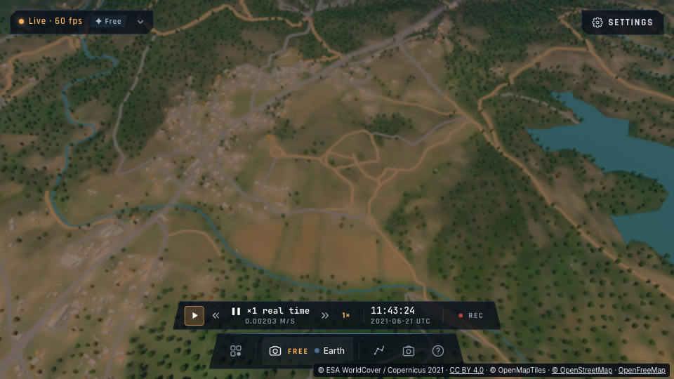
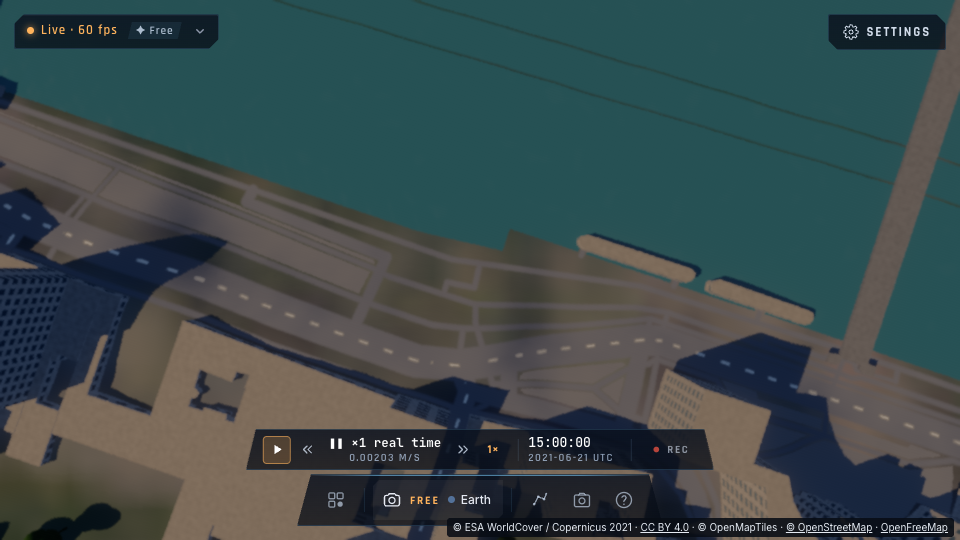

# Décor mondial : forêts, bâtiments, routes, eaux et ponts 3D

État du 12 octobre 2026, branche `codex/earth-photorealistic`. Cette étape prolonge
[l'analyse de faisabilité](ANALYSE-TERRE-PHOTOREALISTE.md) et
[les surfaces satellite régionales](PLAN-TERRE-PHOTOREALISTE.md).

## Conclusion

**Le streaming mondial de forêts, bâtiments, routes, voies ferrées, eaux et ponts OpenStreetMap est opérationnel.** Il ne dépend plus
d'un pack local au Bourget ou dans les Cévennes. Les données suivent la caméra, sont préparées dans
un worker, puis traversées directement par le ray tracer WebGPU. La mémoire supplémentaire du décor
est plafonnée à **16 MiB**, en mode équilibré comme en mode haut.

Cette étape fournit une base géographique et des volumes crédibles pour le vol bas. **Elle n'atteint
pas encore une qualité AAA photoréaliste.** Les arbres utilisent des couronnes analytiques ; les bâtiments
ont des contours OSM, des hauteurs fournies ou estimées, des toits plats et des façades procédurales.
Sentinel-2 à 10 m ne contient pas les détails nécessaires à une vue à quelques dizaines de mètres du sol.
Les améliorations visuelles proposées ci-dessous restent nécessaires. Les objets projettent désormais de véritables ombres par occlusion solaire, avec une pénombre accumulée temporellement et une portée limitée.

## Données réellement utilisées

| Source | Usage | Ce que l'on peut réellement en déduire |
|---|---|---|
| ESA WorldCover 2021, rendu WMS Terrascope | Zones arborées et mangroves, exclusion des autres classes | Une indication de couverture du sol ; ni position individuelle, ni hauteur, ni essence de chaque arbre |
| Composite Sentinel-2 2021, RGB WMS Terrascope | Couleur du sol mondiale et variation des feuillages | Une image à résolution native de 10 m ; pas une orthophoto récente à 20 cm |
| OpenStreetMap via OpenFreeMap / OpenMapTiles | Bâtiments, transport, polygones et lignes d’eau, aires pavées ; inventaire de toutes les couches et de leurs champs | Géométrie simplifiée à z14. Hauteurs des bâtiments parfois estimées ; largeur des voies et élévation des ponts généralement absentes |
| Terrarium / AWS Open Data et relief fin existant du moteur | Altitude des fondations et racines | Le même modèle de terrain général, avec un échantillonnage local ; des écarts restent possibles aux limites de tuiles, sur les fortes pentes et tant que le DEM du rendu charge |

Les GeoTIFF COG ESA publics ont été essayés : le stockage S3 ne permet pas leur lecture directe
avec CORS dans le navigateur. Le service **officiel MapProxy Terrascope** fournit des images CORS
utilisables dans une application statique, sans proxy applicatif ni compte utilisateur.

Le WorldCover WMS est **une image cartographique rendue**, dont les couleurs peuvent être interpolées.
Le worker rapproche ces couleurs de la légende, avec un seuil de confiance. Ce résultat sert au décor ;
il ne remplace pas les classes scientifiques originales présentes dans les packs régionaux.

Le composite mondial est préparé sur une grille de 512 × 512 : environ **10,4 m/pixel en équilibré**
et **14,3 m/pixel en haut** aux latitudes ordinaires, puis filtré bilinéairement en espace linéaire au rendu.
Le mode haut étend principalement la portée ; il n'augmente pas la résolution du satellite.
Les packs régionaux déjà installés conservent la priorité sur cette image mondiale.

## Routes, fleuves, rivières et ponts : ce qui est pris en charge

| Données | Rendu | Exactitude / limites |
|---|---|---|
| `transportation`, lignes | Routes, chemins, pistes, rail et tram de surface ; couleurs pavé/non pavé ; marquage générique et rails près de la caméra | Tracés OSM, largeur estimée par classe (2–18 m, réduite sur les bretelles). Les marquages ne sont pas les marquages relevés sur place |
| `transportation`, surfaces | Places, zones piétonnes et autres surfaces pavées | Polygones et trous conservés ; matériau générique |
| `water`, surfaces | Fleuves, lacs, mares, bassins et côtes, avec réflexion/glint et éclairage du matériau d’eau existant | Contours OSM ; îles conservées. Pas de bathymétrie ni de simulation hydrologique |
| `waterway`, lignes | Rivières, canaux, ruisseaux, fossés | Complète les eaux sans polygone ; largeur estimée de 1,5–14 m. La source ne donne pas un débit ou un niveau d’eau actuel |
| `brunnel=bridge`, `class=bridge` | Vrais tabliers 3D ; contours explicites lorsqu’ils existent, sinon rubans suivant les axes. Parapets et piles génériques pour les axes | Niveau estimé à partir du DEM et de `layer` (4 m par niveau, épaisseur 1,2 m). Les arcs, câbles et structures historiques ne sont pas reconstruits |
| `brunnel=tunnel`, `indoor`, niveaux souterrains | Exclus du décor extérieur | Le réseau souterrain n’est pas peint à travers le terrain ; pas d’intérieur de tunnel |
| `aeroway`, surfaces | Aires pavées aéroportuaires | Les pistes et équipements déjà modélisés par le moteur gardent leur rendu prioritaire |

Les routes et les eaux sont évaluées **au point touché sur le terrain**, avec leur propre BVH planaire.
Elles suivent le relief déjà rendu ; aucun ruban plat n’est posé en travers d’une vallée. Leur géométrie
vectorielle reste indépendante des pixels du fond Sentinel-2 : une voie étroite peut être dessinée
même lorsque l’image mondiale fait 10 m/pixel. Les surfaces polygonales ne disposent pas encore d’un
anticrénelage analytique de leurs bords ; les lignes sont filtrées selon l’empreinte du pixel.
Les arbres sont exclus des routes, rails et eaux avec une marge de 7 m.

**« Tout ce qu’OSM a » ne peut pas être garanti avec ces tuiles.** Elles transmettent un schéma de
visualisation, pas la base OSM complète. `osmLayers` expose toutes les couches effectivement reçues,
leurs comptes de features et les noms de tous leurs champs : bâtiments, transport et noms de routes,
eaux et noms, occupation/couverture du sol, parcs, points d’intérêt, lieux, numéros, limites, sommets,
aéroports selon la zone. Les noms, langues, numéros, limites administratives et POI sont inventoriés,
mais ne deviennent pas automatiquement des objets 3D. De nombreux tags détaillés (`roof:*`, largeur
réelle, structure de pont, matériaux précis, objets ponctuels absents du schéma) ne sont pas transmis.
Pour les exploiter, la suite doit ajouter des tuiles enrichies prétraitées à partir des extraits OSM
mondiaux, avec budgets explicites ; pas des requêtes Overpass publiques à chaque frame.

## Éclairage et ombres portées

Les normales des volumes reçoivent la lumière solaire à travers l’atmosphère, les nuages/météo et la
lumière ambiante du ciel. Les façades, toits, troncs, feuillages, tabliers et piles ont des albedos distincts.
Les plans d’eau utilisent l’éclairage et les réflexions du matériau d’eau du moteur. Les façades restent
une réponse diffuse simplifiée ; les fenêtres n’ont pas encore un matériau de verre complet.

Un rayon d’occlusion traverse le BVH des volumes depuis chaque surface proche vers le Soleil.
Il ombre **le terrain et les autres volumes** : contact des bâtiments, ombre des couronnes, ponts sur
l’eau et objets masqués par leurs voisins. La première intersection suffit ; le moteur ne cherche pas
le bloqueur le plus proche. Seule la lumière solaire directe est réduite ; le ciel garde les ombres lisibles.

Le rayon échantillonne un disque solaire de rayon angulaire 0,00465 rad. L’accumulation temporelle
existante intègre les échantillons et adoucit la pénombre. Ce n’est pas une shadow map ni une tache
peinte dans l’image. Une scène en mouvement peut conserver du bruit ou des traces temporelles ;
les feuilles et structures absentes des volumes actuels ne peuvent pas projeter leurs détails.

| Portée | Équilibré | Haut |
|---|---:|---:|
| Receveurs, distance caméra–surface | 1,2 km | 2 km |
| Rayon solaire, distance maximale d’occlusion | 500 m | 900 m |
| Fondu des receveurs en limite | 200 m | 200 m |
| Rayons d’ombre par point ombragé | 1 | 1 |

Ces limites évitent un coût sans borne aux horizons urbains. Les ombres très longues au soleil rasant
et celles de bloqueurs hors du décor résident peuvent manquer. Le réglage **Ombres du décor** est
activé par défaut, indépendant du niveau de décor et contrôlable par TARS.

## Architecture et choix de rendu

1. La caméra est convertie sur WGS84 ; son centre de streaming est quantifié à environ 556 m.
2. Un worker lit WorldCover, le RGB si le sol satellite est activé, les tuiles OSM nécessaires et le DEM
   utilisé par les objets. Une seule préparation est active à la fois, avec un délai réseau global de 60 s.
3. Les arbres sont une **forêt procédurale** (`src/system/forest.ts`, `src/shaders/forest.wgsl`, octobre 2026) :
   une grille Mercator fixe dans le monde, cellules de 7 m par bandes de 4° de latitude, au plus un arbre par
   cellule. Le worker décide chaque cellule — présence selon la classe WorldCover (forêt 86 %, mangrove 80 %,
   arbustes 22 %, zones humides 12 %, prairie 2,5 %), routes/eaux/pistes exclues, espèce selon le climat
   (feuillus, épicéas, pins, palmiers, peupliers/cyprès, arbustes ; limite des arbres par latitude), hauteur,
   pied sur le sol (grille de hauteurs à 14 m, interpolée) — et en écrit un mot de 32 bits par cellule. Le GPU
   en tire la position dans la cellule, la taille et la forme par hachage de l'indice global : le même arbre
   au même endroit quelle que soit la scène qui le porte (un recentrage le déplace de < 8 cm à 400 m).
4. Les géométries OSM multipolygones sont séparées en bâtiments et leurs trous sont conservés.
   Les copies appartenant au tampon d'une tuile voisine sont éliminées. Les bâtiments individuels
   les plus proches de la caméra sont retenus, plutôt que les premiers objets d'une tuile dense.
5. Deux BVH à indices de sortie organisent séparément les volumes et les réseaux au sol, dans le même buffer. Le worker transfère son ArrayBuffer sans copie
   JavaScript supplémentaire ; la boucle principale effectue une écriture GPU par préparation.
6. Le ray tracer traverse le BVH en mètres dans un repère local. Il compare les intersections avec
   le terrain et le décor d'aéroport, puis utilise les normales, l'éclairage atmosphérique, la profondeur
   et la reconstruction temporelle existants. Les volumes sont donc occultés par le terrain.
7. La forêt n'est pas dans le BVH : le rayon parcourt la grille duale (autour des sommets des cellules) —
   une couronne ne dépasse jamais d'une demi-cellule la sienne, donc quatre arbres candidats par pas, exact —
   et saute en bloc les 8 × 8 cellules dont le sol le plus bas et la cime la plus haute ne croisent pas sa
   hauteur. À moins de ~220 m, chaque couronne est creusée par ses touffes de feuilles (bruit 3D, étages de
   branches des conifères ; uniquement vers l'intérieur : l'invariant reste exact), le ciel passe entre elles,
   l'ombre au sol est tachetée ; au-delà, la forme pleine réduite de la moitié du creusement moyen.
   `bun run check:forest` compare le GPU à une intersection exhaustive en double précision (hachage bit à bit,
   milliers de rayons) et rend une forêt synthétique (`--date` : sa saison).
8. **Saisons et lumière** : la table des espèces est réécrite dans le buffer quand la date du jeu avance de deux
   jours (`forestSeason` : feuilles jeunes au printemps, couleurs d'automne arbre par arbre — jaune, orange,
   rouge, certains plus tôt —, feuillus nus l'hiver — leurs branches rayonnant du tronc, le ciel au travers —,
   neige sur les résineux au-dessus d'une limite qui descend avec l'hiver et la latitude ; rien sous les
   tropiques). Les feuilles laissent passer la lumière : en contre-jour, le bord mince des couronnes s'éclaire
   de leur propre vert. Pas encore de balancement au vent : avec la reprojection temporelle du traceur, des
   couronnes mobiles traîneraient (à traiter avec des vecteurs de mouvement).

**Pourquoi ce choix plutôt qu'un draw call par arbre ou un second moteur de scène ?** Le projet
calcule déjà ses paysages par ray tracing. Une passe raster instanciée demanderait de partager et
convertir la profondeur du terrain, puis de recomposer l'atmosphère et l'historique temporel.
Le BVH permet de livrer les volumes dans ce pipeline avec peu de travail sur le thread principal.
Il ne prouve pas que cette approche sera la meilleure pour des feuillages très détaillés : un rendu
hybride instancié restera à comparer lorsque les véritables assets seront disponibles.

Les couronnes sont des ellipsoïdes ou des cônes selon l'espèce, creusées de près ; les troncs, des cylindres
(collisions à pied : troncs et dômes des arbustes, `scenery-contact.ts`). Les bâtiments sont des extrusions
de polygones, avec fenêtres procédurales. Il n'y a ni allocation ni reconstruction de chaque objet à chaque
frame.

## Budgets et portée

| Paramètre | Désactivé | Équilibré, réglage par défaut | Haut |
|---|---:|---:|---:|
| Buffer GPU résident du décor | 64 octets | 16 MiB maximum | 16 MiB maximum |
| Rayon nominal de préparation | — | 2 km | 3 km |
| Distance maximale d'intersection depuis la caméra | — | 2,5 km | 3,5 km |
| Arbres (grille de 7 m, ≤ 1 par cellule) | 0 | sans plafond, ~1,7 Mio pour la grille | sans plafond, ~3,5 Mio pour la grille |
| Bâtiments | 0 | ≤ 5 000 | ≤ 8 000 |
| Éléments vectoriels au sol, segments ou polygones | 0 | ≤ 16 000 | ≤ 24 000 |
| Ponts, contours ou axes | 0 | ≤ 128 | ≤ 256 |
| Grille image/classification | — | 512² | 512² |
| Tuiles OSM examinées par préparation | 0 | ≤ 64, proches d'abord | ≤ 64, proches d'abord |

Le worker réduit aussi les objets pour respecter la limite en octets, même si leurs comptes restent
sous les plafonds. Une géométrie trop complexe, dépassant 256 sommets pour un bâtiment individuel,
est écartée ; un polygone d’eau/pavement est limité à 4 096 sommets. `budgetLimited` signale les plafonds de population, de mémoire ou de tuiles rencontrés.
En ville dense, la couverture effective des volumes peut donc être plus petite que le rayon nominal.
La limite de distance depuis la caméra comprend aussi la composante verticale : au-dessus d'environ
2,5/3,5 km du terrain, les volumes de ces modes ne sont généralement plus visibles.

Le streaming est autorisé sous 12 km d'altitude ellipsoïdale, entre **84° S et 84° N**. Ces limites ne
constituent pas une garantie de données partout : couverture satellite, OSM et DEM varient ;
les extrêmes polaires sont hors périmètre. Les demandes raster sont séparées à la longitude ±180°,
les tuiles OSM bouclent en longitude et les distances de déplacement tiennent compte de ce passage.
Les images de villes et forêts de trois continents ont été vérifiées ; chaque point de la planète
n'a évidemment pas été testé.

Les pistes connues du moteur ont une zone d'exclusion suivant toute leur longueur, afin d'éviter
les arbres et volumes OSM sur les bandes et les équipements déjà dessinés.
Les téléportations annulent les préparations devenues lointaines et les réponses tardives sont ignorées.
Un buffer retiré attend la fin des soumissions GPU avant destruction ; une nouvelle grosse allocation
attend ce retrait. Désactiver le réglage libère la résidence, sans empiler plusieurs scènes de 16 MiB.

Un appareil limité à **8 storage buffers** conserve le renderer de base. La neuvième liaison et les
fonctions de décor sont retirées du shader ; aucun dépassement de limite n'est demandé. Le décor est
signalé `unsupported-storage-limit`. Une erreur réseau conserve les données déjà disponibles et
signale `degraded`, avec au plus deux essais par centre et un délai de reprise.

Les tuiles OSM, WMS et DEM passent dans le cache PWA partagé et son LRU de **300 MiB**. Les zones déjà
consultées peuvent être réutilisées hors ligne ; le décor mondial entier n'est pas embarqué.
Le service OpenFreeMap `latest` évolue : des données géométriques différentes peuvent être fournies
sur un chargement ultérieur. Une version figée serait nécessaire pour des captures strictement reproductibles.

## Mesures sur la machine locale

Les résultats finaux et la méthode sont détaillés dans la section de mesures ci-dessous. Les valeurs
sont propres au **MacBook Pro M1 Max, 24 cœurs GPU, 32 Go**, à Chrome/WebGPU natif.
Elles ne permettent pas de garantir 60 FPS sur un iPad ou un GPU intégré plus petit.

La durée `workerMs` comprend le réseau, le décodage et la construction ; ce n'est pas une durée CPU
pure. `tileNetworkBytes` additionne les corps des réponses WMS, OSM et DEM du décor, sans les autres
chargements du renderer. `uploadCpuMs` est cumulatif depuis la création du système.

### Chargements vérifiés

| Zone | Arbres | Bâtiments | Segments routiers | Segments ferroviaires | Eaux : segments / polygones | Ponts | Corps réseau | Préparation avec réseau |
|---|---:|---:|---:|---:|---:|---:|---:|---:|
| Paris, équilibré | 962 | 5 000 | 14 497 | 0 | 45 / 36 | 126 | 12.60 MiB | 4.65 s |
| Cevennes, équilibré | 10 879 | 4 310 | 5 526 | 0 | 821 / 16 | 10 | 1.47 MiB | 3.90 s |
| Tokyo, équilibré | 1 686 | 5 000 | 15 377 | 322 | 85 / 67 | 128 | 7.85 MiB | 3.93 s |
| Sydney, équilibré | 1 703 | 5 000 | 15 188 | 326 | 21 / 157 | 128 | 4.58 MiB | 3.75 s |
| Bourget  haut  avion | 6 261 | 8 000 | 23 516 | 237 | 150 / 57 | 123 | 3.14 MiB | 5.45 s |

Ces nombres sont des observations de la campagne, pas une promesse de population par zone. Les
budgets des bâtiments/réseaux/ponts sont atteints dans les villes denses. Le premier upload mesure
0,2 ms sur le thread principal ; le compteur cumulé atteint 3,8 ms après les quatre zones. L’approche
avion mesure 0,6 ms d’upload. Les chargements dépendent du cache et du réseau et comprennent les
informations OSM transport/eaux supplémentaires ; charger toute la zone urbaine coûte davantage
que s’arrêter dès que le quota de bâtiments est rempli.

`workerMs` ne doit pas être interprété comme « 4 s de CPU ». Il inclut les attentes réseau et le
chargement des images. La préparation est hors du thread de rendu ; aucun tri/BVH/placement d’objet
n’est refait à chaque frame. La boucle principale met à jour le repère et les uniformes, puis effectue
un upload par remplacement du décor. Le coût global CPU de l’application n’a pas été isolé de
celui du simulateur, du terrain et de l’interface.

Données brutes : [vues mondiales](perf/earth-scenery-world.json), [avion, mode haut](perf/earth-scenery-plane.json),
[Seine](perf/earth-scenery-seine.json), [différence d’ombres](perf/earth-scenery-shadows.json).

### Méthode de mesure GPU isolée

Le test dédié tourne après arrêt des tests unitaires, builds et autres Chromes. Caméra et simulation
figées ; même Soleil, terrain, satellite, buffer, shader spécialisé et résolution. Les kernels sont
calibrés avant la collecte (`calibrationReady`). Une vue chauffe encore 20 s après calibration pour
stabiliser caches et fréquence GPU. Chaque bloc chauffe 2 s, puis collecte **180 timestamps
GPU par frame**, avec médiane et p10/p90. Sept blocs : désactivé, décor sans ombres, décor avec ombres,
désactivé, décor sans ombres, décor avec ombres, désactivé.

« Désactivé » retire volumes et réseaux de leur branche uniforme, tout en gardant la même imagerie
mondiale. Le test n’attribue donc pas au décor une variation du chargement satellite ou du shader.
Vues : Cévennes à **450 m** et Tokyo à **400 m**, obliques de 35°. Sortie **960 × 540**, sous-échantillonnage
2 (environ 480 × 270 rayons de base), reconstruction temporelle, résolution dynamique désactivée,
nuages désactivés. Ces mesures ne représentent pas un rendu natif 1080p/4K avec toutes les options.
La version initiale sans réseaux/ombres avait aussi été mesurée, mais son altitude forestière était
1 200 m : [ancienne référence](perf/earth-scenery-before-networks.json), à ne pas soustraire aux nouvelles vues.

### Résultats GPU et interprétation

Temps du **dispatch trace**, en ms, deuxième campagne isolée après échauffement. Les deux valeurs
correspondent aux deux blocs du même état ; trois blocs désactivés encadrent les comparaisons.

| Vue | Décor désactivé, trois médianes | Décor sans ombres, deux médianes | Décor avec ombres, deux médianes |
|---|---|---|---|
| Cévennes, 450 m | 17,30 / 15,05 / 16,70 | 17,05 / 15,33 | 16,20 / 17,21 |
| Tokyo, 400 m | 10,10 / 10,85 / 10,29 | 11,42 / 11,48 | 11,60 / 11,30 |

À Tokyo, comparer chaque bloc actif à la moyenne des deux blocs désactivés qui l’encadrent donne
**+0,91 à +0,95 ms sans ombres**, et **+0,73 à +1,12 ms avec ombres**. C’est un ordre de grandeur
utile pour cette vue et cette machine. L’écart propre aux ombres change de signe entre les répétitions
(+0,18 / −0,18 ms) : il est trop petit par rapport à la variabilité pour annoncer un coût précis séparé.

Dans les Cévennes, le décor complet donne **+0,02 à +1,33 ms** par cette méthode, mais le décor sans
ombres alterne entre +0,88 et −0,55 ms. La variabilité atteint plusieurs millisecondes ; **le surcoût
forestier précis et celui des ombres ne sont pas suffisamment isolés**. Les volumes peuvent aussi
remplacer une partie du shader de sol par un matériau plus simple. Un delta négatif ne démontre pas
qu’une fonction ajoutée est gratuite. Les valeurs p10/p90 et tous les échantillons sont conservés.

Les compteurs de rendu pendant les blocs complets affichent environ **50–60 FPS en forêt** et
**60 FPS à Tokyo** dans cette configuration. Les timings trace ne représentent pas toutes les passes,
le coût CPU, les attentes de présentation ni une garantie de fluidité. Le mode haut en avion a été
vérifié visuellement, mais son surcoût n’a pas fait l’objet du même protocole isolé.

**Décision :** garder équilibré par défaut, la mémoire fixe et les portées d’ombre limitées. Ne pas
annoncer une garantie AAA/60 FPS mondiale sur la base de ces mesures. Avant de monter la densité
ou d’ajouter les véritables assets, comparer des segments de vol avec un ordre de tests randomisé,
un contrôle de stabilité des blocs désactivés, plusieurs répétitions et le budget complet de frame.
Le contrôle indépendant des ombres permet déjà de tester ce compromis sur l’appareil réel.

Données : [campagne après échauffement](perf/earth-scenery-calibrated.json),
[première campagne et sa dérive](perf/earth-scenery-calibrated-first.json).
Le test de mesure a réussi dans les deux campagnes, avec **23 assertions** chacune ; réussir le test
prouve la validité technique de la collecte, pas la stabilité statistique du GPU.

### Captures du renderer

Les captures sont prises après disponibilité du shader spécialisé, chargement du terrain et au moins
60 frames profilées. Elles montrent les volumes procéduraux actuels et leurs limites visuelles.




[Tokyo](img/earth-scenery/earth-scenery-tokyo.png), [Sydney](img/earth-scenery/earth-scenery-sydney.png),
[vue avion en mode haut](img/earth-scenery/earth-scenery-plane-high.png),
[forêt à 450 m, sans ombres portées](img/earth-scenery/earth-scenery-low-forest.png).



*Crédits des captures* : bâtiments, routes, eau et ponts © les contributeurs d'[OpenStreetMap](https://www.openstreetmap.org/copyright), [ODbL](https://opendatacommons.org/licenses/odbl/) ; couvert du sol © ESA WorldCover project 2021 / Contains modified Copernicus Sentinel data (2021), processed by ESA WorldCover consortium, [CC BY 4.0](https://creativecommons.org/licenses/by/4.0/) ; imagerie du sol Sentinel-2 cloudless 2021 by [EOX IT Services GmbH](https://s2maps.eu) (Contains modified Copernicus Sentinel data 2021), [CC BY-NC-SA 4.0](https://creativecommons.org/licenses/by-nc-sa/4.0/).

[Ombres activées](img/earth-scenery/earth-scenery-shadows-true.png),
[ombres désactivées](img/earth-scenery/earth-scenery-shadows-false.png). Sur la zone comparée de Paris,
13 716 pixels deviennent plus sombres d’au moins quatre niveaux de luminance, contre 1 693 plus clairs
(sur 195 300 pixels contrôlés ; interface exclue). Ce test démontre un effet visible du calcul,
complété par l’inspection des captures ; il ne certifie pas une fidélité photométrique à une photographie réelle.
Les crédits des sources figurent à la fin de ce document ; leurs liens sont aussi affichés dans la vue du jeu.

## Commandes et contrôles

Dans les réglages, **Décor mondial** propose désactivé, équilibré et haut. Activer également
le **terrain réel** pour les volumes et réseaux. `earthSurface=satellite|materials` autorise le RGB mondial ;
`earthSurface=off` laisse les volumes avec le sol existant.

```js
__bh.settings.earthScenery = "balanced"; // ou "high", "off"
__bh.settings.earthTerrain = true;
__bh.settings.earthSceneryShadows = true; // false pour comparer ou réduire le coût
__bh.settings.earthSurface = "satellite";
__bh.touch();
__bh.renderer.earthScenery.stats();
```

TARS peut agir par `set_settings`, `/scenery` ou `/sceneryshadows`, lire `get_state.scenery`, le groupe de télémétrie
`scenery`, attendre `scenery_ready`, afficher les réglages et être réveillé par un événement `scenery`.
Les crédits et liens des sources figurent aussi dans les réglages et les statistiques.

## Vérifications exécutées

- `bun run check` : TypeScript/Biome et **9 shaders compilés sur WebGPU Apple** ; les avertissements existants du dépôt ne bloquent pas la vérification.
- `bun test --timeout 30000` : **746 réussis, 357 ignorés, 0 échec** (les tests navigateur sont conditionnels).
- Tests ciblés après ajustement des exclusions : **21 réussis**, incluant trous des lacs, routes étroites, empreintes de ponts, BVH séparés, budgets, annulation/retrait des buffers et commandes TARS.
- Campagne navigateur mondiale : **3 réussis, 0 échec**, Paris/Cévennes/Tokyo/Sydney, images avec/sans ombres, mode avion haut et repli à huit buffers.
- Test supplémentaire Seine/berges/ponts : **1 réussi**, capture réelle, eaux et ponts présents, éclairage actif et aucune erreur GPU.
- `bun run build` et `bun run build:pages` : réussis ; worker inclus et licences des dépendances conservées dans son bundle.

La couverture des données et le rendu sont vérifiés à ces emplacements. Ces tests ne constituent pas
une campagne de vol prolongé sur toute la planète. Le test avion fige une approche représentative ;
le coût en vol rapide, les transitions et les autres appareils restent à mesurer.

## Propositions pour atteindre le rendu AAA

**Priorité 1 : améliorer les silhouettes et l'éclairage proches.** Une petite bibliothèque d'arbres
par biomes, avec deux ou trois LOD, donnera davantage de réalisme que d'augmenter seulement leur nombre.
Comparer des maillages GPU instanciés avec profondeur partagée au BVH de volumes actuel.
Les ombres locales sont maintenant intégrées ; comparer leur coût aux ombres des véritables assets, puis ajouter un masque de canopée et des imposteurs au loin.
Budget de départ proposé pour cette expérimentation : 2–4 ms supplémentaires dans une vue de référence,
à confirmer par timestamps GPU, et non une estimation présentée comme mesure.

**Priorité 2 : des matériaux de bâtiments et des toits crédibles.** Conserver les empreintes OSM,
ajouter une variation stable de façade, des types régionaux de couverture et des toits inclinés lorsque
les tags sont disponibles. OpenMapTiles ne transmet pas tous les tags OSM nécessaires ; prévoir des
extraits enrichis prétraités pour les zones où l'on veut davantage d'exactitude. Éviter Overpass public
à chaque déplacement de caméra : ce n'est pas le pipeline de streaming retenu.

**Priorité 3 : l'imagerie haute résolution à proximité.** Garder Sentinel-2 comme fond mondial,
puis charger des orthophotos autorisées et prétraitées dans les zones disponibles. Sous 100–200 m,
10 m/pixel ne suffit pas aux routes, trottoirs et détails du terrain. Il faut accepter une qualité variable
selon les licences et la couverture, ou financer un fournisseur d'imagerie.

**Priorité 4 : réduire les changements visibles du streaming.** Le premier chargement de géométrie
apparaît d'un bloc et une scène est remplacée atomiquement ; le RGB a un fondu de 600 ms. Pour une transition
AAA, prévoir des cellules persistantes, une marge de préchargement selon la vitesse, des raccords de LOD
et un cache de géométrie. Mesurer leur mémoire supplémentaire avant d'introduire deux scènes GPU.

Le feuillage alpha détaillé, les LOD de maillages,
les arbres urbains individuels et les véritables modèles de monuments ne sont pas encore implémentés.
L’atmosphère, l’éclairage solaire, les ombres locales et la profondeur existants s’appliquent aux volumes.

## Sources officielles vérifiées

- [ESA WorldCover : accès aux données et produits](https://esa-worldcover.org/en/data-access).
- [Terrascope : MapProxy, couches, WMS et WMTS officiels](https://docs.terrascope.be/Developers/WebServices/OGC/MapProxy.html).
- [OpenFreeMap : documentation et hébergement public](https://github.com/hyperknot/openfreemap).
- [OpenMapTiles : schéma des couches utilisées](https://openmaptiles.org/docs/schema/).
- [Mapbox vector-tile-js : décodage MVT et géométries](https://github.com/mapbox/vector-tile-js).
- [OpenStreetMap : copyright et ODbL](https://www.openstreetmap.org/copyright).
- [Terrain Tiles : données et accès Terrarium](https://registry.opendata.aws/terrain-tiles/).

Attribution : © ESA WorldCover project 2021 / Contains modified Copernicus Sentinel data (2021),
CC BY 4.0 ; © OpenMapTiles, Data from OpenStreetMap (ODbL), served by OpenFreeMap.
