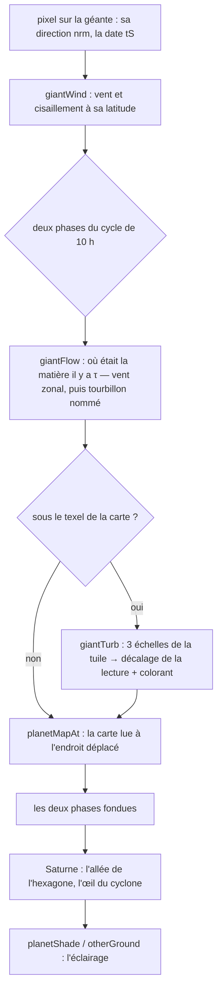

# Les géantes gazeuses et le mouvement de leurs nuages

Résumé du système tel qu'il est au 31 octobre 2026 (PLAN-PLANETES-AAA, phase P9, étapes G1 à G8). Le détail des mesures
et du chemin parcouru : [progress/planetes-aaa/P9.md](progress/planetes-aaa/P9.md).

## En une phrase

Une géante est une **carte de couleur** (une photo réelle de la planète) que le traceur **relit à un autre endroit** à
chaque pixel. Les nuages ne sont pas simulés en direct ; on calcule seulement **où était, il y a τ secondes, la matière
qui est ici maintenant**, et on lit la carte à cet endroit. Les vents, les tourbillons nommés et une turbulence de près
ne font que déplacer cette lecture. Tout est **une pure fonction de la date** : la même date donne la même image, après
un saut dans le temps, en réseau comme en e2e.

## Les quatre échelles du mouvement

| Échelle | Ce qui bouge | Comment | Où |
|---|---|---|---|
| **La planète entière** | les bandes glissent vers l'est, chacune à sa vitesse | vents zonaux mesurés par Cassini, tous les 2,5° de latitude (G1) | `giantWind`, `giantFlow` |
| **Les tourbillons nommés** | la Grande Tache rouge, l'Ovale BA (Jupiter) ; le cyclone polaire et l'hexagone (Saturne) | rotation sur leur ellipse, à leurs vitesses publiées (G8c) | `giantVortex`, `giantFlow` |
| **Sous le texel de la carte** | tourbillons et filaments plus fins que la photo | une tuile de turbulence simulée une fois sur le GPU, lue à trois échelles (G8a, G8b) | `giantTurb`, `giantTileAt` |
| **Les détails propres à Saturne** | l'allée sombre de l'hexagone, l'œil du cyclone et son anneau clair | dessinés par le traceur (la carte de Saturne n'en a pas) | fin de `giantAlbedo` |

## 1. Les cartes

- Jupiter et Saturne ont une carte de base (2 048 px, KTX2 compressée) et une **carte fine** chargée à l'approche
  (`src/system/hd-maps.ts`, `HD_SETS` : `assets/planets-hd/jupiter-color.jpg`, `saturn-color.jpg`). Celle de Jupiter
  vient de 2018 (Juno, Cassini) : la Grande Tache et l'Ovale BA y sont à leur place d'alors.
- Uranus et Neptune n'ont que leur carte de base, fixe : ni carte fine ni vents (décision : plus tard).

## 2. Les vents zonaux (G1)

- `src/system/giant-winds.ts` : 73 valeurs par planète, du pôle sud au pôle nord, en m/s vers l'est, Système III :
  - Jupiter : ses jets alternés, 170 m/s à 24° N ;
  - Saturne : son grand jet équatorial, 450 m/s.
- Elles vivent dans les tables du traceur (`gpu-tables.ts`, `TABLE_WIND`). Un tableau constant indexé à l'exécution était
  recopié à chaque appel ; le passage en table a rendu Jupiter plus rapide.
- `giantWind(m, lat)` rend le vent et son **cisaillement** (sa variation sur 2,5°), interpolés sans marche.
- **Le problème de l'étirement.** Si on décalait la carte de `u·t` sans fin, les bandes se déchireraient à leurs bords au
  bout de quelques heures. La parade (`giantAlbedo`) :
  - la carte est lue **deux fois**, à deux phases d'un cycle de 10 h de temps de jeu (`GIANT_CYCLE` = 36 000 s) décalées
    d'un demi-cycle ;
  - les deux lectures sont fondues en triangle : quand l'une arrive au bout de son cycle (très décalée), son poids est
    nul, et elle repart de zéro ;
  - c'est la technique des textures advectées (Neyret) : le mouvement se voit, l'étirement jamais.

## 3. Les tourbillons nommés (G8c)

`giantVortex` fait tourner la matière sur l'ellipse du tourbillon, à une vitesse angulaire tirée de sa vitesse
tangentielle :
- un pic à 0,8 du rayon ;
- un cœur plus lent (en r²) ;
- un effacement jusqu'à 1,3 rayon.

L'intérieur du tourbillon ne suit plus le vent zonal, et la tuile de turbulence s'y calme.

- **Jupiter** :
  - **la Grande Tache rouge**, 22° S, 126,4° E de la carte, 18° × 10,5° : 180 m/s sur son anneau rapide (Wong et al.
    2021), ~3,4 jours pour un tour ;
  - **l'Ovale BA**, 32,1° S, 57,7° W : 135 m/s à son bord (Hueso et al. 2009) ;
  - ce sont deux anticyclones : ils tournent dans le sens inverse des aiguilles d'une montre dans l'hémisphère sud.
- **Saturne** :
  - **le cyclone polaire nord** : un jet ~150 m/s vers 88° N, vers l'est ;
  - **l'hexagone** : une onde de Rossby de nombre 6 sur le jet de 76° N, fixe en Système III à sa dérive près
    (+0,0128°/jour, Sánchez-Lavega et al. 2014) ;
  - la matière suit les côtés de l'hexagone (`saturnHexRho`) ; le traceur assombrit l'allée du jet et dessine l'œil du
    cyclone et son anneau clair.

## 4. La turbulence de près (G8a, G8b)

Sous le texel de la carte fine (55 km sur Jupiter), une photo ne montre plus rien. Une **tuile de turbulence** y prend le
relais.

### La simulation, une fois (`src/system/giant-tile.ts`)

- Un écoulement 2D sur **plan β** (la rotation de la planète, qui crée jets et tourbillons) :
  - équations en tourbillon / fonction de courant sur un carré périodique de 128², pseudo-spectral ;
  - FFT de Stockham de 128 points en mémoire partagée, désaliasée aux 2/3 ;
  - pas d'Adams–Bashforth 2, filtre spectral d'ordre 8.
- Quatre jets forcés (U0 sin 4y) sont instables : leurs flancs s'enroulent en tourbillons et en filaments.
- Le déroulé : une graine fixe, 200 pas d'amorce, puis une fenêtre de **128 images**. Chaque texel stocke :
  - **r, g** : le **déplacement intégré** depuis le début de la fenêtre, moins la dérive zonale de sa ligne (les vents
    restent ceux de Cassini). C'est une intégrale de la vitesse, sans divergence : rien ne s'étire ni ne pulse ;
  - **b** : un colorant transporté par l'écoulement, le contraste fin ;
  - **a** : la vorticité.
- **La cuisson** se fait une fois, sur le GPU, la première fois qu'une géante est à portée de ses cartes fines
  (`renderer.bakeGiantTile`) : ~25 ms sur ce Mac, ~30–36 ms sur kerr-mini. La même graine donne la même tuile (pas
  d'atomiques, sommes fixes).
- **Sa place** : la seconde moitié de la texture de bruit 3D (`noiseTex`, `rgba16float`, 128 × 128 × 260, tranches 131
  à 258, `src/noise3d.ts`). Le temps est sur z, donc le filtrage matériel interpole entre les images.
  - Le 7ᵉ calque de `mapHi` prévu au plan était impossible : ce tableau est compressé en BC7 ou ASTC sRGB sur toutes les
    machines du labo.
  - Coût : aucune liaison de plus, +16 Mo de mémoire GPU.

### La lecture, à chaque pixel (`giantTurb`, `giantTileAt`)

- **Trois échelles**, de périodes 16, 3 et 0,6 texels de la carte (des tourbillons d'un texel, d'un cinquième, d'un
  vingt-cinquième).
- **Le renouvellement** : la grande échelle se renouvelle avec les phases des vents (10 h), les autres 4 et 16 fois plus
  souvent (les petits tourbillons tournent plus vite). Chacune a ses deux phases fondues et un décalage tiré à chaque
  cycle.
- **La pose sur la sphère** : la tuile est posée sur des **bandes de 6° de latitude**, chacune avec un nombre entier de
  périodes autour de la planète, fondues à leurs bords. Près des pôles, elle est posée sur un plan polaire.
- **Contre la répétition** : la place de la tuile est déformée d'une demi-période par un bruit lent pris sur la sphère.
  Sans ce bruit, ses jets roulés en rangées d'« écailles » trahissaient la répétition à 8 000 km.
- **L'intensité** suit le **cisaillement des vents** : 0,25 au cœur des bandes, 1 aux flancs des jets.
- **Quand elle s'allume** : seulement sous le texel de la carte, chaque échelle quand ses tourbillons font deux pixels.
  Elle ne s'allume donc jamais depuis l'orbite.
- **Quand le temps va plus vite que ~1 000 ×**, elle se fige au milieu de sa fenêtre : les phases scintilleraient.

## 5. Le chemin d'un pixel

- **De loin**, la planète est un disque dessiné par `planetShade`.
- **De près, sous son air**, elle est dessinée par `otherGround`, le chemin de Mars.
- `giantAlbedo` sert les deux. Avant G8, `otherGround` lisait la carte fixe, si bien que les nuages ne bougeaient que vus
  de loin.
- **Le budget des noyaux.** Chaque appel est une copie que le compilateur construit. Pour ne pas grossir les autres
  noyaux, le mouvement n'est compilé que dans ceux qui peuvent montrer une géante en grand :
  - pas les noyaux des sondes de lumière, ni celui de la Terre, ni ceux de Vénus et des mondes sans air ordinaires
    (`NEAR_DETAIL && NEAR_KIND != 1, 3, 6`) ;
  - seulement quand l'horloge de la scène tourne (`P.near5.w > 0`).
- **La lecture de l'empreinte du pixel.** `giantAlbedo` lit l'empreinte du pixel elle-même (`mapLodV`), et non
  `mapLod()`. Ce dernier est borné au texel de la carte grossière (220 km), ce qui empêchait tout détail fin de
  s'allumer.

## 6. Les anneaux de Saturne (pour mémoire)

- **Le profil** : une carte radiale de 2 048 texels (35 km). Sous ce texel, le profil de l'occultation radio de Cassini
  prend le relais, au kilomètre, de 69 800 à 140 900 km (`TABLE_RING`, G3).
- **La lumière** :
  - une diffusion à deux lobes (blocs de glace vers la source, poussière vers l'avant) ;
  - le pic d'opposition ;
  - l'ombre de la planète sur les anneaux, l'ombre des anneaux sur la planète ;
  - leur lumière sur la face de nuit (`ringShine`, dix lectures d'anneau par pixel).
- **Le détail** (G4) : les sillages de l'anneau A (opacité ±30 % selon l'angle de vue) et les rayons de l'anneau B, qui
  tournent en 10,66 h.
- **De près** (G5), à moins de 20 km du plan : des blocs de glace un à un dans une nappe de ±15 m, sur trois grilles,
  jusqu'à 2 km.

## 7. Ce que ça coûte (kerr-mini, médianes)

| Vue | ms | La Terre, même vue |
|---|---|---|
| Jupiter en orbite | 20,5 | 20,2 |
| Jupiter de près (Grande Tache, tuile allumée) | 19,5 | — |
| Saturne en orbite | 21,4 (58,5 avant P10) | 20,1 |
| Saturne en vue ciné | 26,0 (64,0 avant P10) | 41,6 |

Le mouvement des nuages ne coûte presque rien : Jupiter est même devenue plus rapide avec G8. Saturne coûtait 2,8 fois la
Terre en orbite : pas ses anneaux, mais la région du trou de ver où la caméra se trouve (chaque rayon intégré pas à pas),
corrigé en P10 — [progress/planetes-aaa/P10.md](progress/planetes-aaa/P10.md).

## 8. Les limites connues

- **La tuile** fait 128² : tout près (3 000 km), elle donne un voile marbré plutôt que des filaments nets.
- **Les tourbillons nommés** ne suivent pas leur dérive sur des années. La carte (2018) les porte à leur place d'alors ;
  les déplacer laisserait leur fantôme dans la photo.
- **L'orientation de l'hexagone** est une référence choisie plus sa dérive publiée : la carte de Saturne ne le montre pas.
- **La saison de Saturne** : en 2067, la date des scènes, le Soleil rase ses anneaux (l'équinoxe de 2068) ; ses vitrines
  sont en octobre 2026 (P10), le Soleil ~7° sous les anneaux. L'hexagone se voit en 2076.
- **La forme** : depuis P10, Saturne et Jupiter sont des ellipsoïdes à 1 bar (aplaties de 9,8 % et 6,5 %), au rendu et
  au vol.
- **L'éclairage du disque** : sous leur air (`earthLookFar` → `otherGround`, de loin comme de près), la loi de Minnaert
  (k 0,88 : l'assombrissement vers le bord) et une brume d'hydrogène mince. Le chemin des sondes et des noyaux sans air
  (`planetShade`) garde un éclairage de Lambert.
- **Uranus et Neptune** : leur carte fixe seulement.

## Les tests

- **`tests/e2e/giant-tile.e2e.test.ts`** :
  - deux cuissons identiques au bit ;
  - un écoulement sans divergence en début de fenêtre ;
  - les bruits de la première moitié de la texture intacts.
- **`tests/e2e/giants-flow.e2e.test.ts`** : 11 vues, chacune comparée à un tour de rotation d'écart (la même face sous
  le même Soleil : seuls les nuages ont bougé). La Grande Tache revenue à sa date après un saut donne **0,000/255**
  d'écart.

---

## In English (summary)

A giant is a **real colour map** that the tracer reads **somewhere else** at each pixel. Nothing is simulated live: it
works out where the matter now here was τ seconds ago, and reads the map there. Everything is a pure function of the
date, so the same date gives the same image.

The scales of motion:
- **Zonal winds.** Cassini's profiles, every 2.5° (`giant-winds.ts`, `TABLE_WIND`). The map is read at two phases of a
  10 h cycle, half a cycle apart, and faded (Neyret's advected textures), so it never stretches.
- **Named vortices.** The Great Red Spot (180 m/s) and the Oval BA (135 m/s) turn on their ellipses. Saturn's polar
  cyclone and its hexagon are drawn by the tracer, since the map has neither.
- **Turbulence below the map's texel.** A 128² β-plane flow is simulated once on the GPU (pseudo-spectral FFT, ~30 ms).
  It stores the integrated displacement, a dye and the vorticity in the 3D noise texture's second half, with time along
  z. It is read at three scales, laid on 6° bands, warped against repetition, scaled by the wind shear, and switched on
  only where its eddies span two pixels.

`giantAlbedo` serves both the distant disc (`planetShade`) and the near view under the air (`otherGround`).

Cost: Jupiter is on the Earth's budget; Saturn too since P10 (21.4 ms in orbit, the Earth 20.1 — its cost was the wormhole
region the camera sits in, not its rings). Since P10 both giants are oblate ellipsoids, in rendering and in flight.
