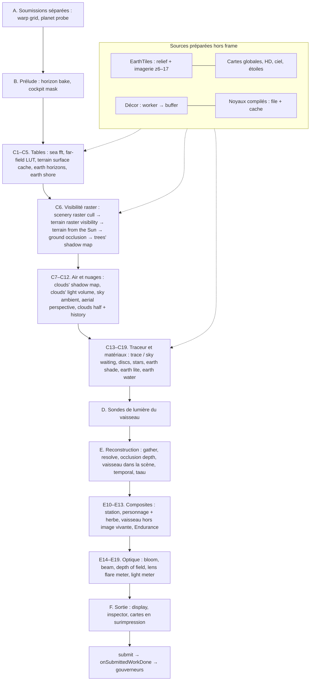

# Le pipeline graphique : qui fait quoi, qui consomme quoi, ce que coûte la compilation

**Document de référence, maintenu.** État du code lu : `main` à `da4e75bd` (6 novembre 2026, arbre de travail). Chaque
session qui modifie le pipeline (une passe, une cible, un pipeline, un noyau, une étape de chargement ou de
compilation) met ce fichier à jour dans le même lot — règle dans [CLAUDE.md](../CLAUDE.md), méthode au §10.

- **Contrôle mécanique** : `bun scripts/pipeline-inventory.ts --check` (≈0,2 s, sans navigateur ni GPU) vérifie que ce
  document nomme chaque libellé de passe du profileur, chaque fichier qui crée des pipelines et chaque fichier `.wgsl` ;
  `--write` régénère l'annexe A (inventaire exhaustif), `--write --sizes` y ajoute les tailles des noyaux (~16 s de CPU).
- **Place dans la stratégie** : c'est la « liste simple de passes déclarant lectures/écritures, tailles et durée de vie »
  que demande [ANALYSE-STRATEGIE-RENDU §7.5](ANALYSE-STRATEGIE-RENDU-2026-11-03.md) avant tout render graph, et la base
  des mesures de §8 (budgets par famille) et §19 (parcours complet). La [fiche système 02](systemes/02-pipeline-rendu.md)
  explique les mécanismes (TAAU, débruiteur, exposition…) ; ses tailles de fichiers et son ordre de compilation datent
  d'avant octobre — ce document-ci fait foi pour l'inventaire, l'ordre et les coûts.
- **États de preuve** utilisés partout : **code** (lu dans le source, ligne citée), **mesuré** (machine, date, source),
  **estimé** (proxy, calcul), **périmé** (mesuré avant un changement connu du même code).

Machines : **ce Mac** = MacBook Pro M1 Max ; **kerr-mini** = Mac mini M1 (écran 50 Hz) ; **kerr-pc** = RTX 5070 Ti,
Windows/D3D12. Les numéros de ligne sont ceux de `da4e75bd`.

---

### Appareil derrière un arbre proche, trottoirs par côté, rues posées sur le relief (25 novembre 2026, branche de l'agent, `599c2425`, `c3b4cea0`, `c87fb232`)

- **Passes de l'appareil (`ship.ts`, `ship.wgsl` `fs`) — `599c2425`** : l'appareil piloté est caché là où la profondeur
  d'occultation (`sceneDepth`, C… `occlusion`) tient plus près dès que l'œil est hors de lui (avant : seulement placé par un
  spectateur). Mont Faron, vue « autour » 24 m devant : 20 943 de ses 21 006 pixels dessinés sur un houppier à 5–6 m, 64–74 après
  (e2e `faron-tree-streak`, ce Mac). Coût : la lecture de `sceneDepth` par fragment de la coque, déjà faite pour le trafic,
  **non mesuré**. Reste : le verre de la verrière vu à travers le houppier.
- **`scenerySurface` — `c3b4cea0`** : une route bordée a ses trottoirs par côté ; à droite de a → b la demi-largeur `|size.w|` + le
  trottoir du mot (6 bits, dm, ≤ 6,3 m), à gauche `size.x` (`pavement-reach.ts facadeSides/widenRecordSides`, worker du décor).
  Un enregistrement symétrique se lit comme avant. Taille inlinée et coût GPU **non mesurés** (une comparaison et un produit
  vectoriel par segment de route proche).
- **Relief national (`earth-tiles.ts nationalHeights`, `street-level.ts`, hors GPU) — `c87fb232`** : chaque tuile z ≥ 15 nivelée
  sous les routes des cellules « rue » en cache autour d'elle avant d'être gardée — le sol unique de la cache du raster et du
  contact : profil `roadProfile` le long de la route, dévers `roadBank` en travers (nul en ville), trottoirs une bordure de 0,12 m
  au-dessus de la chaussée, fondus sur 1,5 m. Rue de Paris (ce Mac) : 65 tuiles, 1 025 145 pixels nivelés. Temps CPU par tuile
  **non mesuré dans la page** (sur le thread principal, à l'arrivée d'une tuile). `renderer.streetLevelOn` (comparaison).

### Ciel inversé de San Francisco, trait du mont Faron, colonnes d'une rue de Paris (25 novembre 2026, branche de l'agent, `9f850c5a`, `8d4e0be1`, `2813d883`, `cd789643`)

- **`sea surface` (C18b, `terrain-raster.ts` `seaFs`) — `8d4e0be1`** : une crête gardée devant la terre derrière elle (une falaise
  sur une baie) doit l'être aussi devant **la surface la plus proche** (`vis.b` : un arbre, la boîte d'un bâtiment devant le sol),
  plus seulement devant le sol (`vis.r`). Sur le mont Faron l'horizon marin à 25–57 km, relevé par l'air (R4b), passait devant la
  ligne de la terre et restait sur les arbres à 10 m de la caméra : **le trait pâle rectiligne près du F-35 posé**. Cherché par
  parties (e2e `faron-tree-streak`, `FARON_DIAG=1`, kerr-mini) : ni le relèvement de projection du raster, ni la géométrie 3D des
  arbres proches, ni l'appareil n'y touchaient (9 à 28 pixels sur 4 670). Pixels rendus plus pâles par le relèvement sur un sol
  sombre : 5 816 et 3 257 avant (kerr-mini), 9 après (ce Mac). Coût : une comparaison de plus par fragment de mer hors pleine
  mer, **non mesuré**.
- **Vue « poursuite » (`camera/subjectcam.ts`) et vie de la mer (`controller/seatraffic.ts`) — `9f850c5a`, hors GPU** : la vue
  n'est jamais sous le sol (`aboveEarthGround`, 2,5 m au-dessus du sol du monde) ; un navire inventé dont le sol est à plus de 2 m
  au-dessus de la mer n'est pas dessiné (`simShipOnLand`). Le « ciel » de la baie de San Francisco : un chalutier inventé sur la
  rive de la lagune de Brisbane (le masque des océans : ~8 km le pixel), la caméra 17 m au-dessus de la mer donc 19–28 m sous le
  sol (tuiles ou non) — la ville et son sol vus par-dessous. Présent avant le lot des routes (`18a6e4dd`) et sans lui (ses sources
  retirées sur `main`) ; e2e `sf-ship-sky` (hauteur de la vue sur son sol : −27,5 m sans tuiles, −19,1 m avec, +2,5 m corrigé).
- **`shadeLite` (`liteMaterial`) — `2813d883`, `c279f169`** : la face d'une marche du maillage (normale de l'image de profondeur
  raide, relief lisse non — une bordure, un muret, le sol du levé en marche au pied d'un bâtiment) lit la photographie par une
  empreinte ronde d'un mètre au moins, ni le détail du revêtement (joints, pavés, fissures) ni les scans de détail n'y sont posés
  d'en haut, la couleur unie de la surface gardée (`cd789643` : retirer aussi la marche des routes noircissait les faces — la
  photographie y est l'ombre d'un toit) : plus de colonnes étirées sur la face (la colonne x 0,93 de la rue de Paris : distances 8,12–8,19 m sur
  7 % de la hauteur de l'image). La normale de l'image de profondeur lue une seule fois (partagée avec la lumière). Coût **non
  mesuré**.

### Étiquettes cachées et structures des rampes d'approche (25 novembre 2026, branche de l'agent) — code, e2e sur ce Mac, non mesuré

- **Étiquettes et feux du trafic cachés derrière ce qui cache leur objet** (`ui/overlay.ts` → `renderer.labelAsk` / `labelSeen`) : la
  profondeur d'occultation (C — `occlusion depth`, `sceneDepth`, déjà là : sol, bâtiments, nuages couvrant plus de la moitié du pixel,
  l'appareil composé) lue après l'image en cinq points sur l'objet de chaque marque (centre, ± la moitié de son rayon de côté, ± 0,3 en
  hauteur), copies de 4 octets, une image sur deux ; caché où la scène tient plus près que l'avant de l'objet moins son rayon et 2 % de sa
  distance ; l'étiquette et les feux estompés en 0,2 s. e2e `traffic-labels` (ce Mac, réussi) :
  `docs/progress/etiquettes-als-2026-11-25/etiquettes-sfo-parking.jpg` — l'A320 d'United derrière le bâtiment de la jetée : son étiquette
  partie ; vu depuis l'aire, les étiquettes des navires derrière le terminal parties aussi. Coût GPU : quelques copies, **non mesuré**.
- **Les structures des rampes d'approche** (`src/world/approach-lights.ts`, `controller/approach-lights.ts`, `ship.setDynamicMesh`) : aux
  extrémités dotées d'un ILS dans les données d'approche (`world/approaches.ts` `ilsAt` — CIFP de la FAA, nav.dat) d'une piste du monde
  éclairée et revêtue (et aux deux extrémités des pistes du jeu), un pylône, une barre et ses cinq têtes tous les 30 m de 30 à 900 m avant
  le seuil, la barre transversale à 300 m (21 têtes, trois pylônes) — aux places où `runwayLights` allume ses feux la nuit —, les têtes sur
  le plan d'approche (le niveau de la piste + 0,5 m), les pieds sur le sol ou l'eau (le relief au-dessus de la mer), un maillage par
  extrémité (2 736 triangles, matériau 90), une instance de la passe de l'appareil (E12a : derrière ce que la scène tient plus près), à
  8 km de l'œil au plus. e2e `approach-lights` (ce Mac, réussi : 28L, 28R, 19L à SFO) — `als-sfo-28l-*.jpg`. Coût GPU **non mesuré**
  (trois à six instances de 2 736 triangles près d'un grand aéroport, sous le pixel au-delà de quelques centaines de mètres).
  Limites : l'ALSF entier partout (un MALSR plus court non distingué) ; la nuit, les feux du shader sont au sol ou à l'eau, sous les têtes
  (3,5 m à SFO) ; les structures ne portent pas de feux propres.

### PERF — le trafic réel : l'air au parking, l'A320 gréé loin, les niveaux de détail (25 novembre 2026, branche de l'agent) — mesuré

**Mesuré**, kerr-mini (Mac mini M1, sans fenêtre, image interne 1200×750 : échelle épinglée 0,75 par `__bh.forceScale`, chaque image
touchée, profileur sur chaque image), e2e **`traffic-cost`** (nouveau : le trafic inventé de `traffic-runways` à SFO —
`tests/e2e/lib/sfo-traffic.ts`, partagé —, la caméra libre en Chase tenue en **courte finale** et **au parking G** ; données disque de
l'e2e, aucune requête IGN). GPU p50 = `renderer.lastGpuMs` sur 90 images ; le bruit d'une mesure à l'autre est de **±2 à 3 ms** (A/A
−2,5 / +0,75 / −3,0 / +3,35 ms) : une coupe sous 3 ms ne se lit pas seule.

- **Où partait le temps (avant, `20261125-033339-tc-diag`, `20261125-040312-tc-amp`)** — appareils dessinés (`ship.lastDraws`) : en finale
  11 instances, **526 562 triangles**, dont **quatre A320 gréés à 106 261 triangles** — un à 226 m (rayon 95 px), **trois à 3,6–3,8 km
  (rayon 6 px)** —, un porte-conteneurs à 53 466 triangles à 12,8 km (10 px) ; au parking 13 instances, 569 946 triangles (trois A320
  gréés à 138–244 m, 88–155 px). Coût de chaque passe de l'appareil **amplifié** (`ship.debugRepeat` : la passe dessinée 6 fois de plus,
  Δ / 6 — au-dessus du bruit) :

  | Passe (Δ/6, ms) | finale | parking |
  |---|---:|---:|
  | `ship: shading (MSAA)` (profondeur préalable + coques + verres), tout | 9,45 | 7,06 |
  | — seulement les appareils à moins d'1 km / au-delà | 8,0 / 1,9 | 6,1 / 3,9 |
  | — ombrage gris plat (`debugFs` 8 : géométrie, MSAA seuls) | 4,1 | 3,5 |
  | — sans lecture de la carte d'ombre / du reflet d'écran / de la sonde (`debugFs` 1/2/4) | 7,7 / 9,1 / 10,1 | 6,8 / 7,2 / 7,7 |
  | — les A320 dessinés simples (`trafficRigMax` 0) | 4,55 | 5,1 |
  | `ship: shadow map` | 0,43 | 1,3 |
  | `ship: motion` | 0,97 | 0,63 |

  Lecture : la passe d'ombrage de l'appareil coûte 7–9,5 ms, dont **la moitié la géométrie** (gris plat 3,5–4,1 ms : 106 000
  triangles par A320, des triangles bien sous le pixel loin, chacun ombré par quad) et la moitié l'ombrage — l'A320 proche
  (95–155 px) en porte l'essentiel ; ni la carte d'ombre de la coque, ni le reflet d'écran, ni la sonde ne pèsent plus d'1,7 ms.
  **La profondeur réécrite par l'ombrage après la profondeur préalable** (soupçon : test de profondeur tardif avec les `discard`) :
  essayée en levier (`depthWriteEnabled` false), **finale −1,1, parking +0,6 ms : au bruit — retirée**
  (`20261125-044408-tc-levers`).
- **Le passage de finition du sol à 27 ms au parking : l'air marché pixel par pixel.** `earth lite: finishing` 23–27 ms au parking,
  1,7–2 ms en finale ; la coupe `liteSkip` 2048 (ni air ni nuages sur la surface) **−22,05 ms de GPU p50 au parking**, −2,35 en finale
  (`tc-amp`) — le temps est réel, pas un chevauchement. Cause : l'œil au parking est à **33 m au-dessus de la mer, soit +0,9 m au-dessus
  de l'ellipsoïde** (géoïde −32,3 m à SFO, le tablier à −29,5 m ellipsoïdal) ; les colonnes de la table aérienne (`aerial`, C10)
  s'arrêtaient à la sphère h = 0 — atteinte à 0,9 m / sin(θ) quand le sol est à 30 m / sin(θ) : `apCovers` (une colonne finie avant la
  moitié de la distance lue) refusait la table et **chaque pixel du sol marchait son air (`earthAir`)**. En finale, l'œil à +42 m
  ellipsoïdal, le rapport 0,57 passait de justesse. **Corrigé** : la colonne s'arrête au niveau de la mer sous la caméra moins 10 m
  (`geoidN`, EGM2008 ; plus bas que le sol, elle est seulement plus longue) — partout où le géoïde est négatif (Californie −32 m, océan
  Indien −107 m), un œil bas n'y retombe plus.
- **L'A320 gréé seulement s'il est grand sur l'image** (`renderer.trafficRigShare` 0,06 : demi-longueur ≥ 6 % de la demi-hauteur, soit
  ~60 px de long sur une image de 1 000 px ; retombe simple sous 80 % de ce seuil, pas de bascule) : les trois A320 à 3,6 km (12 px de
  long) dessinés en avion simple (11 686 triangles, train cuit, livrée) au lieu de l'A320 gréé (106 261) — en finale 526 562 → 242 837
  triangles.
- **Les niveaux de détail du trafic** (`src/ship-lod.ts`, meshoptimizer 1.3.0 déjà en dépendance : par matériau et par pièce mobile —
  jambe de train, nœud du gréement —, bords verrouillés, erreurs 4 / 16 / 64 / 256 / 1 024 cm, un niveau gardé s'il retire ¼ des
  triangles ; faits dans le worker CPU, `system/cpu-worker.ts` job `lod`, 18–175 ms par maillage sur ce Mac) ; chaque instance dessinée au
  plus grossier dont l'erreur reste sous **0,5 px** là où elle est (`ship.lodPx`) — la même image. A320 simple 11 686 → 6 338 / 3 628 /
  1 267 / 766 / 424 ; CRJ 11 506 → 7 268 / 4 642 / 1 830 ; porte-conteneurs 53 466 → 35 208 / 17 205 ; **A320 gréé 107 449 → 66 153
  (4 cm) / 15 468 / 3 915 / 2 335** (son verre après ses triangles opaques). En finale 242 837 → 154 600 triangles (avant l'A320 gréé).
- **Leviers, A/B dans la page** (off on on off off on, puis captures off / on / off comparées ; `20261125-044408-tc-levers`, l'air déjà
  corrigé) — GPU p50 off → on, écart d'image moyen off/on contre A/A (0–255) :

  | Levier | finale | parking |
  |---|---|---|
  | A320 gréé selon sa taille (`trafficRigShare` 0 → 0,06) | 76,5 → 71,8 · 3,34 / 2,59 | 58,1 → 58,2 · 1,16 / 1,09 |
  | niveaux de détail (sans l'A320 gréé ; `lodPx` 0 → 0,5) | 73,5 → 71,8 · 3,29 / 3,26 | 59,4 → 59,5 · 1,54 / 1,72 |
  | les deux (+ l'essai retiré de la profondeur) | 81,8 → 72,0 (médianes 74,7 → 71,6) · 3,02 / 2,86 | 58,9 → 57,6 · 1,34 / 1,30 |

  Les écarts d'image off/on restent dans l'A/A (la mer qui bouge, l'avion en finale) : aucune perte visible.
- **Le lot tel que livré** (l'arbre de la branche contre 11893cd4 — `scripts/ab-commit.ts` + `ab-e2e.ts`, `AB_TREE_A`, A B B A,
  `20261125-050752-tc-ab4`, kerr-mini) — moyennes des deux côtés, ms :

  | Moment | GPU p50 | GPU p50 par tour (A / B) | GPU p50 p95 | `earth lite: finishing` | `earth water: finishing` | triangles dessinés |
  |---|---:|---|---:|---:|---:|---:|
  | courte finale | 79,6 → **70,9** (−8,7) | 82,3, 76,8 / 73,7, 68,1 | 114,7 → 101,7 | 1,62 → 0,43 | 5,19 → 3,25 | 526 562 → 113 552 |
  | parking G | 79,8 → **54,8** (−25,0) | 80,9, 78,7 / 54,5, 55,1 | 115,4 → 85,9 | 23,07 → 1,66 | — | 569 946 → 260 859 |

  Captures (même vue, A1 contre B2) : `docs/progress/perf-trafic-2026-11-25/finale-avant.jpg` / `finale-apres.jpg`,
  `parking-avant.jpg` / `parking-apres.jpg` — la même image ; écarts ×4 des leviers contre leur A/A : `*-leviers-ecart-x4.jpg`,
  `*-leviers-aa-x4.jpg`. La part de chaque correctif dans ces −8,7 / −25 ms se lit au-dessus (l'air : ~−22 ms au parking, la coupe
  `noair` ; en finale l'eau finie −1,9 ms aussi, ses colonnes au ras de la mer) ; les leviers de dessin, au bruit dans l'image entière,
  se lisent en passe amplifiée (`20261125-051955-tc-lodamp`, `lodamp`, l'A320 loin déjà simple) — `ship: shading (MSAA)` Δ/6 :

  | `lodPx` | finale | parking |
  |---|---:|---:|
  | 0 (maillages entiers) | 6,93 | 7,33 |
  | **0,5 (le lot)** | **6,61** | **4,99** |
  | 4 (essai : l'A320 proche à son niveau 63 cm, visible) | 5,04 | 3,70 |
  | 0,5 en gris plat (géométrie, MSAA seuls) | 2,37 | 1,99 |

  Avant le lot la même passe valait 9,45 (finale) et 7,06 (parking) ms (`tc-amp`).
- **La table aérienne ailleurs qu'à SFO — l'image** (ce Mac, M1 Max, 25 nov. 2026, après la fusion : `paris-routes-cost` `PRC_VIEWS=rivoli-dry`,
  `ab-commit.ts 3a7228a6` — main avant le lot — contre l'arbre, A B B A) : rue de Rivoli, écart moyen A ↔ B 0,13 / 0,35 contre A/A
  0,34 et B/B 0,17 (0–255) — **la même image** (`docs/progress/perf-trafic-2026-11-25/rivoli-table-aerienne-planche.jpg`). Le temps GPU
  de ce Mac (partagé avec d'autres e2e pendant la course) n'est pas retenu : B +1,4 à +2,2 ms sur toutes les passes à la fois (y compris
  des noyaux que le lot ne touche pas, `trace`, `trace (discs)`), à reprendre sur kerr-mini — **non mesuré** là.
- **Reste** : la passe d'ombrage vaut encore 5–6,6 ms par image, dont **3–4,2 ms d'ombrage de pixels** (au-dessus du gris plat) —
  surtout l'A320 gréé proche (88–155 px ; son niveau 4 cm garde 62 % de ses triangles, plus grossier il faudrait ses pièces soudées) : le shader unique de l'appareil (`fs`,
  37 textures, toutes les branches de tous les engins) paie ses registres partout ; un `fs` propre aux avions de ligne (comme `HULL_JET`
  pour le F-35) est le levier suivant. Les ombres des avions garés au sol (seconde moitié de la carte) paraissent étirées et floues
  (captures `parking-*.jpg`) — non examinées ici. `ship: motion` (0,6–1 ms) redessine tous les maillages ; la boîte de la passe couvre
  toute l'image dès que le trafic s'étale (effacement et résolution MSAA plein écran) — non mesurés séparément.
### Routes, ombres, arbres, sillages — défauts de la campagne e2e 2 (25 novembre 2026, branche de l'agent, `c02620c0`, `a1f3b0c8`)

- **`scenerySurface` (tous les noyaux Terre) → `sceneryStrip`** (nouvelle petite fonction) : la bande d'une ligne. Les
  morceaux de route gardent leurs bouts en demi-disque (ils se raccordent) ; la peinture d'un carrefour (genre 5 : zèbre,
  lignes d'arrêt et de cédez-le-passage) est coupée droit à ses bouts — plus de « pilule » zébrée. **Clé de rang** : une
  chaussée passe avant tout trottoir (`64 + cr − d` sous la bordure, `size.x − d` au-delà) — un trottoir élargi ne couvre
  jamais l'embouchure d'une rue transversale ; entre chaussées, l'axe le plus proche gagne toujours (règle de `ffbecf26`).
- **Données (worker du décor, hors image) — `pavement-reach.ts`** : chaque route de cellule bordée d'une ville, entre deux
  rangs de bâtiments, est élargie jusqu'au rang le plus proche (de chaque côté la médiane, sur ses points, du bord d'emprise
  le plus proche en travers — celles de la scène et des cellules de maillage —, au plus 8 m au-delà de la bordure ; des
  bâtiments d'un seul côté — un square, un parc, un quai — : 2,5 m de plus au plus vers eux, la pelouse d'en face gardée) : plus d'herbe ni de photographie
  entre trottoir et mur. `earthScenery.stats().pavementsWidened` : scène de la rue de Paris (kerr-mini), 15 751 des 58 827
  routes de cellule avec la règle finale (`2cd9386f`) ; 15 844 avec la première (`c02620c0`), 6 000 avec les deux rangs seuls
  (`a1f3b0c8`) — périmés.
- **`shadeLite`/`shadeWater` → `liteSun` (`a1f3b0c8`)** : les ombres du relief (cascades, horizons), les ombres de contact,
  la carte d'ombre du décor et l'ombre de l'appareil étaient conditionnées par la normale reçue — pour le sol celle de l'image
  de profondeur (`rasterNormal`, les distances des voisins) ; sur les marches du relief du levé (bords de ses mailles d'un
  mètre, en courbes de niveau) elle se détourne du Soleil : ombres sautées, sol éclairé par la normale lisse — **les fines
  lignes claires courbes des rues de Paris**. Le sol est désormais conditionné (et son point d'ombre relevé) par la verticale,
  un maillage par sa propre normale. Observé sur kerr-mini : la vue de débogage des ombres (`liteSkip` 8192) sans ses lignes
  (`docs/progress/routes-defauts-2026-11-25/rue-paris-ombres-*.jpg`). Coût : quelques lectures de la carte de plus sur les
  sols tournés du Soleil, **non mesuré seul**. **Tout le lot sur la rue de Paris sous la pluie** (`bridges -t "wet asphalt"`,
  kerr-mini, une passe chacun, `18a6e4dd` puis `2cd9386f` lancés l'un après l'autre le 25 nov. vers 03 h 40 UTC) : GPU p50
  70,0 → 68,1 ms, p95 73,2 → 73,3 ms ; une paire plus tôt (00 h 15) : 60,8 → 59,8 ms (sans la règle finale des trottoirs) —
  **pas de surcoût visible, aucun gain revendiqué** (une passe, la machine pas dans le même état d'une paire à l'autre).
- **`shadeLite` (`liteMaterial`)** : un trottoir (route bordée, au-delà de sa bordure) posé de niveau — sa normale à 80 %
  vers la verticale : les bosses d'un mètre du relief contre les murs hors de sa lumière (la géométrie du relief reste).
- **`shadeLite` → `sceneryTreeLite`, `shade`/`main` → `worldScenery`** : l'arbre que le raster a dessiné est testé relevé
  (R4b) à **sa propre distance** (`forestCandidateStart`), plus à celle du sol derrière lui — kilomètres sous l'horizontale
  sur une hauteur : arbres testés jusqu'à Λ(portée) trop bas (Λ(4,6 km) ≈ 0,28 m, relevé `sceneryLiftNow` lu sur le mont Faron) —
  incohérence corrigée ; **elle n'était pas la cause du trait pâle du mont Faron**, qui reste (il suit pourtant le relèvement :
  `liftOn` faux l'efface ; e2e `faron-tree-streak`, PROBLEMES).
- **`shadeWater`/`shadeWaterOpen`/`shade` → `seaWake` → `kelvinSlope`** (nouvelle petite fonction) : les vagues de Kelvin
  par leur cambrure selon le nombre de Froude (plus de hauteur ∝ longueur de coque : pentes jusqu'à 1,8 derrière un
  chalutier à 2 m/s — les anneaux concentriques), transversales faibles et lissées sur le sillage turbulent, divergentes
  fortes sur les cuspides à 19,5°, crêtes brisées par le bruit de la mer (une lecture partagée avec l'écume), trains non
  résolus dans la variance des pentes, somme bornée à ak 0,4 ; plus d'`atan`/`cos`/`sin` par train ; le remous de l'hélice
  et la bande lisse aux basses vitesses.
- **Tailles inlinées** (`wgsl-inline-size.ts`, earth-raster, `18a6e4dd` → `a1f3b0c8`) : `shadeLite` 7 919 → 7 966, `shade`
  27 076 → 27 109, `shadeWater` 5 608 → 5 622, `shadeWaterOpen` 4 902 → 4 916, `shadeLiteLight` 2 478 → 2 479, `main`
  42 448 → 42 471, `env` 58 874 → 58 943. `check-wgsl` passé (ce Mac, et kerr-mini pour `c02620c0`).
- **Coût GPU des sillages** (ce Mac, M1 Max, e2e `ship-wake`, une passe de chaque côté, GPU p50 avec puis sans
  `renderer.seaWakes`, trois fois en alternance, médianes) : vue arrière haute du Ford 1,0 → 0,7 ms, vue de travers basse
  0,5 → 0,2 ms — **dans le bruit d'une seule passe**, aucun gain revendiqué ; à 76 m du chalutier (`traffic-free-camera`) :
  −0,1 puis +0,8 ms selon les passes (vue en direct, bruitée). Coût GPU des autres changements **non mesuré**.

### PONT-ROUTES — revue G : la bande de Cheviré (les chutes sur le sursol), la surface de la mer dessinée sur la Seine (26 novembre 2026, branche de l'agent)

- **Préparation du relief (hors image, worker de décodage ; `06a919ed`)** : à la seconde passe d'une tuile nationale (le sursol des silhouettes
  lointaines, I6), sur z 12–13 (`OVER_WATER_Z0` = `ROAD_Z0`), le sursol est effacé sur l'eau intérieure (`tile-decode.ts` op `flatten`
  avec `level: false` — le sol déjà aplani à la première passe —, `water-flatten.ts clearOverWater`) : la tuile OpenFreeMap déjà
  demandée pour les niveaux de rues, aucune requête nouvelle. Le tablier d'un pont n'est plus un barrage de relief sur le fleuve.
- **`earth water (raster)` (C19, `shadeWater`)** : les chutes de l'eau intérieure cherchent l'eau au-dessus et au-dessous de la pente à
  `2·ds` (50 m) au lieu de 12 m. Deux lectures de `sceneryWaterAt` comme avant, seulement où la pente est raide ; coût non mesuré.
- Vérifié en image seulement (ce Mac M1 Max, PROBLEMES « L'eau sous Cheviré ») ; aucune passe ajoutée ni retirée.
- **`sea surface` (C18b) n'est plus dessinée loin de toute mer** (`renderer.ts seaFftParams`, `46af54ad`) : les paramètres des vagues de l'image
  (`seaFftLast`, que lit `encodeSeaSurface`) n'étaient gardés qu'au bout du calcul ; quand la FFT s'arrête — mer non vue depuis
  `SEA_UNSEEN_FRAMES`, ou `seaFft` coupé — le retour anticipé laissait ceux de la dernière mer vue (celle du titre, au démarrage) : la
  surface de la mer redessinée sur Paris toute la session, vagues figées. Désormais chaque image garde les siens (zéros : rien dessiné).
  **Mesuré** (ce Mac M1 Max, 26 nov., vue de Grenelle, GPU par image `lastGpuMs` sur 90 images, profileur coupé, `seaSurfaceOn`
  allumé/coupé en A B B A A B) : avant, on 20,6 / 20,6 / 20,4 ms, off 20,4 / 20,3 / 20,5 ms (p50) — **son coût réel ≈ 0,1 ms, dans le
  bruit** (A/A ±0,2 ms) ; les **10,33–11,19 ms** que le profileur lui donnait étaient le chevauchement des passes de rendu sur Apple
  (§8.3 ; `display` 16–17 ms de même), pas un coût. Après : `drawn` false, `seaFftLast[0]` 0, plus de libellé `sea surface` dans le
  profileur ; GPU p50 20,1–20,8 ms dans les deux positions (bruit). Cohérent avec kerr-mini (24 nov., Paris, −0,2 / −0,45 ms par
  ablation).

### PONT-ROUTES — revue F : aires de ponts sous un tablier, le plafond des reflets de la Seine (26 novembre 2026, branche de l'agent)

- **Worker du décor (hors image)** : une aire de pont d'OpenStreetMap (`bridgeAreas`, une dalle) n'est plus dessinée quand un tablier
  déjà construit couvre une partie de son intérieur (`bridge-structures.ts areaUnderDeck` : centre, contour, 7 × 7 dans le contour).
  (Essayé contre la « bande claire » de Cheviré : elle reste — PROBLEMES.)
- **Mesuré** (ce Mac M1 Max, 26 nov., profileur GPU allumé — surcoût et chevauchements d'Apple : ordres de grandeur), vue de Grenelle :
  `sea surface` 10,33 ms (!) (**périmé, revue G** : un chevauchement du profileur, son coût réel ≈ 0,1 ms ; et elle était dessinée là
  par erreur), `earth lite (raster)` 5,77, `earth water (raster)` 2,46, `earth lite: light` 2,03, `trace` 1,37,
  `earth water: finishing` 0,38 ms. Le reflet des bâtiments proches par le
  repli tracé (option (a) de PROBLEMES) chiffré hors de portée sans index par cellule : non fait.

### PONT-ROUTES — revue E : le lit des rivières aplani (26 novembre 2026, branche de l'agent)

**Code, tests unitaires ; e2e `bridges-notable` 7/7 et `bridges` 7/7 sur ce Mac (M1 Max ; kerr-mini injoignable)**.

- **Chargement du relief (hors image)** : chaque tuile nationale de niveau ≥ 13 (`FLATTEN_Z0`), à sa première passe, voit son sol aplani
  sous l'eau intérieure — `earth-tiles.ts refine` → `flattenInland` : la tuile vectorielle d'OpenFreeMap z 13 déjà demandée pour les
  rues (`fetchRoads`, son cache), puis une requête **`flatten` au worker de décodage** (`tile-decode.ts` : `waterMask` sans découper les
  ponts, `water-flatten.ts flattenUnderWater` : ouverture morphologique ±48 m, filtre de van Herk). Mesuré hors navigateur (ce Mac, 26
  nov., tuile synthétique mi-eau) : 6–19 ms la tuile selon la résolution (`scripts` non, `bun -e` ; un chiffre de CPU de worker, non
  mesuré en jeu). Pas d'eau : sortie immédiate. Tous les lecteurs (relief raster, `earthH` du traceur, contact, `groundAt`) lisent le sol aplani.
- (`beb2615e`, `main` traçant les proxys de couronnes devant le ciel, **repris par `9f22bb29`** : un halo pâle au bord des couronnes.)
- **Mesuré** (ce Mac M1 Max, 26 nov., une passe, p50 / p95 ms, `remote-results/ponts-7-local`) : `bridges` — Grenelle 26,5 / 29,6,
  Alexandre III 28,3 / 32,9, Rivoli 29,1 / 31,2, Millau 17,2 / 21,5, Golden Gate 1 km 25,9 / 33,2, 30 km 14,7 / 17,5 ; `bridges-notable` —
  Cheviré 19,8 / 21,1, Grenelle 24,1 / 28,0, Alexandre III 23,5 / 25,0, Millau 16,9 / 19,9, Golden Gate 22,9 / 31,9. Sans A/B (kerr-mini
  injoignable) : aucun écart attribué.

### PONT-ROUTES — revue D : fourche de Grenelle, eau sous Cheviré, liseré des câbles (25 novembre 2026, branche de l'agent)

**Code, tests statiques ; e2e `bridges-notable` 7/7** (kerr-mini `cbbd1eb0`, puis ce Mac M1 Max `3bd3cf7b` — kerr-mini injoignable).

- **Préparation des ponts (hors image)** : une jointure de plus de 40° termine la chaîne d'un pont (`BRIDGE_FORK_DEG`) ; dans la scène, un
  bout fermé rejoint dans l'axe le bout ouvert d'une autre moitié (`joinDeckPieces`). Grenelle : un tablier droit, la bretelle une branche.
- **`rasterNormal` (trace.wgsl, partagée)** : quand le voisin d'un côté est hors de la surface, celui de l'autre côté est pris (bord d'une
  pièce mince — le liseré clair des câbles). +8 lignes.
- **`liteWater` (shadeLite)** : la pente du relief à plus de ~10 m à l'intérieur d'un polygone de rivière ou de lac n'est plus une rive
  (une requête `sceneryWaterAt` de plus, empreinte 14 m, seulement sur les pixels d'eau en pente) ; **`waterMirror`** : un croisement du
  relief encore dans l'eau n'est pas une rive (`sceneryMirrorWet`, bloc du décor, bouchon sans décor dans `scenery.ts`).
- **Mesuré** (une passe, p50 / p95 ms) : kerr-mini `cbbd1eb0` — Cheviré 48,3 / 57,8, Grenelle (conducteur) 52,5 / 61,1, Alexandre III
  51,8 / 56,4, Millau 36,8 / 43,1, Golden Gate 51,0 / 60,9, téléobjectif 30 km 36,3 / 39,4 ; ce Mac `3bd3cf7b` (autre machine, non
  comparable) — Cheviré 24,3 / 28,3, Grenelle 29,0 / 32,1, Alexandre III 30,3 / 35,2, Millau 20,0 / 26,2, Golden Gate 26,5 / 39,8. Coût
  propre des changements d'eau **non séparé** (pas d'A/B : kerr-mini injoignable).

### PONT-ROUTES — revue C : tabliers relevés, ponts entiers, tous dessinés, câbles ronds, Alexandre III (25 novembre 2026, branche de l'agent)

**Code, vérifié par tests unitaires et par un A/B e2e sur kerr-mini** (mesures plus bas). Ce qui change pour le pipeline :

- **Chargement (cellules « rue », hors image)** : format **6** (`kerr-street-v6`, KSC6 ; le cache v5 effacé à la création du
  pool, chaque cellule refaite à sa première demande). Un point d'axe de pont porte la hauteur relevée du tablier au-dessus de
  la mer (`BRIDGE_POINT_BYTES` 8 → 12), le tirant minimal passe sur deux octets. **Nouvelle requête** : la BD TOPO 3D des
  tronçons « sur le sol » d'une tuile z 14 par le **WFS** de la Géoplateforme (`bdtopo.ts bdtopoDecksUrl` ; les tuiles
  vectorielles TMS sont 2D), une seule par tuile et seulement si une de ses tuiles BD TOPO a un pont (`bdtopoHasBridges`) ;
  8–35 ko ; classée « tuile » par la PWA (`pwa/rules.ts`), budget « rate » du SW (service « other »), ajoutée aux zones
  (`zones.ts streetTileZoneChains`, IGN allumé). Hors ligne sans elle : le profil du tirant comme avant.
- **Préparation** (`street-prep.ts`, `street-detail-prep.ts`) : les tronçons d'un même pont coupés par deux cellules z 15 —
  chaque cellule lit sa propre tuile BD TOPO, découpée avec une marge : recouvrement ou trou d'un segment au bord — sont
  chaînés (recouvrement : jusqu'au bout lointain ; trou ≤ 80 m dans l'axe : franchi). Hors relevé : tirant par l'eau franchie
  (`ruleClearance`, 5,5 m + 3,5 cm/m au-delà de 100 m d'eau, ≤ 45 m).
- **Worker du décor** (`scenery-worker.ts`) : demi-ponts z 14 qui se recouvrent ou s'arrêtent court épissés
  (`bridge-ports.ts spliceOpenHalves`), culées jointives fusionnées et bretelles posées sur le tablier qu'elles rejoignent
  (`joinDeckPieces`, registre) ; profil sur le relevé (`BridgeContinuousProfile.measured`, raccord aux culées ≤ 4 %, refusé
  sous le sol). **Plus de plafond en nombre** (`bridgeLimit` = 256 × k², 1 024 à Paris) : une **part de 30 % des octets du
  décor** (`bridge-lod.ts BRIDGE_SHARE`), les plus proches d'abord, la LOD grossie à mesure que la part se remplit (niveau 3 :
  cordes de 80 m, ni parapet ni pile — sauf viaduc) ; au-delà, un tablier écarté est compté (`stats().bridgesDropped`).
  Couche lointaine : un tablier relevé à sa hauteur (`street-far.ts farBridges`).
- **`meshVs` / `meshShade` (`scenery-raster.ts`, pipelines inchangés)** : un câble de pont remarquable (0xfff2) est ouvert
  **en travers de sa ligne et de la vue** (la ligne : les deux points distincts du triangle) au lieu du haut du repère ; son
  côté ±1 et son diamètre passent en `pyl.z/w` ; là où il couvre ses pixels en entier, **la distance écrite est celle du
  devant d'un cylindre** (`d − r√(1−a²)`) : `rasterNormal` en refait une normale ronde. Sous un pixel : la couverture tirée,
  inchangée (pas de scintillement).
- **Pont Alexandre III** (`bridge-structures.ts`) : chaque pylône en huit solides peints (socle, piédestal, colonne effilée,
  chapiteau, plinthe en granit ; groupe et ailes **dorés**) jusqu'à 22,6 m au-dessus du tablier ; l'arc : cinq nervures sur la
  vraie portée (107,5 m, flèche 6,28 m), naissances sous la clé, clé à l'intrados, montants des tympans, en 12 pièces (la
  rivière dessous reste libre au contact). Tous marqués `BRIDGE_PAINT | peinture`.
- **`shadeLite` (`liteMaterial`)** : palette des pièces peintes 8 → 9 (doré linéaire 0,62/0,41/0,10) : +1 ligne.
  `check-wgsl` 85/85 (ce Mac, 25 nov.).
- **Mesuré** (kerr-mini, 24 nov. 2026 ~22:15 UTC, sans fenêtre, A/B `bridges.e2e` en une même tâche : A = `18a6e4dd`, B = `698dbd22`,
  `remote-results/20261124-221143-ponts-ab-bridges`, `lastGpuMs` sur 90 images, p50 / p95 en ms) : Grenelle 55,0 / 57,3 → 54,1 / 57,2 ;
  Alexandre III 64,4 / 75,1 → 56,1 / 59,2 (B : 28 cellules « rue » encore en préparation à la prise — scène non comparable) ;
  rue de Rivoli 59,6 / 64,2 → 60,2 / 65,2 ; Millau 35,4 / 40,7 → 33,4 / 34,8 ; Golden Gate à 1 km 47,5 / 55,3 → 48,5 / 61,1 ;
  à 30 km 37,3 / 39,2 → 38,0 / 40,4. Ponts dessinés à Paris **1 024 (plafond) → 1 135–1 157 (tous les candidats)** pour
  3,2–3,8 Mo d'octets de tabliers (la part : 20,1 Mo). Une seule passe par côté : l'écart p50 reste dans le bruit de ±1–2 ms
  de ces vues, sauf Alexandre III (scène incomplète côté B). Préparation des cellules à froid plus lente côté B (requêtes WFS
  la première fois : 163 réponses téléchargées puis gardées, 0 échec) : `streetMissing` 28 à Paris et 46 à Millau à la prise.
- **Mesuré** (kerr-mini, 24 nov. 2026 ~23:30 UTC, A/B `bridges-notable.e2e`, mêmes côtés, `remote-results/20261124-221208-ponts-ab-notable`) :
  Cheviré 47,2 / 52,5 → 44,2 / 47,1 ms (crête 25,2 → 60,6 m sur la mer) ; Golden Gate au téléobjectif à 30 km 34,5 / 44,1 → 34,4 / 36,4 ;
  tabliers vus du conducteur : Grenelle 48,5 / 53,8 → 52,7 / 60,9, Alexandre III 50,0 / 52,1 → 50,5 / 62,0, Millau 37,7 / 45,0 → 37,0 / 45,0,
  Golden Gate 43,3 / 45,1 → 43,6 / 49,0 (une passe par côté ; Grenelle et Alexandre III : plus de pièces — pylônes, arc, tous les ponts —,
  écart non séparé du bruit d'une passe). Scintillement des câbles à 30 km : sous la moitié du décalage d'un pixel des deux côtés.
- **Non mesuré** : `levelTwinDecks`, les bouts posés sur un tablier recouvrant (`629aedc0`), `farBridges` relevé (`6f1fdcd2`).
- **`rasterLiteTakes` / `shadeLite` (trace.wgsl, `05a44c32`)** : le proxy de couronne d'un arbre devant le ciel (id en g, sol 0, alpha 0)
  est pris par `shadeLite` (avant : le noyau des rayons `shade`, sans arbres depuis J9 — les blocs gris de Battery Spencer) ; la couronne
  cherchée jusqu'à 60 m au-delà du proxy ; un raté laissé `RASTER_STALE` à la reconstruction. +8 lignes ; `check-wgsl` 85/85 (ce Mac).
- **Mesuré après tous les correctifs** (kerr-mini, 25 nov. 2026 ~00:40 UTC, `05a44c32`, `remote-results/20261125-003315-ponts-after-bridges-2`,
  une passe, p50 / p95 ms) : Grenelle 56,4 / 63,3, Alexandre III 58,8 / 64,9, Rivoli 58,8 / 62,6, Millau 33,4 / 39,7, Golden Gate à 1 km
  47,2 / 51,3, à 30 km 37,3 / 38,9 ; `bridgesDropped` 0 partout, Paris 1 007–1 166 ponts (les pièces jointes en comptent moins).
  `bridges-notable` (`629aedc0`) : Cheviré 45,2 / 53,7, Golden Gate au conducteur 46,1 / 75,6 (p95 d'une seule passe).

### PERF — ponts et rues de Paris (24 novembre 2026, branche de l'agent) — mesuré

**Mesuré**, kerr-mini (Mac mini M1, plein écran 1920×1080, image interne 1440×810 : échelle épinglée 0,75 par `__bh.forceScale`,
chaque image touchée, profileur sur chaque image, médianes de 40 images profilées), e2e `paris-routes-cost` lancé par
`scripts/ab-commit.ts` + `scripts/ab-e2e.ts` (A B B A, deux tours ; `AB_TREE_A`, une archive du commit A, git ne tournant plus sur le mini
— licence Xcode non acceptée), état thermique nominal, GPU à 1 278 MHz. Données disque de l'e2e (aucune requête IGN). Les passes de
**calcul** s'attribuent ; les passes de rendu (`display`, `sea surface`, `terrain raster visibility`) se chevauchent sur Apple (§8.3).

- **La fusion routes et ponts (640d7067) ne coûte rien de mesurable** : 0f461b3e (640d7067^1) contre 18a6e4dd, GPU p50 épinglé
  Grenelle 71,1 / 69,7, Alexandre III 72,8 / 72,0, rue de Rivoli sèche 61,5 / 63,1 (la rue choisie n'était pas la même d'un côté à
  l'autre), sous la pluie 79,3 / 77,2 ms (A/A 0,9–3,1, B/B 1,9–6,5) ; `earth lite (raster)` 17,4 / 17,5, `earth lite: light`
  12,9 / 13,1 ms à Grenelle (A/A 0,02–0,03) — `remote-results/20261124-212937-prc-ab1`. Le coût de ces vues était déjà là.
- **Ablations** (même commit, `liteSkip`, base coupe coupe base ; bruit ±0,7 ms ; Grenelle / Rivoli pluie) : l'eau (`liteSkip` 1 :
  `liteWater` ×2 + passe de l'eau) −18,2 / −3,9 ms ; la marche des routes de `scenerySurface` (2²⁷) −6,5 / −5,6 ; la lumière réduite
  (4096 : transmittances, ombres) −5,8 / −3,6 ; l'imagerie (128) −1,3 / −4,1 ; ombres du décor (2) −2,5 / −1,2 ; air (2048) −0,7 /
  −2,0 ; feuille des bâtiments (262144) −0,2 / −3,0 ; relief (4) −1,5 / −0,8 ; scans de détail −1,2 / −0,4 ; **la surface maillée de la
  mer (`seaSurfaceOn`, dessinée à Paris sans pleine mer) −0,2 / −0,45 : laissée** — `20261124-214137-prc-ablate`.
- **Le lot, mesuré tel que livré** (5d7999f3 contre 18a6e4dd, A B B A, `remote-results/20261124-235147-prc-v3`, rue de Rivoli à la
  même pose des deux côtés) — GPU p50 épinglé (p95), A → B, A/A · B/B :

  | Vue | GPU p50 | GPU p95 | `earth lite: light` | `clouds (half)` | `earth lite (raster)` | A/A · B/B (p50) |
  |---|---:|---:|---:|---:|---:|---|
  | Pont de Grenelle | 67,7 → **62,3** | 72,8 → 65,9 | 12,64 → 7,53 | 0,44 → 0,43 | 17,24 → 17,12 | 2,4 · 1,2 |
  | Pont Alexandre III | 70,0 → **63,8** | 74,9 → 66,7 | 13,07 → 7,42 | 0,65 → 0,44 | 18,28 → 18,11 | 0,2 · 0,6 |
  | Rue de Rivoli, sec | 61,2 → **57,4** | 65,5 → 61,0 | 13,36 → 10,06 | 0,45 → 0,44 | 16,55 → 17,14 | 1,5 · 0,7 |
  | Rue de Rivoli, pluie | 76,6 → **67,4** | 80,1 → 74,5 | 13,47 → 10,19 | 9,78 → 4,19 | 16,99 → 17,67 | 1,0 · 0,1 |

  Images : écart moyen A ↔ B (|Δ| RVB, 0–255) 0,16 / 0,15 / 1,65 / 1,85 contre A/A 0,34 / 2,69 / 4,24 / 2,34 — sous le bruit d'une
  course à l'autre (`docs/progress/perf-routes-2026-11-24/lot-*.jpg`, écarts ×4 `lot-ecart-x4-*.jpg` : sous la pluie, les traînées
  animées seules). Les autres passes inchangées au bruit.
  - **L'eau lue une fois** (ligne C18) : `shadeLiteLight` relisait `liteWater` (l'arbre de l'eau, le relief) à chaque pixel de sol ;
    `shadeLite` en écrit le couvert (9 bits, arrondi au-dessus) et le genre (2 bits) dans les drapeaux de l'enregistrement (bits 13–23),
    `liteWater` sort du noyau de lumière (2 478 → 2 003 lignes inlinées) : `earth lite: light` −3,3 à −5,7 ms.
  - **Les polygones d'eau en bandes aussi pour `scenerySurface`** (le registre de l'eau avait déjà ses bandes, U6 ; le polygone entier —
    jusqu'à 209 arêtes, 6 700 autour de Grenelle — était testé à chaque pixel de sa boîte) : l'enregistrement entier désigne ses bandes
    (`surfaceRecord`, son premier flottant −(10⁶ + n), son second leur table) ; mêmes réponses (`tests/scenery-water-tree.test.ts`, 6 000
    points, float32). Voir ci-dessous : son effet n'est lisible qu'avec le précédent.
  - **Les averses par la longueur du rayon** (ligne C11) : `clouds (half)` −5,6 ms sous la pluie.
- **Ce que les variantes ont appris (Apple : le coût d'un noyau suit son allocation de registres, pas son travail)** : l'eau dans les
  drapeaux sans les bandes : `earth lite (raster)` +1,3 à +2,3 ms (`20261124-230051-prc-confirm`) ; l'eau dans la marque
  (`moments.x` = `RASTER_MAT` − code, écrite avant le matériau) avec les bandes : +2,2 à +3,0 ms (`20261124-232605-prc-v2`) ; les drapeaux
  avec les bandes : au niveau de main (−0,6 à +1,0 sur les trois mesures `prc-ab2`, `prc-final`, `prc-v3`). **Essayé et retiré** : les
  places et zones piétonnes (genre 5 : 23 000 à 77 000 arêtes, 600 au plus par polygone) en bandes aussi, après les octets de la scène
  — rien de plus (`20261124-224501-prc-final` contre `prc-ab2`), retiré. Le coût de la marche des routes (−6 ms par ablation) reste
  donc dans les 92 000–96 000 segments des rues et leur marche.
- **L'appareil en caméra libre, trafic réel, A320 gréés (SFO, e2e `traffic-runways` `TRW_COST=1`)** : sa passe entière (`debugSkipShip`)
  +8,7 ms en courte finale (8 appareils dessinés dont 4 A320 gréés ; GPU p50 86,3 contre 77,7) et +7,6 ms au parking (11 ; 88,5 contre
  80,9) — `20261124-214324-trw-cost`. Au parking, `earth lite: finishing` 27 ms (2 ms en finale) : non expliqué, hors de ce lot. (Expliqué et réglé le 25 nov. 2026 : la table aérienne arrêtée à h = 0 sous un œil au-dessus d'un sol plus bas — « PERF — le trafic réel » ci-dessus.)

### PONT-ROUTES — revue A : un profil, une surface, un contact (24 novembre 2026, branche de l'agent)

**Code, non mesuré** (aucun e2e ni banc lancé dans ce lot ; les vues à vérifier sont listées dans
[PLAN-PONT-ROUTES-AAA](PLAN-PONT-ROUTES-AAA.md) en tête). Ce qui change pour le pipeline :

- **Enregistrement du décor (buffer `world forests and OSM scenery`)** : une tranche de tablier ou de parapet
  (polygone de genre 2–4 parmi les solides) porte `data[11] = DECK_PLANE` (−1) et **un vec4 après ses arêtes** :
  le plan de son dessus `z = a x + b y + c` et son épaisseur (`scenery-data.ts`). Le traceur (`sceneryQuery`, capots plats)
  et les marques de ponts (`boxMarkVs`, `stripCorner`) l'ignorent ; le contact CPU (`scenery-contact.ts topAt`) le lit.
  +16 o par tranche. Le maillage des tranches (`bridge-mesh.ts`) : faces CCW vues de l'extérieur, coins mitrés aux
  coudes, piles orientées le long de l'axe ; le pipeline `meshVs/meshFs` reste sans culling (inchangé).
- **Profil** (`bridge-surface-service.ts`) : courbe verticale bornée (rampe smoothstep + plateau, pentes d'approche aux
  extrémités, pente ≤ 5 %/8 %/3,5 %), stations ≤ 10/20/40 m selon la distance (`bridge-lod.ts selectBridgeLOD`, désormais
  branché dans `scenery-worker.ts deckBridge` ; le culling par enveloppe 3D de PR7, jamais branché, est retiré).
  Les demi-ponts coupés par une tuile z 14 sont joints avant le profil (`bridge-ports.ts joinBridgeHalves`,
  `clipLineToTile` pour OpenMapTiles).
- **`shadeLite` (`liteMaterial`)** : le tablier ne prend plus que la surface d'une route ou de sa peinture (genres 1, 5) ;
  la marche `sceneryGround` sur un tablier n'a plus lieu que sous 2 m de pied de pixel à moins de 2,5 km (avant : chaque
  pixel de tablier à toute distance). Taille inlinée (`scripts/wgsl-inline-size.ts`) : `shadeLite` 8 528 → 8 530 lignes
  (earth-raster), les autres noyaux inchangés ; la ligne qui sautait les polygones dans `scenerySurface` a été retirée
  (+1 ligne dans chaque noyau) au profit du seul test de genre dans `liteMaterial`. Coût GPU **non mesuré**.
- **Chargement** : le worker du décor ne prépare plus de cellule « rue » lui-même (e633d82b : bâtiments absents, génération
  0, réseau en série dans la scène) ; il nomme les cellules absentes ou incomplètes (`streetMissing`), la scène est
  redemandée quand le pool des rues les rend (`scenery.ts streetCellArrived`, au plus toutes les 20 s) ;
  `streetCellComplete` (drapeau `CellStreetFlag.Built`) refuse les cellules incomplètes du cache.
- **CPU, routes des tabliers** : le bit `ROAD_ON_BRIDGE` (32768, `road-markings.ts`) écarte leurs segments de l'exclusion
  des arbres, des décalques et du contact « exclu » ; un tablier n'exclut les arbres que si son intrados est à moins de
  25 m du sol.

### PONT-ROUTES B1/B2 — revêtement des routes et marquages aux carrefours (24 novembre 2026, branche de l'agent)

**Code, non mesuré** (pas d'e2e ni de banc dans ce lot ; tailles inlinées par `scripts/wgsl-inline-size.ts`).

- **`shadeLite` (`liteMaterial` → `roadPavement`, nouvelle fonction)** : le matériau de chaussée — enrobé (granulat proche,
  bandes de roulement assombries et polies, fissures, rapiéçages), béton (dalles de 4,5 m, joints filtrés sur l'empreinte),
  pavés (rangées décalées, joints, bombé par pierre), gravier et terre (ornières) ; humidité par matériau (assombrissement,
  flaques dans les ornières et joints, brillance réduite des sols meubles), lustre sec des bandes de roulement. Chaque détail
  s'efface dans sa moyenne avec le pied de pixel (granulat < 7 cm, pavés < 25 cm, bandes < 2 m). Lu par `shadeLite` seul
  (vérifié par le modèle d'inlining : absent de `shade` et `main`), et seulement avec le décor (`HAS_SCENERY`).
- **`scenerySurface` (partagée, dans tous les noyaux Terre)** : perd les bandes de roulement et fissures de RP10 (passées au
  matériau) et rend les coordonnées de la route gagnante (`SC_ROAD`, `SC_ROAD_DIR`) ; l'abscisse des tirets lit `data[11]`
  (≤ 0 : moins l'abscisse du début du segment le long de sa route) — tirets continus d'un segment à l'autre.
- **Tailles inlinées (earth-raster, avant la revue → après A+B1/B2)** : `shadeLite` 8 528 → 8 787 (+3,0 %) ; `shade`
  27 225 → 27 073 ; `main` 42 601 → 42 449 ; `env` 59 316 → 58 860 ; Lune/planètes `shadeLite` −0,4 à −0,8 %. Coût GPU
  **non mesuré**.
- **Données (worker du décor, hors image)** : matériau par segment (`road-surface.ts` : données BD TOPO/OMT puis règle de
  classe et de lieu ; bits 16–18 du mot de route, bits 5–7 des drapeaux de surface d'une cellule KSC5 — format inchangé) ;
  courbes arrondies (Bézier quadratique en trois morceaux aux coudes de 3–60°) ; fins de lignes aux carrefours selon les rôles
  des branches (`armRoles`) ; lignes de cédez-le-passage/stop par rôle dans la préparation des cellules (mobilier VB7).
  Plus de segments de surface près des carrefours et des courbes (non compté).
- **Correctif du 24 novembre 2026 (soir) — marquages en anneaux** (`scenerySurface`, tous les noyaux Terre) : entre segments de
  même rang, le gagnant est désormais **le plus profond dans sa bande** (`size.x − distance` ; un polygone garde sa couverture),
  plus le premier rencontré (couverture 1 = 1). La bande d'un segment finit en demi-disques (distance bornée à ses bouts) ; avec
  les morceaux de 1–2 m des courbes B2 et des fins de lignes aux carrefours, le premier rencontré peignait ses lignes à sa propre
  distance : cercles de rive et boucles fermées de lignes de voie (SFO, approche du pont Alexandre III). Le plus profond est
  l'axe le plus proche : les marquages suivent la polyligne ; à un T, la route secondaire cède au bord de la principale. La
  peinture gardée à part (`SC_PAINT`, RP1, photographie nationale) ne vient plus que de la route ou de la voie ferrée gagnante,
  par la même règle (avant : le maximum de tous les segments, anneaux compris) ; celle des carrefours (genre 5) inchangée.
  Test : `tests/cell-roads.test.ts` (modèle CPU de la marche sur une rampe courbe ; l'ancienne règle, témoin positif). Tailles
  inlinées (`wgsl-inline-size.ts`, avant → après) : `shadeLite` earth-raster 7 915 → 7 919, `shade` 27 072 → 27 076, `main`
  42 444 → 42 448, `env` 58 862 → 58 874. `check-wgsl` passé (kerr-mini) ; observé avant/après au même point de vue sur
  kerr-mini (bretelles de SFO, approche du pont Alexandre III : `docs/progress/campagne-e2e-2026-11-24/marquages-*.jpg`).
  Coût GPU **non mesuré**. Reste : les passages piétons (genre 5) gardent leurs bouts arrondis (PROBLEMES).

### PONT-ROUTES B3 — ponts remarquables : suspendus et à haubans (24 novembre 2026, branche de l'agent)

**Code, non mesuré, non vu** (aucune capture ; vues à juger listées dans la fiche
[FICHE-REVUE-A-B](progress/pont-routes-aaa/FICHE-REVUE-A-B.md)).

- **Données (worker du décor)** : `bridge-catalogue.ts` (Golden Gate, Normandie, Tancarville, Millau, Brooklyn, Akashi
  Kaikyō — chiffres sourcés, tours dérivées d'OSM à ±20–50 m) ; `bridge-notable.ts` construit, dans `NOTABLE_REACH_M`
  (45 km) de l'œil ou du centre de la scène, le tablier roulable (même `deckBridge`, profil, contact, registre) puis la
  structure accrochée à ce tablier (`notableParts(…, profile.deckAt)`) : tours/pylônes, entretoises, poutre de rigidité,
  massifs d'ancrage, câbles porteurs (parabole), suspentes, haubans (éventail, semi-éventail, semi-harpe, harpe ; un ou
  deux plans). Hauteurs MSL + N du plan géoïde de la scène. Les tabliers des données sous un pont remarquable sont écartés
  (registre).
- **Enregistrement du décor** : `Primitive.meshTag` — les triangles d'une pièce peinte portent `BRIDGE_PAINT | peinture`
  (0xfff3····) ; nouvelle liste `structCables` de `packScenery`, **après les lampadaires**, depuis un sommet pair, ses
  triangles marqués `STRUCT_CABLE | 0x8000 vertical | peinture << 11 | diamètre [cm]` (0xfff2····). Pièces solides
  (kind 3, boîte BVH) : collision et carte d'ombre comme les autres maillages.
- **`meshVs` / `meshFs` (`scenery-raster.ts`, pipelines inchangés)** : 0xfff3 → code `turbine`, feuille `10 + peinture/16` ;
  0xfff2 → paire ouverte à un pixel au moins (verticale : en travers de la vue ; sinon le long du haut du repère), part de
  couverture gardée par le tirage existant des conducteurs (`v.bridge` 5 → `discard` par couverture, code `turbine`).
- **`shadeLite` (`liteMaterial`)** : palette de 8 peintures lue à la feuille 10…11 dans la branche des pièces peintes
  (International Orange linéaire 0,527/0,037/0,025, béton, blanc, acier sombre, granit, gris-vert, argent, ocre) : `shadeLite` earth-raster 8 793 lignes inlinées au total (8 528 avant la revue).
  +5 lignes inlinées.
- Les tours au-delà de la scène ordinaire sont dessinées parce que la scène les contient (jusqu'à 45 km) ; aucune couche
  lointaine dédiée. Ombres : seulement dans l'étendue de la carte d'ombre autour de la caméra.

### J9 — contenu source et inspection (20 novembre 2026)

`vegetation/tree-leaf.ts` possède désormais le masque `leafMask` partagé par la cuisson des imposteurs et l'inspection de
la géométrie source (`tests/e2e/lib/tree-model-preview.ts`, hors de la frame du jeu). Le masque est extrait sans changement
sémantique. Les bouquets d'aiguilles des conifères de `tree-model.ts` sont répartis en éventails de part et d'autre des
branches, dans la même enveloppe ; la cuisson au démarrage reprend ces modèles (aucun atlas persistant à migrer).
Les cibles, layouts et passes de production ne changent pas dans ce lot. L'inspection e2e utilise des cibles temporaires
rgba8unorm/depth24plus, détruites après lecture, sans coût de frame revendiqué. Le rendu proche dans le jeu reste à J9-3.

### J9 — arbres proches en vraie géométrie, LOD 0/1, raccord aux imposteurs, ombres 3D découpées (20 nov. 2026 ; revu le 24 nov. 2026)

`vegetation/tree-near.ts` possède les buffers et pipelines de la géométrie proche, derrière `renderer.nearTreeGeometryOn`
(allumé depuis J9-R). **Le tracé des arbres proches par le noyau des rayons est retiré (revue du 24 nov.)** : drapeau
`RASTER_NEAR_TREES_FLAG` (2048), `RASTER_NEAR_TREES_M`, `rasterNearTreesOn()`, sa branche de `rasterLiteTakes`,
`renderer.nearTreesNow` et le levier `nearTreesRays` n'existent plus. Tant que la géométrie n'est pas là (asset ou pipelines
en route, échec, ou levier éteint), les arbres proches sont dessinés par **leurs proxies découpés au houppier**
(`nearProxyVs`/`nearProxyFs`, pipeline `near tree cut proxy`) : la droite caméra–fragment est testée dans le repère unitaire
du houppier balancé (sphère ou cône, les tests de `shadowFs` factorisés en `unitSphereLine`/`unitConeLine`), le fragment
manqué est rejeté — l'enveloppe entière masquait les arbres et bâtiments derrière (« anneau de sol nu »). Le matériau
(`sceneryTreeLite`, houppier simple `detail −1`) touche ce même houppier.

**Asset (format 2, 24 nov.)** : `trees-v1-1a95a303e00030d6.bin` (KTG1, format 2 ; 24 modèles : 12 × LOD 0 + 12 × LOD 1),
**3 949 312 octets décompressés, 2 278 887 octets gzip** (format 1 : 9 519 424 et 3 979 761). Sommet de 16 octets
(position `unorm16x4` dans la boîte commune de l'asset, normale octaédrique `snorm16x2`, attributs `unorm8x4` : u, v,
matière, ombrage) au lieu de 40 ; indices `uint16` locaux à leur modèle (tous < 65 536 sommets, `baseVertex`). Les deux blobs
sont dans l'ordre d'upload : vues du tampon décompressé, envoyées telles quelles (plus de concaténation). Récupération,
décompression et contrôle dans un worker (`tree-asset-worker.js`, `vegetation/tree-asset-load.ts` ; sur la page à défaut),
demandés **sous le voile d'entrée** (`renderer.departureReady`, qui attend la géométrie prête ou en échec une fois le décor
raster créé, 15 s au plus comme le voile) et au titre (`prewarmEarthFlight`). Un échec est redemandé après 1, 2, 4 … 60 s.
Mesuré côté Bun (pas dans le navigateur), Apple M1 Max, 24 nov. 2026, médiane de 9 : décompression 17,1 → 9,7 ms,
décodage + concaténation 22,2 → 0,17 ms (script ponctuel de la session, non commité). Mémoire GPU des sommets et
indices : 3 244 896 + 702 816 = 3 947 712 octets au lieu de 8 112 240 + 1 405 632 = 9 517 872 (tailles des tampons
calculées depuis le manifeste, non relevées dans le navigateur).

**Pipelines : trois au lieu de 36** (`near tree geometry`, `near tree shadow`, `near tree cut proxy`), compilés à la
création du décor raster, sans constante `NEAR_MODEL` : le modèle se relit de l'arbre (`nearModelOf`), la liste de l'instance
vient de l'attribut d'instance `uint32` lu dans le tampon des listes lié à l'offset de sa tranche (`setVertexBuffer(1, …)`).
WebGPU n'ayant ni décompte indirect ni multi-draw, les 24 dessins de vue, 24 d'ombre et 2 de proxies découpés restent encodés
(un dessin vide a 0 instance) ; plus de changement de pipeline entre eux.

**Sélection (`scenery raster cull`)** : groupe 1 — uniforme 27 (`NearU`, 64 octets : allumé/prêt, portée, capacité, id
diagnostic ; pas de fondu, proxies découpés prêts ; boîte de quantification), stockage 28 (50 arguments indexés de 20 octets
+ dépassement : 1 008 octets), listes 29 (50 × 4 096 u32, 800 Kio ; aussi `VERTEX`), **état par arbre 31** (`nearState`,
4 096 octets : un octet par cellule d'un tore 64 × 64 de la grille mondiale de 7 m, 448 m). `nearSelect` avance l'état
une fois par tri, avant le test de vue : cible géométrie sous 95 % de la limite de l'arbre (portée × gigue ±4 % par graine),
proxy au-delà de 105 %, inchangée entre les deux — **hystérésis indépendante du sens de déplacement** (l'ancre traînante
`anchor` de 2,5 m est retirée) ; LOD 0 si erreur projetée > 3,5 px et < 50 % de la limite, LOD 1 sous 2,9 px ou au-delà de
56 % ; progression du fondu 0…63 par pas `63 × dt / 0,3 s`. Levier de mesure seulement : `nearTrees.hysteresis = false`
(`nearU.b.z`) réduit chaque bande à un seuil (témoin positif de j9-reference) ; `readState()` lit l'octet de chaque cellule. Les
comptes d'ombre de `readCounts()` sont ceux du dernier tri qui a dessiné la carte (copiés par `keepShadowCounts`, 480 octets) :
les listes d'ombre ne sont remplies qu'aux images où elle est redessinée. `nearKeep` place l'arbre en géométrie si la progression > 0, et
son proxy découpé tant qu'elle est < 63 ; **les deux se partagent les pixels par un tramage par pixel et par image**
(`nearDither`, bruit de gradient entrelacé en phase de l'image ; le TAA l'intègre) : fondu de 0,3 s à 80 m au lieu d'un saut
par arbre. Le matériau lit l'imposteur sur les pixels du proxy (`impNear = 0` quand la géométrie est active).
`clampDraws` borne les 50 comptes ; un dépassement retombe dans les proxies, jamais un arbre supprimé.

**Ombres** : `nearShadowKeep` met en géométrie d'ombre **les arbres dessinés en géométrie** (progression ≥ 32), **au LOD
dessiné** (tranches 24…47, 12 modèles × 2 LOD), les autres dans les listes d'ombre proxy. `nearTreeShadowVs` applique **le
même balancement du vent** que la vue. Le cache de la carte (`renderer`, clé `tsmNearKey`) se redessine quand la caméra a
parcouru 8 m depuis le dernier dessin proche (au lieu d'une grille de 32 m, jusqu'à ~22 m de retard), une fois de plus
0,4 s après (fondu terminé) — **l'œil à moins de portée + 40 m au-dessus du sol WGS84** (`liveEyeHM` ; jusqu'au 24 nov. 2026 la
hauteur au-dessus de l'origine du repère du décor, sur l'ellipsoïde : tout lieu au-dessus de 120 m d'altitude ellipsoïdale —
Chamonix, les Maures — n'avait que le dessin du premier instant du fondu, ses lanceurs les proxies ; `carvedOpenings` 0) —, et au rythme du vent : 2 Hz par unité de vent, ≤ 4 Hz (le houppier bouge au plus ~0,45 m/s par
unité, un quart de texel de 0,88 m en ~0,5 s). Coût non mesuré. `treeShadowAt(p, nl)` : biais proche fonction de la pente du
récepteur au Soleil (`0,35 + texel × (0,25 + 0,5 tan θ)`, θ borné à tan 4 : ~0,57 m face au Soleil, ~1,3 m à 60°, ~2,3 m
rasant) au lieu de `0,55 m + ½ texel` pour tout récepteur à moins de 85 m ; filtre bilinéaire 2 × 2 proche fondu vers 3 × 3
entre 55 et 85 m (inchangé).

Pas de nouvelle cible : le fragment rejette les vides du masque partagé (et les cartes de feuilles en hiver lorsque
`v.bare > 0.5`), puis écrit la profondeur réelle, l'identité et le mouvement (`o.mot` uniquement lorsque le vent déplace
l'arbre) ; g/b/a de la visibilité (r du sol conservé). Sous code 0, bit 17 de a = géométrie, normale octaédrique 2×8 bits,
bit 16 = feuille ; la fraction porte l'ombrage sur 64 niveaux. `terrainRasterTreeSurface` et `sceneryTreeGeometry` lisent
cette surface dans le matériau (`earth lite`), sans `forestCandidate` ni marche de grille primaire. **Bruit du matériau
d'arbre mis en commun (24 nov.)** : `sceneryTreeGeometry`, l'imposteur et le houppier simple demandent leurs touffes et leur
grain (`treeFinishAsk`), faits une fois par `shadeLite` (`sceneryTreeFinish`, 4 `gnoise` au lieu de 15) : `shadeLite`
inliné 8 528 → 7 649 lignes (Terre raster ; avant J9 : 7 574), `shade` 27 225 → 27 224 (le retrait du chemin des rayons ne
retirait qu'un test : son tracé des arbres est le `worldScenery` commun) — `scripts/wgsl-inline-size.ts`, 24 nov. 2026.
Budgets `tests/kernel-budget.json` remis aux valeurs d'avant J9 (`d5a28dea`), ou plus serrés quand J9-6 les avait serrés.
Lorsque la géométrie est active (`P.scenery[6].w = 2`), `sceneryTreeLite` passe aux imposteurs V2 dès la portée proche
(`impNear = 0`) et prolonge en hiver les feuillus nus par `forestTwigs` jusqu'à 160 m. Les versions sans décor gardent leurs
stubs. `forestLook` et la chaîne lumière/air/finition restent communs.

**Mesures** : aucune mesure GPU de cette révision (fondu, proxies découpés, ombres au vent, pipelines uniques, sommets
quantifiés) ; les chiffres J9-A sont ceux de leurs fiches (`docs/progress/j9/`), dont la passe M1 Max est invalide (bridage
thermique) ; aucun A/B avant-J9 contre J9 n'existe.

## 1. Vue d'ensemble

Le jeu a **un** `GPUDevice` (celui de `Renderer`, `src/renderer.ts`) partagé par tous les modules de la vue et par la carte
3D ; la console d'équipage (`/crew/`) a ses propres devices. Une frame est **un encodeur, une soumission** (plus deux
soumissions optionnelles avant, et des soumissions de chargement hors frame, §4.5). Deux images au plus en vol (une en
rendu offline, `renderer.ts:1186`).

**Ce qui est cher, ce qui ne l'est pas** (ordre de grandeur, §8.4 pour les sources) : sur la Terre en raster, le matériau du
sol (`earth lite (raster)`, 12–17 ms sur kerr-mini à l'échelle 0,75), l'eau (`earth water (raster)`, 11–15 ms avant sa
réduction du 4/11), les nuages en demi-résolution (`clouds (half)`, 1,5–16 ms selon le Soleil) et le vaisseau (passes de
rendu, coût non attribuable sur Apple, §8.3) dominent ; la visibilité raster, les tables, la reconstruction et le traceur
du ciel coûtent chacun 0,5–2,5 ms.

---

## 2. Qui possède quoi

| Responsable | Fichier | Possède | Pipelines (création) |
|---|---|---|---|
| `Renderer` | `renderer.ts` | device, cibles `Target`, `paramBuf`, `bodyBuf` (tables), noyaux du traceur, post, display, gouverneurs, profileur | traceur (async, file), post ×18 + display ×2 (async attendus au démarrage), cockpit mask ×2, `carryHistory` (sync, au 1er redimensionnement), cloudShadow / cloudLightVolume / skyAmbient (async, paresseux), sonde de précision |
| Composition du traceur | `system/tracer-source.ts`, `system/tracer-kernels.ts`, `system/wgsl-specialise.ts` (+ worker) | source composée selon les limites du device, clé de fonctionnalités → constantes, élagage du source | — (source pour `renderer.ts`) |
| `TerrainCache`, `EarthHorizons`, `EarthShore` | `system/terrain-cache.ts`, `system/earth-horizons.ts`, `system/earth-shore.ts` | cache de hauteurs 8 niveaux × 257², horizons terrestres, rivage | async, au premier besoin |
| `TerrainRaster` | `system/terrain-raster.ts` | cible de distance rgba32f, profondeur, `sunDepth` 4096×2048, maillages (worker) | async, au premier besoin |
| `SceneryRaster` | `system/scenery-raster.ts` | listes indirectes (32 Mio), tsm 2048²×2 | 16 async, quand le décor arrive |
| `BodyRaster` | `system/body-raster.ts` | sol des autres mondes (hauteurs, visibilité, Soleil) | 4 async, à l'approche d'un monde |
| `Gtao`, `WarpGrid` | `system/gtao.ts`, `system/warp-grid.ts` | AO demi-résolution ; table `TABLE_WARP` | async au démarrage |
| `HorizonMaps` | `system/horizon-maps.ts` (`horizon.wgsl`) | cartes d'horizon des corps HD (Lune, Mars…) | 2 sync au premier bake |
| `EarthTiles` | `system/earth-tiles.ts` | textures relief/imagerie, mips d'imagerie | 1 sync (mips) au 1er tuile |
| Cartes | `system/earth-maps.ts`, `system/hd-maps.ts`, `system/day-clouds.ts`, `system/bc-encode.ts`, `system/giant-tile.ts`, `sky.ts` (`sky.wgsl`), `noise3d.ts`, `mipgen.ts` (`mips.wgsl`) | packers de cartes, BC7/BC5, tuile des géantes, ciel, bruit 3D, mips des écrans | sync, à chaque chargement (certains recréés à chaque appel, §5.6) |
| `SeaFft` | `sea/fft-gpu.ts` (`seafft.wgsl`) | spectre et houle FFT 256²×9 | 4 sync au démarrage (`rowsSpec`, `colsAssemble`, `mip`, `foamWorld` ; 15 nov.) |
| `ShipRenderer` | `ship.ts` (`ship.wgsl`) | vaisseau : sondes env/GGX/SH, ombre, MSAA, masque, panaches, verrières ; mouvement et composition dans la scène (J1-5) | 23 sync au démarrage (+ verrières A320 paresseuses) + 3 async (J1-5 : `motionVs/motionFs`, `composeColor`, `composeSurface`) |
| `CharacterRenderer` | `character-renderer.ts` (`character.wgsl` + `forest.wgsl`) | marcheur, herbe, pierres, couvert bas | 17 sync au démarrage |
| `StationRenderer`, `EnduranceRenderer` | `station.ts` (`station.wgsl`), `endurance.ts` (`endurance.wgsl`) | ISS, Endurance | 3 + 2 sync au démarrage |
| `ChartOverlay` ×2 | `chartoverlay.ts` (`overlay.wgsl`) | carte du ciel, lignes de la magnétosphère | 2 sync au démarrage + composites paresseux |
| Shaders composés | `forest-shader.ts`, `system/aerial.ts`, `system/scenery.ts`, `system/earth-surface.ts`… | fragments WGSL injectés dans le traceur | — |
| `MapGpu` (carte 3D, trace au sol) | `ui/map3d/gpu.ts` (`map.wgsl`) | sa toile ; **même device**, lit les cartes du traceur | 6 sync à l'ouverture |
| Console d'équipage | `crew/sys3d/gpu.ts`, `crew/draw/earth.ts` | page `/crew/`, **devices séparés** | sync |
| Profileur GPU | `gpuprof.ts` | 128 requêtes d'horodatage, 1 frame sur 8 | — |

Totaux statiques (annexe A) : **98 sites de création de pipeline** (67 rendu, 31 calcul, 38 asynchrones) et 35
`createShaderModule` dans 28 fichiers ; 34 programmes WGSL (15 fichiers `.wgsl` : `trace.wgsl` 16 541 lignes, `ship.wgsl`
2 541, `post.wgsl` 1 269, `display.wgsl` 935, `character.wgsl` 699, `map.wgsl` 616, `forest.wgsl` 355, `overlay.wgsl`
278, `station.wgsl` 209, `horizon.wgsl` 172, `seafft.wgsl` 159, `endurance.wgsl` 145, `mask.wgsl` 73, `sky.wgsl` 40,
`mips.wgsl` 23 ; et 19 chaînes WGSL dans le TypeScript).

---

## 3. La frame, passe par passe

`Renderer.frame()` (`renderer.ts:10653`). Libellé = celui du profileur (`prof.pass`), tel qu'affiché par
`__bh.game.perf().gpu`, l'onglet Perf (F2) et le Kerr Bench ; « (non chronométrée) » = aucun horodatage (§9).
**res** = résolution interne W×H (toile × `renderScale`). **Famille** = poste du budget de
[§8.2](ANALYSE-STRATEGIE-RENDU-2026-11-03.md) : V visibilité/terrain, M matériaux opaques, W eau, A air et nuages,
R reconstruction/sortie, S ombres/sondes amorties, Z hors budget (diagnostic, chargement).

### A. Avant l'encodeur principal (soumissions séparées)

| # | Libellé | Code | Programme, taille | Quand | Lit → écrit (consommateur) | Fam. |
|---|---|---|---|---|---|---|
| A1 | `warp grid` (non chronométrée) | `warp-grid.ts:156`, appel `renderer.ts:10672` | `warpShader(trace.wgsl)` `main`, WARP_N/8² par niveau | caméra < 300 km de la Terre, fenêtres déplacées | → `bodyBuf` `TABLE_WARP` (traceur) | V |
| A2 | `planet probe` | `renderer.ts:5295` | trace `env`, 1/16 de 256×128 par frame | après la 1re image, toutes les 2 s, planètes éclairées par le disque | → `probeBuf` → lecture CPU `reduceProbe` | S |

### B. Prélude de l'encodeur principal

| # | Libellé | Code | Programme, taille | Quand | Lit → écrit | Fam. |
|---|---|---|---|---|---|---|
| B1 | `horizon bake` ; `horizon mips` (non chronométrée) | `horizon-maps.ts:652`, `:757` ; `renderer.ts:10680` | `horizon.wgsl` `bake` (bande dimensionnée sur la mesure précédente, budget 2 ms), puis `mip` | corps HD de `HORIZON_BODIES` avec MNT | relief HD → cartes d'horizon (+ ligne `TABLE_HORIZON` CPU) → traceur 42/43 | S |
| B2 | (clear `t.stars`) | `renderer.ts:10781` | — | étoiles splattées | → `t.stars` | R |
| B3 | `cockpit mask` | `encodeCockpitMask` `renderer.ts:6149` | `mask.wgsl` `cell` (W/8×H/8) puis `main` (W/16×H/16) | vue cockpit, même pose à la marge du tremblement près | masque propre du vaisseau (frame précédente) → `moments.x` (−1 non tracé) | R |

### C. Le traceur et le raster (`dispatchTrace`, `renderer.ts:6226`)

| # | Libellé | Code | Programme, taille | Quand | Lit → écrit (consommateur) | Fam. |
|---|---|---|---|---|---|---|
| C1 | `sea fft` | `fft-gpu.ts` `encode` | `seafft.wgsl` **`rowsSpec` (les modes et les lignes) puis `colsAssemble` (les colonnes et l'assemblage)** — un groupe par ligne / colonne d'une cascade, ses quatre champs ensemble, les champs une seule fois en mémoire (15 nov. : 4 passes → 2, la passe 2,58 / 2,27 → 1,63 / 1,39 ms sur J0, kerr-mini, la texture la même — sonde ancien / fusionné, A/A 0, témoin positif) —, puis foamWorld, mip ; `renderer.seaFftSplitProfile` (mesure) : chaque étape sa passe, `sea fft: modes and rows`, `: columns and assembly`, `: foam`, `: mips` | mer proche, `s.seaFft` ; coupé après 120 frames sans mer vue ; **4 cascades non commensurables (1 031 / 173 / 29 / 4,9 m), les plus fines non calculées quand l'empreinte du pixel de mer le plus proche les couvre** (PLAN-MER-WEBGPU S1, 10 nov.) | → texture 256²×17 rgba16f (3 couches par cascade : déplacement+J, pentes+carrés, écume+produit des pentes ; puis l'**écume monde** `foamWorld` — 2 niveaux, 128 m et 1 024 m autour de la caméra, ×2 couches écrites tour à tour, S4 ; puis le **ciel reflété** — couche 16 : les niveaux GGX de la sonde (`envSpec`, rugosité = niveau/5) copiés par `takeSky` à chaque filtrage de la sonde, lus par `seaSkyRadiance` à la rugosité de l'eau, S5) → traceur 33/34, `sea surface` | W |
| C2 | `far-field LUT` | `renderer.ts:6244` | trace `lut`/`lutq`, (W/8+2)×(H/8+2) | `lutOn` (pas de rayons courbes locaux : `LUT_BLOCKERS`) | → `t.lut` → `main` | V |
| C3 | `terrain surface cache` ; `terrain cache fade` (non chronométrée) | `terrain-cache.ts:438–520` ; `renderer.ts:6265` | `terrainCacheShader(trace)` `main`, 33×33 groupes par niveau 257² | niveaux déplacés ou retouchés (coalescés 150–500 ms) | tuiles, `earthMaps.elev` → `TABLE_TERRAIN` (+ `_PREV` en fondu 800 ms) → maillages raster, traceur — le traceur (`earthHeightG`) recalcule la hauteur exacte là où les pistes retirent le détail (`runwayGrade(q).w > 0` : leurs aérodromes et, depuis PLAN-J7 J7-1, leurs couloirs d'approche ; `game/runway-grade.ts`, le même calcul pour la collision et le décor) | V |
| C4 | `earth horizons` | `earth-horizons.ts:417` | `bake`, une bande par frame (1,5 ms) | niveaux 4–6 du cache | → `TABLE_EARTH_HORIZON` → traceur | S |
| C5 | `earth shore` | `earth-shore.ts` `bake`, `startField`, `sweeps` | `seeds`, `flood` ×9 (pas 128 … 1, puis 1), `finish` — distance au rivage sur toute la fenêtre par inondation de sauts, en mètres vrais (cos φ d'est en ouest depuis le 11 nov.) (PLAN-MER-WEBGPU L4) ; puis, avec une houle (L1, `earth-swell.ts`) : `swellInit` (profondeur de Dean, k(h), bords : phase du niveau plus grossier ou onde plane du large), `swellSweep` ×48 en tuiles 16² (16 par image, 3 images), `swellFinish` (φ, gain) | niveaux 2 à 6 (nœuds 9,6, 38, 153, 611, 2 446 m ; ±1,2 à ±314 km — le niveau 2 depuis le 11 nov. ; « 6,1 à 390 m » écrit avant était faux), un niveau à la fois, le plus grossier d'abord, quand sa fenêtre, ses hauteurs ou la clé de la houle (direction 5°, période 0,5 s, ancre) changent ; `shoreWash`, `shoreSwellOn` | → `TABLE_SHORE` → traceur (lavis ; profil de Dean, `seaDepthAt`) ; → `TABLE_SWELL` → traceur (`seaSwellAt` : crêtes réfractées, déferlement, lavis cadencé, `seaShade`) | W |
| — | (hors image) `tree impostor bake`, `tree impostor down` | `vegetation/tree-impostors.ts` `TreeImpostors.run` | rendu `vs`/`fs` des 12 arbres de `vegetation/tree-model.ts` (64 vues chacun, 128² par vue), puis `tree canopy bake` (`vsTop` : 2 tuiles de canopée de 64 m vues du dessus, V1), puis `down` 2 × 2 dans le niveau 0 et chaque mip (10) | une fois, au premier dessin de la forêt (`sceneryRaster` créé) ; 523 ms sur kerr-mini, 211 ms sur le M1 Max (sonde `forest-impostors`, 11 nov., commit de ce lot) | → `tree impostors` : rgba8 512² × 28 couches (albédo 0–11, surface 12–23, canopée 24–27), 10 mips, ~39 Mo → traceur groupe 0 binding 50 (`impTex`, si ≥ 38 textures) → `sceneryTreeLite` (C18 `earth lite`) au-delà de 200 m (PLAN-VEGETATION-V2 V2c) et `canopyTile` (matériau du sol, forêt au-delà de 1,5 km, V1) | — |
| C6a | `scenery raster cull` | `scenery-raster.ts:967` | cull, clampDraws, cullBoxes, clampBoxes ; **`farCull`** (PLAN-J8 J8-4 : la couche lointaine, allumée par défaut depuis la décision de Sam du 16 nov. — `renderer.farBuildingsOn` — ; ses paramètres `far buildings params` 32 o — réserve, masque mesuré le long du couloir de la scène (`farMaskD`), seuil du quad, feuille, marque, région — ; ses enveloppes écrivent le code raster du maillage et leurs matériaux, négatifs, dans le g de la visibilité (`farMat` → `terrainRasterFar`, `terrainRasterFarMat` ; les couleurs `farRoofAlbedo`/`farWallAlbedo` dans l'ombrage, PLAN-J8 J8-A) : les enregistrements de la réserve GPU de 72 Mio (24 jusqu'au 16 nov., décision de Sam « ok 72 ») — `far buildings records`, blocs de 256, `far buildings blocks`, `far buildings cells` —, triés au pixel, la scène proche exclue ; son dessin `farVs`/`farQuadVs` + `meshFs` dans la visibilité ; **les lampadaires lointains** (PLAN-J8 J8-L, `street-far.ts` : `far lamps params/records/blocks/cells`, 262 144 lampadaires au plus, les cellules « rue » dans 12 km) : `farLampCull` (dans cette passe : ceux du champ, hors de la portée gardée par la scène autour de son centre — `lampReachM` de `scenery-worker.ts`, 1,5 km sauf plafond ; avant le 16 nov. ~23:00 UTC 1,5 km autour de l'œil —, dans 12 km, le dernier sixième tramé — `far lamps list/draws`) puis `farLampVs` + `farFs` dans la visibilité en indirect, la nuit seulement ; **les voitures lointaines** de même (`farCarCull`, `farCarVs` — `far cars records/blocks/list/draws`, 524 288 au plus, roulant à l'horloge du jeu ; hors de la portée gardée des voitures de la scène, `trafficReachM`, 3 km sauf plafond), **de jour aussi** : leur caisse (la boîte de 4,4 × 1,8 m des proches, 36 sommets, peinte comme elles), sous un demi-pixel écartées ; la nuit un point (6 sommets) ; **les cellules de maillage proches** (PLAN-J8 J8-8 lot (2), levier `renderer.nearCellsOn`, allumé par défaut depuis la décision de Sam du 17 nov. 2026 : `near-meshes.ts`, kerr-mesh-v1) : `nearCellVs` + `meshFs` dans la visibilité, un seul dessin sur les blocs de triangles utilisés (`near mesh cells vertices/triangles/blocks/frames`, 128 Mio), leur feuille vers leurs enregistrements — lot (2b) : une région de 48 Mio au bout du tampon `scenery` (`EarthScenery.setRegion`, gardée d'une scène à l'autre de même taille ; son dernier vec4 la décrit), lue par `rasterBuilding` (`nearCellFrame` : le point ramené dans le repère de la cellule) — le matériau exact du proche sans liaison de plus ; lot (3) : `nearCellShadowVs` dans la carte d'ombre des bâtiments et les cascades du relief ; lot (4) : levier allumé, la scène laisse ses bâtiments BD TOPO (et OSM dans la boîte de la BD TOPO) aux cellules et à la couche lointaine, celle-ci n'étant plus masquée que par les cellules résidentes (vu ce Mac, Toulon : 0 bâtiment dans la scène, 125 715 laissés ; 22,6 ms contre 22,5) ; la couche lointaine effacée sur leurs cellules (`farCull`/`farShadowVs` : la part du repère à −1) ; mesuré ce Mac (Toulon, 15 cellules, 541 151 triangles, la scène sans ses bâtiments) : 21,4 ms contre 22,5 avec ceux de la scène — un regard, pas un A/B ; mesuré (kerr-mini, Paris de nuit, 16 nov.) : 57,8 ms avec, 58,1 sans — dans le bruit ; sans le tri, +3,4 ms, `farShadowVs` dans la couche des bâtiments de la carte d'ombre) ; **`benchCull`** (PLAN-J8 J8-0 (c) : le banc d'enveloppes, outil de mesure, éteint sauf `renderer.envelopeBench` — dans la même passe ; son dessin `benchVs`/`meshFs` dans la visibilité, `benchShadowVs` dans la couche des bâtiments de la carte d'ombre) | décor présent, raster primaire | BVH du décor, `sunU` → `draws` indirects + `lists` | V |
| C6b | `terrain raster visibility` | `terrain-raster.ts:600` (`encodeTerrainRasterVisibility` `renderer.ts:10290`) | **rendu** : patch `terrainVs/Fs`, anneaux `ringFs`, proxies d'arbres, boîtes, maillages de bâtiments ; **seconde cible `terrain raster motion`** (`rgba16float`, PLAN-J1 J1-2, 10 nov.) : le mouvement sur l'image depuis l'image précédente des maillages mobiles du décor et, **depuis le 12 nov. (V2e, F1), des houppiers que le vent balance** (`proxyFs`, leur position à l'horloge d'avant par la caméra d'avant ; forest.wgsl `forestSway` : vent de surface, ≤ 2 % de la hauteur, ≤ 0,5 m, éteint de 300 à 500 m ; le traceur le lit par `P.scenery[7]`, le raster par `sc.misc.yzw` ; la carte d'ombre des arbres reste immobile) (voitures — cinq silhouettes depuis VB3, 17/11 : `car-shapes.ts`, leur verre `CAR_GLASS_BIT` ; VB4, 17/11 : les voitures garées des places des cellules « rue », lues du cache par le worker du décor dans 900 m, à l'arrêt, feux éteints, `renderer.parkedCarsOn` ; VB5b, 17/11 : chaque feu vu le long de son faisceau — un phare de l'avant, son cœur dans l'axe, un feu arrière de l'arrière —, sa part de lumière dans la fraction du tag, le quad fermé de l'autre côté — `carAhead` ; RP7, 17/11 : au-delà de la scène, les tabliers des ponts des cellules « rue » tirés par le chemin des voitures lointaines (`farCarVs`, une dalle de béton par segment de tablier) ; RP2, 17/11 : en France, les routes de la scène dans 2,5 km lues des cellules « rue » du cache — axe et largeur BD TOPO — au lieu d'OMT, `cellRoadsOn` ; VB5a, 17/11 : les lampadaires proches à 12 sommets — mât, potence élargie vers le haut de l'écran (`LAMP_ARM_BIT`), tête — en trois formes, `lampShape` —, pales — leur point à l'horloge et par la caméra d'avant, `meshVs`), z 1 où donné, z 2 une voiture ramenée par sa boucle (saut > ¼ d'image : sans historique) ; effacée à 0, lue par `temporal` et `taau` ; **copiée en fin d'image** (copie non chronométrée avant la soumission, `renderer.keepMotion`, ~9 Mo à 1440×810, seulement si `sceneryRaster.motionOn`) dans `motion, the frame before` (même taille, lue à l'image suivante : désoccultations) | raster primaire, fenêtre du cache prête, ≤ 4,19 Mpx | maillages, `TABLE_TERRAIN`, décor → **distance rgba32f W×H** (r sol, g id d'instance, b surface la plus proche, a code·2¹⁸ + normale) ; **identité `r32uint` W×H** (`terrain raster identity`, PLAN-J1 J1-2, 12 nov. : objet 20 bits | génération 12 bits — la publication du décor, `sc.ident.x` —, 0 rien ; écrite par les proxies d'arbres et les maillages de bâtiments, 0 par le sol, laissée par les boîtes et marques ; lue par `renderer.surfaceAt`) ; **profondeur `depth32float` gardée** (Z inversé, `depthStoreOp: "store"` depuis le 12 nov. ; lue par `surfaceAt(…, true)`) ; ~~**mouvement analytique du rigide**~~ (`renderer.rigidMotionOn`, éteint, jamais lu) **retiré le 13 nov.** (PLAN-J2 J2-8 : ses entrées `terrainVsMot`/`terrainFsMot`/`ringFsMot`, les champs `pd/pr/pu/pf` — l'uniforme du terrain 13 → 9 vec4 —, le `rigidMotion` du décor) | V ; **les anneaux reconstruits au CPU à chaque pas de fenêtre** (`drawRing`) : sommets écrits au seul changement de niveau, découpe par boîtes (`ringCut`), tableau réutilisé — 393–425 → 326 ms sur un vol J0 (14 nov.) |
| C6c | `terrain from the Sun` | `terrain-raster.ts:802` ; `renderer.ts:9804` | rendu profondeur `terrainSunVs`, bâtiments `boxShadowVs/meshShadowVs` | Soleil tourné > 5e-5 rad, centres ou cuissons changés ; sinon gardée | → `sunDepth` (2 cascades 2048², ±1,5 / ±10 km, profondeur ±20 km) + `TABLE_SUN` → traceur 37 ; lecteur partagé `sunShadowFarAt` : récepteur strictement dans la profondeur (0,1), y compris dans le fondu ; sinon cascade suivante puis horizons/marche du lecteur (21 nov. 2026, carré d'ombre) | S |
| C6d | `ground occlusion` | `gtao.ts:128` | `gtao`, demi-résolution | `gtao` actif | distance → `t.ao` r32f → traceur 47 | M |
| C6e | `trees' shadow map` (+ couche bâtiments non chronométrée) | `scenery-raster.ts:1084` | rendu profondeur sur `tsmTex` 2048²×2 ; les arbres découpés à leur houppier vu du Soleil (`shadowFs`, depuis le 14 nov. 2026 ; les proxies entiers et leur levier `treeShadowCut` retirés à J5-R, 15 nov.) | caméra déplacée de 128 m dans le plan du Soleil **ou le long du Soleil** (le centre calé aussi sur cet axe depuis le 15 nov. 2026, J4-5 : il suivait la caméra, la carte redessinée **à chaque image** en vol — 359 fois par vol de 20 s sur les Maures, 36 après ; **GPU p50 55,9 → 53,1 ms**, A B A B A, kerr-mini ; `tsmDraws` le compte ; l'ancien chemin et son levier retirés à J4-R), Soleil, révision du décor, bascule de la découpe ; **arbres proches en géométrie (J9, revu le 24 nov.)** : état de la géométrie proche, caméra déplacée de 8 m depuis le dernier dessin proche puis une fois le fondu fini (+0,4 s), et le vent (2 Hz par unité, ≤ 4 Hz) — coût non mesuré | → `tsmTex`, `TABLE_TSM` → traceur 41 | S |
| C6′ | `body raster heights`, `body raster visibility`, `body from the Sun` | `body-raster.ts:420`, `:507`, `:537` ; `terrain-raster.ts:705`, `:905` | `bodyHeights` (calcul), `bodyVs/Fs` (+ nuages de Mann), `bodySunVs` | autre monde à relief, < 1,5 rayon | même cible de distance ; `sunDepth` cascade 0 ; même contrôle de profondeur du récepteur que C6c (Lune et autres corps éclairés par le Soleil), puis `nearShadow` reprend sa marche/horizons hors couverture | V/S |
| C7 | `clouds' shadow map` | `renderer.ts:9187` | trace `cloudShadow` (**module entier**, non spécialisé), 48×48 | près de la Terre, ombre des nuages | → `csmTex` 384² → `TABLE_CSM` → traceur 40, C8, C11 | A |
| C8 | `clouds' light volume` | `renderer.ts:9275` | trace `cloudLightVolume` (module entier), 1 bande sur 4 | passe des nuages active | → `clvTex` 1536×72 → `TABLE_CLV` → C11 | A |
| C9 | `sky ambient` | `renderer.ts:9357` | trace `skyAmbient` (module entier) | près de la Terre, 1 frame sur 3 (aussi en qualité) | → `TABLE_SKY` → tous les noyaux | A |
| C10 | `aerial perspective` | `renderer.ts:6349` | trace `aerial`, volume 96×54×32 ; **chaque colonne arrêtée, sur la Terre, au niveau de la mer sous la caméra moins 10 m (géoïde EGM2008, `geoidN`) et non plus à h = 0 de l'ellipsoïde (25 nov. 2026)** : là où le géoïde est sous l'ellipsoïde (SFO −32 m), un œil à quelques mètres du sol pouvait être au-dessus de h = 0, ses colonnes finies des dizaines de fois avant le sol, `apCovers` les refusait et chaque pixel du sol marchait son air (`earth lite: finishing` 23–27 ms au parking de SFO, kerr-mini — voir « PERF — le trafic réel ») | caméra dans l'air, noyau compilé | → `aerialTex` 3D → noyaux principaux, `env` | A |
| C11 | `clouds (half)` | `renderer.ts:6404` | trace `clouds`, demi-résolution (/32 amorti) ; sous la pluie, les averses (`wxRainShafts`) **un pas par 100 m de rayon, 2 au moins, 10 au-delà d'un kilomètre (24 nov. 2026 ; avant : 10 pour tout rayon, le mur d'une rue à 30 m compris) — rue de Rivoli sous la pluie 9,8 → 4,2 ms, kerr-mini (`prc-v3`)** | **Terre raster seulement** | indice + C7/C8 → `cloudCurA/B` | A |
| C12 | `clouds' history` | `renderer.ts:9907` | `post.wgsl` `cloudTemporal` | après C11 | → `cloudA/B` → traceur 38/39, occlusion depth | A |
| C13 | `sky (waiting)` | `renderer.ts:6429` | trace `skyFill`, pleine résolution | le `main` de la scène pas encore compilé (ciel d'attente) | remplace C14–C17 | A |
| C14 | `trace` / `trace (converging)` | `renderer.ts:6450` | trace `main` (`rt` ou `q`) ; temps réel : un rayon par bloc (16×16 sous 1,5 km en raster) | toujours, noyau compilé | groupe 0 + LUT → **`accum`**, **`moments`**, **`stamps`**, `stars`, `polAcc` | V/M |
| C15 | `trace (discs)` | `renderer.ts:6492` | trace `main` + `DISC_ONLY` | raster, astres à l'écran | → `accum`… dans leurs rectangles | M |
| C16 | `stars (raster)` | `renderer.ts:6500` | trace `shadeStars`, un fil par étoile (≤120 000) | raster, étoiles splattées | → `t.stars` | R |
| C17 | `earth shade (raster)` ; `earth raster: left pixels` | `renderer.ts:6512` | trace `shade` (+ `shadeMark`) ; **`shadeMark` seul** quand `liteAll` et une cadence > 1 (PLAN-J5 J5-6, 15 nov.) | raster et **pas `liteAll`** : ponts, arbres < 80 m, boîtes marquées ; `shadeMark` à toute cadence > 1 — **il marque aussi les pixels du matériau de la Terre laissés** (`RASTER_STALE`, l'albédo et la profondeur), que le `resolve` rebâtit | → `accum`… pour les restes ; `moments` des pixels laissés | M |
| C18 | `earth lite (raster)` / `body lite (raster)`, puis `earth lite: light`, `earth lite: finishing` | `encodeLite` | trace `shadeLite`. Depuis J8-A (20 nov.), `liteLight` introduit progressivement la lueur urbaine des seuls bâtiments lointains entre 1,5 et 4 km de la caméra. L’émission des fenêtres suit toujours le matériau. Sous 2 m de pied de pixel à moins de 2,5 km, la chaussée de largeur mesurée conserve son matériau avec 25 % de la part photographique (RP1/RP2). **Différé (11 nov., `withLiteDeferred`, l'appareil prenant 37 textures)** : `shadeLite` ne fait plus que le **matériau** (`liteMaterial`, 6,7 k lignes inlinées) et écrit son enregistrement — 4 `rgba32float` `matOut0…3`, groupe 1 liaisons 14–17 : albédo et distance ; normale (oct), drapeaux (arbre, verre, classe, route, **eau : couvert sur 9 bits et genre sur 2, bits 13–23 — 24 nov. 2026**), lumières de nuit ; l'émission unique (transmission d'arbre, fenêtres, feux de piste) et la part d'orthophoto ; verre/AO de bâtiment ou pavage/couvert de route, humidité, ondes —, le pixel marqué `RASTER_MAT` (−11,5) ; `shadeLiteLight` (2,0 k lignes inlinées depuis le 24 nov. 2026 ; 2,5 k avant) relit (liaisons 18–21), retrouve rayon, point, lumière et empreinte, **prend l'eau que `shadeLite` a lue dans les drapeaux de l'enregistrement (`liteWater` n'y est plus rappelé : la passe −3,3 à −5,7 ms sur les vues de Paris, kerr-mini, voir « PERF — ponts et rues de Paris » en tête)**, éclaire (`liteLight`) et finit (`liteEpilogue`) vers `liteOut` ; mesuré forêt kerr-mini : 18,1 + 18,4 + 3,0 ms (39,5 contre 42,1) ; **découpé (11 nov., `tracer-source.ts` `withLiteSplit`)** : il écrit la radiance de surface et la distance dans `liteOut` (`rgba32float`, groupe 1 liaison 13, sa propre mise en page `liteLayout`) et marque le pixel `RASTER_SPLIT` (−9,5) ; `shadeLiteFinish` (trace, 0,8 k lignes inlinées) met l'air et les nuages (`liteFinishAt` → `liteFinish`), `liteOut` lu à la place de la LUT (groupe 1 liaison 2) ; les deux compilés par paire (`liteWithFinish`) — mesuré sur kerr-mini (Toulon, forêt à 120 m) : 46 → 41 + 3 ms ; Terre : un fil par pixel, chaque frame — **à une cadence > 1 (`earthRasterShading` « demi »… ; « auto » garde 1 sous le matériau), un fil par pixel du motif, serrés (`rasterPixel`), le matériau, sa lumière et sa finition lancés sur la largeur divisée ; les autres marqués par `shadeMark` (PLAN-J5 J5-6, 15 nov. : « demi » mesuré J0 −1,9 à −3,2 ms, les Maures −5,7 à −6,3, kerr-mini, A/B ×2)** ; **l'eau classée d'abord (`liteWater`) : la pleine mer profonde sort aussitôt ; la mer peu profonde aussi, après la seule lecture de l'imagerie (son albédo dans `accum`, `w` = 2)** (S2 et S3, 10 nov. ; `liteSkip` 2³⁰ l'A/B des deux) ; autres corps : `bodyLite` → `shadeNear`, dont la mer de Miller ombrée par le `seaShade` de la Terre (`SEA_ALIEN`, 10 nov.) ; à une cadence > 1 son `shadeMark` (mise en page `mainLayout`) dans la même passe, **le groupe 1 de la LUT relié avant lui** (11 nov. : le groupe 1 du matériau laissé lié invalidait la passe sur la Lune — erreur WebGPU à chaque image, vue par l'e2e `apprendre-vaisseaux`) | `shadeLite` compilé | → `accum`, `moments`, `stamps` | M |
| C18b | `sea surface` (rendu) puis `sea surface resolve` (calcul) | `encodeSeaSurface` → `TerrainRaster.encodeSea` | `terrain-raster.ts` `seaVs`/`seaFs` (CDLOD de `sea/surface-nodes.ts`, 16² quads par nœud, 200–900 nœuds) et `seaResolve` | Terre, sous 3 km au-dessus de la mer, FFT prête **et calculée pour cette image** (`seaFftLast` de l'image : plus de mer vue depuis 120 images, rien — revue G, 26 nov.), `seaSurfaceOn` (PLAN-MER-WEBGPU S2) | lit `moments` (pixels de pleine mer), la visibilité, la FFT, la table des rivages (une crête gardée devant le sol plus haut que les vagues, son point en mer : `seaCrestsOverLand` ; et devant la surface la plus proche — un arbre, un bâtiment —, `8d4e0be1`) → cible r32float + profondeur propres → `moments.y` (la distance de la surface déplacée) → `shadeWater` | W |
| C19 | `earth water (raster)` | `encodeLite` | trace `shadeWater`, pleine résolution ; la distance de la surface lue dans `moments.y` (celle de `sea surface` où elle est dessinée) ; l'albédo du fond laissé par `shadeLite` (`accum.w` = 2) éclairé ici ; le SSR seulement à moins de 8 km d'une terre (`seaAllAround`, une lecture du masque de mer) ; **le SSR lit `moments`/`accum` d'autres pixels, dont ceux d'eau que cette même passe écrit (marque 4e30, autres groupes de travail, sans ordre) : cause des points blancs/cyan de la mer (M1 Max, 12 nov.) — écartés (`mk > 3e30`) depuis le 13 nov. (décision de Sam), toujours depuis le lot R1 (le levier `seaSsrSafe` retiré : `shadeWaterFinish`, qui finit des pixels d'eau en lisant les autres, a la même course)** ; **l'eau étagée, première étape (13 nov., `withLiteSplit`, décision 1 de Sam) : sa fin — l'air et les nuages, `liteFinish` — sortie du noyau : il écrit la radiance de sa surface et la distance dans `liteOut` (mise en page `liteLayout`, groupe 1 `lite`) et marque le pixel `RASTER_SPLIT_WATER` (−10,25 ; −10,75 si l'eau couvre plus de la moitié du pixel) — C19d les finit ; **E2 (13 nov.) : compilé avec `WATER_REFL_DEFER` (mise en page `waterLayout` : `liteOut` et `matOut0…2`, liaisons 13–16), il laisse les reflets de la mer à C19d — leur enregistrement dans les trois premières textures du sol différé** ; ses pixels ne sont plus lus par le SSR pendant qu'il les écrit (la course des points blancs disparaît par construction)** ; **la houle côtière (L1–L2) y coûte +2,0 / +2,2 ms sur une côte** (sonde `coast-swell`, toutes les passes relevées, kerr-mini, 15 nov., 0234f17c : allumée contre compilée hors, rien ailleurs) ; **sa passe à part (`shadeSwell`, J4-4) essayée et retirée** : −0,4 à +0,3 ms, le travail déplacé, pas réduit ([PLAN-J4 §10](PLAN-J4-VOLUMES.md)) ; **à demi-rythme depuis le 15 nov. 2026 (PLAN-J5 J5-5, `WATER_HALF`, réglage provisoire)** : un pixel sur deux par image (damier tourné chaque image), des groupes de 32 fils par tuile (`WATER_WG_Y` 4), le résultat écrit aussi au pixel voisin de la paire (l'historique a les deux en deux images ; le voisin ombré quand celui du damier n'est pas de l'eau) — **J0 −6,0 à −6,4 ms, à 30 m sur la mer −6,6 / −7,2 (kerr-mini), l'image la même** ; la moitié des fils d'un groupe de 64 sortis ne rendait rien (le coût suit les groupes) ; **confirmé par Sam le 15 nov. : le seul chemin, l'ancien et son levier retirés (J5-R2)** ; **sa finition (C19d) au même demi-rythme** (le pixel fini recopié au voisin) : J0 −7,4 ms en tout (48,1 contre 55,6) | Terre, noyau prêt, sa passe de finition compilée | → `liteOut`, `moments`… + mot « mer vue » → sonde de mer | W |
| C19c | `earth water open (raster)` | `encodeLite` | trace `shadeWater` compilé avec `WATER_OPEN` (entrée `shadeWaterOpen`) : les pixels de pleine mer — sans fond connu à 60 m, sans rivage à portée du lavis, pas d'eau intérieure —, le code des côtes et de l'eau intérieure retiré (PLAN-MER-WEBGPU S3) ; `shadeWater` les lui laisse (`P.seafft[0].x` = 2) ; **sa fin vers `liteOut` comme `shadeWater` (13 nov.)** | noyau compilé (après l'image), FFT de la mer active, `seaWaterOpenOn` | → `liteOut`, `moments` | W |
| C19t | `earth water: tiles` | `encodeWaterTiles` | **la classification de l'écran par tuiles, premier lot (13 nov., décision 1 de Sam)** : un petit module à part (`earth water: tiles`, un groupe de 8 × 8 fils par tuile 8 × 8) lit les marques de `moments` et liste les tuiles qui tiennent un pixel marqué eau (`RASTER_WATER`, (−8, −5] — dont les crêtes que `sea surface resolve` marque −5,25 sur le ciel et devant la terre) — son compte devient l'`x` des arguments indirects (`y`, `z` = 1) ; la liste est recopiée dans la queue de `stamps` (`copyBufferToBuffer`), où C19, C19c et C19d lisent leur tuile (`waterTilePixel`) : **ces trois passes sont lancées en indirect (`dispatchWorkgroupsIndirect`) sur les seules tuiles d'eau**. Plafond mesuré avant (règle 1, J0 sans eau, kerr-mini) : les trois passes lancées plein écran sans rien à faire coûtaient 0,86 + 0,77 + 0,51 = **2,1 ms** ; le module lui-même 0,21–0,23 ms. **Mesuré (A/B A B B A, kerr-mini, 13 nov., a5b2c60b contre l'arbre)** : sur J0 (presque toute la mer) neutre — GPU p50 57,15 → 56,9 ms, les passes de l'eau 12,3 → 12,05 ms ; **sur la terre** (le même vol parti de la plaine du Gapeau, `J0_START=43.12,6.13,300,20,140`) **50,45 → 49,3 ms (−1,15)**, les passes de l'eau 1,70 → 1,08 ms. **Une première version marquait les tuiles depuis les noyaux du sol (`shadeLite`, sa lumière) : +0,8 ms pour eux (A/B J0, deux fois), et les tuiles de crêtes seules oubliées — retirée** | eau du raster lancée | `stamps` (mots des tuiles) → liste, arguments indirects → `stamps` (liste) | W |
| C19d | `earth water: finishing` | `encodeLite` | **E2 (13 nov.) : trace `shadeWaterFinish`** où l'appareil prend l'enregistrement du sol différé — les reflets de la mer (`seaSSR`, les nuages reflétés) lus dans l'enregistrement que l'eau a écrit (`matIn0…2`, liaisons 18–20), ajoutés à leur poids, puis l'air et les nuages ; mesuré 3,0–3,1 ms sur J0 (kerr-mini), `earth water` 10,5 → 8,1 ms ; ailleurs `shadeLiteFinish` (le même pipeline que `earth lite: finishing`) relancé après C19/C19c : l'air et les nuages devant les pixels `RASTER_SPLIT_WATER` (`liteFinishAt`, sans mélange à l'historique, la marque d'eau gardée) ; plein écran, sortie immédiate ailleurs (la classification par tuiles la bornera) — **l'eau étagée, première étape, 13 nov.** ; **mesuré (A/B J0 A B B A, kerr-mini, 13 nov., 22c3179a contre l'arbre) : 0,83 ms ; `earth water` 12,48 → 10,62, `open` 1,42 → 1,12 ; GPU p50 −1,55 ms** ([PLAN-MER §6](PLAN-MER-WEBGPU.md)) | C19 lancée | `liteOut` (lu à la liaison 2) → `accum`, `moments`, `stamps` | W |

### D. Sonde de lumière du vaisseau (`dispatchEnv`, `renderer.ts:5251`)

| # | Libellé | Programme | Quand | Lit → écrit | Fam. |
|---|---|---|---|---|---|
| D1 | `ship probe: trace` | trace `env`, 1 texel sur k×k de 256×128 (tant que le noyau `env` de la clé courante compile : le dernier compilé, si sa clé ne diffère que par les bits 4096, 8192 ou le réglage — 13 nov. 2026) | vaisseau, engins ou marcheur affichés, **ou mer de la Terre en vue** (`seaHere`, `seaProbeOn` — PLAN-MER-WEBGPU S5 : le ciel que la mer reflète, tracé autour de la caméra) ; toutes les `envEvery` frames (≥ 2 en raster) ; sa lumière principale (`keyLight`, texels `ENV_W·ENV_H` +0/+1) : sur la Terre le **Soleil incident** — la rangée `TABLE_SUN + 5` du sol, R3 —, le géométrique ailleurs ou sans rangée (PLAN-J3 J3-1, 13 nov. 2026) ; la clé du cache de la carte d'ombre de l'appareil (`shipKeyDir`) la même ; cinq texels de plus (+2…+6) : la sonde de J3-1 — la transmittance marchée (celle qui l'éclaire) et celle de la table du sol (`sunThrough`), à 0,2 % l'une de l'autre sur J0, 13 nov. ; la lumière du ciel sur une surface horizontale, celle du sol (`skyIrradiance`) et celle de la sonde de l'appareil (`renderer.readShipKey().air`) ; la direction « haut » dans les axes de la sonde (`renderer.readShipSky` : l'intégrale exacte côté CPU) ; **réécrite entière sur 4 images** quand le ciel change d'une demi-luminance ou, depuis le 14 nov., quand le Soleil tourne de plus de ¼° sur les axes du corps proche (`probeDrift`, `probeSunJump` — un saut d'horloge la laissait sur le ciel d'avant des minutes) | → `ship.envBuf` (`ENV_W·ENV_H + 7` vec4) | S |
| D2 | `ship probe: mips`, `ship probe: GGX`, `ship probe: SH` | `ship.wgsl` envCopy (× l'échelle de la sonde — la pré-exposition, `envBuf` + 8 : `envRaw`/`envSpec` en rgba16float tenues hors des sous-normaux ; lecteurs `envSpec`, `character.wgsl` `envSpecular` ÷ `sh[22]`, `seaSkyRadiance` ÷ `apScale()` — 13 nov. ; passes inchangées au bruit, mesuré)/envDown, envGGX, envSH (64 fils, bandes 0–2 ; **mesuré** 0,155–0,161 ms par passage, kerr-mini, 13 nov.) (envSH4, la bande 4 — `ship.skyBand4` —, retiré à J5-R, 15 nov. 2026) | sauté une fois sur deux à k = 4 | → `envRaw`, `envSpec`, SH → `TABLE_SH` | S |

### E. Reconstruction, composites, optique (`encodePost`, `renderer.ts:7514`)

| # | Libellé | Programme | Quand | Lit → écrit (consommateur) | Fam. |
|---|---|---|---|---|---|
| E1 | `polarization` | `post.wgsl` `polgrid` | `s.polarization` | `accum`, `polAcc` → `polGrid` | R |
| E2 | `gather` | `gatherH` | vue live | `accum`, `stamps`, `moments` → `gather` | R |
| E3 | `resolve` | `resolve` | toujours | → **`hdr` mip 0** rgba16f | R |
| E4 | `denoise` ×4 | `atrous` | convergence ≥ 2 spp ou offline | `hdr` ↔ `denoise` | R |
| E9 | `occlusion depth` | `occlusion` | toujours ; **avant le temporel depuis J1-5** (12 nov. : l'appareil s'y teste et s'y écrit) | `moments`, `stamps`, nuages → **`sceneDepth`** f32 → l'appareil, tous les composites | R |
| E12a | `ship: shadow map`, `ship: shading (MSAA)` (**4 à 5 ms sur kerr-mini pour son MSAA 4×**, mesuré le 14 nov. par `SHIP_MSAA` 1 contre 4 — PROBLEMES), `ship: own mask`, **`ship: motion`**, **`ship: into the scene`**, `ship: hull distance`, `ship: thrusters and plasma` | `ship.wgsl` (`ship.ts` `encodeShip`, `encodeCompose` ; `renderer.ts` `encodeShipNow`) | **PLAN-J1 J1-5 (12 nov.)** : image vivante, `renderer.shipInScene` (allumé), les pipelines de la composition compilées (async, sinon E12) | comme E12 — **et, depuis PLAN-J3 J3-2 (13 nov.), la coque (`fs`), les traînées (`trailFs`), les flammes (`plumeFs`), le halo des feux (`lampFs`, transmittance seule) et les verrières (`fsJetGlass`) vus à travers l'air de leur distance** : la table aérienne du traceur (`aerialTex`, liaisons 41–43 de `ship.wgsl`, `shipAir` : c × T + L × alpha, au-delà de 50 m), sa portée et l'échelle en `sh[12]` (écrites par `keyLight` dans `envBuf` + 7, recopiées par `envSH`), `S.air.z` 1 quand la table est écrite cette image (`renderer.shipAirAllowed`) ; les traînées sans leur ancien `exp(−d/120 km)` —, puis `ship: motion` (hors cockpit : les maillages opaques une fois, une seule échantillon, la pose d'avant par clé d'instance — `motionVs/motionFs` → boîte `rgba32float` : px vers l'image d'avant, z 1 / 2 sans historique + 4 × instance, distance [M]) ; `ship: into the scene` (`composeColor`, `composeSurface`, sur la boîte) : où l'image de l'appareil est opaque (alpha 1 et surface du mouvement), sa couleur → **`hdr`** (avant le temporel), sa distance → `sceneDepth` (min), les étoiles splattées dessous effacées (`stars`) ; son mouvement (w 1 : l'appareil ; z 1, ou 2 depuis le cockpit — sous son masque, sans historique) → `terrain raster motion` ou, sans visibilité de la Terre, **`craft motion`** (cible du renderer) ; son identité (objet 2²⁰ − 1 − instance, génération `ship.craftGen`) → `terrain raster identity`  (copiée entière dans `resolved`, puis ces pixels effacés à 0 ; masque **`ship: in the scene`** effacé puis 1 là — lu là où l'appareil cache quelque chose : pluie, rayures de la verrière, cartes en surimpression, et pour épargner l'appareil de la brume de chaleur et de la profondeur de champ) ; poids de la frame ≥ 0,5 à ses pixels dans `temporal`/`taau` (`CRAFT_ALPHA` : déjà antialiasé par le MSAA, sans gigue — l'historique à 0,9 le ramollissait, −19 % de netteté mesurée). **Depuis le 25 nov. 2026** : les maillages du trafic (avions simples, navires, A320 gréé) dessinés à leur **niveau de détail** (`src/ship-lod.ts`, meshoptimizer par matériau et par pièce mobile, bords verrouillés, fait dans le worker CPU ; le plus grossier dont l'erreur reste sous `ship.lodPx` = 0,5 px là où il est ; jamais l'appareil piloté) — la même liste `draws` pour la profondeur préalable, l'ombrage, le mouvement et la carte d'ombre ; l'A320 du trafic dessiné gréé seulement si sa demi-longueur couvre 6 % de la demi-hauteur de l'image (`renderer.trafficRigShare`), sinon l'avion simple. **Depuis le 25 nov. 2026 aussi les structures des rampes d'approche** (maillages faits par le jeu, `ship.setDynamicMesh`, une instance par extrémité dotée d'un ILS) | M/S |
| E5 | `temporal` (2 sites : temps réel et passage de relais, temps additionnés) | `temporal` | live, reprojection (un pixel de maillage mobile : par son mouvement — `terrain raster motion`, liaison 49, J1-2 ; un pixel qu'un mobile couvrait à l'image d'avant et plus maintenant, ou une voiture ramenée par sa boucle — z 2 — : sans historique, `motion, the frame before`, liaison 50 ; **un pixel de l'appareil — w 1, J1-5 — : neuf, entier, sans albédo du sol, voisinage 3 × 3 au pixel ; au passage de relais, lui et ceux qu'il couvrait : l'image de la frame** ; **rejet par identité** — `renderer.identityReject`, **allumé par défaut depuis le 12 nov. (piste (b) de Sam)** — : un pixel **mobile** (l'appareil, une voiture : mouvement z 1) dont le mot d'identité n'est dans aucun des 3 × 3 autour de son historique dans `identity, the frame before` (liaisons 51, 52) : sans historique ; le décor immobile garde le sien, sauf à l'image où une **nouvelle publication du décor** est dessinée (génération changée, `TA.pFwd.w`) : ce qui apparaît ou disparaît voit le poids de son historique coupé au quart (compte `idRejects`, 8 mots, liaison 53, `renderer.identityRejects()`)), historique valide ; **J2-0 (12 nov.)** : avec `renderer.stageProbe` (diagnostic éteint par défaut), une copie non chronométrée de `hdr` mip 0 juste avant la passe → `stage probe: shade` (rgba16f W×H, créée à la demande ; lue par `renderer.sceneStages()` avec `hist[idx]` et `taau.out` : l'image avant/après le temporel et après la TAAU, dans une soumission) | `hdr`, historique → `hist`, `alb` | R |
| E6 | `taau` | `taau`, **à la taille de la toile** | toile > cible × 1,01 ; un pixel de maillage mobile reprojeté par son mouvement (`terrain raster motion`, liaison 49, J1-2) ; désoccultation par le mouvement de l'image d'avant (liaison 50) ; **l'appareil (w 1, J1-5) : ses 3 × 3 pixels internes pris comme échantillons de la frame, à leur centre (sans gigue)** ; rejet par identité comme `temporal` (éteint par défaut) | → `taau.out` → display | R |
| E7 | `stars` | `stars` | étoiles splattées (sinon copie hist→hdr) | → `hdr` | R |
| E8 | `motion blur` | `motionBlur` | `s.motionBlur > 0` (éteint par défaut) ; un maillage mobile et l'appareil (J1-5) par leur propre mouvement (liaison 49) | → `hdr` | R |
| E10 | station (3 passes, non chronométrées) | `station.wgsl` (`station.ts`, la boîte, ses pipelines et la composition partagés avec E10b : `src/meshbox.ts`, 24 nov. 2026) | ISS affichée, < 3 000 km de la Terre | `sceneDepth` → `hdr` | M |
| E10b | JWST (3 passes : `jwst: shadow map`, `jwst`, `jwst composite`, non chronométrées) | `jwst.wgsl` (`src/jwst.ts`, `src/shaders/jwst.wgsl`, boîte commune `src/meshbox.ts`) | JWST affiché (`s.jwst`), **prêt** (rien sur le GPU avant l'approche : module, 3 pipelines **asynchrones** et maillage créés à < 100 000 km — `JWST_PREPARE_KM` —, depuis le 24 nov. 2026 ; avant : 3 pipelines synchrones et une ombre depth32 2048² de 16 Mio au constructeur du renderer), < 2 000 km, **rayon apparent ≥ 1 px** (`JWST_MIN_PX` : au-delà de ~7 km à 1 440 px et 60° il est sous le pixel — avant, les trois passes tournaient jusqu'à 2 000 km) ; `jwst: shadow map` **seulement à ≥ 24 px de rayon** (`JWST_SHADOW_PX` ; texture créée là) et **redessinée seulement quand la direction du Soleil dans le repère du télescope bouge de plus de 2·10⁻⁴ rad** (la carte est faite dans le repère du modèle, `lightM` ; elle change avec son roulis lent, pas avec la caméra) ; maillage, ombre et boîte libérés après 120 s au-delà de 300 000 km (pipelines gardés). Lit le traqueur de JWST sans le déplacer (`jwstTrack.peek` ; seul `sim.ts` → `jwstFollow` l'avance). **Non mesuré** (aucune A/B GPU de ces portes) | `sceneDepth` → `hdr` | M |
| E11 | `character solar shadow`, `character shadow on traced terrain`, `grass: shade, footprints, blades`, `low cover: clumps`, `character HDR` / `character and grass HDR` | `character.wgsl` (`character-renderer.ts:918–1030`) | marcheur, herbe ou couvert bas ; **avant E5 sur l'image vivante** (voir sous le tableau) | `sceneDepth`, SH, ombre → `hdr` + occulteur + **mouvement** | M |

| E12 | `ship: shadow map`, `ship: shading (MSAA)`, `ship: own mask`, `ship: hull distance`, `ship: thrusters and plasma` (+ clear des panaches non chronométré) | `ship.wgsl` (`ship.ts:2635–3104`) | vaisseau ou engins visibles (à moins de 20 km : `craftsShown` — **depuis le 24 nov. 2026 aussi le trafic réel, les navires et les porte-avions vus sans appareil** : caméra libre, tournée, vue d'un spectateur ; `combatOthers` placés alors depuis la vue elle-même par `sim.ts`, `renderer.othersFromView`, sans œil d'appareil à ajouter — code, non mesuré), **hors image vivante** (rendus hors ligne) ou `shipInScene` éteint — sinon E12a avant le temporel (la station se dessine alors après lui, contre `sceneDepth` qui le contient ; ses verres ne reflètent plus la station ; le marcheur, E11, avant lui depuis le 24 nov. 2026 : son occulteur cache la coque) | `hdr` (reflets), `sceneDepth`, env/SH → `resolved`, `plume` → display, bloom, masque cockpit suivant | M/S |
| E13 | endurance (2 passes, non chronométrées) | `endurance.wgsl` (`endurance.ts:262`) | `s.endurance` | → `hdr` | M |
| E14 | `bloom down …` | `downShip` puis `down` | bloom, lens flare ou faisceau | chaîne de mips de `hdr` | R |
| E15 | `beam` ×2 | `beamH`/`beamV` | bande radio, faisceau > 0 | → `beam` | R |
| E16 | `bloom up …` | `up` | `s.bloom > 0` | → `bloomTex` W/2×H/2 | R |
| E17 | `depth of field` | `dof`, demi-résolution | `dofOn` | → `dof.tex` | R |
| E18 | `lens flare meter` | `flareMeter` | `lensFlare > 0` | → `flare.out` | R |
| E19 | `light meter` | `meter` | exposition auto, 1 frame sur 4 | → histogramme → lecture CPU | R |

**E11 avant le temporel (24 nov. 2026).** Sur l'image vivante, E11 est encodé juste après `encodeSceneDepth` et **avant E5
`temporal`** (et avant l'appareil dans la scène, J1-5, qui lit donc l'occulteur de cette image) : dessiné après, comme avant, il
n'entrait jamais dans l'image de la TAAU — celle qu'affiche l'écran dès que l'image vivante est rendue sous le canevas —, le
marcheur n'en était qu'un fantôme translucide (l'image d'avant fuyant par les pixels que l'ombrage entrelacé laisse) ; son
ombre portée et l'herbe de même. Sa passe couleur écrit une 3ᵉ cible, **le mouvement de l'image vivante** (celui de la
visibilité, `sceneMotion`, sinon `craft motion` effacé une fois par image et partagé avec J1-5), w 1 — la marque de l'appareil :
entier cette image, non tramé, au moins `CRAFT_ALPHA` de cette image — : le marcheur `(0, 0, 1, 1)` (son historique au même
pixel : la caméra le suit) ; l'herbe, les pierres et le couvert bas `(0, 0, 0, w)` (z 0 : leur historique reprojeté par la
profondeur du sol où ils sont posés ; l'herbe w sa couverture, prémultipliée). Hors image vivante, un mouvement à lui
(`motionScratch`, jamais lu). Limite : un autre marcheur (réseau) qui bouge garde l'historique au même pixel, sans son mouvement
propre. Coût non mesuré.

`post` est le libellé par défaut d'une passe de la chaîne sans libellé propre (`renderer.ts:1258`).

### F. Sortie

| # | Libellé | Programme | Quand | Lit → écrit | Fam. |
|---|---|---|---|---|---|
| F1 | `display` | `display.wgsl` `vs`/`fs` (rendu) | toujours | `hdr`/`taau.out`, bloom, vaisseau, DOF, flare → toile (tone map, Purkinje, HDR étendu) | R |
| F2 | `terrain raster inspector` | `terrain-raster.ts:937` | `earthTerrainRasterView ≠ off` (diagnostic) | distance, `sceneDepth` → toile | Z |
| F3 | cartes du ciel / magnétosphère (non chronométrées) | `overlay.wgsl` | carte active | `moments` → toile | Z |
| F4 | fin du profileur, sonde de mer | `gpuprof.ts:86` ; `renderer.ts:8908` | frame profilée ; mer toutes les 15 frames | requêtes → lecture ; mot « mer » → `seaProbe` | Z |
| F5 | `sharpness probe` (non chronométrée : hors profileur) | `src/frame-probes.ts` `SharpnessProbe` (calcul 16 × 16, réduction par groupe) | **PLAN-J2 J2-0 (12 nov.), diagnostic éteint par défaut** : `renderer.sharpProbe` ; image vivante dessinée (pas une image convergée qui revient sans soumettre) | `taau.out` où la TAAU a tourné, sinon `hdr` mip 0 (la source de `sceneColor`) → sommes partielles (storage f32, ≥ 4 096) → copie vers un anneau de 4 tampons lus (`mapAsync` après la soumission) → `renderer.sharpLog` (énergie du laplacien de la luminance × exposition compressée L/(1+L), dans `sharpBox`, l'échelle, la source, la phase) ; rien créé ni encodé éteint | Z |

**Au début de `frame()`** (juste après la description de la frame, avant tout encodage) : **`earthTiles.publish()`** (PLAN-J2 J2-1,
12 nov.) — les pages de tuiles arrivées depuis l'image précédente (`src/system/earth-pages.ts` : hauteurs, imagerie, lumières,
orthophotos) écrites (`writeTexture`), la plus proche de la caméra d'abord, sous un budget du fil principal (1,5 ms, la page suivante seulement si son coût estimé y tient ; 2 ms quand une
page attend depuis 750 ms ; au moins une ; **depuis le lot « pointes » de J2** : le coût d'une page estimé par ses octets — une page de
relief, hauteurs + imagerie + lumières, en vaut trois d'orthophoto —, une page trop lourde passée pour une plus légère après elle, la queue
de la publication — niveaux complétés, mips — prise sur ce budget ; les hauteurs écrites telles quelles quand rien ne s'y ajoute, les
autres parties dans un tampon réutilisé : plus de 256 Kio alloués par partie), puis **toutes leurs mips dans un encodeur et une soumission** (`imagery mips` : une passe
par texture, mip et couche, un tracé par page), puis les rectangles des niveaux agrandis sur les pages publiées ; la version de la
table dans `frameDesc.pages`. Une page arrivée pendant l'image attend la suivante.

**Le sol de contact (PLAN-J2 J2-2, 12 nov.)** — hors GPU, dans la préparation de l'image vivante, juste avant
`earthTiles.update()` : **`earthTiles.setAnchors([appareil piloté, appareil suivi par la caméra libre])`** (le second depuis la
décision de Sam du 12 nov. : seulement quand la caméra libre suit un appareil — `renderer.subjectFocus`) — sous 1 500 m du sol, les tuiles du niveau de contact
(z 17 IGN dans les boîtes nationales, z 14 ailleurs : jamais le choix de la caméra ni de la qualité) autour de l'appareil et de
là où il sera dans 3 s sont **tenues par le monde** : prises dans les emplacements des fenêtres ou le cache (mêmes tableaux, aucune
copie), gardées à leur arrivée, chargées en mémoire quand aucune fenêtre ne les veut (≤ 4 chargements au-delà de la limite, hauteurs
nationales en tête de la file IGN). Rien n'est écrit au GPU : les fenêtres et l'image suivent toujours la caméra. Le sol de contact
(`groundAt` → `earthHeightSampler` → `sys.groundAt`, `heightOverGround`, train, autopilotes, Auto-GCAS) lit le sol dessiné là où il
tient ce niveau en entier, ces tuiles sinon. Le cache des tuiles (`keep`) est taillé par paquets de 16 en une passe (16 tuiles au plus au-delà de sa taille : ≤ 8 Mio, calculé) (J2-2 : les
pointes du fil principal à l'arrivée des tuiles) ; compteurs `pubStats` `keepMs`/`reqMs`/`haloMs` (le balayage des chargements et celui du halo : la pointe restante, fiche J2-2 §4).
**Le budget des tuiles par image (lot « pointes » de J2, [fiche](progress/j2/FICHE-J2-pointes-2026-11-12.md))** : `earthTiles.frame`
(`FrameBudget`, `src/system/earth-pages.ts`), **2 ms du fil principal par image** pour la publication, les démarrages de chargements
(`load`/`loadOrtho` : leurs `fetch`, ≈ 0,3 ms chacun mesurés sur le M1 Max — 8 d'un coup faisaient 2,4–3,3 ms) et le regard du halo ;
ouvert à la fin de chaque image (`pubFrame()` : l'intervalle qu'attend l'image suivante — les démarrages des arrivées entre deux
images, puis sa publication et son `update`), ou par `publish()` quand aucune n'a fini depuis (une image convergée revient avant), ou
après 100 ms sans image ; la
publication prend ce qui reste. Les démarrages passent dans leur ordre (le sol de l'appareil piloté, `setAnchors` ; les fenêtres, la tuile de
la caméra d'abord ; les orthophotos ; le halo) tant que leur coût estimé haut (le 2ᵉ plus cher des 8 derniers démarrages : un
démarrage coûte 0,2–0,7 ms) tient dans ce qui reste moins 0,3 ms ; le reste à l'image suivante (un au moins après trois images sans). Le halo est regardé par
tranches de 0,5 ms (ses niveaux dans l'ordre, ses chargements démarrés une fois tous regardés : même ordre qu'en une fois) et un
niveau dont l'anneau est entier en mémoire n'est plus regardé tant que sa fenêtre, l'anneau, le cache et les sources ne changent pas.
Le temps propre de `request()` (le regard sur les fenêtres, les tuiles du cache posées) est pris sur le même budget, et un
`request()` sans place pour un démarrage ne regarde pas les fenêtres (la suite à l'image suivante). Une arrivée ne relance `request()`
qu'une fois par image (la frame le relance à chaque `update` ; une minuterie sinon). Compteurs
`reqScanMs`/`reqLoadMs`/`reqOrthoMs`/`reqMaxMs`/`reqCalls`/`loads`/`refused`/`haloLooks`/`haloLoads`/`partMaxMs`/`tailMs`.
**Mesuré** (12 nov. 2026, M1 Max, fenêtre visible, vol J0 de `j2-probes`, A/B A B B A refroidi, A = 0cda5113, B = ce lot —
[fiche](progress/j2/FICHE-J2-pointes-2026-11-12.md) §3) : travail des tuiles par image p95 1,5–1,6 → 1,1–1,2 ms, max 3,6–4,5 → 2,2–2,3 ms,
images > 2 ms 29–48 → 3 par vol de ~2 550 ; `request()` max au chargement 8,9–10,0 → 1,9–2,1 ms ; couverture à froid (`tile-arrival` en
rejeu) inchangée. kerr-mini : non mesuré.

Juste avant `keepMotion` : `earthTiles.pubFrame()` (J2-0 : clôt les compteurs de publication de l'image, rien sans
`earthTiles.pubProbe`), puis F5 si demandé. Puis `submit()` (`renderer.ts:8919`) : **un `queue.submit`**, `onSubmittedWorkDone` alimente `lastGpuMs`, le bloc du
traceur (`adaptBlock`) et le taux de shading raster (`adaptRasterRate` — **depuis J2-7, 13 nov., pour les corps seulement** : sur la Terre,
le matériau `shadeLite` tournant, la cadence vaut 1 (le levier `earthRateOne` retiré, lot R1, 13 nov.) ; elle ne gouvernait que les restes de `shade`, 0 pixel mesuré —
e2e `j2-cover`) ; **une cadence fixe (« demi », « quart »…) s'applique au matériau aussi depuis J5-6 (15 nov.)**, « auto » gardant 1 sur la Terre). Une frame **convergée et inchangée** revient sans
soumettre (`renderer.ts:10842`).

---

## 4. Ressources : qui écrit, qui lit

### 4.1 La cible live (`createTarget`, `renderer.ts:2845` ; refaite au redimensionnement)

| Ressource | Format, taille | Écrit par | Lu par |
|---|---|---|---|
| `accum` | stockage, 16 o/px | C13–C19 | gather, resolve, temporal, polgrid |
| `moments` | 8 o/px (Σl² ou marque raster, profondeur) | traceur, cockpit mask | resolve, temporal, taau, occlusion, meter, DOF, cartes |
| `stamps` | (px + 4·SKY_DISCS_MAX + 12 + tuiles + 4) × u32 — **depuis le 13 nov., avant les quatre derniers mots : la liste des tuiles 8 × 8 d'eau (C19t)** | traceur ; CPU (rectangles des astres, matrice des étoiles) ; C19t (liste) | gather, resolve, temporal, taau, occlusion, sonde de mer |
| `stars` | 12 o/px atomiques | `main`, `shadeStars` | temporal, stars, taau |
| `hdr` | rgba16f W×H, 2–8 mips | resolve, **l'appareil (J1-5, avant le temporel)**, temporal, stars, composites | bloom, display, reflets du vaisseau, meter, DOF |
| `sceneDepth` | f32/px | occlusion depth, **l'appareil (J1-5 : sa distance, min)** | station, personnage, vaisseau, Endurance, inspecteur |
| `identity, the frame before` (r32uint W×H) et `the history's rejections by identity` (32 o : rejets et poids coupés, de l'image et cumulés) | | copie de `terrain raster identity` en fin d'image (`keepMotion`) ; `temporal`/`taau` (compte) — **seulement si `renderer.identityReject`** (allumé par défaut depuis le 12 nov.) | temporal, taau ; `identityRejects()` |
| `craft motion` (J1-5) | rgba16f W×H, effacée chaque image où elle sert | l'appareil (`composeSurface`) quand aucune visibilité de la Terre ne donne `terrain raster motion` (espace, autres mondes) | temporal, taau, motion blur ; copiée en fin d'image dans `motion, the frame before` |
| vaisseau : `resolved` (+ stockage), **`ship: in the scene`** (rgba8 W×H, r), boîte **`ship: motion`** (rgba32f + depth32f, taille de la boîte) | | `encodeShip` / `encodeCompose` | display et bloom (`downShip`) : l'image sans les pixels déjà dans la scène (bords, verres) ; le masque : pluie, rayures, brume de chaleur, profondeur de champ, cartes (`overlay.wgsl` liaison 4) |
| historiques `temporal.hist[2]`, `alb[2]` ; `taau.hist[2]`, `out` | rgba16f, W×H ; taille toile | temporal ; taau | temporal, taau, display ; **`taau.out` (`taau image`, COPY_SRC) ou `hdr` niveau 0 : l'export de la couleur complète de l'image vivante, avant l'optique — `renderer.sceneColor` / `sceneColorEXR`, PLAN-J1 J1-6, relu entre deux images** |
| `lut` | rgba32f + r32f, (W/8+2)×(H/8+2) | C2 | `main` |
| nuages `cloudCur/cloud/cloudHist A/B` | rgba32f demi-résolution | C11, C12 | traceur, occlusion |
| `ao` | r32f demi-résolution | C6d | traceur |
| `bloomTex`, `blur`, `denoise`, `dof`, `beam`, `gather`, `polAcc`, `polGrid` | divers | E | display |

### 4.2 Ressources du renderer et des modules

- **`paramBuf`** (uniforme `Params`, `trace.wgsl:13`) : `writeParams` (`renderer.ts:3332–4380`), réécrit par branche,
  par sonde, par bande offline ; patché en cours d'encodage pour les bits raster/lite/eau/étoiles/nuages/arbres.
- **`bodyBuf`** (un seul stockage, binding 15) : toutes les tables lues par le traceur, aux offsets `TABLE_*` de
  `gpu-tables.ts:29–120` (bodies, SH, LUT, PATH, WALK, WARP, TERRAIN, SUN, SKY, CSM, TSM, GEOID, ORTHO, RING, WIND, RINGSUM,
  TOPS, TERRAIN_PREV, HORIZON, EARTH_HORIZON, WATER, SHORE, REFR, TLUT, WXGRID, CLV, MIR, LIFT, PREFR, SWELL — ce dernier,
  le champ de houle côtier, 132 109 vec4 ≈ 2,1 Mo, ajouté le 11 nov. ; total ≈ 44,3 Mo). Le GPU écrit SH,
  TERRAIN(_PREV), WARP, CSM, CLV, SKY, EARTH_HORIZON, SHORE, SWELL (ses nœuds ; son en-tête par le CPU) ; le CPU le reste. Les offsets sont gardés égaux aux
  `*_OFF` de `trace.wgsl` par `tests/gpu-tables.test.ts`.
- **Groupe 0 du traceur** : une seule disposition explicite (`traceLayout`, `renderer.ts:1367–1467`), 8 buffers de stockage
  de base, des bindings optionnels selon les limites (35 indice raster, 37 Soleil, 38/39 nuages, 40 CSM, 41 TSM, 42/43
  horizons, 44–46 ortho, 47 GTAO, 49 détails, 50 imposteurs des arbres — V2c, à 38 textures —, 32 décor). **Groupe 1** selon le noyau (LUT/aérien en lecture ou écriture,
  env, nuages).
- **Textures sources** : bruit 3D, ciel et étoiles, cartes planétaires et HD, cartes globales de la Terre (med 2048² /
  high 4096²), tuiles (`r32uint` 2048²×9 ≈ 144 Mio en portée far/veryFar ; imagerie rgba8 1024²×19 ≈ 106 Mo avec mips depuis
  NU1 — +3 couches `IMG_ROADS0` : les lumières des rues z 12–14 en alpha, cuites dans le worker de décodage, `night-roads.ts`, calculé
  par `ORTHO_BYTES`, non mesuré ; depuis PLAN-J8 J8-E leur g porte l'eau intérieure de la même tuile OpenFreeMap z 13 (`water-mask.ts`,
  encodée sRGB, r et b la couverture ; depuis J8-RP RP7, 17/11, les tabliers des ponts de sa couche `transportation` en sont retirés), demandée de jour comme de nuit, lue par `tileWaterAt` dans `liteWater` au-delà du carré de la
  scène — aucune texture ni liaison nouvelle —, 89 Mo avant), surface régionale,
  FFT de la mer, buffer du décor (16/36/64 Mio), détails, horizons.
  **Lecture de l'imagerie** (`earthImageryAniso`, `earthImagery` dans `trace.wgsl`, lues par `shadeLite`, `main` et la marche des crêtes) :
  par niveau, l'anisotropie du matériel jusqu'à 16 par les gradients de l'empreinte du pixel ; les niveaux pondérés par l'empreinte
  (`zf` ; `TUNE_ANISO` ne sert plus qu'à ce choix) et par la **distance au bord publié** : fondu fixe de 2 à 48 texels, ou **depuis J2-3
  (13 nov. ; ΔGPU kerr-mini −0,03 ms ; le levier `earthTiles.edgeFoot` et l'ancien fondu fixe retirés, lot R1)** à l'échelle de la portée de la lecture filtrée (`edgeWeight` : ½ des deux axes de
  l'empreinte + 1,5 texel de la mip, puis `EDGE_BAND` = 12 texels au moins), porté par `P.tiles.w` = 2 sans compilation ; les hauteurs
  gardent le fondu fixe (même lecteur que le CPU). Mesuré (M1 Max, e2e `j2-probes` `J2_PHASES=edge`) : GPU dans le bruit, fuite toujours
  nulle — [fiche J2-3](progress/j2/FICHE-J2-3-2026-11-13.md).
  ~~**Profondeurs de l'image d'avant**~~ (J2-5) : **retirées le 13 nov.** (J2-8 — +0,43 ms en vol sans gain ; la liaison 54 de `temporal` et
  `taau`, `momentsPrev` et sa copie supprimés ; [fiche J2-5](progress/j2/FICHE-J2-5-2026-11-13.md)).
  **Un seul historique long** (J2-6, depuis le 13 nov. : ΔGPU kerr-mini −0,04 ms ; le levier `singleHistory` et le double historique long retirés, lot R1) : `temporal` à α ≥ 0,5 (`TA.k.z`, le sol porté
  `TA.m2.w`), `taau` à l'α long (`TU.u.w`) ; aucune passe ni cible nouvelle. L'épingle de l'échelle du raster en vol se lève à part
  (non : à 2/3, −2,1 dB en virage contre une référence à pleine échelle, pour ~8 % de GPU ; l'épingle gardée, le levier `rasterScaleFree` retiré, lot R1).
- **Modules** : `TerrainRaster` (distance + profondeur W×H, `sunDepth` 4096×2048, maillages), `SceneryRaster` (indirects,
  listes 32 Mio, tsm), `Ship` (env, SH, ombre 4096×2048, `resolved` W×H, panaches demi-résolution, MSAA), personnage,
  station, **JWST (paresseux depuis le 24 nov. 2026 : maillage 107 384 sommets / 98 879 triangles ≈ 3,8 Mo, ombre depth32
  2048² 16 Mio seulement quand il est grand à l'image, boîte MSAA à sa taille — tout libéré loin ; `src/jwst.ts`)**,
  Endurance, cartes en surimpression.

### 4.3 Mémoire mesurée

Jauge `#vram` (estimation par format, `src/bench/vram.ts`) : vues terrestres **1 434–1 578 Mio** (pic ≈ 1,55 Gio sur
kerr-mini, plafond visé 2 Gio, M0a/M0b 2/11) ; après T10, Paris 1 386 Mio, Chamonix 1 258 Mio ; autres mondes 915–1 210 Mio
(mesuré, kerr-mini, `docs/progress/refraction-horizons/M0a.md`, `T10.md`). Aucune mesure par étape du parcours (§7).

### 4.4 Lectures GPU → CPU

Horodatages (1 frame sur 8 + la bande convergente chronométrée), histogramme de l'exposition (1 sur 4), sonde de mer (1 sur
15), **étiquettes du trafic (25 nov. 2026, `renderer.labelProbeFor`/`labelRead` : 1 image sur 2, au plus 48 marques × 5 texels de 4 octets copiés de `sceneDepth` — `COPY_SRC` ajouté à sa création — dans un tampon lisible, une lecture en vol ; aucune passe)**, compteurs d'herbe (≤ 4/s), sonde planétaire (fin de tâche), diagnostics à la demande (`rasterColumn`, `skyTable`…).
**Instruments de J2-0 (12 nov., éteints par défaut)** : la netteté (F5, une petite lecture par image : ~22 Kio à 1920 × 1080),
`sceneStages()` (trois images rgba16f d'un coup, à la demande), `sceneColor()`.

### 4.5 Soumissions hors frame

Mips d'imagerie (**depuis J2-1, 12 nov. : une soumission par image au plus**, faite par `earthTiles.publish()` au début de la frame
— §3 F ; avant : une **par tuile et par couche** arrivée, `orthoMips` ; comptées par image avec
`earthTiles.pubProbe` — octets, écritures, soumissions, passes de mips, ms du fil principal dans `putTile`/`putOrtho` : J2-0,
`pubLog`/`pubStats()` ; leur temps GPU reste non mesuré. **Mesuré** (12 nov. 2026, vol J0 de 56 s, e2e `j2-probes`, code 22c69cc6 + J2-0,
[fiche J2-0](progress/j2/FICHE-J2-0-2026-11-12.md) §5) : kerr-mini ~8 Mio/s, fil principal p50 0,2 / p95 2,9 / max 9,5 ms par image,
79 images sur 963 au-delà de 2 ms, au plus 9 soumissions de mips dans une image ; M1 Max p95 1,3 / max 9,0 ms, 11 soumissions au plus ;
les mips seules ≤ 0,4 ms p95 côté CPU — le coût est l'écriture), cartes de la Terre et HD
(`earth-maps.ts:275`, `hd-maps.ts:319`), BC7/BC5 (`bc-encode.ts:219`), nuages du jour (`day-clouds.ts:180`, au changement
de date), mips des écrans du cockpit (`mipgen.ts`, `main.ts:9111/9309/9364`), ciel, bruit 3D, tuile des géantes (au
chargement), carte 3D. Leur coût GPU n'est pas mesuré : il tombe dans l'intervalle de complétion de la frame suivante.

---

## 5. Profils de rendu et compilation

### 5.1 Quels groupes de passes pour quel chemin

| Groupe | Tracé (espace, Gargantua, Terre > 100 km ou `trace`, **le marcheur sur la Terre**) | Terre raster | Autre monde raster | Convergence (vue fixe, photo) | Offline |
|---|---|---|---|---|---|
| A1 warp, A2 planet probe | oui | oui | oui | oui | non |
| B1 horizon bake | corps HD | — | oui | oui | non |
| B3 cockpit mask | cockpit | cockpit | cockpit | non | non |
| C1 sea fft | mer proche | si mer vue | Miller/Titan | si due | si due |
| C3–C5 cache, horizons, rivage | non | oui | non | non | non |
| C6 visibilité, Soleil, GTAO, tsm | non | oui | C6′ | non | non |
| C7–C8 ombre et volume des nuages | près de la Terre | oui | non | non | possible |
| C9 sky ambient | près de la Terre | oui | non | oui | près de la Terre |
| C10 aerial | dans l'air | oui | dans l'air | non | non |
| C11–C12 nuages demi-résolution | **non** (exige l'indice) | oui | non | non | non |
| C14 `main` | un rayon par bloc | **ciel seul** | ciel et loin | noyau `q` par bandes | `q`/`rt` par bandes |
| C15–C19 astres, étoiles, shade, lite, eau | non | oui | `body lite` seul | non | non |
| D sonde env | vaisseau/marcheur | ≥ 1 frame sur 2 | oui | tant que spp < 32 | oui |
| E5–E6 temporal, taau | oui | oui | oui | relais seul | non |

**Le marcheur sur la Terre est tracé** (`terrainRasterEligible` : `!walking` ; trace.wgsl `rasterPrimary` : `P.walk[0].w < 0.5`) : la marche du
traceur rencontre la grille de sol que ses pieds touchent. Mesuré le 15 nov. 2026 (PLAN-J5 J5-3, kerr-mini, Chamonix) : tracé 54,8 ms (×8,
à échelle fixe 115,8), le raster — levier de mesure `renderer.walkRasterOn` — 67,3 ms (chaque pixel, à échelle fixe 67,8), son image nette ;
le contact des pieds en raster reste à vérifier.

Le mode photo laisse converger la vue fixe sur le noyau de qualité (`rasterHold`, `main.ts:8660`) ; un PNG repasse
`encodePost` + display dans sa propre soumission (`renderDisplayed`) — **depuis le 15 nov. 2026 (PLAN-J5 J5-4), `exportPNG` de la vue
vivante sort l'image telle que l'écran la montre** (l'image du suréchantillonnage temporel à la taille de la toile où il a tourné : 1920×1080
sur kerr-mini, contre 1440×810 avant, l'image native à l'échelle 0,75) ; `exportRGBA` garde l'image native (une taille stable d'une image à
l'autre : les time-lapses), `shown` l'autre ; l'état du suréchantillonnage rendu après l'export (il le coupait, l'image suivante perdait son
historique). Sonde `export-parity` : export contre écran 1,33 niveau en moyenne (l'interface restée à l'écran), A/A 0,12, +1 EV 23,65. Le télescope n'a pas de chemin
propre (même frame, autre champ). L'offline (`offlineFrame`, `renderer.ts:11207`) n'a ni raster ni cache.

### 5.2 Le traceur : un fichier, des noyaux spécialisés

`trace.wgsl` (16 541 lignes, 64 constantes `override`, 15 points d'entrée) est d'abord **composé** selon les limites du
device (`composeTracer`, `tracer-source.ts:33` : 14 injections — forêt, cache, indice raster, Soleil, nuages, tsm, horizons,
GTAO, détails, ortho, surface, décor, mer, aérien). Ses dérivés sont découpés dans son texte (`warpShader`,
`terrainCacheShader`, `terrainRasterShader`, `bodyRasterShader`, `forestModuleOf`) : **toute modification de
`trace.wgsl` change aussi leurs sources et invalide leur cache navigateur.**

Puis pour chaque **clé de fonctionnalités** (bits 0–30, `tracer-kernels.ts:94–147` : radio, polarisation, jet, spot,
volume, trou de ver, disque épais, corps, pistes, Kerr, météo, ombre, surface, décor, aurore, cache, vue de coût, tune,
`NEAR_KIND`, raster primaire, raster terrain), chaque point d'entrée est **spécialisé** : constantes fixées, branches
mortes et fonctions inatteignables retirées du source (`wgsl-specialise.ts`, dans `wgsl-specialise-worker.js`), puis
compilé par `createComputePipelineAsync`. Le **profil Terre-raster** (bit 29) fixe météo, aurore, ombre, surface, décor
pour tout le vol bas : une seule série de constantes, donc pas de recompilation quand le décor ou la météo arrivent.

| Emplacement | Entrée | Rôle | Compilé |
|---|---|---|---|
| `rt` / `q` | `main` | rayons du temps réel / intégrateur de qualité | `rt` dans la cascade ; `q` pour une vue fixe, photo, offline |
| `discs` | `main` + `DISC_ONLY` | astres en raster | fin de cascade |
| `env` | `env` | sonde de lumière | cascade |
| `lut` / `lutq` | `lut` | champ lointain | après la 1re image, si aucun `LUT_BLOCKERS` |
| `air` | `aerial` | perspective aérienne | après la 1re image, bit des corps |
| `shade`, `shadeMark`, `shadeLite`, `shadeWater`, `shadeStars` | idem | matériaux raster | cascade raster |
| `clouds`, `skyFill` | idem | nuages demi-résolution, ciel d'attente | **avant `main`** sur une clé Terre froide |
| — | `skyAmbient`, `cloudShadow`, `cloudLightVolume` | tables de l'air | paresseux, **module entier non spécialisé** |
| — | `probe` | sonde de précision (outil) | à l'appel |

**La file** (`CompileQueue`, `util/async-resource.ts:57–179`, instance `renderer.ts:1155`) : un emplacement + un second pour
une tâche urgente ; limite de blocage apprise (max(60 s, 3× la plus longue)) ; une compilation < 5 s compte comme un
succès de cache. **La cascade d'une clé** (`realtimeCascade`, `renderer.ts:5610–5709`), clé Terre-raster froide :
`shadeLite` → `skyFill` → `clouds` (une image du ciel et du sol en quelques secondes) → `main` → `shadeWater`,
`shadeMark`, `shadeStars` → `env` → `shade` (si décor), `discs` → [attente 1re image et fin du titre] → `lut`, `aerial`.
Si une autre clé couvre déjà le tracé (`coveringVariant`), les noyaux raster passent avant `main`. Le **noyau général**
(toutes fonctionnalités) n'est plus compilé au démarrage (`generalOnDemand = true`, `renderer.ts:5728`) : seulement pour
`FEATURES_ALL`, l'échec d'une scène ou un test.

**Caches** : dans la session, LRU de 4 clés (`variantCacheMax`), mémo de 64 pipelines par constantes, 32 modules
spécialisés par texte ; **entre sessions, seulement le cache du navigateur/pilote** (aucun hachage ni persistance par
l'app). Sur Mac il rend la relance rapide ; sur Windows il ne garde pas les gros noyaux (§5.5).

**Ce qui recompile** : réglages de `featuresOf` (bande, polarisation, jet, spot, flot chaud, trou de ver, épaisseur du
disque) ; passage raster ↔ tracé (altitude > 100 km, latitude, marche, polarisation, mode) ; changement de corps proche
(`NEAR_KIND`) ; hors profil Terre-raster seulement : pistes, éclipse, aurore, météo/poussière ; arrivée du décor (`shade`) ;
qualité/offline ; `csmEvery`/`clvEvery`/`skyAirN` (modules entiers) ; classe de device (composition) ; perte du device.
Une clé « en avance » est compilée quand la surface ou le décor vont arriver (`aheadKey`, `renderer.ts:4342`) ; sous le
profil, le mémo la rend instantanée.

### 5.3 Taille des noyaux (statique, mesurée aujourd'hui)

Lignes WGSL une fois chaque appel inliné (ce que compile D3D12 ; proxy du coût Metal aussi). `bun
scripts/wgsl-inline-size.ts`, `da4e75bd`, 6/11 — tableau complet en annexe A.4 :

| Profil | Noyaux (milliers de lignes inlinées) | Total |
|---|---|---:|
| Terre raster (vol bas) | `env` 57 · `main` 42 · `discs` 30 · `shade` 26 · `shadeLite` 8,2 · `shadeWater` 6,0 · `clouds` 3,8 · petits < 1 | 175k |
| Terre raster + météo et aurore | `env` 57 · `main` 45 · `shade` 31 · `discs` 30 · … | 182k |
| Terre tracée (marche) | `main` 65 · `env` 60 | 126k |
| Photo (Terre, qualité) | `main` 67 | 67k |
| Espace (titre, Lune, planètes ; clé 736) | `main` 53 · `env` 49 | 102k |
| Lune / lunes glacées | `main` 73–74 · `env` 49 · `shadeLite` 25 | 147–148k |
| Mars / Titan / Vénus | `main` 86–89 · `env` 49 · `shadeLite` 38–43 | 173–181k |
| Kerr + jet (clé 516) | `main` 31 · `env` 27 · `lut` 28 | 86k |
| Noyau général | `main` 147 · `lut` 143 · `env` 71 | 362k |

Budgets : `tests/kernel-budget.json` (61 valeurs, gardées par `tests/kernel-budget.test.ts`, `KB_WRITE=1` réécrit à
mesuré + 10 %). **Depuis `da4e75bd` plusieurs budgets Terre-raster sont à leur taille mesurée, sans marge** (`main`
41 860, `env` 57 150, `discs` 29 780, `shade` 26 060). Depuis P11 (28/10) : `env` +10 %, `main` +5 %, `shadeLite` +18 %,
`discs` +6 %. **Aucun profil ni budget pour les géantes gazeuses.**

### 5.4 Les pipelines hors traceur

- **Au démarrage, synchrones (≈55 pipelines)** dans le constructeur de `Renderer` : vaisseau 23, personnage 17, FFT de la mer
  5, station 3, Endurance 2, ciel 2, cartes en surimpression 2, bruit 3D 1. Ils bloquent le fil principal pendant leur
  création ; **leur coût n'est mesuré nulle part** (`renderer.ts:1719` le reconnaît). La plus longue tâche longue avant la
  1re image (≈ 200–380 ms, E0/E11) tombe juste après la marque `renderer`.
- **Au démarrage, asynchrones attendus** : post ×18 et display ×2 (`auxCompiled`) ; non attendus : cockpit mask ×2, warp
  grid, GTAO. Puis `getCompilationInfo` sur 9 modules (`renderer.ts:2427–2465`).
- **Paresseux** : **JWST (3, `createRenderPipelineAsync`, à l'approche — < 100 000 km —, `src/jwst.ts` ; synchrones au
  constructeur avant le 24 nov. 2026)**, cache de terrain (2), horizons et rivage terrestres, raster du terrain, raster du décor (16), raster des
  corps (4), horizons des corps (2 sync), tuile des géantes (7 sync, **recréés à chaque appel**), mips d'imagerie (1),
  packers des cartes Terre/HD et nuages du jour (sync, **nouveau module à chaque chargement**), BC7/BC5 (2, en cache), mips
  des écrans (`MipGen.warm` pour le F-35), carte 3D (6 sync par instance, à l'ouverture), `carryHistory` (au 1er
  redimensionnement), **sonde de netteté** (`src/frame-probes.ts`, 1 sync, à la première image où `renderer.sharpProbe` est
  allumé — diagnostic de J2-0).
- **Validation sans compilation complète** : `bun scripts/check-wgsl.ts` (Chrome, `getCompilationInfo` seulement, pas le
  backend). Il compose les modules du traceur et du décor ; les modules à WGSL inline de `gtao.ts`, `giant-tile.ts`,
  `bc-encode.ts`, `day-clouds.ts`, `noise3d.ts`, `earth-maps.ts`, `hd-maps.ts`, `earth-shore.ts`, `body-raster.ts` ne
  figurent pas dans ses imports (à confirmer).

### 5.5 Temps de compilation mesurés

**Tous les temps ci-dessous datent du 27–28/10 ou d'avant ; les noyaux ont grossi depuis (§5.3) : ils sont périmés au sens
strict.** Aucune mesure récente de la Terre sur kerr-mini après P11 et le ciel d'attente.

| Quoi | Machine | Valeur | Date, source | État |
|---|---|---|---|---|
| 1re image Terre, froid (cache Metal vidé) | kerr-mini | 134 s (P0) → **19–25 s** (P10) | 27/10, `docs/progress/kernels/BASELINE.md` | mesuré, périmé |
| Tout prêt, froid / relance même profil | kerr-mini | 42–64 s / **10 s** (1re image 3,8 s) | 27/10, idem | mesuré, périmé |
| Un pipeline en cache | kerr-mini | encore 2–4,5 s (chargement de bibliothèque Metal) | 27/10, idem | mesuré |
| Terre tracée froid / relance ; Lune ; trou de ver ; Kerr | kerr-mini | 18/65 s → 3,1/24 s ; 7,9 s ; 8,6 s ; 3,1 s | 27/10, idem | mesuré, périmé |
| 1re image Terre (P10) / avec le ciel d'attente | kerr-pc | 118–151 s / **7,5 s** | 28/10, BASELINE « Windows, measured », `win-p10.txt` | mesuré, périmé |
| `main` / `env` / `shade` / `discs` après P11 | kerr-pc | 72 / 42 / 60 / 21 s ; tout prêt 208–220 s | 28/10, idem | mesuré, périmé |
| Relance sur Windows | kerr-pc | **aucun gain sur les gros noyaux** (`main` 80 → 79 s ; cache Dawn ≈ 10 Mo) ; petits noyaux 0,02–0,05 s | 28/10, idem | mesuré |
| Proxy D3D12 (Tint + DXC sur ce Mac) | ce Mac | Terre raster `main` 265 → 34,5 → 20 s ; **3,4× trop optimiste** face à kerr-pc | 27–28/10, BASELINE | estimé |
| Noyau proche de Jupiter, froid | ce Mac | `main` **203 s** (219 s avec aurore) + `env` ≈ 60 s | 6/11, `docs/PROBLEMES-A-REGLER.md` | mesuré, actuel |
| Noyau proche de Jupiter, froid (pilote poussé d'un cheveu, `AJ_COLD`) / chaud | kerr-mini | vue demandée → rien ne compile : **60,3 s / 5,2 s** ; à l'arrivée d'un voyage G (20 s) : `main` 42–47 s + `env` 19–20 s, attente **73,7 s** (×2) sans anticipation, **46,7–47,6 s** avec `prewarmNear` | 13/11, e2e `aurora-jupiter`, `voyage-prewarm` (lot « prewarmNear ») | mesuré |
| Spécialisation du source (CPU, worker) | ce Mac | 14 variantes : 1,3 s, ≤ 174 ms chacune | 3/11, T8b | mesuré |
| `shadeLite` seul (profil J0 `earth-raster-wx`), froid / la fermeture « surface seule » de J1-4 | ce Mac (M1 Max, Chrome sans interface) | **1,26–1,32 s / 1,10–1,17 s** (4 tours) | 10/11, `scripts/ground-compile-cost.ts`, commit bdfd2696 | mesuré, actuel |
| **Entrée de J0 à froid** (cache Metal vidé, profil neuf ; `kernel-compile` cas `j0`, boot sur `game:artemis`) / relance | kerr-mini | file **sérielle** (temps de page) : `main` du titre 15,6 → 36,0 s (20,4 s), `env` du titre → 47,4 s (11,4), puis les noyaux raster de la Terre (`shadeLiteFinish` 1,5, `shadeLiteLight` 2,1, `shadeLite` 3,2 s, fini à 57,0 s) — **le sol à l'écran ~57 s**, avant le `main` Kerr de la Terre (60,0 → 77,5 s, 17,5) et son `env` (→ 92,5 s) ; tout prêt ~100 s, 41 compilations, 83 s de compilation. Relance : sol 1,2 s, tout prêt 4,8 s. **Le titre attend son `main`/`env` (≈ 32 s, la page démarre sur lui) ; le sol de J0, placé à ~48 s, paraît 9,2 s après — ~2 s de file puis ses noyaux raster (6,8 s) —, avant le `main`/`env` Kerr de la Terre : il n'en dépend pas** | 12/11, `remote-results/20261112-085652-kernel-compile`, arbre de f1cfa611 + export J1-6 | mesuré, actuel |
| Pipelines hors traceur (vaisseau, personnage, raster, post…) | — | **jamais mesurés** | — | angle mort |

Outils : `compileReport()` (traceur seulement), e2e `kernel-compile` (`KC_COLD=1` vide le cache Metal, kerr-mini), proxy
`d3d12-compile-proxy.ts` / `d3d12-ab.ts` (CPU), §8.
**Piège (10/11)** : pour un temps « à froid » sans vider le cache, un commentaire-nonce ou un simple renommage de l'entrée ne suffit
pas — le cache du pilote répond en ~45 ms ; il faut une branche vivante sur un nonce (`ground-compile-cost.ts`).

---

## 6. Ce que la frame partage avec le reste du jeu

- **Simulation → rendu** : `writeParams` lit l'état accepté (temps, caméra en float64, corps, Soleil) ; les différences vers
  l'origine locale sont faites en float64 avant la conversion (contrat de §7.3 de la stratégie). Les hauteurs sont
  géodésiques (WGS84 + géoïde, `TABLE_GEOID`).
- **Simulation → rendu, le trafic** (24 nov. 2026) : les avions et navires réels, la vie en mer et les porte-avions sont
  donnés chaque image par `sim.applyRender` dans `combatOthers` (maillages) et `seaWakes` (sillages), qu'un appareil soit
  piloté ou non — autour du foyer du trafic (`traffic/focus.ts` : l'appareil, sinon l'œil de la vue). Sans appareil ou
  depuis un spectateur, placés depuis la vue (`othersFromView`) ; leur ajustement de trajectoire borné à 1,5 ms par image
  et par famille (`FitBudget`, `controller/traffic.ts`) — coût CPU mesuré sous bun, pas dans la page. Depuis le
  24 nov. 2026 (`traffic/runway-phase.ts`) : chaque avion bas placé contre les pistes du jeu (`EARTH_RUNWAYS` — axe, plan de
  descente, phase, train) ; les avions de ligne au maillage A320 dans 4 km de la vue, les 4 plus proches, dessinés avec
  **l'A320 du jeu et son gréement** (`id: "a320"`, `a320` = propriétés de `src/a320/pose.ts` : train, volets, spoilers,
  inverseurs — `trafficRig`) dans la même passe E12, sur les emplacements gréés `JET_SLOTS` partagés avec les F-35 ; son
  maillage (`assets/a320/a320.bin`, 107 449 triangles, cartes KTX2) demandé au premier avion proche, l'avion simple
  (`a320t`, champ `alt`) dessiné en attendant (`combatShips`). Coût CPU sous bun (200 avions, 4 pistes de SFO) : +0,15 à
  0,25 ms médiane par image contre `main` (ce Mac, A/B intercalé, charge partagée).
  **Train, livrées, ombres du trafic (24 nov. 2026, branche d'agent)** — toujours dans E12/E12a, sans passe ni pipeline
  nouveaux : (1) **le train des maillages simples** (`a320t`, `crj900`) — ils n'en montraient aucun (l'A320 fourni construit
  train rentré, celui du CRJ coupé par `build-airliners.ts`) — est celui de l'A320 FlightGear du jeu, cuit dans leurs `.bin`
  par `scripts/build-traffic-gear.ts` (meshoptimizer : 32 840 → 6 616 triangles, matériaux 55–58, la jambe de chaque sommet
  dans son AO) ; `ship.wgsl` `trafficGearPos` le replie par instance (`shipPos` : `vs`, `depthVs`, `motionVs` et `shadowVs`)
  d'après `gear` de `traffic/runway-phase.ts`, l'enregistrement d'instance `MSL_AT + i` (`traffic/livery.ts`
  `liveryRecord` : position du train et livrée), les charnières en uniforme (`S.tgear`, 12 vec4, écrit une fois —
  `traffic/airliner-gear.ts` `gearUniform` d'après `game/airtypes.ts` `MESH`) ; les maillages simples passent de 5 070 / 5 172
  à 11 686 / 11 506 triangles. (2) **Les livrées** : les couleurs de la compagnie (indicatif OACI, `traffic/livery.ts`,
  50 compagnies, sinon blanc et dérive d'une couleur sourde) posées par `trafficPaint` sur la dérive, une ligne sous les
  hublots, le bas ou le haut du fuselage, les nacelles — places par maillage en uniforme (`S.tpaint`, 9 vec4,
  `TRAFFIC_PAINT_GEO`) — sur les cartes simples blanchies (`scripts/whiten-airliner-maps.py`) et, pour l'A320 gréé, sur la
  couche 3 du tableau de couleurs de l'A320 (la livrée blanche, 4 096², ~21 Mio en BC7/ASTC, chargée au premier avion du
  trafic dessiné en A320 — `loadTrafficWhite` ; le poste de pilotage passe aux couches 4–7) ; l'enregistrement de livrée de
  l'A320 gréé est le dernier de son emplacement (`A320_LIVERY_REC` = 191). (3) **Les ombres** : la moitié droite de la
  carte d'ombre de l'appareil (`ship: shadow map`), sans porte-avions proche, prend le groupe regardé de **lanceurs au sol**
  (`src/ship-casters.ts` `shadowGroup`) — unités de la guerre (200 m, comme avant), avions du trafic au sol ou à moins de
  60 m (`cast`), navires — dans 4 km devant la caméra, sa sphère ≤ 450 m ; lue par le sol et la mer (`trace.wgsl`
  `shipShadow`, `Params.seafft[3]`) ; la carte se redessine alors chaque image. Levier de mesure `ship.trafficCast`,
  `camera.trafficRigMax`. **Mesuré** (kerr-mini, 24 nov. 2026, 1600 × 1000, vue des portes G de SFO — 3 A320 gréés, un
  CRJ, le trafic et les navires de la baie dans l'image —, branche d'agent sur `18a6e4dd`, e2e `traffic-runways` étape
  « costs », jobs `20261124-222347-trw-gear` puis `20261124-223643-trw-final` (`8e733d41`) : `renderer.lastGpuMs`, médiane
  sur 3 s, ABBA sur deux tours ; ce sont des complétions, pas le temps GPU pur — §8.1) : image 76,3 / 77,0 ms ; A/A −0,2 /
  −0,4 ms ; **les A320 gréés** (3 dans l'image, contre les mêmes dessinés simples, `trafficRigMax` 0) **+2,8 / +2,4 ms** ;
  **les ombres du trafic** (contre `trafficCast` éteint) **0,0 / +0,8 ms, au bord du bruit** ; **toutes les passes de
  l'appareil** (E12a entière, `debugSkipShip`) **8,2 / 7,9 ms**. Le même passage sur ce Mac
  (M1 Max, chargé par d'autres sessions) : A/A −2,4 ms — non retenu. Correctif lié : la carte de l'A320 simple était lue à
  l'envers (v retourné) depuis T2 — ses hublots sur le dos —, corrigé dans `build-airliners.ts` et le `.bin`.
- **Rendu → simulation** : rien de décisif. Le sol de contact de l'appareil ne vient pas des cibles GPU ; les sondes
  (mer, planètes, histogramme) n'alimentent que l'image et l'exposition.
- **Rendu → interface** : `sceneDepth` et `moments` servent aux cartes en surimpression ; les écrans du cockpit (PCD, DU)
  sont des toiles 2D montées en textures par `MipGen`.

---

## 7. Le parcours joueur : chargements, compilations, ce qu'on voit

Ordre réel d'une première visite puis d'un vol terrestre. **Bloquant** = rien de neuf à l'écran tant que ce n'est pas
fini. Les marques entre crochets sont celles de `__bh.boot()` (`src/boot-timeline.ts`) ou les étapes de
`gpuDiagnostics` / `loading`.

| # | Étape | Réseau / CPU / GPU | Compilations | Ce que voit le joueur | Bloquant ? | Mesuré (machine, date, source) | Instrumentation |
|---|---|---|---|---|---|---|---|
| 0 | Navigation, Service Worker | page en réseau d'abord (`no-cache`), bundle haché en cache immuable ; SW enregistré **après** `Renderer.create` (`main.ts:931`) ; sauté en dev local et en e2e ; à la première visite, ce que la page puis ses workers (le transcodeur KTX2, `src/pwa/seen.ts`) ont chargé avant lui est redemandé par `warmShell` pour être gardé (13 nov. 2026) | — | page noire puis intro | oui (bundle) | bundle 2,1 Mo dont ≈ 270 ko de WGSL (5/10, ANALYSE-CHARGEMENT-GPU) | aucune marque d'installation du SW |
| 1 | JS démarre | `net-install`, polices chargées en parallèle | — | intro (worker `intro-worker.js`) | non | [`main`] 175 ms froid / 60 ms chaud (ce Mac, 18/10, `title-aaa/E0.md`) | `__bh.boot()` |
| 2 | Titre construit avant le GPU | DOM du titre | — | titre utilisable | non | [`title`] 170–180 ms froid, 40 ms chaud (kerr-mini, E11) | `__bh.boot()` |
| 3 | `Renderer.create` | adaptateur, device (limites, `timestamp-query`), modules (traceur composé), **≈55 pipelines synchrones**, post/display async attendus, validation de 9 modules | post ×18, display ×2 ; ≈55 sync | intro continue | oui pour la 1re image ; fil principal bloqué par moments | [`renderer`] 677 ms froid (ce Mac, E0) ; plus longue tâche 200–380 ms juste après | stades `gpuDiagnostics` [`adapter-request`, `device-request`, `shader-validation`, `core-pipeline-compilation`…] |
| 4 | Éphémérides, ciel, étoiles | DE440 d'abord (E0b), ciel Gaia 3,5 Mo, étoiles 3,4 Mo, JUP365 7,5 Mo | ciel 2 sync | — | la scène attend DE440 | [`ephemerides`] ; title 7,6 → 1,7 s à 20 Mbit/s (E0b) | `loading` (non exposé sur `__bh`, lu par le bench) |
| 5 | 1re image (scène du titre, clé 736) | — | cascade `main` → `env` de la clé ; `lut`/`aerial` après | l'univers derrière le titre | oui | [`first-image`] **1 058 ms froid / 387 ms chaud** (kerr-mini, E11) ; 1 341 / 865 ms en A/B ab-pages | `compileReport()`, `gpu.frames()` |
| 6 | Intro levée | intro courte 1,5 s ou complète 6,5 s ; plafond 12 s après la 1re image | — | titre | non | [`splash-lifted`] 2,4 s froid / 1,6 s chaud (ce Mac, E0) | `__bh.boot()` |
| 7 | Titre ouvert 8 s | **pré-compilation du vol terrestre** (`prewarmEarthFlight`, `main.ts:9729`), non urgente ; noyau général, LUT, aérien retenus (`backgroundHold`) ; **depuis CM3 (12/11)**, Vol libre ou À pied sur la Terre choisis : le départ (`renderer.departure`) — cartes globales `high` puis fenêtres de tuiles du lieu demandées pendant le choix, retirées sur un autre écran | clé Terre-raster complète | titre | non | non mesuré séparément | `compilesPending`, `compileReport()` |
| 8 | Lancement d'un mode | voile d'entrée : attend le noyau de la scène (`scene-tracer`), ≤ 90 s (`ui/entry.ts:67`) ; arrêt de la pré-compilation | la clé de la scène choisie | voile 400 ms, HUD 600 ms | oui (≤ 90 s) | entrée en orbite 2,1 s (E10, e2e) ; vol libre depuis le titre (Edwards, profil neuf, ce Mac, CM3 12/11, `title-departure`) : voile levé à 2,2–2,6 s **sur une image noire** — cartes globales de la Terre et tuiles demandées seulement après, 1re tuile à 11,3 s ; **après CM3** : le voile attend aussi le sol du départ (cartes, chaque niveau z ≤ 10 dessiné autour de l'appareil ; ≤ 15 s, `__bh.entry.lastWait`) — levé à 3,3–3,7 s (Edwards), 3,5 s (Le Bourget), relief dessiné 29–50 %, plus d'image noire | `__bh.entry`, aucune marque dans `boot()` |
| 9 | Arrivée près de la Terre | cartes globales med puis high ; **tuiles** relief z6–17 (8 en vol, décodées en worker) et imagerie, IGN (14 en vol ; SW : WMS-R 25/s et 10 en vol, WMTS/TMS 16 en vol sans débit depuis CM2 12/11 — avant, les orthophotos attendaient 5 s derrière les grilles ; les 429 viennent du seul WMS-R, `pwa.stats().served.geopf`), ortho (8) ; une tuile en échec : son parent agrandi en attendant, redemandée (2 s → 30 s, aussitôt au retour du réseau ; CM1 12/11 — plus la carte mondiale à 4,9 km) ; l'imagerie de jour publiée sans la nuit si celle-ci manque ou tarde de 3 s ; cuissons du cache ; raster créé (pipelines async) | si non pré-compilé : `shadeLite` → `skyFill` → `clouds` (secondes, **image du ciel d'attente**) → `main` → … ; raster du terrain et du décor | sol grossier 2–6 s, puis affiné | **non** (le ciel d'attente remplace `main`) | ILS LFTH froid : côtés complets 38 s, file vide 44 s ; vue à 90 % en 8,1 s (rejeu, ce Mac, T8j 3/11) ; Paris relief 57 s (kerr-mini, M0b 2/11) ; **Paris 900 m froid (ce Mac, CM0 12/11, `tile-arrival`)** : vue à 90 % en 4,9–6,1 s avec ou sans SW, mais avec le SW imagerie z 9–14 reçue p50 5 s (0,25 s sans), orthophotos dessinées 4–5 s (0,7 s), relief IGN 22–23 s (7–8 s) ; à 20 Mbit/s vue à 90 % en 21–22 s, z 11–14 jamais entiers en 60 s | `earthTiles.pending`, `renderer.earthSettled` (booléen) ; **par tuile** : `earthTiles.arrivals` (demandée → reçue → écrite → dessinée, par source ; CM0) |
| 10 | Décor (forêts, bâtiments, routes) | worker du décor : WorldCover, OSM, BD TOPO/Overture, canopée IGN, forêt, BVH ; scène rapide (35 %) puis complète. Le worker continue de préparer des scènes complètes tant que le carré publié couvre la caméra (J8-A, 20 nov. 2026). **Hors de cette couverture, en vol rapide (> 120 m/s), chaque scène rapide centrée jusqu'à 2,5 fois son rayon devant (`renderer.sceneryQuickLead` — **16 nov. : ne suffit pas, bâtiments devant à l'arrivée sur Toulon 1 passage sur 6 ; le décor en retard, pas absent : 41 une fois laissé finir ; PROBLEMES** —, 1,2 avant le 15 nov. : arrivée derrière l'avion, aucun bâtiment devant en arrivant sur Toulon ; e2e `parcours-ville`)** ; fondu 600 ms ; buffer ≤ 64 Mio ; **bâtiments plafonnés** (8 000 × portée², 32 000 en `high`/`veryFar`, les plus proches **du centre de la scène** gardés — `cutBuildings`, `keptReachM`) ; les arbres de la canopée IGN exclus des emprises des seuls bâtiments gardés : sur les îlots coupés, la canopée (MNH, qui contient les toits) plante des arbres — `earthScenery.clearCut` (éteint, décision de Sam) les exclut aussi des emprises coupées ; **plafond de 32 000 bâtiments gardés le long du couloir de vol** (`earthScenery.corridor`, 13 nov. : de l'œil à l'au-delà du centre, non plus autour du centre seul ; `clearCut` allumé : les arbres refusés aux îlots coupés) | `shade` quand le décor entre (profil : déjà compilé) | arbres et bâtiments en fondu | non | scènes 24–33 s (kerr-mini, T8o 6/11) ; couverture 0,97 (T8m) ; **Paris, ce Mac, 12/11, `cut-buildings-trees`** : 215 000–261 000 bâtiments coupés, gardés à 2,5 km du centre ; `clearCut` : 1,22–1,37 M → 0,64–0,68 M arbres, grille des emprises coupées 0,5–0,75 s et forêt +0,9–1,3 s dans le worker (une scène chaude 22–23 s), image GPU inchangée dans le bruit (thermique « Heavy ») | `earthScenery.stats()`, compteur de données |
| 10 b | Cellules préparées (PLAN-J8) | le trafic et le stationnement sont filtrés côté CPU avec les axes WGS84 des pistes. Les cellules lointaines concernées sont réémises quand les pistes du catalogue changent. Workers des cellules (`cell-worker.js`, pools de `cell-workers.ts`) hors de l'image : **bâtiments** z 15 (J8-3, `kerr-cells-v1`, lus par la couche lointaine), **rues** (J8-L, `kerr-street-v6` depuis le 25/11 — KSC6 : la hauteur relevée des tabliers, BD TOPO 3D par le WFS ; KSC3 : la potence des lampes, les suites et surfaces des tronçons, le mobilier des jonctions, J8-VB VB2/VB5a/VB6/VB7 ; KSC4 : les ponts chaînés par tuile, l'indice de pont par tronçon, les bouches de tunnel, J8-RP RP2/RP4/RP6/RP7/RP8 ; KSC5 : les voies ferrées, RP9 ; les caches des formats anciens effacés à la création du pool —, lampadaires et voitures lointains), **forêt par cellule** (J8-8b lot 1, 17/11 : `kerr-forest-v1` — `forest-cells.ts`, `forest-prep.ts`, `forest-cover.ts`, `forest-exclusions.ts` — : les candidats de la grille fixe de la forêt par cellule z 15 ; **assemblés par la scène depuis le lot 2** (17/11, `renderer.forestCellsOn`, éteint par défaut tant que non mesuré : le worker du décor lit les cellules sous son cadre dans `kerr-forest-v1` avant `growForest` — `forest-assembly.ts` `preparedForest`, phase `forest cells`. Avec les maillages proches, la lecture BD TOPO est évitée quand les cellules couvrent toutes les positions plantables du disque (J8-8b, 20 nov.) — et ne décide plus que le sol, l'espèce, la hauteur et le pied des cases couvertes ; les clés du cache lues une fois par scène ; une cellule sans canopée laissée à une scène qui a celle de l'IGN ; le pool forêt demandé à 7 km de l'œil seulement avec `forestPoolOn` (éteint : les cellules des zones seules) ; lot 3 (non mesuré) : les cellules lues dès le début de la scène, et toutes là avec les maillages proches, la BD TOPO n'est plus téléchargée ni décodée par la scène ; `growForest` et le décodage BD TOPO pour les arbres retirés au lot 3) ; Toulon, 4 cellules en 0,6 s, 120–210 ms la cellule, ~34 Ko, image la plus longue 18 ms, kerr-mini, `j8-forest-cells`), **maillages proches** (J8-8 lot 1, 17/11 : `kerr-mesh-v1` — `mesh-cells.ts`, `mesh-prep.ts`, le code des enregistrements partagé avec le worker du décor, `building-mesh-prep.ts` — ; **rien ne les dessine encore** : réserve GPU et dessin au lot 2) ; une zone en couloir les prépare après ses tuiles (maillages : à moins de `MESH_NEAR_M` = 1 500 m du tracé) ; `flightReady({ track })` les compte | — | — | non (workers) | maillages : Toulon centre, 9 cellules en 1,1 s à froid, médiane 254 ms la cellule, 7 854 bâtiments, 8,0 Mo, image la plus longue 10 ms (ce Mac, 17/11, `j8-mesh-cells`) ; Paris centre 345 ms la cellule et ~2,75 ko le bâtiment hors navigateur (`scripts/j8-8-mesh-measure.ts`, un fil) | `__bh.sys.cells` / `streets` / `meshes` `.stats()` |
| 11 | Vol | re-cuissons du cache (≈16/s en vol bas, M0b), nouvelles tuiles (publiées au début de l'image sous budget, une soumission de mips par image — J2-1), décor reconstruit 40–50 s, bandes des horizons ; gouverneurs (bloc, taux raster, échelle, palier) | clé en avance (`aheadKey`) ; rien de neuf sous le profil | — | non | vol de 2 min à Chamonix 30–32 ms médian, p95 37–40, max 72,6 (kerr-mini, M0b) | `game.perf()`, `gpu.frames()` |
| 12 | Voyage vers un autre corps | `NEAR_KIND` change → nouvelle clé — **depuis le 13/11, le noyau du corps visé demandé dès le départ du voyage** (`renderer.prewarmNear`, `main.ts` `travelTo`, non urgent ; levier de mesure `prewarmVoyage`) ; cartes HD + tuiles Lune/Mars ; bake des horizons ; raster des corps | `main`/`env`/`shadeLite` du corps (Mars 86k, Lune 73k lignes) ; **Jupiter proche 203–219 s à froid** (M1 Max, 6/11) ; **60 s** sur kerr-mini (13/11), ~47 s à l'arrivée d'un voyage anticipé | l'ancienne clé couvre si possible | parfois | Lune prête 7,9 s, trou de ver 8,6 s (kerr-mini 27/10) | `compileReport()` ; aucun chrono de re-streaming |
| 13 | Carte 3D, trace au sol | `MapGpu` : 6 pipelines sync à l'ouverture, même device | 6 sync | carte | court | non mesuré | aucun |
| 14 | Photo / vue fixe | noyau de qualité `q` (`qualityCascade`), convergence par bandes | `main` Q, `lut` Q | image qui s'affine | non | photo `main` 67k lignes, non chronométré récemment | `compileReport()` |
| 15 | Réglages | bits de `featuresOf` → nouvelle clé ; portée/ortho/IGN → tuiles rechargées (anciennes gardées « stale ») ; décor → worker tué | selon la clé | l'ancienne image tant que possible | parfois | coût par réglage (GPU, pas compilation) : `src/ui/settings/costs.ts` | `compileReport()` sans lien vers le réglage |
| 16 | Redimensionnement | cible live refaite, `carryHistory` | `carryHistory` sync au 1er | — | court | non mesuré | aucun |
| 17 | Onglet caché | cartes et tuiles libérées (`renderer.ts:2146`) | — | — | — | — | — |
| 18 | Perte du device | tout recréé ; cache navigateur des pipelines | tout | image figée puis reprise | oui | recréation à chaud 357 ms (8/10, PLAN-MONDE) | `__bh.gpu.lose()`, `generation()` |

**Ce qui n'attend jamais les tuiles** : l'intro se lève sur la 1re image et les étapes de `loading` (cartes globales
comprises, jamais les tuiles) ; le voile d'entrée n'attend que le noyau de la scène. La 1re image d'un vol terrestre est donc
le ciel d'attente + le sol grossier ; la couverture utile arrive en ~8–40 s selon la région et le cache (France, mesures
T8 ci-dessus).

**Caches du chargement** : cache de tuiles du SW `kerr-tiles-v1` (LRU 300 Mo par défaut, 1 ou 3 Go au choix), zones hors
ligne `kerr-zones-v1` (hors budget, consultées d'abord), grilles IGN compressées `krh1` (≈ 15 %), cache mémoire des tuiles
(jusqu'à 640 tuiles ≈ 320 Mo de tas JS en veryFar), LRU du worker du décor (96/192 Mio ; depuis `d11f0171` le worker n'est
plus tué au recentrage — la scène dépassée est abandonnée à sa prochaine phase — et garde aussi les toits planifiés,
`planCache`, 26–36 % repris d'une scène à l'autre sur une approche de JFK, ce Mac, 6/11), cache des pipelines du navigateur.
Les zones suivent `ZONE_SCHEMA` 2 depuis le 6/11 (Terrarium sa propre chaîne, rues de nuit z 12–13, infrastructure
Overture à 15 km, sol 3DEP des USA, et depuis le 10/11 les pistes du monde à 150 km : `runways/v1`, effacées avec le cache des
tuiles et redemandées en boucle hors ligne — un recul de 30 s désormais) ; une scène du décor annulée abandonne aussi ses
requêtes en vol (`AbortController` par scène, `scenery-worker.ts`) — la première scène, au lieu de départ, lisait encore le
relevé IGN du Bourget pendant un vol à JFK ; la refonte du chargement est analysée dans [ANALYSE-STREAMING-2026-11-06.md](ANALYSE-STREAMING-2026-11-06.md)
(scène de décor 20–44 s, voyant jaune 74 s sur 162 s d'une approche : l'assemblage, pas le réseau). Le cache « shell » du SW (textures, éphémérides, audio hachés) **est vidé à chaque
nouvelle version** (`sw.ts:190`) : à mesurer (selon les en-têtes HTTP de l'hébergeur).

---

## 8. Mesurer le pipeline

### 8.1 Six horloges à ne pas confondre

| Horloge | Où | Ce que c'est vraiment |
|---|---|---|
| itérations rAF | `perf.ts` `loopFps` ; `renderer.refreshMs` | la boucle et la fréquence de l'écran (kerr-mini : 50 Hz) |
| soumissions | `renderFps`, compteur à l'écran (`main.ts:8706`) | frames encodées et soumises |
| complétions | `lastGpuMs`, `gpu.frames().durationsMs` (512) | intervalle entre deux `onSubmittedWorkDone` : file d'attente et latence du rappel comprises, **pas** le temps d'exécution GPU ; c'est pourtant ce qui pilote les gouverneurs |
| horodatages GPU | `gpuprof.ts` | temps par passe, moyenne glissante, 1 frame sur 8 |
| sections CPU | `perf.ts` `CpuProfiler` | une seule section « render (encode, submit) » (`main.ts:8677`) : pas de coût d'encodage par passe |
| présentation | aucune API dans l'app | seulement de l'extérieur : `scripts/jitter-lab.ts` (screencast), e2e `cadence` (fenêtre visible) |

### 8.2 Comment mesurer quoi

| Question | Outil (coût) |
|---|---|
| L'inventaire est-il à jour ? | `bun scripts/pipeline-inventory.ts --check` (statique, < 1 s) |
| Taille d'un noyau, ce qui l'enfle | `bun scripts/wgsl-inline-size.ts [profil entrée] [--stub f]` (statique, ~16 s) ; `bun test tests/kernel-budget.test.ts` |
| Les shaders compilent-ils ? | `bun scripts/check-wgsl.ts` (Chrome, ~1 min ; validation seulement) |
| Compilation à froid / à chaud d'une scène | e2e `kernel-compile` (`KC_COLD`, `KC_WARM`), `compile-time` ; `__bh.renderer.compileReport()` (3–6 min par cas, GPU) |
| Compilation Windows sans Windows | `d3d12-compile-proxy.ts`, `d3d12-ab.ts` (CPU, minutes ; ×3,4 de correction mesurée) ; kerr-pc via `scripts/remote.ts --host kerr-pc` |
| Coût d'une passe ou d'une fonctionnalité | e2e `perf-suite` (`AB=`), `perf-ab`, `*-cost` (`aurora-cost`, `air-cost`, `sea-cost`…), `raster-shade-ablation` ; libellés de `game.perf({gpu:true})` |
| Coût du traceur entre deux versions | `scripts/trace-ab.ts` (vues figées, A/A ±1 %) ; `ab-commit.ts` + `ab-e2e.ts` (ABBA) |
| Coût de chaque réglage du joueur | `scripts/settings-cost.ts` → `src/ui/settings/costs.ts` (~30 min, kerr-mini) |
| Cadence présentée, saccades | e2e `cadence` (fenêtre visible), `scripts/jitter-lab.ts` |
| Démarrage, 1re image | e2e `boot-time`, `first-image-downloads`, `gpu-startup` ; `scripts/ab-pages.ts` ; `__bh.boot()` |
| Arrivée des tuiles et du décor | e2e `tile-arrival` (rejeu à latence fixe), `approach-detail`, `plan-views` (`PV_M0B=1`) ; `__bh.netLight.stats()` |
| Mémoire GPU | `#vram` ou `#bench` (`bench.vram()`), `stats()` des modules, e2e `tile-memory` |
| Machine en état de mesurer | `bun scripts/thermal.ts --all`, `bun scripts/lab-monitor.ts` |
| **Fuite entre pages, coutures, netteté image par image, coût de publication, points blancs par étape (J2-0)** | e2e `j2-probes` (`J2_PHASES=leak,flight` ; ~4 + 3 min sur kerr-mini, tuiles IGN) : `earthTiles.leakProbe([r,g,b])` (sentinelle hors des rectangles publiés, A/B magenta/vert), `SEAM_JS` (sauts entre niveaux du raster, C0-12), `renderer.sharpProbe` + `scaleDips` (creux aux changements d'échelle), `earthTiles.pubProbe` (par image), `renderer.stageProbe` + `sceneStages()` ; mesures dans `tests/e2e/lib/j2-probes.ts`, fiche [docs/progress/j2/](progress/j2/) |
| **La scène de référence J0** (cadence, régularité, répartition par poste) | e2e `j0-reference` → `scripts/j0-fiche.ts` ([J0-CONTRAT.md](J0-CONTRAT.md) ; ~10 min, GPU, tuiles) : vol réel de 70 s, ablations par poste, vol soutenu, fréquence GPU relevée |
| Vue d'ensemble | Kerr Bench `bun scripts/bench.ts` (±20 % sur les scènes lourdes : pas pour un A/B de noyau) |

### 8.3 Protocole

Vue figée (`__bh.freeze(true)`, `touch()`), attendre `app.settled()` puis `dataSettled()`, échelle forcée
(`forceScale`), côtés alternés ABBA, 2–3 tours, médianes, état thermique noté ; les mesures sur **kerr-mini** (ou ce Mac
quand Sam le permet), une seule e2e IGN à la fois. **Sur Apple, les horodatages des passes de rendu se chevauchent** :
`display`, `ship: shading (MSAA)`, `ship: own mask` y affichent 20–45 ms dans une frame de 33–49 ms (M0b). Seules les
passes de **calcul** s'attribuent par horodatage ; une passe de rendu se mesure par A/B sur le temps de frame
(`debugSkipShip`, `ship.debugSkip`, etc.). Les mesures de passes ne s'additionnent pas.

### 8.4 Coûts de référence publiés (passes de calcul)

kerr-mini, 1920×1080, échelle 0,75, `5cdd71fc` (2/11, avant R3/T6/T7/Q5), suite `plan-views` M0b, tour 2 —
`docs/progress/refraction-horizons/M0b/plan-views.json`. **Mesuré, en partie périmé** (eau et nuages réduits depuis).

| Vue (temps de frame médian) | `earth lite (raster)` | `earth water (raster)` | `clouds (half)` | `trace` | `terrain raster visibility`* | `temporal` | `resolve` | autres > 0,5 ms |
|---|---:|---:|---:|---:|---:|---:|---:|---|
| Paris bas (32,9 ms) | 13,7 | — | 4,5 | 1,3 | 1,5 | 1,6 | 0,85 | cockpit mask 0,67, clouds' shadow map 0,65, terrain from the Sun 0,59, occlusion depth 0,54, aerial 0,51 |
| Chamonix Soleil bas (49,4 ms) | 16,9 | — | 15,8 | 2,4 | 1,5 | 1,3 | 0,83 | clouds' shadow map 0,8, gather 0,56, ship probe 0,55 |
| Côte à 6 km (43,9 ms) | 12,1 | 14,4 | 1,5 | 1,2 | 2,1 | 1,5 | 0,8 | sea fft 1,3, light meter 0,93 |
| Biarritz coucher (49,6 ms) | 14,2 | 11,6 | 1,9 | 2,1 | 3,4 | 1,3 | 0,89 | sea fft 1,5, clouds' shadow map 1,2, trace (discs) 0,82 |
| Lune au terminateur (20,1 ms) | `body lite` 10,4 | — | — | 0,25 | `body raster visibility` 0,37 | 1,4 | 1,7 | gather 1,05, light meter 0,71 |
| Mars au couchant (22,5 ms) | — | — | — | 8,2 | — | 1,4 | 0,89 | gather 0,74, ship probe 0,64 |

\* passe de rendu : indicative seulement sur Apple. Depuis : `shadeWater` 12 000 → 5 800 lignes (4/11), nuages Q5, matériau
Q3 ; Q6u (Tarifa, `docs/progress/refraction-horizons/Q6/q6u-i4-mini.json`) : `taau` 3,4–3,8 ms, `trace` 3,4–6,2 ms selon
l'échelle. **Une mesure de référence actuelle reste à faire** (une suite `plan-views` sur kerr-mini, §10).

**J0, scène `toulon-hyeres-v1`, 10 novembre 2026, code `5aeec7b0`** ([fiches](progress/j0/README.md), mesuré). Vol réel
de 70 s, 1920 × 1080, échelle 0,75, profil du joueur. Passes de calcul, moyenne sur la seconde moitié du vol :

| Machine (GPU par image) | `earth lite (raster)` | `earth water (raster)` | `clouds (half)` | `taau` | `terrain from the Sun` | `earth horizons` | `sea fft` | `temporal` | `trace` |
|---|---:|---:|---:|---:|---:|---:|---:|---:|---:|
| kerr-mini, 1 278 MHz (65 ms) | 17,5 | 12,7 | 5,1 | 3,3 | 2,3 | 1,6 | 1,6 | 1,6 | 1,3 |
| M1 Max frais, 1 296 → 1 197 MHz (26 ms) | 7,2 | 4,7 | 2,3 | 1,0 | 0,9 | 1,7 | 0,4 | 0,5 | 1,1 |

Par ablation sur images terminées (kerr-mini, fréquence stable) : nuages −5,8 ms, décor −3,8, HUD et panneaux −1,4,
ombre de l'appareil −0,7, dessin de l'appareil sauté (`debugSkipShip`, son masque gardé) −0,25 (**périmé** : remesuré le 14 nov. ~01:16 UTC,
même ablation, kerr-mini à 1 278 MHz, code 2fd187c0 : GPU p50 55,3–56,4 → 52,0–52,2 ms, **−3,3 à −3,6 ms**, deux fois), matériau de l'eau dans
`shadeLite` 0,0. **Les effets de sortie** (14 nov. ~01:47 UTC, même ablation, kerr-mini 1 278 MHz, « Nominal », références 56,9 puis 55,7 ms
— la première avec des tuiles en attente) : sans bloom 55,1, sans accentuation (RCAS) 55,4, sans brume de chaleur 55,8 — chacun ≤ 1 ms, dans
l'écart des références : les « ≈ 10 ms non attribués » de la fiche du 13 nov. ne sont pas là.
**Les passes `ship: …` et `display` (37–49 ms par horodatage) ne coûtent donc presque rien** : GP-09 confirmé par
ablation. **Contredit le 14 nov.** (kerr-mini, `perf-ab` `SET=ship`, Tarifa en cockpit, intervalles d'images sans synchro, A B B A A B,
A/A +0,8 ms, les données attendues avant la première paire) : l'appareil sauté entier −4,4 ms en cockpit, −5,1 en « chase », −2,1 vu de 300 m ;
ses coques −2,3 (cockpit) à −5,4 (30 m) ; son ombrage, ses verrières, ses flammes au bruit — [PROBLEMES](PROBLEMES-A-REGLER.md) « Le dessin de
l'appareil coûte 2 à 5 ms » ; **la contradiction levée** : l'ablation J0 refaite le 14 nov. donne aussi −3,3 à −3,6 ms (le −0,25 du 10 nov. périmé). Le M1 Max bride sa fréquence GPU en jeu prolongé (389–1 296 MHz) : ses ablations ne se comparent pas.

**Une vue de mer, 10 novembre 2026, code `4c222776`** (mesuré, kerr-mini à 1 278 MHz, 1920 × 1080, échelle 0,75, caméra libre
au large de Hyères, Soleil bas ; sonde `sea-compare`, [analyse](ANALYSE-MER-LITTORAL-VEGETATION-2026-11-10.md) §2.3) : image
entière **93,2 ms** au p50 à 30 m vers le Soleil, **85,0 ms** à 2,4 m en vue rasante — contre 32,5 ms pour web-ocean (mer FFT
6 cascades, ciel, nuages, MSAA 4×, pleine résolution) sur la même machine. Non réparti par passe.

---

## 9. Angles morts et anomalies relevées

**Non mesurable aujourd'hui** :

1. Passes non chronométrées (annexe A.3b) : warp grid, terrain cache fade, horizon mips, couche bâtiments de la tsm,
   station ×3, Endurance ×2, cartes en surimpression ×4, clear des panaches, `carryHistory`, et toutes les soumissions de
   chargement (mips d'imagerie par tuile, cartes, BC, nuages du jour, ciel, bruit, écrans).
2. Compilation des pipelines hors traceur (≈55 sync au démarrage, raster, post) : ni durée ni journal.
3. Coût CPU d'encodage par passe ; octets téléversés par frame (`writeBuffer`/`writeTexture`) ; mémoire par cible et par
   étape du parcours ; tas JS.
4. Présentation et latence entrée → photon ; images en vol (`inFlight` privé).
5. Étapes répétées du parcours : `loading.stage()` écrase l'entrée d'un même identifiant et `bootMark` ne note qu'une
   fois ; un second `scene-tracer` (voyage, changement de mode) est perdu ; `earthSettled` et `tracerSettled` n'ont pas
   d'horodatage ; aucune marque « image pilotable », « couverture utile », « détail complet » (§8.3 de la stratégie) dans
   le jeu — l'e2e `j0-reference` les chronomètre de l'extérieur depuis le 10 novembre (ses fiches, `progress/j0/`).
6. Le profileur : 64 libellés au plus par frame (au-delà, ignorés en silence) ; un même libellé est additionné
   (`temporal` ×2) ; le bench ne garde que les 10 passes les plus chères.

**Constatées en mesurant (J0, 10 novembre, [fiches](progress/j0/README.md))** :

- **Le chargement ne suit pas le vol de référence** : à 140 m/s et 500 m, portée « veryFar », les tuiles de relief en
  attente montent de 20 → 192 (M1 Max) et 37 → 258 (kerr-mini) en 70 s sans redescendre. Cause non établie (plan CM).
- **Le M1 Max (MacBook Pro) bride son GPU en jeu prolongé** : 100 % de la fréquence au démarrage, 30–60 % après 2,5 à
  4 min (97–99 °C), puis oscillation ; la même scène coûte 25, 41 ou ≈ 83 ms selon l'instant.

**Anomalies relevées en lisant le code (non reproduites, à vérifier)** :

- **Bande d'horizon perdue sur une vue convergée** : `horizonMaps.encode` (B1, `renderer.ts:10680`) avance `job.row`
  pendant l'encodage, mais une frame « convergée et inchangée » revient à `renderer.ts:10842` sans soumettre l'encodeur.
  Pendant le bake des horizons d'un corps, une vue immobile pourrait sauter des bandes (ou passer à « done » sans mips).
- **Intro complète après mise à jour probablement jamais jouée** : la marque `kerr.intro.seen` effacée par `introBuild`
  (`intro/intro.ts:35`) est réécrite par `endSequence()` dans la foulée (`intro.ts:108, 195`).
- **Cache « shell » du SW vidé à chaque version** (`sw.ts:190`) : textures et éphémérides hachées retéléchargées après
  chaque déploiement, si le cache HTTP ne les garde pas.
- **Documents en retard sur le code** : [ANALYSE-PARIS-PIPELINE-2026-11-03 §2–3](ANALYSE-PARIS-PIPELINE-2026-11-03.md)
  (ordre des passes : air et nuages désormais **après** la visibilité ; décodage Terrarium en worker ; fondu 800 ms ; BD
  TOPO 6 coureurs ; worker du décor gardé ; délais par requête 25 s ; horizons terrestres H5 existent),
  [systemes/02 §Spécialisation](systemes/02-pipeline-rendu.md) (cascade sans `shadeLite → skyFill → clouds` avant `main`),
  [ANALYSE-CHARGEMENT-GPU §1](ANALYSE-CHARGEMENT-GPU.md) (5 pipelines du traceur attendus au démarrage : plus vrai).

---

## 10. Maintenir ce document

**Quand** : dans le lot qui ajoute, retire, déplace ou rend conditionnelle une passe ; crée un pipeline ou un module ;
change une cible, un format, une taille, une table de `bodyBuf`, un bind group ; change la cascade, la file, le profil
d'une clé, un budget de noyau ; change une étape du chargement (ordre, attente, cache, worker) ; ou mesure un coût de
passe, de compilation ou de parcours.

**Quoi** :

1. La ligne de la passe (§3), avec libellé exact, condition, lectures/écritures, consommateur, famille.
2. Les ressources (§4), le profil (§5.1), la compilation (§5.2–5.4) et l'étape du parcours (§7) touchées.
3. Une mesure nouvelle : dans §5.5, §7 ou §8.4 avec machine, date, commit, source ; marquer « périmé » ce qu'elle remplace
   sans l'effacer.
4. `bun scripts/pipeline-inventory.ts --check` doit passer ; puis `--write` (annexe), `--write --sizes` si un noyau du
   traceur a changé.
5. Une anomalie corrigée sort du §9 (avec le commit) ; une nouvelle y entre.

**Ne pas** recopier ici l'historique des optimisations (il vit dans les plans et `progress-to-destination.md`), ni
présenter un budget de §8.2 de la stratégie comme un résultat.

**Mesures qui manquent le plus** (aucune n'a été lancée pour écrire ce document) : une suite `plan-views` de référence sur
kerr-mini au commit courant (coûts par passe actuels) ; `kernel-compile` froid/chaud sur kerr-mini et kerr-pc au commit
courant ; le coût de création des ≈55 pipelines synchrones du démarrage ; un parcours complet « titre → vol au-dessus de
Paris jusqu'à `earthSettled` » chronométré par étape.

---

## Annexe A — inventaire généré

<!-- pipeline-inventory:begin (bun scripts/pipeline-inventory.ts --write) -->

_Généré le 2026-11-25T09:03:58Z sur `cc358ac3` (arbre de travail). Ne pas éditer à la main : relancer l'outil._

**130 sites de création de pipeline** (86 rendu, 44 calcul, dont 66 asynchrones) et 43 `createShaderModule` dans 32 fichiers ; **44 programmes WGSL** (16 fichiers .wgsl, 28 chaînes dans le TypeScript) ; **66 libellés de passes** du profileur GPU (+ 11 sites à libellé dynamique).

#### A.1 Sites de création de pipeline, par fichier

| fichier | rendu | calcul | modules | dont async |
|---|---:|---:|---:|---:|
| `src/system/scenery-raster.ts` | 18 | 8 | 1 | 26 |
| `src/ship.ts` | 19 | 3 | 1 | 3 |
| `src/renderer.ts` | 1 | 12 | 8 | 11 |
| `src/character-renderer.ts` | 8 | 1 | 1 | 0 |
| `src/ui/map3d/gpu.ts` | 6 | 0 | 1 | 0 |
| `src/system/terrain-raster.ts` | 4 | 1 | 1 | 5 |
| `src/chartoverlay.ts` | 4 | 0 | 1 | 0 |
| `src/system/body-raster.ts` | 3 | 1 | 1 | 4 |
| `src/jwst.ts` | 3 | 0 | 1 | 3 |
| `src/station.ts` | 3 | 0 | 1 | 0 |
| `src/system/earth-tiles.ts` | 1 | 2 | 3 | 0 |
| `src/vegetation/tree-impostors.ts` | 2 | 1 | 2 | 3 |
| `src/vegetation/tree-near.ts` | 3 | 0 | 0 | 3 |
| `src/crew/sys3d/gpu.ts` | 2 | 0 | 1 | 0 |
| `src/endurance.ts` | 2 | 0 | 1 | 0 |
| `src/mipgen.ts` | 2 | 0 | 1 | 1 |
| `src/sky.ts` | 0 | 2 | 1 | 0 |
| `src/system/earth-shore.ts` | 0 | 2 | 2 | 2 |
| `src/system/horizon-maps.ts` | 0 | 2 | 1 | 0 |
| `src/system/terrain-cache.ts` | 0 | 2 | 2 | 2 |
| `src/crew/draw/earth.ts` | 1 | 0 | 1 | 0 |
| `src/frame-probes.ts` | 0 | 1 | 1 | 0 |
| `src/noise3d.ts` | 1 | 0 | 1 | 0 |
| `src/sea/fft-gpu.ts` | 0 | 1 | 1 | 0 |
| `src/system/bc-encode.ts` | 0 | 1 | 1 | 0 |
| `src/system/day-clouds.ts` | 1 | 0 | 1 | 0 |
| `src/system/earth-horizons.ts` | 0 | 1 | 1 | 1 |
| `src/system/earth-maps.ts` | 1 | 0 | 1 | 0 |
| `src/system/giant-tile.ts` | 0 | 1 | 1 | 0 |
| `src/system/gtao.ts` | 0 | 1 | 1 | 1 |
| `src/system/hd-maps.ts` | 1 | 0 | 1 | 0 |
| `src/system/warp-grid.ts` | 0 | 1 | 1 | 1 |

Détail des sites (fichier:ligne, type, libellé, points d'entrée)

| site | type | libellé | entrées |
|---|---|---|---|
| `src/character-renderer.ts:338` | render | — | `avatarVs`, `fs` |
| `src/character-renderer.ts:347` | render | — | `grassVs`, `grassFs` |
| `src/character-renderer.ts:356` | render | — | `stoneVs`, `stoneFs` |
| `src/character-renderer.ts:363` | render | — | `coverVs`, `coverFs` |
| `src/character-renderer.ts:382` | render | — | `skinVs`, `skinFs` |
| `src/character-renderer.ts:389` | render | — | `skinShadowVs` |
| `src/character-renderer.ts:395` | render | — | `shadowVs` |
| `src/character-renderer.ts:401` | render | — | `screenVs`, `groundShadow` |
| `src/character-renderer.ts:418` | compute | — | — |
| `src/chartoverlay.ts:38` | render | — | `depth` |
| `src/chartoverlay.ts:122` | render | — | `vsFull`, `fsMagVol` |
| `src/chartoverlay.ts:146` | render | — | `vsFull`, `fsMagComp` |
| `src/chartoverlay.ts:187` | render | — | `vsFull`, `fsComposite` |
| `src/crew/draw/earth.ts:121` | render | — | `vs`, `fs` |
| `src/crew/sys3d/gpu.ts:137` | render | — | `vl`, `fl` |
| `src/crew/sys3d/gpu.ts:161` | render | — | `vd`, `fd` |
| `src/endurance.ts:162` | render | — | `vs`, `fs` |
| `src/endurance.ts:185` | render | — | `compVs`, `compFs` |
| `src/frame-probes.ts:86` | compute | `sharpness probe` | `main` |
| `src/jwst.ts:105` | render async | — | — |
| `src/jwst.ts:106` | render async | — | — |
| `src/jwst.ts:107` | render async | — | — |
| `src/mipgen.ts:31` | render | — | — |
| `src/mipgen.ts:40` | render async | `mips` | — |
| `src/noise3d.ts:110` | render | — | `vs`, `fs` |
| `src/renderer.ts:1781` | compute async | — | `main` |
| `src/renderer.ts:1786` | compute async | — | `lut` |
| `src/renderer.ts:1810` | compute async | — | `env` |
| `src/renderer.ts:1971` | render async | — | `vs`, `fs` |
| `src/renderer.ts:1979` | compute async | — | — |
| `src/renderer.ts:2017` | compute async | — | — |
| `src/renderer.ts:6991` | compute async | — | `ep` |
| `src/renderer.ts:7705` | compute | — | — |
| `src/renderer.ts:8754` | compute | — | — |
| `src/renderer.ts:11085` | compute async | `clouds` | `cloudShadow` |
| `src/renderer.ts:11167` | compute async | `sky ambient write` | `cloudLightVolume` |
| `src/renderer.ts:11249` | compute async | — | `skyAmbient` |
| `src/renderer.ts:13607` | compute async | — | `probe` |
| `src/sea/fft-gpu.ts:117` | compute | — | — |
| `src/ship.ts:857` | compute | — | `vs` |
| `src/ship.ts:877` | render | — | `fsJetGlass` |
| `src/ship.ts:904` | render | — | `fs` |
| `src/ship.ts:917` | render | — | `fs` |
| `src/ship.ts:927` | render | — | `mirrorVs`, `fs` |
| `src/ship.ts:935` | render | — | `shadowVs` |
| `src/ship.ts:951` | render | — | `plumeVs`, `plumeFs` |
| `src/ship.ts:963` | render | — | `glowVs`, `glowFs` |
| `src/ship.ts:970` | render | — | `sheathVs`, `sheathFs` |
| `src/ship.ts:979` | render | — | `trailVs`, `trailFs` |
| `src/ship.ts:999` | render | — | `lampVs`, `lampFs` |
| `src/ship.ts:1018` | render | — | `distVs`, `distFs` |
| `src/ship.ts:1025` | render | — | `hullDepthVs`, `hullDepthFs` |
| `src/ship.ts:1036` | render | — | `fsCabin` |
| `src/ship.ts:1044` | render | — | `ctlVs`, `fsCabin` |
| `src/ship.ts:1052` | render | — | `fsCabinGlass` |
| `src/ship.ts:1074` | render | — | `depthVs`, `ownMaskFs` |
| `src/ship.ts:1081` | render | — | `depthVs`, `hullDepthFs` |
| `src/ship.ts:1089` | render | `ship: the frame before` | `compVs`, `compFs` |
| `src/ship.ts:1118` | render async | — | `motionVs`, `motionFs` |
| `src/ship.ts:1125` | compute async | — | `composeColor` |
| `src/ship.ts:1126` | compute async | — | `composeSurface` |
| `src/sky.ts:134` | compute | — | `decode` |
| `src/sky.ts:135` | compute | — | `down` |
| `src/station.ts:89` | render | — | — |
| `src/station.ts:90` | render | — | — |
| `src/station.ts:91` | render | — | — |
| `src/system/bc-encode.ts:186` | compute | — | `f` |
| `src/system/body-raster.ts:369` | render async | — | `bodyVs`, `bodyFs` |
| `src/system/body-raster.ts:382` | compute async | — | `bodyHeights` |
| `src/system/body-raster.ts:385` | render async | — | `bodyCloudVs`, `bodyCloudFs` |
| `src/system/body-raster.ts:399` | render async | — | `bodySunVs` |
| `src/system/day-clouds.ts:164` | render | — | `vs`, `entry` |
| `src/system/earth-horizons.ts:405` | compute async | `earth horizons staging` | `bake` |
| `src/system/earth-maps.ts:254` | render | — | `vs`, `entry` |
| `src/system/earth-shore.ts:245` | compute async | — | — |
| `src/system/earth-shore.ts:272` | compute async | `earth shore bake` | — |
| `src/system/earth-tiles.ts:1311` | compute | — | `main` |
| `src/system/earth-tiles.ts:1312` | compute | `bc7 study: a layer` | `main` |
| `src/system/earth-tiles.ts:3352` | render | `imagery mips` | `vs`, `fs` |
| `src/system/giant-tile.ts:244` | compute | `giant tile` | `e` |
| `src/system/gtao.ts:118` | compute async | — | `gtao` |
| `src/system/hd-maps.ts:300` | render | — | `vs`, `entry` |
| `src/system/horizon-maps.ts:628` | compute | `horizon bake` | `bake` |
| `src/system/horizon-maps.ts:629` | compute | `horizon mips` | `mip` |
| `src/system/scenery-raster.ts:1509` | compute async | — | `cull` |
| `src/system/scenery-raster.ts:1512` | compute async | — | `clampDraws` |
| `src/system/scenery-raster.ts:1515` | compute async | — | `cullBoxes` |
| `src/system/scenery-raster.ts:1518` | compute async | — | `clampBoxes` |
| `src/system/scenery-raster.ts:1522` | render async | — | `proxyVs`, `proxyFs` |
| `src/system/scenery-raster.ts:1547` | render async | — | `boxVs`, `boxFs` |
| `src/system/scenery-raster.ts:1560` | render async | — | `boxMarkVs`, `bridgeMarkFs` |
| `src/system/scenery-raster.ts:1573` | render async | — | `boxSolidVs`, `meshFs` |
| `src/system/scenery-raster.ts:1587` | render async | — | `meshVs`, `meshFs` |
| `src/system/scenery-raster.ts:1603` | render async | — | `shadowVs`, `shadowFs` |
| `src/system/scenery-raster.ts:1618` | render async | — | `boxShadowVs` |
| `src/system/scenery-raster.ts:1626` | render async | `envelope bench cull` | `meshShadowVs` |
| `src/system/scenery-raster.ts:1686` | compute async | — | `benchCull` |
| `src/system/scenery-raster.ts:1690` | render async | — | `benchVs`, `meshFs` |
| `src/system/scenery-raster.ts:1701` | render async | — | `benchShadowVs` |
| `src/system/scenery-raster.ts:1707` | render async | `envelope bench` | `benchQuadVs`, `meshFs` |
| `src/system/scenery-raster.ts:1818` | compute async | — | `farCull` |
| `src/system/scenery-raster.ts:1822` | render async | — | `farVs`, `farFs` |
| `src/system/scenery-raster.ts:1829` | render async | — | `farQuadVs`, `farFs` |
| `src/system/scenery-raster.ts:1836` | render async | — | `farShadowVs` |
| `src/system/scenery-raster.ts:2011` | render async | — | `nearCellShadowVs` |
| `src/system/scenery-raster.ts:2017` | render async | `far lamps draw` | `nearCellVs`, `meshFs` |
| `src/system/scenery-raster.ts:2154` | render async | — | `farLampVs`, `farFs` |
| `src/system/scenery-raster.ts:2161` | compute async | — | `farLampCull` |
| `src/system/scenery-raster.ts:2165` | render async | — | `farCarVs`, `farFs` |
| `src/system/scenery-raster.ts:2172` | compute async | — | `farCarCull` |
| `src/system/terrain-cache.ts:300` | compute async | — | `main` |
| `src/system/terrain-cache.ts:301` | compute async | — | — |
| `src/system/terrain-raster.ts:643` | render async | — | `terrainSunVs` |
| `src/system/terrain-raster.ts:674` | render async | — | `terrainVs` |
| `src/system/terrain-raster.ts:772` | render async | — | `screenVs`, `inspectFs` |
| `src/system/terrain-raster.ts:794` | render async | `sea surface` | `seaVs`, `seaFs` |
| `src/system/terrain-raster.ts:802` | compute async | `sea surface resolve` | `seaResolve` |
| `src/system/warp-grid.ts:133` | compute async | — | — |
| `src/ui/map3d/gpu.ts:166` | render | `map: bodies` | `bodyVs`, `bodyFs` |
| `src/ui/map3d/gpu.ts:174` | render | `map: the bodies` | `bodyVs`, `bodyDepthFs` |
| `src/ui/map3d/gpu.ts:182` | render | `map: stars` | `skyVs`, `skyFs` |
| `src/ui/map3d/gpu.ts:190` | render | `map: lines` | `lineVs`, `lineFs` |
| `src/ui/map3d/gpu.ts:198` | render | `map: planisphere` | `planiVs`, `planiFs` |
| `src/ui/map3d/gpu.ts:206` | render | `map: marks` | `markVs`, `markFs` |
| `src/vegetation/tree-impostors.ts:331` | render async | `tree impostor bake` | `vs`, `fs` |
| `src/vegetation/tree-impostors.ts:348` | compute async | `tree impostor down` | `down` |
| `src/vegetation/tree-impostors.ts:459` | render async | `tree canopy bake` | `vsTop`, `fs` |
| `src/vegetation/tree-near.ts:334` | render async | `near tree geometry` | `nearTreeVs`, `nearTreeFs` |
| `src/vegetation/tree-near.ts:342` | render async | `near tree shadow` | `nearTreeShadowVs`, `nearTreeShadowFs` |
| `src/vegetation/tree-near.ts:350` | render async | `near tree cut proxy` | `nearProxyVs`, `nearProxyFs` |

#### A.2 Programmes WGSL et points d'entrée

| source | lignes | points d'entrée |
|---|---:|---|
| `src/shaders/trace.wgsl` | 18319 | 18 entrées : cloudLightVolume, aerial, lut, main, shade, shadeMark, shadeLiteFinish, shadeWaterFinish, shadeLiteLight, shadeLite, skyFill, shadeWater, clouds, skyAmbient, cloudShadow, env, probe, shadeStars |
| `src/shaders/ship.wgsl` | 2823 | 34 entrées : envCopy, envDown, envGGX, envSH, ctlVs, depthVs, vs, mirrorVs, shadowVs, fs, hullDepthVs, hullDepthFs, ownMaskFs, plumeVs, plumeFs, glowVs, glowFs, distVs, distFs, sheathVs, sheathFs, trailVs, trailFs, lampVs, lampFs, compVs, compFs, fsCabin, fsCabinGlass, fsJetGlass, motionVs, motionFs, composeColor, composeSurface |
| `src/shaders/post.wgsl` | 1396 | 18 entrées : gatherH, atrous, beamH, beamV, polgrid, resolve, down, downShip, dof, flareMeter, up, meter, stars, motionBlur, temporal, occlusion, cloudTemporal, taau |
| `src/system/scenery-raster.ts:208` | 1191 | 31 entrées : cull, cullBoxes, clampBoxes, shadowVs, shadowFs, proxyVs, proxyFs, boxVs, boxFs, bridgeMarkFs, boxMarkVs, boxShadowVs, meshShadowVs, meshVs, meshFs, boxSolidVs, benchCull, benchQuadVs, benchVs, benchShadowVs, farCull, farVs, farQuadVs, farFs, farLampCull, farLampVs, farCarCull, farCarVs, nearCellVs, nearCellShadowVs, farShadowVs |
| `src/shaders/display.wgsl` | 949 | vs (v), fs (f) |
| `src/shaders/character.wgsl` | 708 | 22 entrées : avatarVs, shadowVs, fs, screenVs, groundShadow, skinVs, skinShadowVs, skinFs, grassLight, grassTrample, grassBlades, grassClamp, grassVs, grassFs, stonesGrow, stonesClamp, stoneVs, stoneFs, coverGrow, coverClamp, coverVs, coverFs |
| `src/shaders/map.wgsl` | 616 | bodyVs (v), bodyFs (f), skyVs (v), skyFs (f), bodyDepthFs (f), lineVs (v), lineFs (f), planiVs (v), planiFs (f), markVs (v), markFs (f) |
| `src/shaders/forest.wgsl` | 422 |  |
| `src/shaders/overlay.wgsl` | 279 | vsLine (v), fsLine (f), vsLineD (v), fsLineD (f), vsFull (v), fsComposite (f), fsMagVol (f), fsMagComp (f) |
| `src/system/terrain-raster.ts:186` | 255 | terrainVs (v), terrainSunVs (v), terrainFs (f), ringFs (f), screenVs (v), inspectFs (f) |
| `src/shaders/jwst.wgsl` | 234 | vs (v), shadowVs (v), fs (f), compVs (v), compFs (f) |
| `src/shaders/seafft.wgsl` | 232 | rowsSpec (c), colsAssemble (c), mip (c), foamWorld (c) |
| `src/shaders/station.wgsl` | 209 | vs (v), shadowVs (v), fs (f), compVs (v), compFs (f) |
| `src/vegetation/tree-near.ts:37` | 188 | nearTreeVs (v), nearTreeFs (f), nearTreeShadowVs (v), nearTreeShadowFs (f), nearProxyVs (v), nearProxyFs (f) |
| `src/system/giant-tile.ts:45` | 175 | seed (c) |
| `src/shaders/horizon.wgsl` | 172 | bake (c), mip (c) |
| `src/system/earth-swell.ts:111` | 164 | swellInit (c), swellFinish (c) |
| `src/system/bc-encode.ts:13` | 163 | bc7 (c), bc5 (c) |
| `src/shaders/endurance.wgsl` | 145 | vs (v), fs (f), compVs (v), compFs (f) |
| `src/system/terrain-raster.ts:51` | 131 | seaVs (v), seaFs (f), seaResolve (c) |
| `src/crew/sys3d/gpu.ts:9` | 101 | vl (v), fl (f), vd (v), fd (f) |
| `src/system/body-raster.ts:103` | 91 | bodyHeights (c), bodyVs (v), bodySunVs (v), bodyCloudVs (v), bodyCloudFs (f), bodyFs (f) |
| `src/system/earth-horizons.ts:83` | 76 | bake (c) |
| `src/system/day-clouds.ts:58` | 74 | vs (v), cover (f), down (f) |
| `src/vegetation/tree-impostors.ts:61` | 74 | vs (v), vsTop (v), fs (f) |
| `src/shaders/mask.wgsl` | 73 | cell (c), main (c) |
| `src/noise3d.ts:24` | 71 | vs (v), fs (f) |
| `src/system/gtao.ts:34` | 67 | gtao (c) |
| `src/system/earth-shore.ts:100` | 64 | seeds (c), flood (c), finish (c) |
| `src/system/hd-maps.ts:122` | 52 | vs (v), copy (f), fromSeas (f), fromDem (f), fromHeight (f), downSrgb (f), downLin (f), downDem (f) |
| `src/system/earth-maps.ts:175` | 43 | vs (v), face (f), lights (f), elev (f), downSrgb (f), downLin (f) |
| `src/shaders/sky.wgsl` | 40 | decode (c), down (c) |
| `src/crew/draw/earth.ts:45` | 38 | vs (v), fs (f) |
| `src/frame-probes.ts:14` | 36 | main (c) |
| `src/system/terrain-cache.ts:125` | 36 | main (c) |
| `src/system/warp-grid.ts:85` | 25 | main (c) |
| `src/shaders/mips.wgsl` | 23 | vs (v), fs (f) |
| `src/system/earth-tiles.ts:401` | 18 | vs (v), fs (f) |
| `src/vegetation/tree-impostors.ts:136` | 17 | down (c) |
| `src/renderer.ts:7710` | 16 | main (c) |
| `src/system/earth-tiles.ts:1296` | 14 | main (c) |
| `src/renderer.ts:8758` | 10 | main (c) |
| `src/system/terrain-cache.ts:165` | 9 | main (c) |
| `src/system/earth-tiles.ts:1286` | 8 | main (c) |

#### A.3 Libellés du profileur GPU (`gpuprof.ts`)

| libellé | posé à | fois |
|---|---|---:|
| `character solar shadow` | `src/character-renderer.ts:933` | 1 |
| `character shadow on traced terrain` | `src/character-renderer.ts:956` | 1 |
| `grass: shade, footprints, blades` | `src/character-renderer.ts:972` | 1 |
| `low cover: clumps` | `src/character-renderer.ts:998` | 1 |
| `post` | `src/renderer.ts:1411` | 1 |
| `gather` | `src/renderer.ts:3511` | 1 |
| `resolve` | `src/renderer.ts:3528` | 1 |
| `bloom down …` | `src/renderer.ts:3551` | 1 |
| `bloom up …` | `src/renderer.ts:3575` | 1 |
| `ship probe: trace` | `src/renderer.ts:6099` | 1 |
| `planet probe` | `src/renderer.ts:6158` | 1 |
| `cockpit mask` | `src/renderer.ts:7293` | 1 |
| `sea fft` | `src/renderer.ts:7342` | 1 |
| `far-field LUT` | `src/renderer.ts:7358` | 1 |
| `terrain surface cache` | `src/renderer.ts:7388` | 1 |
| `earth horizons` | `src/renderer.ts:7404` | 1 |
| `earth shore` | `src/renderer.ts:7416` | 1 |
| `aerial perspective` | `src/renderer.ts:7463` | 1 |
| `clouds (half)` | `src/renderer.ts:7513` | 1 |
| `sky (waiting)` | `src/renderer.ts:7536` | 1 |
| `trace (discs)` | `src/renderer.ts:7593` | 1 |
| `stars (raster)` | `src/renderer.ts:7601` | 1 |
| `earth water: tiles` | `src/renderer.ts:7756` | 1 |
| `body lite (raster)` | `src/renderer.ts:7779` | 1 |
| `earth lite (raster)` | `src/renderer.ts:7802` | 1 |
| `earth lite: light` | `src/renderer.ts:7811` | 1 |
| `earth lite: finishing` | `src/renderer.ts:7821` | 1 |
| `earth water (raster)` | `src/renderer.ts:7835` | 1 |
| `earth water open (raster)` | `src/renderer.ts:7856` | 1 |
| `earth water: finishing` | `src/renderer.ts:7867` | 1 |
| `beam` | `src/renderer.ts:7925` | 1 |
| `temporal` | `src/renderer.ts:8499` | 2 |
| `taau` | `src/renderer.ts:8672` | 1 |
| `stars` | `src/renderer.ts:8713` | 1 |
| `motion blur` | `src/renderer.ts:8846` | 1 |
| `occlusion depth` | `src/renderer.ts:8879` | 1 |
| `denoise` | `src/renderer.ts:8911` | 1 |
| `polarization` | `src/renderer.ts:9023` | 1 |
| `depth of field` | `src/renderer.ts:9122` | 1 |
| `lens flare meter` | `src/renderer.ts:9132` | 1 |
| `light meter` | `src/renderer.ts:9156` | 1 |
| `display` | `src/renderer.ts:10713` | 2 |
| `clouds' shadow map` | `src/renderer.ts:11117` | 1 |
| `clouds' light volume` | `src/renderer.ts:11198` | 1 |
| `sky ambient` | `src/renderer.ts:11280` | 1 |
| `clouds' history` | `src/renderer.ts:12003` | 1 |
| `body raster heights` | `src/renderer.ts:12363` | 1 |
| `scenery raster cull` | `src/renderer.ts:12641` | 1 |
| `ground occlusion` | `src/renderer.ts:12681` | 1 |
| `trees' shadow map` | `src/renderer.ts:12686` | 1 |
| `horizon bake` | `src/renderer.ts:12966` | 1 |
| `ship probe: mips` | `src/ship.ts:2026` | 1 |
| `ship probe: GGX` | `src/ship.ts:2038` | 1 |
| `ship probe: SH` | `src/ship.ts:2045` | 1 |
| `ship: shadow map` | `src/ship.ts:3034` | 1 |
| `ship: shading (MSAA)` | `src/ship.ts:3055` | 1 |
| `ship: own mask` | `src/ship.ts:3296` | 1 |
| `ship: hull distance` | `src/ship.ts:3328` | 1 |
| `ship: thrusters and plasma` | `src/ship.ts:3346` | 1 |
| `ship: motion` | `src/ship.ts:3473` | 1 |
| `ship: into the scene` | `src/ship.ts:3531` | 1 |
| `terrain raster visibility` | `src/system/terrain-raster.ts:1091` | 1 |
| `body raster visibility` | `src/system/terrain-raster.ts:1144` | 1 |
| `terrain from the Sun` | `src/system/terrain-raster.ts:1287` | 1 |
| `body from the Sun` | `src/system/terrain-raster.ts:1345` | 1 |
| `terrain raster inspector` | `src/system/terrain-raster.ts:1398` | 1 |

Libellés dynamiques (calculés à l'exécution) :

- `src/gpuprof.ts:66` — `label`
- `src/renderer.ts:7585` — `label`
- `src/renderer.ts:7691` — `label`
- `src/renderer.ts:7692` — `label`
- `src/renderer.ts:9038` — `label`
- `src/renderer.ts:11916` — `label`
- `src/renderer.ts:12369` — `label`
- `src/renderer.ts:12400` — `label`
- `src/renderer.ts:12666` — `label`
- `src/renderer.ts:12712` — `label`
- `src/ship.ts:810` — `label`

#### A.3b Passes jamais chronométrées (ni libellé du profileur, ni horodatage transmis)

Leur coût n'apparaît que dans l'intervalle de complétion de la frame (ou d'une soumission séparée).

| passe (libellé GPU) | site |
|---|---|
| render pass | `src/chartoverlay.ts:128` |
| render pass | `src/chartoverlay.ts:167` |
| render pass | `src/chartoverlay.ts:245` |
| render pass | `src/chartoverlay.ts:260` |
| render pass | `src/crew/draw/earth.ts:199` |
| render pass | `src/crew/sys3d/gpu.ts:255` |
| endurance | `src/endurance.ts:342` |
| endurance composite | `src/endurance.ts:369` |
| sharpness probe | `src/frame-probes.ts:132` |
| jwst: shadow map | `src/jwst.ts:236` |
| jwst | `src/jwst.ts:268` |
| render pass | `src/meshbox.ts:184` |
| render pass | `src/mipgen.ts:69` |
| render pass | `src/noise3d.ts:124` |
| render pass | `src/renderer.ts:5711` |
| compute pass | `src/renderer.ts:8773` |
| compute pass | `src/renderer.ts:13626` |
| compute pass | `src/sea/fft-gpu.ts:261` |
| compute pass | `src/sea/fft-gpu.ts:265` |
| render pass | `src/ship.ts:3427` |
| render pass | `src/ship.ts:3440` |
| render pass | `src/ship.ts:3501` |
| compute pass | `src/sky.ts:166` |
| station: shadow map | `src/station.ts:210` |
| station | `src/station.ts:240` |
| compute pass | `src/system/bc-encode.ts:220` |
| render pass | `src/system/day-clouds.ts:181` |
| render pass | `src/system/earth-maps.ts:276` |
| compute pass | `src/system/earth-tiles.ts:1336` |
| compute pass | `src/system/earth-tiles.ts:1365` |
| imagery mips | `src/system/earth-tiles.ts:3383` |
| render pass | `src/system/hd-maps.ts:320` |
| horizon mips | `src/system/horizon-maps.ts:767` |
| terrain cache fade | `src/system/terrain-cache.ts:482` |
| compute pass | `src/system/terrain-raster.ts:928` |
| warp grid | `src/system/warp-grid.ts:164` |
| render pass | `src/ui/map3d/gpu.ts:503` |
| tree impostor down | `src/vegetation/tree-impostors.ts:363` |
| render pass | `src/vegetation/tree-impostors.ts:396` |
| render pass | `src/vegetation/tree-impostors.ts:535` |

#### A.4 Noyaux du traceur : taille inlinée par profil (`scripts/wgsl-inline-size.ts`)

| profil | noyaux (lignes inlinées, en milliers) | total |
|---|---|---:|
| `earth-raster` | shade 27.2 · shadeMark 0.3 · shadeLite 8.1 · shadeLiteFinish 0.8 · shadeLiteLight 2.0 · shadeWater 5.6 · shadeWaterOpen 4.9 · shadeWaterFinish 1.2 · shadeStars 0.3 · discs 29.9 · clouds 3.8 · skyFill 0.7 · main 42.5 · env 59.0 · aerial 0.7 | 187k |
| `earth-raster-wx` | shade 32.2 · shadeMark 0.3 · shadeLite 8.1 · shadeLiteFinish 0.8 · shadeLiteLight 2.0 · shadeWater 5.6 · shadeWaterOpen 4.9 · shadeWaterFinish 1.2 · shadeStars 0.3 · discs 29.9 · clouds 3.8 · skyFill 0.7 · main 45.4 · env 59.0 · aerial 0.7 | 195k |
| `earth-trace` | main 66.2 · env 62.7 · aerial 0.6 | 130k |
| `earth-photo` | main 68.0 | 68k |
| `game-space` | main 54.2 · env 50.4 · aerial 0.6 | 105k |
| `moon` | main 75.9 · env 50.4 · aerial 0.6 · shadeLite 25.8 | 153k |
| `moons` | main 76.8 · env 50.4 · aerial 0.6 · shadeLite 25.9 | 154k |
| `mars` | main 87.7 · env 50.4 · aerial 0.6 · shadeLite 37.8 | 177k |
| `titan` | main 90.8 · env 50.4 · aerial 0.6 · shadeLite 42.9 | 185k |
| `venus` | main 90.5 · env 50.4 · aerial 0.6 · shadeLite 43.5 | 185k |
| `earth-only` | main 50.2 · env 44.1 · aerial 0.7 | 95k |
| `kerr-jet` | main 31.9 · env 27.9 · lut 28.2 | 88k |
| `eclipse` | main 46.1 · env 37.7 · aerial 0.6 | 84k |
| `general` | main 151.6 · env 73.8 · lut 147.2 | 373k |

<!-- pipeline-inventory:end -->
