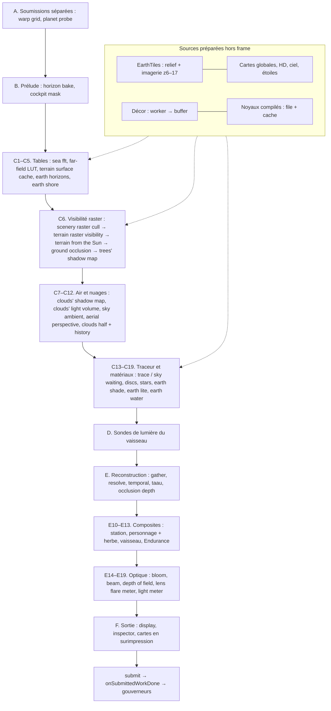

# Le pipeline graphique : qui fait quoi, qui consomme quoi, ce que coûte la compilation

**Document de référence, maintenu.** État du code lu : `main` à `da4e75bd` (6 novembre 2026, arbre de travail). Chaque
session qui modifie le pipeline (une passe, une cible, un pipeline, un noyau, une étape de chargement ou de
compilation) met ce fichier à jour dans le même lot — règle dans [CLAUDE.md](../CLAUDE.md), méthode au §10.

- **Contrôle mécanique** : `bun scripts/pipeline-inventory.ts --check` (≈0,2 s, sans navigateur ni GPU) vérifie que ce
  document nomme chaque libellé de passe du profileur, chaque fichier qui crée des pipelines et chaque fichier `.wgsl` ;
  `--write` régénère l'annexe A (inventaire exhaustif), `--write --sizes` y ajoute les tailles des noyaux (~16 s de CPU).
- **Place dans la stratégie** : c'est la « liste simple de passes déclarant lectures/écritures, tailles et durée de vie »
  que demande [ANALYSE-STRATEGIE-RENDU §7.5](ANALYSE-STRATEGIE-RENDU-2026-11-03.md) avant tout render graph, et la base
  des mesures de §8 (budgets par famille) et §19 (parcours complet). La [fiche système 02](systemes/02-pipeline-rendu.md)
  explique les mécanismes (TAAU, débruiteur, exposition…) ; ses tailles de fichiers et son ordre de compilation datent
  d'avant octobre — ce document-ci fait foi pour l'inventaire, l'ordre et les coûts.
- **États de preuve** utilisés partout : **code** (lu dans le source, ligne citée), **mesuré** (machine, date, source),
  **estimé** (proxy, calcul), **périmé** (mesuré avant un changement connu du même code).

Machines : **ce Mac** = MacBook Pro M1 Max ; **kerr-mini** = Mac mini M1 (écran 50 Hz) ; **kerr-pc** = RTX 5070 Ti,
Windows/D3D12. Les numéros de ligne sont ceux de `da4e75bd`.

---

## 1. Vue d'ensemble

Le jeu a **un** `GPUDevice` (celui de `Renderer`, `src/renderer.ts`) partagé par tous les modules de la vue et par la carte
3D ; la console d'équipage (`/crew/`) a ses propres devices. Une frame est **un encodeur, une soumission** (plus deux
soumissions optionnelles avant, et des soumissions de chargement hors frame, §4.5). Deux images au plus en vol (une en
rendu offline, `renderer.ts:1186`).

**Ce qui est cher, ce qui ne l'est pas** (ordre de grandeur, §8.4 pour les sources) : sur la Terre en raster, le matériau du
sol (`earth lite (raster)`, 12–17 ms sur kerr-mini à l'échelle 0,75), l'eau (`earth water (raster)`, 11–15 ms avant sa
réduction du 4/11), les nuages en demi-résolution (`clouds (half)`, 1,5–16 ms selon le Soleil) et le vaisseau (passes de
rendu, coût non attribuable sur Apple, §8.3) dominent ; la visibilité raster, les tables, la reconstruction et le traceur
du ciel coûtent chacun 0,5–2,5 ms.

---

## 2. Qui possède quoi

| Responsable | Fichier | Possède | Pipelines (création) |
|---|---|---|---|
| `Renderer` | `renderer.ts` | device, cibles `Target`, `paramBuf`, `bodyBuf` (tables), noyaux du traceur, post, display, gouverneurs, profileur | traceur (async, file), post ×18 + display ×2 (async attendus au démarrage), cockpit mask ×2, `carryHistory` (sync, au 1er redimensionnement), cloudShadow / cloudLightVolume / skyAmbient (async, paresseux), sonde de précision |
| Composition du traceur | `system/tracer-source.ts`, `system/tracer-kernels.ts`, `system/wgsl-specialise.ts` (+ worker) | source composée selon les limites du device, clé de fonctionnalités → constantes, élagage du source | — (source pour `renderer.ts`) |
| `TerrainCache`, `EarthHorizons`, `EarthShore` | `system/terrain-cache.ts`, `system/earth-horizons.ts`, `system/earth-shore.ts` | cache de hauteurs 8 niveaux × 257², horizons terrestres, rivage | async, au premier besoin |
| `TerrainRaster` | `system/terrain-raster.ts` | cible de distance rgba32f, profondeur, `sunDepth` 4096×2048, maillages (worker) | async, au premier besoin |
| `SceneryRaster` | `system/scenery-raster.ts` | listes indirectes (32 Mio), tsm 2048²×2 | 16 async, quand le décor arrive |
| `BodyRaster` | `system/body-raster.ts` | sol des autres mondes (hauteurs, visibilité, Soleil) | 4 async, à l'approche d'un monde |
| `Gtao`, `WarpGrid` | `system/gtao.ts`, `system/warp-grid.ts` | AO demi-résolution ; table `TABLE_WARP` | async au démarrage |
| `HorizonMaps` | `system/horizon-maps.ts` (`horizon.wgsl`) | cartes d'horizon des corps HD (Lune, Mars…) | 2 sync au premier bake |
| `EarthTiles` | `system/earth-tiles.ts` | textures relief/imagerie, mips d'imagerie | 1 sync (mips) au 1er tuile |
| Cartes | `system/earth-maps.ts`, `system/hd-maps.ts`, `system/day-clouds.ts`, `system/bc-encode.ts`, `system/giant-tile.ts`, `sky.ts` (`sky.wgsl`), `noise3d.ts`, `mipgen.ts` (`mips.wgsl`) | packers de cartes, BC7/BC5, tuile des géantes, ciel, bruit 3D, mips des écrans | sync, à chaque chargement (certains recréés à chaque appel, §5.6) |
| `SeaFft` | `sea/fft-gpu.ts` (`seafft.wgsl`) | spectre et houle FFT 256²×9 | 5 sync au démarrage |
| `ShipRenderer` | `ship.ts` (`ship.wgsl`) | vaisseau : sondes env/GGX/SH, ombre, MSAA, masque, panaches, verrières | 23 sync au démarrage (+ verrières A320 paresseuses) |
| `CharacterRenderer` | `character-renderer.ts` (`character.wgsl` + `forest.wgsl`) | marcheur, herbe, pierres, couvert bas | 17 sync au démarrage |
| `StationRenderer`, `EnduranceRenderer` | `station.ts` (`station.wgsl`), `endurance.ts` (`endurance.wgsl`) | ISS, Endurance | 3 + 2 sync au démarrage |
| `ChartOverlay` ×2 | `chartoverlay.ts` (`overlay.wgsl`) | carte du ciel, lignes de la magnétosphère | 2 sync au démarrage + composites paresseux |
| Shaders composés | `forest-shader.ts`, `system/aerial.ts`, `system/scenery.ts`, `system/earth-surface.ts`… | fragments WGSL injectés dans le traceur | — |
| `MapGpu` (carte 3D, trace au sol) | `ui/map3d/gpu.ts` (`map.wgsl`) | sa toile ; **même device**, lit les cartes du traceur | 6 sync à l'ouverture |
| Console d'équipage | `crew/sys3d/gpu.ts`, `crew/draw/earth.ts` | page `/crew/`, **devices séparés** | sync |
| Profileur GPU | `gpuprof.ts` | 128 requêtes d'horodatage, 1 frame sur 8 | — |

Totaux statiques (annexe A) : **98 sites de création de pipeline** (67 rendu, 31 calcul, 38 asynchrones) et 35
`createShaderModule` dans 28 fichiers ; 34 programmes WGSL (15 fichiers `.wgsl` : `trace.wgsl` 16 541 lignes, `ship.wgsl`
2 541, `post.wgsl` 1 269, `display.wgsl` 935, `character.wgsl` 699, `map.wgsl` 616, `forest.wgsl` 355, `overlay.wgsl`
278, `station.wgsl` 209, `horizon.wgsl` 172, `seafft.wgsl` 159, `endurance.wgsl` 145, `mask.wgsl` 73, `sky.wgsl` 40,
`mips.wgsl` 23 ; et 19 chaînes WGSL dans le TypeScript).

---

## 3. La frame, passe par passe

`Renderer.frame()` (`renderer.ts:10653`). Libellé = celui du profileur (`prof.pass`), tel qu'affiché par
`__bh.game.perf().gpu`, l'onglet Perf (F2) et le Kerr Bench ; « (non chronométrée) » = aucun horodatage (§9).
**res** = résolution interne W×H (toile × `renderScale`). **Famille** = poste du budget de
[§8.2](ANALYSE-STRATEGIE-RENDU-2026-11-03.md) : V visibilité/terrain, M matériaux opaques, W eau, A air et nuages,
R reconstruction/sortie, S ombres/sondes amorties, Z hors budget (diagnostic, chargement).

### A. Avant l'encodeur principal (soumissions séparées)

| # | Libellé | Code | Programme, taille | Quand | Lit → écrit (consommateur) | Fam. |
|---|---|---|---|---|---|---|
| A1 | `warp grid` (non chronométrée) | `warp-grid.ts:156`, appel `renderer.ts:10672` | `warpShader(trace.wgsl)` `main`, WARP_N/8² par niveau | caméra < 300 km de la Terre, fenêtres déplacées | → `bodyBuf` `TABLE_WARP` (traceur) | V |
| A2 | `planet probe` | `renderer.ts:5295` | trace `env`, 1/16 de 256×128 par frame | après la 1re image, toutes les 2 s, planètes éclairées par le disque | → `probeBuf` → lecture CPU `reduceProbe` | S |

### B. Prélude de l'encodeur principal

| # | Libellé | Code | Programme, taille | Quand | Lit → écrit | Fam. |
|---|---|---|---|---|---|---|
| B1 | `horizon bake` ; `horizon mips` (non chronométrée) | `horizon-maps.ts:652`, `:757` ; `renderer.ts:10680` | `horizon.wgsl` `bake` (bande dimensionnée sur la mesure précédente, budget 2 ms), puis `mip` | corps HD de `HORIZON_BODIES` avec MNT | relief HD → cartes d'horizon (+ ligne `TABLE_HORIZON` CPU) → traceur 42/43 | S |
| B2 | (clear `t.stars`) | `renderer.ts:10781` | — | étoiles splattées | → `t.stars` | R |
| B3 | `cockpit mask` | `encodeCockpitMask` `renderer.ts:6149` | `mask.wgsl` `cell` (W/8×H/8) puis `main` (W/16×H/16) | vue cockpit, même pose à la marge du tremblement près | masque propre du vaisseau (frame précédente) → `moments.x` (−1 non tracé) | R |

### C. Le traceur et le raster (`dispatchTrace`, `renderer.ts:6226`)

| # | Libellé | Code | Programme, taille | Quand | Lit → écrit (consommateur) | Fam. |
|---|---|---|---|---|---|---|
| C1 | `sea fft` | `fft-gpu.ts:103` | `seafft.wgsl` spectrum/rows/cols/assemble/mip | mer proche, `s.seaFft` ; coupé après 120 frames sans mer vue | → texture 256²×9 rgba16f + écume → traceur 33/34 | W |
| C2 | `far-field LUT` | `renderer.ts:6244` | trace `lut`/`lutq`, (W/8+2)×(H/8+2) | `lutOn` (pas de rayons courbes locaux : `LUT_BLOCKERS`) | → `t.lut` → `main` | V |
| C3 | `terrain surface cache` ; `terrain cache fade` (non chronométrée) | `terrain-cache.ts:438–520` ; `renderer.ts:6265` | `terrainCacheShader(trace)` `main`, 33×33 groupes par niveau 257² | niveaux déplacés ou retouchés (coalescés 150–500 ms) | tuiles, `earthMaps.elev` → `TABLE_TERRAIN` (+ `_PREV` en fondu 800 ms) → maillages raster, traceur | V |
| C4 | `earth horizons` | `earth-horizons.ts:417` | `bake`, une bande par frame (1,5 ms) | niveaux 4–6 du cache | → `TABLE_EARTH_HORIZON` → traceur | S |
| C5 | `earth shore` | `earth-shore.ts:111` | `bake` | niveaux 3–4 re-cuits, `shoreWash` | → `TABLE_SHORE` → traceur (déferlement) | W |
| C6a | `scenery raster cull` | `scenery-raster.ts:967` | cull, clampDraws, cullBoxes, clampBoxes | décor présent, raster primaire | BVH du décor, `sunU` → `draws` indirects + `lists` | V |
| C6b | `terrain raster visibility` | `terrain-raster.ts:600` (`encodeTerrainRasterVisibility` `renderer.ts:10290`) | **rendu** : patch `terrainVs/Fs`, anneaux `ringFs`, proxies d'arbres, boîtes, maillages de bâtiments | raster primaire, fenêtre du cache prête, ≤ 4,19 Mpx | maillages, `TABLE_TERRAIN`, décor → **distance rgba32f W×H** (r sol, g id d'instance, b surface la plus proche, a code·2¹⁸ + normale) + profondeur | V |
| C6c | `terrain from the Sun` | `terrain-raster.ts:802` ; `renderer.ts:9804` | rendu profondeur `terrainSunVs`, bâtiments `boxShadowVs/meshShadowVs` | Soleil tourné > 5e-5 rad, centres ou cuissons changés ; sinon gardée | → `sunDepth` (2 cascades 2048², ±1,5 / ±10 km) + `TABLE_SUN` → traceur 37 | S |
| C6d | `ground occlusion` | `gtao.ts:128` | `gtao`, demi-résolution | `gtao` actif | distance → `t.ao` r32f → traceur 47 | M |
| C6e | `trees' shadow map` (+ couche bâtiments non chronométrée) | `scenery-raster.ts:1084` | rendu profondeur sur `tsmTex` 2048²×2 | caméra déplacée de 128 m dans le plan du Soleil, Soleil, révision du décor | → `tsmTex`, `TABLE_TSM` → traceur 41 | S |
| C6′ | `body raster heights`, `body raster visibility`, `body from the Sun` | `body-raster.ts:420`, `:507`, `:537` ; `terrain-raster.ts:705`, `:905` | `bodyHeights` (calcul), `bodyVs/Fs` (+ nuages de Mann), `bodySunVs` | autre monde à relief, < 1,5 rayon | même cible de distance ; `sunDepth` cascade 0 | V/S |
| C7 | `clouds' shadow map` | `renderer.ts:9187` | trace `cloudShadow` (**module entier**, non spécialisé), 48×48 | près de la Terre, ombre des nuages | → `csmTex` 384² → `TABLE_CSM` → traceur 40, C8, C11 | A |
| C8 | `clouds' light volume` | `renderer.ts:9275` | trace `cloudLightVolume` (module entier), 1 bande sur 4 | passe des nuages active | → `clvTex` 1536×72 → `TABLE_CLV` → C11 | A |
| C9 | `sky ambient` | `renderer.ts:9357` | trace `skyAmbient` (module entier) | près de la Terre, 1 frame sur 3 (aussi en qualité) | → `TABLE_SKY` → tous les noyaux | A |
| C10 | `aerial perspective` | `renderer.ts:6349` | trace `aerial`, volume 96×54×32 | caméra dans l'air, noyau compilé | → `aerialTex` 3D → noyaux principaux, `env` | A |
| C11 | `clouds (half)` | `renderer.ts:6404` | trace `clouds`, demi-résolution (/32 amorti) | **Terre raster seulement** | indice + C7/C8 → `cloudCurA/B` | A |
| C12 | `clouds' history` | `renderer.ts:9907` | `post.wgsl` `cloudTemporal` | après C11 | → `cloudA/B` → traceur 38/39, occlusion depth | A |
| C13 | `sky (waiting)` | `renderer.ts:6429` | trace `skyFill`, pleine résolution | le `main` de la scène pas encore compilé (ciel d'attente) | remplace C14–C17 | A |
| C14 | `trace` / `trace (converging)` | `renderer.ts:6450` | trace `main` (`rt` ou `q`) ; temps réel : un rayon par bloc (16×16 sous 1,5 km en raster) | toujours, noyau compilé | groupe 0 + LUT → **`accum`**, **`moments`**, **`stamps`**, `stars`, `polAcc` | V/M |
| C15 | `trace (discs)` | `renderer.ts:6492` | trace `main` + `DISC_ONLY` | raster, astres à l'écran | → `accum`… dans leurs rectangles | M |
| C16 | `stars (raster)` | `renderer.ts:6500` | trace `shadeStars`, un fil par étoile (≤120 000) | raster, étoiles splattées | → `t.stars` | R |
| C17 | `earth shade (raster)` | `renderer.ts:6512` | trace `shade` (+ `shadeMark`) | raster et **pas `liteAll`** : ponts, arbres < 80 m, boîtes marquées | → `accum`… pour les restes | M |
| C18 | `earth lite (raster)` / `body lite (raster)` | `encodeLite` `renderer.ts:6552` | trace `shadeLite` ; Terre : un fil par pixel, chaque frame | `shadeLite` compilé | → `accum`, `moments`, `stamps` | M |
| C19 | `earth water (raster)` | `renderer.ts:6590` | trace `shadeWater`, pleine résolution | Terre, noyau prêt | → `accum`… + mot « mer vue » → sonde de mer | W |

### D. Sonde de lumière du vaisseau (`dispatchEnv`, `renderer.ts:5251`)

| # | Libellé | Programme | Quand | Lit → écrit | Fam. |
|---|---|---|---|---|---|
| D1 | `ship probe: trace` | trace `env`, 1 texel sur k×k de 256×128 | vaisseau, engins ou marcheur affichés ; toutes les `envEvery` frames (≥ 2 en raster) | → `ship.envBuf` | S |
| D2 | `ship probe: mips`, `ship probe: GGX`, `ship probe: SH` | `ship.wgsl` envCopy/envDown, envGGX, envSH | sauté une fois sur deux à k = 4 | → `envRaw`, `envSpec`, SH → `TABLE_SH` | S |

### E. Reconstruction, composites, optique (`encodePost`, `renderer.ts:7514`)

| # | Libellé | Programme | Quand | Lit → écrit (consommateur) | Fam. |
|---|---|---|---|---|---|
| E1 | `polarization` | `post.wgsl` `polgrid` | `s.polarization` | `accum`, `polAcc` → `polGrid` | R |
| E2 | `gather` | `gatherH` | vue live | `accum`, `stamps`, `moments` → `gather` | R |
| E3 | `resolve` | `resolve` | toujours | → **`hdr` mip 0** rgba16f | R |
| E4 | `denoise` ×4 | `atrous` | convergence ≥ 2 spp ou offline | `hdr` ↔ `denoise` | R |
| E5 | `temporal` (2 sites : temps réel et passage de relais, temps additionnés) | `temporal` | live, reprojection, historique valide | `hdr`, historique → `hist`, `alb` | R |
| E6 | `taau` | `taau`, **à la taille de la toile** | toile > cible × 1,01 | → `taau.out` → display | R |
| E7 | `stars` | `stars` | étoiles splattées (sinon copie hist→hdr) | → `hdr` | R |
| E8 | `motion blur` | `motionBlur` | `s.motionBlur > 0` | → `hdr` | R |
| E9 | `occlusion depth` | `occlusion` | toujours | `moments`, `stamps`, nuages → **`sceneDepth`** f32 → tous les composites | R |
| E10 | station (3 passes, non chronométrées) | `station.wgsl` (`station.ts:221`) | ISS affichée, < 3 000 km de la Terre | `sceneDepth` → `hdr` | M |
| E11 | `character solar shadow`, `character shadow on traced terrain`, `grass: shade, footprints, blades`, `low cover: clumps`, `character HDR` / `character and grass HDR` | `character.wgsl` (`character-renderer.ts:918–1030`) | marcheur, herbe ou couvert bas | `sceneDepth`, SH, ombre → `hdr` | M |
| E12 | `ship: shadow map`, `ship: shading (MSAA)`, `ship: own mask`, `ship: hull distance`, `ship: thrusters and plasma` (+ clear des panaches non chronométré) | `ship.wgsl` (`ship.ts:2635–3104`) | vaisseau ou engins visibles | `hdr` (reflets), `sceneDepth`, env/SH → `resolved`, `plume` → display, bloom, masque cockpit suivant | M/S |
| E13 | endurance (2 passes, non chronométrées) | `endurance.wgsl` (`endurance.ts:262`) | `s.endurance` | → `hdr` | M |
| E14 | `bloom down …` | `downShip` puis `down` | bloom, lens flare ou faisceau | chaîne de mips de `hdr` | R |
| E15 | `beam` ×2 | `beamH`/`beamV` | bande radio, faisceau > 0 | → `beam` | R |
| E16 | `bloom up …` | `up` | `s.bloom > 0` | → `bloomTex` W/2×H/2 | R |
| E17 | `depth of field` | `dof`, demi-résolution | `dofOn` | → `dof.tex` | R |
| E18 | `lens flare meter` | `flareMeter` | `lensFlare > 0` | → `flare.out` | R |
| E19 | `light meter` | `meter` | exposition auto, 1 frame sur 4 | → histogramme → lecture CPU | R |

`post` est le libellé par défaut d'une passe de la chaîne sans libellé propre (`renderer.ts:1258`).

### F. Sortie

| # | Libellé | Programme | Quand | Lit → écrit | Fam. |
|---|---|---|---|---|---|
| F1 | `display` | `display.wgsl` `vs`/`fs` (rendu) | toujours | `hdr`/`taau.out`, bloom, vaisseau, DOF, flare → toile (tone map, Purkinje, HDR étendu) | R |
| F2 | `terrain raster inspector` | `terrain-raster.ts:937` | `earthTerrainRasterView ≠ off` (diagnostic) | distance, `sceneDepth` → toile | Z |
| F3 | cartes du ciel / magnétosphère (non chronométrées) | `overlay.wgsl` | carte active | `moments` → toile | Z |
| F4 | fin du profileur, sonde de mer | `gpuprof.ts:86` ; `renderer.ts:8908` | frame profilée ; mer toutes les 15 frames | requêtes → lecture ; mot « mer » → `seaProbe` | Z |

Puis `submit()` (`renderer.ts:8919`) : **un `queue.submit`**, `onSubmittedWorkDone` alimente `lastGpuMs`, le bloc du
traceur (`adaptBlock`) et le taux de shading raster (`adaptRasterRate`). Une frame **convergée et inchangée** revient sans
soumettre (`renderer.ts:10842`).

---

## 4. Ressources : qui écrit, qui lit

### 4.1 La cible live (`createTarget`, `renderer.ts:2845` ; refaite au redimensionnement)

| Ressource | Format, taille | Écrit par | Lu par |
|---|---|---|---|
| `accum` | stockage, 16 o/px | C13–C19 | gather, resolve, temporal, polgrid |
| `moments` | 8 o/px (Σl² ou marque raster, profondeur) | traceur, cockpit mask | resolve, temporal, taau, occlusion, meter, DOF, cartes |
| `stamps` | (px + 32) × u32 | traceur ; CPU (rectangles des astres, matrice des étoiles) | gather, resolve, temporal, taau, occlusion, sonde de mer |
| `stars` | 12 o/px atomiques | `main`, `shadeStars` | temporal, stars, taau |
| `hdr` | rgba16f W×H, 2–8 mips | resolve, temporal, stars, composites | bloom, display, reflets du vaisseau, meter, DOF |
| `sceneDepth` | f32/px | occlusion depth | station, personnage, vaisseau, Endurance, inspecteur |
| historiques `temporal.hist[2]`, `alb[2]` ; `taau.hist[2]`, `out` | rgba16f, W×H ; taille toile | temporal ; taau | temporal, taau, display |
| `lut` | rgba32f + r32f, (W/8+2)×(H/8+2) | C2 | `main` |
| nuages `cloudCur/cloud/cloudHist A/B` | rgba32f demi-résolution | C11, C12 | traceur, occlusion |
| `ao` | r32f demi-résolution | C6d | traceur |
| `bloomTex`, `blur`, `denoise`, `dof`, `beam`, `gather`, `polAcc`, `polGrid` | divers | E | display |

### 4.2 Ressources du renderer et des modules

- **`paramBuf`** (uniforme `Params`, `trace.wgsl:13`) : `writeParams` (`renderer.ts:3332–4380`), réécrit par branche,
  par sonde, par bande offline ; patché en cours d'encodage pour les bits raster/lite/eau/étoiles/nuages/arbres.
- **`bodyBuf`** (un seul stockage, binding 15) : toutes les tables lues par le traceur, aux offsets `TABLE_*` de
  `gpu-tables.ts:29–120` (bodies, SH, LUT, PATH, WALK, WARP, TERRAIN, SUN, SKY, CSM, TSM, GEOID, ORTHO, RING, WIND, RINGSUM,
  TOPS, TERRAIN_PREV, HORIZON, EARTH_HORIZON, WATER, SHORE, REFR, TLUT, WXGRID, CLV, MIR, LIFT, PREFR). Le GPU écrit SH,
  TERRAIN(_PREV), WARP, CSM, CLV, SKY, EARTH_HORIZON, SHORE ; le CPU le reste. Les offsets sont gardés égaux aux
  `*_OFF` de `trace.wgsl` par `tests/gpu-tables.test.ts`.
- **Groupe 0 du traceur** : une seule disposition explicite (`traceLayout`, `renderer.ts:1367–1467`), 8 buffers de stockage
  de base, des bindings optionnels selon les limites (35 indice raster, 37 Soleil, 38/39 nuages, 40 CSM, 41 TSM, 42/43
  horizons, 44–46 ortho, 47 GTAO, 49 détails, 32 décor). **Groupe 1** selon le noyau (LUT/aérien en lecture ou écriture,
  env, nuages).
- **Textures sources** : bruit 3D, ciel et étoiles, cartes planétaires et HD, cartes globales de la Terre (med 2048² /
  high 4096²), tuiles (`r32uint` 2048²×9 ≈ 144 Mio en portée far/veryFar ; imagerie rgba8 1024²×19 ≈ 106 Mo avec mips depuis
  NU1 — +3 couches `IMG_ROADS0` : les lumières des rues z 12–14, cuites dans le worker de décodage, `night-roads.ts`, calculé
  par `ORTHO_BYTES`, non mesuré —, 89 Mo avant), surface régionale,
  FFT de la mer, buffer du décor (16/36/64 Mio), détails, horizons.
- **Modules** : `TerrainRaster` (distance + profondeur W×H, `sunDepth` 4096×2048, maillages), `SceneryRaster` (indirects,
  listes 32 Mio, tsm), `Ship` (env, SH, ombre 4096×2048, `resolved` W×H, panaches demi-résolution, MSAA), personnage,
  station, Endurance, cartes en surimpression.

### 4.3 Mémoire mesurée

Jauge `#vram` (estimation par format, `src/bench/vram.ts`) : vues terrestres **1 434–1 578 Mio** (pic ≈ 1,55 Gio sur
kerr-mini, plafond visé 2 Gio, M0a/M0b 2/11) ; après T10, Paris 1 386 Mio, Chamonix 1 258 Mio ; autres mondes 915–1 210 Mio
(mesuré, kerr-mini, `docs/progress/refraction-horizons/M0a.md`, `T10.md`). Aucune mesure par étape du parcours (§7).

### 4.4 Lectures GPU → CPU

Horodatages (1 frame sur 8 + la bande convergente chronométrée), histogramme de l'exposition (1 sur 4), sonde de mer (1 sur
15), compteurs d'herbe (≤ 4/s), sonde planétaire (fin de tâche), diagnostics à la demande (`rasterColumn`, `skyTable`…).

### 4.5 Soumissions hors frame

Mips d'imagerie (une soumission **par tuile** arrivée, `earth-tiles.ts:2185`), cartes de la Terre et HD
(`earth-maps.ts:275`, `hd-maps.ts:319`), BC7/BC5 (`bc-encode.ts:219`), nuages du jour (`day-clouds.ts:180`, au changement
de date), mips des écrans du cockpit (`mipgen.ts`, `main.ts:9111/9309/9364`), ciel, bruit 3D, tuile des géantes (au
chargement), carte 3D. Leur coût GPU n'est pas mesuré : il tombe dans l'intervalle de complétion de la frame suivante.

---

## 5. Profils de rendu et compilation

### 5.1 Quels groupes de passes pour quel chemin

| Groupe | Tracé (espace, Gargantua, Terre > 100 km ou `trace`) | Terre raster | Autre monde raster | Convergence (vue fixe, photo) | Offline |
|---|---|---|---|---|---|
| A1 warp, A2 planet probe | oui | oui | oui | oui | non |
| B1 horizon bake | corps HD | — | oui | oui | non |
| B3 cockpit mask | cockpit | cockpit | cockpit | non | non |
| C1 sea fft | mer proche | si mer vue | Miller/Titan | si due | si due |
| C3–C5 cache, horizons, rivage | non | oui | non | non | non |
| C6 visibilité, Soleil, GTAO, tsm | non | oui | C6′ | non | non |
| C7–C8 ombre et volume des nuages | près de la Terre | oui | non | non | possible |
| C9 sky ambient | près de la Terre | oui | non | oui | près de la Terre |
| C10 aerial | dans l'air | oui | dans l'air | non | non |
| C11–C12 nuages demi-résolution | **non** (exige l'indice) | oui | non | non | non |
| C14 `main` | un rayon par bloc | **ciel seul** | ciel et loin | noyau `q` par bandes | `q`/`rt` par bandes |
| C15–C19 astres, étoiles, shade, lite, eau | non | oui | `body lite` seul | non | non |
| D sonde env | vaisseau/marcheur | ≥ 1 frame sur 2 | oui | tant que spp < 32 | oui |
| E5–E6 temporal, taau | oui | oui | oui | relais seul | non |

Le mode photo laisse converger la vue fixe sur le noyau de qualité (`rasterHold`, `main.ts:8660`) ; un PNG repasse
`encodePost` + display dans sa propre soumission (`renderDisplayed`, `renderer.ts:11390`). Le télescope n'a pas de chemin
propre (même frame, autre champ). L'offline (`offlineFrame`, `renderer.ts:11207`) n'a ni raster ni cache.

### 5.2 Le traceur : un fichier, des noyaux spécialisés

`trace.wgsl` (16 541 lignes, 64 constantes `override`, 15 points d'entrée) est d'abord **composé** selon les limites du
device (`composeTracer`, `tracer-source.ts:33` : 14 injections — forêt, cache, indice raster, Soleil, nuages, tsm, horizons,
GTAO, détails, ortho, surface, décor, mer, aérien). Ses dérivés sont découpés dans son texte (`warpShader`,
`terrainCacheShader`, `terrainRasterShader`, `bodyRasterShader`, `forestModuleOf`) : **toute modification de
`trace.wgsl` change aussi leurs sources et invalide leur cache navigateur.**

Puis pour chaque **clé de fonctionnalités** (bits 0–30, `tracer-kernels.ts:94–147` : radio, polarisation, jet, spot,
volume, trou de ver, disque épais, corps, pistes, Kerr, météo, ombre, surface, décor, aurore, cache, vue de coût, tune,
`NEAR_KIND`, raster primaire, raster terrain), chaque point d'entrée est **spécialisé** : constantes fixées, branches
mortes et fonctions inatteignables retirées du source (`wgsl-specialise.ts`, dans `wgsl-specialise-worker.js`), puis
compilé par `createComputePipelineAsync`. Le **profil Terre-raster** (bit 29) fixe météo, aurore, ombre, surface, décor
pour tout le vol bas : une seule série de constantes, donc pas de recompilation quand le décor ou la météo arrivent.

| Emplacement | Entrée | Rôle | Compilé |
|---|---|---|---|
| `rt` / `q` | `main` | rayons du temps réel / intégrateur de qualité | `rt` dans la cascade ; `q` pour une vue fixe, photo, offline |
| `discs` | `main` + `DISC_ONLY` | astres en raster | fin de cascade |
| `env` | `env` | sonde de lumière | cascade |
| `lut` / `lutq` | `lut` | champ lointain | après la 1re image, si aucun `LUT_BLOCKERS` |
| `air` | `aerial` | perspective aérienne | après la 1re image, bit des corps |
| `shade`, `shadeMark`, `shadeLite`, `shadeWater`, `shadeStars` | idem | matériaux raster | cascade raster |
| `clouds`, `skyFill` | idem | nuages demi-résolution, ciel d'attente | **avant `main`** sur une clé Terre froide |
| — | `skyAmbient`, `cloudShadow`, `cloudLightVolume` | tables de l'air | paresseux, **module entier non spécialisé** |
| — | `probe` | sonde de précision (outil) | à l'appel |

**La file** (`CompileQueue`, `util/async-resource.ts:57–179`, instance `renderer.ts:1155`) : un emplacement + un second pour
une tâche urgente ; limite de blocage apprise (max(60 s, 3× la plus longue)) ; une compilation < 5 s compte comme un
succès de cache. **La cascade d'une clé** (`realtimeCascade`, `renderer.ts:5610–5709`), clé Terre-raster froide :
`shadeLite` → `skyFill` → `clouds` (une image du ciel et du sol en quelques secondes) → `main` → `shadeWater`,
`shadeMark`, `shadeStars` → `env` → `shade` (si décor), `discs` → [attente 1re image et fin du titre] → `lut`, `aerial`.
Si une autre clé couvre déjà le tracé (`coveringVariant`), les noyaux raster passent avant `main`. Le **noyau général**
(toutes fonctionnalités) n'est plus compilé au démarrage (`generalOnDemand = true`, `renderer.ts:5728`) : seulement pour
`FEATURES_ALL`, l'échec d'une scène ou un test.

**Caches** : dans la session, LRU de 4 clés (`variantCacheMax`), mémo de 64 pipelines par constantes, 32 modules
spécialisés par texte ; **entre sessions, seulement le cache du navigateur/pilote** (aucun hachage ni persistance par
l'app). Sur Mac il rend la relance rapide ; sur Windows il ne garde pas les gros noyaux (§5.5).

**Ce qui recompile** : réglages de `featuresOf` (bande, polarisation, jet, spot, flot chaud, trou de ver, épaisseur du
disque) ; passage raster ↔ tracé (altitude > 100 km, latitude, marche, polarisation, mode) ; changement de corps proche
(`NEAR_KIND`) ; hors profil Terre-raster seulement : pistes, éclipse, aurore, météo/poussière ; arrivée du décor (`shade`) ;
qualité/offline ; `csmEvery`/`clvEvery`/`skyAirN` (modules entiers) ; classe de device (composition) ; perte du device.
Une clé « en avance » est compilée quand la surface ou le décor vont arriver (`aheadKey`, `renderer.ts:4342`) ; sous le
profil, le mémo la rend instantanée.

### 5.3 Taille des noyaux (statique, mesurée aujourd'hui)

Lignes WGSL une fois chaque appel inliné (ce que compile D3D12 ; proxy du coût Metal aussi). `bun
scripts/wgsl-inline-size.ts`, `da4e75bd`, 6/11 — tableau complet en annexe A.4 :

| Profil | Noyaux (milliers de lignes inlinées) | Total |
|---|---|---:|
| Terre raster (vol bas) | `env` 57 · `main` 42 · `discs` 30 · `shade` 26 · `shadeLite` 8,2 · `shadeWater` 6,0 · `clouds` 3,8 · petits < 1 | 175k |
| Terre raster + météo et aurore | `env` 57 · `main` 45 · `shade` 31 · `discs` 30 · … | 182k |
| Terre tracée (marche) | `main` 65 · `env` 60 | 126k |
| Photo (Terre, qualité) | `main` 67 | 67k |
| Espace (titre, Lune, planètes ; clé 736) | `main` 53 · `env` 49 | 102k |
| Lune / lunes glacées | `main` 73–74 · `env` 49 · `shadeLite` 25 | 147–148k |
| Mars / Titan / Vénus | `main` 86–89 · `env` 49 · `shadeLite` 38–43 | 173–181k |
| Kerr + jet (clé 516) | `main` 31 · `env` 27 · `lut` 28 | 86k |
| Noyau général | `main` 147 · `lut` 143 · `env` 71 | 362k |

Budgets : `tests/kernel-budget.json` (61 valeurs, gardées par `tests/kernel-budget.test.ts`, `KB_WRITE=1` réécrit à
mesuré + 10 %). **Depuis `da4e75bd` plusieurs budgets Terre-raster sont à leur taille mesurée, sans marge** (`main`
41 860, `env` 57 150, `discs` 29 780, `shade` 26 060). Depuis P11 (28/10) : `env` +10 %, `main` +5 %, `shadeLite` +18 %,
`discs` +6 %. **Aucun profil ni budget pour les géantes gazeuses.**

### 5.4 Les pipelines hors traceur

- **Au démarrage, synchrones (≈55 pipelines)** dans le constructeur de `Renderer` : vaisseau 23, personnage 17, FFT de la mer
  5, station 3, Endurance 2, ciel 2, cartes en surimpression 2, bruit 3D 1. Ils bloquent le fil principal pendant leur
  création ; **leur coût n'est mesuré nulle part** (`renderer.ts:1719` le reconnaît). La plus longue tâche longue avant la
  1re image (≈ 200–380 ms, E0/E11) tombe juste après la marque `renderer`.
- **Au démarrage, asynchrones attendus** : post ×18 et display ×2 (`auxCompiled`) ; non attendus : cockpit mask ×2, warp
  grid, GTAO. Puis `getCompilationInfo` sur 9 modules (`renderer.ts:2427–2465`).
- **Paresseux** : cache de terrain (2), horizons et rivage terrestres, raster du terrain, raster du décor (16), raster des
  corps (4), horizons des corps (2 sync), tuile des géantes (7 sync, **recréés à chaque appel**), mips d'imagerie (1),
  packers des cartes Terre/HD et nuages du jour (sync, **nouveau module à chaque chargement**), BC7/BC5 (2, en cache), mips
  des écrans (`MipGen.warm` pour le F-35), carte 3D (6 sync par instance, à l'ouverture), `carryHistory` (au 1er
  redimensionnement).
- **Validation sans compilation complète** : `bun scripts/check-wgsl.ts` (Chrome, `getCompilationInfo` seulement, pas le
  backend). Il compose les modules du traceur et du décor ; les modules à WGSL inline de `gtao.ts`, `giant-tile.ts`,
  `bc-encode.ts`, `day-clouds.ts`, `noise3d.ts`, `earth-maps.ts`, `hd-maps.ts`, `earth-shore.ts`, `body-raster.ts` ne
  figurent pas dans ses imports (à confirmer).

### 5.5 Temps de compilation mesurés

**Tous les temps ci-dessous datent du 27–28/10 ou d'avant ; les noyaux ont grossi depuis (§5.3) : ils sont périmés au sens
strict.** Aucune mesure récente de la Terre sur kerr-mini après P11 et le ciel d'attente.

| Quoi | Machine | Valeur | Date, source | État |
|---|---|---|---|---|
| 1re image Terre, froid (cache Metal vidé) | kerr-mini | 134 s (P0) → **19–25 s** (P10) | 27/10, `docs/progress/kernels/BASELINE.md` | mesuré, périmé |
| Tout prêt, froid / relance même profil | kerr-mini | 42–64 s / **10 s** (1re image 3,8 s) | 27/10, idem | mesuré, périmé |
| Un pipeline en cache | kerr-mini | encore 2–4,5 s (chargement de bibliothèque Metal) | 27/10, idem | mesuré |
| Terre tracée froid / relance ; Lune ; trou de ver ; Kerr | kerr-mini | 18/65 s → 3,1/24 s ; 7,9 s ; 8,6 s ; 3,1 s | 27/10, idem | mesuré, périmé |
| 1re image Terre (P10) / avec le ciel d'attente | kerr-pc | 118–151 s / **7,5 s** | 28/10, BASELINE « Windows, measured », `win-p10.txt` | mesuré, périmé |
| `main` / `env` / `shade` / `discs` après P11 | kerr-pc | 72 / 42 / 60 / 21 s ; tout prêt 208–220 s | 28/10, idem | mesuré, périmé |
| Relance sur Windows | kerr-pc | **aucun gain sur les gros noyaux** (`main` 80 → 79 s ; cache Dawn ≈ 10 Mo) ; petits noyaux 0,02–0,05 s | 28/10, idem | mesuré |
| Proxy D3D12 (Tint + DXC sur ce Mac) | ce Mac | Terre raster `main` 265 → 34,5 → 20 s ; **3,4× trop optimiste** face à kerr-pc | 27–28/10, BASELINE | estimé |
| Noyau proche de Jupiter, froid | ce Mac | `main` **203 s** (219 s avec aurore) + `env` ≈ 60 s | 6/11, `docs/PROBLEMES-A-REGLER.md` | mesuré, actuel |
| Spécialisation du source (CPU, worker) | ce Mac | 14 variantes : 1,3 s, ≤ 174 ms chacune | 3/11, T8b | mesuré |
| Pipelines hors traceur (vaisseau, personnage, raster, post…) | — | **jamais mesurés** | — | angle mort |

Outils : `compileReport()` (traceur seulement), e2e `kernel-compile` (`KC_COLD=1` vide le cache Metal, kerr-mini), proxy
`d3d12-compile-proxy.ts` / `d3d12-ab.ts` (CPU), §8.

---

## 6. Ce que la frame partage avec le reste du jeu

- **Simulation → rendu** : `writeParams` lit l'état accepté (temps, caméra en float64, corps, Soleil) ; les différences vers
  l'origine locale sont faites en float64 avant la conversion (contrat de §7.3 de la stratégie). Les hauteurs sont
  géodésiques (WGS84 + géoïde, `TABLE_GEOID`).
- **Rendu → simulation** : rien de décisif. Le sol de contact de l'appareil ne vient pas des cibles GPU ; les sondes
  (mer, planètes, histogramme) n'alimentent que l'image et l'exposition.
- **Rendu → interface** : `sceneDepth` et `moments` servent aux cartes en surimpression ; les écrans du cockpit (PCD, DU)
  sont des toiles 2D montées en textures par `MipGen`.

---

## 7. Le parcours joueur : chargements, compilations, ce qu'on voit

Ordre réel d'une première visite puis d'un vol terrestre. **Bloquant** = rien de neuf à l'écran tant que ce n'est pas
fini. Les marques entre crochets sont celles de `__bh.boot()` (`src/boot-timeline.ts`) ou les étapes de
`gpuDiagnostics` / `loading`.

| # | Étape | Réseau / CPU / GPU | Compilations | Ce que voit le joueur | Bloquant ? | Mesuré (machine, date, source) | Instrumentation |
|---|---|---|---|---|---|---|---|
| 0 | Navigation, Service Worker | page en réseau d'abord (`no-cache`), bundle haché en cache immuable ; SW enregistré **après** `Renderer.create` (`main.ts:931`) ; sauté en dev local et en e2e | — | page noire puis intro | oui (bundle) | bundle 2,1 Mo dont ≈ 270 ko de WGSL (5/10, ANALYSE-CHARGEMENT-GPU) | aucune marque d'installation du SW |
| 1 | JS démarre | `net-install`, polices chargées en parallèle | — | intro (worker `intro-worker.js`) | non | [`main`] 175 ms froid / 60 ms chaud (ce Mac, 18/10, `title-aaa/E0.md`) | `__bh.boot()` |
| 2 | Titre construit avant le GPU | DOM du titre | — | titre utilisable | non | [`title`] 170–180 ms froid, 40 ms chaud (kerr-mini, E11) | `__bh.boot()` |
| 3 | `Renderer.create` | adaptateur, device (limites, `timestamp-query`), modules (traceur composé), **≈55 pipelines synchrones**, post/display async attendus, validation de 9 modules | post ×18, display ×2 ; ≈55 sync | intro continue | oui pour la 1re image ; fil principal bloqué par moments | [`renderer`] 677 ms froid (ce Mac, E0) ; plus longue tâche 200–380 ms juste après | stades `gpuDiagnostics` [`adapter-request`, `device-request`, `shader-validation`, `core-pipeline-compilation`…] |
| 4 | Éphémérides, ciel, étoiles | DE440 d'abord (E0b), ciel Gaia 3,5 Mo, étoiles 3,4 Mo, JUP365 7,5 Mo | ciel 2 sync | — | la scène attend DE440 | [`ephemerides`] ; title 7,6 → 1,7 s à 20 Mbit/s (E0b) | `loading` (non exposé sur `__bh`, lu par le bench) |
| 5 | 1re image (scène du titre, clé 736) | — | cascade `main` → `env` de la clé ; `lut`/`aerial` après | l'univers derrière le titre | oui | [`first-image`] **1 058 ms froid / 387 ms chaud** (kerr-mini, E11) ; 1 341 / 865 ms en A/B ab-pages | `compileReport()`, `gpu.frames()` |
| 6 | Intro levée | intro courte 1,5 s ou complète 6,5 s ; plafond 12 s après la 1re image | — | titre | non | [`splash-lifted`] 2,4 s froid / 1,6 s chaud (ce Mac, E0) | `__bh.boot()` |
| 7 | Titre ouvert 8 s | **pré-compilation du vol terrestre** (`prewarmEarthFlight`, `main.ts:9729`), non urgente ; noyau général, LUT, aérien retenus (`backgroundHold`) | clé Terre-raster complète | titre | non | non mesuré séparément | `compilesPending`, `compileReport()` |
| 8 | Lancement d'un mode | voile d'entrée : attend le noyau de la scène (`scene-tracer`), ≤ 90 s (`ui/entry.ts:67`) ; arrêt de la pré-compilation | la clé de la scène choisie | voile 400 ms, HUD 600 ms | oui (≤ 90 s) | entrée en orbite 2,1 s (E10, e2e) | `__bh.entry`, aucune marque dans `boot()` |
| 9 | Arrivée près de la Terre | cartes globales med puis high ; **tuiles** relief z6–17 (8 en vol, décodées en worker) et imagerie, IGN (14 en vol, portillon SW 25/s), ortho (8) ; cuissons du cache ; raster créé (pipelines async) | si non pré-compilé : `shadeLite` → `skyFill` → `clouds` (secondes, **image du ciel d'attente**) → `main` → … ; raster du terrain et du décor | sol grossier 2–6 s, puis affiné | **non** (le ciel d'attente remplace `main`) | ILS LFTH froid : côtés complets 38 s, file vide 44 s ; vue à 90 % en 8,1 s (rejeu, ce Mac, T8j 3/11) ; Paris relief 57 s (kerr-mini, M0b 2/11) | `earthTiles.pending`, `renderer.earthSettled` (booléen, sans horodatage) |
| 10 | Décor (forêts, bâtiments, routes) | worker du décor : WorldCover, OSM, BD TOPO/Overture, canopée IGN, forêt, BVH ; scène rapide (35 %) puis complète ; fondu 600 ms ; buffer ≤ 64 Mio | `shade` quand le décor entre (profil : déjà compilé) | arbres et bâtiments en fondu | non | scènes 24–33 s (kerr-mini, T8o 6/11) ; couverture 0,97 (T8m) | `earthScenery.stats()`, compteur de données |
| 11 | Vol | re-cuissons du cache (≈16/s en vol bas, M0b), nouvelles tuiles (une soumission de mips par tuile), décor reconstruit 40–50 s, bandes des horizons ; gouverneurs (bloc, taux raster, échelle, palier) | clé en avance (`aheadKey`) ; rien de neuf sous le profil | — | non | vol de 2 min à Chamonix 30–32 ms médian, p95 37–40, max 72,6 (kerr-mini, M0b) | `game.perf()`, `gpu.frames()` |
| 12 | Voyage vers un autre corps | `NEAR_KIND` change → nouvelle clé ; cartes HD + tuiles Lune/Mars ; bake des horizons ; raster des corps | `main`/`env`/`shadeLite` du corps (Mars 86k, Lune 73k lignes) ; **Jupiter proche 203–219 s à froid** | l'ancienne clé couvre si possible | parfois | Lune prête 7,9 s, trou de ver 8,6 s (kerr-mini 27/10) | `compileReport()` ; aucun chrono de re-streaming |
| 13 | Carte 3D, trace au sol | `MapGpu` : 6 pipelines sync à l'ouverture, même device | 6 sync | carte | court | non mesuré | aucun |
| 14 | Photo / vue fixe | noyau de qualité `q` (`qualityCascade`), convergence par bandes | `main` Q, `lut` Q | image qui s'affine | non | photo `main` 67k lignes, non chronométré récemment | `compileReport()` |
| 15 | Réglages | bits de `featuresOf` → nouvelle clé ; portée/ortho/IGN → tuiles rechargées (anciennes gardées « stale ») ; décor → worker tué | selon la clé | l'ancienne image tant que possible | parfois | coût par réglage (GPU, pas compilation) : `src/ui/settings/costs.ts` | `compileReport()` sans lien vers le réglage |
| 16 | Redimensionnement | cible live refaite, `carryHistory` | `carryHistory` sync au 1er | — | court | non mesuré | aucun |
| 17 | Onglet caché | cartes et tuiles libérées (`renderer.ts:2146`) | — | — | — | — | — |
| 18 | Perte du device | tout recréé ; cache navigateur des pipelines | tout | image figée puis reprise | oui | recréation à chaud 357 ms (8/10, PLAN-MONDE) | `__bh.gpu.lose()`, `generation()` |

**Ce qui n'attend jamais les tuiles** : l'intro se lève sur la 1re image et les étapes de `loading` (cartes globales
comprises, jamais les tuiles) ; le voile d'entrée n'attend que le noyau de la scène. La 1re image d'un vol terrestre est donc
le ciel d'attente + le sol grossier ; la couverture utile arrive en ~8–40 s selon la région et le cache (France, mesures
T8 ci-dessus).

**Caches du chargement** : cache de tuiles du SW `kerr-tiles-v1` (LRU 300 Mo par défaut, 1 ou 3 Go au choix), zones hors
ligne `kerr-zones-v1` (hors budget, consultées d'abord), grilles IGN compressées `krh1` (≈ 15 %), cache mémoire des tuiles
(jusqu'à 640 tuiles ≈ 320 Mo de tas JS en veryFar), LRU du worker du décor (96/192 Mio ; depuis `d11f0171` le worker n'est
plus tué au recentrage — la scène dépassée est abandonnée à sa prochaine phase — et garde aussi les toits planifiés,
`planCache`, 26–36 % repris d'une scène à l'autre sur une approche de JFK, ce Mac, 6/11), cache des pipelines du navigateur.
Les zones suivent `ZONE_SCHEMA` 2 depuis le 6/11 (Terrarium sa propre chaîne, rues de nuit z 12–13, infrastructure
Overture à 15 km, sol 3DEP des USA, et depuis le 10/11 les pistes du monde à 150 km : `runways/v1`, effacées avec le cache des
tuiles et redemandées en boucle hors ligne — un recul de 30 s désormais) ; une scène du décor annulée abandonne aussi ses
requêtes en vol (`AbortController` par scène, `scenery-worker.ts`) — la première scène, au lieu de départ, lisait encore le
relevé IGN du Bourget pendant un vol à JFK ; la refonte du chargement est analysée dans [ANALYSE-STREAMING-2026-11-06.md](ANALYSE-STREAMING-2026-11-06.md)
(scène de décor 20–44 s, voyant jaune 74 s sur 162 s d'une approche : l'assemblage, pas le réseau). Le cache « shell » du SW (textures, éphémérides, audio hachés) **est vidé à chaque
nouvelle version** (`sw.ts:190`) : à mesurer (selon les en-têtes HTTP de l'hébergeur).

---

## 8. Mesurer le pipeline

### 8.1 Six horloges à ne pas confondre

| Horloge | Où | Ce que c'est vraiment |
|---|---|---|
| itérations rAF | `perf.ts` `loopFps` ; `renderer.refreshMs` | la boucle et la fréquence de l'écran (kerr-mini : 50 Hz) |
| soumissions | `renderFps`, compteur à l'écran (`main.ts:8706`) | frames encodées et soumises |
| complétions | `lastGpuMs`, `gpu.frames().durationsMs` (512) | intervalle entre deux `onSubmittedWorkDone` : file d'attente et latence du rappel comprises, **pas** le temps d'exécution GPU ; c'est pourtant ce qui pilote les gouverneurs |
| horodatages GPU | `gpuprof.ts` | temps par passe, moyenne glissante, 1 frame sur 8 |
| sections CPU | `perf.ts` `CpuProfiler` | une seule section « render (encode, submit) » (`main.ts:8677`) : pas de coût d'encodage par passe |
| présentation | aucune API dans l'app | seulement de l'extérieur : `scripts/jitter-lab.ts` (screencast), e2e `cadence` (fenêtre visible) |

### 8.2 Comment mesurer quoi

| Question | Outil (coût) |
|---|---|
| L'inventaire est-il à jour ? | `bun scripts/pipeline-inventory.ts --check` (statique, < 1 s) |
| Taille d'un noyau, ce qui l'enfle | `bun scripts/wgsl-inline-size.ts [profil entrée] [--stub f]` (statique, ~16 s) ; `bun test tests/kernel-budget.test.ts` |
| Les shaders compilent-ils ? | `bun scripts/check-wgsl.ts` (Chrome, ~1 min ; validation seulement) |
| Compilation à froid / à chaud d'une scène | e2e `kernel-compile` (`KC_COLD`, `KC_WARM`), `compile-time` ; `__bh.renderer.compileReport()` (3–6 min par cas, GPU) |
| Compilation Windows sans Windows | `d3d12-compile-proxy.ts`, `d3d12-ab.ts` (CPU, minutes ; ×3,4 de correction mesurée) ; kerr-pc via `scripts/remote.ts --host kerr-pc` |
| Coût d'une passe ou d'une fonctionnalité | e2e `perf-suite` (`AB=`), `perf-ab`, `*-cost` (`aurora-cost`, `air-cost`, `sea-cost`…), `raster-shade-ablation` ; libellés de `game.perf({gpu:true})` |
| Coût du traceur entre deux versions | `scripts/trace-ab.ts` (vues figées, A/A ±1 %) ; `ab-commit.ts` + `ab-e2e.ts` (ABBA) |
| Coût de chaque réglage du joueur | `scripts/settings-cost.ts` → `src/ui/settings/costs.ts` (~30 min, kerr-mini) |
| Cadence présentée, saccades | e2e `cadence` (fenêtre visible), `scripts/jitter-lab.ts` |
| Démarrage, 1re image | e2e `boot-time`, `first-image-downloads`, `gpu-startup` ; `scripts/ab-pages.ts` ; `__bh.boot()` |
| Arrivée des tuiles et du décor | e2e `tile-arrival` (rejeu à latence fixe), `approach-detail`, `plan-views` (`PV_M0B=1`) ; `__bh.netLight.stats()` |
| Mémoire GPU | `#vram` ou `#bench` (`bench.vram()`), `stats()` des modules, e2e `tile-memory` |
| Machine en état de mesurer | `bun scripts/thermal.ts --all`, `bun scripts/lab-monitor.ts` |
| Vue d'ensemble | Kerr Bench `bun scripts/bench.ts` (±20 % sur les scènes lourdes : pas pour un A/B de noyau) |

### 8.3 Protocole

Vue figée (`__bh.freeze(true)`, `touch()`), attendre `app.settled()` puis `dataSettled()`, échelle forcée
(`forceScale`), côtés alternés ABBA, 2–3 tours, médianes, état thermique noté ; les mesures sur **kerr-mini** (ou ce Mac
quand Sam le permet), une seule e2e IGN à la fois. **Sur Apple, les horodatages des passes de rendu se chevauchent** :
`display`, `ship: shading (MSAA)`, `ship: own mask` y affichent 20–45 ms dans une frame de 33–49 ms (M0b). Seules les
passes de **calcul** s'attribuent par horodatage ; une passe de rendu se mesure par A/B sur le temps de frame
(`debugSkipShip`, `ship.debugSkip`, etc.). Les mesures de passes ne s'additionnent pas.

### 8.4 Coûts de référence publiés (passes de calcul)

kerr-mini, 1920×1080, échelle 0,75, `5cdd71fc` (2/11, avant R3/T6/T7/Q5), suite `plan-views` M0b, tour 2 —
`docs/progress/refraction-horizons/M0b/plan-views.json`. **Mesuré, en partie périmé** (eau et nuages réduits depuis).

| Vue (temps de frame médian) | `earth lite (raster)` | `earth water (raster)` | `clouds (half)` | `trace` | `terrain raster visibility`* | `temporal` | `resolve` | autres > 0,5 ms |
|---|---:|---:|---:|---:|---:|---:|---:|---|
| Paris bas (32,9 ms) | 13,7 | — | 4,5 | 1,3 | 1,5 | 1,6 | 0,85 | cockpit mask 0,67, clouds' shadow map 0,65, terrain from the Sun 0,59, occlusion depth 0,54, aerial 0,51 |
| Chamonix Soleil bas (49,4 ms) | 16,9 | — | 15,8 | 2,4 | 1,5 | 1,3 | 0,83 | clouds' shadow map 0,8, gather 0,56, ship probe 0,55 |
| Côte à 6 km (43,9 ms) | 12,1 | 14,4 | 1,5 | 1,2 | 2,1 | 1,5 | 0,8 | sea fft 1,3, light meter 0,93 |
| Biarritz coucher (49,6 ms) | 14,2 | 11,6 | 1,9 | 2,1 | 3,4 | 1,3 | 0,89 | sea fft 1,5, clouds' shadow map 1,2, trace (discs) 0,82 |
| Lune au terminateur (20,1 ms) | `body lite` 10,4 | — | — | 0,25 | `body raster visibility` 0,37 | 1,4 | 1,7 | gather 1,05, light meter 0,71 |
| Mars au couchant (22,5 ms) | — | — | — | 8,2 | — | 1,4 | 0,89 | gather 0,74, ship probe 0,64 |

\* passe de rendu : indicative seulement sur Apple. Depuis : `shadeWater` 12 000 → 5 800 lignes (4/11), nuages Q5, matériau
Q3 ; Q6u (Tarifa, `docs/progress/refraction-horizons/Q6/q6u-i4-mini.json`) : `taau` 3,4–3,8 ms, `trace` 3,4–6,2 ms selon
l'échelle. **Une mesure de référence actuelle reste à faire** (une suite `plan-views` sur kerr-mini, §10).

---

## 9. Angles morts et anomalies relevées

**Non mesurable aujourd'hui** :

1. Passes non chronométrées (annexe A.3b) : warp grid, terrain cache fade, horizon mips, couche bâtiments de la tsm,
   station ×3, Endurance ×2, cartes en surimpression ×4, clear des panaches, `carryHistory`, et toutes les soumissions de
   chargement (mips d'imagerie par tuile, cartes, BC, nuages du jour, ciel, bruit, écrans).
2. Compilation des pipelines hors traceur (≈55 sync au démarrage, raster, post) : ni durée ni journal.
3. Coût CPU d'encodage par passe ; octets téléversés par frame (`writeBuffer`/`writeTexture`) ; mémoire par cible et par
   étape du parcours ; tas JS.
4. Présentation et latence entrée → photon ; images en vol (`inFlight` privé).
5. Étapes répétées du parcours : `loading.stage()` écrase l'entrée d'un même identifiant et `bootMark` ne note qu'une
   fois ; un second `scene-tracer` (voyage, changement de mode) est perdu ; `earthSettled` et `tracerSettled` n'ont pas
   d'horodatage ; aucune marque « image pilotable », « couverture utile », « détail complet » (§8.3 de la stratégie).
6. Le profileur : 64 libellés au plus par frame (au-delà, ignorés en silence) ; un même libellé est additionné
   (`temporal` ×2) ; le bench ne garde que les 10 passes les plus chères.

**Anomalies relevées en lisant le code (non reproduites, à vérifier)** :

- **Bande d'horizon perdue sur une vue convergée** : `horizonMaps.encode` (B1, `renderer.ts:10680`) avance `job.row`
  pendant l'encodage, mais une frame « convergée et inchangée » revient à `renderer.ts:10842` sans soumettre l'encodeur.
  Pendant le bake des horizons d'un corps, une vue immobile pourrait sauter des bandes (ou passer à « done » sans mips).
- **Intro complète après mise à jour probablement jamais jouée** : la marque `kerr.intro.seen` effacée par `introBuild`
  (`intro/intro.ts:35`) est réécrite par `endSequence()` dans la foulée (`intro.ts:108, 195`).
- **Cache « shell » du SW vidé à chaque version** (`sw.ts:190`) : textures et éphémérides hachées retéléchargées après
  chaque déploiement, si le cache HTTP ne les garde pas.
- **Documents en retard sur le code** : [ANALYSE-PARIS-PIPELINE-2026-11-03 §2–3](ANALYSE-PARIS-PIPELINE-2026-11-03.md)
  (ordre des passes : air et nuages désormais **après** la visibilité ; décodage Terrarium en worker ; fondu 800 ms ; BD
  TOPO 6 coureurs ; worker du décor gardé ; délais par requête 25 s ; horizons terrestres H5 existent),
  [systemes/02 §Spécialisation](systemes/02-pipeline-rendu.md) (cascade sans `shadeLite → skyFill → clouds` avant `main`),
  [ANALYSE-CHARGEMENT-GPU §1](ANALYSE-CHARGEMENT-GPU.md) (5 pipelines du traceur attendus au démarrage : plus vrai).

---

## 10. Maintenir ce document

**Quand** : dans le lot qui ajoute, retire, déplace ou rend conditionnelle une passe ; crée un pipeline ou un module ;
change une cible, un format, une taille, une table de `bodyBuf`, un bind group ; change la cascade, la file, le profil
d'une clé, un budget de noyau ; change une étape du chargement (ordre, attente, cache, worker) ; ou mesure un coût de
passe, de compilation ou de parcours.

**Quoi** :

1. La ligne de la passe (§3), avec libellé exact, condition, lectures/écritures, consommateur, famille.
2. Les ressources (§4), le profil (§5.1), la compilation (§5.2–5.4) et l'étape du parcours (§7) touchées.
3. Une mesure nouvelle : dans §5.5, §7 ou §8.4 avec machine, date, commit, source ; marquer « périmé » ce qu'elle remplace
   sans l'effacer.
4. `bun scripts/pipeline-inventory.ts --check` doit passer ; puis `--write` (annexe), `--write --sizes` si un noyau du
   traceur a changé.
5. Une anomalie corrigée sort du §9 (avec le commit) ; une nouvelle y entre.

**Ne pas** recopier ici l'historique des optimisations (il vit dans les plans et `progress-to-destination.md`), ni
présenter un budget de §8.2 de la stratégie comme un résultat.

**Mesures qui manquent le plus** (aucune n'a été lancée pour écrire ce document) : une suite `plan-views` de référence sur
kerr-mini au commit courant (coûts par passe actuels) ; `kernel-compile` froid/chaud sur kerr-mini et kerr-pc au commit
courant ; le coût de création des ≈55 pipelines synchrones du démarrage ; un parcours complet « titre → vol au-dessus de
Paris jusqu'à `earthSettled` » chronométré par étape.

---

## Annexe A — inventaire généré

<!-- pipeline-inventory:begin (bun scripts/pipeline-inventory.ts --write) -->

_Généré le 2026-11-06T09:21:14Z sur `6d11d6b5` (arbre de travail). Ne pas éditer à la main : relancer l'outil._

**98 sites de création de pipeline** (67 rendu, 31 calcul, dont 38 asynchrones) et 35 `createShaderModule` dans 28 fichiers ; **34 programmes WGSL** (15 fichiers .wgsl, 19 chaînes dans le TypeScript) ; **60 libellés de passes** du profileur GPU (+ 9 sites à libellé dynamique).

#### A.1 Sites de création de pipeline, par fichier

| fichier | rendu | calcul | modules | dont async |
|---|---:|---:|---:|---:|
| `src/ship.ts` | 18 | 1 | 1 | 0 |
| `src/renderer.ts` | 1 | 11 | 7 | 11 |
| `src/system/scenery-raster.ts` | 8 | 4 | 1 | 12 |
| `src/character-renderer.ts` | 8 | 1 | 1 | 0 |
| `src/ui/map3d/gpu.ts` | 6 | 0 | 1 | 0 |
| `src/chartoverlay.ts` | 4 | 0 | 1 | 0 |
| `src/system/body-raster.ts` | 3 | 1 | 1 | 4 |
| `src/system/terrain-raster.ts` | 4 | 0 | 1 | 4 |
| `src/station.ts` | 3 | 0 | 1 | 0 |
| `src/crew/sys3d/gpu.ts` | 2 | 0 | 1 | 0 |
| `src/endurance.ts` | 2 | 0 | 1 | 0 |
| `src/mipgen.ts` | 2 | 0 | 1 | 1 |
| `src/sky.ts` | 0 | 2 | 1 | 0 |
| `src/system/horizon-maps.ts` | 0 | 2 | 1 | 0 |
| `src/system/terrain-cache.ts` | 0 | 2 | 2 | 2 |
| `src/crew/draw/earth.ts` | 1 | 0 | 1 | 0 |
| `src/noise3d.ts` | 1 | 0 | 1 | 0 |
| `src/sea/fft-gpu.ts` | 0 | 1 | 1 | 0 |
| `src/system/bc-encode.ts` | 0 | 1 | 1 | 0 |
| `src/system/day-clouds.ts` | 1 | 0 | 1 | 0 |
| `src/system/earth-horizons.ts` | 0 | 1 | 1 | 1 |
| `src/system/earth-maps.ts` | 1 | 0 | 1 | 0 |
| `src/system/earth-shore.ts` | 0 | 1 | 1 | 1 |
| `src/system/earth-tiles.ts` | 1 | 0 | 1 | 0 |
| `src/system/giant-tile.ts` | 0 | 1 | 1 | 0 |
| `src/system/gtao.ts` | 0 | 1 | 1 | 1 |
| `src/system/hd-maps.ts` | 1 | 0 | 1 | 0 |
| `src/system/warp-grid.ts` | 0 | 1 | 1 | 1 |

Détail des sites (fichier:ligne, type, libellé, points d'entrée)

| site | type | libellé | entrées |
|---|---|---|---|
| `src/character-renderer.ts:331` | render | — | `avatarVs`, `fs` |
| `src/character-renderer.ts:340` | render | — | `grassVs`, `grassFs` |
| `src/character-renderer.ts:349` | render | — | `stoneVs`, `stoneFs` |
| `src/character-renderer.ts:356` | render | — | `coverVs`, `coverFs` |
| `src/character-renderer.ts:375` | render | — | `skinVs`, `skinFs` |
| `src/character-renderer.ts:382` | render | — | `skinShadowVs` |
| `src/character-renderer.ts:388` | render | — | `shadowVs` |
| `src/character-renderer.ts:394` | render | — | `screenVs`, `groundShadow` |
| `src/character-renderer.ts:411` | compute | — | — |
| `src/chartoverlay.ts:38` | render | — | `depth` |
| `src/chartoverlay.ts:122` | render | — | `vsFull`, `fsMagVol` |
| `src/chartoverlay.ts:146` | render | — | `vsFull`, `fsMagComp` |
| `src/chartoverlay.ts:187` | render | — | `vsFull`, `fsComposite` |
| `src/crew/draw/earth.ts:121` | render | — | `vs`, `fs` |
| `src/crew/sys3d/gpu.ts:137` | render | — | `vl`, `fl` |
| `src/crew/sys3d/gpu.ts:161` | render | — | `vd`, `fd` |
| `src/endurance.ts:162` | render | — | `vs`, `fs` |
| `src/endurance.ts:185` | render | — | `compVs`, `compFs` |
| `src/mipgen.ts:31` | render | — | — |
| `src/mipgen.ts:40` | render async | `mips` | — |
| `src/noise3d.ts:110` | render | — | `vs`, `fs` |
| `src/renderer.ts:1540` | compute async | — | `main` |
| `src/renderer.ts:1545` | compute async | — | `lut` |
| `src/renderer.ts:1569` | compute async | — | `env` |
| `src/renderer.ts:1711` | render async | — | `vs`, `fs` |
| `src/renderer.ts:1719` | compute async | — | — |
| `src/renderer.ts:1757` | compute async | — | — |
| `src/renderer.ts:5953` | compute async | — | `ep` |
| `src/renderer.ts:7359` | compute | — | — |
| `src/renderer.ts:9236` | compute async | `clouds` | `cloudShadow` |
| `src/renderer.ts:9318` | compute async | `sky ambient write` | `cloudLightVolume` |
| `src/renderer.ts:9400` | compute async | — | `skyAmbient` |
| `src/renderer.ts:11337` | compute async | — | `probe` |
| `src/sea/fft-gpu.ts:55` | compute | `sea fft` | — |
| `src/ship.ts:787` | compute | — | `vs` |
| `src/ship.ts:807` | render | — | `fsJetGlass` |
| `src/ship.ts:834` | render | — | `fs` |
| `src/ship.ts:847` | render | — | `fs` |
| `src/ship.ts:857` | render | — | `mirrorVs`, `fs` |
| `src/ship.ts:865` | render | — | `shadowVs` |
| `src/ship.ts:881` | render | — | `plumeVs`, `plumeFs` |
| `src/ship.ts:893` | render | — | `glowVs`, `glowFs` |
| `src/ship.ts:900` | render | — | `sheathVs`, `sheathFs` |
| `src/ship.ts:909` | render | — | `trailVs`, `trailFs` |
| `src/ship.ts:929` | render | — | `lampVs`, `lampFs` |
| `src/ship.ts:948` | render | — | `distVs`, `distFs` |
| `src/ship.ts:955` | render | — | `hullDepthVs`, `hullDepthFs` |
| `src/ship.ts:966` | render | — | `fsCabin` |
| `src/ship.ts:974` | render | — | `ctlVs`, `fsCabin` |
| `src/ship.ts:982` | render | — | `fsCabinGlass` |
| `src/ship.ts:1004` | render | — | `depthVs`, `ownMaskFs` |
| `src/ship.ts:1011` | render | — | `depthVs`, `hullDepthFs` |
| `src/ship.ts:1019` | render | — | `compVs`, `compFs` |
| `src/sky.ts:134` | compute | — | `decode` |
| `src/sky.ts:135` | compute | — | `down` |
| `src/station.ts:108` | render | — | `vs`, `fs` |
| `src/station.ts:117` | render | — | `shadowVs` |
| `src/station.ts:123` | render | — | `compVs`, `compFs` |
| `src/system/bc-encode.ts:186` | compute | — | `f` |
| `src/system/body-raster.ts:369` | render async | — | `bodyVs`, `bodyFs` |
| `src/system/body-raster.ts:382` | compute async | — | `bodyHeights` |
| `src/system/body-raster.ts:385` | render async | — | `bodyCloudVs`, `bodyCloudFs` |
| `src/system/body-raster.ts:399` | render async | — | `bodySunVs` |
| `src/system/day-clouds.ts:164` | render | — | `vs`, `entry` |
| `src/system/earth-horizons.ts:405` | compute async | `earth horizons staging` | `bake` |
| `src/system/earth-maps.ts:254` | render | — | `vs`, `entry` |
| `src/system/earth-shore.ts:102` | compute async | `earth shore staging` | `bake` |
| `src/system/earth-tiles.ts:2280` | render | `imagery mips` | `vs`, `fs` |
| `src/system/giant-tile.ts:244` | compute | `giant tile` | `e` |
| `src/system/gtao.ts:118` | compute async | — | `gtao` |
| `src/system/hd-maps.ts:300` | render | — | `vs`, `entry` |
| `src/system/horizon-maps.ts:628` | compute | `horizon bake` | `bake` |
| `src/system/horizon-maps.ts:629` | compute | `horizon mips` | `mip` |
| `src/system/scenery-raster.ts:802` | compute async | — | `cull` |
| `src/system/scenery-raster.ts:805` | compute async | — | `clampDraws` |
| `src/system/scenery-raster.ts:808` | compute async | — | `cullBoxes` |
| `src/system/scenery-raster.ts:811` | compute async | — | `clampBoxes` |
| `src/system/scenery-raster.ts:815` | render async | — | `proxyVs`, `proxyFs` |
| `src/system/scenery-raster.ts:835` | render async | — | `boxVs`, `boxFs` |
| `src/system/scenery-raster.ts:848` | render async | — | `boxMarkVs`, `bridgeMarkFs` |
| `src/system/scenery-raster.ts:861` | render async | — | `boxSolidVs`, `meshFs` |
| `src/system/scenery-raster.ts:871` | render async | — | `meshVs`, `meshFs` |
| `src/system/scenery-raster.ts:883` | render async | — | `shadowVs` |
| `src/system/scenery-raster.ts:896` | render async | — | `boxShadowVs` |
| `src/system/scenery-raster.ts:904` | render async | — | `meshShadowVs` |
| `src/system/terrain-cache.ts:321` | compute async | — | `main` |
| `src/system/terrain-cache.ts:322` | compute async | — | — |
| `src/system/terrain-raster.ts:398` | render async | — | `terrainSunVs` |
| `src/system/terrain-raster.ts:422` | render async | — | `terrainVs`, `terrainFs` |
| `src/system/terrain-raster.ts:440` | render async | — | `terrainVs`, `ringFs` |
| `src/system/terrain-raster.ts:519` | render async | `terrain raster metric distance` | `screenVs`, `inspectFs` |
| `src/system/warp-grid.ts:133` | compute async | — | — |
| `src/ui/map3d/gpu.ts:166` | render | `map: bodies` | `bodyVs`, `bodyFs` |
| `src/ui/map3d/gpu.ts:174` | render | `map: the bodies` | `bodyVs`, `bodyDepthFs` |
| `src/ui/map3d/gpu.ts:182` | render | `map: stars` | `skyVs`, `skyFs` |
| `src/ui/map3d/gpu.ts:190` | render | `map: lines` | `lineVs`, `lineFs` |
| `src/ui/map3d/gpu.ts:198` | render | `map: planisphere` | `planiVs`, `planiFs` |
| `src/ui/map3d/gpu.ts:206` | render | `map: marks` | `markVs`, `markFs` |

#### A.2 Programmes WGSL et points d'entrée

| source | lignes | points d'entrée |
|---|---:|---|
| `src/shaders/trace.wgsl` | 16609 | 15 entrées : cloudLightVolume, aerial, lut, main, shade, shadeMark, shadeLite, skyFill, shadeWater, clouds, skyAmbient, cloudShadow, env, probe, shadeStars |
| `src/shaders/ship.wgsl` | 2541 | 30 entrées : envCopy, envDown, envGGX, envSH, ctlVs, depthVs, vs, mirrorVs, shadowVs, fs, hullDepthVs, hullDepthFs, ownMaskFs, plumeVs, plumeFs, glowVs, glowFs, distVs, distFs, sheathVs, sheathFs, trailVs, trailFs, lampVs, lampFs, compVs, compFs, fsCabin, fsCabinGlass, fsJetGlass |
| `src/shaders/post.wgsl` | 1269 | 18 entrées : gatherH, atrous, beamH, beamV, polgrid, resolve, down, downShip, dof, flareMeter, up, meter, stars, motionBlur, temporal, occlusion, cloudTemporal, taau |
| `src/shaders/display.wgsl` | 935 | vs (v), fs (f) |
| `src/shaders/character.wgsl` | 699 | 22 entrées : avatarVs, shadowVs, fs, screenVs, groundShadow, skinVs, skinShadowVs, skinFs, grassLight, grassTrample, grassBlades, grassClamp, grassVs, grassFs, stonesGrow, stonesClamp, stoneVs, stoneFs, coverGrow, coverClamp, coverVs, coverFs |
| `src/shaders/map.wgsl` | 616 | bodyVs (v), bodyFs (f), skyVs (v), skyFs (f), bodyDepthFs (f), lineVs (v), lineFs (f), planiVs (v), planiFs (f), markVs (v), markFs (f) |
| `src/system/scenery-raster.ts:200` | 500 | 15 entrées : cull, cullBoxes, clampBoxes, shadowVs, proxyVs, proxyFs, boxVs, boxFs, bridgeMarkFs, boxMarkVs, boxShadowVs, meshShadowVs, meshVs, meshFs, boxSolidVs |
| `src/shaders/forest.wgsl` | 355 |  |
| `src/shaders/overlay.wgsl` | 278 | vsLine (v), fsLine (f), vsLineD (v), fsLineD (f), vsFull (v), fsComposite (f), fsMagVol (f), fsMagComp (f) |
| `src/system/terrain-raster.ts:32` | 250 | terrainVs (v), terrainSunVs (v), terrainFs (f), ringFs (f), screenVs (v), inspectFs (f) |
| `src/shaders/station.wgsl` | 209 | vs (v), shadowVs (v), fs (f), compVs (v), compFs (f) |
| `src/system/giant-tile.ts:45` | 175 | seed (c) |
| `src/shaders/horizon.wgsl` | 172 | bake (c), mip (c) |
| `src/system/bc-encode.ts:13` | 163 | bc7 (c), bc5 (c) |
| `src/shaders/seafft.wgsl` | 159 | spectrum (c), rows (c), cols (c), assemble (c), mip (c) |
| `src/shaders/endurance.wgsl` | 145 | vs (v), fs (f), compVs (v), compFs (f) |
| `src/crew/sys3d/gpu.ts:9` | 101 | vl (v), fl (f), vd (v), fd (f) |
| `src/system/body-raster.ts:103` | 91 | bodyHeights (c), bodyVs (v), bodySunVs (v), bodyCloudVs (v), bodyCloudFs (f), bodyFs (f) |
| `src/system/earth-horizons.ts:83` | 76 | bake (c) |
| `src/system/day-clouds.ts:58` | 74 | vs (v), cover (f), down (f) |
| `src/shaders/mask.wgsl` | 73 | cell (c), main (c) |
| `src/noise3d.ts:24` | 71 | vs (v), fs (f) |
| `src/system/gtao.ts:34` | 67 | gtao (c) |
| `src/system/hd-maps.ts:122` | 52 | vs (v), copy (f), fromSeas (f), fromDem (f), fromHeight (f), downSrgb (f), downLin (f), downDem (f) |
| `src/system/earth-maps.ts:175` | 43 | vs (v), face (f), lights (f), elev (f), downSrgb (f), downLin (f) |
| `src/shaders/sky.wgsl` | 40 | decode (c), down (c) |
| `src/crew/draw/earth.ts:45` | 38 | vs (v), fs (f) |
| `src/system/terrain-cache.ts:146` | 36 | main (c) |
| `src/system/earth-shore.ts:39` | 35 | bake (c) |
| `src/system/warp-grid.ts:85` | 25 | main (c) |
| `src/shaders/mips.wgsl` | 23 | vs (v), fs (f) |
| `src/system/earth-tiles.ts:347` | 18 | vs (v), fs (f) |
| `src/renderer.ts:7363` | 10 | main (c) |
| `src/system/terrain-cache.ts:186` | 9 | main (c) |

#### A.3 Libellés du profileur GPU (`gpuprof.ts`)

| libellé | posé à | fois |
|---|---|---:|
| `character solar shadow` | `src/character-renderer.ts:920` | 1 |
| `character shadow on traced terrain` | `src/character-renderer.ts:943` | 1 |
| `grass: shade, footprints, blades` | `src/character-renderer.ts:959` | 1 |
| `low cover: clumps` | `src/character-renderer.ts:985` | 1 |
| `post` | `src/renderer.ts:1261` | 1 |
| `gather` | `src/renderer.ts:3198` | 1 |
| `resolve` | `src/renderer.ts:3215` | 1 |
| `bloom down …` | `src/renderer.ts:3238` | 1 |
| `bloom up …` | `src/renderer.ts:3262` | 1 |
| `ship probe: trace` | `src/renderer.ts:5278` | 1 |
| `planet probe` | `src/renderer.ts:5333` | 1 |
| `cockpit mask` | `src/renderer.ts:6196` | 1 |
| `sea fft` | `src/renderer.ts:6241` | 1 |
| `far-field LUT` | `src/renderer.ts:6251` | 1 |
| `terrain surface cache` | `src/renderer.ts:6281` | 1 |
| `earth horizons` | `src/renderer.ts:6297` | 1 |
| `earth shore` | `src/renderer.ts:6309` | 1 |
| `aerial perspective` | `src/renderer.ts:6353` | 1 |
| `clouds (half)` | `src/renderer.ts:6416` | 1 |
| `sky (waiting)` | `src/renderer.ts:6439` | 1 |
| `trace (discs)` | `src/renderer.ts:6496` | 1 |
| `stars (raster)` | `src/renderer.ts:6504` | 1 |
| `earth shade (raster)` | `src/renderer.ts:6536` | 1 |
| `body lite (raster)` | `src/renderer.ts:6565` | 1 |
| `earth lite (raster)` | `src/renderer.ts:6578` | 1 |
| `earth water (raster)` | `src/renderer.ts:6586` | 1 |
| `beam` | `src/renderer.ts:6642` | 1 |
| `temporal` | `src/renderer.ts:7164` | 2 |
| `taau` | `src/renderer.ts:7278` | 1 |
| `stars` | `src/renderer.ts:7318` | 1 |
| `motion blur` | `src/renderer.ts:7444` | 1 |
| `occlusion depth` | `src/renderer.ts:7477` | 1 |
| `denoise` | `src/renderer.ts:7509` | 1 |
| `polarization` | `src/renderer.ts:7526` | 1 |
| `depth of field` | `src/renderer.ts:7674` | 1 |
| `lens flare meter` | `src/renderer.ts:7684` | 1 |
| `light meter` | `src/renderer.ts:7708` | 1 |
| `display` | `src/renderer.ts:8871` | 2 |
| `clouds' shadow map` | `src/renderer.ts:9268` | 1 |
| `clouds' light volume` | `src/renderer.ts:9349` | 1 |
| `sky ambient` | `src/renderer.ts:9431` | 1 |
| `clouds' history` | `src/renderer.ts:9961` | 1 |
| `body raster heights` | `src/renderer.ts:10227` | 1 |
| `scenery raster cull` | `src/renderer.ts:10408` | 1 |
| `ground occlusion` | `src/renderer.ts:10448` | 1 |
| `trees' shadow map` | `src/renderer.ts:10453` | 1 |
| `horizon bake` | `src/renderer.ts:10700` | 1 |
| `ship probe: mips` | `src/ship.ts:1814` | 1 |
| `ship probe: GGX` | `src/ship.ts:1826` | 1 |
| `ship probe: SH` | `src/ship.ts:1833` | 1 |
| `ship: shadow map` | `src/ship.ts:2714` | 1 |
| `ship: shading (MSAA)` | `src/ship.ts:2732` | 1 |
| `ship: own mask` | `src/ship.ts:2968` | 1 |
| `ship: hull distance` | `src/ship.ts:2998` | 1 |
| `ship: thrusters and plasma` | `src/ship.ts:3016` | 1 |
| `terrain raster visibility` | `src/system/terrain-raster.ts:669` | 1 |
| `body raster visibility` | `src/system/terrain-raster.ts:717` | 1 |
| `terrain from the Sun` | `src/system/terrain-raster.ts:856` | 1 |
| `body from the Sun` | `src/system/terrain-raster.ts:914` | 1 |
| `terrain raster inspector` | `src/system/terrain-raster.ts:955` | 1 |

Libellés dynamiques (calculés à l'exécution) :

- `src/gpuprof.ts:63` — `label`
- `src/renderer.ts:6488` — `label`
- `src/renderer.ts:7541` — `label`
- `src/renderer.ts:9874` — `label`
- `src/renderer.ts:10233` — `label`
- `src/renderer.ts:10264` — `label`
- `src/renderer.ts:10433` — `label`
- `src/renderer.ts:10477` — `label`
- `src/ship.ts:746` — `label`

#### A.3b Passes jamais chronométrées (ni libellé du profileur, ni horodatage transmis)

Leur coût n'apparaît que dans l'intervalle de complétion de la frame (ou d'une soumission séparée).

| passe (libellé GPU) | site |
|---|---|
| render pass | `src/chartoverlay.ts:128` |
| render pass | `src/chartoverlay.ts:167` |
| render pass | `src/chartoverlay.ts:245` |
| render pass | `src/chartoverlay.ts:260` |
| render pass | `src/crew/draw/earth.ts:199` |
| render pass | `src/crew/sys3d/gpu.ts:255` |
| endurance | `src/endurance.ts:342` |
| endurance composite | `src/endurance.ts:369` |
| render pass | `src/mipgen.ts:69` |
| render pass | `src/noise3d.ts:124` |
| compute pass | `src/renderer.ts:7378` |
| compute pass | `src/renderer.ts:11356` |
| render pass | `src/ship.ts:3090` |
| compute pass | `src/sky.ts:166` |
| station: shadow map | `src/station.ts:274` |
| station | `src/station.ts:304` |
| station composite | `src/station.ts:336` |
| compute pass | `src/system/bc-encode.ts:220` |
| render pass | `src/system/day-clouds.ts:181` |
| render pass | `src/system/earth-maps.ts:276` |
| imagery mips | `src/system/earth-tiles.ts:2306` |
| render pass | `src/system/hd-maps.ts:320` |
| horizon mips | `src/system/horizon-maps.ts:767` |
| terrain cache fade | `src/system/terrain-cache.ts:503` |
| warp grid | `src/system/warp-grid.ts:164` |
| render pass | `src/ui/map3d/gpu.ts:503` |

#### A.4 Noyaux du traceur : taille inlinée par profil (`scripts/wgsl-inline-size.ts`)

| profil | noyaux (lignes inlinées, en milliers) | total |
|---|---|---:|
| `earth-raster` | shade 26.2 · shadeMark 0.3 · shadeLite 8.4 · shadeWater 6.0 · shadeStars 0.3 · discs 29.8 · clouds 3.8 · skyFill 0.7 · main 42.0 · env 57.4 · aerial 0.7 | 176k |
| `earth-raster-wx` | shade 31.0 · shadeMark 0.3 · shadeLite 8.4 · shadeWater 6.0 · shadeStars 0.3 · discs 29.8 · clouds 3.8 · skyFill 0.7 · main 44.8 · env 57.4 · aerial 0.7 | 183k |
| `earth-trace` | main 65.1 · env 60.7 · aerial 0.6 | 126k |
| `earth-photo` | main 66.9 | 67k |
| `game-space` | main 53.1 · env 49.0 · aerial 0.6 | 103k |
| `moon` | main 73.5 · env 49.0 · aerial 0.6 · shadeLite 25.0 | 148k |
| `moons` | main 74.3 · env 49.0 · aerial 0.6 · shadeLite 25.2 | 149k |
| `mars` | main 86.1 · env 49.0 · aerial 0.6 · shadeLite 37.9 | 174k |
| `titan` | main 89.1 · env 49.0 · aerial 0.6 · shadeLite 43.0 | 182k |
| `venus` | main 88.8 · env 49.0 · aerial 0.6 · shadeLite 43.7 | 182k |
| `earth-only` | main 49.4 · env 43.0 · aerial 0.7 | 93k |
| `kerr-jet` | main 31.4 · env 27.2 · lut 27.7 | 86k |
| `eclipse` | main 45.3 · env 36.7 · aerial 0.6 | 83k |
| `general` | main 147.7 · env 71.6 · lut 143.4 | 363k |

<!-- pipeline-inventory:end -->
