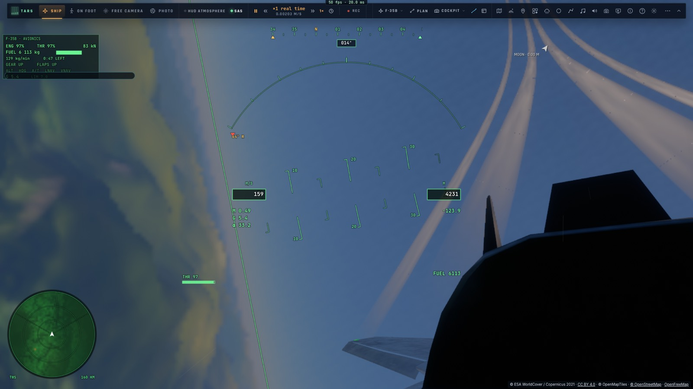

# Les manettes et les HOTAS

Le jeu lit tous les périphériques branchés en même temps : une manette Xbox ou PlayStation, un manche, une manette des gaz, un palonnier, souvent sur trois prises USB. Chaque axe et chaque bouton peut être affecté à une commande. Les réglages sont gardés dans le navigateur, par modèle de périphérique. Plan : [`PLAN-HOTAS.md`](PLAN-HOTAS.md) (M7, H1–H6) ; la manette du F-35 : [`progress/aviation/MANETTE.md`](progress/aviation/MANETTE.md).

## Les fichiers

| Fichier | Rôle |
|---|---|
| `src/input/axes.ts` | pur : le modèle d'un périphérique d'après son identifiant ; la mise en forme d'un axe (calibration, inversion, zone morte, courbe) ; le levier absolu et son cran ; un chapeau lu comme un axe ; les affectations lues sur tous les périphériques ; les fronts des boutons ; la détection |
| `src/input/devices.ts` | les instantanés des périphériques, les profils du joueur (`kerr.pads`), `PadControls` : la lecture de chaque image, les périphériques réclamés |
| `src/input/profiles.ts` | les profils connus (douze modèles), le profil générique d'un appareil de vol inconnu, le modèle de la manette standard |
| `src/input/haptics.ts` | les vibrations : le fond continu (`hapticMix`), les impulsions, l'envoi à chaque périphérique qui sait vibrer |
| `src/input/jetpad.ts` | pur : la disposition de chasseur d'une manette standard pour le F-35 (sticks, tête, zoom, palonnier, appuis brefs et longs) |
| `src/ui/pads-screen.ts` | l'écran « Manettes et HOTAS » : les périphériques en direct, l'affectation par détection, les réglages des axes, la calibration |
| `src/gamepad.ts` | la manette standard (son mapping intégré : le vol, la caméra, les menus) ; elle laisse aux profils les périphériques réclamés |
| `src/controller/piloting.ts` | `pilotInput` : le clavier, le tactile, la manette et les profils additionnés ; la reprise du levier |

## Le chemin d'une entrée

```
navigator.getGamepads() ─ snapshotDevices ─┬─ profil du joueur (par modèle) ─┐
                                           ├─ profil connu (identifiants)   ─┼→ readCommands → axes, actions, touches tenues
                                           └─ profil générique (par le nom) ─┘
axes ────────────→ pilotInput : tangage, roulis, lacet, translations RCS, regard ; le levier → les gaz (reprise)
actions (fronts) → onPadKeyAction → la même action que la touche du clavier (keymap.ts)
touches tenues ──→ ajoutées à celles du clavier
freins aux pieds → motion.ts (ajoutés au freinage de l'arrêt)

manette standard, F-35 piloté (non réclamée) → JetPad.step (lens.ts) → commandes de vol, tête, zoom ; ses actions → onJetPadAction
```

- **Le modèle** : Chrome donne « Nom (Vendor: 044f Product: b10a) », Firefox « 044f-b10a-Nom », Safari le nom seul. Le modèle est `fournisseur:produit` (ou le nom). Le profil du joueur est gardé sous ce modèle.
- **Réclamé** : un périphérique sans mapping standard qui a un profil n'est plus lu comme une manette par `gamepad.ts`. Auparavant, un HOTAS était lu comme une manette, avec ses axes affectés au hasard. La manette standard n'est jamais réclamée (elle garde sa caméra et ses menus). Si le joueur lui crée un profil, ce profil pilote le vol à la place du mapping intégré.
- **Plusieurs sources sur une commande** (la torsion du manche et le palonnier, par exemple) : leurs valeurs s'additionnent, puis sont bornées.

## Un axe

- **La calibration** : l'étendue apprise (bouger chaque axe jusqu'à ses butées), ramenée à −1…+1.
- **L'inversion**, puis **la zone morte** (8 % par défaut, 12 % pour une torsion).
- **La courbe** : x·(1 − c) + x³·c. La pleine course est conservée ; c = 0,35 par défaut.
- **Un demi-axe** : un seul côté d'un axe (un manche poussé d'un côté seulement).
- **Un chapeau** : ses huit positions, lues comme deux axes (le regard).

## La manette des gaz

- **Absolue** : la position du levier donne les gaz, de 0 à 100 %. Un cran de 4 % au ralenti garantit 0 % en butée basse. Les touches et les gâchettes de la manette Xbox restent incrémentales.
- **La reprise, comme un fader de table de mixage** : si les touches (ou le branchement) ont laissé les gaz ailleurs que sur le levier, celui-ci ne les reprend qu'en passant par leur valeur. Sans cela, au premier mouvement, les gaz sautaient de 30 % à plein.
- **En pilote automatique** (rentrée, approche), les gaz sont ceux de l'ordinateur. En mode assisté, le directeur indique sa poussée et le pilote la règle au levier.
- **Avec le F-35** : le levier bougé coupe l'auto-manette (les gaz repris par une autre main). La postcombustion
  s'allume par son action (⇧Z, ou un bouton qui lui est affecté) et met les gaz à fond ; ramener le levier sous
  95 % l'éteint, comme on sort du cran de postcombustion.

## Le F-35 à la manette (Xbox 360, Xbox, PlayStation)

Dès qu'on pilote le F-35 avec une manette au mapping standard, elle prend une disposition de chasseur
(`src/input/jetpad.ts`). Elle s'applique quand on pilote le F-35 — ni dans la vue libre, ni à pied, ni en spectateur. Un profil du joueur
pour cette manette (« personnalisée » dans l'écran des manettes) garde la priorité.

| Commande | Effet |
|---|---|
| Stick gauche | tangage (tiré : cabrer) et roulis |
| Stick droit | la tête : on regarde où il pointe (150° à droite et à gauche, 80° en haut, 45° en bas) ; lâché, elle revient droit devant |
| R3 (maintenu) | le zoom : le champ divisé par 2,5 ; relâché, le champ d'avant |
| RT · LT | plus · moins de gaz (incrémental) |
| LB · RB | palonnier gauche · droite |
| LB + RB maintenus | le curseur de désignation (TDC) : le stick droit le déplace (la tête reste), A désigne dessous au lieu du canon — voir plus bas |
| L3 | la postcombustion |
| A (maintenu) | le canon |
| B | tirer l'arme choisie (hors combat : acquitter l'alarme) — la touche Entrée |
| X | l'arme suivante |
| Y | appui bref : verrouiller la cible suivante (en combat, sinon la piste radar suivante) · maintenu : l'interception |
| Croix | ▲ train · ▼ volets · ◀ leurres · ▶ aérofrein |
| View | appui bref : la vue suivante · maintenu : la tête verrouillée sur la cible (comme ⇧L) |
| Menu | appui bref : les tenues du pilote automatique (altitude et cap) · maintenu : les réglages |

- **La tête est un ressort** : elle suit le stick droit, adoucie sur 0,09 s (la course un peu plus forte au bord
  du stick), et revient à zéro dès qu'il est lâché.
- **Le zoom suit R3** en douceur (0,12 s).
- **Le palonnier monte et descend en rampe** : plein en 0,25 s, au lieu de cogner d'un coup.
- **Appui bref ou long** (Y, View, Menu) : 0,4 s les sépare ; un seul des deux est déclenché.
- **Le verrouillage** donne une vibration brève.
- L'aide des commandes (?) a sa section « The F-35 on a controller ».



## Le curseur de désignation (TDC)

Sans souris, on désigne une piste avec le **curseur de désignation** (PLAN-RADAR-AAA, constat 29 ; `src/input/tdc.ts`,
`src/controller/tdc.ts`).

- **On le maintient** : les deux gâchettes hautes de la manette du F-35 ensemble ; ou la commande maintenue
  **« Curseur de désignation (TDC, maintenu) »** donnée à un bouton du HOTAS dans l'écran des manettes (au clavier :
  F15 par défaut, à changer dans les touches — aucune touche libre en vol, ni en AZERTY ni en QWERTY).
- **Où il se pose** : en vol avec un radar (le F-35, le Ranger), sur le scope radar du HUD ; dans le cockpit du F-35, sur
  la page du PCD au centre de la vue (la tête tournée vers elle). Lâché, il disparaît ; repris, il revient où on l'a
  laissé sur cet écran.
- **On le déplace** : le stick droit de la manette (la tête ne bouge plus), le mini-manche d'une manette des gaz (les
  axes de translation RCS), un chapeau affecté au regard, ou les flèches.
- **On désigne** : A sur la manette, ou l'action **« Désigner sous le curseur (TDC) »** (F14, ou la détente du HOTAS).
  Comme un clic : une piste sélectionnée, une seconde fois verrouillée ; sur le PCD, ce qu'un toucher ferait là.

## Les profils connus

| Modèle | Ce qui est affecté |
|---|---|
| Thrustmaster T.16000M, T.Flight HOTAS, Warthog (manche) ; Saitek/Logitech X52, X56 (manche) ; Logitech Extreme 3D Pro ; VKB Gladiator | le roulis, le tangage (manche tiré : nez haut), la torsion en lacet ; le SAS au bouton du pouce ; le levier intégré s'il y en a un |
| Thrustmaster TWCS, Warthog (manette) ; X56 (manette) | le levier (absolu), le culbuteur en lacet, le mini-manche en translations RCS |
| Thrustmaster TFRP, T-Rudder ; Saitek/Logitech Pro Flight | les freins aux pieds, le lacet |
| un appareil de vol inconnu (nommé manche, manette des gaz, palonnier…) | un profil générique, d'après ses axes |

L'ordre des axes varie selon le navigateur et le système. Ces profils sont donc un point de départ : la détection les corrige.

## L'écran « Manettes et HOTAS »

Il s'ouvre depuis l'écran des commandes. On y trouve :

- **Les périphériques en direct** : chacun avec son nom, son modèle, son profil (connu, générique, le mien, ou le mapping intégré d'une manette standard), ses axes en barres et ses boutons allumés.
- **Les affectations** : un clic sur la source d'une commande, puis on bouge l'axe ou on presse le bouton. Le plus grand mouvement l'emporte. Un manche bougé d'un seul côté donne un demi-axe, un levier l'axe entier.
- **Les réglages de chaque axe** : l'inversion, la zone morte et la courbe, avec la réponse tracée.
- **Les actions** : ajouter une commande (un axe, une action du clavier, une touche tenue), calibrer, revenir au profil d'origine. Une manette standard peut être « personnalisée » à partir de son mapping intégré.

Toute modification fait du profil celui du joueur, gardé pour ce modèle. **Rien n'est piloté tant que l'écran est ouvert** : un bouton pressé pour l'affecter ne déclenche pas son action.

Un bouton peut recevoir n'importe quelle action du clavier, celles du F-35 comprises : la postcombustion, les
tenues du pilote automatique, NAV, le STOVL, l'arme suivante, les leurres, la tête verrouillée (⇧L), ou la roue
des ordres de la patrouille (son action « orders », sur F13 par défaut).

## Les vibrations

- **Le fond continu**, renouvelé toutes les 100 ms : la poussée (léger, aigu), le plasma de la rentrée (lourd), le roulage (il grandit avec la vitesse).
- **Les impulsions**, par-dessus : chaque roue qui touche, les joints de la piste, un bang, les secousses transsoniques, l'amarrage et la séparation, un crash.
- **L'envoi** : `dual-rumble` (Chrome, Safari), `pulse` (Firefox), à tous les périphériques qui savent vibrer.
- **Le réglage** « Vibrations des manettes » va de 0 (aucune) à 1 (0,6 par défaut). Les vibrations sont calculées par le directeur du son, mais restent sensibles même le son coupé.

## Les tests

- **Unitaires** : `tests/hotas-axes.test.ts`, `tests/hotas-profiles.test.ts`, `tests/hotas-haptics.test.ts`,
  `tests/jetpad.test.ts` (les sticks et les gâchettes, la rampe du palonnier, la tête et son retour, le zoom,
  chaque bouton une seule action même maintenu, Y et Menu brefs ou longs, le canon tenu).
- **e2e** `tests/e2e/jetpad.e2e.test.ts`, une manette simulée dans la page : RT pousse les gaz, le stick gauche
  incline l'avion, le stick droit tourne la tête puis la rend, R3 zoome, la croix sort et rentre le train, et en
  combat au canon Y verrouille, A tire.
- **e2e** `tests/e2e/hotas.e2e.test.ts`, avec un HOTAS en trois pièces simulé dans la page :
  - la réclamation ;
  - le manche et la reprise du levier ;
  - un bouton sur le SAS ;
  - les freins aux pieds ;
  - les profils connus ;
  - l'écran par de vrais clics ;
  - les vibrations.
- **e2e** `tests/e2e/hotas-flight.e2e.test.ts`, un vol entier au HOTAS simulé, à 25 km d'Edwards :
  - le levier pris au ralenti, puis réglé pour tenir 200 m/s ;
  - une montée de 15 s et un tour complet incliné à 35°, au manche ;
  - l'approche en mode assisté : le directeur suivi au manche, le levier là où il le demande ;
  - attendu : posé sur la piste, sans remise des gaz.

Pour simuler des périphériques dans une page, remplacez `navigator.getGamepads` (voir le `FAKE` des e2e) : chaque objet a `id`, `mapping: ""`, `axes`, `buttons` et, pour les vibrations, `vibrationActuator`.
