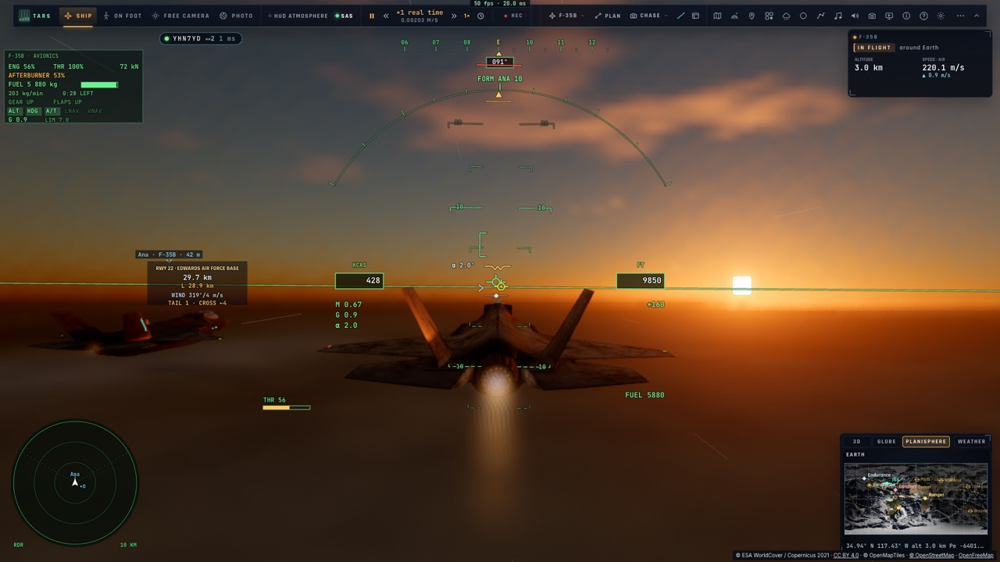

# Jouer ensemble

*[English version](NETWORK.md)* — le plan et ses étapes : [PLAN-RESEAU.md](PLAN-RESEAU.md) ; les planches :
`docs/progress/reseau/`.

Deux à quatre joueurs dans un même monde, avec des spectateurs et des écrans instruments à côté. Le solo
reste entier : rien ne se connecte tant que le joueur ne demande pas une salle, et le code réseau
(`net.js`, 13 Ko) n'est chargé qu'à ce moment.

## Démarrer

1. **Ouvrir le panneau Réseau** : **Échap** (le menu pause) → **Réseau — jouer ensemble** ; ou **Tab maintenu**
   (la roue) → **Réseau**. (Le panneau peut être masqué : Réglages › Réseau.)
2. **Votre nom et votre couleur** en haut du panneau.
3. **Créer une salle** (un nom, un mot de passe facultatifs) → son **code de six lettres** s'affiche, avec
   **Copier le lien**. Envoyez le code ou le lien aux autres.
4. **Les autres** : le même panneau → **Rejoindre une salle**, le code (et le mot de passe s'il y en a un), le
   rôle — **Pilote**, **Spectateur** ou **Instruments** ; ou simplement en ouvrant le lien. Un téléphone ou une
   tablette : l'onglet **Écrans** affiche un **QR code** à scanner.
5. **En salle**, le badge en haut à gauche (● CODE · joueurs · latence) rouvre le panneau : onglets **Équipage**
   (Suivre, À côté, volumes), **Match** (combats, courses, atterrissages), **Voix** (micro), **Écrans**.
6. **Quitter la salle** en bas du panneau ; **Reprendre mon engin** au retour dans une salle.

## Les salles (R0)

- **Réseau — jouer ensemble** (le menu pause, la roue) : un pseudo et une couleur ; **Créer une salle**
  (un nom et un mot de passe, tous deux facultatifs) ou en **Rejoindre** une par son code, comme pilote,
  spectateur ou écran instruments ; **Vos salles** : celles que l'appareil connaît, rejointes d'un clic,
  supprimées par leur propriétaire.
- **Le lien de la salle** (`#join=CODE`) : la page s'ouvre directement dans le jeu, la salle rejointe.
- **Le badge** à côté de la carte de la cible : le code de la salle, ses membres, l'aller-retour ; ambre
  quand la liaison est perdue (le jeu continue, la liaison est retentée et la salle reprise, à la même
  place).
- Une salle accueille 8 appareils, dont 4 pilotes. Le serveur la garde jusqu'à ce que son propriétaire la
  supprime ; son horloge continue quand personne n'y est.
- **Réglages › Réseau › Menu Réseau** désactivé : aucune trace du réseau dans le jeu.

## Voler ensemble sur Terre (R1)

- **Chacun pilote son engin** (le F-35, le Ranger, le Lander…, plusieurs du même type) : ceux des autres sont
  dessinés là où ils sont — les gouvernes, le train, la tuyère et les trappes STOVL d'un F-35 bougent comme
  les commandes de son pilote, sa flamme de postcombustion, les traînées de ses moteurs, les fils de ses
  saumons et sa nappe de vapeur sous facteur de charge —, leur pseudo, leur engin et leur distance au-dessus
  d'eux (une flèche au bord de l'écran hors champ), sur le radar du F-35 dans leur couleur avec leur route et
  leur hauteur par rapport à la nôtre.
- **Affichés au présent** : prolongés depuis leur dernier échantillon par leur mouvement (vitesse,
  accélération, rotation), un désaccord résorbé en douceur — un ailier à 25 m vole à 25 m (un cinquième de
  seconde de retard le mettrait 50 m en arrière à 250 m/s).
- **À côté** (le panneau de la salle, pour chaque autre pilote) : votre engin placé à sa droite, à sa vitesse,
  son cap et son altitude — en patrouille ; au sol, garé à côté de lui. `__bh.net.teleport(slot, écart?)`.
- **Formation** (le panneau de la salle, pour chaque autre pilote en vol dans l'air de la Terre ; à nouveau :
  coupée) : votre pilote automatique vole en échelon à sa droite — à 15 m de ses ailes et des vôtres (26 m
  entre deux F-35), 15 m en arrière — et s'y tient, ses virages et ses changements de vitesse suivis ; le HUD
  affiche `FORM ANA 4 M` (son nom, la distance au poste). Il rejoint d'où vous êtes (3 km en deux minutes, en
  ralentissant de lui-même — l'aérofrein quand le ralenti ne suffit pas — pour ne pas dépasser) ; au-delà de
  20 km, ou au sol : À côté d'abord. Le manche, les gaz, les touches du pilote automatique ou un autre pilote
  automatique la coupent : l'altitude, le cap et la vitesse sont alors tenus. Elle n'entre jamais à portée de
  ses ailes : à sa hauteur à moins de 14 m, elle repousse vers l'extérieur, et pour passer de son autre côté
  elle passe derrière lui (35 m). `__bh.net.formation(slot, { side?, gap?, back?, up? })`. La loi
  (`game/formation.ts`) : chaque axe de son repère une boucle amortie sur l'écart au poste, la vitesse de
  rapprochement plafonnée et assez lente pour s'y arrêter ; son virage d'après son inclinaison, aussitôt
  (anticipé par sa vitesse de roulis), ses changements de vitesse d'après sa trajectoire ; l'inclinaison, la
  pente et la vitesse de l'auto-manette volées par la loi avion.
  Mesuré sur kerr-mini (`tests/e2e/net-formation-ap`, vent léger) : parti 3,2 km derrière et 1 km sur le côté,
  au poste en 115 s puis tenu à 4 m ; le virage de 90° d'Ana à 30° d'inclinaison, Ben à l'intérieur, 7 à 13 m
  au pire pendant sa mise en virage, puis 6 m ; son accélération de 220 à 250 m/s, 12 à 14 m au pire (sa
  postcombustion), puis 6 m ; depuis 55 km, À côté puis au poste à 8 m. En air calme, leader régulier : moins
  d'un mètre.
  
- **Le temps de la salle** : ×1 (temps réel) pour tous, un warp demandé est refusé ; en entrant, la scène est
  mise à l'heure de la salle (le même Soleil) si elle en est à plus d'une minute.
- **Les liens directs** : un canal de données WebRTC vers chaque autre page — sans ordre, jamais renvoyé —,
  établi par le serveur de salles, les échantillons en direct (1–3 ms sur un même réseau), par le serveur tant
  qu'un pair n'est pas joint ; le panneau dit comment arrivent ceux de chacun (direct, local · relayé · via le
  serveur).

Mesuré sur kerr-mini (`tests/e2e/net-flight`, deux pages) : un lien direct local de 1–3 ms ; les deux F-35 en
patrouille se voient à 27,6–27,7 m ; la postcombustion du leader vue allumée chez l'ailier.

Deux Mac, le serveur de salles de production entre eux (`tests/e2e/net-formation` : le leader ici, l'ailier
sur kerr-mini, tous deux au pilote automatique 3000 m, cap 090, 220 m/s, journaux mis côte à côte sur l'heure
de la salle, 3 min) :
- en air calme l'écart reste de 40,0 à 40,1 m (dérive 4 cm) : les deux pages volent le même vol ;
- par vent léger (sa turbulence propre à chaque engin) il s'ouvre de 40 à ~105 m en 3 min (≈50 m en arrière,
  35 m sur le côté) — comme deux vrais jets au pilote automatique : ils tiennent une vitesse air et un cap, pas
  une place ;
- quel que soit l'écart, chaque page dessine l'autre là où il est à 2–5 cm près (9 cm au plus).

Pas encore : le train et les feux du Ranger
d'un autre (une uniforme de l'engin piloté), les engins des joueurs partis gardés dans le monde de la salle
(R7).

## Les matchs (R3)

- **Un match** (le panneau de la salle, un pilote : le mode, ce qu'on vole, les règles — munitions infinies,
  invulnérable, tir ami, missiles ennemis, la durée, la limite de victoires) : **chacun pour soi**, **deux
  équipes** (bleus et rouges, distribués à tour de rôle), **ensemble contre les agresseurs** (les quatre
  combats), une **course de portes**, un **concours d'atterrissage**. Un compte à rebours de 8 s sur l'horloge
  de la salle, puis chaque pilote placé à son départ : le cercle de 8 km de l'arène au-dessus du lac Rogers,
  face au centre, les équipes de front à 15 km l'une de l'autre, le départ du combat de front, la course en
  échelon (60 m à droite, 40 m en arrière), l'atterrissage en file à 2,5 km.
- **En combat** : les autres dans votre monde, là où le réseau les place — les équipiers en bleu, jamais
  verrouillés, jamais touchés sans tir ami — ; **vos tirs jugés chez vous** (un coup sur un autre lui est
  envoyé, ses dégâts sont les siens) ; les agresseurs de l'hôte visent le pilote le plus proche, tournent sur
  son monde et sont envoyés aux autres avec leurs missiles ; **les missiles de chaque pilote sont envoyés** —
  dessinés avec leur fumée, l'alerte missile quand l'un vous poursuit — ; vos leurres trompent aussi les
  missiles des autres.
- **Abattu** : annoncé à tous (le fil : *Ben ✕ Ana · AIM-120*), la victoire comptée, de retour au combat 5 s
  plus tard à votre place du cercle ; une **collision en vol** entre deux joueurs les détruit tous les deux
  (hors match : pas de pause, retour sur la piste la plus proche 4 s plus tard).
- **Le HUD** : le marqueur de coup (quatre traits ; une victoire : épais et rouge), la barre de score (le
  mode, le chrono, les scores ou ceux des équipes), les grands mots (le compte à rebours, *GO*, *abattu par …
  — retour dans 4 s*), le classement final ; un arrivant est informé du match en cours.

Mesuré sur kerr-mini (`tests/e2e/net-battle`, `net-coop`) : l'AIM-120 tiré à 15 km vu dans le casque de la
cible à 15 km, la victoire sur les deux feuilles ; les drones de l'hôte dans le monde de l'invité à un mètre
près ; l'AIM-9X de l'invité en abat un, la victoire est la sienne des deux côtés ; les coureurs à 72 m au
départ.

### Le combat libre, l'ailier par la roue

- **Ailier par la roue** : Tab maintenu › *Patrouille* › *Ailier de Ana* (chaque pilote de la salle en vol dans
  l'air de la Terre ; *Quitter la formation* quand on y est), ou TARS « rejoins Ana » : la formation automatique,
  à **la première place libre** de la forme choisie — celles de ses ailiers IA et des autres joueurs sur son aile
  (chaque page dit à la salle sur l'aile de qui elle vole, toutes les 2 s) prises ; les trois prises, en file
  derrière lui, à 80 m et plus.
- **Le combat libre** (en salle, en F-35, sans match en cours, ni mission, leçon ou défi à soi ; le réglage
  *Combat libre en salle*, actif par défaut) : armes actives — missiles air-air, canon —, **tout appareil est une
  cible** : les autres joueurs (orange, verrouillés par Tab comme toute piste), leurs ailiers IA et les nôtres
  (tir ami autorisé), les avions de ligne, navires, porte-avions et escortes réels que le radar voit — celui
  verrouillé, et tout ce qui est à moins de 6 km (le canon), pris dans le combat par une doublure placée chaque
  image d'après l'image radar (`controller/fightproxy.ts`) ; abattu, le vrai disparaît sur toutes les pages de la
  salle (*Ana ✕ AFR123*). Le radar en armes libres : la piste liaison de données d'un ami se verrouille aussi.
  Abattu : de retour en l'air 6 s plus tard, 15 km au sud, à 5 000 m. Pas de score à atteindre, pas de fin ; la
  barre dit *Combat libre* et les victoires. Un match demandé le remplace.
- **Coop** : les pilotes d'un même camp (bleus, jamais verrouillés, pas touchés sans tir ami) — ils étaient
  jusqu'ici les cibles les uns des autres.

## Les voix (R2)

- **Activer le micro** (le panneau de la salle) : le navigateur demande une fois ; notre voix part sur chaque
  lien direct (WebRTC, Opus — écho annulé, bruit réduit). Elle s'ouvre **à la voix** (par défaut, un seuil),
  **en tenant une touche** (appuyer pour parler : la touche choisie dans le panneau — aucune des touches de vol
  n'est libre) ou **toujours**.
- **Chacun entendu par radio** d'un engin à l'autre : la bande d'un casque, un peu de saturation, un souffle
  pendant qu'il parle, les **bips Quindar** au début (2 525 Hz) et à la fin (2 475 Hz) de chaque prise de
  parole, comme pour Apollo ; les moteurs, l'ambiance et la musique baissés sous sa voix (−8 dB) ; qui parle
  allumé dans le panneau (◉) et sur son étiquette ; le volume de chacun.
- **Deux appareils d'un même réseau ne s'entendent pas** (ils sont dans la même pièce : l'écho) — une case
  pour les entendre.
- Le relais (TURN) pour les téléphones en 4G : le coturn du serveur, une fois activé ([DEPLOY.md](DEPLOY.md)) ;
  STUN seul d'ici là.

Mesuré sur kerr-mini (`tests/e2e/net-voice`, deux pages, une phrase enregistrée comme micro de chacun) : la voix
de chacun reçue par l'autre à −8 à −12 dBFS, allumée « parle », deux bips Quindar ; le même réseau coupé.

## Suivre un autre, les écrans ajoutés (R4)

- **Suivre** (le panneau de la salle, pour chaque pilote) : votre engin devient sa marionnette — placé là où il
  est à chaque image, son type, ses gouvernes, son train, sa tuyère et sa flamme, ses instruments (sa
  télémétrie quatre fois par seconde : le carburant, la manette, le train, les volets, l'aérofrein) —, **toutes
  les vues** du jeu sur lui (le cockpit et son écran panoramique, la poursuite, le fly-by, la vue libre autour
  de lui…) ; vos propres échantillons ne sont pas envoyés.
- **Un spectateur** (le lien de la salle avec `&role=spectator`, ou le rôle du panneau) suit aussitôt le premier
  pilote ; **un écran instruments** (`&role=instruments`) aussi, dans son cockpit.
- **La caméra de mort** : abattu en match par un autre, on suit son avion jusqu'à ce qu'on revole.
- **Ajouter un écran** (le panneau de la salle) : le lien de la salle en **QR code** — l'appareil photo d'un
  téléphone ou d'une tablette l'ouvre (en HTTPS : samlepirate.org) — comme spectateur, écran instruments ou
  pilote ; le code est le nôtre (`src/net/qr.ts`, mode octet, correction M, versions 1–10, vérifié module par
  module contre la bibliothèque Python qrcode).

Mesuré sur kerr-mini (`tests/e2e/net-spectate`) : l'engin suivi à 1–11 m de là où son pilote l'a (lu à 0,1 s
d'écart), son train posé d'après le sien, le HUD et le cockpit du F-35 ; le pilote ne voit personne.

Pas encore : la prédiction de chute libre du spectateur (« IMPACT … ») est celle de son propre engin (sans
portance), pas celle du pilote ; la route et les modes du pilote automatique ne sont que sur l'écran du pilote.

## À pied ensemble (R5)

- **Marcher** (⇧K hors d'un engin posé, ou le mode À pied) : les autres voient votre astronaute — le vrai, son
  corps articulé, sa démarche (marche, course, virage, saut) d'après votre vitesse —, là où vous marchez sur la
  Terre, votre nom au-dessus de lui (« à pied ») ; votre engin garé se voit aussi. 15 échantillons par seconde,
  sa place et sa vitesse prédites au présent comme celles des engins.
- **Monter à bord d'un ami** (⇧K à pied près de l'engin posé d'un autre — à moins de 4 m de l'une de ses
  portes, ou 2 m de sa coque) : vous voyagez en **passager** — son engin est le vôtre sous toutes les vues, ses
  instruments, son vol ; le pilote en est averti (« Ben est à bord »), le panneau de la salle et son étiquette
  le disent. Votre propre engin reste garé où il était.
- **Descendre** (⇧K une fois son engin posé et immobile) : à pied à sa porte de droite, son nez devant ; votre
  engin revient là où vous l'aviez laissé (au décimètre).
- Les engins des autres sont placés depuis votre caméra où qu'elle soit — à pied à 14 km de votre engin, celui
  d'à côté est bien à côté.
- **Sur la Lune, sur Mars** aussi : un engin posé y est envoyé fixé à ce sol (non plus en vol libre : il ne
  dérive plus chez les autres), son astronaute y marche.
- **À côté** d'un joueur à pied : vous à pied à côté de lui (2,5 m à sa droite, tourné comme lui), votre engin
  garé près du sien s'il est posé sur ce sol.

Mesuré sur kerr-mini (`tests/e2e/net-walk`) : deux astronautes à 12 m l'un de l'autre sur le parking
d'Edwards, chacun vu par l'autre à la bonne distance ; l'un marche 3 s — vu se déplacer à 1,1–1,3 m/s ; il
monte dans le F-35 de l'autre (sa vue à moins de 0,1 m de lui, posé : aucun faux décollage annoncé), descend à
8 m de lui, son propre F-35 retrouvé à 14 km à 0,1 m près.

Pas encore : l'herbe désactivée, les autres à pied ne sont dessinés que si vous marchez aussi ; le passager a
la vue du pilote (pas de second siège modélisé).

## Ensemble dans l'espace (R6)

- **Le warp de la salle** : le warp de chaque pilote est son vote ; la salle tourne au plus lent demandé. Une
  baisse est immédiate pour tous (datée de l'instant où son pilote a ralenti) ; une hausse attend que tous les
  pilotes la demandent — « ×100 demandé — on attend Ben » dans la barre du temps, « Ana demande ×100 —
  accélérez pour accepter » chez Ben (accélérer l'accepte) ; elle part alors au même instant pour tous. Une pause
  met la salle en pause (« en pause par Ana ») ; une salle vide continue à ×1.
- **Une horloge** : chaque scène est tenue sur celle de la salle (recalée de la moitié au double du pas, remise
  dessus d'un coup si un onglet a été mis de côté) ; les échantillons portent le temps de scène de leur émetteur
  et sont lus à celui du lecteur — une horloge un peu décalée ne déplace personne.
- **En orbite** : au-dessus de 100 km (ou hors de la sphère de la Terre), un engin est envoyé dans le repère
  inertiel du corps dont il est dans la sphère ; en roue libre (sans poussée), il est porté le long de son orbite
  (Kepler, plus les attractions autres que le centre du corps que son pilote mesure — l'aplatissement de la
  Terre, la Lune, le Soleil —) entre ses échantillons, de 1 à 30 par seconde selon le warp, un aussitôt quand il
  quitte l'orbite que les autres lui prêtent.
- **Vus** : dessinés jusqu'à 60 km, au-delà une étiquette avec la distance (des milliers de km) ; **cibles**
  (Tab, la carte, un clic) : la distance et la vitesse de rapprochement du HUD, le verrouillage, le rendez-vous,
  la carte 3D avec l'orbite de chacun ; **À côté** fonctionne en orbite (à 200 m de l'aile, à la même vitesse).

Mesuré sur kerr-mini (`tests/e2e/net-space`) : deux Rangers à 200 m l'un de l'autre sur une orbite de 400 km ;
le ×100 d'Ana tenu à ×1 jusqu'à ce que Ben accepte, puis 500 s de scène à ×100 — les deux scènes à moins de
0,1 s de l'horloge de la salle, la patrouille gardée (169 m) ; Ben ralentit à ×10 puis ×1 : immédiat pour les
deux, les deux à moins d'une seconde ; Ben ciblé : les 168 m du HUD = ceux de la vue ; à un quart d'orbite : un
marqueur à 6 400 km.

Pas encore : un pas qui suive le temps propre (la dilatation de Gargantua : R8) ; un changement de date en
salle.

## S'amarrer ensemble, le monde persistant (R7)

- **S'amarrer à l'engin d'un autre** : ciblez-le (Tab, la carte), approchez au HUD d'amarrage ou enclenchez
  **DOCK** (B) : l'autopilote vous amène sur son port libre comme sur celui de la station. À la capture, l'engin
  le plus léger s'accroche au plus lourd (à masse égale, le dernier arrivé) : il est **tenu** par l'autre — sa
  place celle de l'hôte composée avec celle des ports, ses caméras et ses écrans gardés — ; l'hôte pilote
  l'assemblage et vous voit sur son port, rigide. **DÉSAMARRER** (ou une poussée) : les ressorts vous écartent à
  5 cm/s.
- **Les contacts** : un engin qui heurte la coque d'un autre rebondit ; l'autre reçoit sa part du choc (selon
  leurs masses). (Les collisions en vol des combats restent dans l'air terrestre.)
- **Le monde persistant** : la salle garde l'engin de chacun tel qu'il l'a laissé — garé là où il était, ou
  sur son orbite (porté par Kepler) : les autres le voient (« Ana (absent) »), le ciblent, s'y amarrent. De
  retour dans la salle, **Reprendre mon engin** (le panneau de la salle) vous remet dessus, là où il est.

Mesuré sur kerr-mini (`tests/e2e/net-dock`) : le Ranger de Ben dérivant à 15 cm/s sur le moyeu avant de
l'Endurance d'Ana : accroché, tenu à moins d'un millimètre de là où son engin le porte, vu sur son moyeu (à
14,7 m de son centre) ; Ana déplacée d'1 km : Ben avec elle (1,5 cm) ; désamarré : 0,2 m d'écart 4 s après ;
l'autopilote DOCK de 25 m à la capture ; hors de l'axe à 0,5 m/s : « Contact avec l'Endurance d'Ana · 0,42 m/s »,
sa part reçue ; Ana partie : son Endurance sur son orbite, Ben s'y amarre ; Ana revenue dessus, à 3,6 m de Ben.

Pas encore : un engin libre partagé (l'Endurance de la salle) avec des baux ; la masse de l'assemblage pour
l'hôte ; le train et les feux d'un Ranger distant.

## Près de Gargantua (R8)

- **Du côté de Gargantua**, chaque engin est envoyé sur la carte du trou (la carte plate de Boyer–Lindquist, sa
  vitesse de coordonnée) ; les autres près du vôtre sont ramenés dans le repère propre de votre caméra —
  dessinés, étiquetés, **À côté** y fonctionne aussi (en orbite de Miller, au tiers de la vitesse de la lumière,
  à 200 m d'une aile).
- **Par le trou de ver** : ceux de l'autre côté sont signalés sur sa bouche (« près de Gargantua — par le trou de
  ver », « dans notre système solaire — par le trou de ver »).
- **Une horloge** pour la salle — son temps de coordonnée — : près de Miller votre temps propre ralentit, et votre
  étiquette le dit aux autres (τ ×0,85 sur une orbite de 400 km autour de Miller).

Mesuré sur kerr-mini (`tests/e2e/net-gargantua`) : deux Rangers autour de Miller, chacun vu à 206 m de l'autre ;
Ben revenu près de la Terre : Ana signalée sur la bouche avec le rythme de son horloge.

Pas encore : les marqueurs déviés par la lentille au loin (ils pointent en ligne droite) ; le train et les feux
d'un Ranger distant.

## Comment ça marche

- **Le serveur de salles** (`server/rooms.ts`, Bun, SQLite) : les salles et leurs membres, l'horloge, les
  événements de la salle, les échantillons des engins relayés. En production sur
  `wss://stream.samlepirate.org/` ([DEPLOY.md](DEPLOY.md)) ; en dev et dans les tests, sur le serveur de
  la page, en `/net` (`#server=` en choisit un autre, `?prodnet` celui de production depuis localhost).
- **Le protocole** (`src/net/proto.ts`) : du JSON pour la vie de la salle, des échantillons binaires de
  104 octets pour les engins (position en float64, vitesse, attitude, rotation, accélération, ce que montre
  l'engin : manette, postcombustion, train, volets, STOVL, commandes de vol, α, CL, Mach).
- **L'horloge** (`src/net/clock.ts`) : l'échange de NTP, le décalage du huitième le plus rapide des 64
  derniers échanges ; à moins d'une milliseconde entre deux pages sur une même machine.
- **Les autres** (`src/net/remote.ts`) : affichés un peu dans le passé — assez pour que l'échantillon
  suivant soit là —, une spline d'Hermite entre deux échantillons, prolongés par leur mouvement au-delà du
  dernier (puis un fantôme), un désaccord résorbé en douceur.
- **Le labo réseau** : `#netlab=latence,gigue,pertes` (par exemple `100,20,0.05`) simule un réseau par-dessus
  la liaison.
- **Le robot** (`src/net/bot.ts`) : `bun src/net/bot.ts --room CODE` rejoint une salle et vole un cercle
  au-dessus d'Edwards, 30 échantillons par seconde.

Mesuré sur kerr-mini (deux pages et le robot, `tests/e2e/net-rooms`) : aller-retour 5–7 ms, les
échantillons en retard de 5 ms (95 % : 27 ms), les autres affichés avec 60–75 ms de retard, les horloges des
deux pages à 0,3 ms près.

## Tests

De bout en bout aussi : `tests/e2e/net-gargantua` (près de Gargantua, par le trou de ver), `tests/e2e/net-dock` (s'amarrer ensemble, les contacts, le monde persistant), `tests/e2e/net-space` (en orbite ensemble, le warp de la salle, les cibles), `tests/e2e/net-walk` (à pied ensemble, un passager), `tests/e2e/net-moon` (à pied sur la Lune, À côté à pied), `tests/e2e/net-formation` (deux Mac en patrouille, la dérive), `tests/e2e/net-formation-ap` (le pilote automatique de formation : rejoindre, virer, accélérer, couper, de loin), `tests/e2e/net-flight` (deux F-35 : vus à 8 km, sur le radar, le lien direct, À côté —
la patrouille, le même écart vu des deux côtés —, la postcombustion vue). Unitaires : `tests/net-core.test.ts` (les échantillons, l'horloge sous 200 ms et 5 % de pertes, Hermite au
centimètre, le lissage, le vol du robot), `tests/net-rooms.test.ts` (un vrai serveur : salles, limites, mots
de passe, la place reprise à la reconnexion, la suppression par le propriétaire, les salles gardées après un
redémarrage). De bout en bout : `tests/e2e/net-rooms` (la page solo intacte, une salle depuis le menu pause,
une page par le lien, le robot, les horloges, le départ).
