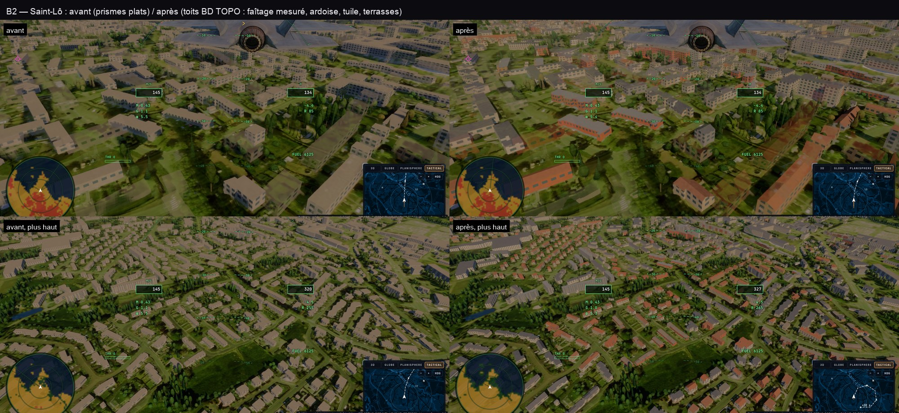
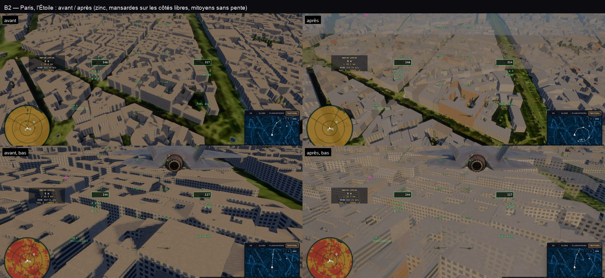
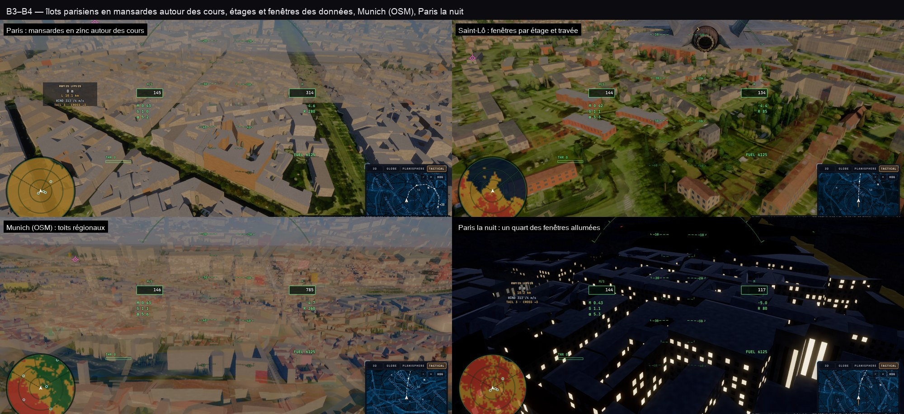

# Plan — les bâtiments AAA : toits, matériaux, ombres et coût

Date : **24 octobre 2026**. Base : `main` à `5cd59c23`.

Demande : « Améliore les buildings, fais les toits, basé sur les données. AAA et performance. Analyse comment les rendre
parfaits. »

Statut : **plan et analyse** ; l'exécution suit, une phase à la fois (commit, captures et mesure par phase), suivie en
bas de ce fichier.

## 1. Verdict

Les bâtiments de Kerr ont les **bonnes emprises** (BD TOPO en France, OSM ailleurs) mais ce sont des **prismes plats
coupés à la gouttière**, d'une seule couleur, avec des fenêtres en bandes obliques et une ombre en boîte. Les données
pour faire mieux sont **déjà dans les tuiles que la scène télécharge** : la BD TOPO donne l'altitude de la gouttière, celle
du faîtage (70 % des bâtiments hors Paris), le matériau de la toiture et celui des murs, l'usage et le nombre d'étages.
Rien de plus à télécharger pour les phases B1 à B3.

« Parfait », ici, c'est : la **silhouette du toit** mesurée (gouttière et faîtage), sa **forme** déduite de l'emprise et
de la mitoyenneté (un faîtage parallèle à la rue, pas de gouttière en V entre deux voisins), sa **couverture** lue dans les
données (tuile, ardoise, zinc, terrasse), des **murs** dans leur matériau avec des étages et des fenêtres alignés sur le
mur, des **ombres exactes**, et un coût **égal ou inférieur** à aujourd'hui dans le raster.

## 2. Ce que fait le jeu aujourd'hui

| Pièce | Où | État |
|---|---|---|
| Emprises | `scenery-worker.ts` (BD TOPO z 15 en France, OpenFreeMap z 14 ailleurs) | exactes, anneaux et cours gardés |
| Hauteur | `bdtopo.ts bdtopoHeight` | `hauteur` BD TOPO **= gouttière** (`altitude_minimale_toit − altitude_minimale_sol`, vérifié : 17,8 = 55,1 − 37,3) ; OSM `render_height` = sommet |
| Toit | `trace.wgsl sceneryQuery` | **plat** : deux couvercles (dessus, dessous) par test point-dans-polygone, murs par arête |
| Couleur | worker | **une seule** pour tous : `(0,38, 0,36, 0,32)`, toit ×0,72 |
| Fenêtres | `worldScenery` | `fract((x + y) × 0,24)` : des bandes à 45° dans le repère est-nord, pas le long du mur |
| Lumière | `windsockShade` | Lambert + ciel uniforme × 0,6 ; ni spéculaire (vitres, zinc), ni ciel selon la normale, ni lumière la nuit |
| Ombres | `scenery-raster.ts boxShadowVs` | la carte d'ombres dessine la **boîte englobante est-nord** de chaque bâtiment : un bâtiment tourné de 45° ombre deux fois sa surface ; les toits n'existent pas |
| Visibilité raster | `boxVs` | les boîtes englobantes marquent l'alpha ; `shade` parcourt alors tout le BVH depuis la racine |
| Gros bâtiments | worker | **écartés** au-delà de 256 sommets (cathédrales, gares, grands îlots) |
| Collisions | `scenery-contact.ts` | prisme du contour |

## 3. Les données, mesurées le 24/10/2026

Tuiles BD TOPO z 15 (`data.geopf.fr/tms/1.0.0/BDTOPO`) de Paris 1er/2e, Paris 16e et Saint-Lô, tuiles OpenFreeMap z 14 et
Overture (PMTiles `2026-10-21.0`) décodées depuis ce Mac.

### 3.1 BD TOPO `batiment`

| Champ | Paris (1 247) | Saint-Lô (1 225) | Usage pour les toits |
|---|---|---|---|
| `altitude_minimale_toit` (gouttière) | 94 % | 96 % | hauteur des murs |
| `altitude_maximale_toit` (faîtage) | **0 %** | **69 %** | hauteur du toit |
| `materiaux_de_la_toiture` | 71 % | 78 % | couverture |
| `materiaux_des_murs` | 71 % | 78 % | murs |
| `nombre_d_etages` | 75 % | 80 % | étages, combles parisiens |
| `usage_1`, `nature`, `construction_legere` | 100 % | 100 % | résidentiel / annexe / industriel / église… |

Codes des matériaux (fichiers fonciers, Cerema `dmatto` et `dmatgm`, deux chiffres = deux matériaux, `0` indéterminé) :

- **toiture** : 1 tuiles, 2 ardoises, 3 zinc ou aluminium, 4 béton (toit-terrasse), 9 autres ;
- **murs** : 1 pierre, 2 meulière, 3 béton, 4 briques, 5 aggloméré (enduit), 6 bois, 9 autres.

Saint-Lô (reconstruction des années 1950) : ardoise 26 %, béton 8 %, tuiles 5 % ; Paris : zinc 32 %, tuiles 11 %, zinc et
tuiles 10 %. Le béton est plat dans 62 % des cas (faîtage − gouttière ≤ 1 m), l'ardoise dans 13 %.

Hauteur du toit (faîtage − gouttière, Saint-Lô, 835 bâtiments) : quartiles **0,8 / 1,8 / 3,5 m**, 90 % sous 5,5 m ;
68 % des bâtiments ont un toit de plus de 1 m. **Aujourd'hui ce volume manque entièrement.**

### 3.2 Les emprises

| | Paris 1er | Saint-Lô |
|---|---|---|
| sommets (médiane / 90 % / 99 %) | 7 / 14 / 27 | 4 / 9 / 26 |
| remplissage de la boîte orientée minimale (10 % / médiane) | 0,6 / 0,8 | 0,7 / 1,0 |
| quatre coins au plus | 33 % | 63 % |
| avec une cour (trou) | 7 % | 0,1 % |
| **murs mitoyens** (arête parallèle à moins de 0,8 m d'une arête voisine, en longueur) | **47 %** (16e : 29 %) | **30 %** |

Deux conséquences : la plupart des maisons sont des rectangles (un toit sur la boîte orientée suffit), mais **un tiers à la
moitié des murs sont mitoyens** — un toit qui descend vers un mur mitoyen fait une gouttière en V entre deux maisons
qui, en vrai, ont un toit continu. La mitoyenneté décide aussi de l'axe du faîtage des maisons de ville (parallèle à la
rue, perpendiculaire aux murs mitoyens, même quand la maison est plus profonde que large).

### 3.3 Hors de France

- **OpenFreeMap / OpenMapTiles** : `render_height` (le sommet, toit compris), `render_min_height`, `colour` (28 % à Paris),
  **pas de forme de toit**.
- **Overture Maps** (PMTiles z 14, CORS ouvert) : `roof_shape`, `roof_height`, `roof_direction`, `roof_orientation`,
  `roof_material`, `roof_color`, `facade_color`, `facade_material`, et `building_part` (les parties des monuments).
  Couverture de `roof_shape` : **Munich 33 %** (540 à deux pans, 178 plats, 89 à quatre pans…), Paris 3 %, Saint-Lô
  0,6 %, Chamonix 0,4 %, New York 10 % (plats), Tokyo 1 %. Tuiles de 0,5 à 1,6 Mo (trois à dix fois OpenFreeMap).
  Utile en Allemagne, en Autriche, en Suisse alémanique ; ailleurs des règles.

## 4. Les décisions de conception

### 4.1 Un toit = l'intersection de plans (exacte, tracée, rasterisée)

Chaque bâtiment est découpé par le worker en **unités de toit** convexes (le plus souvent une seule, sa boîte orientée).
Le toit d'une unité est la surface `z(x, y) = min(plans)` : chaque côté de l'unité qui porte une pente donne un plan qui
passe par ce côté à la gouttière et monte vers l'intérieur, plus un plan horizontal au faîtage. Cette seule famille donne
le **plat**, l'**appentis**, les **deux pans**, les **quatre pans**, le **pavillon**, le **brisé (mansarde)** — deux plans
par côté, raide puis doux — et la **croupe partielle** ; l'espace sous la surface est convexe.

Le bâtiment est alors `prisme(emprise ∩ unité) ∩ sous-le-toit` :

- **murs** : l'arête exacte de l'emprise, de la base jusqu'au toit au point touché (`z(x, y)`, quelques plans) — le pignon
  d'un toit à deux pans vient tout seul ;
- **toit** : l'entrée du rayon dans l'espace convexe sous les plans (`max` des entrées, `min` des sorties), puis **un seul**
  test point-dans-polygone. Aujourd'hui il y en a deux (les deux couvercles) : le nouveau test coûte **moins** pour
  toutes les emprises de plus de quatre coins.

Les formes en L, T, U : des unités **qui se chevauchent** à l'angle ; l'union des deux toits à deux pans fait les noues.
Les îlots parisiens : des ailes rectangulaires, le brisé de chacune. Les côtés **mitoyens** et les côtés **intérieurs**
d'une découpe ne portent pas de pente.

### 4.2 Les règles qui choisissent le toit

Dans l'ordre :

1. **Données** : faîtage − gouttière ≤ 0,8 m → plat ; sinon pente = hauteur du toit / demi-largeur de l'unité (le
   faîtage mesuré exactement). Overture `roof_shape` plus tard (B7).
2. **Matériau** : béton → plat ; zinc avec ≥ 5 étages (Paris) → brisé ; ardoise ou tuile → à pentes.
3. **Usage et taille** : industriel, agricole, commercial de plus de 600 m² → plat ou très faible pente (bac acier) ;
   `construction_legere` → appentis faible ; église → pente raide.
4. **Combles parisiens** sans faîtage : `nombre_d_etages` × 3,1 m − hauteur à la gouttière = étages du comble (1 à 2) →
   brisé de 70° sur cette hauteur, terrasson ensuite.
5. **Ailleurs (OSM)** : la hauteur OSM inclut le toit ; sous 250 m² et 3 niveaux → toit à pentes pris dans la hauteur
   (pente régionale : 45° au nord, 30° en tempéré, 22° méditerranéen, 25° alpin) ; au-delà → plat.
6. **Forme** : deux pans par défaut, quatre pans pour les unités presque carrées (rapport < 1,3) et en régions où c'est
   l'usage ; faîtage parallèle aux côtés libres (non mitoyens) ; mitoyen des deux bouts → deux pans entre pignons
   mitoyens.

### 4.3 Matériaux et lumière

- **Toitures** : tuile mécanique ou canal (rangs le long de la pente, couleur régionale), ardoise (rangs fins, gris-bleu
  sombre), zinc (joints debout tous les 0,5 m, gris clair, reflet métallique), terrasse (gravillon, acrotère).
- **Murs** : pierre de taille (calcaire parisien), meulière, béton, brique (appareil), enduit, bois ; une variation stable
  par bâtiment ; **étages** à la hauteur des données (gouttière / étages), **fenêtres le long du mur** (coordonnée de
  l'arête, travées de 3 à 4 m), vitrines au rez-de-chaussée d'un usage commercial.
- **Lumière** : ciel selon la normale (un mur reçoit la moitié du ciel d'un toit), occultation douce au pied des murs et
  dans les angles, **reflet de Fresnel** du ciel sur les vitres et le zinc, **fenêtres éclairées la nuit** (une sur trois,
  par hachage, plus dans les logements).

### 4.4 Performance

Leçons de la campagne G1 : le noyau est limité par ses registres ; du code ajouté à une boucle chaude coûte même là où il
ne sert pas. Donc :

- le test exact reste **par feuille du BVH**, avec moins de tests point-dans-polygone qu'aujourd'hui ;
- le raster dessine des **enveloppes orientées en forme de toit** au lieu des boîtes est-nord : moins de pixels marqués
  « bâtiment » (le BVH parcouru moins souvent) ; la carte d'ombres dessine les mêmes enveloppes — **des ombres exactes**
  pour les unités pleines, à la précision d'un décroché sinon ;
- puis (B2b, mesuré) la feuille désignée par le raster, testée seule, comme les arbres ;
- les matériaux près de la caméra seulement (au-delà de ~1,5 km, la couleur moyenne) ;
- mesure : `perf-suite` / `raster-shade-ablation` sur kerr-mini, A/B alternés, Paris, Saint-Lô et Tarifa ; budget **≤ 0** en
  raster par rapport à `5cd59c23`, ≤ +5 % en tracé.

### 4.5 Mémoire

Une unité de toit coûte 48 octets de plus par feuille (centre, axes, demi-côtés, profil, côtés en pente), soit +20 % sur un
bâtiment de sept arêtes ; la découpe en unités ajoute des feuilles aux formes en L. Le budget du tampon (16, 36 ou 64 Mio
selon la portée) reste celui d'aujourd'hui ; le compte de bâtiments passe avant les octets.

## 5. Les phases

| Phase | Contenu | Preuve de sortie |
|---|---|---|
| **B0** | Banc : vues fixes Paris (Trocadéro), Saint-Lô, Tarifa en raster ; captures et timestamps de `shade`, de la passe raster et de la carte d'ombres | planche « avant », chiffres de base |
| **B1** | `src/system/roofs.ts` (pur, testé) : lecture des champs BD TOPO et OSM, boîte orientée, mitoyenneté, unités, règles §4.2 ; le worker les écrit dans les feuilles | tests unitaires ; statistiques des formes par ville (pentes, plats, brisés) |
| **B2** | Le traceur : murs jusqu'au toit, toit par plans, couvercle unique ; CPU (`scenery-contact`) au même toit ; raster : enveloppes orientées en visibilité et en ombre | captures avant/après, A/B ≤ 0 en raster ; ombres comparées aux bâtiments tournés |
| **B2b** | La feuille désignée par le raster, testée seule | A/B ; image identique |
| **B3** | Matériaux et lumière §4.3 | planche de jour et de nuit, A/B |
| **B4** | Grands bâtiments : simplification au lieu du rejet (plus de bâtiment perdu au-delà de 256 sommets) ; îlots parisiens en ailes | Louvre, gare de Lyon, Notre-Dame présents |
| **B5** | Détails : souches de cheminées sur les murs mitoyens et les faîtages, lucarnes des brisés, acrotères, débords de toit | captures rapprochées ; coût mesuré |
| **B6** | Toits LiDAR (France) : faîtage et axe par la MNH où la BD TOPO n'a pas de faîtage (Paris) | écarts au MNS sur un quartier |
| **B7** | Teinte des toits par l'orthophoto (partout), puis Overture `roof_*` hors de France (décision : poids des tuiles, lecteur PMTiles, zones hors ligne) | A/B visuel ; décision de l'utilisateur pour Overture |

## 6. Risques

- **Hauteur au mauvais endroit** : la `hauteur` BD TOPO est à la gouttière, OSM au sommet ; les deux doivent rester dans
  leurs règles (un toit OSM est pris *dans* la hauteur, un toit BD TOPO *s'ajoute*).
- **Mitoyens mal détectés** (deux tuiles BD TOPO, découpes de la scène) : un pignon en trop vaut mieux qu'une gouttière en V
  — la détection compte « mitoyen » seulement à moins de 0,8 m et parallèle à 8° près.
- **Coût du noyau** : chaque ajout mesuré en A/B avant d'être gardé ; ce qui ne paie pas est écarté et noté ici.
- **Enveloppes trop justes** : une enveloppe doit contenir le bâtiment (jamais un pixel perdu) — même règle que les proxys
  des arbres.

## 7. Suivi

### B0 — banc (24/10)

`tests/e2e/buildings.e2e.test.ts` : Paris (l'Étoile), Saint-Lô, Munich, le F-35 en vue poursuite au-dessus des toits
puis plus bas, vue tenue en raster ; `BLD_NIGHT=1` la vue basse de nuit. Coût : `tests/e2e/raster-shade-ablation.e2e.test.ts`
aux lieux `paris-low` et `stlo-low` (le vol réel, cockpit), A/B entre commits par `scripts/ab-commit.ts` +
`scripts/ab-e2e.ts` (A B B A). Mesure de `shade` dans mon e2e abandonnée : une vue tenue s'affine dans le traceur, la
passe raster n'y tourne pas toujours.

### B1–B2 — toits par plans, ombres par triangles (24/10, `38c1e3a6`)

- `src/system/roofs.ts` (pur, 18 tests) : codes matériaux, régions (Paris : zinc par défaut ; Bretagne-Normandie :
  ardoise), boîte orientée, côtés fusionnés (les décrochés cadastraux de quelques centimètres ne sont pas des côtés),
  mitoyenneté (`partyEdges` : < 0,8 m, parallèle à 8°, > 50 % de la longueur), choix de la forme, plans.
- Formes sur les tuiles mesurées (parties comprises, voir B4) — Saint-Lô : 1 200 deux pans, 116 appentis (annexes
  adossées), 423 plats (béton mesuré plat), 67 quatre pans ; Paris : 13 300 parties en mansarde, 12 200 deux pans.
- `trace.wgsl sceneryQuery` : murs jusqu'au toit, toit par l'entrée dans l'espace convexe sous les plans, un seul test
  point-dans-polygone (deux avant).
- Ombres : la carte d'ombres dessine les triangles des bâtiments proches (`roof-mesh.ts`, `earcut.ts`) — leurs pignons et
  pentes — et non plus leurs boîtes est-nord. La visibilité garde les boîtes (élargies : l'antialiasing des silhouettes).

### B3–B4 — matériaux, lumière ; emprises complexes (24/10)

- B3 (`trace.wgsl buildingLook`) : étages à la hauteur des données, travées de 3,2 m le long du mur, fenêtres en retrait
  qui reflètent le ciel (Fresnel de Schlick, reflet du Soleil), vitrines au pied des immeubles, un quart des fenêtres
  allumées la nuit ; pierre (assises), brique, enduit ; rangs de tuiles et d'ardoises dans la pente, joints debout et reflet
  du zinc, gravillons des terrasses ; ciel vu selon l'orientation (`WS_AO`).
- B4 (`roofs.ts convexParts`, `planBuilding`) : l'emprise complexe coupée en parties convexes (Hertel–Mehlhorn sur
  `earcut`), chacune son toit sur ses côtés libres, à la pente du bâtiment ; les îlots parisiens à cour en mansardes
  tout autour ; plus de bâtiment perdu au-delà de 256 sommets (simplifié, ses mitoyens reportés).
- Budget : en deux passes — une feuille simple pour tous (le compte d'avant : 32 000 à Paris en portée très lointaine),
  puis le détail (parties, triangles) pour les plus proches tant qu'il tient. Paris : bâtiments 13,4 Mo, triangles
  7,6 Mo (17 500 parties), forêt 12,7 Mo, raster 4,2 Mo. Triangles à 12 octets (trois indices).

Coût (kerr-mini, `raster-shade-ablation` à `paris-low`, A B B A, A = `5cd59c23`) : `shade` 52,0 / 58,7 ms avant, 51,5 /
49,3 ms après ; décor coupé ~33 ms des deux côtés — **aucun surcoût** (un premier A/B d'une seule paire, 48,6 contre 61,1,
n'était que le bruit d'une session de Chrome à l'autre).

### B5 — acrotères, lucarnes ; ombres adoucies (24/10)

- Acrotères : un bâtiment plat tout entier (pas un abri, pas une annexe, murs > 4 m) a ses murs 0,8 m au-dessus de son
  toit (`PARAPET_M`, bit 22 du mot de la feuille), dans le traceur et dans les triangles de la carte d'ombres.
- Lucarnes peintes sur les brisis des mansardes : une par travée de 3,2 m, vitre qui reflète le ciel, un tiers allumées
  la nuit — sans géométrie (dix lucarnes par immeuble en feuilles auraient coûté ~2,5 Ko chacun).
- Carte d'ombres : une boîte de trois texels à position continue (4 × 4 texels pondérés) au lieu de 3 × 3 texels entiers —
  le bord d'une ombre ne fait plus d'escaliers d'un texel (0,9 m, une douzaine de pixels à 100 m).
- Validation par les données (`bdtopo.e2e`, Front de Seine, kerr-mini) : la médiane du toit modélisé contre celle du LiDAR
  (MNS − MNT) aux mêmes points de chaque emprise — **BD TOPO 2,5 m d'écart médian, 58 % à 3 m près ; OSM 4,5 m, 34 %**
  (1 274 parties et 661 bâtiments comparés). L'ancienne mesure (le sommet du prisme contre la médiane) ne valait plus avec
  des toits en pente.

### B7a — teinte des toits par l'orthophoto : essayé, rejeté (24/10)

La couleur des toits proches prise dans l'orthophoto au point du toit (là où l'IGN ou swisstopo en a une fine), les motifs
du matériau gardés : les toits de Paris sont sortis vert olive, ceux de Saint-Lô gris-vert — l'orthophoto n'est pas une
orthophoto vraie (un immeuble y déverse de quelques mètres : au point du toit, c'est la rue, la cour, les arbres), et
l'imagerie régionale s'y mêle. Retiré. Une teinte par bâtiment (la médiane de l'orthophoto sur l'emprise rétrécie, calculée
par le worker) reste possible ; elle demande les dalles d'orthophoto au worker.

### B6 — hauteurs de toit mesurées par le LiDAR (24/10)

Là où la BD TOPO n'a pas de faîtage (tout Paris), dans les 2 km du centre de la scène : la MNH de l'IGN (sursol, déjà lue
pour les forêts en I4, ~3 m le texel) aux points intérieurs de l'emprise (à plus de 1,5 m des murs) ; leur 85ᵉ centile est
le haut du toit, le toit la différence avec la gouttière (0,8–12 m ; en dessous, plat). 9 849 toits mesurés ainsi dans la
scène de l'Étoile. `bdtopo.e2e`, même centre de scène qu'en B5 : **1,4 m d'écart médian, 70 % à 3 m près** (B5 : 2,5 m, 58 % ;
OSM : 4,5 m, 34 %). Piège : deux machines sur la même IP doublent le débit vers la Géoplateforme — HTTP 429 ; un e2e IGN à la
fois.

### Reste à faire

- **B2b** — la feuille désignée par le raster (comme les arbres) : le coût est déjà neutre, gain attendu en ville dense.
- **Cheminées** (souches sur les murs mitoyens parisiens) : en feuilles près de la caméra seulement.
- **Overture** hors de France (`roof_shape` à Munich sur 33 % des bâtiments) : décision à prendre (tuiles 3 à 10 fois plus
  lourdes qu'OpenFreeMap, lecteur PMTiles, zones hors ligne).
- **Ombres proches nettes** : une cascade fine (±150 m à 0,15 m le texel) pour les vues au ras des toits.

