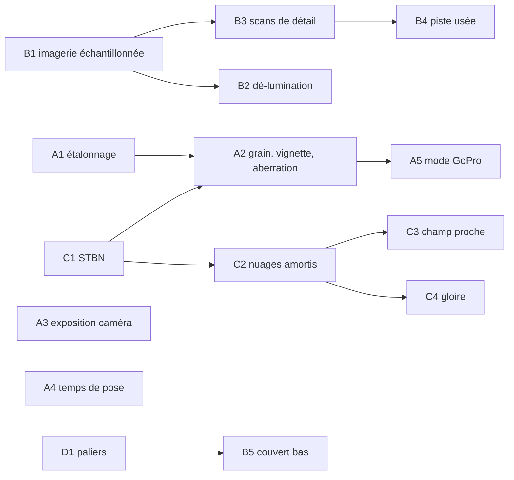

# Plan — ce que VIPER 11 fait de bon pour l'image, repris dans black-hole-gpu

Date : **31 octobre 2026**. Statut : **analyse et plan, rien d'implémenté.** Aucun test ni e2e lancé pour l'écrire.

> **Fusionné le 2 novembre 2026 dans le plan commun [PLAN-REFRACTION-HORIZONS.md](PLAN-REFRACTION-HORIZONS.md)**
> (décisions 28 et 32). Ses chantiers y sont devenus : A1–A4 → I6 (profil Caméra), A5 → I8, B1 → T9, B2.1 → Q2
> (`groundRelight`), B2.2 → Q7 (L7), B3 → L8, B4 → Q7, B5 → Q8, C1–C4 → Q5, D1 → I4, D2 → Q9. Ses sept questions (§7) y
> sont tranchées (décision 32). **L'ordre, les devis et les critères font foi là-bas** ; ce document reste le relevé de
> VIPER 11 et ses sources.

> Demande de Sam : « Crée un plan md pour inclure ce qui est bon dans viperoneone dans le projet. Ce qui améliore le
> graphisme. Analyse la faisabilité, le code existant et qualité/perf. »

Suite de [PLAN-RENDU-RASTER-AAA.md](PLAN-RENDU-RASTER-AAA.md), [PLAN-NUAGES-AAA.md](PLAN-NUAGES-AAA.md) et
[progress/raster-aaa/TERRE-UNREAL.md](progress/raster-aaa/TERRE-UNREAL.md), dont il reprend les invariants : WGS84 partout,
aucun phénomène existant retiré, chaque réglage accessible à TARS (schéma `ui/schema.ts`, `__bh`), le chemin tracé gardé
comme référence.

---

## 0. En bref

VIPER 11 ([viperoneone.com](https://viperoneone.com), un seul auteur, three.js r186 en WebGL2) a une image qui « fait
vidéo ». Son éclairage du sol est pourtant **presque naïf** : pas d'ombre du relief, seulement celle des nuages.
Ce réalisme vient de cinq choses, dans cet ordre d'importance :

1. **une chaîne caméra** (étalonnage, LUT, grain, vignette, aberration chromatique, exposition « caméra », flou de
   mouvement à temps de pose fixe, flare tiré des vrais pixels brillants, verrière rayée) ;
2. **des données réelles qu'il ne contredit pas** (la photo aérienne garde sa lumière : le relief n'est ré-éclairé qu'en
   partie) ;
3. **des nuages volumétriques bien éclairés** (takram, plus une passe de champ proche) et une atmosphère précalculée ;
4. **du détail sous le pixel de la photo en textures**, non en bruit (des scans à trois échelles) ;
5. **ce qui dépasse du sol** près des pistes (buissons, herbe, cailloux en instances).

Côté performance, il rend **toujours sous la résolution native** (≈ 0,64 par axe au palier haut). Il cache cette perte
par la chaîne caméra, et il pilote une vingtaine de réglages par paliers, avec hystérésis.

Nous avons déjà beaucoup de cela (air physique, nuages N1–N7, carte d'ombre des nuages, ambiante du ciel en harmoniques,
brume de chaleur, verrière mouillée, AO cuite par sommet, TAAU, RCAS). **Ce qui nous manque surtout, c'est la chaîne caméra,
la cohérence avec la photo et le budget des nuages.** Et nous avons un gros gain de coût à prendre sur l'imagerie.

| # | Chantier | Gain image | Gain / coût perf | Effort | Risque | Priorité |
|---|---|---|---|---|---|---|
| B1 | Imagerie en texture échantillonnée, filtrage anisotrope matériel | moyen (moins d'aliasing) | **gain net probable** sur `earth lite` | moyen | moyen (mise en page des fenêtres) | **1** |
| A1 | Étalonnage en espace écran : split-tone + LUT 3D, cockpit neutre | **fort** | ≈ 0 | faible | faible | **2** |
| A2 | Grain, vignette, aberration chromatique | moyen | ≈ 0 | faible | faible | **2** |
| A3 | Exposition « caméra » pondérée, mêlée au posemètre incident | moyen | ≈ 0 | faible | faible | **3** |
| B2 | Dé-lumination et ré-éclairage partiel de la photo | **fort** au sol | ≈ 0, ou gain si on allège des ombres | faible à moyen | moyen (Soleil bas) | **3** |
| C1 | Bruit bleu spatio-temporel (STBN) | faible à moyen | ≈ 0 | faible | faible | **4** |
| C2 | Nuages amortis : 1 texel sur 4 par image, plus de pas, la vraie marche vers le Soleil | **fort** | budget constant, réparti autrement | élevé | élevé (reprojection en vol rapide) | **5** |
| A4 | Flou de mouvement à temps de pose fixe, renforcé près du sol | moyen | ≈ 0 | faible | faible | 6 |
| D1 | Paliers de coût avec hystérésis et bannissement | indirect (net plus souvent) | **stabilité** | moyen | moyen | 6 |
| B3 | Scans de détail en rapport d'albédo, trois échelles, avec normales | **fort** en vol bas | + quelques lectures de texture | moyen | faible | 7 |
| B4 | Piste usée : dalles, joints, gomme, éclats de peinture | moyen (décollage, atterrissage) | faible | moyen | faible | 8 |
| B5 | Couvert bas en instances près des pistes (herbe, arbustes, cailloux) | **fort** en roulage et en vol rasant | à budgéter | élevé | moyen | 9 |
| C3 | Passe de champ proche dans les nuages | moyen | + passe à ½ quand on est dans un nuage | moyen | moyen | 10 |
| C4 | Gloire et ombre de l'avion sur les nuages | faible, mais spectaculaire | ≈ 0,05 ms | faible à moyen | faible | 11 |
| A5 | Mode caméra « GoPro » (objectif à profil, bandeau 2,39:1) hors cockpit | fort en replay et photo | rendu plus large, ou −26 % de pixels avec le bandeau | moyen | HUD conforme | 12 |

Les gains de coût marqués « probable » ne sont **pas mesurés** : ce sont des lectures du code, à confirmer au banc existant
(`raster-shade-ablation`, `gpuprof`).

---

## 1. Sources et méthode

- **Le site joué** (le menu, 42 joueurs en ligne), et **le bundle publié** (`/assets/*.js`, 3,8 Mo, sans source map). Les shaders
  GLSL y sont en clair, commentaires compris. Les réglages sont lisibles : tables de paliers, valeurs par défaut de la passe
  d'objectif.
- **Les 15 notes « How it's made »** (`/notes/*`), écrites par l'auteur avec les chiffres de son code : nuages, objectif,
  son, G, aérodromes, commandes de vol, postcombustion, gloire.
- **La LUT** (`/lens/viper.lut.bin`, 33³ en 16 bits) et les **captures couche par couche** de la note sur l'objectif
  (`lens-c{0,1}l{0,1}g{0,1}.jpg`), mesurées (ΔE en Lab).
- **Notre code** : `shaders/display.wgsl`, `shaders/post.wgsl` (`meter`, `motionBlur`, `temporal`, `cloudTemporal`, `taau`),
  `shaders/trace.wgsl` (`shadeLite`, `liteSun`, `earthImageryAniso`, `clouds`, `wxCloud`, `runwayShade`, `surfaceMaterial`),
  `system/earth-tiles.ts`, `system/cloud-pass.ts`, `noise3d.ts`, `renderer.ts` (lecture du posemètre, `shutterShare`),
  `main.ts` (gouverneur d'échelle), `settings.ts`, `ui/schema.ts`, et les docs de progression `raster-aaa`.

**Licences.** Le code propre de VIPER n'est pas sous licence ouverte : **on ne copie ni son code ni ses données (sa LUT, ses
réglages ajustés à sa vidéo)**. On reprend des techniques publiées, et on les réimplémente :
- Nubis (Schneider) ; Wrenninge pour les octaves de diffusion multiple ; Hillaire 2016 et 2020 ;
- le STBN de NVIDIA (Wolfe et al. 2022 ; vérifier la licence des textures avant de les embarquer) ;
- le CDLOD de Strugar ;
- le transfert de couleur par transport optimal en tranches (Pitié 2005, Rabin 2011) ;
- la théorie de Mie pour la gloire (Bohren et Huffman, Laven 2003).

takram `three-geospatial` est sous licence MIT.

---

## 2. Ce qui fait l'image de VIPER (relevé)

### 2.1 La chaîne caméra (`index-*.js`, passe `lens`, une seule passe de post)
Dans l'ordre, sur une image HDR linéaire, avec un seul tone mapping :
- **Exposition automatique** : moyenne logarithmique de la luminance, cockpit exclu. Le ciel compte à **30 %**, le sol devant
  à **×1,2**. Les pixels très brillants sont écrêtés avant la mesure (12, et 3 au Soleil). L'exposition vise `key 0,21`, dans une
  plage **0,6–1,6×**, en **1,2 s**. Elle respire comme une GoPro : nez vers le ciel, le cockpit plonge dans l'ombre.
- Bloom en 6 niveaux, à partir de 2,5 seulement. Rayons divins (flou radial vers le Soleil, plus forts quand il est à
  moitié caché). Voile (une PSF large autour du Soleil). Fantômes hexagonaux, étoile à 6 branches, traînée horizontale,
  halo chromatique. **Tout est calculé à partir des pixels brillants réels**, donc les nuages et le cadre de la verrière les
  masquent.
- **ACES une fois**, puis en espace écran : split-tone (ombres vers le sarcelle `(-0,025, 0,008, 0,035)`, hautes lumières vers
  l'orange `(0,035, 0,012, -0,03)`), puis **LUT 33³** à poids 1. Le cockpit est ramené vers le neutre (`cockpitNeutral 0,75`), avec
  une ouverture des noirs et `cockpitExposure 1,7`. Vignette 0,35, grain 0,018, aberration chromatique 0,012 sur les bords.
- **Flou de mouvement** : obturateur 180° à **30 i/s**, soit **1/60 s fixe**, appliqué au monde seulement, ×1,6 près du sol,
  plafonné à 0,18 de l'image.
- **Verrière** dans sa propre couche à ¾ de résolution. Les rayures sont un champ de sillons orientés, qui ne s'allument que
  perpendiculaires à la ligne œil–Soleil, en arcs à moins de 32° du Soleil. Il y a aussi des traces et de la poussière, un
  reflet Fresnel d'une cubemap du cockpit recalculée **toutes les 2 s**, et des gouttes en nuage.
- **Objectif** : 165° en 2,39:1, rectiligne dans les 28° centraux, puis compression vers les bords. L'image est assemblée à
  partir de **3 rendus** (centre à ±50°, côtés tournés à ±66°), ce qui coûte environ 45 % de temps d'image en plus.

**Mesures de l'étalonnage** (captures de la note, même image avec et sans) : ΔE moyen **16,5**, 78 % des pixels changés de
plus de 10. C'est la couche qui change le plus l'image, devant le flare (10,5, local) et la verrière (3,6). **La LUT seule**
(cube entier) : ΔE moyen 7,1, max 29,6. Elle remonte le noir (≈ 4 %, chaud) et plafonne le blanc (≈ 83 %, cyan). Elle fait
aussi trois choses aux couleurs :
- elle pousse les tons moyens vers le sarcelle (un gris à 50 % → a* ≈ −12) ;
- elle tourne le ciel du bleu-violet vers le cyan, ce qui corrige le biais connu d'ACES sur les bleus ;
- elle laisse le sable et l'orange presque intacts.

La LUT a été **ajustée** sur la vidéo de référence (transport optimal en tranches, région par région). Elle ne vaut que pour
cette scène, désert de jour, mais VIPER l'applique partout.

### 2.2 Le sol (`world-*.js`, `runway-*.js`)
- **Tuiles** : relief AWS Terrarium sur la pyramide, photos NAIP 0,6 m près des pistes, USGS plus loin. 4 559 tuiles
  d'image et 4 559 de hauteurs, en **KTX2/Basis transcodées dans des workers**, échantillonnées par le GPU avec mips. Le CDLOD
  de Strugar morphe les sommets et l'imagerie sur 68–95 % de la portée de chaque niveau. 12 tuiles chargées à la fois, les
  plus grossières et les plus proches d'abord, LRU à 1 400. Le facteur de distance est réglé pour qu'un texel reste sous un pixel.
- **Éclairage** : `col = albedo × (soleil × ndl + mix(sol, ciel, ½ + ½ n.y))`, avec
  **`ndl = mix(max(sun.y, 0), max(dot(n, sun), 0), uRelief)`**. La photo porte déjà la lumière de sa prise de vue, donc on
  ne ré-éclaire qu'une part du relief. Pas d'ombre du relief ; les ombres des nuages viennent de cascades vues du Soleil.
- **Détail en rapport d'albédo** : trois scans CC0 de Poly Haven, chacun appliqué comme **(texel ÷ couleur moyenne du scan)**, si
  bien que la photo garde sa teinte. Plus une normale de détail :

  | Échelle | Tuile | Estompé entre | Poids albédo | Poids normale |
  |---|---|---|---|---|
  | Proche | 4 m | 60 et 320 m | 0,85 (chroma à 30 %) | 0,9 |
  | Moyenne | 25 m, tournée de 0,61 rad | 1,2 et 4,5 km | 0,55 | 0,6 |
  | Macro | deux échelles, 400 m et 1 130 m, tournées | 12 et 32 km | 0,3 | 0,7 |

  Le détail est coupé sur l'eau.
- **Eau** détectée dans la photo (plus bleue que rouge, sombre ; aux Keys : l'altitude 0), puis Fresnel vers le ciel et reflet
  du Soleil. **Neige** au-dessus d'une ligne cassée par la luminance de la photo. **Lumières de ville** la nuit, tirées des routes.
- **Piste procédurale** : dalles de 6,1 m (20 ft) sur quatre de large, chacune sa teinte ; 10 % de dalles refaites ; rustines
  d'asphalte ; gomme le long de la roue avant et des trains principaux (±1,2 m) ; taches d'huile. Joints goudronnés qui
  s'amincissent avec la distance (`fwidth`), fissures fines qui s'éteignent sous le pixel, poussière en congères au bord, bord
  irrégulier. **Peinture écaillée** par le détail, plus mince sur l'axe ; **billes de verre** : la peinture reste jaune au Soleil
  bas. Antialiasage par couverture de bande (`band(x, a, b, fwidth)`).
- **Couvert bas** : 8 477 créosotiers placés **où le proche infrarouge de la photo (NDVI) montre un buisson**. 500 000 instances
  d'herbe, d'arbustes et de cailloux jusqu'à 3 km, dans les ravines, jamais sur les chaussées. Éteints à 650 m (cailloux),
  2,3 km (herbe), 3,2 km (arbustes). Éclairage simple (Soleil · n, ciel · (0,55 + 0,45 n.y)).

### 2.3 Les nuages (`takramClouds-*.js`, `sky-*.js`)
- **takram three-clouds** : jusqu'à **500 pas**, de 50 à 1 000 m, ×1,01 à chaque pas, coupés à 1 % de transmittance. **Un
  texel sur 16 par image** (ordre de Bayer 4×4), reconstruit sur 16 images par reprojection. 8 octaves de diffusion multiple.
  Cascades d'ombre des nuages 3 × 512² jusqu'à 80 km, partagées par le sol et les nuages.
- **Leur couche à eux** (stratocumulus, cirrus, pont lointain) : marche avec **raffinement à l'entrée** (un long pas qui tombe dans
  un nuage recule et rentre en pas fins, sinon des anneaux). Marche vers le Soleil en 6 pas croissants, chaque pas avec sa
  propre gigue au nombre d'or. Deux lobes de Henyey-Greenstein plus un lobe avant pour le liseré argenté. Terme de diffusion
  `exp(-τ·0,04)`. Rebond du sol sous les bases. Ombre au sol en 8 pas. Opacité forcée sous 1 %, pour que le Soleil ne fuie pas.
- **Champ proche** (dans un nuage ou tout près) : 20 pas fins jusqu'à 450 m puis 8 grossiers jusqu'à 900 m, à ½ résolution.
  **Filaments de Worley ancrés au monde** (ils défilent à la vitesse réelle), poches 3D, auto-ombrage local à deux échelles,
  diffusion `1/(1 + 0,22 τ)`, et un **plancher de brouillard texturé** quand takram voit un nuage et pas eux.
- Une **sonde** de densité à la caméra, une image sur deux, pilote le blanchiment, l'eau sur la verrière, la lumière du cockpit
  (−70 %) et le filtre du son.
- **Reprojection** : boîte de variance (±1,6 σ), profondeur la plus proche du 3×3. **Remontée de résolution** pondérée par
  `exp(-|Δ log profondeur| · 6)`, qui revient au bilinéaire loin des bords.
- **Bruit** : `stbn.bin` (STBN, 128×128×64), une lecture `texelFetch` par pixel.
- **Gloire** : table de Mie de 97 couleurs (gouttes de 7 µm), autour du point antisolaire, ×2,5 pour égaler les photos. Ombre
  de l'avion depuis un masque de 256² vu du Soleil, flouté au diamètre apparent du Soleil (16 prises). Quelques centièmes de
  ms, dans le rectangle d'écran utile seulement.

### 2.4 Les performances (`10-game-*.js`)
- **Résolution** : le monde à `res 0,85 × worldScale 0,75` au palier haut. Les vues de côté à 0,65, la verrière à 0,55–0,75.
  Le remappage de l'objectif sert de suréchantillonneur, et sa compression des bords fait un rendu fovéal.
- **Gouverneur** (`v6`) : 7 paliers (5 sur mobile ≤ 4 Go), chacun un **paquet de ~20 réglages** : résolution, côtés, qualité
  des nuages et leur résolution en pixels absolus, verrière, taille et **fréquence** de la carte d'ombre (toutes les 1, 2 ou 3
  images), LOD, portée du couvert, cirrus, composite. Ses règles :
  - fenêtre de 750 ms, mesure `max(médiane, 0,92 × moyenne)` ;
  - 1,5 s de stabilisation après chaque changement ;
  - descente si l'image dépasse le budget de **6 %**, de **deux paliers** au-delà de 2,5× ;
  - montée seulement après **20 s** sous le budget ;
  - **un palier abandonné est banni 90 s** ; s'il est retombé moins de 60 s après y être revenu, le bannissement double, jusqu'à
    10 min.
- **Couches à leur fréquence** : cubemap du cockpit toutes les 2 s, sonde des nuages une image sur deux, ombres une image
  sur N.

---

## 3. Notre état, au regard de VIPER

| Domaine | Nous | VIPER | Écart |
|---|---|---|---|
| Tone mapping | AgX, AgX punchy (défaut), ACES, Film, sortie HDR (`display.wgsl`) | ACES | — |
| Étalonnage | `filmGrade` (le look Interstellar, en linéaire, avant la courbe) ; rien en espace écran | split-tone + LUT 33³ + cockpit neutre | **à faire (A1)** |
| Grain, vignette, aberration | tramage TPDF d'un code seulement | 0,018 / 0,35 / 0,012 | **à faire (A2)** |
| Bloom, flare, saleté de lentille | oui (`lensFlare`, `lensDirtGlow`, `flareMeter`) | oui, plus rayons et voile | proche |
| Exposition | posemètre **incident** (`0,4/meterIncident`), plafonné par les hautes lumières (0,5 %, 2 % dans l'air) ; histogramme uniforme, cockpit exclu | réfléchi, pondéré, plage 0,6–1,6, 1,2 s | **A3** (complément, pas remplacement) |
| Flou de mouvement | `motionBlur` × déplacement d'une image × `shutterShare` (fraction d'image) | 1/60 s fixe, ×1,6 près du sol | **A4** |
| Brume de chaleur | `hazeOffset` (tourbillons, F-35, A320) | idem, plus stries d'ombroscopie | proche |
| Verrière | une couche (`glass-shell.ts`, U5), gouttes (`wetGlass`) | rayures orientées, traces, reflet du cockpit toutes les 2 s | à compléter (avec A2) |
| Imagerie | `rg32uint` (hauteurs + RGBA8 empaqueté) ; **filtrage manuel** : 4 `textureLoad` + unpack par prise, jusqu'à `TUNE_ANISO` prises par niveau | KTX2 échantillonné, mips, anisotrope matériel | **B1** |
| Lumière du sol | `A/π·(Eg·max(n·L,0) + ciel·…)`, avec la photo **plus** nos cartes d'ombre du relief, des arbres, des bâtiments et des nuages | relief ré-éclairé en partie (`uRelief`) | **B2** : ombres doublées chez nous |
| Détail sous la photo | `surfaceMaterial` : un `gnoise` en luminance, selon la classe WorldCover (régions) | 3 scans + normales | **B3** |
| Piste | `runwayShade` : marquages OACI nets, asphalte uni, gomme en bande dans la zone de toucher | dalles, joints, gomme, huile, fissures, éclats | **B4** |
| Couvert bas | herbe et cailloux pour le marcheur (`grass-layout.ts`, 30 m au plus) ; arbres en instances (U2) | 500 k instances jusqu'à 3 km | **B5** |
| Nuages | passe ½ par axe chaque image (`clouds`) ; `wxCloud` **16 pas par couche**, lumière par colonne en temps réel (la marche `wxLightTau` dans le noyau de convergence seulement) ; historique propre (`cloudTemporal`, ±1,25 σ) ; carte d'ombre (N3) ; ambiante en harmoniques (N2b) ; types (N4) ; orage (N5) | 1/16 par image, jusqu'à 500 pas, champ proche | **C2, C3** |
| Gigue | `fract(ign(px) + frame·φ)` (11 sites) ; deux sites figés dans le temps (voir C1) | STBN | **C1** |
| Gouverneur | échelle par huitièmes toutes les 1,5 s, taux d'ombrage raster ; en `shadeLite`, échelle tenue au plafond du raster | paquets de réglages, bannissements | **D1** |
| AO de l'avion | **déjà cuite par sommet** (`ship.ts STRIDE`, `jetAo`) | cuite par vues de profondeur | rien à faire |

Coûts de référence (kerr-mini, Paris bas, vue tenue, U10) : **~41 ms**, dont `earth lite` 13,5 ms, carte d'ombre du vaisseau
~5,5 ms (une image sur deux), visibilité raster 4,4, trace 2,5, temporel 2,4, sonde du vaisseau 1,9, masque du cockpit 1,6.

---

## 4. Les chantiers

Chaque chantier : ce qu'on prend, ce qui existe, la faisabilité (code touché, contraintes), la qualité et le coût attendus,
les risques. Les estimations non mesurées sont marquées *(estimation)*.

### Phase A — l'image « filmée » (`display.wgsl`, `post.wgsl`, `renderer.ts`)

**Contraintes communes.**
- La passe d'affichage (`fs`) lie aujourd'hui 7 textures échantillonnées. Elle peut en prendre plusieurs autres : c'est un
  fragment shader, hors du budget du traceur.
- La structure `Display` a deux composantes libres (`eye.zw`) ; au-delà, elle grandit d'un `vec4f` à la fois.
- Tout se fait **après le TAAU et le RCAS**, donc rien n'est accumulé dans l'historique (le grain surtout).
- L'avion piloté et le cockpit arrivent en image prémultipliée (`ship`). Son alpha permet donc de traiter le cockpit à part.
- Réglages dans `settings.ts` et `ui/schema.ts` (section `render`, groupe « Image »), atteignables par TARS. Les looks
  Interstellar (`tonemap: "Film"`) restent intacts.

#### A1 — Étalonnage en espace écran : split-tone, LUT 3D, cockpit neutre
- **Ce qu'on prend** : après le tone map et avant l'encodage sRGB :
  - un split-tone en luminance, sur des bornes lisses ;
  - une **LUT 33³** (texture 3D `rgba16float`, lue en trilinéaire au centre des texels :
    `c·(N−1)/N + 0,5/N`), avec un poids ;
  - la neutralisation du cockpit, pondérée par l'alpha de `ship`. Cela évite que le sarcelle rende le tableau de bord bleu
    marine.
- **Les LUT** : une identité par défaut, et des looks fabriqués **par nous** :
  - « footage » : un ajustement par transport optimal en tranches sur une vidéo de référence choisie par Sam, avec un script
    hors ligne en Bun ou Python dans `scripts/` ;
  - « neutre » ;
  - éventuellement un look par heure (jour, golden hour).

  Format : `.cube` ou binaire 16 bits dans `assets/lens/`.
- **Faisabilité** : simple. Une texture 3D, un sampler linéaire, un `vec4f` (le split-tone et ses deux teintes, le poids de la
  LUT). La LUT et le split-tone s'appliquent **à la sortie SDR**. En HDR étendu (`D.hdr.x`), deux choix : l'appliquer sur la
  partie SDR seulement (`m ≤ 1`, la même logique que `filmHdr`), ou la couper. À décider.
- **Qualité** : c'est la plus forte différence perçue chez VIPER (ΔE 16,5). Le ciel violacé de l'ACES se corrige au passage.
  Avec notre AgX par défaut, le biais est autre : à juger sur images.
- **Coût** : une lecture de texture 3D par pixel, ≈ 0 *(estimation)*.
- **Risques** : une LUT ajustée sur une seule scène, appliquée partout, décolore la nuit, l'espace et le trou noir. D'où :
  **look par contexte** (sur Terre dans l'air seulement, `meterInAir`), poids réglable, identité ailleurs.

#### A2 — Grain, vignette, aberration chromatique (et rayures de verrière)
- **Grain** : en espace écran, après la LUT, une amplitude qui diminue dans les hautes lumières, d'un bruit **bleu**, temporel,
  par image (voir C1). On garde le tramage TPDF actuel en dessous.
- **Vignette** : dans l'espace angulaire de la caméra (en degrés depuis l'axe), pas en uv, pour qu'elle soit la même en
  paysage et en portrait.
- **Aberration chromatique** : un décalage radial des canaux R et B, qui croît vers les bords (0,012 chez VIPER). Lire
  `hdr` deux fois de plus, ou seulement sur les bords (`smoothstep`).
- **Rayures de la verrière** (optionnel, F-35 en cockpit) : dans le shader du verre (`ship.wgsl fsCabinGlass`), un champ de
  sillons orientés qui ne s'allument que perpendiculaires à la ligne œil–Soleil.
- **Faisabilité** : simple pour les trois premiers ; moyenne pour les rayures (la texture des sillons, le Soleil vu du verre).
- **Coût** : ≈ 0, plus 2 lectures pour l'aberration *(estimation)*.
- **Intérêt perf** : le grain **masque la résolution interne réduite** (TAAU à 0,67, plan raster étape 4). Une image à 0,67 avec
  du grain se lit comme filmée, la même sans grain comme floue. C'est ce qui permet à VIPER d'être à 0,64.

#### A3 — Exposition « caméra », en complément du posemètre incident
- **Ce qu'on prend** : un terme réfléchi qui fait respirer l'image autour de l'exposition incidente, d'environ ±0,7 EV
  (plage 0,6–1,6×), en 1,2 s. Pondération : ciel 30 %, sol devant ×1,2, cockpit exclu (c'est déjà le cas par `moments.x < 0`).
- **Ce qui existe** : `post.wgsl meter` (64×64 cellules, 4×4 points par cellule, histogramme atomique de 128 cases de
  0,67 EV) ; `renderer.ts` dérive `m = 0,4/meterIncident`, plafonné par les quantiles hauts, puis lissé en ~1 s.
- **Faisabilité** : faible à moyenne.
  - Le noyau `meter` pondère ses `atomicAdd` par un entier selon la zone (ciel : profondeur nulle dans `moments.y`, ou la
    direction au-dessus de l'horizon ; sol devant : le tiers bas du centre).
  - Le CPU calcule une moyenne logarithmique sur l'histogramme pondéré, puis
    `EV = EV_incident + clamp(k · (log2(clé/moyenne) − biais), −0,7, +0,7)`.
  - Un réglage `exposureBreath` (0 = l'actuel), atteignable par TARS.
- **Qualité** : le cockpit qui plonge quand on cabre face au ciel, la sortie d'un nuage. C'est la signature « GoPro ».
- **Risques** : le pompage, que le code actuel a déjà combattu (les commentaires sur les quantiles dans `renderer.ts`). Il faut
  donc une plage étroite, des écrêtages (Soleil, ville la nuit) et **rien dans le télescope ni dans l'espace**.

#### A4 — Flou de mouvement à temps de pose fixe
- **Ce qu'on prend** : une longueur de flou = vitesse image × **temps de pose** (1/60 s par défaut), et non × fraction d'image.
  ×1,6 près du sol (profondeur < quelques centaines de m en vol bas), plafond à environ 18 % de l'image.
- **Ce qui existe** : `post.wgsl motionBlur` (2 à 12 prises, plafond 40 px) ; `TA.mb.x = motionBlur × shutterShare()`.
  L'avion est déjà composé après le flou, donc net.
- **Faisabilité** : faible.
  - `TA.mb.x = shutterSec / dtMédian`, avec `shutterShare` gardé contre les images en retard.
  - Le facteur « sol » lit `moments.y`.
  - Le réglage passe de « fraction d'image » à « temps de pose » ; la migration de `motionBlur: 0,5` vers 1/(2 × fps médian)
    est à écrire dans les réglages.
- **Qualité** : le même aspect à 25 et à 60 i/s. Au mini (25 i/s), le flou actuel (180° d'une image de 40 ms = 20 ms) est plus
  long que celui de VIPER (16,7 ms).
- **Coût** : nul.

#### A5 — Mode caméra « GoPro » (hors cockpit)
- **Ce qu'on prend** : le profil d'objectif (rectiligne dans 28°, puis compression vers les bords) et le bandeau 2,39:1, pour
  les caméras extérieures, le replay et la photo.
- **Faisabilité** : moyenne. Le traceur peut lancer ses rayons selon n'importe quelle projection. Mais **la visibilité raster
  est rectiligne**. La voie raisonnable : rendre un champ rectiligne plus large (≤ 120°), puis remapper dans `display.wgsl`.
  Pas de rendu en trois vues comme VIPER (+45 %).
- **Risques** : **le HUD conforme** (vecteur vitesse, horizon) serait décalé du monde déformé. On réserve donc A5 aux vues sans
  HUD, ou on projette le HUD par la même fonction.
- **Perf** : le bandeau, c'est −26 % de pixels en 16:9.

### Phase B — le sol (`trace.wgsl shadeLite`, `system/earth-tiles.ts`)

#### B1 — L'imagerie en texture échantillonnée (le gain de coût principal)
- **Le constat** :
  - `earthImageryAniso` lit l'imagerie dans le canal `.g` d'une texture `rg32uint` (hauteurs et RGBA8 empaquetés), par
    **4 `textureLoad` + `unpack4x8unorm` + bilinéaire manuel**, pour chaque prise (jusqu'à `TUNE_ANISO`), pour chaque niveau
    actif de la boucle des orthophotos, puis des tuiles ;
  - l'sRGB est décodé à la main ;
  - il n'y a pas de mips : le niveau de zoom fait office de mip.

  U6 désigne l'imagerie anisotrope comme l'un des plus gros morceaux d'`earth lite`.
- **Ce qu'on prend** : une **texture d'imagerie séparée**, `rgba8unorm-srgb`, une couche par fenêtre de niveau, **avec mips**,
  lue par un **sampler anisotrope** (`maxAnisotropy 16`) en un seul `textureSampleGrad` par niveau. C'est permis en calcul :
  `shadeLite` le fait déjà sur `earthCube`.
- **Ce qui aide** :
  - les fenêtres sont **toroïdales** (`(corner + i) & (clip−1)`), donc l'adressage `repeat` du sampler fait le même
    enroulement **gratuitement** ;
  - `mipgen.ts` et `mips.wgsl` existent pour régénérer les mips d'une tuile à son arrivée (8 niveaux sur 256², sans
    dépendre des voisines) ;
  - `texture-compression-bc/astc` sont déjà demandées.

  Mais l'imagerie arrive en JPEG du réseau (IGN, EOX, GIBS) : un encodeur BC7 dans le navigateur coûterait trop, donc
  **RGBA8 + mips**, pas de compression.
- **Ce qu'il faut traiter** :
  1. **La mise en page des orthophotos** : aujourd'hui en **quadrants** dans des couches supplémentaires (`orthoLayers`), donc
     sans enroulement matériel possible. Il faut leur donner une couche par fenêtre, à la taille `ORTHO_CLIP`, dans un tableau
     à part, ou des marges.
  2. **Les tuiles absentes** (aujourd'hui le texel 0 et le test `whole`) : écrire alpha = 0 pour « absent », filtrer en
     prémultiplié, puis diviser par la couverture. Le poids de mélange entre niveaux devient cette couverture.
  3. **La mémoire** : séparer les hauteurs (`r32float` ou `r32uint`) de l'imagerie (`rgba8`) garde le même total.
     **Les mips ajoutent +⅓ sur l'imagerie**, soit environ +17 % sur la texture des tuiles *(estimation)*. Il faut le vérifier
     sur iPad (256 Mio : le repli à 4 tuiles existe déjà dans `setReach`).
  4. **Le budget de textures du traceur** : +1 texture et +1 sampler. On est à 27 (`TREE_SHADOW_TEXTURE_LIMIT`) ; Chrome en
     offre 48, Safari 44 ([WEBGPU-MATERIELS.md](WEBGPU-MATERIELS.md)). Il y a de la place.
  5. **Les deux chemins** : le tracé (`earthImagery`) et le raster (`earthImageryAniso`) lisent la même nouvelle texture. Le
     traceur garde la sienne si son budget de registres l'exige (`tests/kernel-budget.json` est la contrainte à respecter, pas
     un test à écrire ici).
- **Qualité** : un filtrage anisotrope matériel à 16 prises, et un **sRGB filtré correctement** (aujourd'hui, le décodage se
  fait après la moyenne d'un niveau). Moins de scintillement à l'horizon. Les mips stabilisent le lointain.
- **Coût** : le gain est **probable mais à mesurer**. On remplace jusqu'à `4·n` lectures entières, plus les unpacks, par une
  lecture filtrée par niveau *(estimation : quelques ms d'`earth lite` sur le mini)*. Il faut y retrancher la régénération des
  mips à l'arrivée de chaque tuile, une petite passe par tuile.

#### B2 — Dé-lumination et ré-éclairage partiel de la photo
- **Le constat** : `shadeLite` éclaire la photo (A) par `Eg·max(dot(n, Lp), 0)` et y ajoute nos ombres :
  - le relief, par `sunShadowFar` ;
  - les arbres et les bâtiments, par `treeShadowAt` et `buildingShadowAt` ;
  - les nuages.

  Or la photo **contient déjà** l'ombrage et les ombres portées de sa prise de vue. Celle-ci date du milieu de la matinée pour
  Sentinel-2 (orbite héliosynchrone, 10 h 30 en heure solaire), de l'été vers midi pour les orthophotos de l'IGN. Les pentes
  sont donc assombries deux fois, et à contresens quand notre Soleil est ailleurs.
- **Ce qu'on prend, en deux temps** :
  1. **Le ré-éclairage partiel** de VIPER, `ndl = mix(max(μ₀,0), max(n·L,0), k)`, avec `k` qui croît quand notre Soleil
     s'éloigne de celui de la photo et quand il baisse : à midi, presque la photo telle quelle ; au couchant, notre relief. C'est
     un réglage `groundRelight`, atteignable par TARS.
  2. **La dé-lumination** (mieux que VIPER, qui a un Soleil fixe) : on divise A par l'ombrage estimé **au moment de la prise de
     vue**, `S_photo = (1 − w) + w · max(n · L_photo, 0) / max(μ_photo, ε)`. `L_photo` est calculé par source :
     - Sentinel-2 : 10 h 30 solaire, à une date moyenne du composite ;
     - IGN : midi en juillet ;
     - GIBS Blue Marble : presque sans ombrage, `w ≈ 0`.

     On borne `[0,5 ; 2]`, puis on ré-éclaire pleinement avec notre Soleil et nos ombres.

     Les **ombres portées** de la photo (arbres, bâtiments) ne s'enlèvent pas ainsi. On les atténue sur les surfaces que notre
     carte de décor dit éclairées : remonter les zones de la photo plus sombres que leur voisinage où `treeShadowAt = 1`, avec
     prudence.
- **Ce qui existe** : la normale du maillage (`rasterNormal`) et la pente fine de l'IGN (`earthSlopeFine`) ; la source de chaque
  niveau est connue côté CPU (`national.ts`, `tileSource`). Il faut un drapeau de source par niveau dans la table des tuiles.
- **Faisabilité** : (1) est triviale, (2) moyenne. Le vrai travail est de calibrer `w` par source ; à faire sur images et pas en
  aveugle.
- **Qualité** : **forte**. Fini les flancs noirs au Soleil de face, et le relief « deux fois éclairé » du matin. Les
  Alpes et les Andes au couchant gagnent : les ombres de l'après-midi ne contredisent plus celles de la photo.
- **Coût** : ≈ 0 (un produit scalaire de plus). Gain possible : à midi, `sunShadowFar` pourrait se lire moins loin, puisque la
  photo porte déjà les ombres proches *(à juger)*.
- **Risques** : sur-corriger les pentes nord (division par un petit ombrage), d'où les bornes. Les mêmes formules doivent
  s'appliquer au chemin tracé (`earthGround`), sinon les deux chemins divergent.

#### B3 — Scans de détail en rapport d'albédo, avec normales
- **Le constat** : `surfaceMaterial` module la luminance d'un `gnoise` (±4 à 12 %) selon la classe WorldCover, dans les régions
  Sentinel-2 seulement. Le détail procédural du relief a été coupé (−30 ms au banc U0) : c'est du bruit calculé, cher et peu
  convaincant.
- **Ce qu'on prend** : 3 à 5 matériaux scannés (CC0 : Poly Haven, ambientCG) en **tableau de textures** (albédo + normale, BC7 ou
  ASTC via la chaîne `basisu` déjà en place pour `earth-surface`). Trois échelles estompées avec la distance (4 m / 25 m tourné /
  macro 0,4–1,1 km). L'albédo appliqué en **rapport à la moyenne du scan** (la photo garde sa teinte), la normale en détail.
  Matériau choisi par la classe WorldCover dans les régions, sinon par la teinte de la photo (vert → herbe, beige → sable et
  gravier, gris → roche).
- **Faisabilité** : moyenne.
  - +2 textures au budget du traceur (on arriverait à 29 ou 30, dans les 44/48).
  - Les assets passent par Git LFS ([ASSETS.md](ASSETS.md)), ≈ 1 à 1,5 Mo par matériau en BC7 1024² *(estimation)*.
  - Une lecture de plus par échelle active, soit 3 à 4 en vol bas, moins en altitude (les poids s'éteignent).
- **Qualité** : **forte en vol bas, au roulage et à pied**. Le sol cesse d'être une photo étirée sous 300 m.
- **Risques** : la répétition des tuiles (d'où les rotations et les échelles premières entre elles, comme VIPER) ; l'accord avec
  le flou de mouvement et le TAAU (le détail fin scintille : estomper selon `fwidth`).

#### B4 — La piste usée
- **Ce qu'on prend** :
  - les dalles (6,1 m sur 4 de large, un ton par dalle haché, 10 % refaites, quelques rustines d'asphalte) ;
  - les joints goudronnés qui s'amincissent avec la distance ;
  - la gomme sur les traces des roues (Gaussiennes à 0 et ±1,2 m de l'axe, plus fortes dans la zone de toucher) et l'huile ;
  - les fissures fines éteintes sous le pixel, la poussière au bord, un bord irrégulier ;
  - **la peinture écaillée** par le détail (B3), plus mince sur l'axe ;
  - **les billes de verre** au Soleil bas.
- **Ce qui existe** : `runwayShade` a les marquages OACI, la gomme en bande et le pied de pixel par axe (`fA`, `fC`), avec
  `bandCover` et `stripeCover`, l'équivalent de la bande antialiasée de VIPER. Ce qui manque : la texture du revêtement et
  l'usure.
- **Faisabilité** : moyenne, locale à `runwayShade` (et `runwayPave`). Les pistes du monde entier : le hachage par piste donne
  à chacune ses dalles ; le béton ou l'asphalte viendrait de la surface publiée (`runwayFlags`).
- **Coût** : faible, seulement sur les pixels de piste ; le lointain s'éteint par `fwidth`.

#### B5 — Le couvert bas en instances près des pistes
- **Ce qu'on prend** : des buissons, des touffes d'herbe et des cailloux, en instances jusqu'à 2 ou 3 km autour de la caméra
  sous 300 m (roulage, décollage, finale), éteints par distance. Placement :
  - par **NDVI** là où les packs régionaux Sentinel-2 ont le proche infrarouge (`earth-surface`, RGBNIR) ;
  - sinon par la classe WorldCover, ou par la teinte de la photo.

  Jamais sur les chaussées (OSM, pistes).
- **Ce qui existe** : les instances d'arbres du raster (U2, proxys allégés au loin, `forest.ts` et `scenery-raster.ts`), la carte
  d'ombre des arbres, `grass-layout.ts` (la table des espèces par classe, pour le marcheur).
- **Faisabilité** : élevée en effort (un nouveau type d'instance, son LOD, son budget). C'est le seul chantier qui ajoute
  beaucoup de géométrie.
- **Qualité** : **forte**. C'est ce qui rend la vitesse sensible au sol, selon l'auteur et selon les captures.
- **Coût** : à budgéter en paliers (D1 : portée et densité), *non estimé*.

### Phase C — les nuages (`trace.wgsl clouds`, `wxCloud`, `post.wgsl cloudTemporal`)

#### C1 — Bruit bleu spatio-temporel (STBN)
- **Le constat** : 11 sites tirent `fract(ign(px) + frame·φ)`. L'IGN est bon dans le temps grâce à φ, moyen dans l'espace (un
  motif en dégradés diagonaux, pas un bruit bleu), et φ décale tous les pixels d'autant. Deux sites semblent **figés dans le
  temps**, à vérifier :
  - `skyFill` : `earthAir(…, ign(centre), …)`, sans terme d'image ;
  - la rotation d'échantillonnage `rot.z = ign(...)`.
- **Ce qu'on prend** : la pile STBN 128×128×64 de NVIDIA, une lecture par usage, avec un décalage torique par dimension, pour
  que l'air, les nuages et la mer ne soient pas corrélés. La variante vec2 pour les tirages 2D.
- **Faisabilité** : faible. **Sans nouvelle liaison** : `noise3d.ts` est une texture 3D 128×128×260 `rgba16float`, de la même
  largeur. On y ajoute 64 tranches (et 4 dimensions STBN dans RGBA si l'on veut), au-delà des tranches du tourbillon des
  géantes, soit +8 Mio *(calcul : 128²×64×8 octets)*. Une fonction `blue(px, frame, dim)` remplace l'expression partout.
- **Qualité** : un grain plus fin et moins scintillant dans les nuages et l'air, surtout **en mouvement**, quand l'historique
  est rejeté. Gain modeste, puisque φ est déjà bon dans le temps.
- **Coût** : une lecture de texture contre quelques opérations ; ≈ 0.

#### C2 — Les nuages amortis : moins de texels par image, plus de travail par texel
- **Le constat** :
  - la passe `clouds` marche **chaque texel de demi-image à chaque image** (1 rayon pour 4 pixels) ;
  - `wxCloud` prend **16 échantillons par couche** ;
  - la lumière vient d'une **colonne** en temps réel, `0,4·τ_haut/μ₀` : la marche vers le Soleil (`wxLightTau`, 6 pas) n'est
    que dans le noyau de convergence, alors que N2a l'a prouvée (cœurs sombres, flancs à l'ombre).

  Les sorties sont en `rgba32float` (2 × 16 octets par texel).
- **Ce qu'on prend** (Nubis et takram) :
  1. **Un texel sur 4 de la demi-image par image**, en damier 2×2 tournant (au total 1 pixel sur 16 par image, comme takram),
     reconstruit par `cloudTemporal` : il a déjà sa propre profondeur, son historique de distance (N7b) et sa boîte en σ.
  2. **Le budget libéré (×4) investi** : la marche vers le Soleil `wxLightTau` en temps réel, et 32 à 48 échantillons par
     couche au lieu de 16. Avec un **raffinement à l'entrée** (revenir en pas fins quand un long pas tombe dans un nuage) et un
     pas grossier hors des nuages (saut d'espace vide grâce à la couverture de la couche, `wxLayerA`).
  3. **Le terme de diffusion** `1/(1 + 0,22 τ)` pour les intérieurs (ils restent gris-blanc), en plus des octaves actuelles.
  4. **Les sorties en `rgba16float`**, après vérification de la plage des radiances (les valeurs sont-elles pré-exposées ?
     sinon un facteur d'échelle).
- **Faisabilité** : élevée.
  - Le texel « neuf » de l'image se choisit par `(gid + offset(frame)) % 2`.
  - Les texels non marchés gardent leur historique reprojeté. **Ce qui manque**, c'est la prise en charge des texels
    découverts (désocclusion, virage rapide) : les remplir par les voisins marchés de l'image, comme la reconstruction du
    tracé (`gatherH`, `resolve`).
- **Qualité** : **forte**. La lumière que N2a a montrée dans la convergence arrive en temps réel, avec des bords plus nets.
- **Coût** : budget **constant** par conception (¼ des texels × ~4 fois le travail) *(à mesurer)*. Le levier de palier (D1) est
  la fraction de texels par image.
- **Risques** : **la vitesse**. À Mach 1 en vol bas, un nuage proche traverse l'écran en quelques images, et l'historique de 4
  images traîne. Parades :
  - repasser à « chaque texel » quand la parallaxe des nuages (leur profondeur × vitesse angulaire) dépasse un seuil ;
  - le champ proche (C3) pour les nuages traversés.

  Les taches de l'orage (N7b) rappellent que l'historique des distances doit suivre.

#### C3 — La passe de champ proche (dans un nuage ou tout près)
- **Ce qu'on prend** : quand la caméra est dans une couche ou à moins de quelques centaines de m, une marche fine des 900
  premiers mètres (20 pas fins jusqu'à 450 m, 8 grossiers), à ½ résolution, gigue bleue. Avec des **filaments de Worley ancrés
  au monde** (le bruit `noise3d` : canaux b et a), des poches, l'auto-ombrage local, et le plancher de brouillard texturé à
  la place du gris uniforme. Une **sonde** de densité à la caméra pilote les gouttes sur la verrière (`wetGlass`, déjà là), la
  lumière du cockpit et le son.
- **Faisabilité** : moyenne. Une variante du noyau `clouds` bornée à 900 m, composée devant la passe principale.
- **Qualité** : la traversée d'un cumulus, aujourd'hui un fondu, devient un passage dans de la matière qui défile.
- **Coût** : seulement dans ou près d'un nuage ; ½ résolution × 28 pas *(non estimé)*.

#### C4 — Gloire et ombre de l'avion sur les nuages
- **Ce qu'on prend** : au-dessus d'une couche, le Soleil dans le dos : l'angle au point antisolaire, une table de Mie (une
  centaine de couleurs, pour des gouttes de 7 à 10 µm, précalculée hors ligne), multipliée sur la lumière du sommet du nuage.
  Plus **l'ombre de l'avion**, depuis sa carte d'ombre existante (`shadow.ts`), floutée au diamètre apparent du Soleil à la
  distance du sommet. Dans le rectangle utile de l'écran seulement.
- **Ce qui existe** : `rainbowPhase` (le même principe pour l'arc-en-ciel), la carte d'ombre du vaisseau, la profondeur des
  nuages de la passe.
- **Coût** : quelques centièmes de ms chez VIPER *(par analogie)*.

### Phase D — le pilotage des coûts (`main.ts`, `renderer.ts`, `quality-policy.ts`)

#### D1 — Des paliers de coût, avec hystérésis et bannissement
- **Le constat** : en `shadeLite`, l'échelle est **tenue** au plafond du raster (`rasterTop`). C'était voulu : chaque pas
  rééchantillonnait l'historique, d'où un pouls de flou. Il ne reste au gouverneur que le taux d'ombrage. Les réglages qui
  coûtent ne bougent pas avec la charge :
  - la carte d'ombre du vaisseau (~5,5 ms une image sur deux sur le mini) ;
  - la sonde du vaisseau ;
  - le nombre de prises anisotropes ;
  - la portée des proxys d'arbres ;
  - les nuages.
- **Ce qu'on prend** : une **échelle de paliers**, chacun un paquet de réglages qui **baisse ce qui ne se voit pas avant la
  résolution** :
  - fréquence de la carte d'ombre du vaisseau (1/2 → 1/3 → 1/4) et sa taille ;
  - fréquence de la sonde ;
  - `TUNE_ANISO` ;
  - fraction de texels de nuages par image (C2) ;
  - échantillons des nuages ;
  - portée du couvert bas (B5) et des proxys d'arbres ;
  - cirrus ;
  - la résolution en dernier.

  Les règles de VIPER, qui ont fait leurs preuves :
  - fenêtre de 750 ms, mesure `max(médiane, 0,92 × moyenne)` ;
  - 1,5 s de stabilisation après chaque changement ;
  - descente au-delà de 6 % du budget, de deux paliers au-delà de 2,5× ;
  - montée après 20 s ;
  - **bannissement** du palier abandonné pendant 90 s, doublé jusqu'à 10 min en cas de rechute rapide.
- **Ce qui existe** : `frameBudget`, `gpuEma`, `scaleMs` (le coût mesuré par échelle), `promotionEligible` et la mémoire par
  adaptateur (`tier.ts`). Ce sont les pièces ; il manque l'échelle des paquets et les bannissements.
- **Faisabilité** : moyenne. Les réglages existent presque tous, sous forme d'interrupteurs ou de valeurs (`renderer.*`,
  `TUNE_*`). Il faut un module `quality-ladder.ts` testable en unitaire (pur, sans GPU). Le palier courant est exposé à TARS et
  à `__bh` (le lire, le forcer, couper le gouverneur).
- **Qualité** : l'image reste **nette** plus souvent, parce qu'on baisse les ombres et les nuages avant les pixels. Et pas
  d'oscillation, qui a déjà coûté cher (VOL-NET, « le dernier blip »).

#### D2 — Chaque couche à sa résolution et à sa fréquence
Dans la ligne de D1 :
- la verrière et ses effets à ¾ ;
- la brume des tuyères à ½ (c'est déjà le cas des panaches : `plumes`, demi-résolution) ;
- les reflets de cockpit et les sondes à basse fréquence (VIPER : la cubemap du cockpit toutes les 2 s) ;
- la mesure d'exposition une image sur N (déjà `METER_EVERY`).

À inventorier dans `renderer.ts` avec `gpuprof`, puis à ranger dans les paliers de D1.

---

## 5. Ce qu'on ne reprend pas

- **L'éclairage du sol sans ombre du relief.** Il tient chez VIPER parce qu'il n'a que trois aérodromes, un désert et une heure
  choisie. Nous avons la Terre entière, le Soleil réel, les éclipses : nos ombres restent, et B2 les met d'accord avec la photo.
- **La LUT de VIPER et son étalonnage du désert** (licence, et une scène unique). Nos LUT seront les nôtres (A1).
- **Le rendu en trois vues** pour l'objectif de 165° (+45 %) dans le cockpit. Seulement un remappage optionnel hors cockpit (A5).
- **Le placement à la main** (taxiways, hangars, tour) et la flaque de la Floride à l'altitude 0 : nos données mondiales (OSM,
  Overture, bathymétrie) font mieux à l'échelle du globe.
- **Le Soleil des notes fixé à une heure** pour une capture.

---

## 6. Ordre, dépendances, budget

Propositions de lots, chacun livrable seul :
1. **Lot 1, l'image filmée** : A1, A2, A3, A4. Peu de code, uniquement l'affichage et le posemètre. C'est l'effet le plus
   visible pour le moins de risque ; il ne touche pas au traceur.
2. **Lot 2, le sol cohérent et moins cher** : B1, puis B2. Le gain de coût d'abord, il finance la suite.
3. **Lot 3, le bruit et les nuages** : C1, puis C2, puis C3 et C4.
4. **Lot 4, le pilotage** : D1 et D2. Ils deviennent nécessaires dès que B3, B5 et C2 ajoutent des leviers.
5. **Lot 5, le détail près du sol** : B3, B4, B5.
6. **Plus tard** : A5.

Budget visé, kerr-mini, Paris bas, vue tenue (aujourd'hui ~41 ms) — *estimations à mesurer* :

| Chantier | Effet attendu sur l'image (ms) |
|---|---|
| A1–A4 | +0 à +0,3 |
| B1 | −1 à −4 (`earth lite` 13,5 ms aujourd'hui), mips à l'arrivée des tuiles en plus |
| B2 | ≈ 0 |
| B3 | +0,5 à +1,5 en vol bas, ≈ 0 en altitude |
| C1 | ≈ 0 |
| C2 | constant par conception ; levier de palier |
| C3 | +1 à +3, seulement dans les nuages |
| C4 | < 0,1 |
| D1 | stabilité ; récupère quelques ms en charge par les ombres et les sondes |
| B5 | à budgéter (paliers) |

---

## 7. Décisions pour Sam

1. **Le look** : une LUT « footage » ajustée sur une vidéo de référence (laquelle ? un vol d'F-35 en GoPro ? un vol de ligne ?),
   ou des looks faits à la main ? Par défaut sur Terre dans l'air, ou en option ?
2. **L'exposition qui respire** (A3) : la signature GoPro, mais elle s'éloigne de la mesure physique de l'éclairement, qui est la
   règle du projet. Activée par défaut, ou en option « caméra » ?
3. **Le grain** par défaut, ou seulement en mode caméra, replay et photo ?
4. **B2** : accepter d'altérer la photo (la dé-lumination), avec un réglage pour comparer ?
5. **B5** : le couvert bas mérite-t-il son budget ? Seulement près des aérodromes, ou partout en vol rasant ?
6. **A5** : un mode caméra « GoPro » hors cockpit, avec son HUD propre ou sans HUD ?
7. **L'ordre des lots** : le lot 1 (visible, sans risque) d'abord, ou B1 (le coût) d'abord ?
