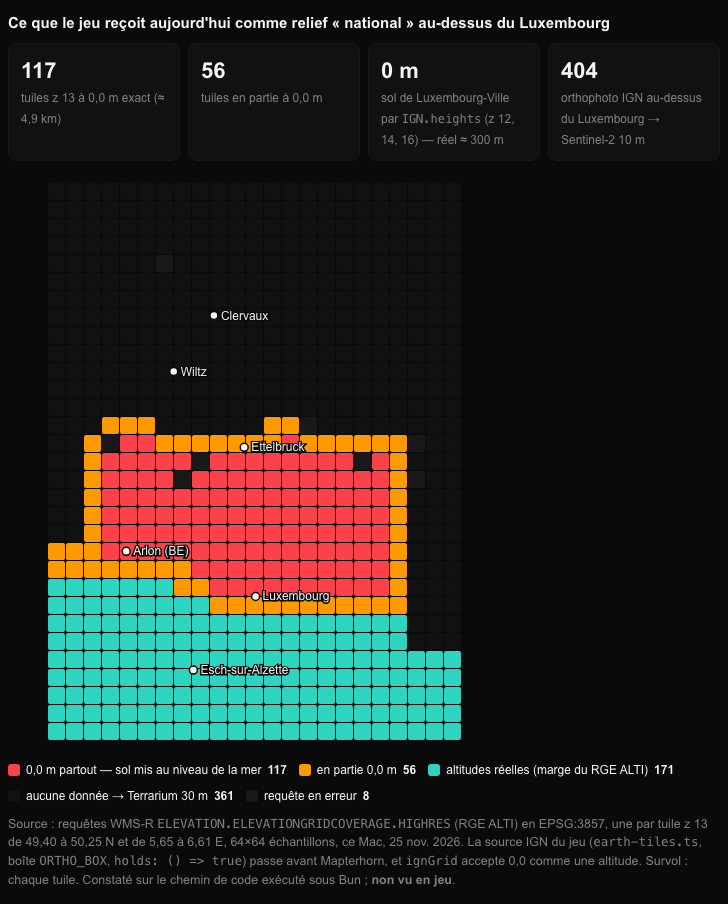
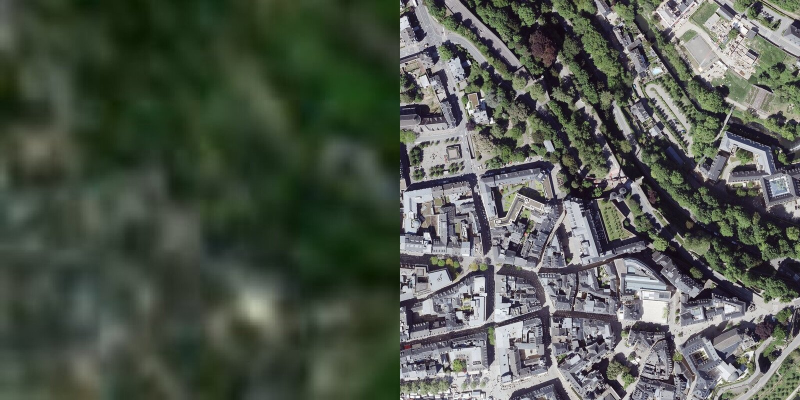

# Plan — le Luxembourg AAA (relief LiDAR, orthophotos 10 cm, bâtiments LOD2, arbres réels)

Date : **25 novembre 2026**. Base : `main` à `f2e65de6`. Demandé par Sam : « les meilleures données (LiDAR, hauteurs,
images) pour le Luxembourg ; comment c'est fait pour la France, la Suisse, les USA et le monde ; un plan Luxembourg AAA ».

**Statut : plan validé par Sam le 25/11/2026 (§9), pas commencé — aucune ligne de code du jeu changée.**
**Mode de travail : speed** (Sam, 25/11) : les lots LU-0 → LU-7 d'affilée, contrôles rapides par lot, **un gros e2e de fin
de jalon (LU-F, §6 bis)** qui vérifie tout ; rien d'affirmé avant lui (CLAUDE.md, « Modes de travail »). Les services ont été interrogés le 25/11/2026 depuis ce Mac (`curl` et, pour le relief, le code du jeu
exécuté sous Bun hors navigateur : `IGN.heights`, `decodeQuantizedMesh`, `drawMeshesSliced`, `geoidDeg`). **Rien n'a été vu
en jeu** ; aucune mesure GPU. Repères : [V] vérifié le 25/11 par une requête réelle ; [D] lu dans la documentation ou la fiche
officielle, non revérifié ; [E] estimation calculée ; [NV] non vérifié.

Lectures liées : [ANALYSE-IGN-LIDAR](ANALYSE-IGN-LIDAR.md) (le modèle de ce plan, I0–I8), [DATA-SOURCES-MONDE](DATA-SOURCES-MONDE.md)
(§1 Mapterhorn, §3.1 la ligne Luxembourg), [PLAN-J8](PLAN-J8-BATIMENTS.md) (cellules de bâtiments), [PLAN-J9](PLAN-J9-ARBRES-PROCHES.md)
(arbres proches), [PLAN-PONT-ROUTES-AAA](PLAN-PONT-ROUTES-AAA.md), [GRAPHICS-PIPELINE](GRAPHICS-PIPELINE.md), stratégie
[§7, §8, §18, §19](ANALYSE-STRATEGIE-RENDU-2026-11-03.md).

## 1. Verdict

1. **Le Luxembourg est aujourd'hui mal servi, et en partie faux.** La source IGN du jeu a pour terre un rectangle
   (`ORTHO_BOX`, `holds: () => true`) qui contient le Luxembourg ; elle passe avant Mapterhorn. Or le RGE ALTI de l'IGN
   **répond 0,0 m exact** (pas « sans donnée ») sur un bloc de 173 tuiles z 13 qui couvre Luxembourg-Ville, Mersch,
   Ettelbruck et Arlon (BE) : `ignGrid` accepte 0 comme une altitude, et le sol de ces tuiles est posé **au niveau de la mer à
   partir de z 11**, ~300 m trop bas [V par le code du jeu sous Bun ; non vu en jeu]. Au nord, l'IGN ne répond rien : Terrarium
   30 m, alors que Mapterhorn porte le LiDAR luxembourgeois à 0,5 m. L'imagerie est celle de Sentinel‑2 à 10 m (l'IGN : 404).
   Les bâtiments : ni BD TOPO (404) ni Overture dans la scène proche (barrée dans la boîte IGN) — OSM seul. **Ce défaut est le
   lot LU-0, à faire d'abord ; il touche aussi la Belgique et les autres voisins inclus dans le rectangle.**
2. **Le Luxembourg a les meilleures données ouvertes d'Europe pour un simulateur, toutes en CC0** : LiDAR 2024 national
   (> 30 pts/m² émis, 126 milliards de points), MNT et MNS 2024 à 0,5 m en **COG lisible par plages depuis le navigateur**
   (CORS `*`, `Content-Range` exposé) [V], **un terrain LiDAR 2024 déjà en quantized-mesh** (le format de swisstopo, que le jeu
   décode déjà : vérifié avec notre décodeur) [V], des orthophotos **10 cm été et hiver 2025** en WMTS Web Mercator jusqu'à
   z 21 [V], des bâtiments 3D **LOD 2.2** de 2023, **chaque arbre du pays** (position, hauteur, couronne, type) extrait du LiDAR
   2024, les ponts, les lignes à haute tension et les caténaires en 3D [D].
3. **Le chemin est court parce que tout existe déjà pour la Suisse.** Imagerie : une `orthoUrl` Web Mercator et un
   `OrthoFit`. Relief : le chemin swisstopo (quantized-mesh EPSG:4326 TMS → grille 256² Web Mercator) avec une autre URL. Ce
   qui est neuf : un lecteur de COG par plages (surface, canopée), et la préparation hors image des bâtiments LOD2 et des
   arbres en cellules z 15 (format J8/J9), servies par **le serveur de Sam** (décidé le 25/11, lot LU-H).

Ordre validé par Sam (25/11, mode speed) : **LU-0 (correctif, utile au-delà du Luxembourg) → LU-1 imagerie → LU-2 relief
LiDAR 2024 → LU-3 surface et canopée → LU-H hébergement → LU-4 arbres réels → LU-5 bâtiments LOD2 → LU-6 ouvrages et
détails → LU-7 hors ligne → LU-F gros e2e**, puis les options (saisons, z 19–20, Grande Région), non tranchées.

*Ce que la source IGN du jeu reçoit sur le Luxembourg (WMS-R RGE ALTI en EPSG:3857, une requête par tuile z 13, 64×64
échantillons, 25/11/2026) : en rouge 0,0 m partout (117 tuiles), orange en partie (56), vert de vraies altitudes (la marge du
RGE ALTI au-delà de la frontière, 171), gris rien (Terrarium).*

*La même tuile z 16 (≈ 400 m, la vieille ville et la Pétrusse) : à gauche l'imagerie que le jeu dessine aujourd'hui (EOX
Sentinel‑2 2021) ; à droite les 16 tuiles z 18 de `ortho_latest` (été 2025), sans recalage de couleur.*

## 2. Ce que le jeu fait aujourd'hui au Luxembourg (lu dans le code, mesuré sur les services)

| Couche | Chemin du code | Ce qui arrive au Luxembourg |
|---|---|---|
| Source choisie | `tileSource(NATIONAL, …)` (`national.ts:76`) : la première source dont la boîte et `holds` contiennent le centre de la tuile ; `NATIONAL = [SWISSTOPO, IGN, USA, MAPTERHORN_EUROPE, …]` (`earth-tiles.ts:945`) | **`"ign"`** : `ORTHO_BOX = {−5,6 ; 9,8 ; 41,2 ; 51,2}` (`earth-tiles.ts:160`) contient le pays, `IGN.holds` rend toujours vrai. `MAPTERHORN_EUROPE` n'est jamais atteint. `__bh.earthTiles.nationalAt` vaut `"ign"`, le crédit IGN s'affiche (`main.ts:9647`) |
| Relief z ≤ 10 | Terrarium (SRTM ~30 m) | correct, grossier |
| Relief z ≥ 11 | `ignGround` → `ignGrid(IGN_RGEALTI)` ; le LiDAR HD à z ≥ 16 répond hors couverture → RGE ALTI ; `ignGrid` ne rejette que `< −100` ou `> 9000` (`earth-tiles.ts:681`) | **centre : 0,0 m accepté → sol au niveau de la mer** (Luxembourg-Ville z 12, 14 et 16 : 65 536 échantillons à 0,0 [V]) ; **sud** (Esch, Bettembourg, Mondorf) : vraies valeurs de la marge du RGE ALTI ; **nord** (Clervaux, Wiltz) : `null` → Terrarium agrandi jusqu'à z 17 |
| Surface (I6) | MNS LiDAR HD / RGE → `overground` | rien (NaN) |
| Imagerie z 9–14 et 15–18 | `orthoUrl` IGN → 404 [V] → EOX Sentinel‑2 2021 10 m | flou (image ci-dessus) |
| Bâtiments, scène proche | `scenery-worker.ts:1034` BD TOPO si `survey === "ign"` ; Overture seulement si `!bdtopo` (`:1160`) | BD TOPO 404 [V] → **OSM seul**, Overture barré |
| Bâtiments, cellules J8 | `cell-worker.ts:87-105` : BD TOPO dans `BDTOPO_BOX` (= `ORTHO_BOX`), Overture quand elle est vide | Overture (le repli prévu, `cell-overture.ts:2` nomme le Luxembourg) |
| Canopée | `inIgnBox` = `ORTHO_BOX` moins la Suisse (`ign-canopy.ts:45`) ; MNH LiDAR HD | MNH : rien [V] ; arbres par WorldCover |
| Sol des pieds (décor) | `surveyOf` (`scenery-sources.ts:130`) → `IgnLand` | le même sol IGN (0 au centre) |
| Hors ligne | `zones.ts` : chaînes IGN | URL IGN inutiles dans une zone luxembourgeoise |

Le même défaut vaut pour tout ce que le rectangle couvre hors de France : la Belgique (Arlon dans le bloc à 0), la Sarre et
la Rhénanie au bord, la Catalogne, l'Italie du Nord-Ouest, Andorre, les îles Anglo-Normandes — partout où Mapterhorn
aurait donné 0,5–1 m. L'étendue des 0 hors du Luxembourg n'a pas été cartographiée [NV].

## 3. Comment c'est fait ailleurs

| | France (IGN, I0–I8) | Suisse (swisstopo, I7) | USA (lot D) | Monde |
|---|---|---|---|---|
| Déclaration | `IGN` (`earth-tiles.ts:848`), boîte rectangle | `SWISSTOPO` (`national.ts:142`), contour Natural Earth | `USA` (`earth-tiles.ts:894`), contour des 48 États | `MAPTERHORN_EUROPE/JAPAN/NZ` (relief seul, `orthoUrl: null`) ; Terrarium, EOX, GIBS, ETOPO |
| Imagerie | WMTS PM z 9–18, 0,2 m, `ORTHO_FIT` | WMTS 3857 SWISSIMAGE, `SWISS_FIT` (12 lieux) | ArcGIS cache NAIP z ≤ 16 (`orthoZ1`), `USA_FIT` table par canal (`usa-colour.ts`) | EOX 2021 10 m (z 9–14), GIBS z ≤ 8 |
| Relief | WMS-R float32 BIL en EPSG:3857, une requête par tuile ; RGE ALTI 1 m + LiDAR HD 0,5 m dès z 16 ; garde `lidarSuspect` | **quantized-mesh EPSG:4326 TMS**, niveau `min(z−1, 17)`, `drawMeshesSliced` → 256² | Mapterhorn 512² WebP Terrarium (3DEP 1 m), quart d'une tuile z−1 | Terrarium z ≤ 15 ; Mapterhorn z ≤ 16 (→ notre z 17) en Europe |
| Surface / HLOD | MNS − MNT (I6) z 11–13 | — | — | — |
| Canopée | MNH LiDAR HD (`ign-canopy.ts`) | — | — | WorldCover 10 m (classe) |
| Bâtiments | BD TOPO (MVT z 15) + toits par MNS (B6) | Overture | Overture | Overture (PMTiles), OSM |
| Datum | normales NGF-IGN69 traitées « mer » + EGM2008 | LHN95 traité « mer » | NAVD88 traité « mer » | `overEllipsoid()` (`sources.ts:298`) : `max(h,0)+N` |
| Hors ligne | `zones.ts` ; relief compressé `krh1` (BIL seulement) | maillages listés par `heightUrls` | idem | idem |

Leçons qui valent pour le Luxembourg : **une source = un contour, pas un rectangle** (USA, Suisse) ; **le 0 n'est pas une
absence** (T7 : le LiDAR HD interpolé en mer ; ici le RGE ALTI rempli de 0) ; **chaque source déclarée** dans `sources.ts`
(Q7 G1/G2) avec son datum ; **les couleurs recalées** sur une douzaine de lieux ; **`heightUrls` = exactement ce que
`heights` demande**, sinon les zones hors ligne ont des trous ; **un `orthoZ1` honnête** (JFK : 930 réponses 404).

## 4. Les données du Luxembourg (ACT, data.public.lu, géoportail)

Toutes sous **CC0** [D, fiche de chaque jeu sur data.public.lu ; les lignes à haute tension : licence « non spécifiée »].
Système : **LUREF / Luxembourg TM (EPSG:2169)** pour les fichiers ; les services WMTS sont en Web Mercator.

### 4.1 Relief

| Jeu | Contenu | Accès | Pour Kerr |
|---|---|---|---|
| **Terrain LiDAR 2024 en quantized-mesh** `acts3.geoportail.lu/3d-data/3d-tiles/ACT2024_LiDAR_Terrain/` | `layer.json` : `quantized-mesh-1.0`, extension `octvertexnormals`, **EPSG:4326, schéma TMS, z 0–19**, bbox 5,73–6,53 E × 49,45–50,18 N, tuiles `{z}/{x}/{y}.terrain?v={version}` [V] | CORS en écho de l'origine [V] ; 40–90 ms par tuile ici ; non compressé (pas de `Content-Encoding`) ; 16–48 Ko par tuile [V] | **le relief du jeu** (LU-2) : décodé par `decodeQuantizedMesh` sans changement [V] — Luxembourg-Ville g 15 : 237,8–308,7 m ; Clervaux g 17 : 348–372 m. Maillage adaptatif : pas moyen 52 m à g 13, 11–16 m à g 15, 2,4–3,7 m à g 17, 0,9–1,0 m à g 19 [V]. C'est le service du visualiseur 3D (VC Map), **pas un service ouvert déclaré** : conditions d'usage à demander à l'ACT [NV] |
| **MNT 2024** `download.data.public.lu/…/MNT_Lidar2024.tif` | **un seul COG national** : 114 617 × 163 687 px à 0,5 m, Float64, LZW sans prédicteur, tuiles 128², 11 aperçus (1 m … 1 km), nodata −9999, 40,1 Go [V par l'en-tête lu en plage] | `Range` → **206**, CORS `*`, `Content-Range` exposé, CloudFront [V] | lecture par plages (LU-3) ; les tableaux d'offsets du niveau plein font 9,2 Mo chacun (1 145 984 tuiles) : à lire par tranche de ligne, jamais en entier |
| **MNS 2024** `…/MNS_Lidar2024.tif` | même structure, 42,8 Go [D, même jeu] | même hôte | surface (HLOD I6) et canopée = MNS − MNT (LU-3) |
| MNT / MNS 2019 | 0,5 m, ZIP de GeoTIFF en EPSG:2169 [D] | téléchargement | **c'est ce que Mapterhorn sert** (source `lu`, 0,5 m) [V attribution.json] : sa tuile z 16 sur Luxembourg-Ville donne 237,2–310,3 m [V], 404 à z 17 |
| WMTS `lidar_2019_mnt_public`, `lidar_2019_mns_public` | PNG **ombrés** (hillshade), z ≤ 21 [V] | Web Mercator | inutilisables comme hauteurs |
| Nuage LiDAR 2024 | 126 443 348 082 points [V `metadata.json` Potree 2.0], > 30 pts/m² émis, colorisé (ortho été 2023), classé en 10 catégories (sol, végétation basse/moyenne/haute, bâtiments, eau, **ponts**, **lignes HT**…), COPC LAZ par 9 tuiles de 500 m [D] ; visualiseur `lidar.geoportail.lu` (Potree) | téléchargement, ~1 300 ZIP | source des préparations (toits, ponts), pas du jeu en direct |

**Datum** [D/NV] : le COG ne déclare aucun datum vertical (pas de `VerticalCSTypeGeoKey`) [V] ; les hauteurs sont celles du
nivellement luxembourgeois (au-dessus de la mer, comme NGF-IGN69 et LHN95). **N (EGM2008) vaut 47,8–48,1 m** sur le pays
(`geoidDeg` du jeu : Luxembourg-Ville 48,00, Clervaux 48,10, Esch 47,81, ELLX 48,04) [V]. Le terrain quantized-mesh est
dans le même datum que Mapterhorn (mêmes plages à 1 m près, pas +48 m) : **pas ellipsoïdal** [V]. Dans le sud, là où le
RGE ALTI a de vraies valeurs, le LiDAR 2024 est **0,35 à 2,0 m sous lui en médiane** par tuile z 15 (Esch −0,88, Bettembourg
−1,99, Mondorf −0,35, Differdange −0,35, Rumelange −0,63) [V] — ce n'est pas le seul écart de datum : la marge du RGE ALTI
hors de France n'est pas un relevé LiDAR. La marche à la frontière française reste à mesurer sur des points plats (LU-2).

### 4.2 Imagerie

| Couche WMTS (`wmts1.geoportail.lu/opendata/wmts/{couche}/GLOBAL_WEBMERCATOR_4_V3/{z}/{x}/{y}.jpeg`) | Contenu | Vérifié |
|---|---|---|
| **`ortho_latest`** | = **`ortho_2025`** (été 2025, vols des 10–13 mai 2025, ≤ 10 cm, EMQ ≤ 20 cm, débord ≥ 50 m au-delà de la frontière) — mêmes octets à z 18 | [V] md5 identiques ; 200 jusqu'à **z 21** (8–26 Ko la tuile, 0,3–0,4 s) ; CORS `*`, `max-age` 3 jours |
| `ortho_2025_winter` | hiver 2025 (1er–19 février), ≤ 10 cm | [V] 200 |
| `ortho_irc` | infrarouge couleur | [V] 200 |
| `ortho_2023`, …, `ortho_1967` | 19 millésimes (10 cm depuis 2020, 20 cm 2017–19, 25 cm 2010–16, 50 cm avant) | [V] capacités |
| Hors du pays | une tuile de 854 octets (vide) à Metz | [V] → il faut un **contour**, pas une boîte |

Ordre `{z}/{x}/{y}` (TileCol puis TileRow, comme swisstopo) [V capacités]. Pas de limite d'usage publiée trouvée [NV] ; les
fichiers JP2 du pays entier font 55–146 Go (RGB/CIR/RGBI) [D].

### 4.3 Bâtiments, végétation, ouvrages

| Jeu | Contenu [D] | Taille [D] | Pour Kerr |
|---|---|---|---|
| **BD-L-Bati3D 2023** | **LOD 2.2** par restitution photogrammétrique des toits (EMQ ≤ 20 cm), superstructures > 0,5 m, emprises > 20 m², textures obliques ; CityGML par commune, GDB multipatch, emprises 2D en GPKG/GeoJSON | GDB 7,3–7,8 Go ; emprises GPKG 63 Mo | cellules de bâtiments à vrais toits (LU-5). **Attention** : la fiche 2020 exclut le territoire de la Ville de Luxembourg (données à demander à la VDL) ; à vérifier pour 2023 [NV] |
| BD-L-GeoBase (oct. 2026) | adresses, parcelles, **réseau de transport**, bâtiments, limites, altimétrie ; GPKG/GDB | 1,0 Go le paquet ; bâtiments 39 Mo | emprises officielles ; routes officielles (comparées à OSM, LU-6) |
| **LiDAR 2024 — Arbres** | **chaque arbre** : centroïde, couronne maximale, segments de 1 m ; `tree_height` (AGL), largeur de couronne, `tree_type` (feuillu/conifère, par les orthos d'été et d'hiver) | points GPKG 3,9 Go ; couronnes 6,5 Go | arbres réels dans les cellules J8-8b / J9 (LU-4) |
| Modèles 3D des ponts | LOD1 automatique (surface roulable, LiDAR 2019) ; quelques LOD3 manuels ; CityGML (+DXF) | 2,5 Mo (LOD1), 29 Mo (LOD3) | ponts de [PONT-ROUTES](PLAN-PONT-ROUTES-AAA.md) (LU-6) |
| Lignes HT 3D | pylônes et câbles (LiDAR 2019), OBJ des pylônes | 38–113 Mo | obstacles en vol bas (LU-6) |
| Réseau ferroviaire 3D | caténaires, poteaux, mobilier, trains/tram en OBJ/FBX | 66–317 Mo | détails (LU-6) |

Le visualiseur 3D (`map.geoportail.lu`, VC Map) n'a servi dans sa configuration que le terrain et des images obliques
(`imagesObliquesVCS/act2023`) ; **aucune couche 3D Tiles de bâtiments n'y a été trouvée** [V config ; tilesets devinés : 404].

### 4.4 Autour : la Grande Région

| Voisin | Relief | Imagerie |
|---|---|---|
| Lorraine (FR) | IGN LiDAR HD/RGE ALTI (déjà) | IGN 0,2 m (déjà) |
| Wallonie (BE) | Mapterhorn `bewallonie` MNT 2021–22 0,5 m [V attribution] | `geoservices.wallonie.be` ORTHO_LAST (écho) [D, DATA-SOURCES §3.2] ; Web Mercator à vérifier [NV] |
| Rhénanie-Palatinat, Sarre (DE) | Mapterhorn `derlp` 1 m, `desaarland` 1 m [V attribution] | DOP20 ouverts [D] ; services 3857 [NV] |

**Après LU-0, Mapterhorn donne déjà le relief fin de toute la Grande Région** ; l'imagerie des voisins reste EOX (LU-9).

## 5. Architecture proposée

Une responsabilité par module, les contrats existants gardés :

- **`LUX: NationalSource`** (`national.ts`, à côté de `SWISSTOPO`) : `id: "lux"`, contour `LUXEMBOURG` dans
  `national-borders.ts` (Natural Earth comme la Suisse ; le débord de 50 m de l'ortho couvre les tuiles de bord),
  `orthoUrl` = `ortho_latest`, `orthoZ1: 18` (le plafond actuel du jeu, `ORTHO_Z1`), `fit: LUX_FIT`, `heightsFrom: 11`,
  `heights` = le terrain quantized-mesh (repli Mapterhorn sur échec), `heightUrls` = les mêmes URL. Placée **avant `IGN`**
  dans `NATIONAL`.
- **Le chemin quantized-mesh rendu générique** : `swissMesh`, `swissTerrainLevel`, `SwissGround` deviennent un
  `MeshTerrain { url(g,x,y), g1, level(z) }` partagé par swisstopo et le Luxembourg (`MeshGround` pour les pieds du décor).
  Pas de deuxième décodeur, pas de deuxième rastériseur.
- **Un lecteur de COG par plages** (`system/cog.ts`, dans le worker de décodage) : IFD et tranches d'offsets lues à la
  demande, LZW float64 → float32, reprojection EPSG:2169 → grille Web Mercator (Transverse Mercator sur l'ellipsoïde
  international + Helmert vers WGS84 ; paramètres à prendre au registre EPSG [NV]). Il sert la surface (HLOD) et la canopée.
  Bibliothèque : **geotiff.js** est le candidat évident (§18 : vérifier licence, poids, Bun, lecture paresseuse des offsets)
  contre ~200 lignes à nous ; décider au lot LU-3 sur ces critères, une seule autorité.
- **Les préparations lourdes hors image et hors navigateur** : arbres (LU-4) et bâtiments LOD2 (LU-5) convertis par des
  scripts Bun (`scripts/build-lux-*.ts`) en cellules z 15 au format déjà lu par `cell-worker.ts` (bâtiments J8, forêts
  J8-8b/J9), compressées (meshoptimizer pour les maillages, §18), adressées par leur contenu, **servies par le serveur de
  Sam** (décision du 25/11 ; même choix que D13 pour les binaires, [ASSETS.md](ASSETS.md)) — le lot LU-H les y installe.
- **Datum** : `vertical: "msl"`, `verticalName: "nivellement luxembourgeois"` dans `sources.ts` ; la conversion reste à la
  seule frontière WGS84 (`overEllipsoid`, `+N` EGM2008). Aucune hauteur n'est prise comme `|p| − R`.
- **Le monde possède le sol** (CLAUDE.md, pratiques) : le relief luxembourgeois entre par les mêmes tuiles que lisent le
  traceur, le raster, `groundRelief` et les contacts ; aucune lecture « graphique » à part.

Ce qui ne change pas : aucune passe GPU nouvelle, aucun pipeline nouveau, aucun noyau du traceur touché par LU-0 à LU-3
(les mêmes tuiles, d'autres octets). LU-4/LU-5 remplissent des cellules que les passes J8/J9 dessinent déjà.

## 6. Les lots

Chaque lot : son gain plafond (règle 1), sa preuve, sa sortie. Les coûts GPU sont **non mesurés** ; les volumes marqués [E].
Ordre validé par Sam : **LU-0 → LU-1 → LU-2 → LU-3 → LU-H → LU-4 → LU-5 → LU-6 → LU-7 → LU-F**. En mode speed, la
« Preuve » de chaque lot ci-dessous est **vérifiée par LU-F** (§6 bis) ; par lot, seulement les contrôles rapides. Un lot non
mesuré s'écrit « non mesuré » dans ce plan et le journal.

### LU-0 — L'IGN sur la France seulement (correctif, prioritaire)

- **Quoi** : `IGN.holds` = contour de la France métropolitaine et de la Corse (`national-borders.ts`), au lieu du rectangle ;
  `inIgnBox` (`ign-canopy.ts`), `BDTOPO_BOX`/`inBdtopoBox` (`bdtopo.ts`), `surveyOf` suivent le même contour (le test
  `cell-overture.test.ts` qui exige l'égalité avec `ORTHO_BOX` change de contrat : « même terre que l'IGN »).
  Défense dans `ignGrid` : une grille **entièrement à 0,0 exact** est refusée (`null`) — la France n'a pas de tuile terrestre
  plate à 0,000 m ; la mer garde son `NaN` habituel.
- **Effet attendu** : au Luxembourg, en Belgique, en Sarre, en Catalogne… les tuiles vont à Mapterhorn (0,5–1 m) ; plus de
  sol à 0 m ; la scène proche y lit Overture ; le crédit IGN ne s'y affiche plus. Gain : qualité/justesse, pas de temps
  d'image (plafond 0 ms, dit).
- **Preuve** : `tests/national.test.ts` (Luxembourg-Ville, Clervaux, Arlon → `"mapterhorn"` ; Thionville, Metz → `"ign"`) ;
  test de `ignGrid` sur une grille à 0 ; un e2e court en vue fixe au-dessus de Luxembourg-Ville (sol ≈ 300 m, `nationalAt`,
  capture avant/après) — Géoplateforme sollicitée : **un e2e IGN à la fois** entre les deux Macs.
- **Docs** : `BH-API.md` (`nationalAt`), `DATA-SOURCES-MONDE.md` §1, `ANALYSE-IGN-LIDAR.md` (note datée), PROBLEMES.

### LU-1 — L'orthophoto 2025 (10 cm, ici jusqu'à z 18 = 0,39 m)

- **Quoi** : la source `LUX` avec `orthoUrl` et contour ; relief encore délégué à Mapterhorn. `LUX_FIT` ajusté sur ~12 lieux
  (vieille ville, Kirchberg, Moselle et ses vignes, Ardennes/Éislek, Mullerthal, lac de la Haute-Sûre, Minett et ses
  friches, ELLX, champs du Gutland, forêts de Grünewald) par la méthode de `SWISS_FIT` (tuiles z 14 contre EOX tel que le jeu
  le montre). Crédit « Orthophoto © ACT Luxembourg (CC0) » sous la caméra ; `nationalAt: "lux"`. Hôte `wmts1.geoportail.lu`
  dans `classify`/`tileKind` (`pwa/rules.ts`) — cache du SW et cache disque des e2e.
- **Gain** : l'imagerie passe de 10 m à 0,39 m le pixel en vol bas (×25) ; 0 ms attendu (mêmes pages, autres octets) —
  non mesuré.
- **Preuve** : test de l'URL et du contour ; e2e en cockpit au-dessus de la vieille ville et sur ELLX (imagerie présente,
  crédit, aucune 404 dans `netLight.stats().failBy`, coutures au bord avec la Lorraine et la Wallonie) ; captures A/B.

### LU-2 — Le relief LiDAR 2024 par quantized-mesh

- **Quoi** : `MeshTerrain` générique (§5) ; `LUX.heights` lit `ACT2024_LiDAR_Terrain` ; niveau des mailles **à mesurer**
  (point de départ : g = z, soit 4 à 6 mailles de 20–50 Ko par tuile z 17 ; g 19 pour z 17 coûterait ~40 mailles) ;
  repli Mapterhorn par tuile si le service refuse ; `MeshGround` pour les pieds du décor ; `heightUrls` exact (zones).
  Garde contre une maille aberrante (comme `lidarSuspect`) contre les niveaux grossiers.
- **Usage du service** (Sam : « fais au mieux » → décision prise ici) : on l'utilise, **en invité poli et sans dépendance** :
  la version de l'URL lue dans `layer.json` au démarrage (jamais codée en dur : elle change à chaque publication),
  `available` respecté (pas de requête hors couverture), une porte de débit propre à l'hôte (8 requêtes en vol, ~20/s au plus),
  les mailles gardées par le cache du SW, un `User-Agent` générique ; **repli Mapterhorn** par tuile sur refus et pour toute la
  source si `layer.json` ne répond pas ou si les refus dépassent un seuil (la source garde son imagerie). Un message courtois à
  l'ACT est proposé en annexe (§11) : **Sam l'envoie s'il le souhaite**, rien n'en dépend.
- **Gain** : 2019 → 2024 (carrières, chantiers, Kirchberg), maillage adaptatif ~1 m à g 19 contre 0,77 m régulier de
  Mapterhorn : **gain visuel modeste sur Mapterhorn** ; l'intérêt est la cohérence avec MNS/arbres 2024 et l'ortho 2025.
  Si le service disparaît ou refuse, LU-2 se réduit à Mapterhorn (déjà acquis par LU-0) et rien n'est perdu.
- **Preuve** : vallée de la Pétrusse et de l'Alzette au Grund (falaises de ~60 m, Bock), Moselle à Schengen, Haute-Sûre ;
  pente maximale, résolution `finest`, `heightAt` sur 5 repères (ELLX seuil, Bock, Kneiff 560 m, Mosel) contre le MNT 2024
  lu par plages ; **marche à la frontière** France/Luxembourg et Belgique/Luxembourg mesurée sur points plats ; pistes de
  ELLX nivelées (A7) et un atterrissage A320 (recette existante, e2e de vol : E2E-VOLS).

### LU-3 — La surface et la canopée 2024 (COG par plages)

- **Quoi** : `system/cog.ts` (ou geotiff.js, §5) ; **HLOD I6** (`over = MNS − MNT`, z 11–13) depuis les aperçus 8–16 m
  (IFD 4–5 : 56×80 tuiles d'offsets, 36 Ko) ; **canopée** pour le décor (`canopy()` / `canopyNear()` comme `IgnLand`,
  blocs z 14) depuis le plein niveau ou IFD 1 (1 m). Généraliser les tests `instanceof IgnLand` (`scenery-worker.ts:2090,
  2136`, `cell-worker.ts:192-218`) en une interface `SurveyLand`. Porte de débit pour l'hôte CloudFront (en-tête
  `x-ratelimit-limit: 366` vu sur data.public.lu, sens [NV]).
- **Gain** : silhouettes lointaines réelles (Kirchberg, viaducs, forêts de l'Éislek) ; arbres posés sur leur vraie canopée
  (I4 en France : 76 % des arbres sur leur canopée contre 69 sans). Coût de dessin : celui d'I6 en France (0 à +1,2 ms
  mesuré là-bas, rien mesuré ici).
- **Preuve** : témoins de la sonde (règle 3) pour le lecteur COG (une tuile connue lue par GDAL ailleurs = mêmes valeurs) ;
  silhouette de la Tour Alcide de Gasperi / Kirchberg à 20 km ; captures lisières.

### LU-H — L'hébergement des données préparées sur le serveur de Sam

- **Quoi** : ce que [ASSETS.md](ASSETS.md) laisse « à construire » pour D13, réduit à ce que LU-4 à LU-6 demandent : une
  racine statique sur le serveur de Sam (nginx, comme l'image du site) sous une URL à fixer à l'ouverture du lot (par exemple
  `samlepirate.org/data/lux/…` ou un sous-domaine), **fichiers adressés par leur empreinte**, jamais remplacés ni effacés
  (la règle d'ASSETS) ; en-têtes `Access-Control-Allow-Origin: *`, `Cache-Control: public, max-age=31536000, immutable`,
  `Range` accepté ; un `manifest` versionné dans Git (cellule → empreinte, taille) que lit le jeu ; l'hôte dans
  `classify`/`tileKind` (SW, zones, cache disque des e2e).
- **Préparation** : les scripts Bun `scripts/build-lux-*.ts` tournent sur une machine du labo (les entrées font 4 à 8 Go :
  pas sur la CI) ; le dépôt sur le serveur passe par le chemin qu'ouvre ce lot (accès d'écriture à demander à Sam à ce
  moment : SSH/rsync vers un volume monté dans la pile, ou un conteneur dédié ; Portainer reste non exposé).
- **Preuve (rapide)** : une cellule témoin servie avec ses en-têtes (`curl -H Origin`) et lue par le jeu ; le manifest testé.

### LU-4 — Chaque arbre du pays

- **Quoi** : `scripts/build-lux-trees.ts` : les centroïdes LiDAR 2024 (hauteur, couronne, type) → cellules z 15 du format
  forêt J8-8b/J9 (instances : position WGS84, hauteur, rayon, essence feuillu/conifère), hors navigateur ; cellules
  servies et mises en cache comme les autres (SW, zones). Les espèces du jeu (modèles V2/J9) choisies par `tree_type` et
  la hauteur. Repli : canopée LU-3 + WorldCover.
- **Volume** [E] : 3,9 Go de GPKG en entrée ; une cellule z 15 (≈ 790 m de côté à 49,6°) porte de l'ordre de 10³–10⁴ arbres
  en forêt ; à 12 octets par arbre quantifié, ~10–120 Ko la cellule, **quelques centaines de Mo** pour le pays — à mesurer
  sur une commune d'abord.
- **Gain** : la forêt réelle, arbre par arbre, à sa hauteur, en vol bas — ce qu'aucune autre région du jeu n'a.
- **Preuve** : comptage arbres / couronnes contre la fiche sur une commune ; recouvrement arbre ↔ ortho (méthode I4) ;
  coût J9 inchangé à nombre d'arbres égal (A/B kerr-mini) ; mémoire.

### LU-5 — Les bâtiments LOD 2.2

- **Quoi** : deux pas. (a) emprises 2023 + hauteurs (attributs de l'emprise s'ils existent [NV], sinon MNS − MNT par
  bâtiment) → cellules J8 au format `PreparedCell` de la BD TOPO : le Luxembourg aussi bien que la France, sans nouveau
  dessin. (b) les toits LOD 2.2 réels (CityGML/GDB) → maillages par cellule (meshoptimizer, LOD par distance), dessinés par
  le chemin de maillage de J8 ; textures obliques **hors périmètre** au premier passage (poids, mémoire).
  La Ville de Luxembourg : vérifier si BD-L-Bati3D 2023 la couvre ; sinon toits par MNS 2024 (B6) et Overture.
- **Volume** [E] : 7,8 Go de GDB en entrée ; ~250 000 bâtiments [NV] ; maillages simplifiés, quelques centaines de Mo.
- **Preuve** : écart de hauteur contre le MNS 2024 sur un quartier (méthode I5 : médiane, part à 3 m près) ; captures de la
  vieille ville, du Kirchberg, d'Esch-Belval ; coût de la couche bâtiments (A/B, même vue qu'en France).

### LU-6 — Ouvrages et détails du vol bas

- Ponts LOD1/LOD3 → `PLAN-PONT-ROUTES-AAA` (supports, tabliers ; viaducs de la Pétrusse, pont Grande-Duchesse Charlotte) ;
  lignes HT 3D (pylônes OBJ, câbles) — **simple décor** (Sam, 25/11) : dessinées, ombrées, sans collision ni destruction ;
  caténaires ; BD-L-GeoBase transport comparé à OSM (OSM reste la base si équivalent). Chaque élément = une cellule
  préparée, un consommateur existant.

### LU-7 — Hors ligne et PWA

- `zones.ts` : chaînes du Luxembourg (ortho, mailles, COG par plages, cellules) ; `sizeOf`/`zoneDuration` ;
  `ZONE_SCHEMA` +1 ; règles SW des trois hôtes (`wmts1.geoportail.lu`, `acts3.geoportail.lu`, `download.data.public.lu`).
- Volume d'une zone **pays entier** [E] : ortho z 18 seule ≈ 2 586 km² / (99 m)² ≈ 264 000 tuiles × ~25 Ko ≈ **6,6 Go** ;
  z ≤ 17 ≈ 2,2 Go. Une zone reste un rayon autour d'un lieu, comme aujourd'hui ; le pays entier n'est pas proposé.

### Options (non tranchées par Sam le 25/11 : hors du jalon, à redemander après LU-F)

- **LU-8 Saisons** : `ortho_2025_winter` quand la date du jeu est en hiver — demande des arbres sans feuilles cohérents
  (les arbres LU-4 portent feuillu/conifère). Les millésimes 1967–2023 pour un « voyage dans le temps » : possible, hors
  plan.
- **LU-9 Grande Région** : orthophotos Wallonie, Rhénanie-Palatinat, Sarre si un service Web Mercator CORS existe (à
  chercher) ; le relief est déjà acquis par LU-0.
- **LU-10 z 19–20 près de la caméra** : l'ortho luxembourgeoise va jusqu'à z 21 (z 20 ≈ 0,10 m) ; le jeu plafonne à
  `ORTHO_Z1 = 18`. Monter d'un ou deux niveaux est un **changement du moteur** (pages J2, mémoire, filtrage) qui profiterait
  aussi à l'IGN (0,2 m à z 19) et à swisstopo — un plan à part, mesuré.
- **LU-R** : retirer ce qui n'a plus d'utilisateur (règle 2), tenir GRAPHICS-PIPELINE, BH-API, DATA-SOURCES, la carte.

## 6 bis. Vérifier en mode speed

**Par lot (rapide, rien d'autre)** : tests unitaires du code touché (`national`, `sources`, `zones`, `pwa-rules`,
`cell-overture`, les nouveaux : `cog`, `mesh-terrain`, `lux-cells`, manifest) ; `tsc` ; Biome ; `check-wgsl` si un shader
change (aucun prévu) ; `bun scripts/pipeline-inventory.ts --check` ; références tenues dans le même lot (BH-API `nationalAt`,
GRAPHICS-PIPELINE si un chargement ou une table change, DATA-SOURCES, sources.ts déclarées, ASSETS pour LU-H, E2E-CATALOGUE
pour LU-F). Pas d'e2e ni d'A/B par lot. Un doute réel (par exemple le niveau des mailles en LU-2, la reprojection du COG en
LU-3) peut justifier un e2e court **sur kerr-mini, lancé et suivi par un agent en parallèle**, la session continuant de
coder. Les e2e qui sollicitent la Géoplateforme (bord français) : **un à la fois** entre les deux Macs.

**LU-F, le gros e2e de fin de jalon** (`tests/e2e/luxembourg.e2e.test.ts`, en raster et en cockpit, temps gelé pendant les
attentes, attentes plafonnées avec compteurs — E2E.md, E2E-VOLS.md) : il couvre chaque critère, ses captures et ses
graphiques sont montrés à Sam, ses mesures font foi.

| # | Critère | Mesure | Seuil proposé |
|---|---|---|---|
| F1 | Plus de sol à 0 m (LU-0) | `heightAt` sur Luxembourg-Ville, Mersch, Ettelbruck, Arlon (BE), Perl (DE) | à ±3 m du MNT 2024 (lu par plages) ou de Mapterhorn hors LU |
| F2 | Les bonnes sources | `nationalAt` : `"lux"` au Luxembourg, `"mapterhorn"` à Arlon et en Sarre, `"ign"` à Thionville et Metz ; crédits à l'écran | exact |
| F3 | Imagerie 2025 | `orthoFinest` = 18 en vol bas sur la vieille ville et ELLX ; `netLight.stats().failBy` sans 404 du géoportail | exact ; captures A/B contre `e7022587` |
| F4 | Relief LiDAR 2024 | `finest` ≥ 16 ; pente des parois du Grund/Bock ; 5 repères (ELLX seuil, Bock, Kneiff, Moselle à Schengen, Haute-Sûre) | repères à ±1 m du MNT 2024 |
| F5 | Coutures aux frontières | marche médiane sur points plats FR/LU (Esch), BE/LU, DE/LU ; couleur de part et d'autre (captures) | marche ≤ 2 m médiane, mesurée et dite |
| F6 | Silhouettes et canopée (LU-3) | Kirchberg à 20 km ; part des arbres sur leur canopée (méthode I4) | silhouette visible ; ≥ 70 % des arbres sur canopée |
| F7 | Arbres réels (LU-4) | comptage d'une cellule contre le jeu de données ; recouvrement arbre ↔ ortho | ±5 % ; captures lisières et Mullerthal |
| F8 | Bâtiments LOD2 (LU-5) | hauteurs contre MNS 2024 sur un quartier (méthode I5) | médiane ≤ 2 m, ≥ 70 % à 3 m près |
| F9 | Ouvrages (LU-6) | ponts de la Pétrusse et Grande-Duchesse Charlotte à leur hauteur ; lignes HT présentes (décor) | captures ; tablier à ±2 m du LiDAR |
| F10 | Vol | approche et atterrissage A320 à ELLX sur le sol LiDAR (recette existante ; AP, train, poussée assertés — E2E-VOLS règle 13) | posé sur la piste, contact du train sans saut |
| F11 | Hors ligne (LU-7) | zone de 10 km autour de Luxembourg-Ville, réseau coupé | 0 requête, sol et décor complets |
| F12 | Jour et nuit | les vues F3/F6 de jour et de nuit | captures montrées |
| F13 | Coûts, deux machines | GPU p50 et p95 sur la vue fixe « vieille ville » et le vol ELLX, **kerr-mini** et **M1 Max borné à 30, soutenu** ; A/A, puis A/B contre `e7022587` ; mémoire | dans le bruit A/A pour LU-0–LU-2 ; LU-3–LU-6 chiffrés et dits ; dans les seuils de Sam (J0-CONTRAT) ou le dépassement traité lot par lot |
| F14 | Strict | aucune erreur console, aucune tuile perdue définitivement (CM1) | exact |

Les seuils sont **proposés** ; un dépassement se montre et se traite, il ne se cache pas.

## 7. Budgets et règle 1

| Lot | Gain plafond en temps d'image | Justification |
|---|---|---|
| LU-0, LU-1, LU-2 | 0 ms (aucun poste retiré) | justesse et qualité de l'image ; coût attendu nul (mêmes passes) — **à vérifier par un A/A et un A/B sur kerr-mini** |
| LU-3 | 0 ms ; coût possible +0 à +1,2 ms (I6 en France) | silhouettes et arbres justes |
| LU-4, LU-5 | 0 ms ; coût à mesurer (plus d'arbres, de vrais toits) | contenu ; le budget J8/J9 de la vue s'applique, pas de dépassement silencieux |

Les seuils de Sam (25 ms M1 Max borné à 30, 40 ms kerr-mini) s'appliquent à une vue luxembourgeoise comme à J0.

## 8. Risques

- **Le service quantized-mesh n'est pas un service ouvert déclaré** (backend du visualiseur 3D) : son URL versionnée peut
  changer sans préavis. Réponse retenue (§6 LU-2) : version lue dans `layer.json`, débit borné, cache, repli Mapterhorn
  permanent (2019, 0,77 m) ; message courtois à l'ACT en annexe, à l'initiative de Sam.
- **Pas de politique d'usage publiée** pour les WMTS du géoportail [NV] : cache du SW, pas de rafales, `User-Agent`
  générique ; une porte de débit par hôte comme la Géoplateforme si des refus apparaissent.
- **COG Float64 LZW sans prédicteur** : ~2× les octets d'un float32 ; une tuile z 17 lue au plein niveau = ~16 tuiles COG
  de 128² [E] → réserver le plein niveau à la canopée proche, les aperçus au reste.
- **Ville de Luxembourg** absente des bâtiments 3D 2020 de l'ACT ; à vérifier pour 2023.
- **Coutures** : ortho 2025 (mai) contre IGN (millésimes départementaux) et EOX ; marches de relief de l'ordre du mètre
  aux frontières (§4.1) ; la colorimétrie se recale (LU-1), la géométrie se mesure (LU-2).
- **Hébergement des cellules préparées** (LU-4/5) : volumes de l'ordre du Go [E] ; **le serveur de Sam** (décidé) — la
  bande passante et le disque du serveur, l'accès d'écriture depuis le labo restent à régler à l'ouverture de LU-H.
- **Mode speed** : les défauts de LU-0 à LU-7 n'apparaissent qu'à LU-F ; le risque est accepté par le mode, compensé par
  les contrôles rapides et, sur un doute réel, un e2e court sur kerr-mini mené par un agent en parallèle.

## 9. Décisions de Sam (25 novembre 2026)

| # | Question | Réponse de Sam | Ce que le plan en fait |
|---|---|---|---|
| 1 | Le service quantized-mesh de l'ACT | « Fais au mieux » | on l'utilise en invité poli (version lue dans `layer.json`, débit borné, cache), repli Mapterhorn par tuile et pour toute la source ; message à l'ACT proposé en annexe (§11), envoyé ou non par Sam (LU-2) |
| 2 | Hébergement des données préparées | **Sur le serveur de Sam** | lot LU-H avant LU-4 : racine statique adressée par contenu, CORS, `immutable`, manifest dans Git |
| 3 | Ordre et mode | **Ordre du plan, mode speed** | LU-0 → … → LU-7 puis LU-F (§6, §6 bis) |
| 4 | Lignes à haute tension | **Simple décor** | dessinées et ombrées, sans collision (LU-6) |
| 5 | Options LU-8 à LU-10 | non tranchées | hors du jalon ; à redemander après LU-F |

**Pas commencé** : Sam a demandé de mettre le plan à jour sans lancer les lots (25/11).

## 10. Sources

- data.public.lu, fiches lues le 25/11/2026 (API `api/1/datasets/<slug>`) : `lidar-2024-releve-3d-du-territoire-luxembourgeois`,
  `lidar-2019-modele-numerique-de-terrain-mnt`, `lidar-2019-modele-numerique-de-la-surface-mns`, `lidar-2024-arbres`,
  `lidar-2019-arbres`, `base-de-donnees-nationale-des-batiments-3d-2023` (et 2020), `bd-l-geobase`, `bd-l-tc-2015`,
  `modeles-3d-des-ponts`, `lignes-electriques-de-hautes-tensions-3d`, `reseau-ferroviaire-3d`,
  `orthophoto-officielle-du-grand-duche-de-luxembourg-edition-ete-2025` (et hiver 2025), `bd-l-ortho-webservices-wms-et-wmts`.
- WMTS : `https://wmts1.geoportail.lu/opendata/wmts/1.0.0/WMTSCapabilities.xml` (51 couches, matrices
  `GLOBAL_WEBMERCATOR_4_V3` 00–21).
- Terrain : `https://acts3.geoportail.lu/3d-data/3d-tiles/ACT2024_LiDAR_Terrain/layer.json` (VC Map `lux.config.json`).
- MNT 2024 : `https://download.data.public.lu/resources/bd-l-lidar2024-releve-3d-du-territoire-luxembourgeois/20241223-093912/MNT_Lidar2024.tif`
  (en-tête BigTIFF lu en plage : 64 Ko).
- Nuages : `metadata.json` Potree 2.0 des campagnes 2019 (80 344 692 774 points) et 2024 (126 443 348 082).
- Mapterhorn : `https://download.mapterhorn.com/attribution.json` (sources `lu`, `bewallonie`, `derlp`, `desaarland`).
- Pistes données par Sam (résumé Google du 25/11) : vérifiées ci-dessus (LiDAR 2024 COPC/COG, ortho été 2025 ≤ 10 cm,
  hiver et CIR) ; pages tierces citées (terratrace.si, technicalgis.com) non utilisées comme source.
- Scripts de vérification de cette analyse : dans le répertoire temporaire de la session (non commités) ; les deux images
  de `docs/progress/luxembourg/` en sont les sorties.

## 11. Annexe — message proposé à l'ACT (Sam l'envoie s'il le souhaite)

> Objet : utilisation du terrain LiDAR 2024 (quantized-mesh) dans un simulateur de vol non commercial
>
> Bonjour,
>
> Je développe un simulateur de vol et d'espace gratuit qui tourne dans le navigateur (WebGPU). J'aimerais y montrer le
> Luxembourg avec vos données ouvertes : l'orthophoto (WMTS `ortho_latest`), les MNT/MNS 2024 (COG, par plages), les arbres
> et les bâtiments 3D (préparés de notre côté et servis depuis notre serveur), avec le crédit « © ACT Luxembourg ».
>
> Le terrain LiDAR 2024 en quantized-mesh servi pour votre visualiseur 3D (`acts3.geoportail.lu/3d-data/3d-tiles/
> ACT2024_LiDAR_Terrain/`) conviendrait parfaitement : les joueurs en téléchargeraient quelques tuiles autour de leur
> position, mises en cache, avec un débit limité. Est-ce acceptable de votre point de vue, et y a-t-il une adresse stable ou
> une limite d'usage à respecter ? Sinon, nous utiliserons un autre chemin.
>
> Merci pour la qualité de ces données ouvertes.
