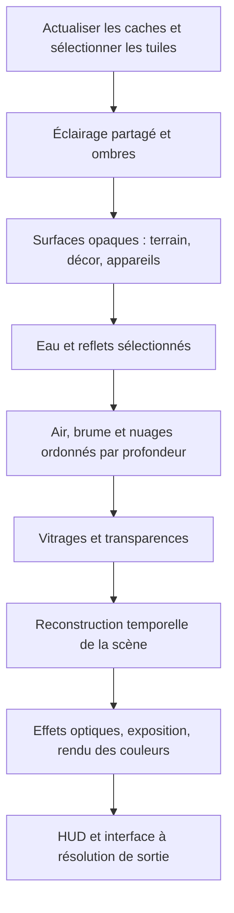

# Plan — migration du rendu terrestre vers une qualité AAA en vol

Date : **20 octobre 2026**. Branche de conception : **`codex/aaa-terrestrial-renderer`**, créée depuis **`a9380bfe69d8b40a26bc4ed158934338624646c1`**, dernier `origin/main` récupéré à sa création.

Statut : **implémentation commencée — prototype de cache de hauteurs P1a, désactivé par défaut**. Le [suivi P1a](progress/terrestrial-aaa/P1a.md) décrit le code, les vérifications et ses limites. Aucun jalon de qualité/performance n'est validé : les mesures P0, le terrain raster et la comparaison en mouvement restent à faire. Aucun test ou benchmark de jeu n'a été lancé ; les vérifications TypeScript et de compilation WGSL sont distinguées des validations futures ci-dessous.

Lire d'abord [l'analyse technique](ANALYSE-PIPELINE-TERRE-AAA.md). Les règles de référence restent [CLAUDE.md](../CLAUDE.md), [E2E.md](E2E.md), [BH-API.md](BH-API.md) et [E2E-CATALOGUE.md](E2E-CATALOGUE.md).

## 1. Résultat recherché et périmètre

### Cible visuelle

Viser le niveau de cohérence graphique d'un simulateur de vol AAA, avec Microsoft Flight Simulator comme référence de lumière, volumes, matériaux et continuité en mouvement. La qualité géographique reste limitée par les données disponibles ; les détails synthétiques doivent respecter les grandes structures réelles.

Le point de départ rapporté par le propriétaire est environ 24 images/s sur M1 Max en temps réel ×4. La première livraison doit montrer une image beaucoup plus fine en vol, avec une cadence stable supérieure **à conditions de scène, de sortie et de qualité documentées**. La cible ultérieure est 60 images/s sur le matériel et les profils qui le permettent ; aucune cadence n'est garantie par ce plan.

### Périmètre technique retenu

- Raster forward léger pour terrain et décor terrestres lorsque les trajectoires droites sont valides.
- Caches de surfaces et streaming incrémental par tuiles.
- Éclairage, profondeur, mouvements et pré-exposition communs.
- Atmosphère et nuages volumétriques dédiés, avec reconstruction adaptée.
- Forêts visibles jusqu'à 10–20 km, par représentations de plus en plus collectives.
- Conservation du traceur pour les régions relativistes et comme référence pendant la migration.

Ni nouveau moteur physique, ni portage natif, ni remplacement du framework de l'application, ni photogrammétrie mondiale, ni GI/path tracing généralisé ne font partie du premier périmètre. Pas de dépendance obligatoire à un matériel de ray tracing, à des mesh shaders ou aux seules extensions natives de Metal.

## 2. Invariants avant toute implémentation

1. **WGS84 partout sur Terre.** Altitudes géodésiques et contacts cohérents ; aucun remplacement par une sphère moyenne. Réutiliser `ellipsoid.ts`, `groundRelief`, `heightOverGround` et le nivellement des pistes.
2. **La physique ne suit pas un LOD graphique lointain.** Conserver une source de hauteur indépendante des simplifications visuelles ; contrôler l'accord au proche.
3. **Précision et origine explicites.** Repères locaux relatifs à la caméra, transformations vers le globe, pose précédente conservée lors des changements d'origine.
4. **Une convention de profondeur.** Documenter profondeur GPU, distance le long du rayon et unités legacy ; nuages et transparences ne remplacent pas la profondeur opaque.
5. **Une convention radiométrique.** Espace linéaire, pré-exposition et unités documentés ; ne pas appliquer deux fois exposition, atmosphère ou ombre.
6. **Ressources bornées.** Compter CPU, GPU, temporaire, caches persistants et ressources retirées mais encore en vol. Les annulations libèrent réellement les données devenues inutiles.
7. **La qualité utilisateur reste explicite.** Pas de gain obtenu en réduisant silencieusement résolution, FOV, densité, couverture nuageuse ou portée.
8. **Le mode spatial conserve sa physique et son intention visuelle.** Une région à lumière courbe ne reçoit pas un simple fond raster de géométrie finie.
9. **Toute fonction produit atteint TARS.** Réglages documentés dans le schéma et les outils de commande ; diagnostics agents via `__bh`/CLI, sans dépendance à une UI cachée.
10. **Une étape utile à la fois.** Chaque changement comporte son budget, sa preuve et son repli. Éviter de migrer terrain, végétation, nuages et exposition dans un seul changement indivisible.
11. **Aucun phénomène physique ou optique existant supprimé.** Éclipses, réfraction, diffusion/absorption, réflexion/transmission et transport relativiste/scientifique restent opérationnels dans leur domaine actuel. Une approximation accélérée exige un domaine de validité et une erreur contrôlés ; conserver un chemin spécialisé lorsque les buffers du raster ne décrivent pas le phénomène. La généralisation attend les preuves de non-régression.

## 3. Décisions de pipeline à formaliser

### 3.1 Conventions de frame

Le contrat minimal doit nommer, typer et versionner :

| Donnée | Contrat à définir |
|---|---|
| Caméra actuelle/précédente | Projection, jitter, pose, FOV, origine, instant de simulation |
| Géométrie | Repère, échelle physique, transformations actuelles/précédentes, version de surface |
| Profondeur opaque | Convention reversed-Z si retenue, reconstruction du point et conversion en mètres |
| Mouvement | Sens, unités, compensation du jitter et des changements d'origine |
| Radiance | Espace linéaire et facteur de pré-exposition de la frame/historique |
| Validité | Découverte, téléportation, chargement, LOD, matériau, animation et transparence |
| Atmosphère | Transmission et lumière intégrées jusqu'à une distance, domaine de validité |
| Nuages | Transmission, lumière, intervalle/distance effective, mouvement et confiance propres |

Les sorties additionnelles sont justifiées par leur consommateur. Pas de gros G-buffer imposé par principe. Une prépasse de profondeur et une pyramide d'occlusion sont des candidats à comparer, pas des exigences initiales sur le GPU Apple.

### 3.2 Ordre logique de la frame terrestre

Il s'agit de dépendances logiques, pas de l'obligation d'une passe GPU par boîte. Regrouper les écritures raster compatibles et réduire les aller-retours de textures. Les volumes peuvent avoir un historique interne ; éviter une double accumulation excessive lors de la reconstruction finale.

Le cockpit nécessite une composition dédiée : coque opaque proche, vitrage et extérieur correctement séparés, instruments lisibles. Si une partie du cockpit reste dans une cible locale MSAA, formaliser sa profondeur, ses mouvements et son raccord à l'exposition ; conserver les optimisations existantes tant que leur remplacement n'a pas démontré un gain.

### 3.3 Rôle des modules existants

| Socle actuel | Évolution proposée |
|---|---|
| `renderer.ts` | Orchestration progressive de passes explicites ; éviter un nouveau monolithe |
| `earth-tiles.ts`, `earth-surface.ts` | Sources, résidence et versions pour caches/patches ; réutiliser le streaming existant |
| `terrain.ts`, `ellipsoid.ts`, `runwayGrade` | Contrat partagé des hauteurs et contacts, précision de référence |
| `warp-grid.ts` | Réutiliser la déformation déjà mutualisée ; ne pas redoubler son calcul |
| `trace.wgsl` | Conserver la référence et le mode relativiste ; extraire les fonctions réutilisables sans maintenir trois copies divergentes |
| `forest.ts`, `scenery-worker.ts`, `scenery.ts` | Placement déterministe et sources ; préparer une résidence par tuiles et plusieurs représentations |
| `ship.ts`, `station.ts`, `endurance.ts`, `character-renderer.ts` | Adapter les sorties/consommateurs de profondeur, mouvement et atmosphère ; conserver les assets et PBR utiles |
| `post.wgsl`, `display.wgsl` | Historiques adaptés, traitement final partagé ; préserver SDR/HDR et exports |
| `quality-policy.ts`, `tier.ts` | Budgets par famille, transitions avec hystérésis et réglages explicites |
| `gpuprof.ts`, diagnostics existants | Attribution du coût, comptage des frames terminées, ressources et état des variantes |

Les noms et frontières des futurs fichiers doivent découler de ces responsabilités ; ce tableau n'impose pas une réorganisation générale préalable.

### 3.4 Contrat de conservation de l'optique

Ce tableau est le minimum à inventorier, puis à compléter à partir des fonctionnalités effectivement présentes. Il protège les modèles existants ; il n'annonce pas de nouveaux phénomènes ni une précision supérieure déjà acquise.

| Phénomène | Intégration à préserver | Vérification future avant bascule |
|---|---|---|
| Éclipse solaire, pénombre et totalité | Même visibilité solaire dans sol, objets, nuages et atmosphère ; réponse diffuse existante | Positions/contacts et progression d'ombre cohérents, ciel et nuages réagissant à la totalité |
| Éclipse lunaire et ombres entre corps | Modèles de `eclipse/shadows-gpu.ts`, lumière transmise par l'atmosphère et réponses des corps | Géométrie de l'ombre et aspects colorés conservés dans les scènes de référence |
| Réfraction atmosphérique | `airBend`, `REFR_DELTA`, `system/refraction.ts`, pointage et directions apparentes | Hauteur apparente Soleil/Lune/étoiles, horizon, zoom et télescope cohérents ; effets chromatiques existants préservés |
| Diffusion et absorption atmosphériques | Rayleigh/Mie, absorption, phases, Soleil/Lune et perspective aérienne | Jour, nuit, crépuscule, altitude, direction du Soleil et éclipse ; pas de double atmosphère |
| Nuages, brume et transmission | Densité, extinction, lumière et diffusion multiple approximée cohérentes | Contre-jour, ombres, traversée et couches superposées ; couverture opaque/transparente correcte |
| Réflexion, Fresnel et vitrages | Matériaux, eau, sondes/reflets et transparences avec leurs replis | Angles rasants, rugosité, verre, eau et objets hors écran sans perte silencieuse de fonction |
| Lentilles et propagation relativiste | Intégrateurs Kerr/Dneg et traitement des objets à distance finie | Anneau, ombre, images multiples et traversée du trou de ver, y compris zoom |
| Fréquences, aberration et modes scientifiques | Doppler/redshift, transport de polarisation/Stokes, radio et fonctions spécialisées existantes | Signaux et images de référence conservés ; retour au chemin spécialisé si le raster ne porte pas les grandeurs |

La réfraction actuelle du fond astronomique ne signifie pas une réfraction complète de toutes les surfaces proches : conserver cette portée sans annoncer des mirages nouveaux. Inversement, dessiner directement les astres dans un nouveau ciel ne doit pas contourner leur correction de direction. Les masques d'éclipse sont des données d'éclairage, pas une simple couche sombre posée après composition.

Position réelle, position apparente, visibilité et radiance doivent être distinguées et raccordées entre image, ombres, sondes et instruments. Le choix du chemin ne doit pas dépendre seulement de l'altitude : utiliser les conditions physiques et l'erreur projetée, avec hystérésis et prise en compte du zoom.

## 4. Jalons de réalisation

Toutes les cases d'implémentation sont volontairement non cochées.

### P0 — Référence et contrats d'intégration

**But :** rendre la comparaison exploitable et empêcher les défauts de raccord dès le prototype.

- [ ] Définir quelques séquences figées, météo/date/heure et trajets reproductibles ; séparer une référence synthétique sans réseau d'une référence géographique réelle.
- [ ] Relever sur M1 Max : GPU exact, navigateur, fenêtre/sortie, DPR, résolution interne, bloc, réglages, état de chargement et variante compilée.
- [ ] Enregistrer cadence réellement terminée, p50/p95/p99, temps de passes interprétables, pics CPU/GPU et mémoire ; aucune extrapolation à partir du seul rAF.
- [ ] Spécifier les conventions de la section 3 et les adaptateurs nécessaires aux consommateurs actuels.
- [ ] Compléter l'inventaire optique de §3.4 et attribuer chaque phénomène à ses sources, consommateurs, références et chemin de repli ; aucun ne peut être abandonné pour atteindre le budget.
- [ ] Séparer rendu terrestre droit, régions relativistes, et transitions selon erreur projetée/hystérésis.
- [ ] Prévoir les invalidations locales et globales : contenu, LOD, déplacement d'origine, saut, date, météo, changement de profil.
- [ ] Exposer l'état du pipeline et les métriques dans les diagnostics existants ; contrôles produit accessibles à TARS si ajoutés.

**Preuve attendue :** conditions de référence et contrats relus, pas de confusion entre résolution ×4 et scale ; les limitations de mesure sont enregistrées. Aucun objectif de performance n'est déclaré atteint à cette étape.

### P1 — Terrain pilote : caches et raster

**But :** démontrer le bénéfice structurel avant la généralisation.

**En cours :** [P1a — cache GPU de hauteurs expérimental](progress/terrestrial-aaa/P1a.md). Ce sous-lot prépare une source réutilisable et son chemin de comparaison dans le traceur. Il ne valide ni l'erreur géométrique, ni le gain total, ni le jalon raster ; les cases restent ouvertes jusqu'à leurs preuves.

- [ ] Construire une surface source stable et ses versions filtrées à partir du relief réel, du détail procédural et du nivellement des pistes.
- [ ] Produire incrémentalement hauteurs, normales macro et bornes par tuile ; gérer bordures, versions et invalidation.
- [ ] Étudier formats/quantification avec erreur verticale bornée ; pas de conversion aveugle des altitudes absolues en float16.
- [ ] Réutiliser ces caches dans un chemin de comparaison de terrain ray marché, pour distinguer économie d'évaluation et économie de visibilité.
- [ ] Dessiner un terrain raster par patches/grilles et transitions de LOD, sélectionné par erreur à l'écran et visibilité.
- [ ] Raccorder le proche à un globe courbe et un repli grossier déjà résident ; tester la conception aux changements d'origine, au zoom et à l'horizon.
- [ ] Fournir profondeur et mouvement au contrat commun ; occulter correctement les appareils existants.
- [ ] Conserver le choix de pipeline de comparaison dans les outils de diagnostic, sans rendre les deux chemins complets chaque frame en usage normal.

**Preuve attendue :** sur un paysage montagneux et une approche de piste, silhouettes préservées, absence de fissures, contact proche cohérent et image plus définie en mouvement. Gain ou coût total documenté à résolution interne comparable, puis comparaison à qualité perçue comparable.

**Condition de poursuite :** le coût total, incluant préparation et transferts, et la netteté justifient le raster. Si le bénéfice n'est pas établi, isoler les caches réutilisables et revoir le dimensionnement avant toute migration du décor.

### P2 — Profondeur, mouvements et atmosphère de toute la scène

**But :** obtenir un monde cohérent, pas un terrain rapide entouré d'objets mal composités.

- [ ] Faire participer les appareils extérieurs, bâtiments et végétation à la profondeur opaque et au mouvement de la scène.
- [ ] Adapter les cibles locales de station/appareil/personnage sans imposer d'emblée la suppression de leurs optimisations MSAA/scissor.
- [ ] Appliquer transmission et lumière atmosphériques à la distance des surfaces, y compris les appareils distants.
- [ ] Distinguer nuage, profondeur opaque, transparence et cockpit ; composer les segments d'air sans double brume.
- [ ] Mettre en place une TAA robuste à résolution interne élevée, avec rejet des surfaces nouvellement visibles et masques locaux.
- [ ] Gérer la pose précédente après changement d'origine, la rotation terrestre et les changements de géométrie/LOD.
- [ ] Garder les instruments et le HUD lisibles ; éviter un cockpit flou et les silhouettes fantômes sur l'extérieur.

**Preuve attendue :** un appareil à plusieurs kilomètres et une montagne à distance comparable subissent une perspective atmosphérique compatible ; virage, translational motion, occultations et cockpit/extérieur n'introduisent pas de traînées persistantes ni d'inversion de profondeur.

**Condition de poursuite :** les raccords sont valides avant de charger une forêt massive ou des transparences supplémentaires. Un fond plus net ne compense pas une mauvaise profondeur.

### P3 — Éclairage et matériaux terrestres partagés

**But :** donner aux surfaces une réaction à la lumière compatible avec les appareils existants.

- [ ] Centraliser le Soleil, sa transmission, la lumière diffuse du ciel et la pré-exposition terrestre.
- [ ] Dériver le ciel éclairant et les sondes terrestres du même modèle atmosphérique ; limiter les mises à jour aux changements utiles.
- [ ] Conserver les briques GGX/PBR, filtres et sondes déjà pertinents ; éviter un doublon de système de matériaux sans nécessité.
- [ ] Introduire une palette de matériaux : roche, terre, végétation basse, sable, neige, asphalte, humidité et eau superficielle.
- [ ] Mélanger imagerie et matériaux selon l'échelle, avec contrôle des ombres photographiées et de la saturation ; garder parcelles et réseaux réels.
- [ ] Filtrer normales/rugosité et motifs selon leur taille projetée ; l'affûtage n'est pas le correctif d'un matériau aliasé.
- [ ] Remplacer progressivement les ombres terrestres répétées par des cartes proches stabilisées et une représentation économique du relief lointain.
- [ ] Partager ombres et transmission nuageuse avec les appareils ; prévoir l'évaluation à leur altitude, pas seulement au sol.
- [ ] Séparer calibration physique terrestre et choix artistiques spatiaux ; préserver nuit, éclipses, télescope, SDR/HDR et exposition.

**Preuve attendue :** mêmes changements de lumière sur sol, appareil et cockpit ; ombres sans pulsation ou raccord dominant ; piste humide avec réponse matérielle crédible ; paysage lisible au soleil rasant et sous couverture nuageuse.

### P4 — Forêts et bâtiments sur une vue de 10–20 km

**But :** étendre la couverture avec une représentation adaptée, sans une grille fine géante.

- [ ] Découpler résidence et préparation de forêt, bâtiments, réseaux et imagerie.
- [ ] Charger par tuiles conservées, avec plafonds mémoire, priorités regard/trajectoire et réserve autour de l'avion.
- [ ] Réutiliser les identités/propriétés déterministes des arbres ; gérer les raccords géographiques et les limites de bandes actuelles.
- [ ] Créer des arbres proches instanciés, des LOD/imposteurs multiangles et des groupes/HLOD ; gérer texture alpha et couverture filtrée.
- [ ] Construire une canopée lointaine en relief, avec lisières, clairières, variations de hauteur et silhouettes sélectionnées.
- [ ] Garder les crêtes, arbres isolés et éléments remarquables suffisamment détaillés selon leur taille à l'écran.
- [ ] Faire correspondre hauteur, albédo, couverture, profondeur et ombre entre représentations ; fondus stables dans le monde, avec traitement temporel adapté.
- [ ] Regrouper les bâtiments lointains ; réserver géométrie et matériaux proches aux détails réellement visibles.
- [ ] Conserver routes, pistes et eaux dégagées ; collisions individuelles limitées au proche, indépendantes du HLOD visuel.
- [ ] Réviser la dépendance de la végétation distante au gate d'altitude du décor proche ; suivre le globe et la courbure.
- [ ] Compter overdraw, instances, triangles utiles, travail d'ombre et pics de streaming ; l'instanciation seule ne prouve aucun gain.

**Preuve attendue :** pas de disque de forêt proche entouré de collines nues ; couverture à 10–20 km dans le champ, y compris virage et zoom ; pas de changement brutal de teinte ou d'épaisseur avec le LOD ; aucun arbre sur les pistes ; mémoire et latence de chargement bornées.

### P5 — Nuages dédiés, beaux et traversables

**But :** traiter forme, lumière et stabilité ensemble, avec un budget indépendant.

- [ ] Définir un champ météo macroscopique et des profils de cumulus, stratus, cirrus et masses orageuses ; géographie et vent stables.
- [ ] Construire forme/érosion 3D multi-échelles et leur préfiltrage ; bornes d'occupation sûres pour sauter le vide.
- [ ] Adapter les prélèvements à l'empreinte et à l'intervalle traversé ; arrêter sur opacité ; compter le coût des mises à jour de caches.
- [ ] Relier lumière solaire interne, diffusion multiple approximée et ombres à la densité réellement utilisée.
- [ ] Commencer par une résolution candidate de moitié par axe, puis adapter selon les situations ; ne pas confondre quart de pixels et quart du coût.
- [ ] Conserver radiance/transmission, mouvement du vent et distances/couches propres ; définir les cas où une distance effective est insuffisante.
- [ ] Rejeter l'historique lors des découvertes/traversées et ajuster localement le budget ; ne pas réutiliser la profondeur du terrain comme profondeur du nuage.
- [ ] Introduire STBN et dimensions d'échantillonnage appropriées ; vérifier qu'aucune transformation ultérieure ne détruit les propriétés recherchées.
- [ ] Composer correctement air avant/après, opaque, eau et objets visibles entre couches ; ombres cohérentes au sol et sur l'appareil.

**Preuve attendue :** sous/au-dessus/dans les nuages, contre-jour, horizon rasant, traversée rapide et couches superposées convaincants ; pas de trame dominante ou d'historique collé au sol ; silhouettes, densité et lumière crédibles sans gonfler uniformément le nombre de pas.

P5 peut commencer plus tôt en prototype isolé lorsque les contrats de P2 sont fixés ; il ne doit pas être intégré sur une profondeur/motion encore ambiguë.

### P6 — Mer, transparences, calibration et gouverneur de qualité

- [ ] Rasteriser la mer avec les FFT existantes et transfert des vagues non résolues vers la variance de pente/rugosité.
- [ ] Sélectionner sondes, reflets écran avec profondeur, reflets planaires et rayons ponctuels selon le bénéfice réel ; ne pas confondre `screenRefl` directionnel et SSR général.
- [ ] Traiter les vitrages, pluie et panaches avec occultation, exposition et réaction temporelle explicites.
- [ ] Mettre en place des budgets par famille, avec hystérésis et paramètres compréhensibles ; protéger cockpit/HUD de la dégradation du paysage.
- [ ] Limiter travail de cache, uploads et compilations par frame ; préparer les variantes avant les transitions critiques.
- [ ] Revoir bloom, rendu des couleurs, adaptation et éclairage nocturne sur l'ensemble cohérent ; conserver les composants existants qui conviennent.
- [ ] Préserver le mode photo/export et les scènes relativistes ; le nouveau rendu doit disposer de sa référence convergée, l'ancienne image n'étant pas la vérité de nouveaux modèles de nuages/matériaux.

**Preuve attendue :** pas de scintillement spéculaire dominant, reflets cohérents, nuit lisible, aucune oscillation de résolution/LOD, cadence et mémoire acceptables sur un vol prolongé.

## 5. Politique de qualité et budgets

### 5.1 Trois étapes de performance

1. **Preuve structurelle :** terrain pilote plus défini et coût total amélioré ou nettement mieux maîtrisé, à conditions documentées.
2. **Profil de vol stable :** dépasser les 24 images/s rapportées avec une qualité beaucoup plus fine ; un profil 30 images/s stable peut être un jalon utile, sans en faire le plafond du projet.
3. **Profil fluide :** viser 60 images/s avec budget compatible et qualité explicite. Pas de fausse amélioration par interpolation de frames ou compteur rAF ; la génération d'images ne fait pas partie du premier périmètre.

### 5.2 Exemple d'enveloppe pour un futur profil 60 images/s

Ces nombres sont des hypothèses de conception à réviser, **pas un résultat M1 Max, un engagement, ni un benchmark**. Résolution de sortie candidate : 1920 × 1080 ; la résolution interne devra être déclarée séparément.

| Famille | Allocation indicative |
|---|---:|
| Terrain et matériaux | 3,0 ms |
| Forêts et bâtiments | 2,5 ms |
| Ombres | 1,5 ms |
| Mer | 1,0 ms |
| Nuages | 2,5 ms |
| Ciel et atmosphère | 0,5 ms |
| Appareils et personnages | 1,5 ms |
| Reconstruction et post-traitement | 1,5 ms |
| **Total GPU indicatif** | **14,0 ms** |

La marge jusqu'à 16,7 ms ne doit pas être considérée comme du budget libre : présentation, comportement du navigateur et variabilité comptent. Ces familles peuvent se recouvrir dans les passes ; éviter le double comptage. Certains effets changent leur coût selon la scène, par exemple mer ou cockpit couvrant la vue.

Chaque étape doit aussi fixer un plafond de résidence après inventaire réel. L'élargissement actuel des fenêtres de relief et du buffer de décor n'est pas une solution suffisante à 20 km ; la représentation lointaine doit rester collective.

## 6. Validation future : scènes et critères

**Aucune de ces campagnes n'a été lancée pour ce document.** Lorsqu'une implémentation sera entreprise, suivre [E2E.md](E2E.md), notamment la répartition des deux Macs et l'exclusivité d'un Chrome de test par machine. Les agents pilotent les commandes et `__bh`, pas le dashboard humain. Lire le catalogue et réutiliser les scénarios pertinents avant de créer des tests redondants.

| Séquence | Défauts recherchés |
|---|---|
| Virage serré en montagne | Crêtes en blocs, ghosting, mouvement du terrain et LOD |
| Approche et roulage sur piste | Accord rendu/contact, profondeur cockpit, marquages et ombres |
| Forêt à moyenne altitude puis rase-mottes | Continuité proche/loin, lisières, découvertes, collisions proches |
| Vue avant 20 km, zoom puis demi-tour | Portée réelle, qualité projetée, repli et réserve de streaming |
| Appareil distant devant montagne et ciel | Profondeur, atmosphère et éclairage communs |
| Soleil rasant, ciel couvert, coucher de Soleil | Ombres, diffuse du ciel, exposition et couleurs |
| Sous, dans et au-dessus d'un cumulus | Nuage solide en apparence, volumes ordonnés, historique et vent |
| Traversée rapide de plusieurs couches | Mauvaise profondeur effective, traînées, disocclusions |
| Mer agitée et eau calme près d'une rive | Vagues sous-pixel, reflets, occultation et scintillement |
| Pluie et piste humide de nuit | Matériaux, verrière, émissions, bloom et lisibilité |
| Déplacement prolongé, téléportation et perte réseau | Pics mémoire, versions de tuiles, annulations et repli |
| Orbite, télescope, trou de ver et Gargantua | Préservation des chemins hors périmètre et raccords |

Comparer à conditions identiques, variantes stabilisées et données entièrement prêtes ; utiliser A/B alterné si pertinent. Séparer démarrage/streaming et état résident. Ne pas additionner des pourcentages issus d'ablations indépendantes.

Associer captures et vidéos en mouvement aux métriques : cadence réellement terminée, p95/p99, résolution/bloc, consommation mémoire, travail de préparation, état des caches et variantes. Les scores d'image seuls ne garantissent ni netteté ni absence de fantômes. Une référence physique/hauteur est distincte d'une référence photographique.

Ajouter des tests ciblés lorsque l'implémentation le justifie : transformations/profondeur/mouvement, raccords de tuiles/LOD, quantification, budgets/libération de ressources, contacts WGS84. Pour les changements de code avant un futur push, respecter les vérifications du dépôt (`bun run check && bun test`) et les campagnes nécessaires. **Aucun push n'est prévu par la rédaction de ces documents.**

## 7. Retour arrière et conditions de généralisation

- Garder un choix de chemin diagnostique et une référence stable tant que les jalons de qualité ne sont pas acquis.
- Un échec de chargement ou de capacité revient au globe/caches grossiers, pas à un trou dans le paysage.
- Un gain local ne justifie pas une régression d'une autre scène ou un déplacement du coût vers la préparation.
- N'activer par défaut le nouveau chemin qu'après validation en vol, au proche, à l'horizon et lors du raccord orbital.
- Retirer les adaptateurs et données redondantes une fois la migration stable, pas avant ; ne pas laisser deux mondes résidents sans budget.
- Ne jamais activer le raster de géométrie finie dans une région relativiste uniquement pour améliorer une statistique de performance.
- Ne pas généraliser le nouveau chemin tant que l'inventaire optique de §3.4 comporte une régression non résolue ; conserver le chemin spécialisé nécessaire, y compris pour les modes scientifiques et le télescope.

Les mesures et décisions futures seront ajoutées ici avec date, commit, matériel, scénario, réglages et liens vers leurs rapports. Marquer une case faite exige son résultat concret, pas seulement la présence de code.

## 8. Ordre recommandé et premier livrable

**P0 → P1 → P2**, puis éclairage/matériaux P3, paysage étendu P4 et nuages P5 ; P5 peut être prototypé isolément après fixation des contrats. P6 finalise la mer, les transparences et les profils. Ce plan n'ordonne pas de délégation ou de travail multi-agent.

Le premier livrable d'implémentation doit être **une scène de vol terrestre avec terrain raster/caches, appareils correctement occultés, capture en mouvement et comparaison de coût total**, avant l'ajout massif de végétation ou de nouveaux effets. Si cette preuve n'est pas convaincante, revoir l'architecture à ce jalon plutôt que poursuivre une réécriture générale.

Le socle ne suffira pas seul : sélectionner ensuite les assets d'arbres, matériaux et bâtiments qui soutiennent la référence visuelle. Les sources et limites détaillées figurent dans [l'analyse](ANALYSE-PIPELINE-TERRE-AAA.md).
