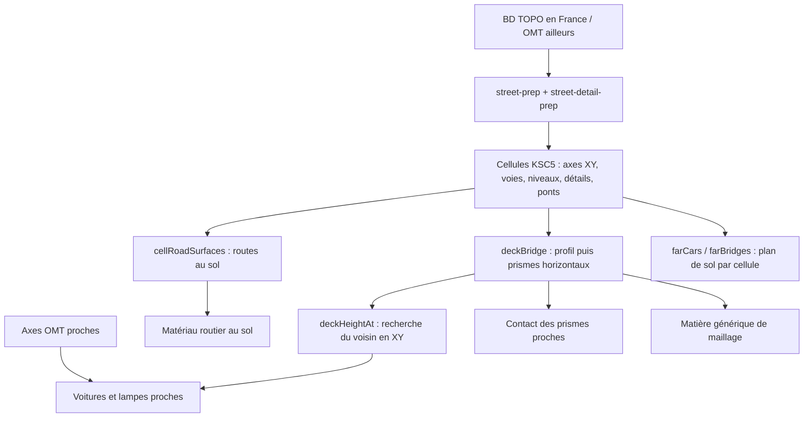
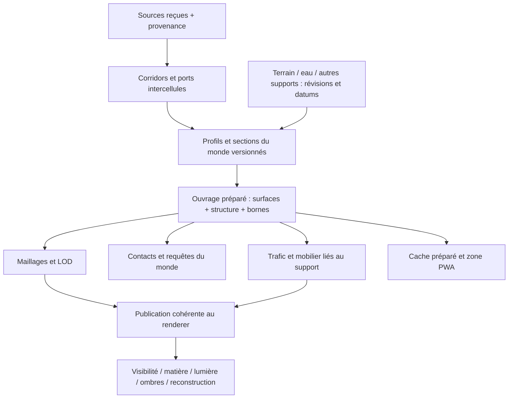

# Ponts et routes AAA — une chaussée continue dans un monde à plusieurs niveaux

**21 novembre 2026 — plan demandé par Sam : « Crée un plan pour pont-routes-AAA md. Analyse profondément ».**
**État : analyse approfondie et plan proposés ; aucune phase d'implémentation commencée.**
**Mode : normal**, par défaut selon [CLAUDE.md](../CLAUDE.md). Le mode speed historique de J8 ne s'étend pas à ce chantier.
Base examinée : **`3a86f5e1`**, avec le journal d'analyse du 21 novembre. Le code fait foi si le dépôt évolue.

Ce document prépare la réalisation ; il n'autorise pas une exécution implicite de ses lots. Aucun code produit,
format persistant, réglage, shader ou test n'est modifié pour l'écrire. Les résultats unitaires et les cas contrôlés
du §3 proviennent de l'analyse précédente ; aucun nouveau test du jeu, e2e ou benchmark n'est lancé ici.

**Décision de conception proposée :** préparer une définition versionnée de chaque corridor et ouvrage, possédée par
le monde, puis faire lire ses surfaces aux routes, ponts, contacts, véhicules, mobilier, lumières, ombres et LOD.
La qualité graphique détermine le détail dessiné ; elle ne détermine ni le niveau sur lequel on marche ni le profil du pont.

## 1. Résultat attendu et périmètre

Un pont se traverse sans marche artificielle à son entrée, entre ses morceaux ou à sa sortie. La chaussée conserve
ses voies, sa largeur, ses marquages, son matériau et sa continuité avec les routes d'accès. Les roues et les pieds
reposent sur la surface dessinée. Ce qui passe dessous reste dessous ; l'eau continue sous le tablier. L'ouvrage
garde son niveau, sa silhouette et sa matière lorsque la caméra s'éloigne ou qu'une cellule est remplacée.

« AAA » signifie ici un contrat de qualité, de contenu, de stabilité et de coût vérifiable. Une dalle beige dotée de
parapets ne termine pas le chantier ; une belle capture sans traversée ni transition ne le termine pas davantage.
La cohérence interne au centimètre n'est pas une promesse de précision géographique au centimètre.

### Inclus

- Routes au sol : axes et largeurs disponibles, surfaces et profils, carrefours, giratoires, bretelles, raccords,
  peinture, trottoirs, accotements, déblai/remblai lorsque nécessaire et fondé.
- Ponts routiers, ferroviaires et passerelles : tabliers, sections, culées, intrados, appuis, protections, chaussées,
  structures adaptées aux données et silhouettes d'ouvrages remarquables.
- Usages déjà présents : trafic décoratif, stationnement autorisé, lampadaires, glissières, signaux, caténaires,
  marche, caméra et contacts concernés ; proche et loin, jour, nuit et pluie.
- Surfaces finales, occlusion, ombres, reconstruction temporelle, streaming, zones PWA, reprise GPU et diagnostic TARS.
- Frontières de sources, de tuiles, de scènes et de niveaux ; absence ou contradiction de données.

### Frontières explicites

- Pas de simulation de génie civil, de rupture structurelle, de trafic urbain complet ni de conduite automobile jouable.
  Les véhicules procéduraux restent un trafic visuel ; on exige leur support et leur continuité, pas une IA de circulation entière.
- Les rails partagent le contrat d'ouvrage, sans hériter des marquages routiers ni ajouter une simulation ferroviaire.
- Les tunnels conservent leurs portails et exclusions ; raccorder leurs entrées et leur niveau, sans ouvrir ici une
  reconstruction mondiale des intérieurs ni une excavation automatique du terrain.
- Pas de suppression globale des routes photographiées, de reconstruction IA de l'orthophoto ni de nouvelle source
  géographique mondiale par défaut. Les problèmes d'alignement sont traités sur les corridors et qualifiés.
- Pas de routes réelles inventées sur la Lune. Les contrats de support sont réutilisables pour un futur ouvrage artificiel,
  mais les sources de ce plan décrivent la Terre.

### Place parmi les plans

| Document | Ce qui reste acquis | Responsabilité de ce plan |
|---|---|---|
| [J8](PLAN-J8-BATIMENTS.md), fermé le 20 novembre | Cellules, couverture, zones et preuves J8-A conservées | Reprendre explicitement les finitions et limites RP encore présentes, sans rouvrir la clôture historique |
| [Détails en vol bas / J8-VB](PLAN-DETAILS-VOL-BAS-FABLEFLIGHT.md) | Modèles de voitures, mobilier, préparation et règles déjà livrés | Continuité des corridors, supports, niveaux et parité proche/loin ; pas une seconde population |
| [J9](PLAN-J9-ARBRES-PROCHES.md) | Géométrie proche et intégration raster des arbres livrées selon son en-tête actuel | Réutiliser les pratiques de publication/LOD ; ne pas remettre son prototype historique à l'ordre du jour |
| [J7](PLAN-J7-FLUIDITE.md), [chargement](PLAN-CHARGEMENT-MONDE.md) | Ordonnancement et budgets communs | Chiffrer les nouvelles préparations et conserver la fluidité ; ne pas remplacer l'ordonnanceur du monde |
| [J3](PLAN-J3-LUMIERE-COCKPIT.md), [pipeline](GRAPHICS-PIPELINE.md) | Lumière, air, ombres et surface finale communs | Brancher les ouvrages sur ces responsabilités ; pas de second modèle d'éclairage |
| [Stratégie §§7, 19, 20](ANALYSE-STRATEGIE-RENDU-2026-11-03.md) | Monde/contact indépendants de la vue ; préparation hors frame ; migrations verticales | Livrer ces garanties pour le réseau routier et ses ouvrages |

Le chantier porte le préfixe **PR** ci-dessous. Aucun numéro J10 ni changement d'ordre global des jalons n'est imposé.

## 2. Existant vérifié et causes des écarts

### 2.1 La chaîne actuelle



Sources principales : [street-prep.ts](../src/system/street-prep.ts),
[street-detail-prep.ts](../src/system/street-detail-prep.ts), [street-cells.ts](../src/system/street-cells.ts),
[cell-roads.ts](../src/system/cell-roads.ts), [scenery-worker.ts](../src/system/scenery-worker.ts),
[street-far.ts](../src/system/street-far.ts), [scenery-raster.ts](../src/system/scenery-raster.ts),
[scenery-contact.ts](../src/system/scenery-contact.ts), [trace.wgsl](../src/shaders/trace.wgsl).

### 2.2 Défauts établis en lecture du code

| Constat | Cause actuelle | Conséquence à traiter |
|---|---|---|
| Tabliers en marches | `deckBridge` évalue son profil au milieu de chaque morceau ≤ 10 m ; `polygonPrimitive` lui donne un dessus horizontal | Géométrie discontinue malgré un profil continu ; contact et voitures peuvent diverger |
| Raccords aux accès non garantis | Profil reconstruit depuis le sol des extrémités, avec ajout de 0,4 m ; bouts ouverts non pris en compte | Une coupure de tuile peut être prise pour une culée ; route d'accès non résolue avec le tablier |
| Tirant improvisé | Bombement parabolique, dégagement sur échantillons du terrain, relèvement plafonné à 40 m | Pas de garantie sur l'intrados, la route réellement franchie, la caténaire ou une contrainte impossible |
| Dessus routier différent | Ponts exclus de `cellRoadSurfaces` ; meshes exclus du chemin `scenerySurface` / `roadPaved` | Peinture, texture et effets routiers non partagés ; matière générique sur le tablier |
| Pas de coupe transversale détaillée | Largeur unique incluant les côtés ; `segmentSurface` désactive les trottoirs sur pont | Chaussée, trottoir et parapet ne possèdent pas chacun leur espace et leur support |
| Support choisi par proximité | `deckHeightAt` cherche le tablier le plus proche en XY, sans identité ni étage | Ambiguïté aux ouvrages voisins ou superposés |
| Sources proches désalignées | Chaussée française BD TOPO, axes proches des voitures et lampes OMT | Largeur, trajectoire et pieds de mobilier peuvent différer du corridor dessiné |
| Géométrie lointaine indépendante | `farBridges` encode une dalle à dégagement + 0,6 m sur le plan de sol de la cellule | Niveau et forme différents du proche ; pas de profil partagé |
| Trafic lointain sans tablier | `farCars` ne transporte pas de support surélevé | Voitures maintenues sur le plan du sol |
| Culling et couverture d'ouvrage assimilés au trafic | `farCarCull` teste le centre avec petite marge ; masque proche `carMaskR` | Un bout visible peut être éliminé ; le rayon des voitures ne prouve pas la couverture des ponts |
| Identité locale fragile | Clé `${br.id}:${Math.round(br.points[0][0])}`, x exprimé dans la cellule | Le même ouvrage peut recevoir plusieurs clés ; ce n'est pas une identité mondiale |
| Chaînage ambigu | `chainBridges` relie le premier voisin libre de même niveau, sans séparation route/rail | Assemblages dépendants des branches et mélange de modes possibles |
| Deux constructions proches possibles | Ancien constructeur surfacique OMT plat et constructeur linéaire coexistent | Responsabilité en double, risque de volumes superposés à vérifier sur cas réel |
| Piles approximatives | Pied interpolé depuis l'axe densifié, appuis à espacement générique | Pas d'ancrage vérifié au pied exact ; risque de pile dans une voie ou au mauvais endroit |
| Lumière sans niveau propre | Grille proche `sceneryLampLight(xy)` en 2D | Placer la lampe sur le pont ne suffit pas à éclairer le bon récepteur |
| Ponts dans le noyau général | `renderer.ts` conditionne `liteAll` à `bridgeCount === 0` | Un pont garde un dispatch général ; son coût actuel n'est pas remesuré ici |

La présence d'une face inférieure de dalle et d'un contact sous le pont existe déjà : le manque concerne surtout
la continuité et le détail structurel, pas une absence totale d'intrados ou de passage sous tout pont.
La pluie générique existe aussi ; c'est sa parité avec le matériau routier qui manque.

### 2.3 Les routes ne sont pas encore une référence géométrique complète

`cellRoadSurfaces` produit des segments de surface suivant le terrain, sans construire un profil nivelé.
Les fonctions pures `roadProfile` et `roadBank` existent dans `street-detail-prep.ts`, mais aucun lecteur de production
ne les applique au sol : la recherche dans `src` trouve leurs définitions, pas une intégration au terrain/contact.
Le lot RP3 historique reste donc un travail à reprendre, pas un bénéfice déjà livré.

Trois limites supplémentaires doivent entrer dans la conception :

- Dans `scenerySurface`, les pointillés utilisent `s = along * len` puis des périodes de 9/13 m : la phase repart
  par segment. L'abscisse `s0` des cellules n'est pas transportée par le primitive routier actuel. Une continuité de
  texture demande une origine métrique stable, y compris après changement de scène et de LOD.
- `s0` et les continuations sont locaux aux morceaux/tuiles ; `NEXT_ELSEWHERE` n'est pas un graphe mondial résolu.
  Le chaînage des routes au sol sépare déjà route et rail ; ne pas perdre cet acquis en corrigeant les ponts.
- `roadProfile` conserve ses deux extrémités même si leur différence d'altitude rend la pente maximale impossible.
  Ses valeurs par classe sont des heuristiques du projet, pas des relevés ni des normes garanties. Un futur solveur
  doit rendre le conflit explicite ; réutiliser une fonction existante ne prouve pas la faisabilité du profil.

Les voitures proches circulent actuellement sur des morceaux bouclés par horloge ; `carsAlong` décrit lui-même
une limite de phase aux changements de corde. Le loin emploie encore des phases par segment. Corriger seulement
leur altitude ne suffit pas à garantir une traversée continue de bout en bout.

## 3. État de preuve et inconnues

### Preuves disponibles au 21 novembre

- **Lecture du code** à `3a86f5e1` : les écarts du §2 sont localisés, sans prétendre qu'ils soient tous visibles
  sur chaque pont. Le bilan [J8](PLAN-J8-BATIMENTS.md) laisse explicitement finitions, raccord du trafic et coût à juger.
- **37 tests unitaires existants passent**, zéro échec : `street-detail-prep`, `street-cells`, `street-far`,
  `scenery-contact`, `cell-roads` ; 50 026 assertions. Source locale :
  `remote-results/bridges-analysis-tests.log`. Ils ne valident pas une traversée du tablier maillé.
- **Cas synthétique exécutant le constructeur réel**, collecte des volumes à la place de `addSolid`, sans rendu GPU :
  pont routier de 100 m sur terrain plat, largeur 10 m, dégagement demandé 5,5 m, points tous les 20 m.
  Dix dalles ; première à 2,0328 m ; saut adjacent maximal 2,75 m. La comparaison échantillonnée à 1 cm des bouts
  de dalle donne un écart au profil continu jusqu'à 1,6294 m. Ce sont des sorties de ce cas contrôlé, pas des
  mesures d'un ouvrage réel ni une mesure exacte de l'erreur maximale de toutes les voitures en mouvement.
- **Deux cas contrôlés** : une route puis un rail peuvent être chaînés en un pont routier ; deux repères de cellules
  donnent des clés distinctes à un même id. **Pas de doublon observé** dans l'échantillon réel Seine `8297/5636` :
  cinq records, cinq ids, cinq clés. Ne pas convertir un risque démontré en défaut déjà observé sur la Seine.
- Trois features de pont de cet échantillon portent une méthode/précision altimétrique, sans attribut d'altitude
  explicite relevé. Le contrat sérialisé conserve seulement XY. L'absence de cote ici ne prouve pas son absence
  dans l'ensemble du produit IGN.

Sonde locale ignorée : `scripts/zz-bridges-audit.ts` ; résultats : `remote-results/bridges-analysis-probes.json`.
Ces fichiers sont des artefacts d'audit, **pas une suite de régression versionnée ni une dépendance du plan**.
PR0 doit transformer les cas utiles en fixtures/tests pérennes sans extraction textuelle de fonction au runtime.

### Inconnues à fermer en PR0–PR2

1. Quelles cotes, emprises, matériaux et architectures sont effectivement accessibles dans les sources déjà reçues ?
   Mesurer leur remplissage sur plusieurs régions, pas seulement trois features de Paris.
2. Quels défauts ressortent sur les mêmes ouvrages en mouvement, sous le pont et aux changements de cellule ?
3. Quel écart réel entre axes BD TOPO, OMT et orthophoto aux raccords ? Quelle donnée faire autorité localement ?
4. Quelle part du coût complet vient des ponts : préparation, triangles, visibilité, ombres, matériau et dispatch général ?
5. Quels consommateurs physiques doivent accepter un support surélevé ? La marche en lit déjà ; la prise en compte
   par le train des appareils doit être auditée et traitée explicitement, sans annoncer qu'elle fonctionne déjà.

Les captures historiques J8 et ses vols stricts prouvent leurs propres critères. Ils ne remplacent pas les nouvelles
preuves de géométrie, de niveau et de parité définies ici. Aucun coût ni gain nouveau n'est établi.

## 4. Contrats communs proposés

### 4.1 Géodésie, datum et précision

- Monde terrestre en **WGS84**, latitudes géodétiques, positions et supports en hauteur ellipsoïdale ; fonctions
  d'`ellipsoid.ts`, `bodyFixedOf`, `our-surface.ts` réutilisées. Aucun rayon moyen pour poser les ouvrages.
- Chaque cote source déclare son datum et sa qualité. Une hauteur orthométrique ne devient ellipsoïdale qu'avec
  la conversion appropriée à son référentiel. Ne pas assimiler automatiquement une cote NGF à une hauteur EGM2008.
  Les données réellement MSL du projet conservent leur conversion existante à la frontière ; pas de double géoïde.
- Préparation et requêtes CPU en précision suffisante ; coordonnées GPU locales en mètres, origine déclarée.
  Fragmenter les longs ouvrages et contrôler courbure et précision : un plan tangent de cellule n'est pas un tablier mondial.
- Un changement d'origine de scène transforme les mêmes surfaces ; il ne rééchantillonne pas un autre pont.
- Distinguer **incertitude géographique**, **erreur de simplification**, **erreur numérique** et **écart entre lecteurs**.
  Les seuils centimétriques du §11 portent sur ce dernier, pas sur la qualité du levé.

### 4.2 Corridor, ouvrage et niveaux

Un **corridor** porte axes, sections, usages et raccords. Un **ouvrage** porte une ou plusieurs surfaces de transport
et leur structure. Un même pont peut avoir deux chaussées, une piste cyclable, des trottoirs ou plusieurs niveaux.
Le modèle ne suppose donc pas « un axe = un pont = une largeur = un étage ».

- Identité logique avec espace de noms de source et id d'origine conservé ; hash compact GPU séparé avec gestion
  des collisions. Ni l'ordre d'assemblage, ni le x local, ni le premier morceau arrivé ne définissent l'identité mondiale.
- Fragments de tuiles reliés par des ports de bord stables : position, orientation, mode, niveau, largeur, référence
  source et état de résolution. Une extrémité ouverte reste une **continuation**, jamais une culée inventée.
- Assemblage déterministe : branches, boucles, chaussées parallèles et raccords route/rail traités explicitement.
  À une bifurcation ambiguë, garder plusieurs corridors plutôt que prendre le premier voisin libre.
- L'ouvrage physique peut regrouper plusieurs modes ; les chemins de circulation restent distincts. Une route
  n'est jamais prolongée automatiquement sur un rail. Un `track` n'est pas automatiquement une passerelle piétonne.
- Les attributs mesurés, inférés et absents restent distingués : voies, sens, accès, largeur, matière, appuis et cotes.
  `layer` exprime un ordre au croisement, pas un nombre de mètres. Une restriction de hauteur n'est pas une cote de tablier.
- L'abscisse curviligne et la phase des motifs ont une ancre stable par chemin ; jonctions et boucles possèdent des
  coutures explicites et cohérentes. Pas d'exigence impossible d'une abscisse unique sur tout un réseau ramifié.

### 4.3 Surface de support à plusieurs niveaux

Une carte de hauteur unique ne peut pas représenter simultanément la rivière, la route inférieure et le pont.
Conserver le terrain du monde, puis des surfaces d'ouvrage distinctes au-dessus ou en dessous.

Contrat sémantique proposé, **pas une nouvelle API déjà disponible** :

```ts
type SupportRef = { assetId: string; surfaceId: string; revision: string };
// sample(ref, sM, uM) → position WGS84/local déclarée, normale, tangente, section, disponibilité
// query(position, volume/mouvement, support précédent?) → candidats, contact accepté, qualité et révision
```

- Le trafic et le mobilier possèdent leur référence et leurs coordonnées `s/u`, pas une recherche du pont voisin en XY.
- La marche et le train recherchent les surfaces admissibles dans leur volume et le long de leur mouvement ; le support
  précédent stabilise la sélection. Ne pas choisir systématiquement la surface la plus haute d'une colonne.
- La normale, la pente et le dévers reposent sur la même surface. La hauteur de carrosserie n'est pas celle du point
  de contact des pneus ; tester ces derniers ou une enveloppe de roues définie, pas le centre du modèle.
- Contacts préparés à partir de la surface canonique, avec index local borné ; interpolation identique ou approximation
  à erreur bornée. Pas de lecture GPU→CPU bloquante par pas de simulation, ni une seconde courbe indépendante.
- Profil physique et résidence de contact dépendent de l'acteur et de son déplacement prévu, pas du regard, de
  `earthScenery`, du LOD ou de la disparition d'une scène proche. Une génération remplacée reste épinglée tant
  qu'un acteur en dépend ; le remplacement ne téléporte ni ne fait tomber le joueur.
- Un support indisponible renvoie un état explicite. Pas de tablier à zéro ni d'autorisation de circulation sur une
  surface qui n'a pas pu être publiée. Définir la reprise sûre au chargement d'une sauvegarde sur un pont.

### 4.4 Profil long et section transversale

- Résoudre ensemble les accès routiers et le tablier : position et pente aux vrais raccords, largeur et section
  continues. Continuité de position et, hors joint explicitement modélisé, de tangente ; aucun bombement universel.
- Cotes fiables prioritaires ; sinon reconstruction déterministe documentée, contrainte par les accès et les
  franchissements. L'incertitude reste visible dans les diagnostics, sans décor de debug dans le parcours du joueur.
- Le dégagement s'évalue **sous l'intrados**, avec épaisseur, dévers et accessoires, au-dessus de la surface
  réellement franchie. La cote d'une route, d'une voie électrifiée, d'un cours d'eau et du terrain nu n'est pas interchangeable.
- Aucune hauteur de navigation mondiale de 5,5 m présumée. Les heuristiques actuelles restent identifiées comme
  telles ; un conflit de gabarit et de pente devient un résultat dégradé/incohérent, pas un relèvement silencieux plafonné.
- Conserver les talus et profils mesurés quand le relief est assez précis, notamment IGN. La décision de niveler
  dépend de la qualité locale et du datum, pas uniquement d'une frontière nationale.
- Sur relief grossier, préparer un profil et son déblai/remblai avec enveloppe d'influence bornée. Même composition
  pour CPU, worker et GPU ; priorité explicite aux pistes et aux autres ouvrages. Ne pas niveler le lit sous un pont.
- Préserver bâtiments, hydrographie et routes à d'autres niveaux. Aux carrefours de même niveau, résoudre une
  surface commune ; une superposition de bandes ou plusieurs corrections de sol additionnées n'est pas un carrefour.
- La section déclare voies, sens, piste cyclable si connue, trottoirs, bordures, accotements, protections, épaisseur
  et dévers. Leur largeur s'additionne sans réduire arbitrairement les voies pour faire entrer le mobilier.

## 5. Architecture et formats à préparer



### 5.1 Responsabilités

| Propriétaire | Entrées → sorties | Limite |
|---|---|---|
| Adaptateurs de source (`street-prep`) | BD TOPO/OMT → fragments typés, provenance et qualité | Ne produit pas les hauteurs en fonction de la caméra |
| Assemblage du réseau | Fragments/ports → corridors, relations de franchissement et ids | Travaille par voisinages bornés, pas sur le graphe terrestre entier |
| Service des surfaces du monde | Corridors + révisions de relief → profils, sections et supports | Indépendant de l'option de décor et des budgets de dessin |
| Préparation d'ouvrage en worker | Définition commune → géométrie, index de contact, LOD, bornes | Pas de triangulation ou de solveur lourd dans la frame |
| Résidence/publication | Ressources validées → version acceptée et couverture réelle | Distingue prêt sur disque, préparé, uploadé, dessiné et utilisable en contact |
| Renderer | Surfaces/instances → profondeur, attributs, matière, lumière et ombres | Ne réinvente ni profil ni niveau |
| Simulation/usages | SupportRef + temps accepté → pose, contact, état et événements | Ne lit pas une carte de profondeur de la vue pour décider du sol |

Les noms de futurs modules sont à choisir au lot concerné. Extraire des responsabilités pures ciblées du worker
existant ; ne pas créer un second `EarthScenery` complet ni un nouveau gestionnaire réseau concurrent.

### 5.2 Contenu d'un ouvrage préparé

- Id logique, fragments, sources, version de schéma et de générateur ; révisions des données de terrain et des règles utilisées.
- Repère déclaré, bornes 3D, surfaces distinctes, ports de raccord, sections et échantillons/profil canonique.
- Relations aux surfaces franchies, contraintes connues et conflits ; qualité de chaque attribut important.
- Plages de géométrie par rôle : chaussée, trottoir, bordure, parapet, intrados, poutre, pile, culée, câble ou arche.
- Paramétrisation métrique `s/u`, normales/tangentes, références de matériaux, LOD et erreur de simplification.
- Index de contact, attaches des usages et bornes de chaque morceau ; aucune hypothèse « un octet suffit pour tous les ponts ».

Le format KSC5 est réutilisé tant qu'il suffit à porter les sources. Il peut rester le format des **candidats XY**,
avec un asset dérivé de support séparé si les révisions de relief l'exigent. Décider entre extension KSC et format
dérivé en PR1, après bilan de taille, invalidation, compatibilité et PWA. Ne pas imposer ici un binaire non chiffré.
Examiner notamment `SegmentSurface.bridge` sur un octet, les limites de segments/continuations et le budget de ponts.

Clé d'un asset dérivé : schéma + source/édition ou empreinte pertinente + révision du générateur + entrées de relief
et de profil. Une simple date ou une URL `latest` ne garantit pas que deux préparations utilisent les mêmes entrées.
La révision de surface est distincte de celle de son LOD ; changer de LOD n'invalide pas le sol physique.

## 6. Géométrie, matériaux et intégration graphique

### 6.1 Construire de vraies surfaces

- Échantillonnage adaptatif selon courbure, variation de pente, section et erreur permise ; sommets partagés aux
  raccords. Densifier seul ne corrige pas les dalles plates ni la hauteur des accès.
- Sections transversales extrudées suivant un repère stable, sans vrillage aux segments dégénérés ; traiter angles,
  raccords en biais, élargissements, fourches, doubles chaussées et virages serrés. Pas de rectangles indépendants
  qui laissent un trou intérieur ou un chevauchement extérieur.
- Culées aux vraies extrémités ; intrados fermé et épaisseur correcte ; raccords de matériaux volontairement séparés.
  Les joints de dilatation éventuels sont des détails bornés, pas des sauts de hauteur entre segments.
- Appuis ancrés sur le support réel interrogé à leur pied exact. Leur implantation respecte voies, gabarits et eau.
  Un MNT ne mesure pas nécessairement le fond d'une rivière : déclarer le fond inconnu, sans présenter une fondation
  sous-marine inventée comme relevée. Le modèle générique doit malgré cela éviter des pieds visiblement flottants.
- Les carrefours au sol et raccords du tablier portent une surface et une organisation de peinture propres,
  sans connecter des voies qui se croisent à des étages différents.

### 6.2 Chaussée commune, matériaux par rôle

- Extraire une responsabilité courte et partagée pour la surface routière : couleur linéaire, rugosité, microrelief,
  peinture et mouillé. L'utiliser sur terrain et tablier, en conservant les modèles de lumière et d'air existants.
- Grain, usure, réparations et motifs en coordonnées métriques stables, filtrés à l'empreinte du pixel. Couverture
  analytique ou textures/mips adaptés ; pas de lignes surépaissies à toutes distances pour les rendre visibles.
- Voies, phases des pointillés et changements de nombre de voies continus. Marquages inférés identifiés ; ne pas
  transformer une règle de classe en réglementation locale prétendument relevée. Conduite à gauche prise en compte.
- Photographie comme contribution locale à l'albédo quand elle est cohérente ; le dessus du pont ne prélève pas
  arbitrairement la rivière sous lui. Pour les routes au sol, préserver les acquis RP1/RP2 et vérifier les écarts d'axe.
- Répartir asphalte, béton, pierre, acier, ballast et peinture selon le rôle ; ne pas appliquer de fenêtres de bâtiment
  ni de peinture automobile au pont. Le vieillissement est spatialement cohérent, sans variations à chaque cellule.
- Pluie : grain et rugosité cohérents, mouillé borné, flaques compatibles avec le dévers ; pas d'eau étalée sur les
  parois verticales par une règle de chaussée. Pas de nouvelle simulation hydraulique exigée.

### 6.3 Rester dans le pipeline commun

- Direction retenue : **visibilité raster des triangles, attributs minimaux, ombrage différé en calcul existant**.
  Étendre le contrat pour normale, rôle de matière et coordonnées routières, sans recopier tout `liteSurface` dans
  un nouveau shader de pont. Chiffrer les attributs/buffers et la récupération des données avant de fixer le layout.
- Sorties : profondeur finale des triangles, identité et génération correctes, couleur de scène et mouvement utile.
  L'index de feuille/prisme historique n'est pas une identité mondiale ; le plan ne lui ajoute pas des bits sans audit.
- Le shader ne relance pas une marche de tout le décor pour retrouver un pont dont la surface est déjà connue.
  Retirer le veto `bridgeCount === 0` de `liteAll` **après** migration de toutes les faces et de leurs consommateurs,
  avec témoins de présence/occlusion. Conserver les transports spécialisés dans leur domaine légitime.
- Ombres : triangles et bornes de l'ouvrage dans les cartes existantes ; inclusion des parties hors champ qui
  projettent dans la vue ; cohérence proche/loin. Pas une carte ou une lumière dynamique par pile ou lampadaire.
- Eau : traiter profondeur et domaine de réception. Ne pas effacer globalement l'emprise du pont du fleuve pour
  cacher de l'eau sur le tablier : cela supprimerait la rivière vue dessous ou sur les côtés. Préserver reflets,
  ombre sur l'eau et désocclusion ; tout repli a une portée explicite.
- Historique : même ouvrage à caméra mobile, mais nouvelles surfaces invalidées quand profil/asset change.
  Pas de mélange temporel entre l'ancien niveau et le nouveau ; test de pause, pas, saut de temps et retour sauvegarde.
- Export/photo lit les mêmes définitions et matériaux compatibles ; aucune promesse de parité du transport relativiste
  hors de son domaine sans test dédié. Un repli spécialisé doit être décrit et couvert, pas supprimé à l'aveugle.

## 7. Usages, structures et distance

### 7.1 Véhicules et mobilier

- Préparer voies et trajectoires sur le corridor faisant autorité, largeur et sens conservés. Pose selon `s/u`,
  tangente, pente et dévers du support. Pas de sélection du pont « le plus proche » pour chaque pied ou chaque voiture.
- Temps accepté de la simulation et identité stable des véhicules. Un changement de scène ne reroule pas les graines,
  ne change pas couleur/modèle et ne réinitialise pas leur phase. Assurer une continuité entre morceaux puis proche/loin,
  sans exiger ici une simulation de chaque automobiliste sur tout le globe.
- Respecter accès, barrières, sens, niveaux, portails et exclusions des pistes déjà corrigées. Le trafic sous un
  pont reste sur son propre chemin. Ne pas installer de stationnement sur tout pont : seulement des places autorisées
  et connues, avec repli conservateur sans place sur tablier lorsque la donnée manque.
- Lampes, glissières, signaux et caténaires attachés à la bonne surface/section ; pas de pied dans la chaussée,
  de garde-corps bouchant l'entrée ni de doublon entre structure et mobilier.
- Réception lumineuse distinguée par niveau et hauteur du récepteur. Étudier une extension bornée des pages/grilles
  existantes, ou un regroupement local par surface ; pas de boucle sur toutes les lampes par pixel ni de grille 3D
  mondiale non chiffrée. Les feux et reflets de chaussée doivent éclairer la surface qui leur correspond.
- Diagnostic et réglages produit via les mêmes actions métier pour humain, `__bh` et TARS. Aucun réglage de debug
  nécessaire à l'usage normal ; le niveau de détail graphique ne devient pas une commande qui retire le support physique.

### 7.2 Fidélité des structures

La structure s'évalue par **travée**, pas seulement par longueur totale. Un ouvrage peut changer de famille.

| Donnée disponible | Comportement proposé |
|---|---|
| Type, appuis et dimensions fiables | Reconstituer les travées correspondantes et contrôler la silhouette |
| Type connu, appuis partiels | Compléter de manière déterministe, bornée et signalée comme inférée |
| Axe et largeur seuls | Modèle générique discret et cohérent ; ne pas inventer un monument suspendu ou un nombre d'arches prétendument exact |
| Monument identifiable | Asset ou règle dédiée documentée, calée sur les mêmes accès, surfaces, matériaux et datums |
| Données contradictoires | Conserver la dernière version cohérente ou un repli qualifié, avec raison observable |

Familles attendues : dalle/poutres, viaduc à travées, arches, treillis, suspension et haubans ; variantes route, rail,
passerelle et ouvrages mixtes. Les câbles et garde-corps fins requièrent un traitement de taille projetée/filtrage,
sans augmenter arbitrairement leur diamètre ni faire disparaître la silhouette à distance.
Le pont Alexandre III doit être un cas de fidélité architecturale, pas seulement de présence d'une dalle sur la Seine.
La liste finale des ouvrages remarquables et leurs références licenciées se fixe en PR0/PR6.

### 7.3 LOD et couverture

- LOD dérivés de la même définition et conservant ports, profil, surfaces de circulation, enveloppe et rôles de matière.
  Simplifier les détails structurels selon leur erreur projetée, pas remplacer le pont par une dalle à une autre altitude.
- Hystérésis, transitions complémentaires, identité stable. La transition ne double ni opacité ni ombre et ne fait
  pas disparaître l'ouvrage entre deux rayons. Tester les détails dans la reconstruction, pas seulement en image brute.
- Bornes de morceau tenant compte de longueur, largeur et hauteur ; culling conservateur de volumes, pas du centre.
  Un pont dont le centre est hors champ mais dont une travée est visible doit rester dessiné.
- Couverture proche publiée par **emprises réellement prêtes**, indépendante de la portée des voitures et des lampes.
  Si une partie manque, le LOD antérieur garde cette partie ; publier aussi les masques avec leur génération.
- Fractionner les longs ouvrages pour résidence/culling, sans confier toute leur existence à la cellule de leur premier
  point. La propriété logique est unique ; plusieurs morceaux résidents ne sont pas plusieurs ponts.

## 8. Streaming, caches, PWA et budgets

- Préparer depuis les sources déjà acquises ; voisinages et halos bornés. Une continuation hors zone n'autorise pas
  une chaîne infinie de téléchargements jusqu'à la prochaine culée. Définir une limite de résolution et un état partiel.
- Réutiliser `CellPool`, workers, coordination réseau, zones et budgets fournisseur. Un enrichissement externe
  éventuel passe par le même circuit, avec coût/licence/couverture et téléchargement hors ligne explicites.
- Publication : données valides → support canonique → contacts/instances → GPU prêt → couverture acceptée.
  Les lecteurs partagent une révision compatible ; le rendu peut avoir plusieurs LOD de cette révision.
  Ne jamais inscrire un support comme disponible avant que ses ressources minimales aient été acceptées.
- Remplacer par lot cohérent d'ouvrage/ports, sans imposer le rechargement complet d'une ville. Garder ancienne
  géométrie et anciens contacts utiles jusqu'à leur remplacement ; annuler proprement les préparations périmées.
- Les caches actuels balaient les anciens formats de rue : traiter cette politique dans la migration, ne pas
  supprimer la seule couverture utile d'une zone hors ligne avant reconstruction/compatibilité vérifiées.
- `flightReady` et la zone distinguent sources présentes, voisinages résolus, profils prêts, contacts prêts,
  uploads et pipelines prêts. Résultat partiel/dégradé explicite ; aucune attente de 15 s assimilée à une réussite.
- Conserver les contraintes de parcours : zéro téléchargement de données pendant un vol strict préparé, pas de
  scène rapide acceptée implicitement, suppression de zone invalidant aussi les assets dérivés sans casser l'acteur actif.
- Compteurs : ouvrages/fragments, ports ouverts, conflits, supports/LOD prêts, candidats/dessinés/refusés, bytes
  CPU/GPU/disque, travaux annulés, âge des files et révisions. Overflow signalé avec repli de couverture, pas un trou silencieux.
- Budget distinct pour préparation, contacts, géométrie, matériaux, lumière et ombres. Buffers partagés/instances
  pour détails répétitifs ; aucun buffer ou draw obligatoire par pile. Limites en octets et records vérifiées contre le device.
- Perte GPU : garder les définitions CPU/cache et reconstituer les ressources avec leur révision. Ne pas refaire
  les cotes depuis une autre source parce que les buffers GPU ont disparu.

Aucune durée ou enveloppe mémoire arbitraire n'est déclarée atteinte. PR0 mesure le coût complet existant et PR1
fixe les plafonds de chaque ressource avant ajout. Cibles de produit conservées : progression vers 60 images/s réelles
sur M1 Max, 25 régulières sur le mini ; aucun palier nouveau inventé pour faire accepter ce chantier.

## 9. Phases de réalisation proposées

Tous les lots ci-dessous sont **à faire**. Chaque lot livre un bénéfice concret, son contrôle adapté, ses documents
et son retrait associé. Un échec d'acceptation reste ouvert ; « implémenté » ne devient pas « validé ».

| Phase | Travail et dépendances | Sortie vérifiable / retrait |
|---|---|---|
| **PR0 — Références et contrat** (fait) | Figer corpus réel + cas synthétiques ; relever sources/datums, phases et état actuel ; profil de coût sur les deux Macs ; valider les sondes | Fixtures rejouables (`src/system/bridge-corpus.ts`, `tests/bridges-corpus.test.ts`), défauts localisés, seuils renseignés, preuves A/A et témoins validés ([FICHE-PR0](progress/pont-routes-aaa/FICHE-PR0.md)) |
| **PR1 — Identité, ports et publication** (fait) | Après PR0 : fragments, multi-surfaces, provenance ; rapprochement déterministe aux frontières ; décision de format/cache et capacités | Isolation stricte route/rail et déterminisme dans `chainBridges`, ports `OpenA`/`OpenB` préservés, clé canonique mondiale `bridgeCanonicalKey` ([FICHE-PR1](progress/pont-routes-aaa/FICHE-PR1.md)) ; clé $x$ locale retirée |
| **PR2 — Profil et supports communs** | Après PR1 : service de surface et contacts ; résoudre accès, profils, sections et gabarits ; politique de nivellement et conflits | Une référence de support testable ; raccords cohérents ; aucun saut avec caméra/qualité ; retirer les profils de support reconstruits séparément |
| **PR3 — Géométrie continue routes/ponts** | Après PR2 : mesh des tabliers, culées et raccords ; courbes, sections, carrefours ; appuis génériques sûrs ; contacts issus de la surface canonique | Première traversée complète dessus/dessous ; retirer les prismes horizontaux comme autorité du tablier et le constructeur OMT surfacique dans le domaine remplacé |
| **PR4 — Chaussée et raster communs** (fait) | Après PR3 : attributs de surface, matériau routier partagé, phases des lignes, pluie, profondeur/identité, lumière et ombres communes | Parité sur route d'accès et pont à sec/mouillé ; aucun retour au noyau général pour ces faces ; retrait du veto ponts dans liteAll ([FICHE-PR4](progress/pont-routes-aaa/FICHE-PR4.md)) ; gain GPU ~0,6 ms |
| **PR5 — Usages au bon niveau** | Après PR2/PR3, puis intégration PR4 : trafic continu, attaches s/u, lampes, glissières, rails/caténaires, marche/train concernés, niveaux lumineux | Véhicules au bon support et bonne orientation, dessus/dessous indépendants ; retirer `deckHeightAt` au plus proche et les axes OMT doublant une autorité BD TOPO migrée |
| **PR6 — Structures fidèles** | Après PR3/PR4 : travées, familles, matières et modèles d'ouvrages remarquables ; données/refs acquises selon le contrat commun | Silhouettes et appuis inspectés, références et limites documentées ; remplacer les espacements génériques là où la structure est connue |
| **PR7 — LOD, résidence et PWA complets** | Socle dès PR1, livraison après PR3–PR6 : proche/loin communs, bornes/culling, masques de couverture, zones, reprise GPU | Traversée des frontières sans trou ni changement de niveau ; zéro réseau en parcours strict préparé ; retirer `farBridges` parmi les voitures et ses dalles indépendantes |
| **PR8 — Acceptation intégrée** | Après PR0–PR7 : campagne §10, parcours complet et budget soutenu ; traiter les écarts trouvés | Critères §11 satisfaits, captures/rapports et coût complet présentés ; aucun simple compteur de présence comme verdict |
| **PR-R — Retraits et clôture** | Retraits au lot suivant chaque bascule ; audit final après PR8 | Anciens lecteurs/options/buffers sans usage supprimés ; docs vraies, compatibilité et limites explicites ; clôture seulement sur preuves |

**Premier incrément jouable : PR0 → PR1 → PR2 → PR3**, un pont routier et ses accès réellement traversables,
sans attendre tous les modèles architecturaux. La sortie finale exige néanmoins PR4–PR8 : ce premier incrément
n'est pas déclaré « ponts parfaits ». LOD, PWA et contacts se conçoivent dès le socle, même si leur campagne complète est en PR7.

### Registre de migration obligatoire

| Ancien chemin | Remplacement | Condition et moment de retrait |
|---|---|---|
| Clé id + x local / chaînage ambigu | Identité source et ports résolus | PR1, quand tous les producteurs du domaine migré lisent la nouvelle identité |
| `deckBridge` à dessus plats et ancien pont surfacique | Surface canonique maillée | PR3 puis lot suivant ; ne pas supprimer le seul repli d'une région non migrée |
| `deckHeightAt(x,y)` | SupportRef et requête de surface | PR5, une fois trafic, mobilier et contacts consommateurs migrés |
| Dessus générique, tags de bâtiment/voiture utilisés pour le pont | Rôles de matière et surface partagée | PR4/PR7 selon le lecteur ; audit raster, photo et ombres |
| Dalles `farBridges` dans les records de voitures | Morceaux d'ouvrage et LOD communs | PR7, avec couverture prouvée aux deux côtés de la jonction |
| Axes proches OMT doublant BD TOPO | Corridor faisant autorité | PR5, sans supprimer OMT hors couverture ni faire disparaître un réseau manquant |
| Veto global `bridgeCount` du dispatch | Lecteur des surfaces raster finales | PR4 après preuve des faces, puis audit PR-R ; conserver les autres raisons légitimes du dispatch |
| Adaptateur de cache ou d'ancien layout | Lecteurs du format retenu | Lot suivant la migration sûre des zones ; version et condition consignées |

Les leviers de mesure restent des outils hors parcours produit. Chaque adaptateur restant reçoit une responsabilité,
un domaine et un lot de retrait ; pas de double opaque ni de double population permanente.

## 10. Campagne de validation future

Méthode obligatoire : [E2E](E2E.md), [E2E-VOLS](E2E-VOLS.md), [BH-API](BH-API.md),
[catalogue](E2E-CATALOGUE.md), [pipeline §8](GRAPHICS-PIPELINE.md#8-mesurer-le-pipeline), [thermique](THERMAL.md).
Les noms ci-dessous désignent des **tests à créer ou adapter**, pas des commandes actuellement disponibles.

### 10.1 Corpus minimal à figer en PR0

| Cas | But de preuve |
|---|---|
| Pont droit synthétique de 100 m | Anciennes marches détectées ; profil, intrados et contacts comparables numériquement |
| Pont court incliné / terrain accidenté | Raccords, pente et gabarit ; pas de bombement forcé |
| Courbe, élargissement et culée en biais | Sections, UV, normales, absence de trou/chevauchement |
| Deux étages et route au sol sous le pont | Sélection de support, trafic et lampes séparés ; pas d'association XY erronée |
| Ouvrage mixte, voies parallèles et bifurcation | Appartenance physique sans fusion des chemins route/rail/piéton |
| Ouvrage traversant 2+ tuiles z14 et plusieurs scènes | Bouts ouverts, ordre d'arrivée, identité et phase métrique |
| Long viaduc dont le centre est hors champ | Bornes conservatrices, résidence par morceaux et ombres hors champ |
| Paris — Alexandre III et autres ponts de Seine | Architecture, eau sous le pont, voie d'accès, nuit et marche |
| Toulon / côte varoise | Routes mesurées, viaduc et rail électrifié ; choisir les ids/poses exacts après inspection |
| Route de montagne sur relief grossier hors de France | Nivellement partagé, conflit de contraintes, talus et raccords |
| Région roulant à gauche et frontière de source | Sens, mobilier, compatibilité BD TOPO/OMT et absence de doublons |
| Source partielle, contradictoire ou absente | Repli déterministe, readiness dégradé et absence de support fictif |

Chaque fixture réelle porte ids de source, empreintes/édition, datum connu ou inconnu, lat/lon, hauteur avec datum,
pose/heure, paramètres, sortie/échelle et chemin de caméra/acteur. Ne pas figer seulement une capture sans ses entrées.
Les points exacts hors Paris restent à sélectionner ; aucun ouvrage non inspecté n'est décrit comme validé.

### 10.2 Contrôles unitaires et structurels

- Portage des cas du §3 dans des modules testables : pas d'extraction de code source en test de production.
- Ordre et découpage des fragments, inversion d'axe, rebasing, tuiles manquantes, largeur variable et niveaux.
- Continuité profil/section, faisabilité des contraintes, erreur mesh/support, normales, intrados et portées.
- Conservation de phase métrique, niveau du mobilier, trajectoires et temps gelé/avancé ; sens de circulation.
- Encodage/décodage du format retenu, offsets/alignements CPU/WGSL, champs absents, valeurs non finies et capacités.
- Publication atomique, annulation et version périmée ; éviction d'une cellule traversée par un acteur ; migration PWA.
- Tests de défauts réels et invariants ; pas une batterie qui répète seulement les constantes du nouveau code.

### 10.3 E2E visuels et fonctionnels

- **Traversée** : marche dans les deux sens, caméra rasante et latérale ; route → pont → route, puis passage sous
  le même ouvrage. Le support et la révision sont assertés, pas uniquement « personnage non tombé ».
- **Trafic/mobilier** : suivre un véhicule et ses points d'appui, tourner autour des lampes ; franchir les mêmes
  limites proche/loin dans les deux sens ; la route inférieure ne reçoit pas les objets de l'étage supérieur.
- **Matériau** : lumière rasante, sec/pluie, nuit ; phases et voies au raccord, parapets, intrados et reflets contrôlés.
- **Distance** : approche/éloignement et panoramique aux frontières ; centre hors champ, vue dessus/dessous et FOV
  variable. Pas de vérification réduite à « nombre de ponts > 0 ».
- **Streaming** : cache froid puis chaud, zone prête puis strict hors ligne, cellule manquante, changement d'origine,
  suppression/recréation de zone, perte GPU, sauvegarde/reprise sur le pont. Regarder ailleurs ne change pas le support.
- **Diagnostics** : compteurs de candidats, surfaces, conflits, refus et révisions ; TARS lit les mêmes états de
  disponibilité et utilise les mêmes actions que l'UI. Ajouter les références BH-API/TARS si leurs contrats changent.

Attendre des prédicats de données/shaders/surfaces prêts avec borne et raison ; pas de sommeil fixe assimilé à une
preuve. Gel, pas, pause et temps simulé suivent E2E-VOLS ; une pause du jeu ne gèle pas nécessairement toute préparation.
Chrome visible ici, mini plein écran, un seul Chrome de test par machine ; charge IGN commune respectée.

### 10.4 Mesures et présentation

- Référence A/A pour chaque sonde d'image ; témoin positif injectant un défaut connu, témoin négatif ne changeant
  rien avant de retenir ses chiffres. Une image moyenne ou un ratio de populations n'est pas une mesure de raccord.
- Comparer les **mêmes points et identités** des deux représentations, exposition et données tenues, plusieurs
  frames pour séparer gigue, trafic et historique du défaut. Captures annotées au besoin, sans modifier les originaux.
- Coût complet sur les deux Macs : CPU p50/p95/p99, préparation et files, GPU par famille et total, régularité,
  réseau, mémoire CPU/GPU/disque, uploads et compilations. État thermique et cadence bornée soutenue selon J0.
- Isoler géométrie, matière et ombres par ablation à contenu constant ; puis mesurer le cumul avec ville/eau/arbres.
  Une économie du dispatch général n'est pas le gain net du chantier ; les nouveaux triangles ont leur coût.
- Aucun allègement silencieux de densité, portée, résolution, eau, arbres ou appareil pour faire passer le budget.
- Montrer dans T3 captures, courbes et rapports avec machine, date, commit, scènes, paramètres et verdicts.
  Les `.png` sur disque seuls ne constituent pas une présentation à Sam. Mettre les nouvelles fiches dans
  `docs/progress/pont-routes-aaa/` lors de l'exécution, sans fabriquer un dossier de résultats maintenant.

## 11. Contrat d'acceptation proposé

**Cibles de travail à confirmer en PR0, pas des mesures déjà acquises.** Toute relaxation future est documentée
avec son effet visuel/fonctionnel ; elle ne devient pas silencieusement la nouvelle définition de « parfait ».

| Garantie | Cible / verdict attendu | Preuve |
|---|---|---|
| Raccord interne de surfaces | Écart vertical ≤ 5 cm, pas de fissure ni marche visible ; continuité de tangente hors joint déclaré | Échantillons aux ports + traversée à pied + caméra rasante |
| Véhicule/support/rendu | Écart du point de contact attendu à la surface dessinée ≤ 2 cm dans le domaine proche validé | Roues ou enveloppe définie, support versionné, lecture de surface contrôlée |
| Niveaux | Zéro association à l'étage voisin sur tout le corpus ; objets du dessous conservés | Identités de support + cas superposés jour/nuit |
| Géométrie | Pas de trou, inversion de face, pile flottante ni appui dans un gabarit connu ; conflits non résolus signalés | Vérification structurelle + vues dessus/dessous |
| Parité de chaussée | Même matériau et motifs continus au raccord ; trottoirs et protections occupant leur section | Cas sec/mouillé, nuit et largeur variable |
| LOD | Pas de changement de niveau ; cible initiale ≤ 0,5 pixel d'écart projeté du support et des raccords pendant le relais | Mêmes points reprojetés, A/A, mouvement et FOV contrôlés |
| Couverture | Aucun morceau visible supprimé parce que le centre est hors champ ; aucun trou de relais ou doublon opaque | Tests d'étendue, masques publiés et refus comptés |
| Indépendance physique | Caméra, qualité et éviction graphique ne modifient pas support/normale de l'acteur | Même trajectoire avec regard/qualité différents ; transitions de résidence |
| Sources | Datum, qualité et provenance accessibles ; aucun niveau converti arbitrairement en altitude | Audit d'échantillons et télémétrie |
| PWA/reprise | Parcours préparé strict : zéro requête de données ; profils/contacts/LOD prêts ; reprise cohérente | Réseau capturé + readiness + perte GPU + sauvegarde sur pont |
| Raster | Pont présent avec noyau général non requis pour ses faces migrées ; profondeur, occlusion et ombres correctes | Ablations, défaut injecté et vues de la rivière sous le pont |
| Performance | Coût soutenu dans l'enveloppe fixée en PR0/PR1, progression compatible avec les cibles du projet | Fiches J0 par machine et coût complet, pas de durée estimée déclarée mesurée |
| Fidélité remarquable | Ouvrages nommés reconnaissables par leurs travées et silhouette, limites de source déclarées | Références licenciées, vues correspondantes et revue de Sam |

Les seuils de 5 cm, 2 cm et 0,5 pixel ont des domaines différents : raccord de deux surfaces, cohérence d'un point
de contact proche, relais visuel. Un test doit satisfaire tous ceux qui s'appliquent ; 5 cm n'autorise pas une marche
visible à très courte distance. Un LOD lointain n'est pas le support physique. L'incertitude géographique peut rester
métrique tout en gardant tous les lecteurs parfaitement cohérents entre eux.

## 12. Risques, arbitrages et décisions préparées

| Risque | Réponse à préparer | Ce qui interdit de clore |
|---|---|---|
| Pas de cote fiable | Reconstruction contrainte et qualité explicite ; enrichissement local si nécessaire | Promesse de fidélité altimétrique sans cote/datum |
| Accès, pente et gabarit incompatibles | Solveur rendant les conflits ; données à corriger ou repli cohérent | Courbe « réparée » par une bosse/cap arbitraire |
| Retouches du terrain dommageables | Politique par qualité, influence bornée et priorité des supports | Contact différent de l'image ou nivellement d'un étage voisin |
| Explosion des attributs et du shader | Données préparées, rôles compacts, lecteurs courts, inventaire et compilation | Nouveau noyau universel lourd ou buffers sans budget |
| Éclairage multinéiveau coûteux | Pages locales et sélection de récepteurs ; prototype mesuré | Fuite sous le pont ou coût non borné par lampadaire |
| Streaming intercellules sans fin | Ports et halos bornés, état partiel défini | Attente sans borne ou couverture supprimée en attendant la suite |
| Fidélité des grands ouvrages | Enrichissement ciblé et assets partageant les mêmes surfaces | Générique présenté comme monument reconstruit fidèlement |
| Migration interrompue | Verticale jouable, domaines de repli et registre de retrait | Deux versions permanentes calculant des ponts différents |

Choix recommandés dès le départ : mode normal ; pas de nouveau fournisseur par défaut ; support canonique commun ;
matériau partagé ; terrain conservé lorsqu'il est fiable ; premier parcours vertical avant enrichissement massif.
Choix à documenter en PR0/PR1 : format exact, plafonds, fournisseur éventuel de cotes, lieux supplémentaires,
liste d'ouvrages remarquables et capacité des lumières par niveau. Leurs décisions et leurs preuves entrent dans
la fiche de la phase concernée avant de figer le format ou de lancer la production de contenu correspondante.

## 13. Bibliothèques et sources primaires

Aucune dépendance ajoutée ni mise à jour par ce plan. Le dépôt utilise déjà `meshoptimizer` **1.3.0** dans
`scripts/build-tree-assets.ts` et `webgpu-utils` **2.1.1** dans `scripts/gen-layouts.ts` (versions du manifeste).
Réutiliser cet outillage ; évaluer un ajout seulement s'il retire un travail précis et respecte Bun, licence,
workers, bundle et budgets :

- **meshoptimizer déjà installé** : étendre son usage à la localité, compression et aux LOD de structures ; protéger ports, chaussées et
  silhouettes. Réutiliser l'[évaluation J3-6](progress/j3/FICHE-J3-6-MESHOPT-2026-11-14.md). Ne pas déléguer le
  profil routier ou la validité du support à un simplificateur de triangles.
- **Earcut** : candidat pour surfaces de carrefours nettoyées ; validité, trous et auto-intersections restent à traiter.
- **glTF Transform / chaîne glTF existante** : préparation d'assets remarquables si leurs sources s'y prêtent.
- Layouts CPU/WGSL : étendre la génération existante avec **webgpu-utils**, une autorité de schéma et les contrôles
  déjà présents avant une migration de bibliothèque.
  Aucun portage général vers Effect/TypeGPU demandé pour ce chantier.

Sources externes relues le 21 novembre 2026, utilisées pour leur sémantique, pas comme garantie des tuiles reçues :

- [IGN — BD TOPO](https://www.data.gouv.fr/datasets/bd-topo-r) : produit 3D et identifiants stables.
  **Conséquence proposée** : examiner les cotes réellement distribuées et leur datum avant toute acquisition nouvelle.
- [OSM — layer](https://wiki.openstreetmap.org/wiki/Key:layer) : ordre vertical local aux croisements, sans hauteur métrique.
  **Conséquence proposée** : résoudre les gabarits et les cotes séparément de cet ordre.
- [OSM — bridge:structure](https://wiki.openstreetmap.org/wiki/Key:bridge:structure) : famille structurelle par travée,
  plusieurs familles possibles sur un ouvrage. **Conséquence proposée** : modèle de travées et enrichissement ciblé.
- [OpenMapTiles — schéma transportation](https://github.com/openmaptiles/openmaptiles/blob/master/layers/transportation/transportation.yaml) :
  classes, sens, rampes et franchissements. Le schéma amont n'est pas un relevé des attributs de notre fournisseur.
  L'URL publique `/schema/transportation/` n'était pas accessible par l'outil de lecture ; source officielle du dépôt lue à la place.

Les références sont paraphrasées brièvement ; les paramètres de conception du plan viennent des besoins du projet,
pas de normes d'ingénierie routière revendiquées. Tout ajout réel de bibliothèque relira sa documentation officielle
et sa version au moment du lot, conformément à CLAUDE.md.

## 14. Documents à maintenir et état de suivi

À chaque lot d'exécution : ce plan (état/preuves/retraits), le journal et sa page « État courant » ;
[GRAPHICS-PIPELINE](GRAPHICS-PIPELINE.md) si passes/layouts/chargement changent ;
[BH-API](BH-API.md) et [TARS](TARS.md) si leurs contrats changent ;
[DATA-SOURCES-MONDE](DATA-SOURCES-MONDE.md), [ASSETS](ASSETS.md) et [DEPLOY](DEPLOY.md) si sources/assets le demandent ;
[E2E-CATALOGUE](E2E-CATALOGUE.md) pour chaque nouveau test ; guides de vol/contact concernés si comportement modifié.

Contrôles rapides adaptés au code réellement touché : tests unitaires ciblés, TypeScript/Biome ; WGSL et inventaire
pipeline si concernés. `bun run check && bun test` avant un push, selon les règles du dépôt. Ne pas lancer toute
la campagne e2e par défaut ; PR8 exécute le corpus défini et les parcours de non-régression nécessaires.

| État au 21 novembre | Preuve | Suite |
|---|---|---|
| Analyse des ponts/routes approfondie | Code, docs et sources primaires relus ; distinction preuves/inconnues | PR0 livré avec corpus et témoins |
| Plan PR0–PR8 / PR-R engagé | PR0, PR1, PR2 et PR3 livrés ([FICHE-PR0](progress/pont-routes-aaa/FICHE-PR0.md), [FICHE-PR1](progress/pont-routes-aaa/FICHE-PR1.md), [FICHE-PR2](progress/pont-routes-aaa/FICHE-PR2.md), [FICHE-PR3](progress/pont-routes-aaa/FICHE-PR3.md)) | PR4 — Chaussée et raster communs |
| Performance et validation finale | Non mesurées / non effectuées dans cette session documentaire | Ne pas écrire « livré » avant PR8 et PR-R |

**Prochaine action de réalisation : PR4**, chaussée et raster communs, matériau routier partagé (asphalte, marquages, pluie), levée du veto `bridgeCount === 0`.
chaussée continue, du terrain au tablier, avec ses usages sur le même support. La fidélité architecturale et la
couverture mondiale se construisent sur cette autorité, sans reconduire des ponts différents selon le lecteur.
