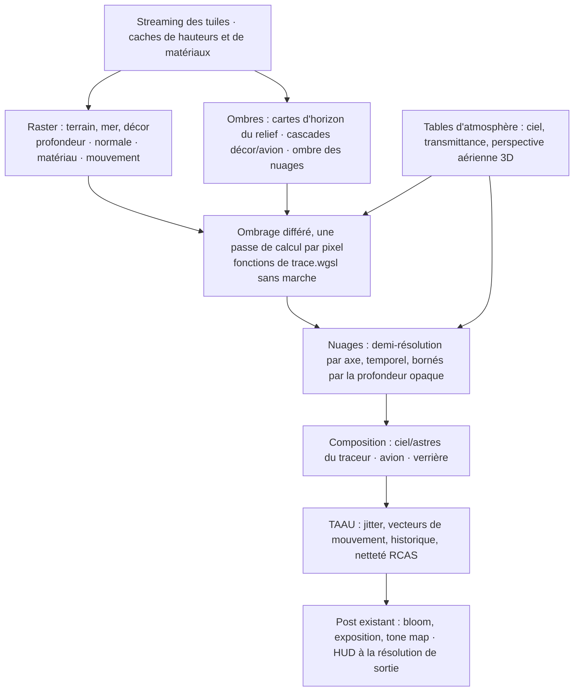

# Plan — le vol terrestre en qualité AAA, temps réel, sur M1 Max (WebGPU)

Date : **20 octobre 2026**. Branche **`plan-rendu-raster-aaa`**, créée depuis `main` à `38977554`.
Statut : **plan seul — aucun code modifié**. Les chiffres marqués *(estimation)* sont des hypothèses de conception
à mesurer, pas des résultats.

## 0. La demande et le point de départ

> « Je veux la qualité AAA en realtime… sur mon M1 Max, en avion, je suis en realtime ×6 pour du 20–30 fps. Je veux
> la meilleure qualité AAA WebGPU. »

Aujourd'hui, en vol au-dessus de la Terre, tout le paysage (relief, mer, nuages, air, arbres, bâtiments) est
**une seule passe de calcul qui lance un rayon par bloc de b × b pixels** (`trace.wgsl main`). Le reste (avion en
raster, reconstruction, temporel, affichage) est à pleine résolution. « Temps réel ×6 » = **un rayon pour 36 pixels**,
les 35 autres reconstruits (`post.wgsl gatherH`, `resolve`) : c'est la cause de l'image pixelisée.

Ce qui est mesuré (`docs/PERFORMANCE.md` § *The low flight*, `docs/PLAN-RENDU-PERF.md`, kerr-mini = Mac mini M1) :

| Fait | Valeur |
|---|---|
| Coût d'un rayon | ≈ 0,37 µs sur M1 (8 cœurs GPU) ; ≈ 4× moins sur M1 Max (32 cœurs) *(estimation)* |
| Rayon de sol vs rayon de ciel | 2 à 3× plus cher |
| Travail d'un rayon de sol | ≈ 150 lectures de hauteur (`earthMarch`, `earthH`), ≈ 40 pas d'ombre (`earthTerrainShadow`), ≈ 40 pas d'air (`earthAir`), nuages jusqu'à ≈ 40 pas (`earthCloud`) |
| Linéarité | le temps de trace suit le nombre de rayons (échelle 0,5 : 163 → 43 ms) |
| Meilleurs gains déjà obtenus sur le traceur | masque du cockpit ≈ −40 % ; table aérienne, marche, grille (`perf-render`, fusionnée) ; indice raster −23 à −43 % (`codex/aaa-terrestrial-renderer`, P1d) |

**Conclusion.** Une image nette demande environ un échantillon par pixel, soit **36× plus de rayons qu'en ×6**.
Aucune optimisation de la marche n'atteint ce facteur. C'est l'architecture qu'il faut changer pour la visibilité
primaire du sol : **sur Terre la lumière va droit**, et un GPU dessine un terrain triangulé à 1–2 Mpx en quelques
millisecondes. C'est ce que font tous les simulateurs AAA.

## 1. Relation avec le plan existant (`codex/aaa-terrestrial-renderer`)

Le plan `PLAN-PIPELINE-TERRE-AAA.md` de cette branche est **juste dans sa direction** et ce plan-ci le reprend :

- **Ses invariants (§2) et son contrat de conservation de l'optique (§3.4) s'appliquent tels quels.** WGS84 partout,
  aucun phénomène supprimé (éclipses, réfraction, diffusion, Fresnel, relativiste), réglages accessibles à TARS,
  une étape utile à la fois avec mesure et repli.
- **Son code est réutilisé** (cherry-pick au début de l'étape 1) : `system/terrain-raster-mesh.ts` (maillage WGS84
  conforme aux pistes), `system/terrain-raster.ts` (passe raster et inspecteur), `system/terrain-cache.ts` (cache de
  hauteurs), `system/terrain-raster-frame.ts`.

**Ce qui change :** l'indice raster (P1d) fait seulement démarrer la marche plus près du sol. Il garde la marche, la
vérification par lectures du relief complet et les blocs ×N, donc **l'image reste pixelisée** et le gain plafonne
à environ 1,5×. Ce plan fait du raster **la visibilité primaire à pleine résolution interne**, et regroupe le travail
en **4 grandes étapes**, chacune livrable et mesurable seule.

## 2. Architecture cible de l'image terrestre

Le **traceur reste** pour le ciel et les astres (directions apparentes, réfraction), les régions relativistes
(trou de ver, Gargantua, orbite), la sonde de lumière, le mode photo/offline et comme **référence convergée** des
comparaisons. Le choix du chemin se fait par un réglage `earthPipeline: "trace" | "raster"` (schéma, TARS, `__bh`),
`"trace"` par défaut jusqu'à la validation de l'étape 4.

## 3. Les 4 étapes

### Étape 1 — Visibilité raster et ombrage différé (le saut structurel)

**But :** plus aucun rayon marché pour trouver le sol, la mer ou le décor proche ; un échantillon par pixel à la
résolution interne.

1. **Terrain raster à LOD continu.** Partir du pilote Codex et le généraliser en anneaux emboîtés autour de la caméra
   (approche *geometry clipmaps* / *CDLOD*) : grilles fixes réutilisées, hauteurs lues dans le cache GPU par le
   vertex shader, morphing entre niveaux (pas de fissures ni de sauts), sélection par erreur projetée à l'écran.
   Repère local relatif à la caméra (précision float32), courbure WGS84, nivellement des pistes (`runwayGrade`) aux
   sommets. Le détail procédural sous la cellule (`earthDetail`) passe dans le vertex shader près de la caméra et en
   normale au-delà.
2. **Cible de visibilité minimale** : profondeur (reversed-Z), normale encodée, identifiant de matériau et UV
   géographiques, vecteur de mouvement. Pas de gros G-buffer : ce qui manque se recalcule dans l'ombrage.
3. **Ombrage différé** : un nouveau noyau de calcul (`earth-shade`) qui reprend les fonctions de `trace.wgsl` déjà
   écrites, **sans leurs marches** : imagerie et couverture (`earthImagery`, `earthCover`, `earthSurface`), eau
   (`seaWaves`/`seaWavesFft`, Fresnel), lumière lunaire, perspective aérienne lue dans la table (`apRead`). Les
   fonctions partagées sont extraites dans un module WGSL commun, sans trois copies divergentes (même méthode
   d'inclusion que `forest-shader.ts`).
4. **Mer raster** : la même grille de clipmaps, déplacée par la FFT existante (`seafft.wgsl`) près de la caméra ; les
   vagues non résolues passent dans la rugosité.
5. **Décor** : bâtiments en instances raster (géométrie de `scenery-geometry.ts`) ; arbres en instances proches et en
   imposteurs au-delà, à partir des positions déterministes de `forest.ts` (le même hachage que `forest.wgsl`).
   En attendant les imposteurs, le chemin tracé actuel des forêts reste disponible, **borné par la profondeur raster**
   (le rayon ne marche que jusqu'au sol déjà connu).
6. **Composition** avec l'avion (`ship.ts`), la station et le personnage : profondeur commune, plus de masque cockpit
   nécessaire pour le sol.

**Preuve de sortie :** Tarifa et les Alpes, cockpit F-35, 300 m et 3 km : image à **un échantillon par pixel** dont
le coût total (préparation, uploads et ombrage compris) est inférieur à celui du traceur en ×4 ; silhouettes de
crêtes, contact au sol et pistes identiques à la référence (inspecteur de profondeur Codex) ; aucune fissure en vol.

### Étape 2 — Ombres et éclairage partagés

**But :** remplacer les ≈ 40 pas d'ombre par pixel et donner la même lumière au sol, au décor, à l'avion et au cockpit.

1. **Ombres du relief en cartes d'horizon par tuile** (*horizon mapping*) : pour chaque texel, l'élévation de
   l'horizon dans 8 à 16 azimuts, calculée une fois par tuile en calcul (et non à chaque image), à partir du cache de
   hauteurs. Ombre douce du Soleil = comparaison avec la hauteur du Soleil, interpolée entre azimuts. Remplace
   `earthTerrainShadow` dans le chemin raster ; le traceur garde la sienne.
2. **Cascades d'ombres** (2 à 4, stabilisées au texel) pour le décor, les arbres et l'avion, partagées avec le cockpit.
   La carte d'ombre de l'avion existante (`shadow.ts`) devient une cascade de ce système.
3. **Ombre des nuages** : une carte de transmittance vue du Soleil, mise à jour à basse fréquence, lue par le sol,
   l'avion et l'air.
4. **Éclairage commun** : Soleil transmis, ciel diffus en harmoniques sphériques ou petite cubemap dérivée du même
   modèle atmosphérique, pré-exposition unique. Éclipses : la visibilité du Soleil (`sunSeen`, `eclipse/`) reste une
   donnée d'éclairage, appliquée avant composition, jamais un voile posé après.

**Preuve de sortie :** soleil rasant sur relief (Andes au couchant, Yosemite) sans pulsation ni raccord visible
entre les ombres du relief et du décor ; même assombrissement du sol et de l'avion pendant une éclipse.

### Étape 3 — Atmosphère et nuages découplés

**But :** un ciel et des nuages de niveau AAA à budget fixe, indépendant de la résolution du sol.

1. **Tables d'atmosphère** (méthode Hillaire 2020, *A Scalable and Production Ready Sky and Atmosphere Rendering
   Technique*) : transmittance, diffusion multiple, vue du ciel et **perspective aérienne en volume 3D** (froxels)
   alignée sur la caméra. La table aérienne existante (`system/aerial.ts`, noyau `aerial`) est la base : elle passe
   de « l'air avant le sol proche » à toute la scène, avion distant compris. Réfraction (`airBend`, `refraction.ts`)
   et position apparente des astres inchangées.
2. **Nuages volumétriques dans leur propre passe** (approche *Nubis*, Horizon Zero Dawn) :
   - demi-résolution par axe, avec une mise à jour en damier entre les images et une reprojection temporelle propre aux
     nuages (vent, mouvement de la caméra, rejet à la traversée) ;
   - bruit bleu spatio-temporel (STBN) pour les points de départ ;
   - saut de l'espace vide par une grille d'occupation à plusieurs niveaux ;
   - arrêt à opacité, nombre de pas adapté à l'empreinte ;
   - **bornés par la profondeur opaque** de l'étape 1 et remontés en résolution selon la profondeur.

   Les champs de densité et la lumière existants (`earthCloud`, `earthCloudLight`, `day-clouds.ts`,
   `realweather.ts`) sont conservés : seul l'échantillonnage change.
3. **Brume, pluie, couches superposées** composées par segments de profondeur, sans double atmosphère.

**Preuve de sortie :** sous, dans et au-dessus d'un cumulus, contre-jour, traversée rapide : silhouettes nettes, pas
de trame visible ni d'historique collé au sol ; coût des nuages stable *(cible : 2–3 ms sur M1 Max, estimation)*.

### Étape 4 — Reconstruction temporelle (le « DLSS » du projet) et finition

**But :** l'image nette à la résolution Retina, à partir d'une résolution interne réduite, comme DLSS ou FSR 2 en mode
« Qualité ».

1. **Jitter sous-pixel** de la projection, suite de Halton (2,3) sur 8 à 16 phases, retiré des vecteurs de mouvement.
2. **Vecteurs de mouvement exacts** issus de la profondeur raster et des poses actuelle/précédente ; mouvement propre
   de l'avion, des appareils distants et des panaches ; changements d'origine du repère local compensés.
3. **TAAU** : le noyau `temporal` existant (`post.wgsl`, `encodeTemporal` dans `renderer.ts`) est la base. Il garde
   la lecture Catmull-Rom et le clamp de voisinage en YCoCg, et gagne :
   - le rejet de l'historique par profondeur et normale (surfaces nouvellement visibles) ;
   - des masques réactifs pour la verrière, le HUD, les panaches et les particules ;
   - l'accumulation en résolution de sortie.
4. **Netteté RCAS** (FidelityFX, licence MIT, portage WGSL court) après le TAAU, réglable.
5. **Profils de résolution interne** branchés sur la résolution dynamique (`quality-policy.ts`, `renderScale` de
   `main.ts`) : Qualité 0,67, Équilibré 0,58, Performance 0,5 de la sortie par axe ; HUD et instruments toujours à la
   résolution de sortie.
6. **Piste de recherche, pas un engagement :** un petit réseau de reconstruction entraîné sur les rendus convergés du
   mode offline (la vérité terrain est gratuite ici). À n'évaluer qu'après le TAAU, et seulement s'il tient dans
   2–3 ms sur M1 Max : sans cœurs tensoriels, même un petit réseau coûte cher en WebGPU.

**Preuve de sortie :** virage serré en montagne, approche de piste, rase-mottes en forêt : pas de traînée persistante
ni de fantôme sur les bords de la verrière, instruments lisibles ; netteté comparée au rendu convergé de la même vue
(`tests/e2e/flight-quality.e2e.test.ts`, PSNR et capture en mouvement).

## 4. Budget visé sur M1 Max *(estimation à mesurer)*

Sortie 1728 × 1117 (fenêtre Retina à DPR 1,5) ou 1920 × 1080, résolution interne 0,67.

| Famille | Profil 30 fps (33 ms) | Profil 60 fps (16,7 ms) |
|---|---:|---:|
| Terrain, mer, décor (raster + ombrage) | 8 ms | 4 ms |
| Ombres (horizon, cascades, nuages) | 3 ms | 1,5 ms |
| Ciel et perspective aérienne (tables) | 1 ms | 0,5 ms |
| Nuages | 5 ms | 2,5 ms |
| Avion, cockpit, verrière | 3 ms | 2 ms |
| TAAU, RCAS, post, affichage | 3 ms | 2 ms |
| **Total GPU** | **23 ms** | **12,5 ms** |

**Ce qui est réaliste :** 30 fps stables avec une image nette sont atteignables à la fin de l'étape 4. 60 fps est
plausible mais serré, et dépendra des nuages et du décor ; il n'est pas promis. WebGPU n'offre ni mesh shaders, ni
ray tracing matériel, ni MetalFX ; `shader-f16` et les subgroups sont disponibles sur Apple et serviront à l'ombrage
et aux nuages, après mesure.

## 5. Mesure et validation

- **Machines :** le M1 Max de l'utilisateur pour la cible ; kerr-mini (M1) pour la continuité avec les mesures
  existantes. Écran à 50 Hz de kerr-mini : lire les temps de passe, pas les fps arrondis.
- **Outils existants :** `tests/e2e/perf-suite.e2e.test.ts` (scènes figées, A/B alterné), `scripts/trace-ab.ts`,
  `gpuprof.ts` (`__bh.game.perf()`), la vue coût (`renderer.costView`), `flight-quality.e2e.test.ts` (PSNR contre le
  convergé), l'inspecteur de profondeur Codex.
- **Scènes de référence :** Tarifa et Alpes en cockpit F-35 (300 m, 3 km), Kennedy (plat, piste), canyon (crêtes
  rasantes), Andes au couchant, cumulus traversé, mer agitée, plus les scènes spatiales et relativistes pour la
  non-régression.
- **À chaque étape :** coût total (pas seulement la passe principale), p95/p99, mémoire résidente, captures fixes et en
  mouvement, comparaison avec `earthPipeline: "trace"`. Suivre `docs/E2E.md` pour les campagnes.

## 6. Risques et repli

| Risque | Parade |
|---|---|
| Crêtes fines perdues par le LOD | Erreur projetée bornée au pixel ; cache de bornes min/max par nœud ; comparaison au traceur sur le canyon |
| Désaccord entre ce qu'on voit et le contact physique | La physique garde sa source de hauteur (`heightOverGround`, `groundRelief`) ; le maillage proche lit les mêmes fonctions |
| Coût déplacé vers le streaming et les uploads | Budget de mise à jour par image ; caches incrémentaux ; mesure du coût total |
| Fantômes du TAAU sur la verrière et le HUD | Masques réactifs ; HUD composé après le TAAU |
| Régression d'un phénomène optique | Contrat §3.4 du plan Codex vérifié à chaque étape ; chemin tracé conservé là où le raster ne porte pas la grandeur |
| Deux mondes résidents en mémoire | Le chemin tracé ne garde que ses caches tant que `earthPipeline = "raster"` ; retrait des doublons après validation |

**Repli permanent :** `earthPipeline: "trace"` reste disponible tant que l'étape 4 n'est pas validée en vol, au proche,
à l'horizon et au raccord avec l'orbite.

## 7. Ordre et premier livrable

**1 → 2 → 3 → 4.** L'étape 3 (nuages) peut être prototypée isolément dès que la profondeur opaque de l'étape 1 est
fixée. L'étape 4 profite de chaque étape précédente, mais elle n'a de sens qu'une fois la visibilité raster en place :
appliquée au ×6 actuel, elle accumulerait des pixels reconstruits.

**Premier livrable :** la scène de Tarifa en cockpit F-35 avec terrain raster et ombrage différé, sans décor, comparée
en coût total et en image au traceur en ×4. Si cette preuve n'est pas convaincante, revoir l'architecture à ce stade
plutôt que poursuivre.
