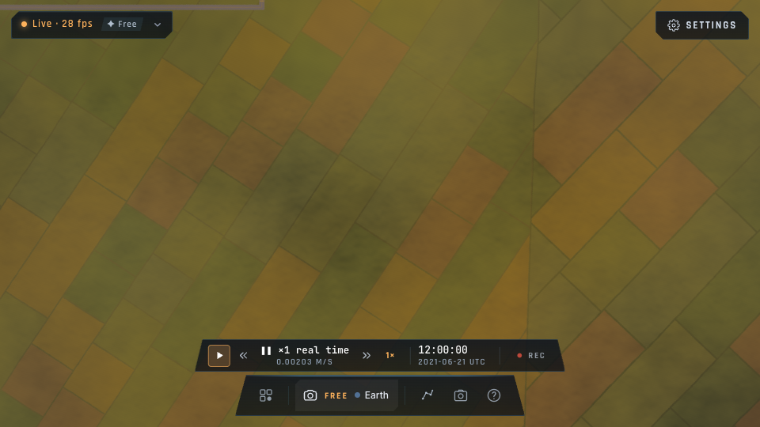

# Mise en œuvre du paysage terrestre

Branche : `codex/earth-photorealistic`. Décisions de fond : [analyse](ANALYSE-TERRE-PHOTOREALISTE.md).

## Jalon A — sol satellite régional

Le socle est implémenté : Sentinel‑2 et WorldCover 2021 sur deux régions pilotes. Il apporte les vraies parcelles, routes et masses boisées vues du ciel. **Ce jalon ne constitue pas encore un paysage AAA à 100 m** : les volumes, silhouettes et orthophotos fines sont les jalons suivants.

| Région | Emprise | Pages | Source couleur |
|---|---|---:|---|
| Le Bourget | 2,30–2,62° E ; 48,84–49,16° N | 16 | Composites annuels Sentinel‑2 2021, environ 10 m |
| Cévennes | 4,02–4,34° E ; 44,02–44,34° N | 16 | Idem |

Chaque page a 1 024² pixels, dont deux pixels de bord de chaque côté. La grille géographique produit des pixels d'environ 6–9 m selon la latitude ; **elle n'améliore pas la résolution native de 10 m**. Les classes restent les valeurs entières WorldCover, en R8Uint sans filtrage ni compression avec perte. La couleur est une réflectance convertie de linéaire en sRGB, encodée UASTC/KTX2 avec onze mipmaps. Le GPU revient en linéaire lors de l'échantillonnage.

### Fonctionnement

- `earthSurface`: `off`, `satellite` (par défaut), `materials`. Le dernier ajoute un détail discret guidé par les classes, sans inventer de nouvelles parcelles. Commande joueur : `/surface materials`.
- Chargement sous 20 km au-dessus de l'ellipsoïde ; maintien jusqu'à 30 km et petite marge géographique pour éviter les oscillations. Ce sont des seuils de streaming, pas une promesse de photoréalisme à cette altitude.
- Une seule région résidente ; priorité aux pages proches de la caméra/du vaisseau, deux pages en cours maximum, deux tentatives par page. Les réponses d'une ancienne région ne sont jamais téléversées.
- Transcodage KTX2 et décompression des classes dans des workers, transfert des buffers ; aucune lecture de GeoTIFF dans le navigateur.
- Filtrage des couleurs avec mipmaps et anisotropie 4× ; apparition progressive sur 350 ms, bords fondus vers les pages manquantes et le globe.
- Les heuristiques de champs/forêts du rendu précédent s'effacent là où l'image satellite est pleinement présente.
- Le DEM, `heightAt`, le nivellement des pistes, les contacts et l'altimètre restent sur leurs données physiques. Le réglage du sol satellite fonctionne aussi avec `earthTerrain=false`.
- Réponses manquantes : paysage existant. GPU limité à 16 textures échantillonnées par étage : rendu existant, sans allocation du pack. Cette extension en nécessite 18, LUT comprise ; elle est optionnelle et ne change pas le minimum du jeu.
- À la sortie, les anciennes textures sont détruites après les commandes GPU qui les utilisent. Un changement de région peut temporairement faire coexister deux allocations ; la télémétrie compte les ressources en cours de libération.

### Mémoire et téléchargement

Le calcul inclut chaque mipmap et les petits blocs de compression ; il couvre **uniquement cette extension**, en plus du moteur existant. Ce sont les octets logiques des textures, vérifiés par les tests et la télémétrie ; les alignements et allocations internes du pilote GPU ne sont pas mesurés :

| Format couleur | Couleur × 16 | Classes × 16 | Total résident |
|---|---:|---:|---:|
| BC7 / ASTC 4×4 | ~21,33 MiB | 16 MiB | ~37,33 MiB |
| RGBA8, GPU sans compression | ~85,33 MiB | 16 MiB | ~101,33 MiB |
| Hors région / désactivé | 4 octets | 1 octet | 5 octets |

Le buffer de classes transféré pour une page occupe 1 MiB ; la couleur transcodée ajoute environ 1,33 MiB, ou 5,33 MiB en RGBA. Deux travaux bornent ces buffers entrants, auxquels s'ajoutent le heap du transcoder partagé, ses fichiers compressés et les ressources internes du navigateur. Les copies `writeTexture` et l'invalidation sont encore sur le thread principal : `uploadCpuMs` les mesure, sans inclure le travail du worker ni prétendre mesurer le temps GPU du transfert.

Les fichiers servis sont dans `assets/earth-surface/v1/`, avec hashes de contenu. Ils ne sont pas précachés au démarrage ; ils rejoignent le LRU partagé des tuiles de 300 MiB. Le serveur de développement, le build local et Pages distribuent les mêmes packs. La disponibilité offline dépend des pages effectivement chargées et conservées dans ce cache.

Les 32 fichiers du Bourget représentent **15,52 MiB téléchargés**, ceux des Cévennes **14,86 MiB** : 30,38 MiB distribués pour les deux pilotes, indépendamment du format de transcodage GPU. Une transition garde temporairement jusqu'à deux packs GPU ; les téléportations rapides attendent la libération du précédent au lieu d'empiler les allocations.

### Préparation des packs

Prérequis hors du navigateur : Python 3, Rasterio/GDAL et Basis Universal (`basisu`). Versions Python fixées dans [earth-surface-requirements.txt](../scripts/earth-surface-requirements.txt).

```sh
python3 -m venv .cache/earth-build
.cache/earth-build/bin/pip install -r scripts/earth-surface-requirements.txt
bun run build:earth-surface
```

Les emprises se modifient dans `assets/earth-surface/regions.json`. La préparation lit des fenêtres HTTP Range dans les COG officiels, avec cache GDAL borné, rééchantillonne la couleur en bilinéaire et les classes au plus proche. Les PNG intermédiaires sont dans `.cache/earth-surface`, hors Git. Le manifeste embarqué référence chaque fichier par son hash et conserve les URL sources ; les tests vérifient dimensions, mipmaps, valeurs de classe, hashes et raccords.

L'ordre des bandes est contrôlé contre les métadonnées du COG : **B04 rouge, B03 vert, B02 bleu, B08 proche infrarouge**, avec facteur de réflectance 0,0001. La préparation refuse un ordre inattendu. `.cache/earth-build/bin/python scripts/earth-surface-build.py --self-test` vérifie aussi les primaires RGB, la conversion sRGB et le masque de données absentes, sans accès réseau.

Le format courant limite une région à 4 × 4 pages, compatible avec le masque de résidence de 16 bits et la route statique du serveur. Une extension mondiale exige un véritable service de tuiles et des clipmaps ; agrandir ce JSON sans revoir ce contrat n'est pas cette extension.

### Accès TARS et diagnostics

TARS règle `earthSurface` par `set_settings`, le retrouve par « worldcover », montre le panneau des réglages existant, lit `get_state.surface` et `get_telemetry({groups:["surface"]})`, attend `wait({until:"surface_ready"})` et reçoit les événements `surface` lors d'un changement de région/état. L'attente retourne aussi le statut du pack : un chargement terminé peut être dégradé, hors région ou non supporté ; TARS doit lire ce résultat.

Les mêmes chiffres se trouvent dans `__bh.renderer.earthSurface.stats()` et `__bh.game.perf().earthSurface` : mode, support, région, année, résolution native, format GPU, pages, chargements en cours, échecs, dernière erreur, octets GPU, octets téléversés et temps CPU des uploads. Les octets téléversés et le temps CPU sont cumulés depuis la création du renderer.

### Validation

Campagne du **11 octobre 2026**, sur **Apple M1 Max, 24 cœurs GPU, 32 Go**, Chrome/WebGPU natif, textures BC7. Le test compare `off → satellite → materials → off` dans la même vue du Bourget, à 2 km, 960 × 540, ratio de pixels 1, résolution dynamique désactivée, nuages désactivés. La date simulée est le 21 juin 2021 à midi UTC. Le **DEM réel est chargé, niveau maximal 13, zéro tuile en attente**. La reconstruction temporelle est activée ; le bloc 1 calcule chaque pixel, le bloc 2 calcule un quart des pixels par frame. Un `touch()` à chaque frame maintient le rendu temps réel même avec la caméra fixe.

Chaque étape attend la disponibilité du shader, la fin des chargements et une chauffe de 1,5 s, puis collecte 60 frames profilées (environ 480 frames rendues). Les chiffres GPU ci-dessous sont ceux de la passe compute **`trace`**, en moyenne ; ils ne constituent pas une addition des différentes passes. Le CPU couvre l'encodage et la soumission du renderer, en régime établi.

| Bloc | Mode | `trace` GPU, ms | Images rendues/s | Encodage CPU, ms |
|---:|---|---:|---:|---:|
| 1 | off avant | 33,87 | 28,54 | 0,91 |
| 1 | satellite | 35,46 | 27,54 | 0,73 |
| 1 | materials | 35,95 | 27,98 | 0,89 |
| 1 | off après | 34,43 | 28,00 | 0,38 |
| 2 | off avant | 9,62 | 59,97 | 1,42 |
| 2 | satellite | 8,93 | 60,05 | 0,97 |
| 2 | materials | 7,34 | 59,98 | 0,73 |
| 2 | off après | 7,23 | 60,01 | 0,72 |

**Conclusion A :** en bloc 1, la moyenne des deux contrôles vaut 34,15 ms : satellite ajoute **1,31 ms (+3,8 %)**, materials **1,80 ms (+5,3 %)**. Le coût CPU établi reste sous 1 ms dans ces profils ; sa variabilité ne permet pas d'attribuer un delta précis à l'extension. Le chargement d'un pack additionnel demande **14–14,9 ms CPU cumulés**, répartis sur ses 16 uploads, hors décompression et transcodage dans les workers. Cela ne mesure pas les pics de frame en cache froid.

Le bloc 2 tient **60 i/s dans cette scène**, mais les contrôles dérivent de 9,62 à 7,23 ms : la chauffe/fréquence GPU rend le delta trop incertain pour annoncer un coût en millisecondes. Le résultat ne prouve pas que materials soit plus rapide que satellite. La prochaine campagne devra inverser/randomiser l'ordre et stabiliser la chauffe avant d'en tirer un budget.

Les 512 intervalles de frames terminées conservés par profil donnent, en bloc 1, un p95 de **37,1 ms** en référence et **38,4 ms** en satellite ; en bloc 2, **13,4 ms** en satellite. Ce sont des intervalles de complétion observés par le navigateur, distincts des timestamps GPU. Le benchmark n'est ni un vol de vingt minutes, ni une validation à 1080p, ni une promesse sur tous les appareils.

Les [mesures brutes](perf/earth-surface-20261011.json) sont conservées avec les captures de cette branche :

| Paysage précédent | Sentinel‑2, même vue |
|---|---|
|  |  |


[Capture en mode avion au Bourget](img/earth-surface/cockpit.png). Elle vérifie l'intégration dans la vue de vol ; l'interface de vol, les volumes et les assets de l'appareil sont ceux du jeu existant. Les pixels de 10 m restent visibles à proximité du sol.

Vérifications effectuées : **740 tests unitaires passent**, aucun échec ; après la préparation définitive des packs, **33 tests ciblés** repassent. **4 tests e2e sol** passent avec le DEM réel, ainsi que les **12 tests e2e TARS**. Les scénarios couvrent les deux vrais packs, changement de région, mémoire libérée, mode avion, repli RGBA, adaptateur limité à 16 textures et worker de classes indisponible. `bun run check` passe, dont **9/9 shaders WGSL compilés** ; les builds local et Pages passent.

```sh
bun run e2e earth-surface tars-agent
SURFACE_LIVE_TERRAIN=1 bun run e2e earth-surface
```

Sans la variable, le test isole les packs régionaux et n'exige pas de serveur de tuiles externe. Avec elle, les sorties sont `remote-results/earth-surface-perf-terrain.json` et `remote-results/earth-surface-*.png`. **kerr-mini était injoignable** lors de la vérification distante : aucune mesure ni validation du second Mac n'est revendiquée.

## Jalon B — bosquet 3D, puis densité

À engager après validation visuelle et performance de A. L'objet de la première preuve est un bosquet correctement intégré, avant la quantité.

1. Définir une profondeur commune en mètres et le repère local partagé avec le terrain ; traiter explicitement les pixels de ciel et les pixels reconstruits par le temporal.
2. Intégrer un petit lot d'arbres avec LOD de silhouette, masque d'exclusion piste/eau/sol bâti et atmosphère jusqu'à l'objet, puis vérifier crêtes, soleil bas et brume depuis le cockpit.
3. Préparer cellules et placement déterministes hors frame ; culling/compaction GPU et draw indirect, caps d'instances et d'ombres, canopée lointaine et imposteurs intermédiaires.
4. Valider un vol de vingt minutes, virages, téléportations et cache froid sur les deux Macs. N'adopter un terrain proche raster que si le profil montre un gain net.

**Porte de passage :** profondeur/atmosphère correctes en mouvement, aucune croissance mémoire, surcoût compatible avec le budget défini pour chaque appareil. Les timings A n'estiment pas le coût B.

## Jalon C — région premium pour 100–300 m

Préparer une région locale avec orthophoto IGN à 0,5–1 m, relief plus fin et bâtiments géographiques ; choisir/créer une bibliothèque d'assets distribuable sur le web. Vérifier alignement, exclusions, ombres et raccord avec A/B avant d'étendre la couverture. Les données Sentinel‑2 à 10 m ne suffisent pas à fournir les détails proches demandés.

**Porte de passage :** qualité et stabilité en vol bas, volumes identifiables, débit soutenable à la vitesse choisie, CPU/GPU/mémoire mesurés. C'est ce jalon, avec B, qui porte l'ambition photoréaliste AAA.

## Sources et attribution

- [ESA WorldCover — accès, classes et licence](https://esa-worldcover.org/en/data-access)
- [Composites Sentinel‑2 — registre AWS officiel](https://registry.opendata.aws/esa-worldcover-vito-composites/)
- [Dépôt ESA — description des datasets](https://github.com/ESA-WorldCover/esa-worldcover-datasets)
- [Rasterio — fenêtres](https://rasterio.readthedocs.io/en/stable/topics/windowed-rw.html), [WarpedVRT](https://rasterio.readthedocs.io/en/stable/topics/virtual-warping.html)

© ESA WorldCover project 2021 / Contains modified Copernicus Sentinel data (2021), processed by ESA WorldCover consortium. [CC BY 4.0](https://creativecommons.org/licenses/by/4.0/). Modifications : reprojection, rééchantillonnage, conversion de réflectance en sRGB, mipmaps, compression et tuilage. Aucune mise à jour temporelle automatique : la date de simulation ne change pas ces images annuelles.
