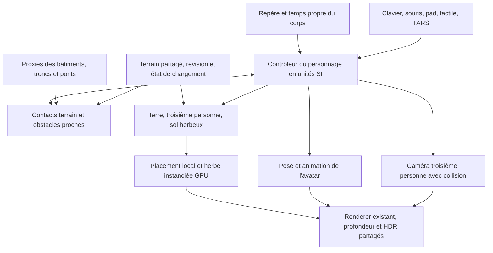

# Contrôleur à la troisième personne sur les planètes, et herbe interactive

Analyse et plan du **12 octobre 2026**, sur la base du moteur au commit `b0c0065`.
Référence examinée : [false-earth](https://github.com/momentchan/false-earth), commit
[`468a0cfd71698400103198a8eb91d5176fe4f59e`](https://github.com/momentchan/false-earth/tree/468a0cfd71698400103198a8eb91d5176fe4f59e).
**Document de conception initial. L’implémentation, ses validations et ses limites sont décrites dans
[THIRD-PERSON-IMPLEMENTATION.md](THIRD-PERSON-IMPLEMENTATION.md).**

## Recommandation

L'ajout est faisable. Je recommande un **personnage indépendant du vaisseau**, contrôlé dans le repère
local de la planète, et un rendu natif WebGPU pour l'avatar et l'herbe. Les sensations de mouvement et
les procédés d'herbe de false-earth constituent une bonne référence, mais son contrôleur ne constitue
pas une physique planétaire réutilisable directement.

Le premier objectif est de marcher correctement sur **Terre, Lune et Mars**, puis sur les autres
surfaces solides du simulateur. L'herbe reste **exclusivement terrestre, dans la vue troisième personne
du personnage et dans une zone herbeuse identifiée**. Une caméra externe d'avion ne l'active pas.

Les décisions proposées sont :

- Garder les coordonnées et la physique du simulateur ; ajouter un contrôleur local en mètres et secondes.
- Utiliser les hauteurs existantes du moteur pour le contact, avec une caméra qui évite le terrain et les obstacles.
- Faire un prototype avec un avatar simple, puis ajouter un modèle animé dont la licence permet sa distribution.
- Porter en WGSL les brins courbés, le placement stable, les touffes, le vent et la poussée du personnage.
- Commencer avec **65 536 instances maximum**, trois LOD et un rayon visuel de **28 m**.
- Ajouter les collisions de proximité avec les bâtiments, troncs et ponts ; leurs volumes actuels sont visuels.
- Profiler d'abord le paysage à hauteur humaine : un faible coût de l'herbe ne suffit pas si le fond dépasse déjà le budget de frame.

## Ce que fait réellement false-earth

Le code a été lu sans exécuter le projet ni récupérer ses modèles et textures. Sa pile est
React Three Fiber, Three.js WebGPU/TSL et des composants React ; notre moteur utilise Bun et WebGPU/WGSL
directement. Le `package.json` référence Three.js `^0.182.0` ; ce numéro ne représente pas une version
à ajouter au simulateur.

### Personnage et caméra

Le contrôleur lit les entrées clavier/joystick, choisit une direction relative à la caméra, oriente le
personnage, déplace son groupe et mélange les animations. Les clips sont séparés du modèle principal.
La caméra suit une cible proche du haut du corps, avec rotation à la souris.
[Sources : déplacement](https://github.com/momentchan/false-earth/blob/468a0cfd71698400103198a8eb91d5176fe4f59e/src/components/character/utils/solveCam.ts),
[animations](https://github.com/momentchan/false-earth/blob/468a0cfd71698400103198a8eb91d5176fe4f59e/src/components/character/hooks/useCharacterPhysics.ts),
[caméra](https://github.com/momentchan/false-earth/blob/468a0cfd71698400103198a8eb91d5176fe4f59e/src/components/camera/hooks/useFollowCamera.ts).

Pour notre usage, ses limites sont nettes : le mouvement suppose un axe vertical fixe et une rotation
autour de Y. Les solveurs inspectés ne résolvent ni la gravité, ni les contacts avec le relief, ni une
capsule contre les obstacles. Certains lissages utilisent un facteur par frame, ce qui change la
réponse selon le framerate. Ce sont des éléments à concevoir, pas des capacités déjà fournies.

### Herbe

L'herbe est instanciée, animée sur le GPU et répartie en LOD par un calcul de visibilité. Les racines
suivent un terrain procédural ; des graines entières rendent le placement stable lorsque la grille
se décale. Le matériau construit des rubans courbés et une réaction autour du personnage.
[Calcul](https://github.com/momentchan/false-earth/blob/468a0cfd71698400103198a8eb91d5176fe4f59e/src/components/grass/core/grassCompute.ts),
[matériau](https://github.com/momentchan/false-earth/blob/468a0cfd71698400103198a8eb91d5176fe4f59e/src/components/grass/core/grassMaterial.ts),
[grille](https://github.com/momentchan/false-earth/blob/468a0cfd71698400103198a8eb91d5176fe4f59e/src/core/utils/gridSnapping.ts).

Points importants relevés dans le code :

- `GrassLOD` désactive explicitement la réception et la projection d'ombres. Cela ne suffit pas à notre objectif d'éclairage cohérent.
- Masquer le groupe ne désactive pas les callbacks de calcul de l'herbe. Il faudra couper les passes, et pas seulement rendre les meshes invisibles.
- La poussée locale des brins est présente. Un hook de traces existe, mais il n'est pas relié au chemin de rendu de l'herbe inspecté : les traces persistantes ne sont pas une fonction prête à importer.
- L'orientation, les racines, la normale et le vent supposent un paysage local avec Y vertical.
- Le matériau comporte aussi des effets lumineux propres à la démonstration. L'herbe terrestre utilisera les lumières, l'exposition et la météo du simulateur.

[LOD et ombres](https://github.com/momentchan/false-earth/blob/468a0cfd71698400103198a8eb91d5176fe4f59e/src/components/grass/GrassLOD.tsx),
[dispatchs](https://github.com/momentchan/false-earth/blob/468a0cfd71698400103198a8eb91d5176fe4f59e/src/components/grass/hooks/useGrassCompute.ts),
[hook de traces](https://github.com/momentchan/false-earth/blob/468a0cfd71698400103198a8eb91d5176fe4f59e/src/components/character/hooks/useCharacterTrail.ts).

### Coût déduit de la configuration source

Les constantes définissent `1024 × 1024` candidats sur un carré de 80 m de côté. Chaque brin occupe
64 octets ; trois listes d'indices réservent chacune quatre octets par candidat.

| Allocation | Calcul | Taille brute |
|---|---|---:|
| Données des brins | 1 048 576 × 64 octets | 64 MiB |
| Trois listes de visibilité | 3 × 1 048 576 × 4 octets | 12 MiB |
| Sous-total | Hors textures, avatar, profondeur et temporaires | **76 MiB** |
| Traces, si le hook était utilisé | Deux textures 512² RGBA FloatType, soit 16 octets/texel | **8 MiB supplémentaires** |

Ces valeurs sont des **calculs d'allocation à partir du code**, pas une mesure de résidence GPU.
Les LOD comportent 15, 5 et 2 segments, soit respectivement 30, 10 et 4 triangles par ruban.
Le calcul est lancé sur tous les candidats ; les travaux plus coûteux sont conditionnés par la visibilité.
Recopier ces paramètres serait un mauvais point de départ pour notre budget.
[Configuration](https://github.com/momentchan/false-earth/blob/468a0cfd71698400103198a8eb91d5176fe4f59e/src/components/grass/core/config.ts),
[allocations](https://github.com/momentchan/false-earth/blob/468a0cfd71698400103198a8eb91d5176fe4f59e/src/components/grass/core/grassGeometry.ts).

### Licences et ressources

Le code principal porte une [licence MIT](https://github.com/momentchan/false-earth/blob/468a0cfd71698400103198a8eb91d5176fe4f59e/LICENSE) :
conserver sa notice et créditer Ming-Jyun Hung dans les adaptations. Le README signale séparément
que l'astronaute a été acheté sur CGTrader et nécessite une licence appropriée. Sa présence dans le
dépôt ne donne pas un droit de redistribution de son modèle ou de ses textures.
[Notice du projet](https://github.com/momentchan/false-earth#-attribution).

Le matériau référence également `packages/three-core`, sous-module fixé à
`0a215fef696aaeccd9c1d8902bd6c15966d046a3`. Son arbre inspecté ne contient pas de fichier de licence
identifié. Je propose de réécrire les petites fonctions mathématiques nécessaires, sans importer ce
package. Une reprise de ses fichiers demanderait de clarifier leurs droits. Les droits des animations,
sons et autres ressources doivent également être vérifiés avant toute distribution.
[Sous-module examiné](https://github.com/momentchan/three-core/tree/0a215fef696aaeccd9c1d8902bd6c15966d046a3).

## Points d'appui du simulateur

| Existant | Utilité pour le contrôleur / l'herbe | Travail restant |
|---|---|---|
| [our-surface.ts](../src/system/our-surface.ts) | Repères fixes des corps, rotation, hauteur, normale géodétique, vitesse du sol | Interface de terrain avec révision, qualité et requêtes à l'échelle du personnage |
| [ellipsoid.ts](../src/system/ellipsoid.ts) | WGS84, conversions géodétiques et figures des autres corps | Réutiliser les conversions ; aucune sphère unique imposée à toutes les planètes |
| [terrain.ts](../src/terrain.ts), [earth-tiles.ts](../src/system/earth-tiles.ts) | Relief procédural et échantillonnage CPU cohérent avec le GPU | Petits patches de hauteur et gestion des changements de données |
| [landing.ts](../src/landing.ts) | Repère propre et gravité des mondes proches de Gargantua | Adaptateur en unités SI, séparé du train d'atterrissage du vaisseau |
| [rig.ts](../src/controller/rig.ts), [spectator.ts](../src/controller/spectator.ts) | Pose de caméra et séparation entre vue et véhicule | Rig du personnage, caméra orbitale et anticollision |
| [renderer.ts](../src/renderer.ts), [ship.ts](../src/ship.ts) | Composite raster sur HDR, profondeur du paysage, ombres et éclairage des objets proches | Passe d'avatar animé et passe d'herbe partageant la profondeur |
| [scenery-worker.ts](../src/system/scenery-worker.ts) | Contours des bâtiments et ponts, volumes d'arbres, réseaux et eau | Exporter des proxies de collision de proximité ; conserver les cours intérieures |
| [bindings.ts](../src/input/bindings.ts), [phase.ts](../src/game/phase.ts) | Actions configurables et phases du jeu | Contexte « personnage » et phase à pied explicites |

Les occurrences actuelles de « on foot » dans les entrées désignent la caméra libre : il n'y a pas
encore un personnage marchant. Le chargeur de vaisseaux utilise des formats de meshes propres au projet ;
il ne constitue pas un chargeur glTF avec squelette et clips d'animation.

Le moteur possède déjà une origine flottante et une ancre de caméra compensée : `nearCam0`,
`nearCam1` et le calcul de hauteur d'`earthMarch` évitent une partie des erreurs au voisinage du sol.
Les nouveaux objets doivent conserver cette précision. Il faudra la vérifier à 2–5 m d'altitude,
pas conclure qu'elle est suffisante à partir des captures de vol à plusieurs centaines de mètres.

## Architecture du contrôleur



### État, repère et temps

Ajouter un état `CharacterState` : corps et univers, position fixée au corps en float64, vitesse relative
au sol en m/s, orientation, contact, état de mouvement et état de la caméra. Le vaisseau conserve son
propre état : sortir de son cockpit ne doit ni le téléporter ni effacer sa sauvegarde.

La position physique reste dans le repère du corps ; un repère tangent local en mètres est fourni au
rendu et aux collisions. Lorsqu'il est renouvelé, positions, vitesses, heading, obstacles et traces
subissent la même transformation. Les coordonnées globales du système solaire ne sont pas envoyées
directement en float32 au moteur de proximité.

Le haut vient de la figure/gravité locale. La normale de la pente sert aux contacts et aux pieds ;
elle ne remplace pas systématiquement la verticale du torse. Construire une base tangentielle robuste
aux pôles, avec un axe de secours, et transporter l'orientation entre deux positions. Le déplacement
relatif à la caméra est projeté dans ce plan, puis normalisé pour éviter une course plus rapide en diagonale.

Le solveur utilise un pas fixe proposé de **1/60 s**, interpolation au rendu et un nombre borné de
sous-pas. Les lissages prennent la forme `1 - exp(-k * dt)`, indépendante du framerate. Une longue
suspension d'onglet ne produit pas une translation de plusieurs mètres sans détection de collision.

Les adaptateurs convertissent les unités du simulateur à leur frontière. Près de Gargantua,
`PlanetFrame.ut` et le temps propre existant (`simDt / F.ut`) doivent être respectés ; ne pas confondre
secondes, unités M et vitesses en c. Le ressenti et l'affichage du temps local seront validés dans ce cas.
Le warp interactif est limité à 1× pendant la marche et les sauts ; le rendu hors ligne avance l'état
par étapes déterministes. La caméra peut conserver un lissage visuel fondé sur le temps d'affichage.

### Sol, gravité et collisions

Créer un `SurfaceProvider` commun : hauteur/contact, normale, type de surface, gravité effective,
révision et disponibilité. Réutiliser `groundRelief`, le DEM, le relief fin et le nivellement des pistes,
avec une résolution de contact adaptée au pied. La normale actuelle de `groundUnder`, lissée sur 5 m
pour le train du vaisseau, ne suffit pas seule pour les petits reliefs et les pieds.

Ne pas modifier la variable globale `GEAR` pour poser l'avatar. Sa capsule, sa hauteur et sa marge de
contact ont leurs propres paramètres. Proposition : hauteur 1,8 m, rayon 0,30 m, marge 1–2 cm ; valeurs
à ajuster au modèle choisi. Torse droit, inclinaison du déplacement selon la pente, puis IK des pieds
dans une étape de finition.

Comportements indispensables : marcher, courir, arrêter, tourner, sauter, tomber, atterrir, glisser sur
une pente trop forte et franchir de petites marches. Valeurs de départ : marche 1,4 m/s, course 4 m/s,
pente maximale 45°, marche franchissable 0,25 m. Pour le saut, une impulsion en m/s bornée permet de
montrer la différence de gravité ; une hauteur de saut constante sur toutes les planètes masquerait cette différence.

Le contrôleur s'appuie sur la gravité effective du repère, en tenant compte des fonctions déjà présentes
et de la rotation. Il ne doit pas ajouter à un personnage solidaire de la Terre l'accélération absolue
du Soleil sans retirer celle du repère terrestre.

Les proxies OSM de proximité sont préparés hors frame et publiés avec la même révision que les volumes
visibles. Le personnage doit s'arrêter contre les façades, traverser les cours ouvertes, passer sous
un tablier et marcher dessus. Les troncs bloquent le mouvement ; la caméra tient aussi compte des
volumes de canopée qui masquent effectivement la vue. Une hauteur de terrain seule ne gère pas un pont.
Ne pas lire le BVH GPU à chaque tick : publier un petit paquet CPU de collision pour la zone active.
Les proxies d'objets désactivés ou absents du rendu de repli ne doivent pas créer d'obstacles invisibles.

| Solution | Avantage | Coût / limite | Décision |
|---|---|---|---|
| Contrôleur natif sur terrain | Simple à intégrer, contrôle précis des repères et du temps | Les contacts latéraux et marches complexes demandent un vrai solveur | Prototype initial |
| Contrôleur natif + Rapier local | Capsule, glissement, marches et requêtes de forme disponibles | WASM, colliders locaux, raccord des patches et gestion des changements de repère | Backend proposé pour les collisions complètes, après essai comparatif |
| Importer toute la scène R3F/Three | Rendu de la démonstration déjà constitué | Second moteur, double gestion de profondeur/lumière, contrôleur toujours planaire | Non retenu |

Rapier permet de changer le vecteur haut et fournit le déplacement corrigé d'un collider. La gravité
reste à fournir ; son contrôleur gère les translations, pas un balayage de rotation. Ces limites
doivent être prises en compte lors du renouvellement du repère et de l'orientation de la capsule.
Le monde de collision restera local, avec un nombre borné d'obstacles et des colliders générés à partir
des données disponibles. [Documentation officielle](https://rapier.rs/docs/user_guides/javascript/character_controller/).

Un corps gazeux, une étoile ou une surface océanique sans support solide ne sont pas des sols
marchables. Miller et ses vagues visuelles ne deviennent pas un plancher. Nage, EVA en apesanteur,
intérieurs et simulation de survie ne font pas partie de ce premier ajout.

### Caméra et transitions

La cible est le haut du corps, avec une distance initiale de 4–5 m et un pitch limité. La souris
orbite, les entrées directionnelles déplacent l'avatar par rapport à cette vue, la molette ajuste une
distance bornée. Une requête de sphère entre cible et position désirée rapproche la caméra devant
les obstacles ; une détente progressive la recule lorsqu'ils disparaissent.

Prévoir une vue jouable sans pointer lock, puis le verrouillage sur geste utilisateur. Entrer dans
un champ de texte, ouvrir un menu, perdre le focus ou quitter le mode remet les entrées de déplacement
à zéro. Les actions sont configurables et disposent d'équivalents pad/tactile.

Deux entrées : un point de départ sûr sur une planète, ou débarquer d'un vaisseau posé et presque
immobile. L'embarquement exige un accès proche et valide. Au changement de corps, à la téléportation
ou au chargement d'une sauvegarde, invalider les anciennes requêtes et initialiser les nouveaux
contacts avant de relancer le mouvement. L'état à pied sera sauvegardé séparément et de façon compatible
avec les anciennes sauvegardes ; les buffers d'herbe se reconstruisent et ne sont pas enregistrés.

### Une même touche pour quitter et rejoindre le vaisseau

Prévoir **Maj + K (`⇧K`) par défaut**, configurable, pour les deux directions. Ce raccourci existe
déjà dans le contexte de vol sous `leaveShip` ; aujourd'hui il bascule le réglage `ship` via
`btn-ship`, sans créer de personnage ni vérifier un point de sortie. Le plan doit donc remplacer
cette action dans le contexte de pilotage et l'exposer aussi dans le nouveau contexte à pied.
`E` est déjà utilisé pour le roulis en vol et le déplacement vertical de la caméra libre.
La même action contextuelle sera disponible sur manette et via un bouton tactile.

| Contexte | Action de `⇧K` | Conditions proposées |
|---|---|---|
| Aux commandes du vaisseau | Débarquer et prendre le contrôle du personnage en troisième personne | Vaisseau posé sur un support solide, vitesse relative au support < 0,5 m/s, sortie dégagée et données de contact prêtes |
| À pied près de l'accès | Embarquer et reprendre les commandes | À moins de 2–3 m du point d'accès, chemin dégagé, vaisseau accessible et presque immobile |
| Action indisponible | Rester dans le mode courant et afficher la raison | En vol, sortie obstruée, accès trop éloigné ou collisions encore indisponibles |

Ces distances et vitesses sont des valeurs initiales à valider avec la taille des appareils.
Chaque modèle doit déclarer un point d'accès et des candidats de sortie dans son repère local.
Tester le volume de la capsule et le support sous ses pieds avant la transition ; ne pas faire
apparaître le personnage dans une coque, sous un tablier, dans l'eau ou en chute libre. Les sorties
en vol restent hors du premier lot, qui n'inclut pas l'EVA.

Le vaisseau conserve sa pose, sa simulation et son identité pendant la marche ; quitter les commandes
relâche les entrées maintenues. À l'embarquement, restaurer le dernier point de vue de pilotage.
La caméra effectue une courte transition bornée, avec vérification des obstacles ; si la transition
est interrompue, son état reste cohérent avec le contrôleur actif. Activer l'herbe uniquement une
fois la vue du personnage active et l'arrêter dès la reprise du pilotage.

Le HUD affiche « ⇧K — Quitter le vaisseau » ou « ⇧K — Entrer dans le vaisseau », avec le raccourci
réel après remappage. Déclencher une seule transition sur le front d'appui, ignorer la répétition
clavier et les nouvelles demandes pendant une transition. Aucun déclenchement dans un champ de
texte ou un menu ; une perte de focus relâche les entrées. Une machine d'états explicite
`piloting → disembarking → onFoot → boarding → piloting` valide l'action avant de changer de mode
et revient à l'état de départ si la préparation échoue.

## Herbe terrestre : adaptation proposée

### Activation et choix des zones

La condition d'activation doit être explicite :

```text
personnage contrôlé à pied
ET vue = troisième personne du personnage
ET corps = Terre
ET proche du sol (contact ou petit saut, hauteur < 2 m)
ET zone herbeuse confirmée et données disponibles
ET réglage herbe activé
```

WorldCover **30, végétation herbacée**, est le premier signal. Des polygones OSM identifiant précisément
une pelouse/prairie peuvent compléter les zones urbaines. Un parc entier n'est pas automatiquement
une pelouse. Ne pas mettre par défaut la même herbe dans les cultures, les forêts, les marais ou sur
la neige. Sous-bois et végétation spécialisée peuvent venir ensuite.

Soustraire les routes, rails, zones pavées, bâtiments, tabliers et surfaces d'eau. Utiliser le pavage
réel des pistes, pas la large zone d'exclusion des arbres : les abords herbeux d'un aéroport restent
des candidats valides. Un masque inconnu ne devient pas de l'herbe par défaut ; exposer le repli.

La classification WMS mondiale existante est un guide rendu, à résolution source voisine de 10 m.
L'agrandir dans un masque fin n'ajoute aucune précision géographique. Les frontières étroites seront
corrigées par les vecteurs lorsqu'ils sont disponibles. Un `GrassSurfaceProvider` doit pouvoir fournir
ce petit masque sans dépendre de l'activation des forêts ni de la neuvième liaison du ray tracer :
l'herbe ne doit pas être interdite artificiellement sur un GPU limité à huit storage buffers.

Quand l'avatar quitte une pelouse, un court fondu peut éviter une disparition brutale. En sortant de
la troisième personne ou de la Terre, arrêter immédiatement les passes d'herbe. Les ressources sont
allouées à la demande et libérées avec une hystérésis courte, en attendant les soumissions GPU en cours.

### Placement, LOD et animation

Reprendre les principes de false-earth, dans un module WGSL autonome :

1. Racines et caractéristiques statiques calculées lorsque les cellules entrent dans la zone active.
2. Identifiants de cellules entiers et graines stables ; coordonnées locales float32 pour le GPU.
3. Petits groupes de brins et variation de hauteur, courbure et teinte.
4. Courbe de Bézier, puis vent et poussée évalués dans le vertex shader.
5. Visibilité/LOD compactés sur le GPU ; trois draws indirects maximum, sans lecture des comptes sur le CPU.

La zone de travail est un carré tangent de **64 m**, avec couverture visuelle jusqu'à 28 m et une marge.
Le déplacement de l'origine ne change ni la graine ni l'identité des racines. Les indices mondiaux
restent des entiers ; ne pas passer les grandes coordonnées de la Terre en indices float32.

Proposition équilibrée avant culling et masque :

| Anneau | Densité cible | Géométrie | Population théorique |
|---|---:|---:|---:|
| 0–6 m | 144 instances/m² | 6 segments, 12 triangles | ~16 286 |
| 6–16 m | 48 instances/m² | 2 segments, 4 triangles | ~33 175 |
| 16–28 m | 8 instances/m² | 1 segment, 2 triangles ; représentation simplifiée | ~13 270 |
| Total | | | **~62 731, sous le plafond 65 536** |

Cela représente environ **355 000 triangles** avant culling, puis beaucoup moins hors du champ.
La dernière couronne devra être comparée à des touffes/imposteurs pour conserver une couverture
visuelle crédible. Les transitions utilisent des choix stables par racine et un fondu, pas un anneau
qui apparaît au passage d'une distance. La densité et le LOD proche sont réduits en premier en cas de dépassement.

Les racines utilisent un petit patch de hauteur et de normale dérivé du terrain partagé. Éviter de
réévaluer le DEM et tout son relief fin pour chaque brin à chaque frame. La préparation de patches
est découpée ou effectuée dans un worker avec des entrées de hauteur bornées ; ne pas cloner toute
la carte globale à chaque déplacement. CPU de contact et GPU de placement connaissent la même révision.
Les arrivées de données plus fines doivent faire évoluer sol, contacts et racines ensemble ; un
changement de DEM ne doit pas être interprété comme une impulsion physique lançant l'avatar.

Les buffers indirects suivent le format WebGPU indexé de 20 octets ; `baseVertex` est signé,
`firstInstance=0` évite de demander une option supplémentaire. Les compteurs sont remis à zéro et
bornés avant écriture. La somme des ressources est contrôlée par shader, sans ajouter une dixième
liaison obligatoire au tracer existant.
[Spécification WebGPU](https://www.w3.org/TR/webgpu/#dom-gpurendercommandsmixin-drawindexedindirect).

### Rendu, profondeur et éclairage

Utiliser le HDR déjà compatible render attachment. L'avatar et l'herbe partagent une profondeur
raster de proximité ; la profondeur du paysage tracé les masque. Convertir correctement la distance
le long du rayon, la profondeur de projection et les unités M/mètres. Le `moments` existant ne doit
pas être traité comme une profondeur NDC directement.

Le pipeline de vaisseau constitue un exemple de composite, pas une solution entièrement prête :
son test de masquage pour un objet éloigné n'est pas automatiquement celui qu'il faut pour des pieds
au contact du sol. Il faut vérifier les pixels reconstruits, le sous-échantillonnage et les marges
de profondeur pour éviter des pieds coupés et des racines flottantes.

Proposition de premier pipeline : fond tracé et reconstruit, puis avatar/herbe dans le HDR, avant le
bloom et le tone mapping. L'avatar doit être occulté par les brins proches et inversement. L'herbe
animée n'entre pas aveuglément dans l'historique temporel du fond : ajouter ensuite un traitement
spécifique ou des vecteurs de mouvement si les essais révèlent du scintillement. Le coût de toute
profondeur plein écran, histoire supplémentaire ou MSAA doit être compté.

Éclairage : Soleil réel, extinction atmosphérique, lumière du ciel, météo et exposition du moteur.
Herbe diélectrique, métal à zéro, rugosité élevée, transmission simplifiée en contre-jour et occlusion
au pied. Les ombres des arbres/bâtiments peuvent être rééchantillonnées dans un petit cache local,
plutôt qu'un rayon BVH pour chaque fragment de brin. L'avatar projette une ombre sur terrain et herbe
via une petite shadow map locale ; mutualiser l'infrastructure existante lorsque ses coordonnées le permettent.

Commencer sans ombre individuelle de chaque brin. Une auto-occlusion de touffe et un assombrissement
des racines constituent le premier compromis ; ajouter des ombres détaillées sur les mètres proches
seulement si le profil et les captures justifient leur coût. Cette approximation doit rester visible
dans les options de qualité, pas présentée comme une simulation complète du feuillage.

### Poussée et traces

La première version écarte les brins autour du personnage et les laisse revenir, avec un rayon
d'environ 0,6–1 m. Le vent provient de la météo terrestre locale.

Des traces persistantes constituent un lot suivant : un champ scalaire de tassement, deux textures
256² `r32float` en ping-pong, soit **0,5 MiB** de texels bruts. Décroissance en fonction du temps,
réindexation lors du déplacement et durée limitée. Les traces suivent le terrain et les cellules,
pas les coordonnées de l'écran. Le format doit rester utilisable sans option de filtrage float32
supplémentaire. Il n'y a pas de simulation physique d'un million de ressorts.

## Budgets proposés et limites des prévisions

**Les valeurs ci-dessous sont des plafonds et objectifs de développement, pas des timings mesurés.**
Le seul coût exact calculable maintenant est celui des structures proposées.

| Profil | Instances maximum | Racines à 32 octets | Trois listes à 4 octets | Budget des données d'herbe, caches et transitions |
|---|---:|---:|---:|---:|
| Bas | 32 768 | 1 MiB | 0,375 MiB | ≤ 4 MiB |
| Équilibré | 65 536 | 2 MiB | 0,75 MiB | ≤ 8 MiB |
| Haut | 131 072 | 4 MiB | 1,5 MiB | ≤ 12 MiB |

La représentation à 32 octets exige un packing des normales et paramètres ; ce n'est pas le layout
64 octets de false-earth. Ces budgets **n'incluent pas** les textures de l'avatar, la profondeur
plein écran ou une shadow map commune. À 1080p, un depth32float brut vaut ~7,91 MiB ; une shadow map
512² vaut 1 MiB. Réutiliser ces ressources entre avatar et herbe, et les mesurer avec les formats de repli.
Budget d'avatar proposé : ≤ 16 MiB pour mesh, squelette, textures et ressources propres, après choix de l'asset.
Ces allocations s'ajoutent au décor mondial de 16 MiB et aux ressources existantes du moteur.

| Travail | Objectif initial sur le Mac de référence |
|---|---|
| Contrôle, animation CPU, contact et caméra | ≤ 0,5 ms CPU au p95 en régime établi |
| Gestion CPU de l'herbe | ≤ 0,05 ms/frame ; aucune boucle par brin sur le thread principal |
| Avatar + herbe + ombre locale, équilibré | Viser ≤ 2–3 ms GPU supplémentaires à une résolution de référence documentée |
| Hors du contexte d'activation | 0 dispatch/draw d'herbe ; résidence libérée après le délai court prévu |
| Préparation réseau/patches | Mesurée séparément ; aucune préparation longue bloquant le rendu |

Les mesures de vol du [décor mondial](FORETS-BATIMENTS-WORLDWIDE.md) ne prédisent pas le coût d'une
caméra à hauteur humaine. Elles utilisaient notamment 960×540 avec sous-échantillonnage 2. Une sortie
1080p native comporte seize fois plus de pixels que ces 480×270 rayons de base ; le coût ne se
multiplie pas nécessairement exactement par seize, mais on ne peut pas transporter les résultats tels quels.

Mesurer d'abord le fond sans avatar/herbe à 2–5 m. Pour 60 FPS, la **frame complète** doit entrer dans
16,7 ms. Si le fond dépasse déjà l'enveloppe, réduire/adapter son coût ou expérimenter un patch proche
raster avec préprofondeur permettant d'éviter le march inutile sur les pixels couverts. Ce serait un
lot dédié, avec raccord au paysage lointain, et non une modification silencieuse du terrain mondial.
Ne pas acheter de densité en rendant tout le reste plus flou sans l'indiquer dans la comparaison.

## Plan d'implémentation et critères de passage

| Lot | Livrable concret | Critère de passage |
|---|---|---|
| **0 — Baseline au sol** | Scènes Terre/Lune/Mars à hauteur humaine, résolution native et bloc 2, HDR/profondeur et origine compensée contrôlés | Erreur de contact visible évaluée ; profil du fond et budget disponible connus |
| **1 — Marche et caméra** | État indépendant, capsule de test, repères, terrain, marche/course/saut, caméra avec sol, clavier/pad/tactile ; `⇧K` pour débarquer/embarquer depuis un appareil posé | 30/60/120 Hz donnent le même déplacement ; pôles et date line sans flip ; solidaire du corps en rotation ; aller-retour par la même touche sans double activation |
| **2 — Obstacles et données** | Backend de collision comparé, proxies OSM proches, ponts, caméra contre façades, chargement et renouvellement de repère | Cour intérieure ouverte ; mur bloquant ; passage sous pont et marche sur tablier ; pas de chute lors d'un changement de données |
| **3 — Avatar animé** | Asset distribuable ou modèle original ; format de mesh/rig, clips et skinning GPU ; ombre et exposition | Idle/marche/course/saut cohérents, pieds stables, avatar masqué par le terrain, budget réel textures inclus |
| **4 — Herbe minimale** | Masque terrestre conservateur, racines stables, trois LOD, brins WGSL instanciés et activation stricte | Herbe seulement dans le contexte demandé ; aucun calcul en avion, sur Lune/Mars ou caméra libre ; caps mémoire respectés |
| **5 — Interaction et finition** | Vent météo, poussée, transitions, éclairage partagé et ombre du personnage ; traces optionnelles | Contre-jour/pluie/nuit cohérents ; caméra mobile sans traces temporelles gênantes ; comparaison qualité/coût convaincante |
| **6 — Intégration du jeu** | Accès par modèle, transitions consolidées, sauvegardes, HUD contextuel, remappage, TARS, ressources et repli GPU | Parcours de 20 min, téléportations et cycles de mode sans croissance mémoire ; reprise de sauvegarde fiable ; dernier point de vue du vaisseau restauré |

L'ordre recommandé est 0 → 1 → 2 → 3/4 → 5 → 6. Les raccords avec les réglages, états et outils sont
ajoutés à chaque lot ; le dernier lot consolide les transitions et la campagne longue. Si le lot 0
montre que le fond est le facteur limitant, traiter ce point avant d'augmenter les populations.

Pour le squelette, un prétraitement Bun peut produire mesh, poids, articulations, inverse bind matrices
et clips normalisés. Le runtime mélange un petit nombre de poses sur CPU et envoie les matrices au
vertex shader ; le skinning de chaque vertex n'est pas effectué sur le CPU. Le modèle acheté de
false-earth n'est pas un prérequis pour les lots 0–2 et 4.

## TARS, réglages et automatisation à prévoir

Ces noms sont proposés, non encore exposés :

- Mode de personnage et réglage de vue explicites ; réglage `earthGrass=off|balanced|high`.
- Outil de personnage : débarquer/embarquer explicitement et de manière idempotente, avancer latéralement ou longitudinalement pendant une durée bornée, arrêter, courir, sauter et régler la vue. Même validation que la touche contextuelle, aussi accessible par `press_key`.
- Commandes `/walk` (dont `disembark` et `board`) et `/grass`, avec arguments complétés et actions arrêtées par un watchdog ; échec expliqué si l'accès est indisponible.
- `get_state.character` et groupe de télémétrie `character` : corps, pose, vitesse au sol, gravité, hauteur des pieds, contact, pente, état de chargement et erreurs ; vaisseau associé, phase de transition, distance à l'accès et raisons d'indisponibilité.
- Groupe `grass` : activation et raison du repli, source du masque, candidats/instances visibles par LOD, octets résidents/transitoires, révision, temps CPU/GPU lorsqu'ils sont profilés.
- Attentes pour le sol, les collisions et l'avatar prêts, puis pour l'embarquement/débarquement terminé ; événements de débarquement/embarquement, saut/atterrissage, changement de surface et indisponibilité. Pas d'événement à chaque cellule d'herbe.
- Écran de réglages et informations HUD accessibles, ainsi qu'un handle `__bh` documenté pour les tests. Mettre à jour l'aide clavier, les traductions, les bindings et la documentation TARS.

## Validation

Tests unitaires ciblés : conversions de repères et unités, transport de heading, diagonales, pas fixe,
gravité/jump, contacts/pentes, capsules contre proxies, trous, changements de révision, seeds et
compteurs bornés, prédicat d'activation, sauvegarde et accès TARS.

Tests navigateur selon [E2E.md](E2E.md), [BH-API.md](BH-API.md) et [E2E-CATALOGUE.md](E2E-CATALOGUE.md) :

1. Terre, Lune, Mars ; puis Mann/Edmunds. Refus explicite des surfaces non marchables.
2. Sol en pente, départ/arrêt, saut, petit obstacle, mur, cour, pont et caméra dans un passage étroit.
3. Heure qui avance, rotation planétaire, pôles, longitude ±180°, déplacement de l'origine et perte de focus.
4. Pelouse, prairie, route, eau, toit, piste, neige, données absentes ; aucun brin sur les autres planètes ni hors troisième personne.
5. Soleil bas, ombre d'un bâtiment, contre-jour, nuit, pluie ; pieds et herbe à la même échelle et exposition.
6. Chargement froid, réseau indisponible, GPU à huit buffers, perte/recréation du device et renouvellement de terrain.
7. Aller-retour vaisseau ↔ marche par la même touche, au clavier remappé et sur pad/tactile ; appui maintenu sans double transition, menus/focus, sortie obstruée et accès trop éloigné. Pose du vaisseau conservée, caméra de pilotage restaurée, herbe arrêtée à l'embarquement.
8. Restauration de sauvegarde dans les deux modes ; 20 min de déplacement et cycles d'embarquement/débarquement avec mémoire observée.

Pour le coût : séparer fond seul, avatar seul, avatar+herbe, puis ombres/traces. Mêmes chemins, entrées,
soleil et résolution ; kernels prêts et échauffés ; ordre des blocs randomisé, plusieurs répétitions,
timestamps de chaque passe et p95 CPU. Consigner le nombre de rayons réels, les instances, les textures
et les FPS de la frame complète. Un réglage adaptatif est figé pendant les comparaisons.

Cette analyse n'a ajouté ni dépendance ni code de jeu et n'a pas exécuté la démonstration externe.
Les coûts en ms restent à mesurer avec le prototype. Les allocations et populations annoncées ont
été calculées à partir du code inspecté et des configurations proposées.
