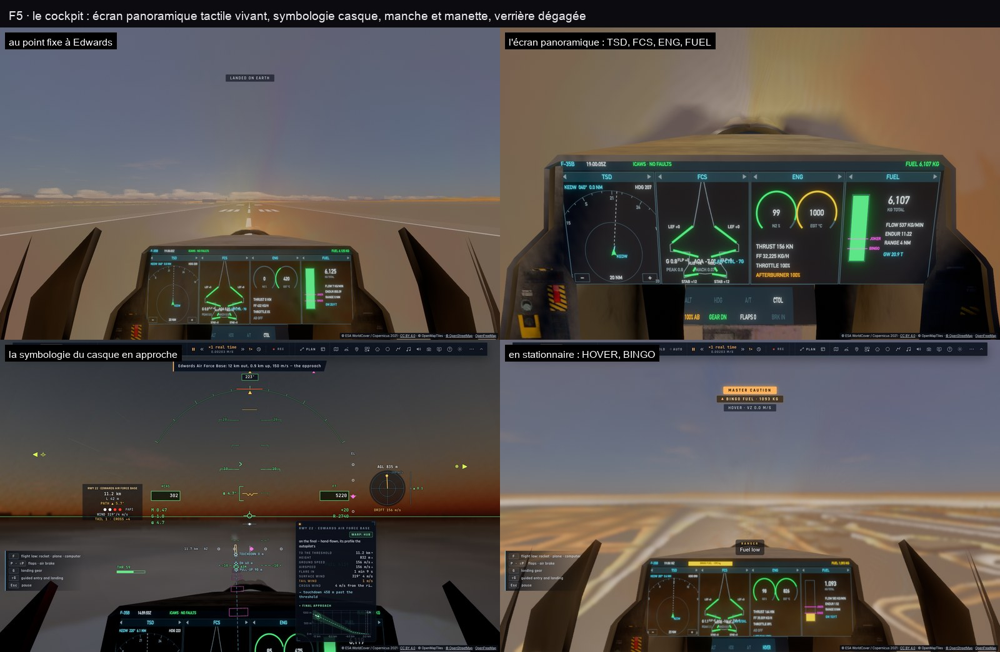

# Apprendre à voler en avion — le cours, puis la référence

Ce document apprend à piloter les avions du jeu — le **F-35B / F-35C** et l'**A320** — à un humain au clavier comme à
un LLM qui pilote par `__bh`. La **partie I** est un cours progressif : les notions, la lecture des instruments, puis une
leçon par manœuvre (décoller, tenir un palier, virer, gérer l'énergie, atterrir, l'ILS, le STOVL, l'A320), chacune
avec son but, ses gestes au clavier, ses appels `__bh`, ses critères de réussite et les erreurs qui la font rater. La
**partie II** est la référence du code : modèles de vol, commandes, systèmes, définitions et limites.

Version illustrée (schémas, captures du cockpit et des écrans) : [apprendre-avions.html](apprendre-avions.html).
Pour le joueur, le manuel complet : [F35.fr.md](F35.fr.md) ; les manettes : [HOTAS.md](HOTAS.md) ; le cockpit :
[COCKPIT.md](COCKPIT.md) ; la base de connaissances de TARS : [aviation/](aviation/fr/basics.md) ; le plan de l'A320 :
[PLAN-A320.md](PLAN-A320.md). Pour les vaisseaux : [VOL-VAISSEAUX.md](VOL-VAISSEAUX.md). Pour les tests :
[E2E-VOLS.md](E2E-VOLS.md).

*Rédigé le 6 novembre 2026 par lecture du code à `6d11d6b5` (aucun vol lancé pour l'écrire). Les chiffres des leçons
sont ceux des leçons du jeu (`src/game/lessons.ts`) et des constantes du code ; « calcul » = déduit des constantes,
non mesuré ; « doc » = affirmé par un document ou un test unitaire. Le code fait foi.*

---

# Partie I — Le cours

## Comment suivre ce cours

Chaque leçon a la même forme :

- **But** : ce qu'on sait faire à la fin.
- **À comprendre** : la notion qui explique les gestes.
- **Au clavier** : les touches, par **code physique** (noms QWERTY, AZERTY entre parenthèses). `W` désigne la touche
  en haut à gauche des lettres, `Z` sur un clavier français.
- **Par `__bh`** : les mêmes actions pour un LLM ou un test, dans la console du navigateur ou par `app.js(…)`.
- **Réussi quand** : des chiffres à lire, au HUD ou par `__bh`.
- **Erreurs** : celles qui font rater la manœuvre, avec leur correction.

**Pour un LLM**, la méthode est une boucle « lire, agir, avancer, vérifier » :

```js
// dans la page (console, ou app.js d'un test) — un pas = 1/30 s de vol
__bh.freeze(true);                            // la boucle du jeu n'avance plus seule : c'est vous qui avancez
const c = __bh.camera, lire = () => ({
  altMer: Math.round(c.geoNow().alt),                                  // m au-dessus de la mer
  sol: Math.round(__bh.sys.heightOverGround("earth", __bh.fleet.pose(__bh.fleet.active, __bh.time()).X, __bh.time())),
  vitesse: Math.round(c.airFlight.last?.speed ?? 0),                   // m/s, vitesse air
  vz: +(c.geoNow().vs).toFixed(1),                                     // m/s
  inclinaison: Math.round((c.attitudeNow().bank ?? 0) * 57.3),          // °
  assiette: Math.round((c.attitudeNow().pitch ?? 0) * 57.3),           // °
  poussée: +c.pilot.engineNow.toFixed(2), panne: c.airFlight.failure,
});
for (let i = 0; i < 30 * 10; i++) __bh.step(1 / 30);                  // 10 s de vol
lire();
```

Toute la leçon tient alors dans **un seul appel** (gel, pas fixes, sortie dès que c'est réussi ou raté), comme le
font les tests ([E2E-VOLS.md](E2E-VOLS.md) §3.2). Un LLM pilote par les maintiens et les autopilotes, ou en
remplaçant `c.pilotInput` (le manche) pour un geste précis (leçon 3).

### Les conventions (à connaître avant la première leçon)

| Sujet | Convention |
|---|---|
| Latitude, longitude | **degrés** géodésiques WGS84, longitude est positive (`geoNow()`, `flyAt`, `glideTo`…) |
| Caps | tous **vrais** (le jeu n'a pas de déclinaison magnétique ; le ND de l'A320 affiche TRU). `flyAt(…, capDeg)` et les tableaux du cours : degrés ; `jetModes.hdg`, `attitudeNow().heading` (de −π à π), `geoNow().track` (de 0 à 2π) : **radians** depuis le nord, sens horaire |
| Inclinaison, assiette | `attitudeNow().bank` en radians, **positive à droite** ; `pitch` positive nez haut |
| Vitesses | `airFlight.last.speed` et `jetModes.spd` (`apSet({ spd })`) : **vitesse vraie par rapport à l'air**, m/s ; `geoNow().gs` : vitesse sol ; le casque l'affiche en m/s (en unités impériales il écrit « KCAS » mais montre la même vitesse vraie). L'A320 parle en nœuds et ses « IAS » sont des vitesses équivalentes |
| Altitudes | `geoNow().alt`, `jetModes.alt`, `apSet({ alt })` : m **au-dessus de la mer** ; hauteur sol : `__bh.sys.heightOverGround` — celle du **point de référence** de l'avion, 1,08 m au-dessus des roues pour le F-35, 1,59 m pour l'A320 |
| Le manche par code | `c.pilotInput = (pad) => ({ ...c.__input(pad), pitch, roll, yaw, throttle })` : chaque champ dans **[−1, 1]** ; `pitch` + = cabrer, `roll` + = à droite, `yaw` + = nez à droite ; `throttle` est un **débit** (+1 = la manette monte de 0,6/s) ; pour la fixer, écrire `c.pilot.throttle` |
| Les touches | **tout ou rien** (±1) : une touche est un manche **à fond** (S = 7 g en l'air). « Doucement » veut dire **par petites pressions**, ou **Verr. Maj** (commandes de précision : le manche ×0,25 — 2,5 g au lieu de 7 —, la manette à 0,15/s). Maintenir **⇧** fait aussi monter la manette : un raccourci ⇧+touche la pousse un peu |
| Le temps | page gelée (`__bh.freeze(true)`), `__bh.step(1/30)` avance 1/30 s ; l'image continue d'être dessinée ; pour laisser passer une image dans un appel `async` : `await new Promise((r) => requestAnimationFrame(r))` |
| Les sites | `lineUp`, `glideTo` reconnaissent les sites du jeu par un morceau de leur nom : « Edwards Air Force Base », « Kennedy Space Center, Shuttle Landing Facility », « Paris – Le Bourget » (tiret long), « Kourou », « Baikonur », « Tanegashima », « Woomera » ; les codes OACI des sites du jeu (KEDW, LFPB…) marchent toujours ; ceux des autres aérodromes une fois leur tuile chargée |

**Après un crash** (taux de chute au-delà de 4,5 m/s, rupture, collision) : en solo **le jeu se met en pause** et
affiche l'écran de perte — « **Reprendre avant la rentrée** » (s'il y a un instantané d'avant l'entrée), « **Continuer
sans dégâts** » (le réglage `damage` coupé, le temps relancé), « **Recommencer la scène** ». Vérifié en jeu
(e2e `apprendre-avions`). Par code : un nouveau placement (`lineUp`, `flyAt`…) efface la panne
(`airFlight.failure`) mais ne ferme **ni l'écran de perte ni la pause** : cliquer un de ses boutons
(`.craft-lost button` — depuis la console, `document.querySelector(".craft-lost button").click()` suffit ; un
test e2e clique « en vrai » pour prouver qu'aucun calque ne le cache). « Reprendre » n'existe qu'après une
rentrée atmosphérique ; `pause(false)` sans nouveau placement repart dans l'épave, la panne toujours là. Pour s'entraîner sans casse :
`__bh.settings.damage = false`.

## Leçon 0 — Monter dans l'avion, choisir son aide

**But** : être en vol ou aligné sur une piste, avec l'aide qui convient.

**Au clavier**
- Hors vol, **Tab maintenu** ouvre la roue : **Voler en F-35**. En vol d'avion : Tab › Navigation › **Préparer un
  vol** (un aérodrome, un départ — aligné sur la piste, en finale à 15 km et 900 m, ou en croisière à 40 km et
  6 000 m —, l'heure, la météo, le carburant, un plan de vol), puis **Voler**.
- Réglages › Jeu › F-35 › **Assistance** (par défaut : **Réaliste**) : commencez en **Assisté** (gaz automatiques, incidence limitée à 20°,
  protection du sol toujours active), passez en **Réaliste** (le vrai F-35) quand les leçons 1 à 6 sont acquises. Le
  niveau **Débutant** fait voler l'avion vers un anneau cyan déplacé au manche.
- **V** change de vue : la vue **cockpit** (le casque) est celle du pilote ; les vues extérieures aident à comprendre
  l'attitude. **Échap** met en pause (Espace aussi, hors combat).
- **⇧X** ramène toujours au vol stable : ailes à plat, légère montée (6°), puis altitude, cap et vitesse tenus (au
  moins 150 m/s). Toute touche de tangage ou de roulis l'annule. C'est le bouton « je suis perdu » ; par code :
  `__bh.camera.recoverStart()`.
- **F6** : TARS. Il répond aux questions de pilotage et peut voler une démonstration (leçon 11).

**Par `__bh`**

```js
__bh.settings.vessel = "f35";                         // ou "a320"
// page non gelée : attendre __bh.fleet.active === "f35" (le changement se fait au pas de vol suivant)
// page gelée : quelques pas, puis vérifier
for (let i = 0; i < 5; i++) __bh.step(1 / 30);
__bh.fleet.active;                                    // "f35" — l'avion est alors aligné sur la piste la plus proche
__bh.game.lineUp("Edwards");                          // ou sur une piste choisie (le bout en service, face au vent)
__bh.settings.shipMount = "cockpit"; __bh.refresh(); __bh.camera.viewReset();
```

Réglages utiles : `f35Assist` (`"manual"`, `"realistic"`, `"assisted"`, `"beginner"`), `f35Variant` (`"B"`, `"C"`),
`damage` (faux : les limites deviennent des alarmes), `wind` (0 calme … 3 fort), `f35InfiniteFuel`.

## Leçon 1 — Ce qui fait voler un avion

**À comprendre**

- **Quatre forces.** La **portance** (perpendiculaire à la trajectoire, produite par l'aile), le **poids**, la
  **poussée** du moteur, la **traînée** de l'air. En palier stable, portance = poids et poussée = traînée.
- **La portance croît avec le carré de la vitesse et avec l'incidence** (l'angle α entre l'aile et l'air qui arrive).
  Plus lent, il faut plus d'incidence pour porter le même poids — jusqu'au **décrochage**, où l'aile ne porte plus
  (pour le F-35 : aile décrochée vers 26°, mais le corps et les tables de haute incidence portent encore jusqu'à 35°
  et au-delà ; le jeu borne l'incidence à 50° en loi normale, 20° en assisté).
- **Trois axes.** Le **tangage** lève ou baisse le nez (W/S), le **roulis** incline les ailes (Q/E — A/E en AZERTY),
  le **lacet** tourne le nez à plat (A/D — Q/D). On vire avec le roulis, pas avec le lacet.
- **Le nez n'est pas la trajectoire.** Le **vecteur vitesse** (le petit avion du HUD, cercle à ailes) montre où va
  l'avion ; le nez est au-dessus, de l'incidence. On pilote le vecteur vitesse.
- **Le facteur de charge** (« g ») : la portance divisée par le poids. 1 g en palier, 2 g dans un virage à 60°
  d'inclinaison en palier. En loi normale, **le manche du F-35 commande un facteur de charge** : manche au neutre =
  1 g (l'avion garde sa trajectoire), tiré = jusqu'à +7 g, poussé = jusqu'à −3 g ; 4 g au plus train sorti.
- **L'énergie.** Vitesse et altitude s'échangent : monter coûte de la vitesse, descendre en rend. La poussée ajoute
  de l'énergie, la traînée en retire. Un avion lent et bas n'a plus de réserve : près du sol, **la vitesse, c'est la
  vie**.
- **Les hauteurs.** L'altitude affichée et tenue par l'autopilote est **au-dessus de la mer** ; la hauteur au-dessus
  du sol (AGL) est donnée par la radiosonde sous 1 500 m. La Terre du jeu est l'ellipsoïde WGS84 et la mer est sur le
  géoïde : un avion à 900 m au-dessus de la mer au-dessus de Paris est à ~850 m du sol.

## Leçon 2 — Lire le casque (HUD) du F-35

**But** : savoir où l'on va, à quelle vitesse et hauteur, et ce que fait l'automatisme, d'un coup d'œil.



| Ce qu'on voit | Ce que c'est |
|---|---|
| Le **vecteur vitesse** (cercle à ailes) | là où va l'avion ; sur l'horizon = palier |
| L'**échelle de pente** | barreaux tous les 5° (pleins au-dessus de l'horizon, tiretés en dessous) |
| La **bande de cap** en haut | le cap du nez (repère ambre), la route (vert), la cible, le point du plan de vol (magenta) |
| La **vitesse** (encadrée, à gauche) et l'**altitude** (encadrée, à droite) | en m/s et m par défaut (Réglages › Jeu › Aides du HUD › Unités) ; dessous : Mach, **G** (ambre au-delà de 5,6, rouge au-delà de 6,65), **α** (ambre au-delà de 35°), la vitesse verticale, la **hauteur radar** sous 1 500 m |
| Les **annonces** sous la bande de cap | les modes engagés : `ALT …`, `HDG …`, `A/T …`, `LNAV`, `VNAV`, `TF 150`, `ORBIT`… |
| `THR %` en bas à gauche | la manette ; ambre avec la postcombustion |
| Le carburant en bas à droite | kg ; ambre sous 20 % |
| Les **chevrons GCAS** | se referment quand le sol approche ; rouges et `AUTO GCAS — FLY UP` quand l'avion reprend la main |
| `DIRECT LAW` en ambre | la loi directe : plus de protection |

L'**écran panoramique** (PCD) sous le casque porte les pages tactiles (carte tactique, moteur, carburant, train…) ;
voir [F35.fr.md](F35.fr.md) « Le cockpit et le casque ».

**Par `__bh`** : `c.geoNow()` (lat, lon, `alt` mer, `gs`, `track` en rad, `vs`), `c.airInfo()` (`speed` [m/s],
`mach`, `alpha`, `beta` [rad], `nz` [g], `stalled`, `aoaWarn`, `gear`, `flaps`…), `c.attitudeNow()` (rad),
`c.jetModes` (les maintiens engagés : `alt` [m mer], `hdg` [rad], `spd` [m/s], `null` = coupé), `c.pilot.throttle`
et `c.pilot.engineNow` (la manette et la poussée réelle), `__bh.fleet.fuel.f35` [kg]. **`airInfo()` n'a pas de
hauteur sol** : `__bh.sys.heightOverGround(…)` (voir « Comment suivre ce cours »).

## Leçon 3 — Décoller

**But** : quitter la piste dans l'axe, train rentré, en montée stable.

**À comprendre** : il faut assez de vitesse pour que l'aile porte l'avion à une incidence modeste. Le F-35 sec a un
rapport poussée/poids d'environ 0,59 : il accélère franchement, plus encore avec la postcombustion (×1,47). Doc :
décollage en 10,5 s (`tests/f35-envelope.test.ts`).

**Au clavier**
1. Aligné sur la piste (leçon 0). La manette à 0 freine toutes les roues.
2. **Z** (W en AZERTY) : plein gaz ; **⇧Z** (⇧W) : postcombustion si la piste est courte ou l'avion lourd (elle
   s'allume au sol aussi : seuls l'autopilote et l'auto-manette exigent d'être en l'air).
3. Tenir l'axe au **lacet** (A/D — Q/D), par petites touches : la roue avant suit le lacet.
4. Vers **70 m/s** (≈ 135 kt), **S par petites pressions** (ou Verr. Maj puis S) : le nez se lève ; viser **10 à
   12°** d'assiette.
5. Dès que la vitesse verticale est positive : **G** (train rentré, 8 s). Volets (P) rentrés s'ils étaient sortis.
   L'alarme « train rentré trop bas » sonne alors (train rentré sous 300 m et 150 m/s) : normale juste après un
   décollage, elle se tait au-dessus.
6. Montée à 10–15° ; **⇧Z** (⇧W) éteint la postcombustion (elle s'éteint aussi d'elle-même dès que la manette passe sous
   95 % : Alt, X…).

**Par `__bh`** (la forme du test `f35-flight-ops`) :

```js
const c = __bh.camera;
c.__input ??= c.pilotInput.bind(c);
c.pilotInput = (pad) => {                                     // le manche : tiré à 0,8 au-dessus de 67 m/s au sol
  const i = c.__input(pad);
  return (c.rolling || c.ourLanded) && (c.airFlight.last?.speed ?? 0) > 67 ? { ...i, pitch: 0.8 } : i;
};
c.pilot.throttle = 1; c.jetToggle("ab");                      // plein gaz + postcombustion
for (let i = 0; i < 30 * 40 && (c.rolling || c.ourLanded); i++) __bh.step(1 / 30);
c.pilotInput = c.__input;                                     // le manche rendu
c.gearDown = false;                                           // train rentré
```

**Réussi quand** : `!c.rolling && !c.ourLanded`, vitesse verticale > 5 m/s, inclinaison < 5°, écart à l'axe faible.

**Erreurs**
- Tirer trop tôt : l'avion se lève trop lent, son incidence monte, il retombe. Attendre la vitesse.
- Tirer trop fort : la queue touche, ou l'avion part en cabré excessif ; 10–12°, pas plus.
- Oublier le train : il traîne et le HUD le rappelle.

**Ou bien U** (le décollage automatique, depuis le 11 novembre 2026) : aligné sur une piste, **U** met plein gaz et la
postcombustion, tient l'axe à la roue avant, fait la rotation à **67 m/s**, puis en l'air tient une montée d'environ
8 m/s (assiette 8 à 20°, ailes à plat dans l'axe), rentre le train ; passé **110 m/s et 100 m**, il rend la main aux
maintiens — **1 500 m au-dessus du terrain**, le cap de la piste, **210 m/s** à l'auto-manette, postcombustion coupée —
et le dit (« Airborne — gear up, climbing to … »). Le manche, la manette tirée ou U à nouveau l'arrêtent. L'Auto-GCAS
reste désarmé pendant ce décollage (comme sur le vrai, au décollage). Par code : `app.press("KeyU")` (la vraie touche),
ou `__bh.camera.runwayTakeoff()` (le même départ ; il rend un message, `null` hors du sol ou sans le F-35). Réussi
quand `c.rwyRun === null`, `c.gearDown === false` et `c.jetModes.alt` ≈ terrain + 1 500. Vérifié en jeu (e2e
`apprendre-avions`, 11 nov.) : en l'air en 10,8 s, assiette 20,1° au plus, l'axe à 0,3°, 1 348 m et 201 m/s à 45 s.
Près d'un porte-avions, U fait le décollage court ou la catapulte.

## Leçon 4 — Tenir un palier, virer, monter, descendre

**But** : les quatre gestes de base, à la main puis à l'autopilote. Ce sont les étapes de la leçon « Premier vol »
de l'école.

**À comprendre** : en loi normale, l'avion **garde la trajectoire qu'on lui laisse** (manche lâché = 1 g, pente et
inclinaison tenues). On pilote par petites impulsions, puis on lâche. **L'attitude d'abord, l'altitude suit.**

**Le manche et l'autopilote** : les maintiens du jet (', ⇧') **laissent passer le manche** — on vire ou on monte à la
main, et au lâcher le nouveau cap ou la nouvelle altitude est tenu ; mais avec le maintien de cap engagé, lâcher le
roulis fait **reprendre le cap du moment et remettre les ailes à plat**. (La règle « sans maintien » de la loi avion,
en partie II, concerne les maintiens d'attitude des vaisseaux, pas ceux du jet.) Pour voler vraiment à la main,
**couper l'autopilote avec '** — ⌫ ne coupe pas les maintiens du jet (seulement les missions et les autopilotes du
vaisseau).

**Au clavier**
- **Palier** : le vecteur vitesse sur l'horizon, ailes à plat, **200 m/s**. Ajuster la manette (Maj / Alt, ou ↑ ↓)
  pour tenir la vitesse.
- **Virage en palier** (AP coupé) : **Q/E** (A/E) par petites pressions, et **lâcher vers 20°** : la vitesse de
  roulis acquise emmène encore une dizaine de degrés (mesuré en jeu : touche tenue jusqu'à 29°, inclinaison finale 41°).
  Une fois l'inclinaison voulue, **lâcher** : la loi normale tient l'inclinaison **et la pente** — elle ajoute d'elle-même la portance du virage
  (1,15 g à 30°) ; ne pas toucher S. Pour sortir, roulis inverse jusqu'aux ailes à plat **environ 5° de cap avant** le
  cap voulu (taux de virage = g·tan(inclinaison)/vitesse : à 200 m/s et 30°, ≈ 1,6°/s ; un demi-tour prend ~2 min).
- **Montée** : de la puissance et le nez en haut pour **500 m** ; commencer la mise en palier **à un dixième du taux
  de montée** avant l'altitude (à 20 m/s de montée, 200 m avant).
- **Descente** : la puissance réduite, le nez un peu bas ; même anticipation.
- **Ralentir** à 160 m/s : la puissance réduite, le nez qui monte un peu à mesure.
- **L'autopilote** : **'** (ù en AZERTY) tient l'altitude et le cap actuels ; **⇧'** l'auto-manette (la vitesse
  actuelle ; Maj / Alt la changent de 10 m/s par seconde). Le manche passe outre ; lâché, la nouvelle altitude ou le
  nouveau cap est tenu.

**Par `__bh`**

```js
const c = __bh.camera;
for (let i = 0; i < 10; i++) __bh.step(1 / 30);               // en l'air, en mode avion : les maintiens acceptent
c.apSet({ ap: true, athr: true, alt: 3000, hdg: 90 * Math.PI / 180, spd: 200 });  // alt m mer, hdg rad, spd m/s
for (let i = 0; i < 30 * 60; i++) __bh.step(1 / 30);          // une minute
({ alt: c.geoNow().alt, cap: c.attitudeNow().heading * 57.3, v: c.airFlight.last.speed, modes: c.jetModes });
```

`apSet` peut se rappeler sans risque (`hdg` : n'importe quel angle en radians, ramené à 0–2π ; `{ ap: false }` coupe les
maintiens et laisse l'auto-manette ; `{ athr: false }` l'inverse) ; **`jetToggle("ap")` bascule** (un second appel coupe tout) et refuse tant que
l'avion n'est pas en l'air en mode avion. Écrire `c.pilot.throttle` pendant que l'auto-manette tient la désengage.

**Réussi quand** : altitude à ±30 m, cap à ±2°, vitesse à ±5 m/s pendant 10 s (les seuils de l'instructeur sont du
même ordre).

**Erreurs**
- Courir après l'altitude : de grosses corrections qui dépassent. Petites corrections, tenues.
- Tirer en virage « pour ne pas descendre » : la loi normale le fait déjà ; S ajouterait une ressource (jusqu'à 7 g).
- Mettre en palier trop tard : à un dixième du taux de montée avant l'altitude.

## Leçon 5 — L'énergie, l'incidence et les limites

**But** : savoir jusqu'où on peut tirer, et ce qui arrive au-delà.

**À comprendre**
- Le HUD montre **α** et, sur l'arc entre le vecteur vitesse et le nez, une parenthèse verte (meilleure finesse),
  un trait ambre (85 % du décrochage), une barre rouge (le décrochage). Le **chevron d'énergie** à côté du vecteur
  vitesse dit si l'on gagne ou perd de la vitesse.
- **Facteur de charge** : 7 g par défaut (réglage 5–9) ; **au-delà de 10,5 g tenus 0,25 s, la structure casse**
  (avec les dégâts actifs). Le **corps du pilote** : voile gris puis noir au-delà de sa tolérance, **perte de
  connaissance** si le voile noir dure 1,5 s (~8 s inconscient) ; voile rouge sous −1,5 g.
- **Les protections** : l'**Auto-GCAS** tire à 5 g et remet les ailes à plat quand le sol arriverait (armé train
  rentré, hors loi directe et hors décollage automatique U) ; l'**Auto-ACAS** évite un autre appareil.
- **Loi directe** (Réglages › Jeu › F-35 › Loi de pilotage) : plus de protection, la vrille devient possible ; on en
  sort en lâchant tout une dizaine de secondes.

**À essayer** : en palier à 3 000 m, tirer progressivement en virage et regarder G et α monter ; relâcher avant
l'ambre. En Réaliste, réduire la manette en tenant l'altitude jusqu'aux premières vibrations, puis **⇧X**.

**Par `__bh`** : `c.airInfo()` → `nz` (g), `alpha` (rad), `buffet`, `stalled`, `gPeak` ; `c.airFlight.margins()`
(0…1 : g, chaleur) ; `c.airFlight.failure` (la raison d'une perte).

## Leçon 6 — Le tour de piste et l'atterrissage

**But** : revenir sur la piste et s'y poser doucement. Ce sont les étapes des leçons « Tour de piste » et
« Atterrissage » de l'école.

**À comprendre** : on se pose sur une **pente de 3°** vers un point de visée, à une vitesse d'approche stable ; on
**arrondit** (on adoucit la descente) près du sol pour toucher à moins de 3 m/s de vitesse verticale.

| Étape | Chiffres de l'école |
|---|---|
| **Vent arrière** | **300 m** au-dessus du terrain, **1,8 km** à côté de la piste — le tour de l'école est **à droite** (la piste à votre droite en vent arrière) —, **100 m/s**, **train sorti** (G) |
| **Dernier virage** (base) | **3 km** après le seuil : un **demi-tour continu de 900 m de rayon** vers l'axe, en descendant vers **200 m** — à 100 m/s cela demande ≈ **49°** d'inclinaison (≈ 36° à 80 m/s : ralentir avant) ; l'autopilote, limité à 30°, ne le vole pas |
| **Finale** | dans l'axe, sur la pente de 3° vers le **point de visée, 300 m après le seuil**, à la vitesse d'approche ; volets (P) ; le seuil réel : `c.ilsRunways("KEDW").auto.rwy` (`lat`, `lon`, `hdg`, `elev`, `len`) |
| **Arrondi** | à partir de **14 m** : la descente adoucie sous 1 m/s, **manette au ralenti** |
| **Toucher** | dans la zone **150–900 m** après le seuil ; manette 0 = freinage automatique ; rester dans l'axe au lacet |

Vitesse d'approche (calcul, formule de l'ILS) : ≈ **92 m/s** réservoirs pleins, ≈ **81 m/s** à 16 t. À la même
hauteur, on se pose plus lentement léger.

**Verdict au toucher** (taux de chute, réglage `crashSpeed` = 4,5 m/s) : **≤ 3 m/s posé**, ≤ 4,5 m/s dur (train
endommagé), au-delà **écrasé**.

**Au clavier** : G (train) au vent arrière ; P (volets) en finale ; la pente se tient au **vecteur vitesse posé sur
le point de visée**, la vitesse à la manette ; arrondi en tirant doucement S à 14 m ; X (manette coupée) au toucher.
Une approche ratée se rattrape : plein gaz (**Z**, W en AZERTY), montée, train rentré, nouveau tour.

**Par `__bh`** : le plus simple est l'ILS (leçon 7). À la main, placer l'avion en finale :

```js
// 5 km avant le seuil d'Edwards dans l'axe, à la hauteur de la pente — comme le test ils.e2e
// (lat, lon : un point de l'axe à 5 km du seuil — src/game/ils.ts fromRunway le calcule ; 260 m ≈ 5 km × tan 3°)
__bh.game.flyAt(lat, lon, 260, capPiste, 90);
const c = __bh.camera; c.gearDown = true; c.gearExt = 1; c.gearInit = true; c.airFlight.cfg.flaps = 1;
```

puis lire le journal : `__bh.game.log.events.filter(e => e.kind === "pilot")` contient « Touchdown … · X m/s down ».

**Erreurs**
- Arrondir trop haut : l'avion flotte puis tombe. L'arrondi à 14 m, la descente adoucie, pas arrêtée.
- Plonger vers la piste : suivre la pente, le point de visée immobile dans le pare-brise.
- Laisser de la puissance à l'arrondi : l'avion flotte au-delà de la zone. Manette au ralenti.
- Lent et bas en finale : de la puissance d'abord.

## Leçon 7 — L'approche ILS

**But** : se poser par tout temps en suivant deux faisceaux : l'**alignement de piste** (localizer) et la **pente**
(glideslope, 3°).

| Point | Chiffres |
|---|---|
| Point d'approche initiale (IAF) | **18,5 km** dans l'axe, en palier à la hauteur de la pente à ce point (≈ 1 000 m sol) |
| Alignement | intercepté à 30–45°, ailes à plat quand l'aiguille se centre |
| Pente | rejointe **en palier, par en dessous** : la descente commence quand le losange se centre (~4 m/s à 85 m/s) — jamais en plongeant depuis au-dessus |
| Point d'approche finale (FAF) | **9,3 km** : train, volets, vitesse, stable — aiguilles à moins d'un point |
| Minimums | **60 m** : stable, on continue ; sinon remise de gaz droit devant |
| Arrondi | à **14 m**, descente < 1 m/s, ralenti, toucher **150–900 m** après le seuil |

**Conditions** : un avion (F-35, A320), en l'air ; une piste nommée est acceptée à toute distance, sans nom la plus
proche à moins de 150 km. L'approche coupe la formation, l'interception, le STOVL et l'autopilote en cours, puis vole
elle-même (`ilsRun.phase` : `toIaf`, `intercept`, `final`, `flare`, `rollout`, `missed`, `done` ; et `base`, `hold`),
sort le train et les volets, coupe la manette à l'arrondi. Elle refuse une pente qui rentre dans le relief.

**Au clavier** : Tab › Navigation › **Approche ILS** (le choix de la piste dans la sous-roue). Le HUD montre en vert
les points de pente à droite, ceux de l'alignement en bas, des losanges magenta, et la phase (`IAF`, `LOC`, `LOC GS`,
`FLARE`, `ROLL`, `GA`). Toucher le manche ou la manette repasse en manuel.

**Par `__bh`**

```js
const c = __bh.camera;
c.ilsRunways("KEDW");                         // les pistes possibles, celle face au vent marquée
c.ilsStart("KEDW");                           // la piste face au vent ; { runway: "<numéro>" } pour en choisir une
                                              // rend toujours un message : "ILS approach: …" ou "ILS: …" (refus)
// puis avancer jusqu'à c.ilsRun === null ; c.ilsLast = { rwy, score, notes, touch: { along, across, vs } }
```

**Réussi quand** : `ilsLast.touch.along` entre 150 et 900 m, `|across|` < 8 m, et `touch.vs > -3` (`vs` est
**signé, négatif en descente** : un critère « vs < 3 » serait toujours vrai).

## Leçon 8 — Le F-35B en stationnaire, le F-35C sur porte-avions

**À comprendre** : le **F-35B** a une soufflante de sustentation et une tuyère orientable : il tient en l'air sans
vitesse tant qu'il pèse **moins d'environ 17,8 t** (184 kN de poussée verticale) — il faut donc avoir brûlé environ
3 t de carburant avant un poser vertical. Le **F-35C** se pose sur un porte-avions avec sa crosse dans un brin, et
décolle à la catapulte.

**F-35B au clavier** : **⇧B** convertit (6 s : trappes, embrayage) ; sous **65 m/s** la loi de stationnaire prend la
main : **le manche commande une vitesse sol**, **Maj / Alt une vitesse verticale** (±4 m/s), **lâché, l'avion tient
son point**. Au-dessus de 80 m/s, retour au vol normal. Sur un porte-avions : **F7** à moins de 30 km lance
l'appontage vertical (le long du bord, au-dessus du pont, descente), **U** le décollage court ou vertical.

**F-35C** : **U** sur la catapulte (72 m/s en bout de course), **F7** pour l'appontage aux brins (pente 3,5° sur le
porte-avions *Ford*, le « ball » de l'officier d'appontage, le brin arrête l'avion en 100 m à 4,5 g au plus).

**Attention** : `carrierSpawn` pose le navire au niveau de la mer **4 km devant, où que l'on soit** (à Edwards, le
pont serait sous le désert) : se placer d'abord en mer, ou `carrierSpawn("ford", { lat, lon })`. `deckLand` attend la
carte du pont (« still loading ») : réessayer. L'état STOVL : `c.stovl.on`, `.conv` (0…1), `.hover`.

**Par `__bh`** : `c.carrierSpawn("ford")` ; `c.carrierFinal("ford", 3500, 90)` ; `__bh.fleet.fuel.f35 = 1800`
(assez léger pour le stationnaire) ; F-35B `c.deckLand("ford")` puis `c.deckLast` (`dx`, `dz`, `sink`, `grade`) ;
F-35C (`__bh.settings.f35Variant = "C"`, une image plus tard) `c.catLaunch(0)`, `c.trapLand("ford")`, `c.trapLast`.
`c.stovlToggle()` hors porte-avions (sous 128 m/s).

## Leçon 9 — Naviguer : le plan de vol et la NAV

**Au clavier** : **⇧O** ouvre le plan de vol sur la carte (un clic ajoute un point, sur un aérodrome l'aérodrome ;
altitude et vitesse par point ; carburant à l'arrivée et bingo). **⇧M** : la **NAV** — LNAV suit les branches, VNAV
la montée et une descente à 3° ; la fin du plan passe la main à l'ILS. Le HUD montre `LNAV · VNAV` et le prochain
point (magenta). Le manche coupe la NAV.

**Autres modes** (Tab › Navigation › Modes du pilote automatique) : orbite autour d'un point, hippodrome d'attente,
**suivi de terrain** à 100, 150 ou 300 m (il suit le relief, **pas les bâtiments** — le GCAS non plus ; il engage
seul l'AP et l'auto-manette), ravitaillement en vol, « voler vers… » un point de la carte.

**Par `__bh`** : `c.nav` (le plan), `c.tfStart(150)`, `c.orbitStart({…})`, `c.tankerStart({ near: true })`,
`c.modesOff()` ; TARS fait la même chose par ses outils `jet_mode` et `approach`.

## Leçon 10 — L'A320 : de la porte à l'atterrissage automatique

**But** : faire un vol complet d'avion de ligne — au sol, décollage, montée, croisière sous autopilote, approche ILS,
atterrissage automatique, roulage —, en sachant ce que fait l'automatisme à chaque instant.

**À comprendre**
- **Les lois Airbus** (commandes de vol électriques) : en loi normale le manche commande **+2,5 / −1 g** (+2 / 0 g
  volets sortis) et un taux de roulis (15°/s) ; **manche lâché, la trajectoire est tenue** (pente, et l'inclinaison
  jusqu'à 33°) ; l'inclinaison est limitée à 67° (45° en protection), l'assiette à +30° / −15° ; les **protections**
  empêchent le décrochage (α prot, α max, et **α floor** qui met la poussée TOGA d'office) et la survitesse. Des pannes
  font passer en loi alternée ou directe (moins de protections).
- **Tout est lent et anticipé** : 15°/s de roulis, des volets qui mettent ~30 s à sortir en entier, des moteurs qui
  montent en régime en quelques secondes. Les vitesses sont en **nœuds** (kt), les altitudes en **pieds** (ft).
- **Le levier de poussée a des crans** : ralenti 0, **CL** 0,6 (montée : l'A/THR y travaille), **FLX/MCT** 0,78–0,83,
  **TOGA** ≥ 0,95. On décolle en FLX ou TOGA, on ramène en CL à l'altitude de réduction, l'A/THR gère alors la vitesse.
- **Le FMA** (la bande du haut du PFD) dit ce que fait l'automatisme : poussée (`MAN FLX`, `THR CLB`, `SPEED`,
  `IDLE`), vertical (`SRS`, `CLB`, `ALT*`, `ALT`, `V/S`, `G/S*`, `G/S`, `LAND`, `FLARE`), latéral (`RWY`, `NAV`,
  `HDG`, `LOC*`, `LOC`, `ROLL OUT`), et `AP1`, `A/THR`. **Lire le FMA après chaque action.**
- **Les vitesses du FMGC** : au décollage **V1 ≈ VR − 3**, **VR ≈ VS1G(1+F) × 1,13 − 4** (≈ 135 kt à la masse par
  défaut, 64,8 t),
  **V2 ≈ VR + 4** ; en montée V2 + 10, puis **250 kt sous le FL100**, puis ECON (indice de coût 30) ; à l'approche
  « green dot » (≈ 2 × masse en t + 85 kt, lisse), **S**, **F**, puis **VAPP = VLS + ⅓ du vent de face** (5 à 15 kt de
  plus) en configuration d'atterrissage ; **VLS** = 1,23 × la vitesse de décrochage de la configuration.

**Le vol, étape par étape** (départ `ready` : moteurs prêts ; `cold` : poste éteint, `apu` : APU en marche)

| # | Étape | Au clavier / au poste | Ce qu'on vérifie |
|---|---|---|---|
| 1 | Au poste | Préparer un vol › départ « à la porte » ; tablette › Au sol : services (escaliers, GPU, plein), puis **Fin** : repoussage (tracteur, droit ou queue à gauche/droite) | le tracteur dételé ; frein de parc (la poignée du poste : pas de touche) |
| 2 | Roulage | lâcher le frein de parc, un peu de poussée ; la roue avant suit le **lacet** (A/D — Q/D) ; la clairance de la tour donne l'itinéraire (ligne au sol, carte du ND) | ≤ 30 kt en ligne droite, ≤ 10 kt en virage |
| 3 | Alignement | volets **P** une fois : **CONF 1+F** (becs 18°, volets 10°) | ECAM : mémo T.O sans rouge |
| 4 | Décollage | **Z** (W) = TOGA, ou le levier au cran FLX ; l'axe au lacet | FMA `MAN TOGA`/`MAN FLX` · `SRS` · `RWY` ; A/THR armé |
| 5 | Rotation | à **VR**, **S** doucement, ~3°/s, jusqu'à **15°** d'assiette | vario positif |
| 6 | Montée initiale | **G** (train rentré) ; au-dessus de 1 500 ft, levier en **CL** : l'A/THR, **déjà armé** au décollage, devient actif ; volets rentrés par étapes **au levier du poste** en accélérant au-delà de F puis S (P ne fait que **monter** d'un cran et passe de FULL à 0) | FMA `THR CLB` · `CLB` · `NAV` |
| 7 | Autopilote | **'** (ù) = **AP1** — accepté au sol ou **≥ 5 s après le décollage et ≥ 100 ft**. **Ne pas presser ⇧'** : l'A/THR est déjà armé (⇧' le couperait) | FMA `AP1`, `A/THR` |
| 8 | Croisière | le **FCU** au poste (cliquer : SPD, HDG, ALT, V/S ; tirer = sélecté, pousser = géré) ; **⇧M** : NAV sur le plan de vol | FMA `ALT`, `SPEED` |
| 9 | Descente et approche | ALT du FCU plus bas, tirer : `OP DES` ; volets par étapes à **FULL** (becs 27°, volets 35° — ~30 s), **G** train ; Tab › Navigation › **Approche ILS** | FMA `LOC*`→`LOC`, `G/S*`→`G/S`, vitesse VAPP |
| 10 | Atterrissage | avec l'AP : `LAND` sous 400 ft, **`FLARE` à 50 ft (seulement avec l'AP)**, `ROLL OUT` ; manettes au **ralenti** au toucher | toucher < 3 m/s (≈ 600 ft/min) |
| 11 | Freinage | **⇧Z** inverseurs (au sol, ralenti), **⇧B** autofrein (LO 1,7 · MED 3,0 · MAX m/s², MAX au sol seulement) ; spoilers sol automatiques | sorti de piste < 30 kt |
| 12 | Au poste | la tour donne un poste libre ; frein de parc | — |

Remise de gaz : levier **TOGA** (Z — W en AZERTY) en approche → `GA TRK`, `SRS`, montée ; train et volets rentrés par étapes.

**Démarrage à froid** (`a320Start: "cold"`) : la **tablette › Systèmes** donne les check-lists de FlightGear (11
procédures, 9 normales), chaque item montré par un anneau sur sa commande ; doc : APU disponible ~52 s après MASTER,
un moteur au ralenti ~47 s après ENG MASTER. La même page arme les **76 pannes** (tout de suite, à V1, au décollage, au
hasard, à une vitesse) : la lecture de l'ECAM et ses procédures (actions en cyan qui s'effacent une fois faites) est
la suite de cette leçon.

**Par `__bh`**

```js
__bh.settings.vessel = "a320"; __bh.settings.a320Start = "ready";
// (attendre __bh.fleet.active === "a320")
__bh.game.lineUp("Paris – Le Bourget");      // puis attendre de nouveau !!__bh.camera.a320Sys (le placement le refait)
const c = __bh.camera;
c.airFlight.cfg.flaps = 0.25;                 // le levier des volets / 4 : 0.25 = cran 1 (1+F au sol), 1 = FULL
c.a320Park = false; c.pilot.throttle = 1;     // TOGA (0.6 = CL, 0.78–0.83 = FLX/MCT)
// la rotation : le manche (c.pilotInput enveloppé, comme pour le F-35) tiré quand la vitesse passe VR ;
// la vitesse air : c.airFlight.last.speed [m/s] (135 kt ≈ 69 m/s)
// en l'air depuis ≥ 5 s et ≥ 100 ft : c.a320ApKey("ap") ; l'A/THR est déjà armé : if (!c.a320Fmgc.athr) c.a320ApKey("athr")
// le FMA lisible : c.a320Fmgc.fma() ; inverseurs c.a320ReverseToggle() ; autofrein c.a320AutobrakeCycle()
// le FCU par code : c.a320Fmgc.altTurn(n), .altPush(), .altPull(), .hdgTurn(n), .spdTurn(n), .vsTurn(n)…
//   (crans du bouton ; SPD 100–399 kt, ALT 100–49 000 ft) ; ses champs c.a320Fmgc.spd, .hdg, .alt sont lisibles
c.ilsStart("LFPB");                           // l'approche : l'A320 la passe à son FMGC (LOC, G/S, LAND, FLARE)
// la suivre par c.a320App (c.ilsRun reste nul pour l'A320) ; la note dans c.ilsLast
// réussi : c.ourLanded, c.airFlight.failure === null ; le journal (kind "pilot") donne le taux de chute au toucher
// pannes : c.a320Fail.arm(id, when) ; au sol : await __bh.game.atStand("LFPG", "C07"), __bh.game.pushedBack()
```

**Erreurs**
- Tirer avant VR, ou trop vite : la queue touche (un contact de ventre).
- Engager l'AP trop tôt : il refuse avant 5 s de vol et 100 ft.
- Ne pas lire le FMA : un mode armé n'est pas un mode engagé (armé : en cyan, sur la seconde ligne ; engagé : en
  vert, sur la première).
- Annoncer FULL sans laisser sortir les volets : la protection d'incidence ignore alors la trajectoire demandée.
- Croire qu'une survitesse casse l'avion : ce sont des **alarmes ECAM** (VLE 284 kt, VFE + 4 kt, VMO), pas des dégâts.
- L'arrondi automatique n'existe qu'avec l'AP : à la main, arrondir soi-même vers 30 ft.

Il n'y a pas encore de manuel du joueur pour l'A320 (prévu au plan, étape A18) ni de page A320 dans la base de
connaissances de TARS ; ce cours en tient lieu.

## Leçon 11 — S'entraîner avec l'école de vol

Tab maintenu › Leçons et défis › **École de vol** : **dix-huit leçons** — premier vol, tour de piste, atterrissage,
approche ILS, cas I et le *ball* du porte-avions, vol en patrouille, interception, canon, dix figures de voltige —,
chacune avec son schéma, ses étapes chiffrées et ses erreurs courantes.

- **Voir la démonstration** : TARS vole toute la leçon en la commentant.
- **Guidé** : TARS vole la première partie, puis vous rend les commandes.
- **Essayer** : vous volez, l'instructeur regarde, annonce les écarts et rend un **débriefing** (une lettre, une note
  sur 20, les courbes volées contre l'idéal, deux points à travailler).

**Par `__bh`** : `__bh.flight.school.open()`, `.demo(id)`, `.guided(id)`, `.tryIt(id)` (id : `"first"`, `"circuit"`,
`"landing"`, `"ils"`, `"case1"`, `"formation"`, `"intercept"`, `"guns"`, ou une figure : `"loop"`, `"immelmann"`…),
`.state()` (l'étape, son temps, `left`, `stalled`), `__bh.camera.courseLast` (la fin de la dernière leçon) ; un test suit l'état toutes les 2 s
(le chien de garde de `school-demos.e2e.test.ts`).

**Progression conseillée** : leçons 1–4 en Assisté ; l'école « Premier vol » puis « Tour de piste » en Essai ;
« Atterrissage » et « Approche ILS » ; passer en Réaliste ; le F-35B (stationnaire), le F-35C (porte-avions) ;
l'A320.

## Vérifié en jeu

Les recettes de ce cours ont été volées telles quelles par l'e2e `tests/e2e/apprendre-avions.e2e.test.ts`
(6 novembre 2026, ce Mac, fenêtre visible ; captures dans [apprendre-avions.html](apprendre-avions.html) et
`progress/apprendre/`) :

| Leçon | Résultat mesuré |
|---|---|
| 0 et 3 — le F-35B aligné à Edwards, décollage | quitté le sol en 11 s ; 8 s plus tard vario +35 m/s, inclinaison 0°, train rentré |
| 4 — palier sous `apSet`, puis virage à la main | 3 000 m, 270°, 200 m/s tenus exactement ; virage vers 000° à 2 999–3 000 m sans toucher S (touche tenue jusqu'à 29° : 41° atteints) |
| 7 — ILS d'Edwards depuis 12 km | 20/20 : toucher à 470 m du seuil, 0,6 m de l'axe, −0,8 m/s |
| 8 — le F-35B posé verticalement sur le Ford (`deckLand`) | posé à 0,5 m du point, 1,2 m/s, « OK » |
| 10 — l'A320 du Bourget | décollage TOGA en 28 s, AP1 engagé (FMA `MAN TOGA · SRS · RWY TRK`, A/THR armé) ; ILS depuis 19 km : 20/20, toucher à 786 m, 1,1 m de l'axe |
| Après un crash | pause et écran de perte ; un placement efface la panne, l'écran reste ; « Continuer sans dégâts » relance |

Six sur six, deux passages complets identiques. Non vérifiés en jeu : le tour de piste et le vol bas sur Paris à la
main, la catapulte et les brins du F-35C, la navigation (leçon 9), le démarrage à froid de l'A320.

---

# Partie II — La référence

## 1. Les appareils

| Id | Appareil | Modèle de vol | Définition |
|---|---|---|---|
| `f35` | F-35B (défaut) ou F-35C (`settings.f35Variant`: `"B"` \| `"C"` ; **pas de F-35A**) | aérodynamique maison (boîte newtonienne, aile en deux moitiés, dérive, **tables de haute incidence**) + moteur F135 + loi de chasseur de `pilot.ts` | `vessels.ts` (`f35`), `f35/variant.ts` (le C modifie `VESSELS.f35`) |
| `a320` | A320-214 | coefficients **JSBSim** du modèle A320-family de FlightGear (GPL v2) évalués comme JSBSim, branchés par `AERO_MODELS.a320` ; FADEC ; lois Airbus (`a320/fbw.ts`) ; FMGC ; systèmes JSBSim + Nasal portés | `vessels.ts` (`a320`), `src/a320/*` |
| `ranger` | le vaisseau ailé | aérodynamique générique + fusée ; vole avec la loi avion (`isPlane`) | [VOL-VAISSEAUX.md](VOL-VAISSEAUX.md) |
| ailiers IA | `AiJet` (`game/aijet.ts`) | point matériel sur l'ECEF WGS84, aéro et F135 du F-35 ; +7/−2 g, α 25°, rotation à 70 m/s | `controller/wingmen.ts` |
| cibles de combat | drones, chasseurs, avions de ligne, le ravitailleur TEXACO 11 | cinématiques, dans le repère plat E/N/U du combat | `game/combat.ts` |
| trafic réel | ADS-B lissé par une spline, affiché derrière le temps réel | non simulé (`airtypes.ts` ne fait qu'associer un type OACI à deux maillages) | `controller/traffic.ts` |

| | F-35B | F-35C | A320 |
|---|---|---|---|
| Masse | 20 925 kg | 24 895 kg | 64 777 kg (dont 13,5 t de charge **fixe**, 8 t de carburant) |
| Carburant | 6 125 kg | 8 960 kg | 8 000 kg par défaut ; réservoirs ≈ 19 437 kg |
| Aile | 42,7 m², allongement 2,68 | 62,1 m², 13,1 m d'envergure | 122,6 m² (JSBSim) |
| Moteur | F135 : 120 kN sec, 176 kN avec postcombustion ; τ 1,1 s ; allumage PC 0,6 s | idem | 2 × CFM56 (2 × 120,1 kN) par le FADEC |
| Loi `fbw` (p/y/r, g, α) | 0,52/0,18/3,3 rad/s, +7/−3 g, 50° | idem | 0,12/0,05/0,26 rad/s, +2,5/−1 g |
| **Rupture structurale `aero.gMax`** | **10,5 g** | **10,5 g** | **3,75 g** |
| Coque | 480 K | 480 K | 400 K |
| Hauteur du point de référence au-dessus des roues (`GEAR`) | 1,08 m | | 1,59 m |

Choisir un avion : écrire `settings.vessel` ; le contrôleur appelle `switchVessel` **au pas de vol suivant, temps en
marche**. La première fois, `onJetStart` appelle `tools.lineUp()` (piste la plus proche à moins de 60 km, Edwards à
défaut), manette 0, `flightMode = "plane"`. F / ⇧F gardent un avion en mode avion.

---

## 2. Le modèle de vol

### 2.1 État, repères, hauteurs

L'état de l'avion est la pose de la caméra (float64). Près de la Terre, `flyHome` (`controller/motion.ts`) intègre dans
le repère cartésien « home » (unités M et c) ; l'aérodynamique et le train travaillent en SI. Axes de l'appareil :
x à gauche, y en haut, z vers le nez. L'attitude tourne par `pilot.omega` (commande en vitesse angulaire).

| Grandeur | Datum |
|---|---|
| `camera.jetFigures().h`, `camera.geoNow().alt`, `jetModes.alt`, `apSet({ alt })` | **au-dessus de la mer** (hauteur ellipsoïdale − ondulation N du géoïde) |
| Atmosphère (US76) | au-dessus de l'ellipsoïde |
| `airFlight.cfg.agl` | hauteur du ventre au-dessus du relief |
| `airFlight.last.h` | au-dessus de l'ellipsoïde (**pas l'AGL**) |
| ILS, terrain du GCAS | au-dessus de la mer, contre l'`elev` de la piste et le relief − N |
| **AGL** | `__bh.sys.heightOverGround("earth", fleet.pose(actif, t).X, t)` (`camera.airInfo()` n'a pas de champ `agl`) |

**Le sol sous l'appareil** (contact, train, AGL, autopilotes, GCAS) est celui des tuiles de relief au **niveau de contact** —
z 17 de l'IGN en France et dans les boîtes des sources nationales, z 14 ailleurs — **quelle que soit la caméra** (PLAN-J2 J2-2,
12 nov. 2026) : sous 1 500 m du sol, le monde tient ces tuiles autour de l'appareil même quand la vue extérieure ou libre est loin
(avant, la caméra à 1,5 km, le sol sous l'appareil pouvait tomber d'un ou deux niveaux, des mètres sur une pente). Quand la caméra
est à bord, c'est exactement le sol dessiné. `__bh.renderer.earthTiles.contactAt(lat, lon)` dit d'où vient le sol sous un point.

### 2.2 Les forces (à chaque sous-pas, `motion.ts` `accAt`)

- **Gravité** (`gravityHome`).
- **Aérodynamique** — F-35 : faces de la boîte newtonienne, `cdA0`, traînée transsonique et d'onde ; aile en deux
  moitiés, chacune avec son incidence, son décrochage, son dièdre ; Prandtl–Glauert sous Mach 0,8, Ackeret au-dessus
  de 1,2 ; effet de sol. Haute incidence du F-35 : CL max 1,74 à 35°, rupture en tangage, masquage de la dérive, buffeting
  de 18° à 32°. Volets +0,45·volets au CL ; aérofrein −65 % de portance et de la traînée ; train : traînée.
  **A320** : `a320Forces` remplace tout cela ; ses moments de gouvernes sont retirés et remplacés par une limite
  d'autorité (`a320Authority` : accélérations angulaires maximales aux débattements pleins), les dérivées de stabilité et
  d'amortissement agissant toujours. Portance ajustée (×1,077 + incréments de becs et volets) pour retrouver les vitesses
  de décrochage d'Airbus (doc : à 0,4 kt près).
- **Poussée** : `engineNow × thrustMax × jetThrust`. F-35 : `dryThrust(mach, σ)`, **0 réservoir vide** ; postcombustion
  `wetRatio` ; avec la soufflante de sustentation ×184/120. **Le ralenti du F135 (`idle: 0.05`) n'est jamais lu : manette
  0 = poussée 0.**
- **Train** (`gear.ts`) : jambes ressort-amortisseur progressives, adhérence des pneus par glissement, freins
  antidérapants, roue avant directrice ; train pas entièrement sorti → patins de ventre.
- **Vent** (`wind.ts`) : profil en loi de puissance, turbulence de Dryden et rafales, graine par vol ; actif si
  `wind > 0` (défaut 1, 4 m/s) ou météo non « fair ».

### 2.3 L'ordre d'une image (`flyShip`, `controller/piloting.ts`)

1. Retour immédiat si en pause.
2. Vent ; commandes du pilote (le G-LOC les annule) ; pas courts du pont : décollage court, appontage, catapulte.
3. En l'air : accélération du temps plafonnée à ×4 ; `dtPilot`.
4. Systèmes de l'A320 ; maintiens du jet (`jetStep`) ; FMGC de l'A320.
5. Missions, repère ILS, GCAS, STOVL.
6. `airCtx` construit sur l'échantillon d'air **de l'image précédente** ; `pilot.step`.
7. Rotation de l'attitude ; direction de la roue avant ; spoilers sol et freins ; train.
8. `fall` → sous-pas de `flyHome` (Verlet en vitesse), au plus `subCap` = 400 × image/16,7 ms ; **4 ms à moins de 12 m du sol**.
9. Couple du train ; `airAfter` (chaleur, charge, rupture, moment aérodynamique — une fois par image) ; carburant.

### 2.4 Pause, gel, accélération

En pause (`animate = false`) rien ne bouge. `__bh.freeze(true)` + `__bh.step(dt)` font avancer la simulation à pas
fixes sans rien dessiner. **Accélération ×4 au plus dans l'air** (q > 1 Pa). Au sol à l'arrêt, l'avion est porté par
la Terre. Un crash en solo met la partie en pause (§5.3).

---

## 3. Les commandes

### 3.1 Clavier (codes physiques ; AZERTY entre parenthèses)

| Action | Touche |
|---|---|
| Tangage piqué / cabré | W / S (Z / S) |
| Lacet | A / D (Q / D) |
| Roulis | Q / E (A / E) |
| Manette + / − (en débit : **0,6/s**, 0,15/s en précision) | Maj ou ↑ / Alt ou ↓ |
| Plein gaz / réduit | Z / X (W / X) |
| Postcombustion (F-35) · inverseurs (A320) | ⇧Z |
| Retour au vol stable (F-35) | ⇧X |
| AP · autothrottle (F-35) ; AP1 · A/THR (A320) | ' · ⇧' |
| STOVL (F-35B) · autofrein (A320) | ⇧B |
| Repoussage (A320) | Fin |
| NAV · panneau de plan de vol | ⇧M · ⇧O |
| Volets : F-35 0 → ½ → plein ; A320 0 → 1 → 2 → 3 → FULL | P |
| Aérofrein | ⇧P |
| Train (8 s par sens) | G |
| Décollage · atterrissage automatiques (sur une piste : le décollage automatique ; près d'un porte-avions : opérations de pont du B, catapulte et brins du C) | U · F7 |
| Tout relâcher | Retour arrière |

Les touches de vol sont tout ou rien (±1). Manette de jeu du F-35 (`input/jetpad.ts`) : stick gauche tangage et roulis,
RT/LT manette, LB/RB palonnier, L3 postcombustion, croix train, volets, leurres, aérofrein. Levier HOTAS : absolu, cran
de ralenti à 4 %, repris seulement quand il croise la valeur courante ; le bouger **désenclenche l'autothrottle** ; sous
95 %, la postcombustion s'éteint.

### 3.2 Lois de commande (`pilot.ts`)

La loi avion exige le mode `"plane"`, **q > 300 Pa** et aucun maintien.

- **F-35, loi normale** : le stick commande un facteur de charge — 1 g au neutre, +`f35GLimit` plein arrière (défaut 7,
  réglage 5–9), −3 g plein avant — borné par une consigne d'incidence (35° à mi-course, 50° plein arrière ; la plus
  stricte gagne). Lâché : 1 g, puis pente et inclinaison tenues. **4 g au plus train sorti.**
- **F-35, loi directe** (`f35Law: "direct"` ou niveau manuel) : le stick donne une accélération de gouverne, avec un
  trim automatique lent ; vrille possible.
- **Niveaux d'assistance** (`f35Assist` : manual, realistic, assisted, beginner) : les niveaux assistés ajoutent un
  autothrottle, plafonnent l'incidence à 20° et forcent le GCAS.
- **STOVL** (`f35/stovl.ts`, F-35B) : actif sous 65 m/s, relâché au-dessus de 80 m/s ; le stick commande la vitesse
  sol, les touches de manette la vitesse verticale (±4 m/s) ; lâché, le point est tenu.
- **A320** (`a320/fbw.ts`) — loi normale : le stick commande un facteur de charge +2,5/−1 g (+2/0 g volets sortis) ;
  lâché, pente tenue, inclinaison tenue jusqu'à 33° ; roulis 15°/s ; inclinaison max 67° (45° en protection) ; tables
  α prot / α max par Mach et configuration ; α floor de 9,5° (lisse) à 13° (FULL) ; protection de grande vitesse ;
  assiette +30°/−15° ; mode arrondi sous 50 ft en manuel ; THS automatique en l'air. Lois alternée et directe selon les
  pannes (`failures.ts`). Au sol : loi avion générique.
- Trim : aucun pour le pilote du F-35 (la loi directe se trimme seule) ; THS automatique pour l'A320.

---

## 4. Les systèmes

### 4.1 F-35

- **Carburant** (`f35/engine.ts` `fuelFlow`) : sec 0,81 lb/lbf/h × (1 + 0,25 M), incrément de postcombustion 4,5,
  plancher de ralenti 0,12·σ kg/s. **Calcul** : ≈ 37 min plein sec, ≈ 10 min pleine postcombustion au niveau de la mer.
  `fleet.fuel.f35` [kg] ; `f35InfiniteFuel` ; chaque placement remplit les réservoirs.
- **Vol stationnaire** : ≤ 0,95 × 184 kN / g ≈ **17,8 t** — le F-35B doit brûler ≈ 3,1 t avant un appontage vertical.
- **Train** : `gearDown` / `gearExt` (8 s) ; seul `gearExt ≥ 1` porte. Train automatique quand `autoGear` (défaut faux)
  ou un autopilote d'entrée, d'atterrissage, de décollage : sorti sous **600 m AGL et 250 m/s**. `setGear` refuse sur le
  ventre, refuse de rentrer au sol, refuse en automatique. **Aucune vitesse limite train** (le 250 kt de
  `aviation/en/f35.md` n'est pas appliqué). Alarme train : rentré, sous 300 m et 150 m/s. **Manette 0 sur toutes les roues
  = freinage automatique.** Roue avant : min(60°, 5,2/v). Spoilers sol au toucher manette 0.
- **Volets** 0 / 0,5 / 1, **aérofrein** 0 / 1 : aucune vitesse limite.
- **Maintiens du jet** (`game/jet.ts`, `controller/jet.ts`) — disponibles en mode avion, en l'air, sans roulage, sans
  `pilot.auto` :
  - **AP** : altitude = l'altitude mer courante arrondie à 10 m ; vitesse verticale 0,1/s × écart, ≤ 40 m/s, pente
    ≤ 12° ; cap : inclinaison 2,5 × écart, ≤ 30°. Le stick vole à travers les maintiens ; lâché, la nouvelle altitude ou le
    nouveau cap est tenu.
  - **A/T** : tient la vitesse vraie courante ; les touches de manette changent la consigne de 10 m/s par seconde ;
    toute autre écriture de la manette le désenclenche.
  - **`apSet({ alt [m mer] 0–20 000, hdg [rad], spd [m/s] 30–700, ap, athr })`** : rappelable sans risque.
  - **`jetToggle("ap" | "athr" | "ab")`** : **bascule**, refusée hors mode avion ou au sol.
  - Priorité des modes : GCAS → récupération → route → ravitaillement → interception → appontage → ILS → patrouille →
    orbite → visée. Autres modes : orbite, hippodrome, suivi de terrain 100/150/300 m, ravitailleur, NAV (LNAV/VNAV).
- **ILS** (`game/ils.ts`) : IAF 18,5 km, FAF 9,3 km, pente 3°, hauteur de décision 60 m (remise de gaz à plus d'un point
  d'écart), arrondi à 14 m ; `vApp = √(2mg/(1,225·S·1,0)) + 4` (**calcul** ≈ 92 m/s pleins, ≈ 81 m/s à 16 t). Toute
  action sur le stick ou la manette le passe en manuel.
- **GPWS** (tous les avions) sous 3 000 m AGL. **Auto-GCAS** : ressource à 5 g, marge 45 m + 0,12·V ; armé seulement
  **train rentré**, sans ILS, patrouille, STOVL, appontage ni autopilote de pont, hors loi directe. **ACAS** : approche la
  plus proche < 150 m dans 8 s.
- **Porte-avions** (`ford` : catapultes, 3 brins, pont oblique 8,8°, pente 3,5° ; `kiev` ; `implacable`). F-35C :
  catapulte 72 m/s en fin de course, puis 250 m et 150 m/s tenus ; course du brin 100 m à ≤ 4,5 g ; notes de l'officier
  d'appontage. F-35B : appontage vertical ; décollage court sur `150 m × (m/20,9 t)²`, rotation à 52 m/s.
- **Ravitaillement en vol** (`game/aar.ts`) : TEXACO 11 à 7 000 m, 210 m/s ; capture à moins de 0,42 m de l'axe du panier,
  entre 0,25 et 2,6 m/s ; 20 kg/s ; modes level, auto, assisted, manual. (`controller/refuel.ts` est le ravitaillement
  des vaisseaux.)
- **Pannes** : aucune panne électrique, hydraulique ou moteur pour le F-35 (`game/systems.ts` ne couvre que les
  vaisseaux) ; seulement le G-LOC et les dégâts de combat.
- **U / F7** : sur une piste, U fait le **décollage automatique** du F-35 (`controller/runwaytakeoff.ts`, `RWY_TAKEOFF` :
  roulage plein gaz + PC, axe à la roue avant, rotation à 67 m/s, montée à ~8 m/s, maintiens à 110 m/s et 100 m —
  terrain + 1 500 m, cap de la piste, 210 m/s, PC coupée —, GCAS désarmé pendant `rwyRun`) ; avant le 11 novembre 2026
  il lançait le décollage orbital, refusé (poussée/poids 0,59 < 1,05). Sur un pont : le décollage court ou la
  catapulte (`deckTakeoff`). F7 loin d'un porte-avions : autopilote d'atterrissage avec un profil droit à 3°.

### 4.2 A320

- **FADEC** (`a320/fadec.ts`) : crans du levier ralenti 0, CL 0,6, FLX/MCT 0,78–0,83, TOGA ≥ 0,95 ; montée en régime
  JSBSim × 1,6 ; FLEX depuis le MCDU ; inverseurs tout ou rien. A/THR : THR CLB, IDLE, SPEED, RETARD, A.FLOOR, TOGA LK ;
  il ne fonctionne qu'entre IDLE et CL (le cas « MCT moteur en panne » n'est pas fait). La limite du levier n'est
  appliquée que par le FMGC (dans le FADEC, `min(n1Cmd, max(levier, n1Cmd))` vaut `n1Cmd`).
- **FMGC** (`a320/fmgc/fmgc.ts`, colle `controller/a320ap.ts`) : **AP1/AP2 s'enclenchent au sol ou ≥ 5 s après le
  décollage et ≥ 100 ft radiosonde** ; le stick au-delà de 0,5 le déconnecte. Latéral : HDG/TRK (2,5°/° d'écart, ≤ 25°),
  NAV (LNAV du jeu), LOC*/LOC, RWY/ROLL OUT. Vertical : SRS/CLB/OP CLB, DES/OP DES, ALT*/ALT, V/S, FPA, G/S, LAND sous
  400 ft, **FLARE à 50 ft seulement avec l'AP**, ROLL OUT. Remise de gaz TOGA. EXPED ne fait que renommer ; `cstr` est
  toujours nul (ALT CST jamais produit). Vitesse gérée : V2+10 au décollage, 250 kt sous FL100, ECON (indice de coût 30),
  vitesses d'approche par configuration. FCU par code : `spdTurn/Push/Pull`, `hdgTurn…`, `altTurn…`, `vsTurn…`,
  `ap1Toggle`, `athrToggle`, `locToggle`, `apprToggle`… (SPD 100–399 kt, ALT 100–49 000 ft).
- **Systèmes** : les 13 fichiers de systèmes JSBSim de FlightGear (1 102 composants) et le Nasal porté (électricité,
  pneumatique, hydraulique, carburant, ADIRS, APU, feu) sur un même sac de propriétés. Démarrages `a320Start` :
  `cold`, `apu`, `ready` (défaut) ; `air` en vol. Hydraulique : vert, bleu, jaune ; train sur le vert, roue avant et
  freins alternés sur le jaune ; sortie par gravité 25 s. ECAM porté (doc : 759 messages).
- **Configurations** : 1 = 18/0, 1+F = 18/10, 2 = 22/15, 3 = 22/20, FULL = 27/35 (becs/volets, en °) ; becs 1,0°/s,
  volets 1,17°/s (≈ 30 s jusqu'à FULL). `airFlight.cfg.flaps` = levier / 4.
- **Spoilers et freins** : aérofrein = spoilers 2–4 jusqu'à 40° ; spoilers sol 50° — **ils sortent à tout toucher
  manettes au ralenti, armés ou non** (l'armement est effacé au-dessus de 30 m) ; autofrein LO 1,7, MED 3,0, MAX m/s² ;
  frein de parc `a320Park`.
- **Sol** : repoussage (`a320/pushback.ts`, port d'Autopush ; touche Fin), services (escaliers, GPU, camion de
  carburant 1 000 kg/min, cales…), roulage par le réseau OSM de l'aéroport (`controller/a320taxi.ts`).
- **Pannes** : 76 (`a320/failures.ts`) — moteurs, feux, hydraulique, électricité, calculateurs, données air, pressurisation,
  pneumatique, carburant, train, APU ; déclenchées `now`, `v1`, `takeoff`, `random`, `ias` : `camera.a320Fail.arm(id, when)`.
- **Masse** : 56,8 t + carburant ; la ZFW du MCDU ne change ni la masse ni le centrage ; « Préparer un vol » plafonne le
  carburant à 8 t.

---

## 5. Définitions et limites

### 5.1 Ce qui est appliqué

| Limite | Valeur | Source |
|---|---|---|
| Facteur de charge F-35 | +`f35GLimit` (7) / −3 g ; 4 g train sorti | `controller/piloting.ts` |
| Facteur de charge A320 (loi normale) | +2,5 / −1 g (+2/0 volets) | `a320/fbw.ts` |
| **Rupture structurale** | accélération totale (aéro + poussée) > `aero.gMax` pendant 0,25 s : F-35 10,5 g, A320 3,75 g | `flightair.ts` |
| Incidence F-35 | 50° (loi normale), 20° assisté ; décrochage de l'aile 25,8° | `vessels.ts` |
| Vitesse et Mach F-35 | pas de VMO ; poussée qui s'effondre au-delà de Mach 1,6 sec / 1,8 PC ; la coque atteint 480 K vers Mach 2,0 au niveau de la mer, 2,7 à 11 km (calcul) | `f35/engine.ts` |
| Enveloppe F-35 (doc) | Mach 1,6 à 11 km, plafond 54 500 ft, décrochage 116 kt | `tests/f35-envelope.test.ts`, [F35.md](F35.md) |
| VMO / MMO A320 | loi : 350 kt codé en dur, Mach 0,83 ; écrans : VMO 350, MMO 0,82 | `a320/fbw.ts`, `a320/du/data.ts` |
| **Toucher** | taux de chute `c = settings.crashSpeed` (**4,5 m/s** par défaut) : ≤ ⅔c posé, ≤ c dur, au-delà écrasé ; F-35C : au moins 8 m/s ; `gearForgiving` ×3 | `gear.ts`, `motion.ts` |

### 5.2 Ce qui n'est pas appliqué (alarmes seulement, ou rien)

- Aucune vitesse de train, de volets ni VMO n'endommage un avion. L'A320 n'a que des alarmes ECAM (VLE 284 kt, VFE + 4 kt,
  survitesse) — **choix de Sam (11 novembre 2026) : laissé ainsi**, comme les masses ci-dessous.
- Aucune masse maximale (MTOW, MLW) vérifiée.
- Le F-35 n'a pas de pannes de systèmes.

### 5.3 Perte de l'appareil

- Coque plus de 1,5 m sous le sol avec une chute > 0,5 m/s (« crashed into … off its gear ») ; basculement ; chaleur,
  charge, pression ; collision en vol dans une salle réseau (même sans `damage`).
- Un atterrissage sur le ventre bloque le train mais n'est une perte que si le verdict est « écrasé ».
- `airFlight.failure` donne la raison. **En solo : `animate = false` et l'écran de perte** (reprendre, sans dégâts,
  recommencer) ; en salle : nouvel alignement sur la piste après 4 s. `settings.damage = false` rend `crashed()` inerte.

### 5.4 Approximations connues

Ralenti du F135 inutilisé ; `airCtx` en retard d'une image ; moments aérodynamiques appliqués une fois par image ;
décalages locaux plats (permis pour les distances) ; le « haut » du vent est radial, pas la normale géodésique ; le F-35C
reprend le maillage, le train et le crochet du B ; toutes les « IAS » de l'A320 sont des EAS (densité du niveau de la
mer) ; affichage TAT/SAT de l'A320 (corrigé le 11 novembre 2026 : SAT = l'air statique, TAT = T·(1 + 0,2 M²) en kelvins —
`airTemps`, `tests/a320-temps.test.ts` ; avant, la statique affichée comme TAT et divisée en °C pour la SAT) ;
commentaire de la loi alternée (« roll direct ») contredit par le code ; le plan A320 donne une corde moyenne de 4,19 m,
le code 7,68 m.

---

## 6. Piloter depuis `__bh`

Références : [BH-API.md](BH-API.md) (section « The aircraft's members »), recettes et pièges : [E2E-VOLS.md](E2E-VOLS.md) §5.

| Pour | Appel |
|---|---|
| Choisir le F-35 | `__bh.settings.vessel = "f35"` (et `f35Variant: "C"` au besoin), puis `waitFor('__bh.fleet.active === "f35"')` ; page gelée : 5 pas |
| Choisir l'A320 | `vessel = "a320"`, `a320Start = "cold" \| "apu" \| "ready"`, `__bh.refresh()`, `lineUp("Paris – Le Bourget")`, attendre `!!__bh.camera.a320Sys` |
| En l'air | `__bh.game.flyAt(lat, lon, aglM, capDeg, vitesse)` — hauteur sur le relief chargé à l'appel ; **train rentré, manette 0, AP coupé** ; volets et carburant remis par le placement ; vol bas : `placeLow` |
| Maintiens | quelques pas, puis `c.apSet({ ap: true, athr: true, alt, spd })` ; ou `if (c.jetModes.alt === null) c.jetToggle("ap")` puis les consignes |
| Manette | `c.pilot.throttle` (0…1) ; poussée réelle `c.pilot.engineNow` ; postcombustion `jetToggle("ab")` |
| Train | `c.gearDown = true; c.gearExt = 1; c.gearInit = true` (+ `settings.autoGear = false`) |
| Volets | `c.airFlight.cfg.flaps = 0 \| 0.5 \| 1` (A320 : levier/4), **après** le placement |
| Piste · poste | `lineUp(nom?, alongM)` (bout en service, face au vent) ; A320 : `await atStand("LFPG", "C07")`, `pushedBack()` |
| Porte-avions | `c.carrierSpawn("ford")`, sonder `c.carrierLand("ford", { x, z }).startsWith("On")` ; `c.carrierFinal("ford", d, v)` ; B : `deckLand`, `deckTakeoff` ; C : `catLaunch(0)`, `trapLand` |
| Décoller par script | envelopper `c.pilotInput` (tirer 0,8 au-dessus de 67 m/s), `throttle = 1`, `jetToggle("ab")`, attendre `!c.rolling && !c.ourLanded` |
| ILS | F-35 : `flyAt` dans l'axe, `gearDown = true`, `c.ilsStart("KEDW")` → phases final, flare, rollout, done ; `c.ilsLast` (le test attend un toucher 150–900 m après le seuil et à moins de 8 m de l'axe). A320 : `c.ilsStart(icao, { runway })` (en l'air ; suivre `c.a320App`, `c.ilsRun` reste nul ; son AP s'engage ≥ 5 s après le décollage) |
| Ravitaillement · STOVL | `c.tankerStart({ near: true })` avec `f35AarMode: "auto"`, attendre `aar.stage === "hose"` ; `c.stovlToggle()` sous 128 m/s, léger |
| Lire | `geoNow().alt` (mer), AGL par `sys.heightOverGround`, `airFlight.last.speed` (vitesse air), `geoNow().gs`/`.vs`, `attitudeNow()` (rad), `ourLanded`, `rolling`, `airFlight.failure`, `ilsLast`, `deckLast`, `trapLast`, le journal `kind: "pilot"` (« … m/s down ») |
| TARS | les mêmes actions par `src/ai/game-tools.ts` : `place_ship`, `controls`, `f35`, `jet_mode`, `approach`, `carrier` ; **aucune action propre à l'A320** (FCU, MCDU, repoussage, services) — à faire (PLAN-A320 A18) |

---

## 7. Écarts entre les docs et le code (relevés le 6 novembre 2026)

| Document | Il dit | Le code |
|---|---|---|
| [systemes/04](systemes/04-vol-commandes-camera.md) | vitesse de crash 12 m/s ; roulage sans le modèle de train à ressorts | 4,5 m/s ; jambes ressort-amortisseur (`gear.ts`) |
| [aviation/en/f35.md](aviation/en/f35.md) | train limité à 250 kt | aucune limite appliquée |
| [aviation/](aviation/en/f35.md) | — | aucune page A320 (prévue au plan A18) ; `basics`, `emergencies`, `ils` décrivent le F-35 ou un avion générique |
| [PLAN-A320.md](PLAN-A320.md) | corde moyenne 4,19 m | 7,68 m |
