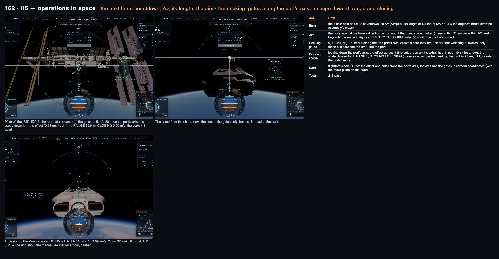
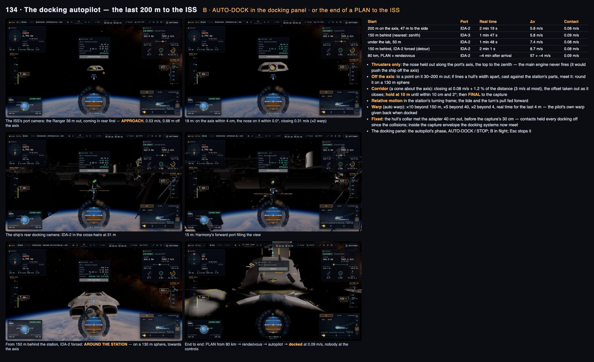
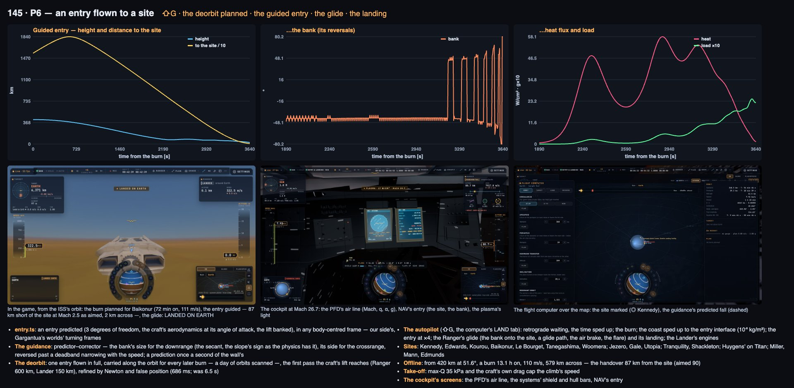
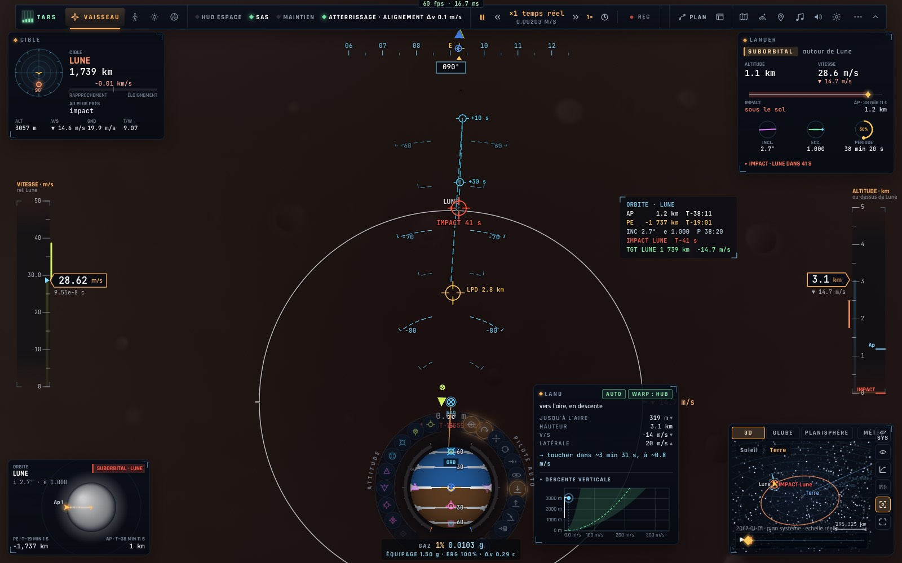

# Apprendre à piloter un vaisseau — le cours, puis la référence

Ce document apprend à piloter les vaisseaux du jeu — le **Ranger**, le **Lander** et l'**Endurance** — à un humain au
clavier comme à un LLM qui pilote par `__bh`. La **partie I** est un cours progressif : ce qui change dans le vide,
la lecture de la sphère d'attitude et du HUD, puis une leçon par manœuvre (tenir une attitude, monter et descendre
une orbite, circulariser, changer de plan, aller vers la Lune, le rendez-vous et l'amarrage, la rentrée et le plané,
l'atterrissage sous moteur, le décollage, l'Endurance, Gargantua, les pannes), chacune avec son but, ses gestes au
clavier, ses appels `__bh`, ses critères de réussite et ses erreurs. La **partie II** est la référence du code :
physique, commandes, autopilotes, systèmes et limites.

Version illustrée (schémas, captures du cockpit et du HUD) : [apprendre-vaisseaux.html](apprendre-vaisseaux.html).
Pour le joueur, le manuel complet : [VAISSEAUX.fr.md](VAISSEAUX.fr.md) ; la base de connaissances spatiale de TARS :
[spatial/](spatial/fr/orbits.md) ; le HUD : [HUD.md](HUD.md). Pour les avions : [VOL-AVIONS.md](VOL-AVIONS.md). Pour
les tests : [E2E-VOLS.md](E2E-VOLS.md).

*Rédigé le 6 novembre 2026 par lecture du code à `6d11d6b5` (aucun vol lancé pour l'écrire). Les chiffres des leçons
sont ceux de l'école spatiale du jeu (`src/game/spacecourse.ts`), des mesures citées par [VAISSEAUX.fr.md](VAISSEAUX.fr.md)
et des constantes du code ; « calcul » = déduit des constantes, non mesuré. Le code fait foi.*

---

# Partie I — Le cours

## Comment suivre ce cours

Chaque leçon a la même forme : **But**, **À comprendre**, **Au clavier** (codes physiques, noms QWERTY, AZERTY entre
parenthèses), **Par `__bh`**, **Réussi quand**, **Erreurs**. Les leçons suivent celles de l'école spatiale du jeu,
qu'on peut voler ensuite avec TARS (leçon 13).

**Pour un LLM**, la boucle « lire, agir, avancer, vérifier » :

```js
__bh.freeze(true);                                       // vous avancez la simulation vous-même
const c = __bh.camera, p = c.pilot, lire = () => {
  const s = __bh.game.status();
  return { statut: s.status, soi: s.soi, altKm: Math.round(s.altKm),
    peKm: s.orbit && Math.round(s.orbit.peKm), apKm: s.orbit && Math.round(s.orbit.apKm), incDeg: s.orbit && +s.orbit.incDeg.toFixed(1),
    vitesse: Math.round(s.speed), maintien: p.hold, auto: p.auto, manette: +p.throttle.toFixed(2),
    dvDepense: Math.round(c.spent * 299792458), panne: c.airFlight.failure };
};
for (let i = 0; i < 30 * 10; i++) __bh.step(1 / 30);    // 10 s
lire();
```

Deux règles qui évitent la moitié des échecs : **`setHold` et `setAuto` basculent** (pour enclencher à coup sûr :
`p.auto = "none"; p.setAuto("circularize")`), et **on attend l'état final** (`status().status === "orbit"`,
`c.docked`, `c.ourLanded`), pas `p.auto`, car les autopilotes s'enchaînent (circulariser devient « exécuter le
nœud » une image plus tard).

### Les conventions (à connaître avant la première leçon)

| Sujet | Convention |
|---|---|
| **Le temps et `step`** | `__bh.step(dt)` avance la scène de **dt × l'accélération** : à ×100, `step(1/30)` vaut 3,3 s de vol. Une demi-orbite basse (≈ 46 min) demande ≈ 830 pas à ×100. Page gelée, l'image continue d'être dessinée et `requestAnimationFrame` tourne : pour laisser répondre un worker (un plan), `await new Promise((r) => requestAnimationFrame(r))` entre deux paquets de pas. En pause (`animate` faux, après une perte), `step` ne fait plus voler : `__bh.game.pause(false)` |
| **L'accélération du temps** | `__bh.game.warp(x)` (un facteur) sert **hors autopilote**. Sous un autopilote avec `autoWarp` (défaut), l'autopilote **fixe** l'accélération à chaque image : un `warp` est remplacé (`c.setWarpAuthority(false)` rend la main au pilote, sous le plafond de l'autopilote). Touches : **,** plus lent · **.** plus vite · **/** temps réel (; : ! en AZERTY). Dans l'air : ×4 au plus. Lire l'accélération en cours : `__bh.settings.timeSpeed * 4.925490947e-6 * __bh.settings.massSolar` (le facteur, ×1 = temps réel) |
| **Le manche et le RCS par code** | `c.__input ??= c.pilotInput.bind(c); c.pilotInput = (pad) => ({ ...c.__input(pad), pitch, yaw, roll, tx, ty, tz, throttle })`, chaque champ dans [−1, 1] : `pitch` + nez haut, `yaw` + nez à droite, `roll` + à droite, `tx` + droite, `ty` + haut, `tz` + avant (le RCS), `throttle` un débit. Rendre le manche : `c.pilotInput = c.__input`. Le SAS : `p.sas = true/false` ; la récupération (⇧X) : `c.spaceRecoverStart()` (`c.recoverStart()` prend la voie du F-35 dès que l'appareil est dans l'air). Une rotation d'essai : `p.omega = [0.04, 0.06, 0.02]` (rad/s) |
| **Les touches de vol** | lues dans les vues de bord, **cockpit compris** ; ignorées dans la vue « cabine » (on s'y déplace) et la vue extérieure libre. **K** hors vol prend le vaisseau ; en vol c'est le RCS (haut). **⇧** maintenue seule (ou avec les touches de vol) est « plus de poussée », au bout de 0,1 s : la manette est un niveau, ce que ⇧ ajoute **reste** une fois la touche lâchée ; tenue pour un raccourci (⇧X, ⇧9, ⇧8, ⇧V…) elle ne touche plus la manette (depuis le 13 nov. 2026 : avant, chacun la poussait un peu, et ⇧V ou ⇧K à quai désamarrait) ; sous autopilote, la manette du pilote est ignorée. **⇧9** (translation) : W/S haut/bas, A/D gauche/droite, ⇧/Alt avant/arrière, Q/E roulent toujours |
| **Les hauteurs** | `orbit({ altKm })` : sur la sphère du rayon équatorial ; `status().altKm` : la Terre au-dessus de la mer ; `status().orbit.peKm/apKm` : géodésiques ; une orbite **circulaire** se lit dans `status().orbit.circular` = `{ km, swingKm }` (hauteur moyenne et son écart ; `null` si elle ne l'est pas) |
| **La position** | `__bh.sys.geodetic()` → `{ body, lat, lon, altM, radiusM }` (degrés ; notre côté) ; `__bh.fleet.pose(__bh.fleet.active, __bh.time()).X` (repère home, M) |
| **L'attitude** | `c.attitudeNow()` → `{ pitch, bank, heading }` en radians au-dessus du sol ; `p.omega` = `[x, y, z]` vitesses de rotation (rad/s) autour des axes du vaisseau (x gauche, y haut, z nez) : `Math.hypot(...p.omega)` |
| **Le moteur** | les scènes du jeu (Terre, `game:artemis`, `game:interstellar`) volent au **moteur Crew à 2 g** ; ailleurs le moteur « cinéma » (poussée fixe, sans réservoir) peut donner des accélérations énormes. La poussée suit la manette avec un retard (τ 0,4 s pour le Ranger) : après la coupure il reste ≈ a × τ de Δv (≈ 8 m/s à 2 g) — couper un peu avant, et lire le résultat quand `p.engineNow` < 0,01 |
| **Les sites** | « Kennedy Space Center, Shuttle Landing Facility », « Edwards Air Force Base », « Kourou – Cayenne-Félix-Éboué », « Baikonur, Yubileyniy », « Paris – Le Bourget », « Tanegashima – New Tanegashima Airport », « Woomera » ; Mars : « Jezero crater », « Gale crater », « Utopia Planitia » ; Lune : « Tranquility Base », « Shackleton crater's rim » ; Titan : « Huygens' landing site » ; les mondes de Gargantua. Un morceau du nom suffit **pour `glideTo`** (`glideTo("Kennedy")`) ; `c.entrySite` veut l'**objet** site : `c.entrySite = __bh.sys.runways().find((r) => /Kennedy/.test(r.site.name)).site` |
| **L'alignement** | le nez (repère home) : `c.activePoseNow().ax[2]` ; la vitesse : `n = __bh.sys.nav()`, `n.V − n.refVel` ; aligné = moins de 5° (le test de l'école). Les `flightInfo().dirs.*` sont en coordonnées caméra |

**Après une perte** (rupture, chaleur, crash) : en solo le jeu se met en **pause** et affiche l'écran de perte —
« **Reprendre avant la rentrée** » (l'instantané de la dernière seconde avant l'air épais, au-dessus de 1 km/s ; sinon
« **Reprendre N s plus tôt** » : un point gardé toutes les 10 s de vol stable dans l'air, le plus récent d'au moins 15 s ;
depuis le 13 nov. 2026, seulement le vol et l'appareil perdus — e2e `resume-point`), « **Continuer sans dégâts** » (le
réglage `damage` coupé), « **Recommencer la scène** ». Une sauvegarde rend aussi les consommables et pannes du vaisseau
(`fleet.systems`) et sa peau ; une mission, un défi ou une leçon en cours ne reprend pas (dit). Par code : un nouveau placement efface la panne (`c.airFlight.failure`) mais ne ferme ni
l'écran ni la pause : cliquer un de ses boutons (`document.querySelector(".craft-lost button").click()` depuis la
console). `__bh.game.pause(false)` sans nouveau placement repart dans l'épave, la panne toujours là.

## Leçon 0 — Monter à bord, choisir son aide

**Au clavier**
- **K** (ou, hors vol, Tab maintenu › **Piloter**) prend le Ranger ; **]** depuis le Ranger : le Lander, puis
  l'Endurance, puis le F-35 ; **[** depuis le Ranger : l'A320.
- **Placer le vaisseau** (la roue, hors vol) : une orbite, un sol, un site. Les scènes de la galerie mettent un
  vaisseau en situation (« Amarrage à l'ISS », « l'Endurance à 800 km »…).
- Réglages › Jeu › Engins spatiaux › **Assistance** : **Assisté** pour commencer (SAS toujours actif, dérive annulée
  près d'un vaisseau), **Réaliste** ensuite, **Manuel** pour l'expert (pas de SAS).
- **⇧X — Récupérer** : la rotation arrêtée ; au-dessus d'un sol, un stationnaire ; en orbite, prograde tenu.
  C'est le bouton « je suis perdu ».
- **⇧F4** : l'autopilote **vole**, ou il **assiste** — vous pilotez en suivant son directeur au HUD. Le meilleur moyen
  d'apprendre une manœuvre : la laisser voler une fois, puis la voler assisté.
- **V** : vue suivante (la vue cockpit montre les écrans tactiles du Ranger). **Espace** arrête le temps ; **Échap**
  ouvre le menu de pause. **F6** : TARS.

**Par `__bh`**

```js
__bh.game.preset("game:artemis");                 // une scène du jeu (le trou de ver y est : les placements marchent)
__bh.settings.vessel = "lander";                  // puis attendre __bh.fleet.active === "lander"
__bh.game.orbit("earth", { altKm: 400, inc: 51.6 });
__bh.settings.spaceAssist = "assisted";           // "manual" · "realistic" · "assisted" · "beginner"
```

## Leçon 1 — Dans le vide, rien ne freine

**À comprendre**
- **Pas d'air, pas de frottement.** Une rotation lancée continue ; une vitesse acquise reste. Le moteur ne fait pas
  « avancer » : il **change la vitesse** (le Δv, en m/s), dans la direction du nez.
- **Le SAS** (T) amortit les rotations et tient l'attitude quand le manche est lâché. Sans lui, le manche donne une
  accélération de rotation que seul un contre-manche arrête.
- **Le RCS** : des petits propulseurs qui **translatent** le vaisseau sans le tourner (I/K, J/L, H/N), à 8 % de la
  poussée principale ; **⇧9** fait des touches d'attitude des touches de translation (utile pour l'amarrage).
- **Le nez n'est pas la trajectoire** : on peut voler en marche arrière, de travers. Ce qui compte est la vitesse par
  rapport au corps de référence (la sphère d'influence où l'on est).
- **Les ordres de grandeur** (calcul, réglages du jeu) : le Ranger accélère à 2 g au plus pleins réservoirs, le Lander
  à 1,5 g, l'Endurance à 0,24 g. Le Δv embarqué est énorme (~0,29 c) : **les ergols ne limitent pas un vol dans le
  Système solaire** ; ce qui limite, c'est la structure (9 g, 6 g, 1,5 g), la chaleur et le temps.

**Au clavier** (leçon « L'attitude et le RCS » de l'école ; en **Réaliste** ou **Manuel** — en Assisté le SAS ne se
coupe pas) : T pour couper le SAS, une impulsion de roulis — la
rotation continue ; **⇧X** l'arrête. Tourner le nez de 90° (W/S, A/D, Q/E), puis **arrêter la rotation sous 0,5°/s**.
Puis **⇧9** (le RCS en translation : W/S deviennent haut et bas) et une poussée de 2 s vers le haut.

**Réussi quand** : la vitesse de rotation sous 0,5°/s (`p.omega`, rad/s) ; `p.fired` montre ce qui a poussé.

## Leçon 2 — Lire la sphère d'attitude et le HUD Espace


**La sphère d'attitude** (navball) montre le ciel autour du vaisseau : la moitié **bleue** est au-dessus de
l'horizon du corps de référence, la **brune** en dessous ; le **repère fixe** au centre est le nez. Les marqueurs :

| Marqueur | Couleur | Ce que c'est | Touche du maintien |
|---|---|---|---|
| **Prograde** | jaune | la direction de la vitesse (par rapport au corps de la sphère d'influence, ou à la cible en mode cible) | **1** |
| Rétrograde | jaune, barré | à l'opposé | **2** |
| **Radial extérieur / intérieur** | cyan | s'éloigner du corps / aller vers lui (près de Gargantua : le trou) | **3 / 4** |
| **Normal / anti-normal** | magenta (triangle) | perpendiculaire au plan de l'orbite | **5 / 6** |
| **Cible / dos à la cible** | orange | vers la cible choisie (Tab bref : cible suivante) | **7** / panneau |
| **Nœud** | — | la direction de la prochaine poussée planifiée | panneau (NODE) |

Un maintien pointe le nez sur son marqueur et l'y garde ; il est aligné à moins de 5°. **⌫ (Retour arrière)** lâche
tout (mission, maintien, autopilote).



**Le HUD Espace** (en cyan à droite du centre) : l'orbite autour du corps de la sphère d'influence — **apoapside (Ap)
et périapside (Pe)** avec leurs hauteurs et le temps pour y aller, l'inclinaison, l'excentricité, la période —, le
prochain événement (un impact en rouge), la distance et la vitesse de rapprochement de la cible ; la **prochaine
poussée** (compte à rebours, Δv, durée à pleine poussée, et un anneau autour du marqueur de nœud : vert à 2°, ambre à
10°). **⇧²** passe d'un HUD à l'autre (automatique, Atmosphère, Espace, Approche).

**Par `__bh`** : `__bh.game.status()` → `status` (`landed`, `flight`, `suborbital`, `orbit`, `escape`, `hyperbolic`…),
`soi`, `altKm` (la Terre : au-dessus de la mer), `speed` (par rapport au centre du corps), `orbit`
(`peKm`, `apKm`, `incDeg`, `ecc`, `period` [s], `tPe`, `tAp`), `target` (`distKm`, `rate`, approche minimale `caKm`
dans `caIn` s) ; `c.flightInfo()` (`hold`, `auto`, `dirs` : les directions des marqueurs) ; `__bh.game.pilotState()`
(une ligne : SAS, maintien, autopilote, manette).

## Leçon 3 — Monter et descendre une orbite

**À comprendre** — la règle d'or de la mécanique orbitale : **une poussée change l'orbite de l'autre côté**.
- Pousser **prograde** (plus vite) **élève le point opposé** de l'orbite : à la périapside, l'apoapside monte.
- Pousser **rétrograde** (plus lent) **abaisse le point opposé**.
- Pousser **radial** fait tourner l'orbite ; **normal**, changer son plan (leçon 5).
- Monter coûte de la vitesse : une orbite plus haute est plus lente.

**Au clavier** (leçon « Monter et descendre ») : en orbite basse, **1** (prograde), **Maj** maintenu (manette),
regarder **Ap** monter au HUD, **X** (couper) quand **Ap = 600 km** ; puis **2** (rétrograde), pousser jusqu'à
**Ap < 450 km**.

**Par `__bh`**

```js
__bh.game.orbit("earth", { altKm: 400 });                         // hauteurs sur la sphère du rayon équatorial
p.hold = "none"; p.setHold("prograde");
for (let i = 0; i < 30 * 20; i++) __bh.step(1 / 30);              // le nez sur le prograde
p.throttle = 1;
for (let i = 0; i < 30 * 600 && __bh.game.status().orbit.apKm < 600 - 28; i++) __bh.step(1 / 30);  // couper ~28 km avant
p.throttle = 0;
for (let i = 0; i < 30 * 5 && p.engineNow > 0.01; i++) __bh.step(1 / 30);       // la poussée retombe
__bh.game.status().orbit;                                          // apKm ≈ 600
```

**Réussi quand** : `orbit.apKm` à ±10 km de la consigne, lu une fois la poussée retombée (`p.engineNow < 0.01`).
**Erreurs** : pousser hors de l'axe (l'orbite tourne ou penche) ; oublier de couper (l'apoapside s'envole) ; couper
pile à la consigne (la poussée qui retombe ajoute encore ~8 m/s, ≈ 25–30 km d'apoapside en orbite basse).

## Leçon 4 — Circulariser et le transfert de Hohmann

**À comprendre** — le **transfert de Hohmann** est le moyen le plus économique de passer d'une orbite circulaire à
une autre : **une poussée prograde** pour élever l'apoapside à la hauteur voulue, **une demi-orbite** de croisière,
**une poussée prograde à l'apoapside** pour relever la périapside — l'orbite redevient circulaire.

**Au clavier** : **9** (circulariser) ou le bouton **CIRC** : l'autopilote planifie la poussée à la prochaine apside,
y vole (le temps accéléré jusqu'à elle) et ajuste l'orbite ; il a fini sous 0,2 m/s d'écart (« Circular: A × B km —
X m/s spent »). Le plan de la leçon de l'école : le transfert vers **800 km** volé par TARS, la circularisation à
l'apoapside par vous.

**Lire le résultat** : par `status().orbit.circular` (`km`, la hauteur moyenne ; `swingKm`, son écart) — mesuré en jeu
après CIRC à 51,6° d'inclinaison : `circular` = 587 km ± 1 km, alors que Pe et Ap (géodésiques) lisaient 588 et 608 km :
la Terre est aplatie, une orbite circulaire passe 21 km plus « haut » au-dessus des pôles qu'à l'équateur. Ne pas juger
une orbite circulaire par Ap − Pe.

**Par `__bh`** : `p.auto = "none"; p.setAuto("circularize")`, puis avancer (l'autopilote règle lui-même
l'accélération du temps jusqu'à la poussée ; un `game.warp` serait remplacé) jusqu'à ce que
`__bh.game.status().orbit.circular` ne soit plus `null` et que `p.auto === "none"`. `orbit.circular` donne la
hauteur moyenne et son écart.

**Erreurs** : attendre `p.auto === "circularize"` (il est devenu `"node"`) ; juger l'orbite trop tôt (la
correction finale vient après la poussée principale).

## Leçon 5 — Changer de plan

**À comprendre** : le plan d'une orbite ne se change qu'**à un nœud**, là où l'orbite croise le plan voulu, par une
poussée **normale** ou **anti-normale** (5 / 6). **Le signe** : au **nœud ascendant** (on passe l'équateur vers le
nord), une poussée **normale augmente** l'inclinaison, anti-normale la diminue ; au nœud descendant, c'est l'inverse.
L'inclinaison (`status().orbit.incDeg`) se mesure par rapport à l'**équateur de date** du corps (le Soleil : l'écliptique). C'est cher : Δv = 2 v sin(Δi / 2) — changer de 45° une orbite basse coûte
environ 0,77 fois sa vitesse orbitale (≈ 5,9 km/s à 400 km), plus qu'un aller vers la Lune.

**Au clavier** : **O** ouvre l'ordinateur de vol (sur la carte) › onglet **ORBIT** › Inclinaison : 45° ; **PLAN** puis
**EXÉCUTER** — il choisit le nœud **le plus éloigné du corps** (le moins cher), attend, se tourne, pousse. Ou à la
main : **5** (ou 6), et pousser au passage du nœud — le nœud ascendant est l'instant où `__bh.sys.geodetic().lat`
passe 0 vers le nord. Une orbite exactement équatoriale n'a pas de nœud défini.

**Par `__bh`** : `c.fcSetPlan(burns, note)` puis `c.fcExecute()` — `burns` : `{ t, dv: [prograde, normal, radial],
label }`, où `t` [s d'ici] est le **milieu** de la poussée et `dv` [m/s] est pris dans le repère orbital au nœud (il le
suit pendant la poussée) ; ou l'outil de TARS qui planifie et exécute :
`await __bh.tars.tools().find((x) => x.name === "plan_maneuver").run({ op: "inclination", incDeg: 61.6 }, new AbortController().signal)` ;
ou `orbit(…, { inc })` pour placer directement.

## Leçon 6 — Aller ailleurs : la Lune, les planètes

**À comprendre** : le vaisseau quitte la **sphère d'influence** (SOI) de la Terre pour celle de la Lune. Le plan :
une poussée de départ à l'instant où la Lune sera au rendez-vous, une croisière (accélérée), parfois des corrections,
une poussée de capture à l'arrivée. Mesuré (VAISSEAUX.fr.md) : depuis l'orbite basse, départ **3 089 m/s**
(2 min 38 s), capture **804 m/s** (41 s), **3 893 m/s** prévus.

**Au clavier** : **O** — l'onglet **MISSION** de l'ordinateur de vol : une destination (la Lune), l'arrivée (orbite,
survol, retour libre), la hauteur ; **PLAN**, puis **EXÉCUTER** (le même bouton est aussi sur le plan de mission).
**⇧O** : le plan de mission (chaque poussée, son échéance, son Δv, le budget et la marge). Le temps s'accélère avec **,** **.** **/** (; : ! en AZERTY) ; sous un
autopilote, c'est lui qui fixe l'accélération (`autoWarp`).

**Par `__bh`**

```js
await __bh.camera.missionPlan({ target: "moon", arrival: "orbit", altKm: 100 });  // le plan vient d'un worker
__bh.camera.missionCommit(); __bh.camera.fcExecute();
// avancer par paquets de pas, avec une image entre deux (le worker répond entre les images) ;
// réussi quand __bh.game.status().soi === "moon" && status === "orbit"
```

**Erreurs** : avancer tout le vol dans un seul appel synchrone (le worker ne répond pas dedans) ; changer la date
(`game.setDate`) après avoir planifié — le plan est abandonné.

## Leçon 7 — Le rendez-vous et l'amarrage

**À comprendre** — la mécanique orbitale de proximité est contre-intuitive : **pousser vers la cible fait monter,
et monter fait ralentir — on passe derrière**. Pour rattraper une cible devant soi sur la même orbite, on descend un
peu (orbite plus courte, plus rapide). D'où le rendez-vous planifié : un transfert, puis l'approche finale.

**Au clavier**
- **Se placer** : la leçon de l'école « Le rendez-vous » met l'ISS 20 km devant (`__bh.flight.school.space("rendezvous",
  "try")`) ; la scène « Earth: docking to the ISS » place le Ranger à 60 m de son port
  (`__bh.presets["Earth: docking to the ISS"].issDistance = 20000` avant le préréglage pour 20 km ; ou
  `__bh.iss.start(__bh.time(), 20000)` puis `__bh.game.placeAt({ frame: "ours", …, note })`).
- **Au-delà de 3 km**, `setAuto("dock")` refuse : `__bh.game.target("iss"); c.rendezvousStart()` planifie tout le
  rendez-vous (puis `node` → `dock`). Le port visé : le plus proche à l'enclenchement (IDA-2 pour le rendez-vous).
- **Avant le contact**, `c.dockInfo` donne `range`, `along`, `lateral`, `closing`, `angle`, `spin` (de port à port) ;
  `status().target.distKm` est de centre à centre et `rate` est positif quand on s'éloigne.
- **Le couloir** : sur l'axe à 15 % près (0,5 m près du port), ports à moins de 15°, moins de 0,5 m/s ; hors du couloir,
  au double de la limite de rapprochement, la protection enclenche le maintien à poste (autour de tout vaisseau aussi).
- **Les ports** : celui du Ranger est son **sas arrière** (axe −z : on s'amarre en marche arrière), celui du Lander son
  sas dorsal, l'Endurance a ses deux moyeux ; l'ISS, IDA-2 (Harmony avant) et IDA-3 (zénith).
- **Tab** (bref) : choisir la cible (l'ISS, un vaisseau). **B** : à moins de **3 km**, l'autopilote d'amarrage ;
  au-delà, **tout le rendez-vous** planifié et volé, puis l'amarrage.
- L'approche s'arrête aux points d'attente : **WP1 à 220 m** (30 s, « feu vert pour l'approche »), **WP2 à 20 m**
  (20 s, « feu vert pour la capture »), puis l'attente alignée à **10 m**, puis la capture.
- **À la main** (leçon « L'amarrage à la main ») : le **COAS** — une croix sur l'axe de notre port, le port visé un
  cercle, vert sous 1° — ; **⇧9** (RCS en translation) ; aligner, annuler la dérive, s'approcher à **0,1 m/s**.
- **⇧8 — maintien à poste** : tenu immobile par rapport à la cible (à moins de 5 km).



**Capture** si, au contact : écart latéral **< 0,3 m**, angle entre les ports **< 10°**, vitesse relative
**< 0,5 m/s**, rotation relative **< 3°/s**. Sinon le vaisseau **rebondit** et le message nomme le terme fautif
(« Bounced off …'s port · 0.62 m/s — 0.5 at most »). Sphère d'exclusion autour de l'ISS : 200 m, à n'y entrer que
par le couloir d'amarrage.

**Par `__bh`**

```js
__bh.setDate(Date.UTC(2026, 9, 1, 12)); __bh.game.preset("Earth: docking to the ISS");
const c = __bh.camera; __bh.freeze(true);
c.pilot.auto = "none"; c.pilot.setAuto("dock");
for (let i = 0; i < 30 * 600 && !c.docked; i++) __bh.step(1 / 30);
c.docked;                                   // true ; c.undock() pour repartir (5 cm/s)
```

**Erreurs** : manette ou RCS touchés amarré — cela **désamarre** ; s'approcher trop vite dans les 20 derniers mètres
(le HUD passe au rouge) ; viser la station plutôt que l'axe du port.

## Leçon 8 — Rentrer dans l'atmosphère et se poser en planant (Ranger)

**À comprendre**
- Pour revenir, on **abaisse la périapside dans l'air** par une poussée rétrograde (sous **60 km** pour la Terre),
  puis l'air freine. **Bouclier d'abord, nez haut** (40° d'incidence pour le Ranger) : le plasma devant.
- Le **couloir de rentrée** : trop raide, la charge et la chaleur dépassent les limites (bouclier 1 950 K, 9 g) ;
  trop plat, le vaisseau rebondit. Le guidage règle l'**inclinaison** pour viser le site (toutes les 2 s simulées) et
  garde la charge sous 2,4 g.
- Sous Mach 2,5, le Ranger est un **planeur** (finesse ~6) qui se pose comme la navette : une **pente raide de 12,6°**
  (jusqu'à 19° s'il arrive haut) à **160 m/s**, vers un point de visée **≈ 3 km avant le seuil** ; une ressource vers
  **90 m** sur une pente de **1,5°** à 130 m/s ; l'arrondi à **12 m** ; le toucher **450 m après le seuil** ; hauteur
  de décision 60 m (deux remises de gaz automatiques au plus). Dans l'air, le temps ne s'accélère pas au-delà de ×4.

**Au clavier**
- **⇧G** — Rentrée et atterrissage : la désorbitation vers le site choisi (onglet **ATTERRIR** de l'ordinateur de
  vol), l'attente, la poussée, la rentrée guidée, le plané et l'atterrissage, en une touche. **Z** (plein gaz) remet
  les gaz en approche.
- À la main (leçon « Le plané et la piste ») : **⌫** relâche l'autopilote de rentrée (ou **⇧F4** pour le voler
  assisté, en suivant son directeur) ; le Ranger vole **déjà en mode avion** (lâché, il tient sa pente ; **F** passerait
  au mode « ordinateur de vol ») ; le vecteur vitesse sur le point de visée (le losange du HUD Approche), **G** — le train sorti
  **avant 500 m** —, arrondi à **14 m**, toucher **sous 3 m/s** ; manette à 0 sur les roues = freins.



**Par `__bh`** : `__bh.game.glideTo("Edwards")` (80 km avant, 25 km de haut, 750 m/s, l'autopilote de rentrée
engagé : le départ le plus fiable) ; depuis l'orbite, `orbit(…)`, puis `p.auto = "none"; p.setAuto("entry")` (le site
le plus proche du plan de l'orbite, ou `c.entrySite` s'il est posé), et attendre que `c.entryRun.phase` passe de
`"plan"` à `"wait"` (le plan vient d'un worker, entre deux images). Le journal donne le
toucher : « Touchdown … · X m/s down ».

**Réussi quand** (le dernier toucher : `c.lastTouch` → `sink`, `gear`) : `c.ourLanded`, `c.airFlight.failure === null`, taux de chute < 3 m/s, arrêt dans l'axe
(`c.runwayView().across` < 10 m).

**Erreurs** : partir trop près ou trop bas (sous énergie : remise de gaz) — l'autopilote de rentrée **ne remet jamais
de poussée** pendant le plané ; le train oublié ; l'Endurance (pas de bouclier : elle brûle).

## Leçon 9 — Se poser sous moteur sur la Lune (Lander)

**À comprendre** — sans air, on freine au moteur jusqu'au sol. La descente : une croisière, une **poussée
d'orbite de descente** si la périapside passe trop haut, le **freinage**, un **stationnaire** au-dessus du point,
le **toucher à 0,8 m/s**. Le panneau DESCENTE du Lander compte les **secondes de stationnaire** qui restent (ambre
sous 60 s, rouge sous 30 s : « posez-vous ou interrompez »).



**Au clavier**
- **8** : stationnaire (maintien de position). **F7** : descente et atterrissage. Sous **5 km**, le **LPD** : W/S
  (Z/S) avance / recule le point visé, A/D (Q/D) le décale à gauche / à droite (une croix dans un cercle au sol, ambre
  une fois déplacé) ; « avant » = le sens de la vitesse horizontale (sinon le cap) ; portée ≤ max(250 m, la hauteur).
  Par code, après un pas sous `land` : `c.lpdOrder = { fwd: 300, right: 0 }` (mètres) ; `c.landRun.moved`.
- À la main : la vitesse verticale au **taux de chute** du HUD (Approche, sous 5 km), la vitesse latérale annulée
  (la portée de dérive), toucher sous 3 m/s.

**Par `__bh`**

```js
__bh.settings.vessel = "lander";                        // attendre __bh.fleet.active === "lander"
__bh.game.hoverOver("moon", 0.674, 23.473, 1.5);        // 1,5 km au-dessus de Tranquillité, stationnaire engagé
const c = __bh.camera; __bh.freeze(true);
c.pilot.auto = "none"; c.pilot.setAuto("land");
for (let i = 0; i < 30 * 300 && !c.ourLanded && !c.airFlight.failure; i++) __bh.step(1 / 30);
```

**Verdict au toucher** (réglage `crashSpeed` = 4,5 m/s) : ≤ 3 m/s posé, ≤ 4,5 m/s dur, au-delà écrasé ; le Lander
bascule au-delà d'environ 44° d'inclinaison (calcul).

**Erreurs** : `hoverOver` remplit les réservoirs (un vaisseau lourd peut manquer de poussée : « the engine … cannot
hold the weight ») ; hors autopilote, descendre plus vite que 80 % de la vitesse de crash déclenche la protection du
sol (armée en Assisté, Débutant, et en Réaliste par défaut), qui remet en stationnaire.

## Leçon 10 — Décoller vers l'orbite

**À comprendre** : on monte d'abord à la verticale pour sortir de l'air épais, puis on **bascule** progressivement
vers l'horizon (le *virage gravitationnel*) pour prendre la vitesse orbitale (~7,7 km/s sur Terre, ~1,6 km/s sur la
Lune). Mesuré (VAISSEAUX.fr.md) : de Tranquillité vers 100 km, 2 042 m/s pour un minimum théorique de 1 718.

**Au clavier** : **U** — sans objectif, la montée vise **3 % du rayon hors de l'air** (≈ **52 km** sur la Lune, rayon
1 737 km) ; l'onglet LAUNCH de l'ordinateur de vol propose 200 km ; 100 km est l'objectif de la leçon de l'école.
Par code : `c.launchGoal = { altKm: 100, incDeg: null }` **avant** `setAuto("takeoff")` — il reste d'un vol à l'autre.
Puis la bascule et la circularisation.
Sur une piste avec de l'air, le Ranger roule, se cabre à 110 m/s et monte. Le compte rendu donne une note sur 20
(le rendement : 20/20 dès 85 %).

**Le Lander posé décolle à la verticale** : sur ses jambes, il monte d'abord sur sa poussée vectorée, à plat sur son
cap (comme en stationnaire), à 4 m/s puis plus vite avec la hauteur (40 m/s au plus) ; à **200 m**, la loi de montée
prend la main — le nez bascule vers la poussée en quelques secondes, puis la montée et la bascule comme ailleurs. Jusqu'au
11 novembre 2026, il restait posé, poussée nulle (la loi voulait d'abord tourner le nez, ce qu'un appareil posé ne fait
pas). Vérifié en jeu le 11 novembre (e2e `apprendre-vaisseaux`, leçon 10) : le Lander comme le Ranger, de Tranquillité,
atteignent l'orbite de 100 km.

**Par `__bh`** (le Lander ou le Ranger) : `__bh.game.land("moon", 0.674, 23.473)` ; `c.launchGoal = { altKm: 100, incDeg: null }` ;
`p.auto = "none"; p.setAuto("takeoff")` ; réussi quand `status().status === "orbit"` et `orbit.circular.km` ≈ 100 (le
test de l'école : périapside > 80 km) — le décollage devient `circularize` puis souvent `node`.

## Leçon 11 — L'Endurance, l'anneau, Gargantua

- **L'Endurance** (900 t, 0,24 g, 1,5 g de limite) ne se pose pas, ne rentre pas, tourne lentement. **⇧[ ⇧]**
  changent la rotation de l'anneau (1 g ≈ 5,5 tr/min) ; **B** s'amarre à elle même en vrille (leçon de l'école :
  « It is not possible. — No, it is necessary. »).
- **Près de Gargantua** : le temps du vaisseau ralentit (dτ/dt au HUD, l'horloge de la Terre qui prend de l'avance) ;
  près de Miller, une heure à bord vaut sept ans sur Terre — chaque poussée se paie en années. **0** (approche),
  **⇧0** (orbiter la cible), et l'ordinateur de vol (O) pour les poussées autour des mondes.
- **Le trou de ver** : `__bh.game.wormhole("ours")` place devant la bouche ; dans la gorge, aucun autopilote ne vole.

## Leçon 12 — Les pannes

Réglages › Jeu › Engins spatiaux › **Pannes** (aucune par défaut). Une panne allume l'**alarme principale** (Entrée
l'acquitte) et sa **checklist** (page CKL des écrans, ou M › Systèmes). Les pannes : moteur éteint (relance : une
chance sur trois de rester à 50 %), propulseur RCS bloqué (isoler le quad), gyroscope, court-circuit, fuite d'O₂,
épurateur ; batterie à plat : plus de RCS. La leçon « Les urgences » de l'école en fait voler deux.

## Leçon 13 — S'entraîner avec l'école spatiale

Tab maintenu › École et défis › **École de vol** : **quinze leçons**, chacune avec sa mise en place : 1 l'attitude et
le RCS · 2 les maintiens et le SAS · 3 monter et descendre · 4 circulariser et Hohmann · 5 le changement de plan ·
6 le rendez-vous · 7 l'amarrage à la main · 8 la désorbitation et la rentrée · 9 le plané et la piste (Ranger) ·
10 la descente lunaire avec le LPD (Lander) · 11 le décollage et l'ascension · 12 l'amarrage à l'Endurance en vrille ·
13 l'assistance gravitationnelle · 14 voler près de Gargantua · 15 les urgences. Modes **Guidé** (TARS vole ses étapes
puis vous laisse les vôtres), **Démonstration** (TARS vole tout), **Essai** (vous seul) ; une étape est réussie quand
ce qu'elle demande tient un instant, et une note sur 20 conclut.

**Par `__bh`** : `__bh.flight.school.space(id, mode)` — id `"attitude"`, `"holds"`, `"orbit-basics"`, `"hohmann"`,
`"plane"`, `"rendezvous"`, `"docking"`, `"entry"`, `"glide"`, `"lunar-descent"`, `"ascent"`, `"endurance-dock"`,
`"slingshot"`, `"relativity"`, `"emergencies"` ; mode `"guided"`, `"demo"`, `"try"` ; pour suivre l'étape :
`__bh.camera.spaceCourse` (`step`, `stepT`, `results`, `done`) — `__bh.flight.school.state()` est l'école des avions.

**Progression conseillée** : leçon 1 en Réaliste (pour sentir le vide sans SAS), puis Assisté pour les leçons 2 à 6 ;
l'école 1 à 4 en Essai ; le rendez-vous et l'amarrage (B
d'abord, puis à la main) ; la rentrée (⇧G, puis assistée avec ⇧F4) ; la Lune avec le Lander ; Réaliste ; l'Endurance
et Gargantua.

## Vérifié en jeu

Les recettes de ce cours ont été volées telles quelles par l'e2e `tests/e2e/apprendre-vaisseaux.e2e.test.ts`
(6 novembre 2026, kerr-mini, plein écran ; captures dans [apprendre-vaisseaux.html](apprendre-vaisseaux.html) et
`progress/apprendre/`) — 8 sur 8 :

| Leçon | Résultat mesuré |
|---|---|
| 1–2 — rotation arrêtée, rétrograde tenu | 0,075 → 0,001 rad/s par `spaceRecoverStart()` ; rétrograde à 0,0° |
| 3 — l'apoapside à 600 km | coupée 28 km avant : 600 km |
| 4 — CIRC | terminé de lui-même ; `orbit.circular` 587 ± 1 km (Pe/Ap géodésiques : 588/608) |
| 5 — changement de plan de +10° (`plan_maneuver`) | 51,60° → 61,60°, 1 336,7 m/s (2 v sin 5°) |
| 7 — amarrage à l'ISS | capturé à IDA-2, 0,08 m/s |
| 8 — rentrée et plané du Ranger | posé à Edwards, 0,2 m/s |
| 9 — le Lander à Tranquillité, LPD +300 m | posé à 0,8 m/s, à 300,2 m du site |
| 10 — décollage lunaire (Lander posé, puis Ranger) | Lander : +10 m en 3 s, orbite 100,0 ± 0,04 km (Pe 100,1 / Ap 101,0, note 20/20) ; Ranger : 100,0 ± 0,04 km (11 nov. 2026) |

Non vérifiés en jeu : l'aller vers la Lune planifié, l'amarrage à la main, la finale à la main, l'Endurance et
Gargantua, les pannes.

---

# Partie II — La référence

## 1. Les appareils

`VesselId = "ranger" | "lander" | "endurance" | "f35" | "a320"` (`src/vessels.ts`). `SPACECRAFT` = les trois premiers,
toujours quelque part dans la flotte ; `isAircraft` = les deux derniers, posés sur une piste quand on les choisit ;
`isPlane` = le Ranger et les avions (loi avion par défaut, piste). Spécifications : `VesselDef` (`vessels.ts`).

| | Ranger | Lander | Endurance |
|---|---|---|---|
| Masse pleine (ergols compris) | 40 t | 160 t | 900 t |
| Part de la poussée « Crew » à pleins réservoirs (`accel`) | 1 | 0,75 | 0,12 |
| Poussée niveau de la mer / vide (`slThrust`) | 0,9 | 0,85 | 0,4 |
| Retard de la manette (`spool`, τ) | 0,4 s | 0,3 s | 1,5 s |
| Agilité (× réglages de rotation du Ranger) | 1 | 0,55 | 0,2 |
| Moteurs / tuyères RCS dessinés | 2 / 20 | 6 / 16 | 4 / 16 |
| Port d'amarrage | sas arrière (axe −z) | sas dorsal (+y) | moyeu avant (+z) et arrière (−z) |
| Train (`lands`) | tricycle + patins de ventre | quatre pieds | aucun |
| Vole dans l'air (`flies`) | oui | oui (pas `isPlane`) | non (toujours « rocket ») |
| Bouclier thermique | ventre et nez, **1 950 K** | tout le ventre, **2 300 K** | aucun |
| Coque | 1 150 K | 1 000 K | 700 K |
| Pression d'écrasement (`pMax`) | 150 bar | 140 bar | 3 bar |
| **Limite structurale (`gMax`)** | **9 g** | **6 g** | **1,5 g** |
| Aile | 91 m², allongement 2, finesse ≈ 6 en plané | 304 m², allongement 1 | aucune |
| Particularités | — | panneau « descent » | anneau de 30 m (max 10 tr/min ; 1 g ≈ 5,5 tr/min) |

Train (`src/gear.ts`) : Ranger — hauteur 1,8 m, roue avant directrice (z 6,5 m), deux principales freinées (x ±4 m),
ζ 0,6, μ 0,8, freinage 0,45 ; patins de ventre quand `gearExt < 1`. Lander — quatre pieds (±4,2 ; −6,15 ; ±4,2 m), course
0,5 m, hauteur 6 m, pas de ventre (toujours sur ses pieds). Sortie ou rentrée : **8 s**.

Départ de la flotte (`src/fleet.ts` `fleetStart`) : l'Endurance en orbite circulaire à 800 km, 40° derrière l'ISS dans
son plan ; le Lander à 500 km, 25° devant ; le Ranger amarré au port avant de l'Endurance. L'ISS a deux ports
(IDA-2 Harmony avant, IDA-3 Harmony zénith).

### 1.1 Moteur et ergols

| Réglage | Valeurs | Défaut | Scènes du jeu (Terre, Système solaire) |
|---|---|---|---|
| `engine` | `"cinema"` (poussée fixe, pas de réservoir) ou `"crew"` | `"cinema"` | `"crew"`, `crewG: 2` |
| `thrust` | c²/M | 0,02 | — |
| `crewG` | g | 1 | 2 |
| `exhaust` (vitesse d'éjection) | c | 0,1 | — |
| `massRatio` (m₀/m_sec) | | 20 | — |
| `spaceInfinitePropellant` | booléen | false | — |

- Accélération maximale (`thrustMax`, `controller/plan.ts`) = poussée du réglage × `accel` × masse pleine × facteur de
  pression × facteur des pannes ÷ **masse de l'assemblage amarré** ; **plafonnée à 0,85 × gMax** avec le moteur Crew ;
  0 réservoir vide.
- Facteur de pression : `max(0, 1 − (1 − slThrust)·p/101 325)` (l'Isp baisse d'autant ; en l'air une même poussée coûte
  plus).
- Ergols : fusée relativiste — budget de rapidité `vₑ ln R₀`, chaque poussée dépense `∫a dτ`, `m/m₀ = e^{−w/vₑ}`.
  Modèle de réservoir commun à la scène, dépense propre à chaque appareil (`fleet.spent[id]`, `camera.spent` en c).
- **Calcul**, aux défauts (vₑ 0,1 c, R₀ 20, Crew 2 g) : Ranger 2 t à sec / 38 t d'ergols, 2 g dans le vide (rapport
  poussée/poids au sol terrestre ≈ 1,8) ; Lander 1,5 g (≈ 1,28) ; Endurance 0,24 g (≈ 0,1 : ne tient nulle part en
  stationnaire au-dessus de 0,24 g). Δv disponible ≈ 0,29 c : **les ergols ne limitent pas un vol dans le Système
  solaire** ; l'accélération monte jusqu'à 20× en vidant le réservoir, jusqu'au plafond.

### 1.2 Rotation et RCS

- Réglages : `turnRate` 43°/s, `turnAccel` 92°/s², `rcsFraction` 0,08 de la poussée principale.
- Par appareil, chaque image : couple `agility·m·rg²·turnAccel` divisé par l'inertie du moment ; un assemblage amarré
  tourne moins vite. **Calcul** : Ranger 92°/s² et 43°/s, Lander ≈ 51°/s², Endurance ≈ 18°/s² et ≈ 27°/s.
- La physique ne fait pas tirer chaque tuyère : le RCS est une force (une fraction de la poussée) ; les tuyères ne
  servent qu'au dessin.

---

## 2. La physique

### 2.1 Le vaisseau est la caméra

L'état de l'appareil piloté est **la pose de la caméra dans `Settings`** (`src/camera.ts` : `setHolePose`,
`setHomePose`) : position du centre de l'appareil, orientation de la caméra, 3-vitesse. Les axes du vaisseau s'en
déduisent par la monture (`shipToCamera(mount, lookYaw, lookPitch)`). Une monture ne change que l'œil et la visée,
jamais la trajectoire. Lire l'attitude par `camera.attitudeNow()`, pas par `settings.yaw/pitch` (angles de caméra).
Le spectateur (`__bh.spectate(true)`) fait tourner un second contrôleur : le vaisseau continue avec ses maintiens.

### 2.2 Trois régions, trois intégrateurs

| Région | Quand | Intégrateur | Gravité |
|---|---|---|---|
| **Repère du trou (Kerr)** | près de Gargantua | Dormand–Prince 5(4) adaptatif en temps propre (tol. 1e-8, ≤ 20 000 pas par appel) ; poussée en impulsion après chaque pas | métrique de Kerr exacte + champs faibles de l'étoile et des planètes (frondes) |
| **Repère d'une planète de Gargantua** (Miller, Mann, Edmunds) | sous 0,5 rayon de Hill (sortie à 0,6) ou posé | `stepLocal` : repère au repos de la planète, marée et Coriolis de Gargantua linéarisées, traînée exponentielle, contact ponctuel | planète exacte + primaire linéarisée |
| **Gorge du trou de ver** (métrique Dneg) | dans la sphère de recollement, et à 12 rayons de gorge de la bouche de notre côté | géodésiques droites, la poussée change γβ | aucune de la gorge ; Soleil et planètes de notre côté |
| **Repère de notre Système solaire** (« home », cartésien, origine à notre bouche) | ailleurs de notre côté | **Yoshida d'ordre 4** dans le vide à plus de 100 km de tout sol ; **saute-mouton** dans l'air ou sous 100 km ; **sur rails** en croisière stable ; vitesse bornée à 0,999 c | n corps newtoniens des éphémérides, termes zonaux J2–J4 ; traînée de la thermosphère |

Pas du repère home (`motion.ts` `stepOf`) : vide `0,025·tDyn` ; air `0,01·tDyn` ; près d'un sol solide ≈ 0,1 s ;
avec aérodynamique ≤ `0,05/aAir` ; **train à moins de 12 m du sol : 4 ms**. Budget de sous-pas par image :
`round(400 × clamp(dt·60, 1, 6))` ; épuisé, l'horloge du vaisseau prend du retard et la scène la suit.

Rails : moteur coupé, orbite stable (liée, périgée > 1,01 R + haut de l'air, apogée < 0,25 SOI), image > 2 % de
période → l'état est celui de **l'orbite moyenne avec la dérive séculaire de J2** (≈ 10 m par tour en orbite basse ;
pas un Kepler exact).

Au sol ou sur un pont, l'appareil est porté en coordonnées liées au corps (`camera.ourLanded = { body, q, h?, deck? }`) ;
il décolle quand la poussée verticale dépasse `g·dt·1,001`, roule quand la poussée le long du sol dépasse 2 % de g.

### 2.3 Unités

- 1 M = **1,476625e11 m** (`M_METRES`) = **492,5490947 s** (`M_SECONDS`) ; vitesses en c (299 792 458 m/s) ;
  accélérations en c²/M. Les scènes du Système solaire imposent `massSolar = 1e8`.
- `__bh.game.*` : km, degrés, m/s ; `status()` en km et m/s ; `camera.spent` en c (× `C_MPS` → m/s).
- Précision float64 dans le repère home : ≈ 3 cm près de la Terre.

### 2.4 Sphères d'influence

`referenceBody(X, t)` = la plus petite SOI contenant le point, `r_SOI = a·(m/M_parent)^0,4` (le Soleil : tout). Elle
sert de référence aux directions prograde/radiale/normale, à `status()`, à l'air, au sol. L'air d'une géante compte sous
1,5 × le haut de son air. Côté Gargantua : sphères de Hill. Les autopilotes et `status()` changent de référence d'un
coup à la frontière d'une SOI.

### 2.5 Temps, dilatation, accélération

- `sim.time` [M] (temps-coordonnée, multiplié par `timeSpeed` [M/s]) et `sim.play` [s] (flammes, vagues). En pause
  (`animate = false`) aucun ne bouge et `flyShip` rend la main aussitôt. L'horloge de la scène suit l'horloge du
  vaisseau quand il est piloté.
- Temps propre : intégrateur de Kerr près du trou ; `dt·√(1−v²)` dans le repère home (relativité restreinte seule :
  pas de décalage gravitationnel solaire) ; `dt` posé. « τ/t » affiché = α/γ près du trou, 1/γ ailleurs.
- `warpFactor = timeSpeed × secondsPerM` ; `__bh.game.warp(x)` prend un facteur, **`camera.requestWarp(speed)` prend
  des M/s**.
- **Plafonds recalculés à chaque image** (le minimum ; le souhait du pilote mémorisé et rendu ensuite) :
  1. rails (`plan.ts` `railsLimit`) : un tour de l'orbite la plus serrée en ≥ 0,6·2π·tDyn ; près d'un sol, une image
     couvre ≤ ⅙ de la hauteur ; sous `land` en descente `0,04·h/|vv|` ; moteur allumé 5 000 M/s (Crew) ; approche d'une
     sphère de Hill ou du trou de ver : ≤ ⅓ de l'écart par image ;
  2. **dans l'air : ×4** (`AIR_WARP`, message « In the air: the time warp held at ×4 ») ;
  3. les plafonds des autopilotes (§4.4).
- Une touche d'accélération n'est **refusée** que si un autopilote ou un nœud tient l'accélération sous `autoWarp`
  (« Warp managed by the hub… ») ; sinon elle est acceptée puis plafonnée sans rien dire.

### 2.6 De la poussée au mouvement

`pilotInput` (clavier, manette, HOTAS) → `FlightComputer.step` (`src/pilot.ts`) → une rotation appliquée à la caméra
et une accélération propre (moteur selon le nez × `engineNow × thrust`, plus le RCS) → `fall()` l'intègre → dépense
`w = |acc|·Δτ`. `engineNow` suit la manette avec τ = `spool` (moteur Crew seulement ; Cinema répond aussitôt).

---

## 3. Les commandes

### 3.1 Entrer en vol

`settings.ship = true` → `setPilot(true)` : gravité, `motion = "geodesic"`, **maintien et autopilote coupés, manette 0,
rotations 0, plan effacé**. Chaque placement de `__bh.game` appelle `setPilot(true)` puis `newFlight()` (réservoirs
pleins, états d'entrée, d'amarrage et d'accélération effacés) ; `pilot.newFlight()` garde SAS, alignement de roulis et
précision. F1–F4 : vaisseau, à pied, caméra libre, photo.

### 3.2 Clavier (par code physique ; AZERTY entre parenthèses)

| Action | Touche |
|---|---|
| Tangage **piqué** / cabré | W / S (Z / S) — W pique, à la KSP |
| Lacet | A / D (Q / D) |
| Roulis | Q / E (A / E) |
| RCS bas / haut, gauche / droite, avant / arrière | I / K, J / L, H / N |
| Manette + / − (maintenue, en débit) | Maj ou ↑ / Alt ou ↓ |
| Plein gaz / coupé | Z / X (W / X) |
| Récupération (arrêter la rotation, stationnaire au-dessus d'un sol, prograde en orbite) | ⇧X |
| Précision (rotations et RCS ×0,25, manette 0,15/s) | Verr. Maj |
| SAS · alignement de roulis | T · R |
| Maintiens : prograde, rétro, radial+, radial−, normal, anti-normal, cible | 1…7 (& é " ' ( - è) |
| Autopilotes : stationnaire, circulariser, approche, orbite, atterrir, décoller, amarrer | 8, 9, 0, ⇧0, **F7**, U, B |
| Maintien de station · mode RCS translation | ⇧8 · ⇧9 |
| Entrée et atterrissage | **⇧G** |
| Train | G |
| Anneau de l'Endurance −1/+1 tr/min | ⇧[ / ⇧] |
| Appareil précédent / suivant | [ / ] |
| Mode de vol dans l'air (rocket ↔ plane ↔ sf) · antigravité | F · ⇧F |
| Volets · aérofrein | P · ⇧P |
| Autopilote assisté (le pilote suit la consigne) | **⇧F4** |
| **Tout relâcher** (mission, maintien, autopilote) | **Retour arrière** (Échap ouvre le menu pause) |
| Pause · échelle d'accélération · temps réel | Espace · , . · / |

La manette au clavier est un **débit** (0,6/s, 0,15/s en précision), appliqué seulement si aucun autopilote ne vole (ou
en assisté). Les réglages de manette de l'interface (levier tactile, hub) **terminent** l'autopilote. Une manette HOTAS
est absolue mais « reprise » comme un fader : elle ne prend la main qu'en croisant la valeur courante. Les touches sont
ignorées dans la vue extérieure libre, la vue cabine, et avec un spectateur.

Manette de jeu (`src/input/spacepad.ts`) : stick gauche tangage et lacet, LB/RB roulis, RT/LT manette, A SAS, X/Y
prograde/rétrograde, B couper.

### 3.3 Loi de rotation

Commande en vitesse avec SAS (stick lâché : vitesse 0) ; SAS coupé : le stick est une accélération angulaire, la
vitesse est gardée. Accélération par axe limitée par `couple/inertie` (+ gouvernes dans l'air). Pointage d'un maintien
ou d'un autopilote : vitesse `min(turnRate, √(2·0,7·turnAccel·θ), 3θ)`. Près du trou, axes transportés de Fermi–Walker
le long de la géodésique (`gyroscopes`). Attitude « sur rails » (posée cinématiquement) quand une image dure plus de
20 s de temps du vaisseau sous autopilote.

### 3.4 Modes de vol dans l'air

`settings.flightMode` : `"rocket"`, `"plane"` (défaut), `"sf"` ; ne s'applique qu'aux appareils `flies` (Ranger,
Lander). Changer d'appareil met `flightMode = isPlane(id) ? "plane" : "rocket"` (le Lander passe en `rocket`). Chaque appareil garde son
train, ses volets, ses freins, son aérofrein et son STOVL pendant qu'un autre vole (`fleet.config`, depuis le 13 nov. 2026 — audit FX-14 :
avant, le Ranger arrivait en orbite avec le train et les volets du F-35, et le F-35 retrouvé sur sa piste avait le train rentré) ; un appareil
jamais piloté a son train décidé par sa hauteur.

| Mode | Comportement | Condition |
|---|---|---|
| rocket | comme dans l'espace | toujours |
| plane | le stick demande des vitesses (tangage 20°/s, lacet 8°/s, roulis 70°/s) ; lâché, pente et inclinaison tenues, décrochage évité, incidence tenue au-dessus de Mach 4 | `q > 300 Pa`, sans maintien ni autopilote |
| sf | « ordinateur de vol » : manette = vitesse, tangage = pente, lacet = cap, roulis = glissade ; poussée dans toutes les directions ; sous 80 m descente ≤ max(0,8 ; 0,25·h) m/s ; avec ⇧F l'antigravité ne coûte rien | sans maintien ni autopilote |

### 3.5 Niveaux d'assistance

`settings.spaceAssist` : `manual` (loi directe, sans SAS), `realistic` (défaut : SAS du pilote), `assisted` (SAS forcé,
dérive tenue à 1 km d'un appareil), `beginner` (comme assisté, vitesses ×0,5, 2 km). Indépendamment, `pilot.assist`
(⇧F4) transforme chaque autopilote en consigne (`pilot.director`) que le pilote suit.

---

## 4. Maintiens et autopilotes

### 4.1 La mécanique commune

- Deux énumérations du `FlightComputer` : `Hold` = `none | prograde | retrograde | radialOut | radialIn | normal |
  antinormal | target | antiTarget | maneuver` ; `Auto` = `none | hover | circularize | approach | orbit | node |
  transfer | land | takeoff | dock | entry | burns | keep`.
- **`setHold(h)` et `setAuto(a)` basculent** : la valeur courante redonne `none`. Enclencher un maintien coupe
  l'autopilote et inversement (sauf en assisté). **Couper un autopilote met la manette à 0.** Pour enclencher à coup
  sûr : `pilot.auto = "none"; pilot.setAuto(x)`.
- Une seule branche commande à chaque pas, par priorité : sf → `entry`/`burns` (attitude imposée, poussée en rampe
  cos 6° → cos 2°) → `node` → **`dock` et `keep` au RCS seul** → poussée vectorisée (stationnaire bas, atterrissage
  lent) → boucle de vitesse (`T = 1,2·tauRate`, anticipation de la gravité et de la traînée) → maintien.
- Le stick pendant un autopilote non assisté : la manette et le RCS du pilote sont ignorés ; une rotation non nulle
  saute le pointage pour cette image.
- **Un toucher termine tous les autopilotes sauf le décollage.** En pause, rien ne vole.
- Un maintien ne se « termine » jamais ; il est jugé aligné à moins de 5° (école, missions, défis).

### 4.2 Les autopilotes

| Auto | Touche | Univers | Se termine → devient | Refus / abandon (message du pilote) |
|---|---|---|---|---|
| hover (« Hold position ») | 8 | les deux | jamais (un toucher le termine) | — |
| circularize | 9 | notre côté : un nœud à l'apside puis un ajustement ; trou : cercle de Kerr ; **dans la sphère d'un monde de Gargantua** (Miller, Mann, Edmunds) : un cercle autour de lui, à la distance où il est engagé, dans son repère (`controller/planet.ts` `localCircWant`, depuis le 11 nov. 2026) | notre côté : **devient `node`**, puis ajustement fini (< 0,2 m/s) → none ; trou : jamais ; monde : sur le cercle (distance à 1 %, vitesse à 0,2 %) → none, « In orbit around … » | « only around the black hole » ; « inside the photon orbit » |
| approach | 0 | les deux | arrivée → `orbit` (corps massif) ou `hover` | « select a body (Tab) » ; « Landed on … » |
| orbit | ⇧0 | les deux | jamais (tient la hauteur où il a été enclenché) | « select a body with a mass » |
| node | Exécuter (FC, hub) | les deux | dernier nœud → `then` (circularize, orbit, approach, dock) ou none | dans la gorge ; plan de l'autre univers |
| transfer | Exécuter | trou seulement (moteur Crew) | → circularize / orbit / approach | pas de plan ; réservoir vide |
| land | F7 | les deux + mondes de Gargantua | toucher → none (« Landed on … ») | pas de sol ; appareil sans train ; poussée < 1,05 × poids |
| takeoff | U | les deux | orbite atteinte → circularize (les deux ; Gargantua : depuis le 11 nov. 2026 — départ vertical en poussée vectorée jusqu'à 200 m, montée au-dessus de l'air, puis CIRC à l'apogée de la montée) | comme land |
| dock | B | notre côté ; Endurance près du trou | capture → none ; au-delà de 3 km : rendez-vous planifié → `node` → `dock` | Δv ≥ 10 km/s ; cible hors de portée |
| keep (maintien de station) | ⇧8 | notre côté | jamais | au-delà de 5 km (abandon au-delà de 10 km) ; amarré : désamarre et recule de 30 m |
| entry | ⇧G (`glideTo`) | les deux | plané → toucher → none ; Lander → `land` ; sans site, sous le Mach de passation → none | pas de bouclier (Endurance) ; ni air ni sol ; pas de site en orbite ; pas de désorbitation trouvée |
| burns | FC | mondes de Gargantua | poussées faites → none | loin du monde |

Détails utiles :
- **hover** : bas au-dessus d'un sol (gear < 20 km ; géante < 100 km) il tient un point lié au sol, poussée vectorisée,
  appareil à plat ; sinon au repos par rapport au corps de la SOI.
- **approach** (notre côté) : distance d'arrêt `max(3R, orbite basse)` ; vitesse de rapprochement
  `min(vmax, √(1,2·thr·reste))` ; accélération pour arriver en ~8 s.
- **land** (notre côté, `src/descent.ts`) : croisière (accélération ≤ ×1 000, temps réel ~25 s avant le freinage) →
  poussée d'orbite de descente si le périgée est à plus de 16 km du point → freinage → translation ≤ 25 m/s → porte à
  40 m → **toucher à 0,8 m/s** sur les 3 derniers mètres. Désignateur de point d'atterrissage sous 5 km (le stick déplace
  le point). Mondes de Gargantua : descente `−max(min(√(2·0,5·(thr−g)·h), h/60 s, 0,02 c), 1,5 m/s)`.
- **takeoff** (notre côté) : sommet `R + max(18 H, 0,03 R, altKm)`, montée dans l'air (traînée < 30 % de la poussée,
  q ≤ 35 kPa), virage gravitationnel ; Ranger sur piste : roule, rotation à 110 m/s à 12° ; Lander posé : départ vertical
  sur sa poussée vectorée, à plat sur son cap, jusqu'à 200 m (`LIFT_TOP_M`, `camera.liftOff`), puis la loi de montée. Fini hors de l'air, à la
  hauteur, vitesse horizontale ≥ 99,5 % de la circulaire.
- **dock** : phases « TO THE AXIS » (30–200 m sur l'axe), contournement, « APPROACH » (rapprochement
  `min(3, 0,08 + 0,012·along)` m/s), points d'attente 220 m (30 s) et 20 m (20 s), « HOLD 10 m » (latéral < 0,1 m,
  angle < 2°), « FINAL ». Toute manette ou RCS amarré **désamarre**.
- **entry** : phases `plan → wait → (trim) → burn → entry → glide` (Ranger) ou `→ land` (Lander). Désorbitation
  cherchée par un worker : 16 orbites (Ranger, périgée 45 km, portée 600 km) ou 96 (Lander, 30 km, **portée 30 km**).
  Guidage d'inclinaison toutes les **2 s de temps simulé** ; incidence 40° (Ranger) / 65° (Lander) ; plafond 2,4 g
  (Ranger) / 0,85·gMax (Lander). Passation sous Mach 2,5 (Ranger) / 1,4 (Lander). Plané vers la piste : pente raide de 12,6°
  (≤ 19°) vers un point visé ≈ 3 km avant le seuil, ressource à 90 m sur 1,5°, arrondi à 12 m, toucher 450 m après, **remise de gaz** à la hauteur de décision (2 automatiques au plus), plein gaz = TOGA.
  **L'autopilote d'entrée ne remet jamais de poussée pendant le plané.**

### 4.3 Enchaînements (ce que devient `auto`)

| Enclenché | Peut devenir |
|---|---|
| circularize (notre côté) | `node` (apside) → circularize (ajustement) → none ; ou `node` (Hohmann vers la hauteur de la mission) |
| approach | `orbit` (corps massif) ou `hover` (bouche, appareil) |
| takeoff | `circularize` → souvent `node` → circularize → none (Gargantua : `orbit`) |
| entry | `land` (Lander, ou corps sans air avec site) ; none (toucher, pas de site) |
| dock (> 3 km) | `node` (rendez-vous) → `dock` → none à la capture |
| transfer | circularize / orbit / approach |
| node (dernier) | son `then` ou none |
| tout sauf takeoff | none au toucher |
| none (protections armées) | `hover` (sol) ou `keep` (sphère d'exclusion) |

**Pour un test : attendre l'état final** (`status().status === "orbit"`, `ourLanded`, `docked`), pas `pilot.auto` :
`auto === "circularize"` devient souvent `"node"` dans l'image suivante. De notre côté, CIRC se termine de lui-même une fois
l'orbite circulaire (« Circular: … », `auto` revient à `none`) ; près du trou, il tient le cercle sans fin.

### 4.4 Plafonds d'accélération des autopilotes

Avec `autoWarp` (défaut vrai), l'accélération **est** le plafond ; sinon le souhait du pilote, plafonné. approach :
arrivée en ~8 s ; dock : ×10 au-delà de 150 m, ×5 au-delà de 40 m, ×2 au-delà de 4 m, temps réel dedans ; keep ≤ ×10 ;
land : croisière ≤ ×1 000 puis temps réel ; entry : attente ≤ ×1 000, plan et poussée en temps réel, ≤ ×500 jusqu'à
l'interface d'entrée, ×4 dans l'air ; transfer ≤ 1e5. Dans l'air dense, tout sauf `node` est plafonné à ×4.

### 4.5 Lectures

- `__bh.game.pilotState()` : « SAS · hold X · auto Y · throttle N % · K nodes · landed ».
- `camera.flightInfo()` : `hold`, `auto`, `assist`, `director`, `entry`, `hub` ; `camera.hubInfo()` : la carte du hub
  (NODE, CIRC, ENTRY, LAND, TAKE OFF, ORBIT, APPROACH, HOLD POS, KEEP, DOCK).
- `__bh.phase()` : `control` (manual, hold, auto), `detail`, `stage`.
- `__bh.game.status()` : `status` (landed, flight, suborbital, orbit, escape, hyperbolic ; côté trou throat, plunge,
  bound, unbound), `orbit` (périgée et apogée géodésiques, `circular` = le cercle moyen visé par CIRC).
- Les messages du pilote (journal `kind: "pilot"`, `camera.onPilotMessage`) sont le seul signal d'un abandon, avec
  `auto` revenu à `none`.

---

## 5. Systèmes et limites

### 5.1 Charge, chaleur, pression

- Charge `g = |F_air/m + poussée|/g₀` (la gravité ne compte pas : une chute libre est en apesanteur ; la poussée ne
  compte qu'avec le moteur Crew). **Au-delà de `gMax` pendant plus de 0,25 s : « broke up under X g ».** Le moteur seul
  ne peut l'atteindre (plafond 0,85 gMax, posé après qu'un transfert à faible poussée eut atteint 9,7 g).
- Flux thermique au point d'arrêt (Sutton–Graves + rayonnement de Tauber–Sutton au-dessus de 9 km/s + couche de choc
  d'hydrogène des géantes) ; partagé entre bouclier (dans son cône) et coque (5 % + le reste). Pertes : bouclier >
  `shield.tMax`, coque > `hull.tMax`, pression extérieure > `pMax·(1 − 0,5·smooth(0,6 ; 1 ; T_coque/T_max))`.
- Seuils de l'air : `Q_FREE` 1 Pa (en dessous, pas d'aérodynamique, accélération libre) ; interface d'entrée
  ρ = 1e-8 kg/m³ (~125 km sur Terre) ; haut de l'air ρ = 1e-10.
- **Calcul** : flux radiatifs supportables ≈ 0,70 MW/m² (bouclier du Ranger), ≈ 1,35 MW/m² (Lander), ≈ 8 kW/m² (coque
  de l'Endurance) : l'Endurance brûle sur toute vraie entrée.
- Marges du HUD : `camera.airFlight.margins()` (bouclier, coque, g, pression, de 0 à 1).

### 5.2 Toucher et contact

- **Vitesse de crash `settings.crashSpeed` = 4,5 m/s par défaut** (le 12 m/s de `game/tuning.ts` est écrasé à chaque
  image par le réglage ; les anciennes fiches qui disent 12 sont périmées).
- Verdict du train (Ranger, Lander, notre côté) sur le taux de chute : ≤ ⅔ (3 m/s) **posé**, ≤ 4,5 **dur** (train
  endommagé), au-delà **écrasé** (« the gear collapsed »). `gearForgiving` ×3. Un contact dans les 0,5 s après un
  rebond n'est pas rejugé.
- **Basculement** (`tippedOver`) en roulant ou à l'arrêt : inclinaison au-delà de `max(atan2(portée de jambe, hauteur),
  20°)` — **calcul** ≈ 66° Ranger, ≈ 44° Lander. **Aucune limite de pente explicite** : la pente n'agit que par ce test et
  les forces du train.
- Atterrissage sur le ventre (Ranger, train non sorti) : posé ou dur, marqué « belly », train bloqué.
- À l'arrêt : toutes les jambes en contact, glissement < 0,05 m/s, rotation < 0,003 rad/s, manette 0 → `ourLanded`.
- Appareil sans train (Endurance) ou contact sans définition de train : axe vertical à moins de 25° de la normale et
  vitesse horizontale entre 0,5 et 220 m/s, sinon un impact au-dessus de `crashSpeed` est un crash.
- Mondes de Gargantua : règle de contact ponctuel (sans ressorts), plus deux crashs : la grande vague de Miller, les
  nuages gelés de Mann entre 1 et 3 km.
- Protection du sol (`game/spaceguard.ts`) : agit quand la descente dépasse 80 % de `crashSpeed` (90 % de la poussée,
  2 s de réaction, 20 m de marge) en enclenchant **hover** ; armée en assisté, débutant, et en réaliste avec
  `spaceAutoProtect` (défaut vrai) ; jamais sous autopilote, amarré, posé, pour un avion, ni pour un Ranger ailé à
  q > 300 Pa.

### 5.3 Perte de l'appareil

Un seul verrou, `camera.airFlight.failure`, **inactif sans `settings.damage`** (défaut vrai ; sans lui, toutes les
limites sont des alarmes). Causes : bouclier, coque, charge, pression, train cassé, crash hors du train, basculement,
impact sans train, impact sur un monde de Gargantua, vague de Miller, nuages de Mann, abattu, collision en vol dans une
salle réseau (même sans `damage`).

Ensuite (`main.ts` `craftLost`) : **en solo, le jeu se met en pause** (`settings.animate = false`) et affiche l'écran de
perte (reprendre depuis l'instantané d'avant l'entrée, « sans dégâts », recommencer). En salle : pas de pause, retour sur
la piste la plus proche après 4 s. Pour un test : `camera.airFlight.reset(fleet.active)` lève le verrou ;
`__bh.game.pause(false)` relance l'horloge.

Non destructif : les contacts coque-station et coque-appareil rebondissent (vitesse de rapprochement rendue à 0,3×,
glissement amorti) ; l'épuisement des consommables n'a pas d'autre effet que l'affichage.

### 5.4 Amarrage

Capture (notre côté, `docking.ts` `dockCheck`) : position axiale entre −0,6 et +0,3 m, **latéral < 0,3 m**, **angle
< 10°**, **rotation relative < 3°/s**, **vitesse relative < 0,5 m/s**, rapprochement > −0,02 m/s. Sinon, au contact
(axial < 0,05 m, latéral < 1,5 m) : **rebond** (vitesse normale renvoyée à 0,3×) et message « Bounced off …'s port ·
… — … at most » qui nomme le premier terme fautif. Après un désamarrage, pas de capture avant 1 m d'écart. Côté
Gargantua : mêmes limites, amarrage à moins de 5 km, pas de capture 5 s après le lâcher.

Sphère d'exclusion de l'ISS : 200 m, rapprochement limité à `0,05 + 0,005·distance` m/s, alerte à 1,5×, maintien de
station enclenché à 2× ; le couloir d'amarrage en est exempté. Note sur 20 (`game/report.ts`).

### 5.5 Systèmes et pannes (`src/game/systems.ts`)

| | Équipage | Batterie | Générateur | Conso. de base / effort | O₂ | Épurateurs |
|---|---|---|---|---|---|---|
| Ranger | 4 | 60 kWh | 4 kW | 2,6 / 6 kW | 40 kg | 14 j |
| Lander | 2 | 120 kWh | 1,6 kW | 2 / 9 kW | 20 kg | 10 j |
| Endurance | 12 | 2 MWh | 40 kW | 25 / 60 kW | 8 t | 730 j |

O₂ : 0,84 kg par personne et par jour. Pannes (`settings.spaceFailures`, défaut `off` ; par heure : rare 0,05,
realistic 0,3, hard 1,5 ; tirage avec graine) : moteur (poussée 0 ; rallumage : 1 chance sur 3 de rester à 50 %), RCS
bloqué (⅓ de poussée sur un axe ; isolé : RCS à 75 %), gyroscope (dérive d'attitude), court-circuit (3× la conso.),
fuite d'O₂ (stock vide en ~6 h), épurateur ; batterie à plat : ni RCS ni roues jusqu'à 5 %. Temps de réparation : 30 s,
2 s, 5 s, 3 s, 60 s, 20 s.

### 5.6 Approximations et écarts connus

- La flotte non pilotée suit une orbite de Kepler avec J2 séculaire et décroissance due à l'air « sur rails », son
  attitude tenue fixe.
- Mondes de Gargantua : mouvement relatif linéarisé, contact ponctuel.
- Un seul modèle de réservoir pour tous (vₑ, R₀ de la scène).
- RCS : une fraction scalaire de la poussée, pas tuyère par tuyère.
- La rétroaction balistique des autopilotes au sol utilise encore `TUNING.ballistic` alors que l'intégrateur applique
  toute l'aérodynamique.
- Pas de décalage gravitationnel solaire dans τ de notre côté.
- Deux formules de Δv restant (`fcBudget` en rapidité × c, HUD en tanh) : identiques sous ~0,1 c.
- **Les grisés du HUD pour décoller et atterrir** (réglé le 11 novembre 2026 ; ils dépendaient du mauvais `else`) :
  posé, atterrir et stationnaire grisés ; en l'air au-delà d'un demi-rayon du corps, décoller et atterrir grisés.
- **La rotation de l'anneau sous un maintien** (réglé le 11 novembre 2026, `pilot.ts` ; `tests/pilot.test.ts`) : un maintien ou
  un autopilote qui pointe le nez garde la rotation de l'anneau autour de lui (avant : le roulis visé à 0, l'anneau freiné).
- **Les maintiens et CIRC près d'un monde de Gargantua** (vérifiés en vol le 11 novembre 2026, e2e `gargantua-circ`) : les
  maintiens étaient déjà justes (prograde et radial pris par rapport à Miller : une poussée prograde de 20 s monte
  l'apoapside de 2 000 à 3 623 km, le périapside gardé) ; **CIRC ne l'était pas** — il visait le cercle de Kerr autour du trou et
  freinait sans fin (périapside à −7 600 km) ; réglé : 2 000 × 4 000 → 2 913 × 2 945 km, terminé de lui-même.
- **Le décollage d'un monde de Gargantua** (réglé le 11 novembre 2026, même e2e) : posé, l'appareil ne quittait pas le sol (la
  loi voulait d'abord tourner le nez) ; et la montée qui suivait, jamais volée, visait 0,3 rayon de Hill à des km/s (une
  hyperbole une fois décollé). Maintenant : départ vertical, montée au-dessus de l'air, CIRC — U sur la glace de Mann : orbite
  277 × 304 km, « In orbit around Mann », CIRC fini en 4 min. Le placement `game.orbit` par défaut y est au-dessus de l'air.

---

## 6. Piloter depuis `__bh`

Référence complète : [BH-API.md](BH-API.md). Recettes et pièges de test : [E2E-VOLS.md](E2E-VOLS.md) §5.9.

| Pour | Appel |
|---|---|
| En orbite | `__bh.game.orbit("earth", { altKm: 400, inc: 51.6 })` (hauteurs sur la sphère du rayon équatorial) ; `orbitOver(body, lat, lon, o)` pour passer au-dessus d'un lieu |
| À côté d'un corps, au repos | `__bh.game.near("moon", { altKm: 3 })` (hover enclenché, ≤ 0,7 SOI) |
| En stationnaire au-dessus d'un lieu | `__bh.game.hoverOver("moon", 0.674, 23.473, 1.5)` (hover, **réservoirs remplis**) |
| Posé | `__bh.game.land("moon", 0.674, 23.473)` ; Terre sur une piste → `lineUp` |
| Devant une bouche du trou de ver | `__bh.game.wormhole("ours" \| "gargantua")` |
| Sur l'approche d'une piste (rentrée) | `__bh.game.glideTo("Edwards")` (80 km, 25 km, 750 m/s ; entry enclenché) ; Mach 14 : `glideTo("Edwards", 700, 55, 4500)` |
| À un état exact | `__bh.game.placeAt({ frame, X, vel, fwd, up, landed?, note })` ; ou `snapshot()` / `importSave(json, false)` |
| Changer d'appareil | `__bh.settings.vessel = "lander"`, attendre `__bh.fleet.active === "lander"` (au pas suivant, temps en marche) |
| Enclencher un autopilote | `const p = __bh.camera.pilot; p.auto = "none"; p.setAuto("land")` |
| Un maintien | `p.hold = "none"; p.setHold("retrograde")` |
| Manette | `p.throttle = 1` (lue telle quelle si aucun autopilote ne vole) ; poussée réelle `p.engineNow` |
| Accélérer le temps | `__bh.game.warp(30)` (facteur) ; `camera.requestWarp(m_per_s)` (M/s) ; `camera.setWarpAuthority(false)` pour garder la main |
| Planifier | `await __bh.camera.missionPlan({ target: "moon", arrival: "orbit", altKm: 100 })`, `missionCommit()`, `fcExecute()` ; le plan arrive d'un worker entre deux images : `await app.waitFor("!__bh.camera.planBusy")` |
| Lire | `__bh.game.status()`, `soi()`, `pilotState()`, `camera.flightInfo()`, `camera.hubInfo()` (cache 250 ms : `camera.hubCache = null`), `camera.docked`, `camera.ourLanded`, `camera.airFlight.failure`, `camera.spent * 299792458` (m/s dépensés) |
| Capturer les messages | `const said = []; const prev = c.onPilotMessage; c.onPilotMessage = (m) => { said.push(String(m)); prev?.(m); }` |

Gabarit déterministe :

```ts
const r = await app.js(`(() => {
  __bh.freeze(true);
  __bh.game.orbit("moon", { altKm: 100, inc: 30 }); __bh.game.target("moon");
  const c = __bh.camera; c.pilot.auto = "none"; c.pilot.setAuto("orbit"); __bh.game.warp(20);
  for (let i = 0; i < 30 * 120 && !c.airFlight.failure; i++) __bh.step(1 / 30);
  const st = __bh.game.status(); __bh.freeze(false);
  return { auto: c.pilot.auto, status: st.status, orbit: st.orbit, spentMps: c.spent * 299792458 };
})()`);
```

Pièges propres aux vaisseaux :
- un placement de notre côté exige une scène avec le trou de ver (`game:artemis`, `game:interstellar`), pas un
  préréglage « trou noir » classique ;
- `near`, `hoverOver`, `wormhole` ont déjà enclenché `hover` : un `setAuto("hover")` le **coupe** (un test s'en sert
  pour laisser tomber le Lander) ;
- dans la sphère de recollement du trou de ver, aucun autopilote ne vole (traversée Gargantua → nous à la main) ;
- trois pas après un placement avant de planifier ;
- les scènes du temps réel (ISS, flotte) ont besoin d'une date (`__bh.setDate(Date.UTC(2026, 9, 1, 12))` avant le
  préréglage) ;
- `runwayView()` est en cache 0,1 s (`c.runwayCache = null`), `hubInfo()` 250 ms (`c.hubCache = null`) ;
- un appareil amarré qu'on place ailleurs est libéré ;
- `game.targets()` ne liste que les corps et le trou de ver, mais `target("iss")`, `"endurance"`, `"lander"` marchent.

---

## 7. Écarts entre les docs et le code (relevés le 6 novembre 2026)

| Document | Il dit | Le code |
|---|---|---|
| [systemes/04](systemes/04-vol-commandes-camera.md), [systemes/05](systemes/05-pilote-autopilotes-atmosphere.md), PLAN-ATMOSPHERE-ORDINATEUR, `game/tuning.ts` | vitesse de crash 12 m/s | **4,5 m/s** (`settings.crashSpeed`, écrase `TUNING`) |
| [VAISSEAUX.md](VAISSEAUX.md) | le Lander ne vole pas dans l'air | `lander.flies = true` (il n'est pas `isPlane`) |
| systemes/04 §6 | rails = Kepler exact | orbite moyenne avec J2 séculaire |
| systemes/05 §4 | atterrir = G ; Échap coupe tout | atterrir = **F7** (G = train, ⇧G = entrée) ; tout relâcher = **Retour arrière** (Échap = pause) |
| systemes/05 §4, PLAN-ASSISTANT C5 | contact à 1,5 m/s des deux côtés | seulement sur les mondes de Gargantua ; notre côté : `descent.ts`, **0,8 m/s** |
| systemes/05 §4 | orbit = orbite basse 1,1 R + 12 H | tient la hauteur où il est enclenché |
| systemes/05 §4 | circularize = rappel radial doux | nœud à l'apside puis ajustement, fini sous 0,2 m/s |
| systemes/05 §3.1 | seul dock est au RCS | dock **et keep** |
| systemes/05 §4 | rebond 1,3× | rebond net 0,3× ; capture aussi sur rotation < 3°/s ; points 220 m / 20 m |
| systemes/05 §10 | guidage une fois par seconde murale ; 16 orbites ; portée du Lander 150 km | toutes les 2 s simulées ; 16 (Ranger) / 96 (Lander) ; **30 km** |
| systemes/06 | exécution des nœuds dans `controls.ts` | `controller/plan.ts` (`nodeBurn`) |
| PLAN-ASSISTANT C0 | assisté sur F4 | **⇧F4** (F4 = mode photo) |
