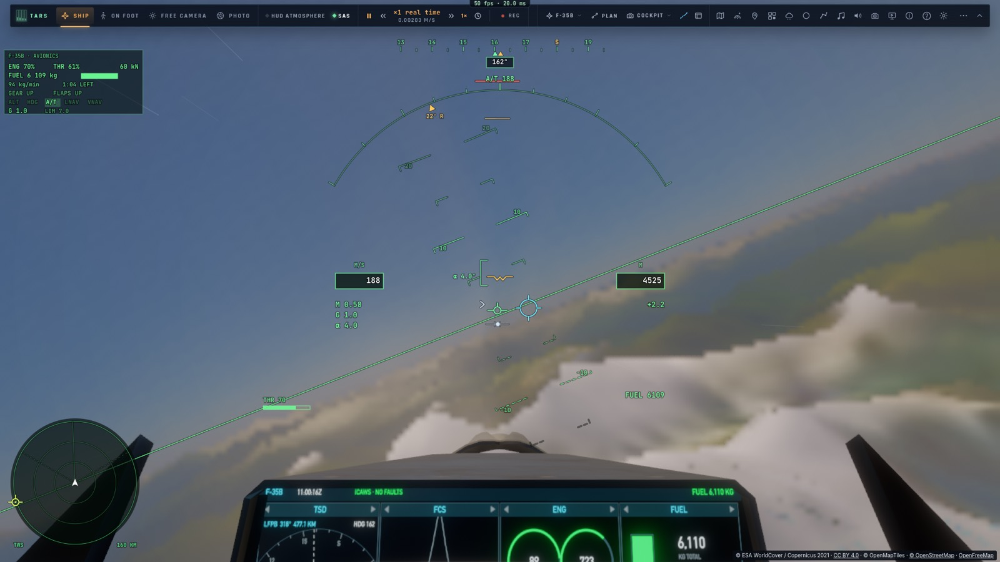
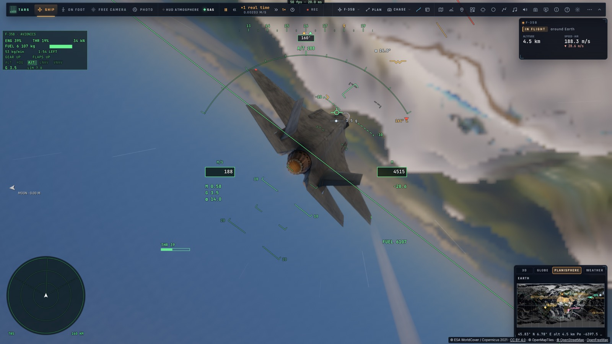
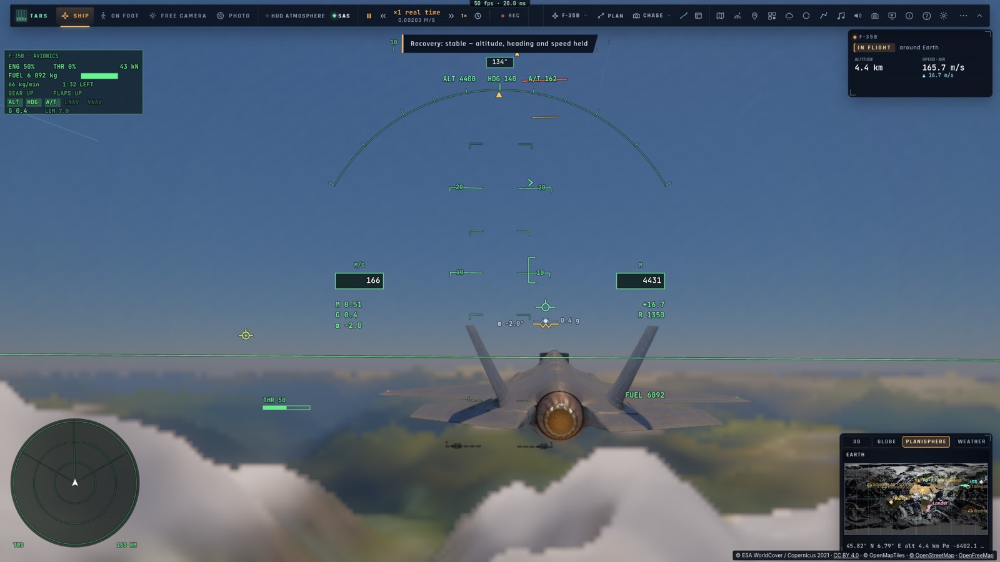

# A1 — Les niveaux d'assistance

*2026-10-15 — [PLAN-AVIATION-AAA](../../PLAN-AVIATION-AAA.md), phase A1.*

## Quatre niveaux (`controller/assistlevel.ts`, réglage « Assistance » du F-35)
- **Manuel** : la loi directe, le manche sur les gouvernes, sans calculateur. Décrochages et vrilles possibles.
- **Réaliste** (par défaut) : le vrai F-35, sa loi de commande et ses limites (50° d'incidence, 7 g).
- **Assisté** :
  - **gaz automatiques** : en vol, la vitesse du moment est tenue, et les touches de gaz règlent une vitesse au
    lieu de la poussée (sauf postcombustion) ;
  - **l'incidence limitée à 20°** : le décrochage est tenu bien à l'écart, même manche plein arrière ;
  - **la protection du sol** toujours active : l'Auto-GCAS d'A2.
- **Débutant** : **on vise, l'avion y va**.
  - Le manche ne pilote plus l'avion : il **déplace un anneau** (le roulis le tourne à 45°/s, le tangage le monte
    ou le baisse à 12°/s, ±25° de pente).
  - L'avion **incline et tire pour s'y rendre** (l'inclinaison qui tourne de la moitié de l'écart par seconde,
    60° au plus) et **suit la pente de l'anneau**.
  - Les gaz sont une vitesse ; l'incidence est limitée à 20°.
  - **L'anneau est au HUD** (un cercle cyan et ses quatre repères, dans la vue en 3D).
  - Le pilote automatique ou la navigation engagés reprennent la main, puis l'anneau repart de là où l'avion vole.

## Le retour au vol stable, d'une touche (⇧X, à tous les niveaux)
- **Les ailes d'abord** : ramenées à plat, sans tirer le nez à travers une forte inclinaison.
- **Puis le nez** en légère montée (6°), à une vitesse sûre (200 m/s, la postcombustion si trop lent).
- Une fois **stable trois secondes** (moins de 10° d'inclinaison, en montée), l'altitude, le cap et la vitesse
  sont **tenus par le pilote automatique**.
- Un coup de manche franc l'annule.

## Mesuré
- **`tests/assistlevel.test.ts`** (sans navigateur) :
  - **le retour au vol stable** depuis −171° d'inclinaison en descente : stable en 5,9 s, ailes à −0,1°, en montée
    à 7°, les maintiens engagés ;
  - **débutant** : l'anneau tourné de 90° et monté de 12° par le manche. Le cap le rejoint à 0,4° près (89,6°), la
    pente à 12,3° pour 12,2°, à 198 m/s ;
  - **manche plein arrière à 150 m/s** : **50,4° d'incidence en réaliste, 20,3° en assisté** (gaz automatiques
    engagés à 148 m/s).
- **`tests/e2e/assistlevel.e2e.test.ts`** sur kerr-mini (les Alpes d'abord, 28 s), avec de **vraies touches** :
  - débutant, la touche de roulis (E) tenue 1,2 s : l'anneau à 55° à droite, l'avion tourne de 53° et s'y aligne à
    1,7° près ;
  - réaliste, mis sur le dos (−165°), puis **⇧X** : ailes à plat (−0,1°), les maintiens engagés, 113 m perdus.

## Écarts
- **La protection du sol** du niveau assisté arrive avec l'Auto-GCAS (A2).
- **Un anneau hors du champ** (un grand virage demandé) n'est pas montré au bord de l'écran ; il réapparaît en
  tournant.
- **Pas d'assistance au roulage** ni au décollage ; les niveaux s'appliquent en vol.
