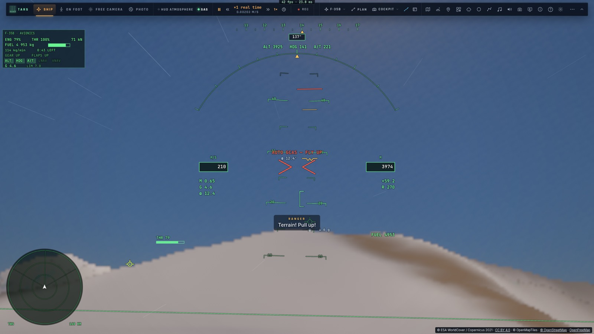
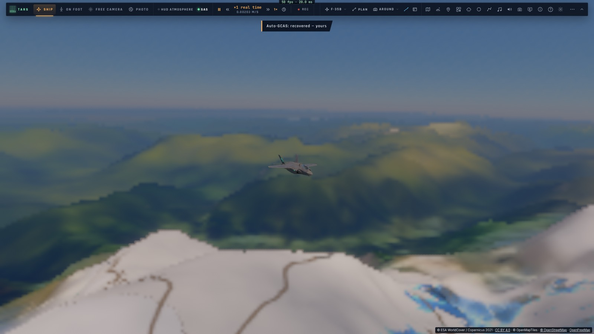
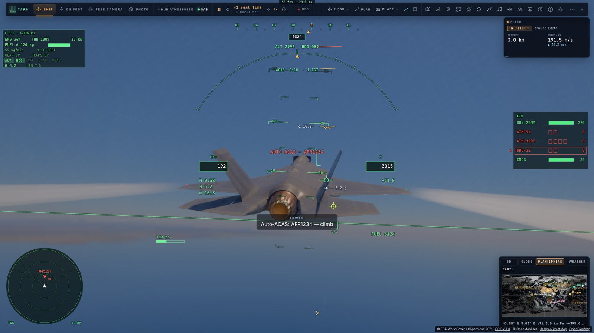

# A2 — Les protections du vrai F-35 : Auto-GCAS et Auto-ACAS

*2026-10-15 — [PLAN-AVIATION-AAA](../../PLAN-AVIATION-AAA.md), phase A2.*

## L'Auto-GCAS (`game/gcas.ts`, `controller/gcas.ts`)
L'évitement automatique de collision avec le sol, celui qui équipe le vrai F-35.
- **Dix fois par seconde**, l'avion prévoit **la ressource qu'il ferait maintenant** :
  - un délai de 0,5 s (la mise en facteur de charge comprise) ;
  - le roulis jusqu'aux ailes à plat à 180°/s, à 1 g, la pente qui tombe tant que l'inclinaison détourne la
    portance ;
  - puis la traction à 5 g jusqu'à une montée de 20° (cinq de moins que la ressource réelle, pour rester du côté
    sûr).

  Cette trajectoire est **comparée au relief le long de la route** sur 25 s (les hauteurs du relief sur une grille
  de 250 m, rafraîchies toutes les 10 s, quand des tuiles plus fines arrivent).
- **Il prend la main au dernier moment**, quand cette ressource ne dégagerait plus le sol de sa marge (45 m + 0,12 s
  de vitesse : environ 75 m à 250 m/s) :
  - le manche est neutralisé ;
  - d'abord les ailes à plat, sans tirer le nez à travers une forte inclinaison ;
  - puis la montée à 25°, avec la postcombustion si l'avion est lent.
- **Il rend la main** quand l'avion monte, les ailes presque à plat, et qu'un **palier à l'altitude atteinte
  dégagerait aussi le relief des 12 s suivantes**. Sans cette condition, il rendait trop tôt et devait tirer une
  seconde fois sur la même crête. Une altitude maintenue plus bas est montée à l'altitude atteinte.
- **Au HUD**, deux chevrons se resserrent sur le centre quand le sol approche (la ressource à moins de deux marges),
  puis se rejoignent en rouge, avec « AUTO GCAS — FLY UP ».

## L'Auto-ACAS
L'évitement automatique de collision en vol.
- **Les autres avions** sont ceux du radar : ceux du combat, le trafic réel, les joueurs du salon, nos ailiers.
- **Un conflit**, c'est un rapprochement minimal prévu à moins de 150 m dans les 8 secondes.
- **L'évitement est vertical**, à l'opposé de l'autre : en montée s'il passera dessous (ou au même niveau, si
  l'on n'est pas bas), sinon en descente, à ±15°, les ailes à plat.
- **Il continue jusqu'à 300 m de rapprochement prévu** (sans cela, il lâchait juste au bord des 150 m), puis rend
  la main au bout d'une seconde et demie sans conflit. Le pilote automatique garde l'altitude atteinte : avant,
  il redescendait droit sur l'intrus.

## Quand elles sont actives
- **Le réglage « Auto-GCAS · Auto-ACAS »** est actif par défaut, comme sur le vrai avion. Il est **toujours
  forcé aux niveaux Assisté et Débutant** (A1).
- **Elles se taisent** :
  - en loi directe (aucun calculateur pour voler la ressource) ;
  - train sorti, en formation, en approche ILS ou d'appontage, en STOVL ;
  - au sol, ou sous un autre pilote automatique.

## Mesuré
- **`tests/gcas.test.ts`** (sans navigateur) :
  - **la prédiction** :
    - en palier haut, dégagé ;
    - à −30° et 300 m, non dégagé ;
    - sur le dos, la ressource prévue perd plus que ailes à plat (le roulis d'abord) ;
    - une crête de 1 500 m à 2 km, en palier à 900 m : non dégagé ; à 1 600 m : dégagé ;
    - les conflits : de face au même niveau, à 1 km au-dessus, en éloignement ;
  - **un piqué tenu vers la mer, le manche à fond en avant** : la ressource au dernier moment, le point le plus bas
    à 78 m. **Protection coupée : dans la mer** ;
  - **sur le dos, le nez vers la mer** : ailes à plat puis ressource, le plus bas à 475 m ;
  - **en palier à 700 m vers une crête de 1 200 m** (pilote automatique) : passée avec 152 m de marge ;
  - **un avion de face au même niveau** : évité, le rapprochement minimal à 203 m.
- **`tests/e2e/gcas.e2e.test.ts`** sur kerr-mini (les Alpes d'abord, 1 min 38 s) :
  - le pilote automatique tient 3 925 m droit sur le Mont-Blanc. La ressource se déclenche au dernier moment (sa
    marge prévue au plus juste : 86 m), passe le massif à 4 885 m, et rend la main ;
  - un A320 de face au même niveau au-dessus de la mer : évité, croisé à 217 m.

## Écarts
- **Pas de commande pour couper la protection en vol** (sur le vrai avion, un bouton sur le manche) : seulement le
  réglage.
- **L'évitement en vol est seulement vertical** ; le vrai combine roulis et ressource.
- **Les autres avions sont ceux que le radar connaît** : un appareil hors de ses sources n'est pas vu.
- **Les crêtes sont lues sur la route actuelle** : un relief juste à côté de la trajectoire, dans un virage serré,
  peut échapper à la prévision.
