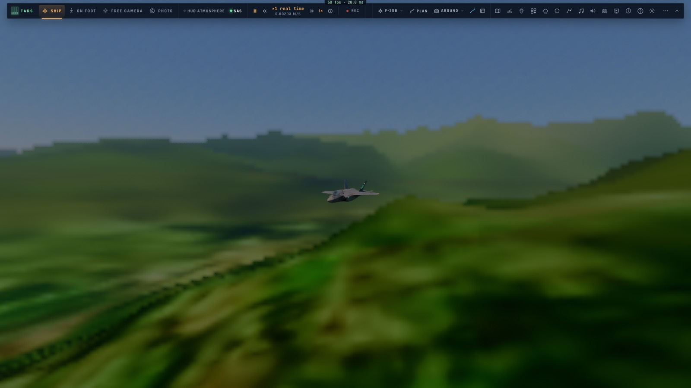
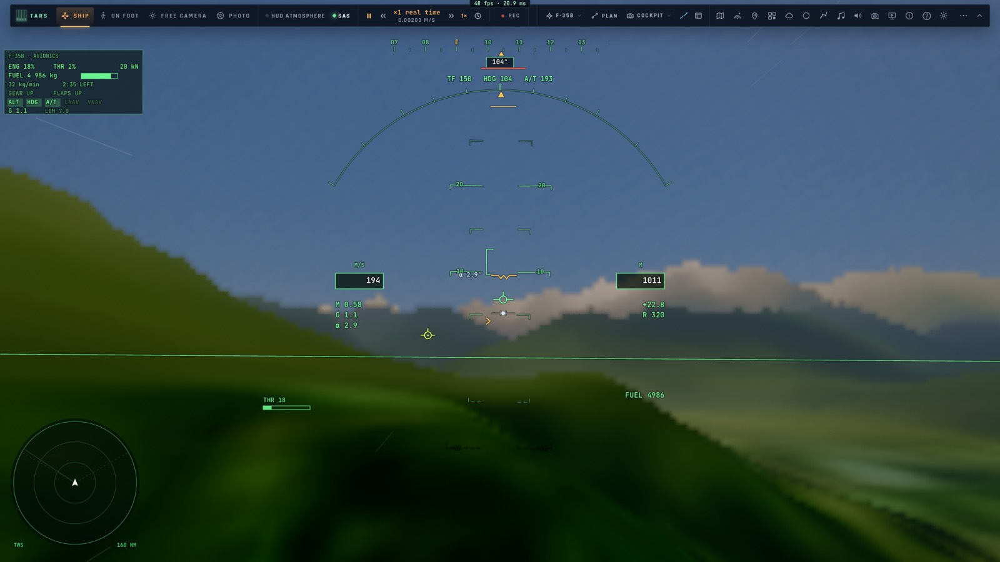
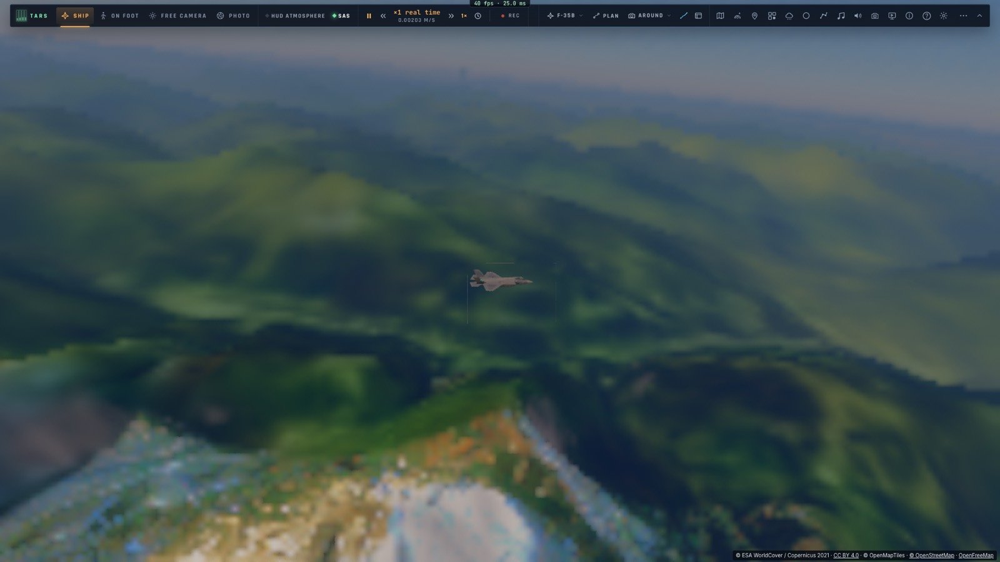
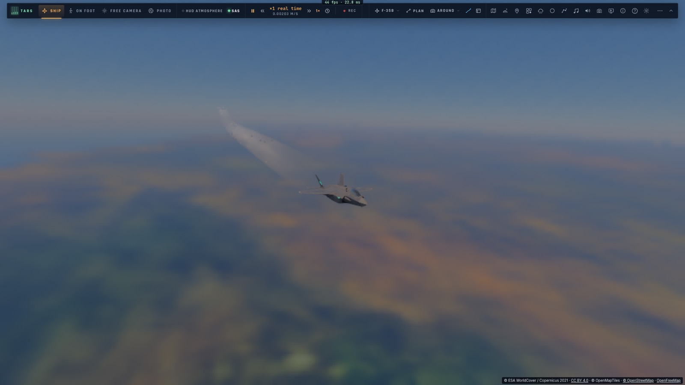

# A3 — Les nouveaux modes du pilote automatique

*2026-10-15 — [PLAN-AVIATION-AAA](../../PLAN-AVIATION-AAA.md), phase A3.*

## Les modes (`game/jetmodes.ts`, `controller/jetmodes.ts`)
- **L'orbite sur un point** :
  - à droite ou à gauche ;
  - au rayon demandé, ou par défaut celui d'une inclinaison de 40° à la vitesse du moment (4 km au moins) ;
  - un point donné, ou sinon un point à un rayon sur le côté, pour être sur le cercle tout de suite ;
  - **la loi d'orbite** :
    - de loin : le cap vers le cercle (sa tangente, infléchie selon l'écart) ;
    - sur le cercle : l'inclinaison que demande le cercle (V² / g R), corrigée par l'écart de rayon et la vitesse
      radiale (55° au plus) ;
    - l'altitude et la vitesse tenues ;
  - le maintien de cap seul tenait 5 à 14 km pour 4 demandés : il ne fait que réagir.
- **L'hippodrome sur un point** : l'attente de F2, sur l'endroit où l'on est ou un point donné, axe d'arrivée au
  choix.
- **Le suivi de terrain** (100, 150 ou 300 m) :
  - à chaque image, **la pente la plus forte que demande un point du sol devant** (sur 14 s de vol) pour le
    passer à la hauteur voulue : c'est le « ski toe » des vrais systèmes ;
  - 20° de montée au plus, 12° de descente pour suivre les vallées ;
  - le cap reste celui du pilote automatique ou de la navigation ;
  - les hauteurs du relief viennent du cache de l'Auto-GCAS (A2), qui reste en filet de sécurité ;
  - le tangage du manche le suspend tant qu'il est tenu.
- **Le rendez-vous avec un ravitailleur** :
  - un ravitailleur ami, « TEXACO 11 », est placé 25 km devant à 7 000 m, à 210 m/s, sur son hippodrome (deux
    branches de 30 km, tournées en boucle) ;
  - l'interception de C2 le rejoint jusqu'à sa **position pré-contact : 50 m derrière, 10 m dessous**. Elle suit
    ici un appareil ami, connu par la liaison de données ;
  - l'Auto-ACAS ignore un appareil rejoint volontairement (une ombre d'interception, une position pré-contact).
- **Le menu de vol** a un sous-menu **« Modes du pilote automatique »** :
  - orbite ici (droite, gauche), hippodrome ici ;
  - suivi de terrain (100, 150, 300 m, coupé) ;
  - ravitailleur, approche ILS ;
  - **voler vers… (la carte)**, voltige (les démonstrations des défis) ;
  - modes coupés.
- **TARS, son outil `jet_mode`** : `orbit`, `hold`, `tf`, `tanker`, `off`.
- **Au HUD** : « ORBIT », « TF 150 », « PRE-CONTACT TEXACO 11 ».
- Les autres modes du plan existaient déjà : l'approche ILS (P4), l'appontage vertical (M3), l'interception (C2),
  la formation (F1), la démonstration de voltige, « voler vers » (la carte, P2).

## Mesuré
- **`tests/jetmodes.test.ts`** (sans navigateur) :
  - le cap d'orbite (tangent sur le cercle, infléchi dedans ou dehors) et la pente du suivi de terrain devant une
    colline de 600 m ;
  - **orbite de 4 km à 220 m/s** : rayon tenu entre **3 947 et 3 978 m**, 474° de virage en 150 s ;
  - **suivi de terrain à 150 m sur des collines de 0 à 500 m** (une tous les 8 km) : de 143 à 473 m au-dessus
    du sol, et l'Auto-GCAS n'a jamais dû intervenir ;
  - **le ravitailleur** : rejoint en pré-contact, à 66 m de lui, 10,3 m dessous.
- **`tests/e2e/jetmodes.e2e.test.ts`** sur kerr-mini (les Alpes d'abord, 2 min 38 s) :
  - le suivi de terrain à 150 m en remontant la vallée de l'Arve, sur le vrai relief : de 132 à 386 m au-dessus du
    sol ;
  - une orbite de 5 km autour du Mont-Blanc : 5 332 m ;
  - le ravitailleur rejoint en pré-contact, à 81 m.

## Écarts
- **Le ravitailleur est un A320** (pas de KC-46 ni de perche ou de panier modélisés) ; le contact et le transfert
  viendront avec le ravitaillement en vol (phase S).
- **Le suivi de terrain ne regarde que la route actuelle** ; en virage serré, un relief de côté peut échapper.
- **L'orbite autour d'un point qui bouge** (un navire, un avion) n'est pas faite : le point est fixe.
