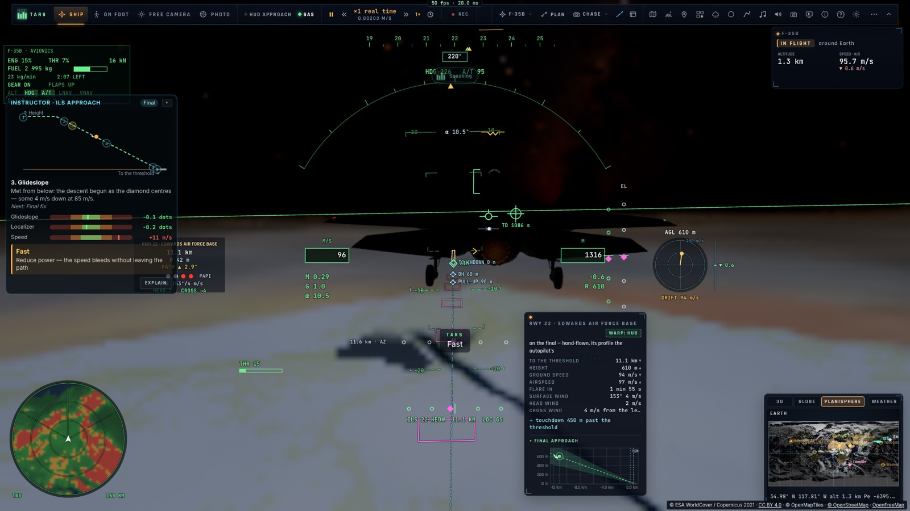
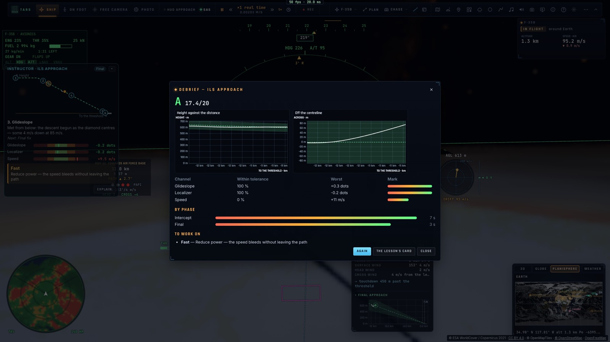
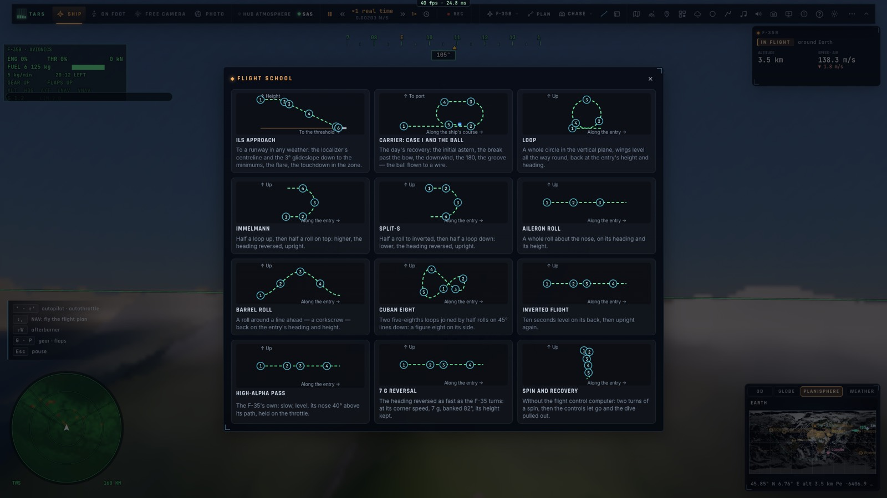
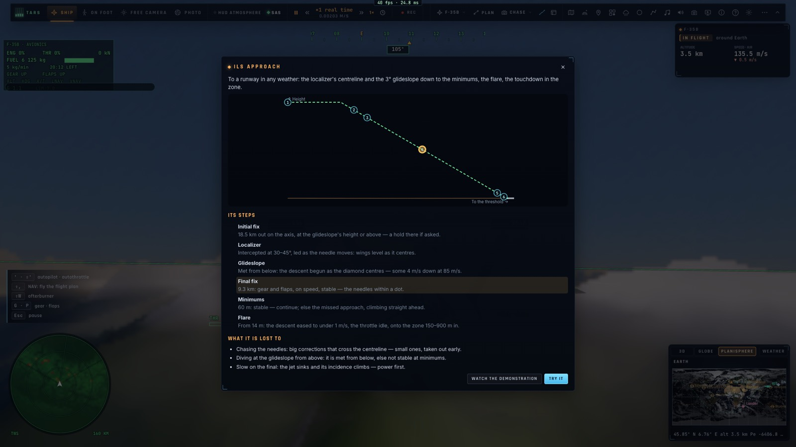
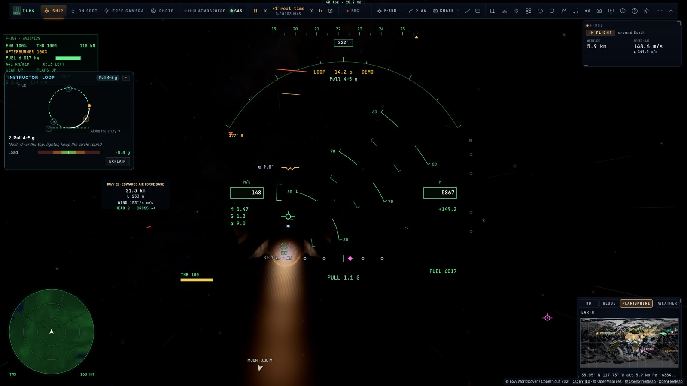

# A4 — L'instructeur et l'école de vol

*2026-10-15 — [PLAN-AVIATION-AAA](../../PLAN-AVIATION-AAA.md), phase A4.*

## L'instructeur (`game/instructor.ts`, `controller/instructor.ts`)
- **Il regarde** une approche ILS (du localizer à l'arrondi), un appontage (en finale) et une figure de voltige (en
  vol), qu'ils soient pilotés à la main ou par le pilote automatique.
- **Les paramètres suivis, chacun avec sa tolérance et sa limite** :
  - **ILS** : le glide et le localizer (en points), la vitesse face à celle d'approche ;
  - **appontage** : l'écart au plan (le ball, en degrés), l'alignement (en mètres), la vitesse ;
  - **figure** : la charge face à celle demandée, la vitesse (trop lent au sommet).
- **Les annonces au bon moment** :
  - un écart **tenu une seconde au-delà de sa limite** ;
  - **le pire d'abord** (pondéré : le glide et l'alignement avant la vitesse) ;
  - jamais deux annonces à moins de 2,2 s ;
  - **un écart qui persiste n'est pas répété en boucle** : il revient après 5, 10, 15… puis 20 s ;
  - **chaque annonce a sa correction** (« Bas — sous le glide : remonte un peu le nez et ajoute un peu de gaz, le
    losange revient au centre »).

  C'est TARS qui parle ; le panneau affiche l'annonce et sa correction.
- **Le débriefing chiffré** à la fin de la manœuvre :
  - pour chaque paramètre : la part du temps dans la tolérance, le pire écart et une note ;
  - la note de chaque phase ;
  - **une note sur 20 et une lettre** ;
  - **les deux points à travailler** avec leur correction.
- **Le réglage « Instructeur »** : coupé, annonces seules, ou complet (annonces, panneau, débriefing).

## Le panneau en direct (`ui/instructor.ts`)
Il se place à gauche, entre l'avionique et le radar, et se replie.
- **Le schéma de la manœuvre**, avec **notre trace dessinée par-dessus en temps réel** et un point qui avance :
  - l'ILS, en profil (hauteur selon la distance au seuil) ;
  - l'appontage, vu de dessus ;
  - une figure, dans son plan vertical.

  Les étapes y sont numérotées, l'étape en cours entourée.
- **L'étape en cours**, ce qu'elle demande, et la suivante.
- **Une jauge par paramètre** : la tolérance en vert, la limite en orange, l'aiguille et la valeur, colorées
  selon l'écart.
- **La dernière annonce et sa correction**, qui s'efface après 8 s.
- **« Explique »** met la simulation en pause et ouvre la carte de la leçon ; on reprend en la fermant.

## Le débriefing
- La lettre et la note sur 20.
- **Les graphiques** de ce qui a été volé face à l'idéal et sa tolérance :
  - ILS : la hauteur selon la distance (le glide à ±1 point), l'écart à l'axe (le localizer à ±1 point) ;
  - appontage : l'erreur de plan et l'alignement ;
  - figure : la charge face à celle demandée.

  Le traceur des assistants existant a été réutilisé, avec de nouvelles unités (°, g, points).
- Le tableau des paramètres, des barres par phase, les points à travailler.
- **« Réessayer »** relance la même leçon ; **« La carte de la leçon »**.

## L'école de vol
- Elle s'ouvre par le menu de vol (« École de vol ») ou par TARS (outil `lesson`). **Douze leçons** :
  - l'approche ILS ;
  - le cas I et le ball ;
  - les dix figures de voltige.
- **Chaque carte** comprend :
  - son résumé ;
  - **son schéma interactif** : survoler une étape l'entoure sur le schéma, cliquer un repère du schéma l'allume
    dans la liste ;
  - **ses étapes avec leurs chiffres** (« 9,3 km : train et volets, à la bonne vitesse, stable — les aiguilles à
    moins d'un point ») ;
  - **les erreurs courantes**.
- **« Voir la démonstration »** : le pilote automatique la vole (l'ILS 22 d'Edwards depuis 12 km, le cas I depuis
  7 km derrière le Ford, la figure), l'instructeur commentant.
- **« Essayer »** : l'avion est placé et c'est au pilote de voler, l'instructeur regardant. L'ILS est à la main
  avec ses aiguilles ; on arrive en finale du Ford pour voler le ball ; la figure se vole depuis son entrée.

## Mesuré
- **`tests/instructor.test.ts`** (sans navigateur) :
  - **les annonces** : rien sous la limite ; bas de 1,2 point et 10 m/s trop vite → « Bas — sous le glide » 1 s
    plus tard, puis « Vite » 2,3 s après. Le glide n'est pas répété avant 10 s ;
  - **le débriefing** : localizer 100 %, glide 42 %, la phase d'arrondi notée 1, le point à travailler « Bas — sous
    le glide », 17,1/20 ;
  - **les douze leçons** : chemins et étapes dans l'ordre ; à 8 km sur le glide, l'étape est « Point d'approche
    finale » ;
  - **un ILS réel regardé** : celui du pilote automatique, 19,8/20 ; le même volé 12 m/s trop vite, « Vite »
    annoncé sept fois en 100 s (de moins en moins souvent), 16,6/20, et le point à travailler est la vitesse.
- **`tests/e2e/instructor.e2e.test.ts`** sur kerr-mini (les Alpes d'abord) :
  - l'école de vol, et la carte de l'ILS ouverte d'**un vrai clic**, une étape survolée et entourée sur le schéma ;
  - **« Essayer » cliqué** : l'ILS à la main, le panneau en direct, « Vite » annoncé ; puis lâché, le débriefing
    et ses deux graphiques ;
  - la boucle en démonstration, sa trace sur le cercle, débriefée 19,4/20.
- Typecheck et Biome propres ; tous les tests unitaires passent.

## Écarts
- **L'appontage vertical du F-35B** n'a pas encore son instructeur ni sa carte.
- **La trace des figures est montrée dans leur plan vertical** : une figure qui en sort (un tonneau) y paraît
  aplatie.
- **Les cartes ne s'animent pas d'elles-mêmes** : ce qui bouge en direct, c'est la trace en vol.
