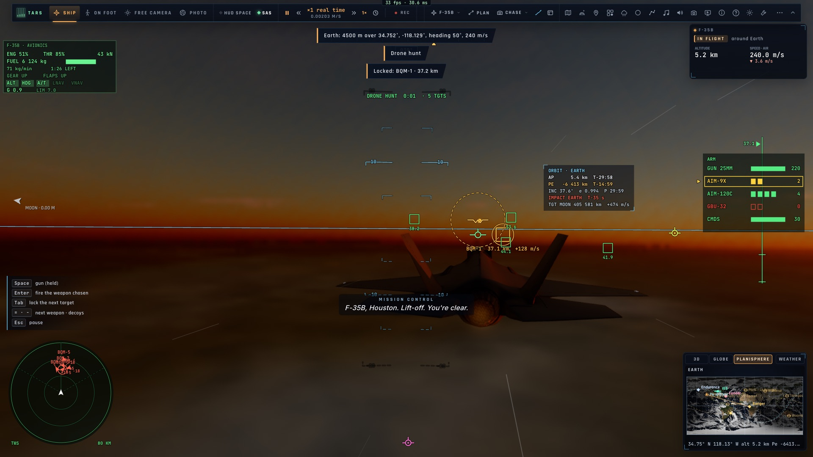
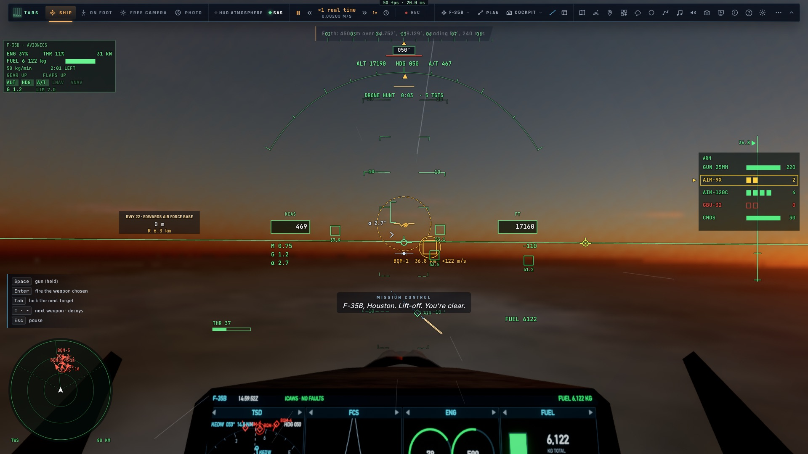
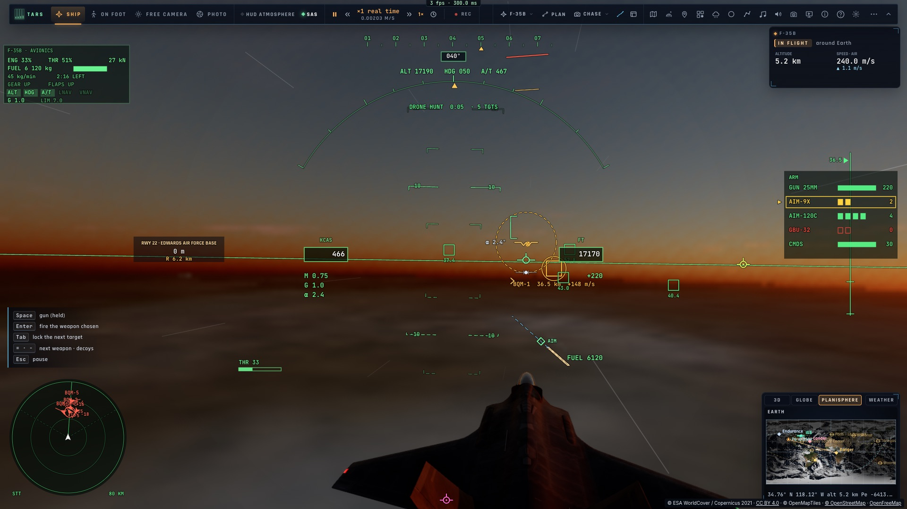

# C1 — Le radar toujours actif

*2026-10-15 — [PLAN-AVIATION-AAA](../../PLAN-AVIATION-AAA.md), phase C.*

## Le radar (`game/radar.ts`)
L'AN/APG-81 n'existait que dans un combat, et y voyait tout. C'est maintenant un vrai capteur, allumé dès que le
F-35 est en l'air, en combat ou non.
- **Le faisceau balaie** ±60° devant le nez en 2 s (±35° en site). Un contact n'est mesuré que quand le faisceau
  le croise.
- **La portée dépend de la taille** : 150 km sur un chasseur de 5 m², environ 95 km sur 0,8 m² (portée ∝ σ^¼).
- **L'horizon radar** : la Terre à 4/3 de son rayon (la réfraction). Un contact bas à 100 km est caché depuis
  300 m, vu depuis 6 km.
- **Le masquage par le relief**, enfin codé : la ligne de visée est échantillonnée sur le relief réel (grille de
  500 m gardée en cache), avec la courbure de la Terre.
- **L'encoche Doppler** : en regardant vers le bas (le sol derrière la cible), un avion qui vole en travers du
  faisceau a la vitesse du sol, et il est perdu dans le fouillis. De face, il est vu.
- **Les pistes** sont tenues entre deux passages du faisceau (leur mouvement prolongé) et abandonnées après 5 s
  sans mesure.
- **Les modes** :
  - RWS : les contacts seuls, sans vitesse ;
  - TWS : les pistes, avec leurs vitesses et leurs routes ;
  - STT : le verrouillage seul, mesuré à chaque image, le faisceau sur lui. Il est perdu s'il sort du cône.
- **L'IFF** : un transpondeur ami ou neutre (un avion de ligne) répond dans 120 km. Un contact muet reste
  *inconnu* jusqu'à être vu à moins de 3 km devant le nez. Les cibles d'une mission sont connues d'avance
  (hostiles). Couleurs : ami bleu, neutre blanc, inconnu jaune, hostile rouge.
- **La liaison de données** : la position des avions amis est toujours connue, hors radar. Ils sont dessinés en
  cercles creux et ne peuvent pas être verrouillés.

## Dans le jeu (`controller/radar.ts`)
- **Des sources** donnent au radar ce qu'il peut voir, relatif à l'avion (est, nord, haut) :
  - « cmb » : les cibles d'un combat, balayées d'un coup au début ;
  - « net » : les autres joueurs d'un salon ;
  - à venir : le trafic réel et les bateaux (phase T), les ailiers (phase F).
- **Le combat est nourri par le radar** : ses cibles vues et son verrouillage sont désormais ceux du radar (il ne
  « voit » plus tout seul).
- **Tab** verrouille la piste la plus proche, puis la suivante, en combat comme hors combat. Dans la roue :
  *Radar › mode* (RWS → TWS → STT).
- **Le HUD** :
  - la portée radar unifiée (combat, défis, salon) : le mode, le faisceau, les pistes à la couleur de leur IFF,
    les amis de la liaison en cercles creux ;
  - hors combat, une **boîte de verrouillage** sur la cible : son nom, sa distance en milles, sa vitesse, son
    altitude, et une flèche au bord quand elle est hors champ.
- **Le TSD du PCD** (l'écran du cockpit) : les symboles OTAN, la route de chaque piste, l'anneau du
  verrouillage, la liaison en pointillés.

## Corrigé en chemin
- **Tests** : un combat lancé par un test laissait la masse des emports sur le F-35 pour les tests suivants. Le
  passage à grande incidence échouait alors (14,8/20) dans la suite complète seulement. Elle est remise à zéro
  entre les vols.

## Mesuré
- `tests/radar.test.ts` (11 tests) : portée selon la taille ; détection au passage du faisceau ; derrière les
  ±60° ; horizon ; encoche ; relief ; pistes tenues puis abandonnées ; IFF (avion de ligne neutre à 120 km,
  muet inconnu jusqu'à 3 km) ; liaison ; verrouillage et STT ; RWS/TWS.
- `tests/radar-flight.test.ts` : la chasse aux drones depuis son départ. Les 5 drones sont pistés d'un coup,
  hostiles ; Tab verrouille BQM-1 à 37,1 km, puis le suivant ; l'image TWS, la distance et la vitesse de
  rapprochement du verrouillage.
- Dans le jeu (`tests/e2e/f35-radar`, kerr-mini) : la mission lancée depuis sa carte ; TWS, 5 hostiles ; Tab
  verrouille BQM-1 et c'est aussi le verrouillage du combat ; STT, le faisceau tenu à 3,9° sur la cible. Sans
  régression : `f35-combat` (Tab, AIM-120, drone abattu), `f35-hud`, `f35-challenges`, `net-flight`.
- 1 138 tests unitaires passent.
- **Reste du critère** : « un avion de ligne réel apparaît en neutre, disparaît derrière une crête » demande le
  trafic réel (phase T). Le radar, l'IFF et le relief sont prêts et testés séparément ; la source « trf » se
  branchera dessus.

| Portée HUD, TWS, BQM-1 verrouillé | Depuis le cockpit : le TSD | STT |
|---|---|---|
|  |  |  |
