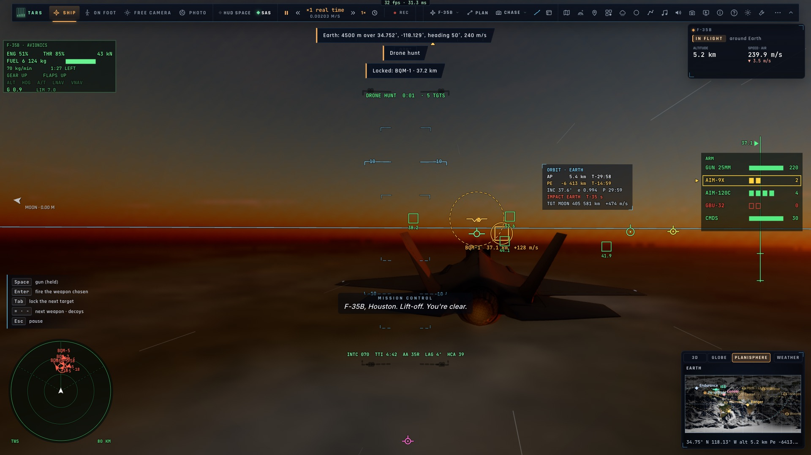
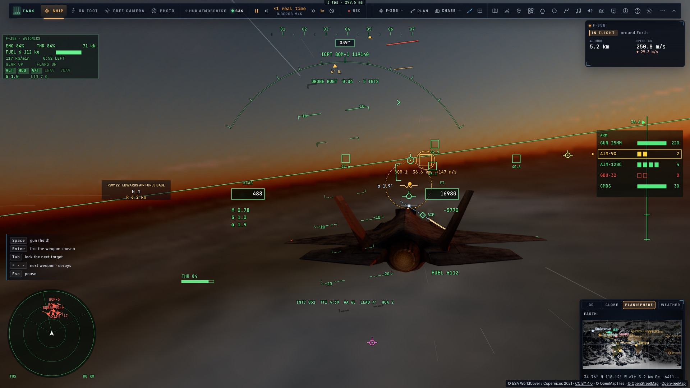
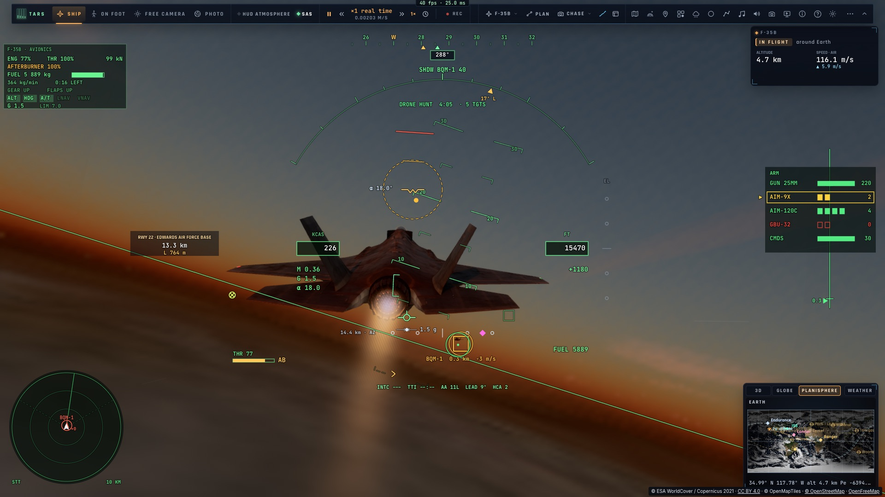
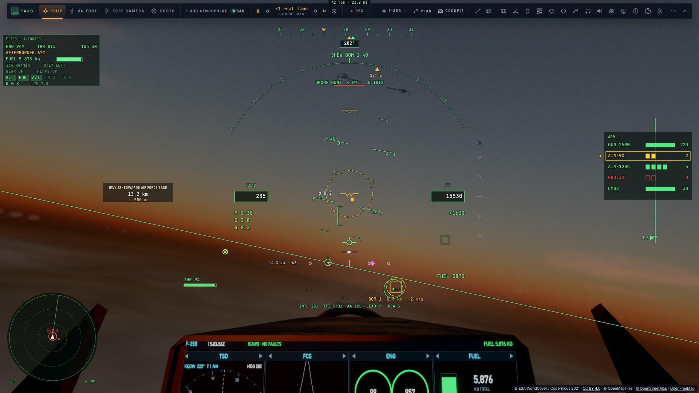

# C2 — La trajectoire d'interception

*2026-10-15 — [PLAN-AVIATION-AAA](../../PLAN-AVIATION-AAA.md), phase C.*

## Les repères (`game/intercept.ts`)
Dès qu'une piste est verrouillée, le HUD donne ce qu'un pilote de chasse vole :
- **le cap de collision** : le cap qui rencontre la cible à notre vitesse. Il est affiché au HUD (« INTC 070 »)
  et marqué par un repère de pilotage (un cercle et sa tige) dans la direction à suivre ;
- **le temps avant la rencontre** (TTI) ;
- **l'angle d'aspect** : 0° derrière elle, 180° de face, et le côté (« AA 35R » : 35° sur sa droite) ;
- **la poursuite volée** : en avance (LEAD), pure (PURE, à 3° près) ou en retard (LAG), avec l'écart en degrés ;
- **l'angle entre les deux routes** (HCA).

## Le pilote automatique INTERCEPT (`controller/intercept.ts`)
**⇧Tab** (ou la roue : *Radar › Intercepter*) sur le verrouillage (ou la piste la plus proche). Le HUD affiche
« ICPT », puis « JOIN » et « SHDW » suivis du nom et de la distance au poste.
- **La course** : une conversion par l'arrière, comme en vrai.
  - On vise un point décalé sur le côté de la place qu'il faut pour se retourner : deux rayons de virage de
    face, un rayon en travers, aucun quand on est déjà dans sa route.
  - Le **virage** commence quand, volé tout de suite à 45° d'inclinaison, il finirait au moins 2 km derrière la
    cible.
  - La vitesse : un peu au-dessus de celle de la cible tant qu'on est devant elle (pour virer serré). Derrière,
    le rapprochement dépend de la distance, assez lent pour pouvoir s'arrêter sur le poste.
- **La jonction et la patrouille** : à moins de 3 km du poste, routes alignées, la **loi de formation** prend la
  main. Le poste : **300 m derrière, 60 m sur sa gauche**, au même niveau. Une fois en patrouille :
  - le radar passe en STT sur elle ;
  - elle est identifiée à vue (IFF connu) ;
  - TARS annonce « En patrouille sur … ».
- **Une cible qui tourne** (un drone en orbite) n'a pas de route sur laquelle se placer. La course devient alors
  une poursuite du poste, et la jonction se fait à moins de 3 km quel que soit l'angle. L'accélération de la
  cible, mesurée, sert à anticiper son virage.
- **Hors du faisceau** (pendant le virage derrière elle), la cible est suivie par **la situation partagée** :
  l'AWACS pour une cible de mission, l'ADS-B pour un transpondeur, la liaison pour un ami. Sinon, elle est
  prolongée à l'estime depuis sa dernière mesure (2 min 30 au plus), et verrouillée de nouveau dès que le
  faisceau la retrouve.
- Le manche, la manette des gaz, un autre pilote automatique, la formation : l'interception est coupée, et
  l'altitude, le cap et la vitesse du moment sont tenus.

## Mesuré
- `tests/intercept.test.ts` (sans rendu, F-35 à 9 km, avion de ligne simulé à 230 m/s) :

| Départ | Patrouille atteinte en | Tenue ensuite (1 min) |
|---|---|---|
| De face, 79 km | 309 s | 9 m du poste |
| En travers, 80 km | 361 s | 8 m |
| Par l'arrière, 60 km | 757 s (rapprochement 90 m/s) | 8 m |
| BQM-1 en orbite de 5 km, 37 km | 236 s | 33 m, dans son virage |

  À la fin : 291 à 293 m derrière, 59 à 60 m à gauche, 0 à 2 m de différence de hauteur. La cible est
  identifiée neutre à vue.
- Dans le jeu (`tests/e2e/f35-intercept`, kerr-mini) : Tab sur BQM-1, les repères affichés (INTC 070, TTI 4:42,
  AA 35R, LAG 4°). Puis **⇧Tab** : la course, la jonction, la patrouille en STT, **11 m du poste** dix secondes
  après, en vue poursuite comme en cockpit.
- 1 144 tests unitaires passent.
- **Reste du critère** : « un avion de ligne réel » attend le trafic réel (phase T). L'avion de ligne simulé du
  test transmet et vole droit, exactement comme le fera la source « trf ».

| Les repères sur BQM-1 | La course | En patrouille (STT, 0,3 km) | Depuis le cockpit |
|---|---|---|---|
|  |  |  |  |
