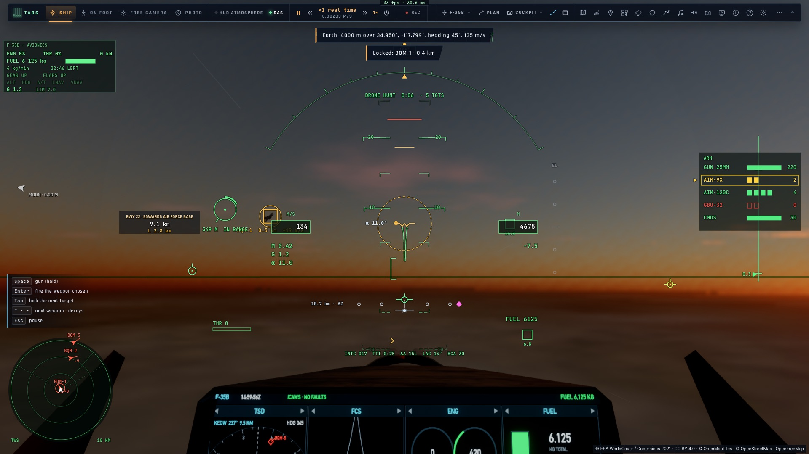
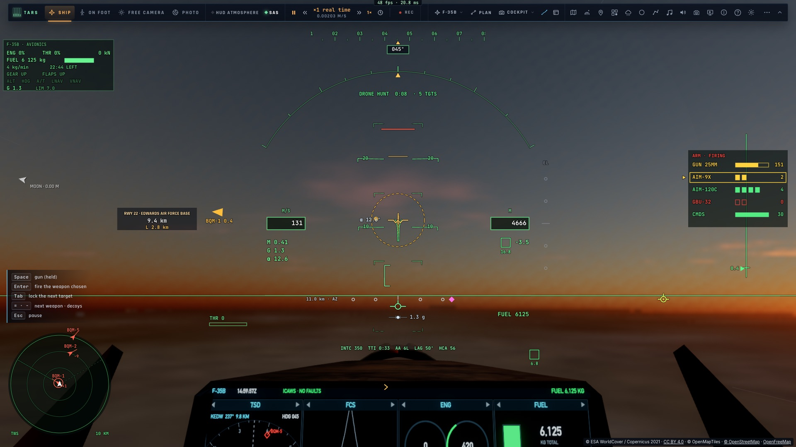

# C3 — Où tirer

*2026-10-15 — [PLAN-AVIATION-AAA](../../PLAN-AVIATION-AAA.md), phase C.*

## Le calcul (`game/gunsight.ts`)
L'ancien collimateur prolongeait la cible en ligne droite (sa vitesse seule) et approchait la chute des obus.
Contre une cible qui vire, il visait donc là où elle n'est plus. Désormais :
- **la position future de la cible** tient compte de sa vitesse **et de son accélération**, c'est-à-dire de son
  virage (½ a t²). L'accélération est mesurée sur l'évolution de sa vitesse, lissée sur une demi-seconde, et
  bornée à 9 g ;
- **le temps de vol et la direction de tir** sont résolus ensemble. On fait voler un obus *avec la même
  balistique que le combat* (chute, traînée ; une seule fonction, `roundStep`, sert aux deux), on mesure son
  écart à la cible au moment de la rencontre, et on corrige la visée et le temps de vol. Six passes suffisent ;
- **la portée** : « IN RANGE » entre 150 m et 1,2 km, et pas de solution au-delà de 2,2 s de vol.

## Au HUD
- **Le réticule** sur le point où tirer : on y met l'axe du canon (la croix) et les obus rencontrent la cible.
- **La barre de distance** : un arc qui part de midi, un tour complet pour 2 km, avec un repère à 1,2 km (la
  portée utile). En dessous, la distance (dans les unités choisies) et « IN RANGE ». Rouge et « GUNS » quand la
  croix est dessus et la cible à portée.
- **L'entonnoir** (comme l'EEGS du vrai F-35) : là où sont maintenant les obus tirés le long de l'axe du canon
  pendant la dernière seconde et demie, ses deux bords écartés d'une envergure de la cible (10,7 m pour un
  chasseur, 3,5 m pour un drone). Une cible qui remplit l'entonnoir est à sa distance. En vol droit, c'est un
  trait court sous la croix (la chute) ; en virage, il se courbe. Affiché gâchette tenue, ou cible à moins de
  1,5 km.
- **Les traçantes** : un obus sur cinq tracé en trait lumineux, les autres en étincelles.

## Mesuré
- `tests/gunsight.test.ts` :
  - une cible qui traverse à 250 m/s, à 600 m : l'obus tiré sur la solution passe à 2 cm d'elle ;
  - **le banc** : un chasseur en virage à **5 g** à 250 m/s, poursuivi sur son cercle. L'axe du canon est mis
    sur le collimateur à chaque image, avec une erreur de visée de pilote de 5 mrad. On tire 3 s (164 obus),
    en les faisant voler comme le combat :

| Derrière la cible | Le collimateur C3 | L'ancien (vitesse seule) |
|---|---|---|
| 400 m | **100 %** | 100 % |
| 700 m | **100 %** | 9 % |
| 1 000 m | **86 %** | 0 % |

  De près, le virage pendant le vol des obus (½ a t² ≈ 4 m) reste dans le rayon d'impact (7 m) : les deux
  touchent. Plus loin, seul le nouveau calcul touche. **Critère « ≥ 60 % sur une cible à 5 g » atteint.**
  - L'entonnoir : 15 obus fictifs sur 1,5 s, du plus loin (> 1 km) au plus près, tous devant l'avion et sous son
    axe.
- Dans le jeu (`tests/e2e/f35-gunsight`, kerr-mini) : placé à 450 m derrière BQM-1, à 349 m le réticule est en
  « IN RANGE » (0,34 s de vol). Espace tenu : l'entonnoir (15 points) et 13 traçantes. Sans régression :
  `f35-combat` (canon, missiles, duel).
- 1 150 tests unitaires passent.

| Le réticule, sa distance, IN RANGE (le drone dans son cercle) | Au tir : l'entonnoir sur l'axe |
|---|---|
|  |  |
