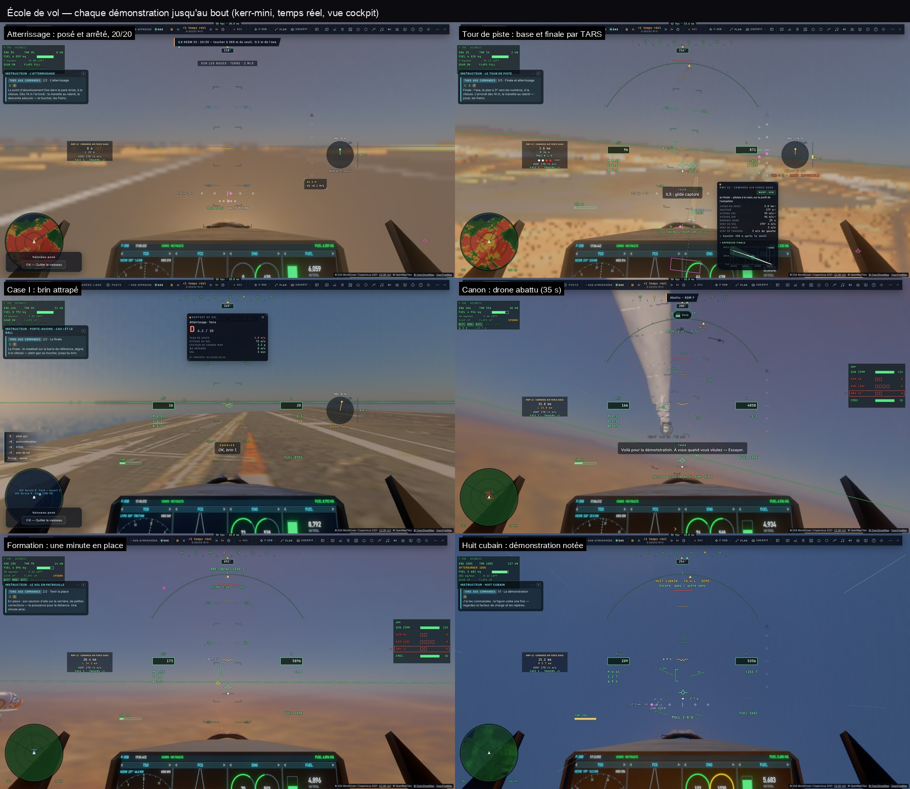

# École de vol jusqu'au bout, roue lisible, IA lissée, combat libre en réseau

*2026-10-18 — [PLAN-AVIATION-AAA](../../PLAN-AVIATION-AAA.md), à la suite de I3 (leçons guidées) et R3 (matchs).*

## Les démonstrations font ce qu'elles annoncent
- **« Voir la démonstration » : TARS vole toute la leçon**, la part du pilote comprise, avec ses propres mots
  (`game/course.ts` : `auto`, `demoSay`, `demoName` pour chaque étape du pilote). Avant, la démo s'arrêtait à la
  fin de la part de TARS : **l'atterrissage s'arrêtait à 3,5 km**, le tour de piste à la vent arrière, le canon
  avant la première rafale.
- **Toutes les démos passent par le même déroulé** (ILS, Case I, figures compris), donc par le même contrôle.
- **Causes trouvées et corrigées** :
  - **l'atterrissage partait 700 m trop haut** : la hauteur donnée à `flyAt` est une hauteur sol, la leçon lui
    passait l'altitude de la piste + 330 m ; l'ILS ne pouvait pas s'établir et repartait vers le point d'entrée
    (« l'atterrissage annulé dès le début ») ; idem pour le tour de piste ;
  - **la glide capturée depuis le dessus aussi** quand on est déjà établi en courte finale (placé un peu bas, il
    remettait les gaz aussitôt) ;
  - **l'événement « posé » ne venait jamais** (les chiffres du jet existent encore au roulage) : la leçon ne se
    terminait pas ;
  - **Case I** : la variante F-35C n'était appliquée qu'à l'image suivante, le pilote automatique d'appontage
    était abandonné à sa première image comme celui d'un B (sans crosse) ; le brin attrapé n'était pas vu sur le
    pont ;
  - **le canon** : l'interception, faite pour les derniers mètres d'une place, prenait 5 km de retard sur le drone
    dans ses virages — TARS vole désormais une poursuite avec anticipation et tire quand le réticule est dessus
    (abattu en 35 s) ;
  - **le tour de piste** : un vrai segment de base (ILS phase `base`) — le dernier virage commencé quand son rayon
    (40° d'inclinaison) amène sur l'axe, la descente sur le plan, l'intégrale de l'alignement ne démarrant qu'une
    fois près de l'axe ;
  - le virage de 90° à 30° d'inclinaison et 200 m/s demande ~60 s : son temps maximal porté à 90 s ;
  - le huit cubain dure ~130 s : son temps maximal porté à 200 s.
- **Plus d'écrans de débriefing sur les démos** : la démo est notée (toast « Démonstration : 19,4/20 », trace sur
  le schéma du panneau instructeur), sans fenêtre ; TARS ne se corrige pas lui-même. Une nouvelle leçon ferme un
  débriefing resté ouvert et n'en note pas la manœuvre interrompue (le Case I interrompu noté F 0,4/20 en
  pleine démo du canon). Un appontage n'ouvre plus le rapport d'atterrissage « piste » (un D sur le pont).
- **Le panneau instructeur ne restait jamais caché** (son `display: grid` annulait `hidden`).
- **Une leçon démarre toujours** : la pause et l'écran « appareil perdu » levés, les pilotes automatiques de la
  leçon précédente coupés, le moteur en marche.

### Les outils pour qu'une leçon ne soit jamais bloquée
- **Dans le jeu** : chaque étape mesure ce qu'il lui reste (distance au seuil, à l'axe, au porte-avions, portée de
  la cible, écarts aux consignes…) ; une démonstration qui n'avance plus depuis 90 s est abandonnée et le dit ;
  les étapes terminées par leur temps maximal sont notées (`courseLast.late`).
- **`__bh.flight.school.state()`** : l'étape, son temps, ce qu'il en reste, depuis quand elle stagne.
- **`tests/e2e/school-demos.e2e.test.ts`** : chaque démo lancée par de vrais clics, surveillée toutes les 2 s —
  échec si elle stagne 45 s, si une étape finit par son temps maximal, si un débriefing, la pause ou « appareil
  perdu » apparaît ; un blocage enregistre l'état complet et une vue. `DEMOS=landing,circuit` pour un sous-ensemble.

Mesuré sur kerr-mini (temps réel) : premier vol 227 s, atterrissage 95 s (20/20, 369 m du seuil), tour de piste
139 s, ILS 171 s, Case I 173 s (brin 1), formation 135 s, interception 210 s, canon 35 s, les dix figures.

## La roue (Tab maintenu)
- **Jusqu'à 800 px de diamètre** (44 % du petit côté de la vue), textes 13–20 px, chaque libellé dimensionné à son
  secteur (POSTCOMBUSTION n'est plus coupé), le centre qui dit l'élément pointé, sa touche, s'il est engagé.
- **10 secteurs au lieu de 21** : Pilote auto ▸, Postcombustion, STOVL, Train/volets ▸, (Armes ▸), Radar ▸,
  Patrouille ▸, Navigation ▸, Leçons et défis ▸, Caméra ▸ ; la roue du vaisseau spatial regroupée de même.
- Un appui bref sur Tab reste « verrou suivant », même si une image lente a laissé la roue s'ouvrir.

## Ailier en réseau
- **Tab maintenu › Patrouille › « Ailier de Ana »** (ou TARS « rejoins Ana ») : à côté de lui s'il est loin, puis la
  formation automatique, **à la première place libre** (ses ailiers IA et les autres joueurs sur son aile pris en
  compte ; chaque page dit à la salle sur l'aile de qui elle vole).
- **L'Auto-ACAS ne fait plus fuir** : le leader grimpait pour échapper à son propre ailier (la formation se
  défaisait à 100 m), et deux avions côte à côte à la même vitesse grimpaient ensemble sans fin — seuls comptent
  maintenant un appareil qui se rapproche, ou à moins de 25 m.

## Le combat libre (en salle, en F-35)
- Hors match, mission, leçon ou défi : **armes actives, tout appareil est une cible** — les autres joueurs, leurs
  ailiers IA et les nôtres, les avions de ligne, navires, porte-avions réels que le radar voit (pris dans le combat
  par une doublure placée chaque image d'après l'image radar, `controller/fightproxy.ts`) — **tir ami autorisé**,
  le radar en « armes libres » (une piste amie se verrouille). Abattu : de retour en l'air 6 s plus tard. Réglage
  *Combat libre en salle*.
- Le **coop** : les pilotes enfin dans le même camp.
- Mesuré (`tests/e2e/net-wing-fight`) : Ben rejoint l'aile d'Ana par la roue, tenu à 3,6 m sur 20 s ; Ana le
  verrouille (Tab) et l'abat à l'AIM-120 (*Ana ✕ Ben · AIM-120*), il revole.

## Les avions IA lissés
- **Inclinaison à vitesse de roulis** (180°/s chasseurs, 90°/s drones, 15°/s avions de ligne) et facteur de charge
  à vitesse limitée : plus de bascule d'un coup aux angles d'un circuit ou à un changement d'avis ; le virage ne
  dépend plus de la cadence d'images (même trajectoire à ±9 m sur une minute à cadence irrégulière).
- **Dessinés là où on est maintenant** : les appareils du combat étaient placés par rapport à notre position de
  l'image précédente (4 m de va-et-vient à 250 m/s, 8 m sur une image lente) — le leader d'une leçon de formation
  « tremblait ».
- Le sol sous le combat interpolé (plus de marches de 250 m), les ailiers IA des autres joueurs (20 Hz) et les
  agresseurs de l'hôte lissés, l'attitude des autres joueurs corrigée en douceur à chaque échantillon.
