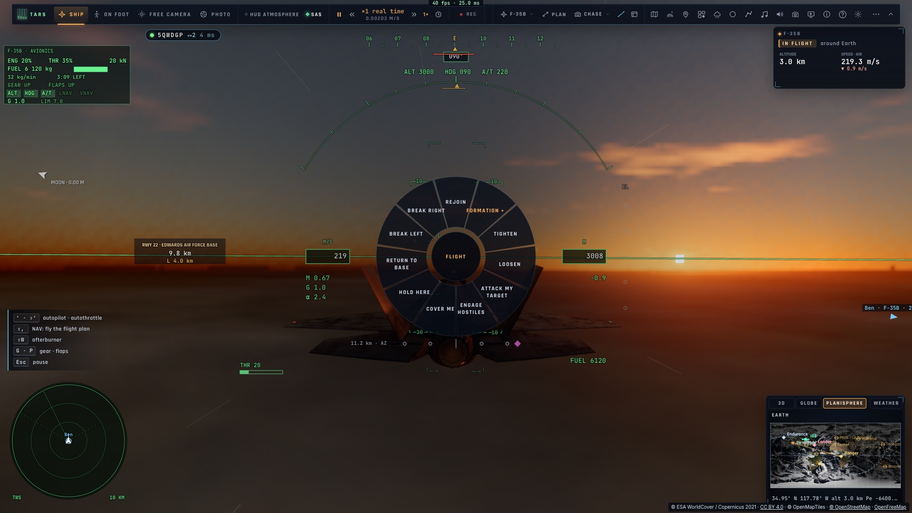
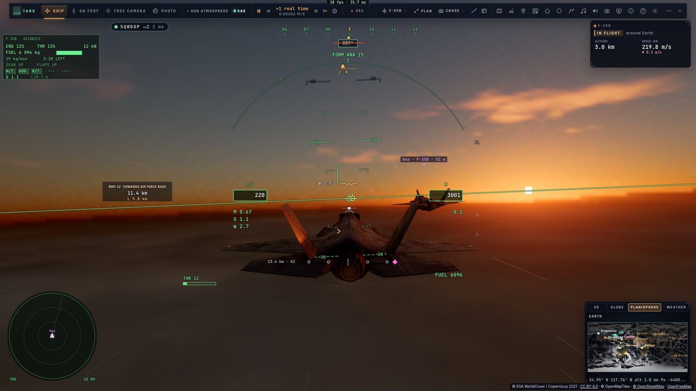

# F2 — Les ordres du leader

*2026-10-15 — [PLAN-AVIATION-AAA](../../PLAN-AVIATION-AAA.md), phase F.*

## Les ordres (`game/orders.ts`)
Rejoindre · changer de formation · serrer · s'écarter · attaquer ma cible · engager les hostiles · me couvrir ·
tenir ici · rentrer à la base · dégagement à gauche · dégagement à droite. Chacun a son appel radio, en français
et en anglais (« Patrouille, en Losange », « Break right! »).

## Les donner
- **La roue** : *Tab maintenu › Patrouille* (les formations dans une roue à elles). Elle a aussi sa propre
  action, sur F13 par défaut. On peut la réassigner dans les commandes ou la mettre sur un bouton du HOTAS.
  F2 était déjà pris (le mode à pied).
- **À la voix** : TARS a un nouvel outil, *flight_lead* (donner un ordre, l'état de la patrouille). **Hors
  ligne**, sans clé, il comprend aussi « Patrouille, en losange », « Dégagez à gauche ! », « Rejoignez »,
  « Retour base », « Serrez », « go echelon left »…
- Donner un ordre change d'abord notre propre idée de la patrouille (la formation, l'écartement), puis
  l'envoie : au salon, et en F3 à nos ailiers IA.

## Les recevoir
L'ordre est **dit à la radio** (la voix de la tour) et affiché chez chaque joueur du salon. Il est **exécuté si
l'on vole en formation sur celui qui le donne** :
- **la formation, l'écartement** : notre poste se déplace aussitôt et la loi de formation le rejoint ;
- **le dégagement** : la formation est lâchée, virage serré de 90° du côté demandé à 75° d'inclinaison,
  postcombustion allumée, puis le cap est tenu (« BRK » au HUD) ;
- **tenir ici** : un hippodrome d'attente au-dessus du point du leader, sur son axe (virages à droite, branches
  de 8 km), **étagé par poste** : 300 m plus haut pour le n° 2, 600 m pour le n° 3 (« HOLD ») ;
- **rentrer à la base** : un plan direct vers le terrain le plus proche, LNAV et VNAV engagés ;
- **rejoindre**, entendu hors formation : on reprend la formation sur lui ;
- attaquer, engager, couvrir : entendus. À un humain de les exécuter ; les ailiers IA (F3) le feront.

## Le ralliement, refait
Quand le poste est loin (au-delà de 3 km : un ralliement, après un dégagement), la formation commence par **la
course d'interception de C2**. On vise le poste, on prend la place de virer quand on revient vers sa route, on
vire à 60° à une vitesse de virage, et on ralentit si l'on est devant le poste. La loi de formation prend la main
à moins de 3 km. Avant, le rapprochement latéral était limité à 40 m/s, et 6 km de travers demandaient plus de
2 min 30.

## Mesuré
- `tests/orders.test.ts` (sans rendu, 9 km, 220 m/s, air calme) :
  - l'hippodrome : sa forme (le point au bout de la branche d'arrivée, la branche de sortie à deux rayons sur la
    droite) ; suivi depuis 20 km à côté, on est à moins de 268 m du circuit au bout de 5 min ;
  - les phrases hors ligne, et « hold position » qui reste le stationnaire ;
  - donnés en leader : la formation, l'écartement (serré), « attaquer » sans verrouillage refusé, les champs
    venus du réseau vérifiés ;
  - reçus en formation :

| Ordre | Résultat |
|---|---|
| En losange (depuis l'échelon droite, n° 2) | poste passé à gauche, rejoint à 2,2 m |
| Dégagement à droite, puis rejoindre | virage de 87° à 75° d'inclinaison, puis ralliement à 15 m en 148 s, tenu à 1,0 m |
| Tenir ici (n° 2) | 7 min d'attente, à 20,7 km au plus du point, 299 m au-dessus |
| Retour base | plan vers le terrain le plus proche, LNAV et VNAV engagés |
| Attaquer ma cible | entendu, la formation gardée |

- **En réseau** (`tests/e2e/net-orders`, deux pages sur kerr-mini) : Ana mène sur ses tenues au-dessus
  d'Edwards, Ben en fingertip n° 2.
  - La touche des ordres ouvre la roue chez Ana.
  - « En losange » est entendu chez Ben ; son poste change et il le vole (14,8 m).
  - « Dégagement à droite » : Ben vire de 82°.
  - « Rejoindre » : Ben est de retour à son poste (8,4 m).
- Sans régression : `net-formation-ap`, qui s'améliore avec l'intégrale de F1 : tenu à 4,99 m (6,7 avant), 6,7 m
  dans son virage (10,4 avant). L'interception C2 est inchangée (309 / 361 / 757 / 236 s).
- 1 171 tests unitaires passent.

| La roue des ordres (Ana) | Ben en losange n° 2, Ana à sa droite |
|---|---|
|  |  |
