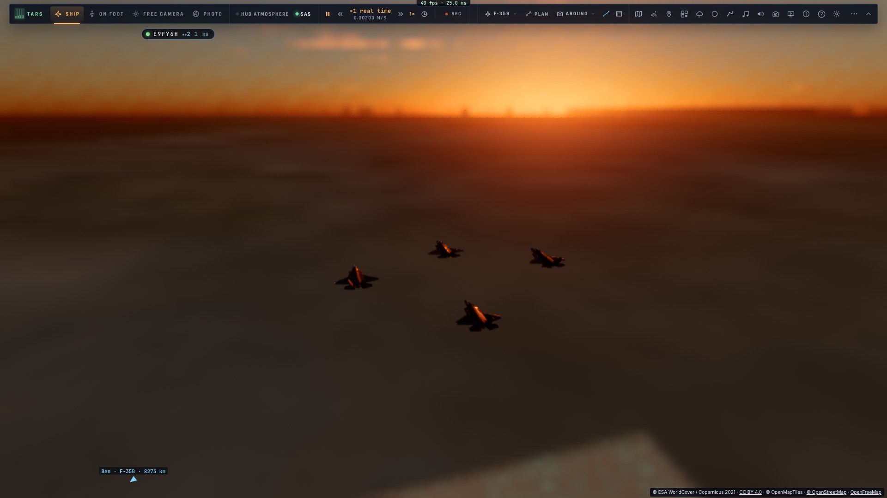
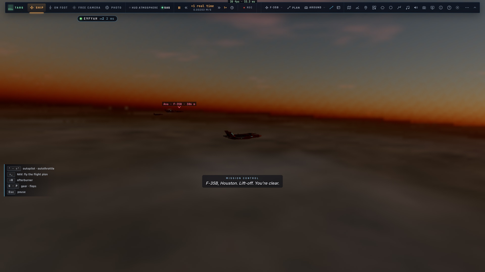
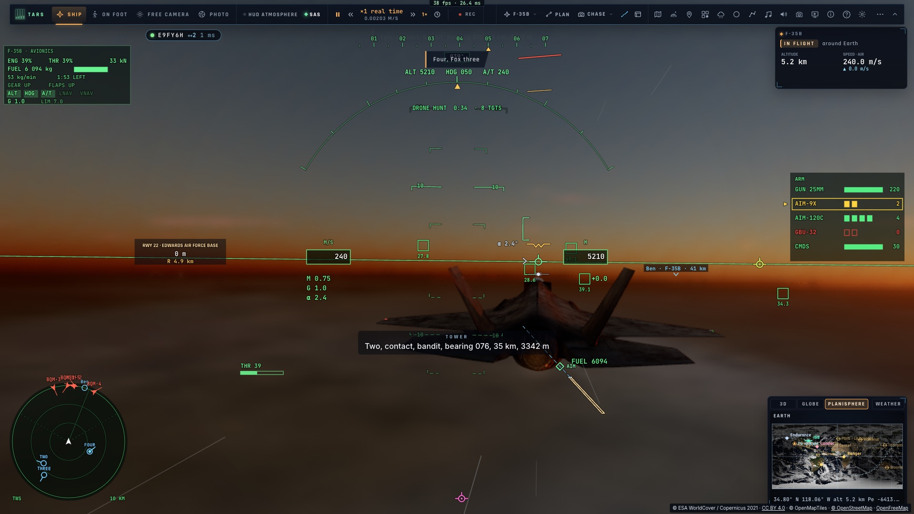

# F3 — Les ailiers IA

*2026-10-15 — [PLAN-AVIATION-AAA](../../PLAN-AVIATION-AAA.md), phase F.*

## Leur avion (`game/aijet.ts`)
Un ailier IA vole **avec les forces du vrai F-35**, pas sur un rail :
- **l'air** : les tables aérodynamiques du F-35 (`aero.ts`), avec sa portance et sa traînée selon son incidence
  et son Mach, dans l'atmosphère de la Terre ;
- **le moteur** : la poussée du F135 selon l'altitude et la vitesse, à sec ou avec la postcombustion, et sa
  consommation ;
- son poids, qui baisse avec le carburant, et la gravité.

Il est piloté **comme le fait la loi de commande** : l'inclinaison est atteinte au taux de roulis permis (moins
en air mince et lent), le facteur de charge demandé pour la pente est obtenu en réglant l'incidence (limites :
7 g, 25°), et la vitesse est tenue par l'auto-manette. C'est un point matériel dont l'attitude se déduit de sa
vitesse, de son incidence et de son inclinaison. C4 l'affinera (attitude complète, manœuvres de combat).

Vérifié : palier stable à 230 m/s à 9 km ; à 60° d'inclinaison, 2 g et 4,3°/s, la valeur théorique.

## Les ailiers (`controller/wingmen.ts`)
- **Un à trois** (*Jeu › Formation › Ailiers IA*, la roue *Patrouille*, ou TARS) : Deux, Trois, Quatre. Ils se
  mettent en place dès que le F-35 vole (« Deux, en place »), et reviennent avec lui après un placement (le
  début d'un combat, une téléportation).
- **En formation**, chacun à son poste dans la formation choisie. Le ralliement passe par la course de C2, puis
  la loi de formation prend la main.
- **Les ordres** du leader, avec accusé de réception (« Deux, Trois ») :
  - formation, serrer, s'écarter, rejoindre ;
  - dégagement de 90° à 75° d'inclinaison avec postcombustion, puis cap tenu ;
  - attente étagée (300 m par poste) au-dessus du point du leader ;
  - retour à la base : cap vers le terrain le plus proche, puis attente au-dessus ;
  - me couvrir : la patrouille étalée, haut et large ;
  - attaquer ma cible (le verrouillage du leader) ; engager les hostiles (le plus proche, chacun le sien).
- **Au combat** : ils poursuivent leur cible (la course, puis 900 m derrière elle). Ils tirent l'AIM-120 entre 6
  et 35 km et l'AIM-9X de près, la cible devant le nez. Leurs missiles volent comme ceux du joueur. Les
  agresseurs les prennent pour cibles aussi : touchés (« Deux, touché ! »), ils peuvent être **abattus** (« Deux
  est abattu ! »). Ils s'écrasent aussi s'ils touchent le sol.
- **La radio** : les contacts annoncés à partir du radar (« Deux, contact, bandit, au 054, 37 km, 4 701 m »,
  dans les unités choisies, toutes les 8 s au plus), « Fox trois », « Fox deux », « Splash ».
- **Au radar**, par la liaison de données : amis, bleus.
- **En réseau**, l'hôte les fait voler. Leurs positions partent dix fois par seconde ; les autres les dessinent
  (prolongées entre deux envois) et les ont au radar par la liaison.

## Mesuré
- `tests/wingmen.test.ts` (sans rendu, 6 km, 230 m/s, air calme) :

| Situation | Résultat |
|---|---|
| Trois en losange, ligne droite | tenus à 1,3 m |
| Le leader vire de 90° | 4,4 m au pire |
| Dégagement à gauche | les deux virent de 86° |
| Puis rejoindre | à 15 m en 194 s, puis 1,3 m |
| Attente | +300 m et +600 m au-dessus du leader |
| Retour base | cap vers le terrain le plus proche |
| Chasse aux drones, « engagez » | deux drones abattus ; « Fox three », « splash one » |

- Dans le jeu (`tests/e2e/f35-wingmen`, deux pages sur kerr-mini) :
  - Ana au-dessus d'Edwards avec trois ailiers : le losange formé et tenu à 1,4 m ;
  - Ben, à 300 m de son aile dans le même salon, voit les trois ailiers d'Ana et les a au radar ;
  - la chasse aux drones : « Engage bandits ». Contacts annoncés, « Fox three » de Deux et Quatre, deux drones
    abattus.
- Sans régression : `f35-combat`, `f35-radar`. 1 176 tests unitaires passent.

| Ana et ses trois ailiers en losange | Vus depuis l'avion de Ben | Au combat |
|---|---|---|
|  |  |  |
