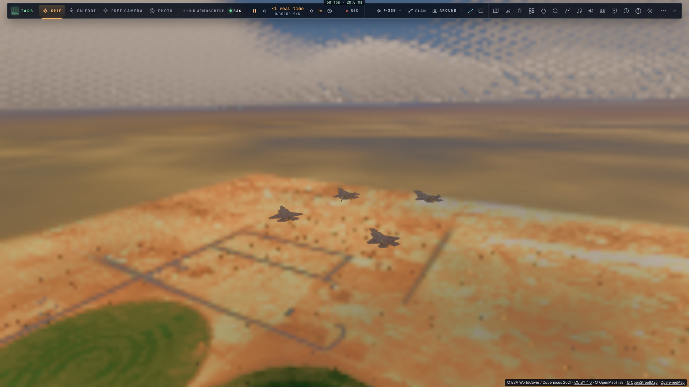
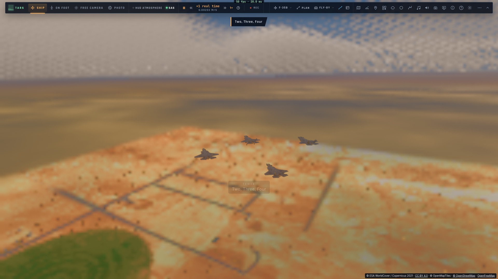

# F4 — Les manœuvres de patrouille

*2026-10-15 — [PLAN-AVIATION-AAA](../../PLAN-AVIATION-AAA.md), phase F.*

## Changer de poste sans à-coup (`game/formflow.ts`)
- Le poste volé **glisse** vers le nouveau, à 12 m/s.
- Pour passer de l'autre côté du leader dans une formation serrée, il passe **dessous et derrière lui** (le
  « cross-under » : 40 m derrière, 10 m sous le plus bas des deux niveaux), jamais à travers lui. Mesuré : au plus
  près, 30 m du leader.
- Dans une formation tactique (des centaines de mètres), le déplacement est direct et plus rapide (jusqu'à 60 m/s).
- Cela vaut pour les ailiers IA comme pour un joueur en formation dans un salon.

## Les virages en patrouille
Dans une formation tactique (ligne de front, patrouille étalée), passé 60° de virage du leader, **les ailiers
changent de côté** (le virage croisé) : celui qui était à l'extérieur ne reste pas loin derrière, et la
formation se retrouve symétrique après le virage. Mesuré, après un virage de 90° : ligne de front n° 3 passé de
gauche à droite, tenu à 0,6 m ; patrouille étalée n° 2 de droite à gauche, 1,2 m.

## Le décollage en patrouille
- Le F-35 aligné sur une piste avec des ailiers IA : **Deux à côté de lui** (15 m), **le second élément 200 m
  derrière** (Trois dans l'axe, Quatre à côté).
- Freins serrés tant que le leader ne roule pas. Deux part avec lui et tient sa place à côté ; l'élément part
  **8 s après**, pleine puissance. Rotation à 70 m/s.
- En l'air, chacun rejoint son poste dans la formation choisie, par la transition fluide.
- Le modèle de l'avion IA a désormais un **mode au sol** : roulage guidé sur l'axe, frottement des roues (et des
  freins), rotation, décollage quand la portance porte l'avion, toucher des roues accepté sous 4 m/s de taux de
  chute (au-delà : écrasé), freinage jusqu'à l'arrêt.

## L'atterrissage en patrouille
- Le leader en finale (train sorti, sous 600 m, en descente) : **Deux se place à côté et un peu derrière**,
  l'élément **900 m derrière sur le plan de descente de 3°**.
- Quand le leader touche, ceux qui sont encore en l'air font **leur propre approche vers son point de toucher**
  : l'axe de la piste, le plan de 3°, l'arrondi sous 12 m, 75 m/s.
- Posés, ils freinent jusqu'à l'arrêt (« Deux, posé »).

## Le passage en losange
Un ordre de plus, « Passage en losange » (roue *Patrouille*, TARS, hors ligne aussi) : losange serré, puis la
caméra de passage, qui attend la patrouille devant elle sur sa route.

## Mesuré
- `tests/flight-manoeuvres.test.ts` (sans rendu) :
  - changement de côté : passé 39 m derrière et 10 m dessous, jamais à moins de 30 m du leader ;
  - décollage à Edwards : le leader décolle à 10,5 s, les trois ailiers 8,0 s après lui, puis le losange tenu à
    1,1 m ;
  - atterrissage sur la 22 d'Edwards (leader en finale à 3°, posé à 120 s) : les trois posés à 146 s, arrêtés,
    aucun cassé.
- `tests/formations.test.ts` : les virages croisés (ligne de front, patrouille étalée). Les formations serrées
  sont inchangées (1 m en ligne droite).
- `tests/orders.test.ts` : « en losange » depuis l'échelon droite. Deux passe dessous et se cale à 1,7 m.
- Dans le jeu (`tests/e2e/f35-flight-ops`, kerr-mini) : aligné à Edwards avec trois ailiers au sol, décollage en
  patrouille (« Airborne », les trois en l'air), losange formé dans la montée à 9,6 m ; « Passage en losange » :
  serré, la caméra de passage.
- 1 179 tests unitaires passent.

| Le losange dans la montée, après le décollage | Le passage en losange, vu de la caméra de passage |
|---|---|
|  |  |
