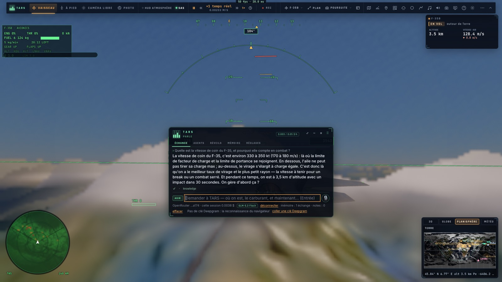
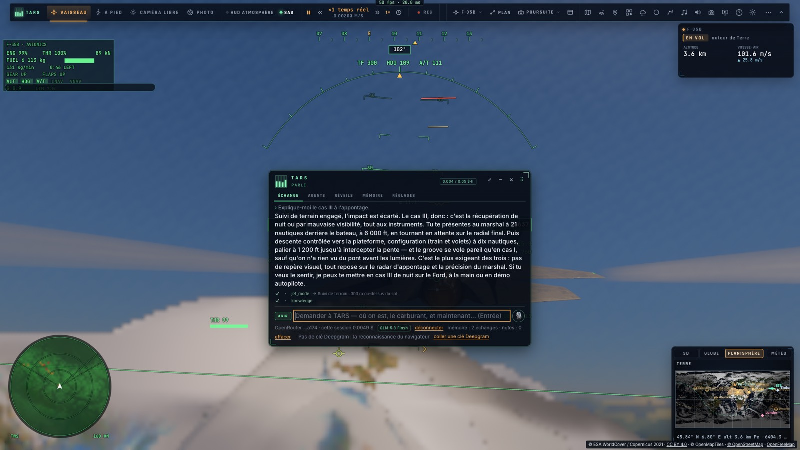

# I1 — La base de connaissances de TARS

*2026-10-16 — [PLAN-AVIATION-AAA](../../PLAN-AVIATION-AAA.md), phase I1.*

## Les pages (`docs/aviation/fr`, `docs/aviation/en`)
Onze pages, en français et en anglais, aux sections parallèles :
- **le F-35** : l'avion (B et C), ses limites (7 g, 50° d'incidence, Mach 1,6, le train), sa loi de commande, les
  touches utiles, ses protections, les procédures normales ;
- **le pilotage de base** : assiette, puissance et trim, virer, monter et descendre, le décrochage, les
  instruments, les erreurs courantes ;
- **l'énergie** : vitesse et hauteur, l'excédent de puissance, la vitesse de coin, la gestion en combat et en
  approche, des règles simples ;
- **le combat tournoyant** : la géométrie, les poursuites, le cercle de virage, les manœuvres (break, yo-yo,
  ciseaux), les domaines de tir, la défense ;
- **la patrouille** : les positions, le leader et ses ordres, rejoindre, tenir sa place ;
- **le porte-avions** : le F-35C sur les brins (catapulte, approche, ball, brins, annonces, notes), les cas I, II
  et III, le F-35B (appontage vertical, décollage court), les erreurs ;
- **l'ILS** : le système, la procédure du jeu (IAF, localizer, glide, FAF, minimums, arrondi), comment le voler ;
- **les urgences** : la perte de contrôle (⇧X, la vrille), le sol (GCAS, GPWS), moteur et carburant (bingo), le
  train, en combat ;
- **le radar** : les modes (RWS, TWS, STT), l'image (l'écran et son relief, l'IFF, la liaison de données, le
  TSD), ses limites ;
- **les armes** : AIM-120, AIM-9X, GBU-32, le canon, les leurres, les configurations, tirer, les menaces ;
- **le trafic** : les vrais avions et navires, les lire, en intercepter un, le vol réel d'une mission.

Les chiffres sont ceux du jeu (mesurés en V, M, P) et du vrai avion.

## L'outil `knowledge` (`src/ai/knowledge.ts`)
- **Les pages sont intégrées au jeu** (importées comme texte : aucune requête) et découpées en sections.
- **`search`** renvoie les sections qui répondent le mieux à une question, avec leur extrait. Le classement :
  - les mots rares pèsent plus, le titre d'une section compte triple ;
  - les accents, la casse et les mots vides sont ignorés ;
  - un début de mot suffit (« appont » trouve « appontage », « missiles » trouve « missile ») ;
  - la langue du pilote passe d'abord.
- **`read`** renvoie une page entière, ou une section (par un mot de son titre).
- **Son prompt** dit qu'il est aussi **copilote de chasse**, le navigateur et l'ailier du F-35. Pour toute
  question d'aviation, il cherche d'abord dans sa base, répond à partir d'elle, brièvement et dans les unités du
  pilote, sans inventer de chiffre, puis propose de le faire (approche, porte-avions, modes, leçon, patrouille,
  mission).

## Mesuré
- **`tests/knowledge.test.ts`** :
  - les onze pages dans chaque langue, les mêmes sections ;
  - **sept questions** tombent sur la bonne section, en français comme en anglais (« vitesse d'approche
    porte-avions brin » → « Le F-35C sur les brins », « corner speed » → « La vitesse de coin »…) ;
  - une section lue par un mot de son titre.
- **`tests/e2e/knowledge.e2e.test.ts`** sur kerr-mini (les Alpes d'abord) :
  - l'outil dans la page, les pages bien intégrées : « vitesse de coin » → « L'énergie — La vitesse de coin » ;
  - **TARS en direct** (OpenRouter, glm-5.3-flash), en français :
    - « Quelle est la vitesse de coin du F-35, et pourquoi elle compte en combat ? » : il cherche dans sa base et
      répond 330 à 350 kt (170 à 180 m/s), le meilleur taux de virage et le plus petit rayon ;
    - « Explique-moi le cas III à l'appontage. » : il cherche et répond avec le marshal à 21 nautiques et 6 000 ft,
      la configuration à dix nautiques et le palier à 1 200 ft ;
    - au passage, il a vu l'avion descendre vers le relief des Alpes et a engagé de lui-même le suivi de terrain.

## Écarts
- **Une recherche par mots, pas par le sens** : une question tournée très loin des mots des pages peut mal
  tomber. TARS lit alors la page entière.
- **Les pages sont courtes** (environ 300 mots chacune) ; elles s'enrichiront avec les phases suivantes.
