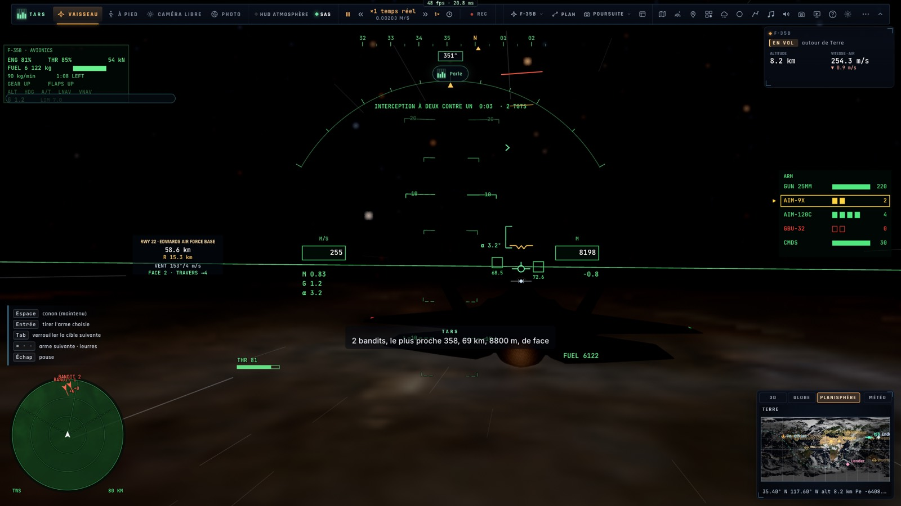
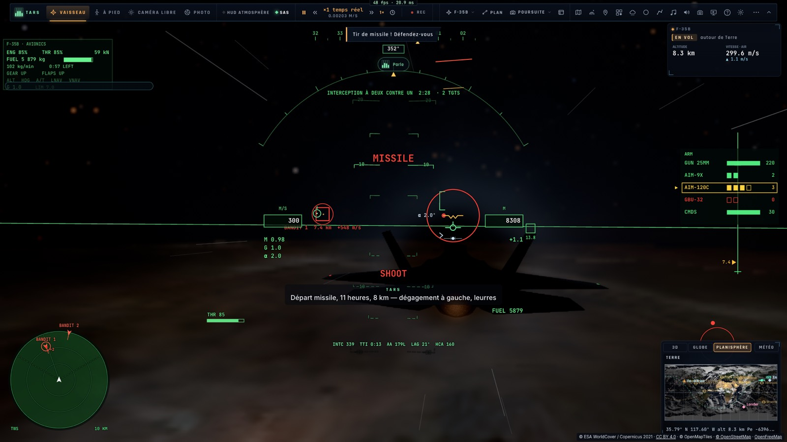
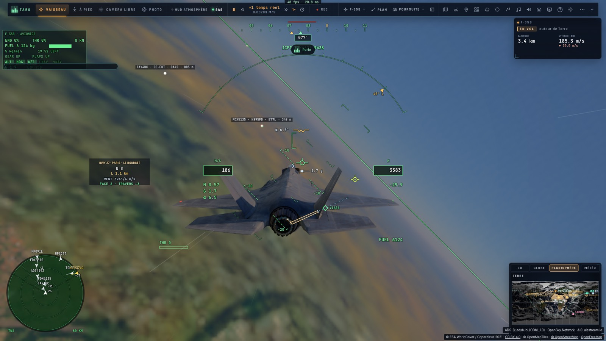

# I2 — Les mains du copilote

*2026-10-16 — [PLAN-AVIATION-AAA](../../PLAN-AVIATION-AAA.md), phase I2.*

## Les menaces annoncées (`game/threats.ts`, `controller/copilot.ts`)
En combat, TARS joue le navigateur en place arrière et annonce lui-même, à la voix et en sous-titre :
- **un missile tiré sur nous**, à l'instant : où il est sur l'horloge, à quelle distance, et quoi faire.
  - Un missile : « Départ missile, 11 heures, 8 km — dégagement à gauche, leurres » (le dégagement du côté du
    missile).
  - Un SAM : « Tir SAM, 10 heures, 14 km — mettez-le au travers, paillettes ».
- **le même missile à moins de 3 km** : « Missile 11 heures, tout près — dégagez maintenant ! », une seule fois ;
- **sa fin** : « Missile leurré » ou « Missile évité » ;
- **les bandits nouveaux au radar**, par leur **BRAA** : relèvement, distance, altitude, aspect (de face, en
  flanc, travers, de dos).
  - Plusieurs à la fois forment un groupe : « 2 bandits, le plus proche 358, 69 km, 8800 m, de face ».
  - Un contact disparu une minute est annoncé de nouveau à son retour.
- **un bandit à moins de 10 km, de face** : « Bandit proche, 11 heures, 10 km, de face » ;
- **un site SAM vu** : « SA-6, 3 heures, 21 km » ;
- **un coup reçu** : « On est touchés — dégâts 35 % » ;
- **une victoire** : « Un au tapis — BANDIT 1 ».

**Les priorités.** Les missiles et les coups passent tout de suite, en priorité 1 de la file vocale : ils
coupent ce qui se dit. Le reste attend son tour, à 3 s d'écart. Les amis et les neutres ne sont jamais annoncés.
Les distances et les altitudes sont dans les unités du pilote.

**Le réglage** *Annonces des menaces* (F-35, activé par défaut).

## Les outils de TARS
- **`traffic`** : les avions autour de nous. En F-35 en vol, c'est l'image radar : le vrai trafic, la salle, les
  ailiers, ceux du combat. Sinon, c'est le trafic entendu. Ses actions :
  - `list` : les plus proches, avec indicatif, type, immatriculation, distance, relèvement, horloge, altitude et
    écart, cap, vitesse, aspect ;
  - `info` : un avion par son indicatif (la casse, les espaces et un début suffisent) ;
  - `intercept` : l'interception volée sur lui, par son id radar. Il est suivi même hors du faisceau, par son
    transpondeur ou la liaison de données. La description demande de ne pas toucher aux commandes ensuite : un
    « pleins gaz » coupait l'interception ;
  - `join` : la patrouille sur lui, à notre place dans la formation choisie s'il s'agit d'un avion de ligne, sinon
    son ombre ;
  - `stop` : l'interception ou la patrouille relâchée.
- **`weapons`** : les armes et le radar. Ses actions :
  - `status` : l'arme choisie, les emports, les domaines de tir, les dégâts, les cibles restantes, le mode et le
    verrou du radar ;
  - `threats` : l'image tactique, avec les missiles sur nous, les hostiles en BRAA et les dernières annonces ;
  - `select` : choisir une arme ;
  - `lock` : verrouiller une piste par son nom, ou la suivante ;
  - `radar` : le mode RWS, TWS ou STT ;
  - `fire` : le tir. Il renvoie ce qui reste, pour que TARS ne se trompe pas de compte ;
  - `gun` : une rafale, de 0,2 à 3 s ;
  - `countermeasures` : leurres et paillettes.

  TARS tire quand le pilote l'ordonne, sans confirmation.
- **`mission modify`** : une mission changée par une phrase (`game/missionedit.ts` `patchMission`).
  - Le titre, le briefing, le départ, l'heure, la météo et la limite sont remplacés.
  - Les unités, objectifs et déclencheurs sont fusionnés par leur id (ou ajoutés). `remove` les retire.
  - **Une unité retirée emporte les objectifs qui la visent.** Ceux qui venaient après eux viennent après ce qui
    les précédait. Un objectif changé voit ses mots refaits, et la limite de temps est recalculée si les lieux
    bougent.
  - Une mission du jeu modifiée devient une copie parmi celles du pilote.
- **La patrouille et le porte-avions** existaient déjà (`flight_lead`, `carrier`).
- **Son prompt** dit qu'il a des mains de copilote, et qu'en combat il reste bref.

## Mesuré
- **`tests/threats.test.ts`** :
  - l'horloge, le relèvement, l'aspect et le BRAA (« 045, 32 km, 6000 m, de face ») ;
  - la veille, scénario complet : missile annoncé une fois, puis tout près, puis leurré ; SAM au travers ; trois
    bandits en un groupe ; un ami jamais annoncé ; le site SAM après l'écart ; le bandit proche ; le coup, la
    victoire ;
  - une mission modifiée comme TARS le ferait : le SAM déplacé à Ajaccio, le camion retiré avec son objectif,
    l'appontage remis à sa place dans l'enchaînement, la tempête.
- **`tests/e2e/copilot.e2e.test.ts`** sur kerr-mini (les Alpes d'abord), TARS en direct (glm-5.3-flash), en
  français :
  - **le combat à deux contre un** : « 2 bandits, le plus proche 358, 69 km, 8800 m, de face » dès le radar.
  - « Verrouille BANDIT 1 et tire un AMRAAM. » :
    - lock, select, fire, puis « BANDIT 1 verrouillé à 67 km, FOX 3 parti — trois AMRAAM restants » ;
    - puis, de lui-même : « Bandit proche, 11 heures, 10 km, de face » et « Départ missile, 11 heures, 8 km —
      dégagement à gauche, leurres » ;
    - « Quelle est la menace ? » : threats, leurres largués, dégagement à gauche ordonné aux ailiers.
  - **au-dessus de Paris, le vrai trafic**, avec « Quels avions autour de nous ? » : « Huit avions autour, tous
    neutres : le plus proche un 767 de FedEx à 8,6 km à nos dix heures… ».
    - « Intercepte le FDX6321. » : l'interception est engagée sur lui.
  - « Modifie la mission de frappe en Corse : mets une tempête et enlève le camion. Ne la lance pas. » : la copie
    est gardée, avec la tempête et les unités Ford, SA-6 et chasseur.
    - Au premier essai, retirer le camion échouait, car l'appontage venait après lui. TARS avait alors retiré
      l'appontage aussi, tout en disant qu'il restait.
    - L'enchaînement est maintenant repris : le second essai l'a fait en un appel.

## Écarts
- **Pas d'image propre à l'IA ennemie** : les bandits ne sont annoncés que vus par le radar (ou, dans un autre
  appareil, par le monde du combat). Les missiles, eux, sont toujours annoncés : c'est l'alerte missile de
  l'avion.
- **Les annonces de menaces suivent le combat local**. Dans un match en réseau, les missiles des autres joueurs
  passent par le même monde et sont donc annoncés. Les annonces restent individuelles : pas de diffusion à la
  patrouille avant I4.
