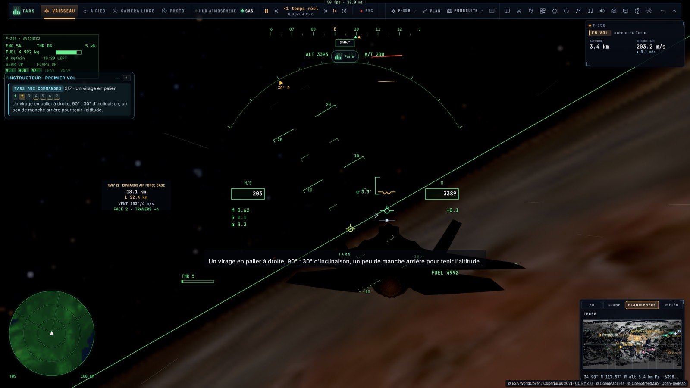
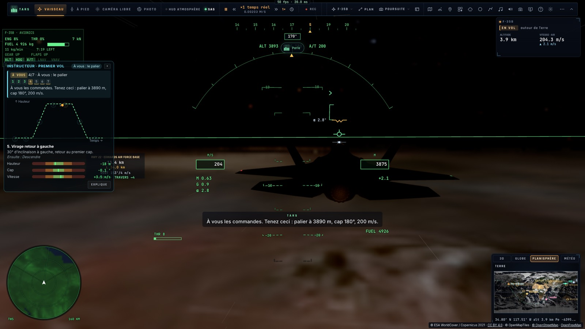
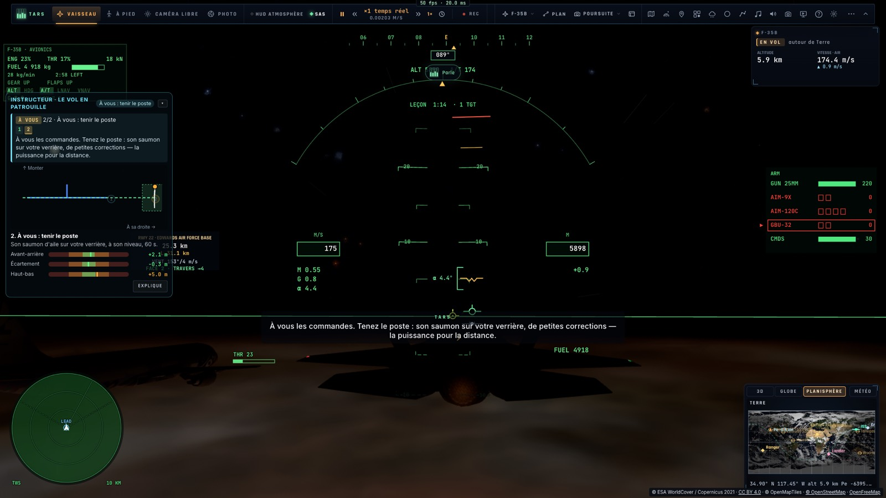
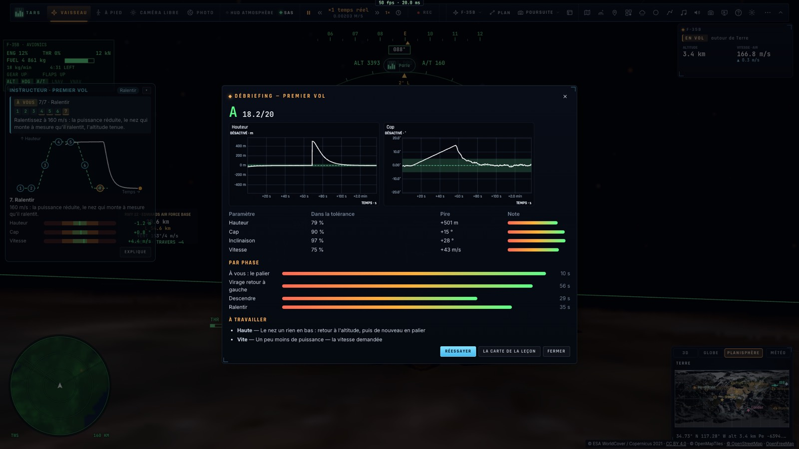

# I3 — Le mode instructeur : TARS vole d'abord, puis vous

*2026-10-16 — [PLAN-AVIATION-AAA](../../PLAN-AVIATION-AAA.md), phase I3.*

## Les leçons guidées (`game/course.ts`, `controller/course.ts`)
Chaque leçon de l'école de vol peut maintenant être **guidée**, comme le fait un vrai instructeur :
- **TARS vole la première partie.** Il dit chaque étape au moment où il la commence (voix et sous-titres), et le
  pilote automatique l'exécute : les tenues d'altitude, de cap et de vitesse, l'autopilote ILS, celui du
  porte-avions ou l'interception.
- **Puis il passe la main** : « À vous les commandes ».
  - Dans un tour de piste ou une approche, les tenues sont relâchées et le pilote vole seul.
  - Près d'un autre avion (patrouille, interception, canon), l'avion reste « trimé » : son altitude et sa vitesse
    sont tenues jusqu'à ce que le manche et la manette les reprennent.
- **L'instructeur d'A4 regarde les étapes du pilote.** Il les mesure contre leurs cibles, annonce chaque écart
  avec sa correction, puis débriefe avec des graphiques, un tableau par paramètre et par étape, et les points à
  travailler.

**Les données d'une leçon.** C'est une suite d'étapes. Chacune dit qui vole, ce qu'elle demande (un écart
d'altitude, de cap, une vitesse, une inclinaison, relatifs au départ) et ce que fait l'autopilote à son début.
Elle se termine quand ses cibles sont tenues un moment, quand son temps est écoulé ou sur un événement vu par le
contrôleur, avec une durée maximale :

| Événement | Ce qu'il signifie |
|---|---|
| point de base | 3 km après le seuil, en vent arrière |
| axe | aligné sur l'axe de piste |
| x > −3,5 km | à 3,5 km du seuil en finale |
| toucher | l'avion est posé |
| finale porte-avions | l'appontage entre en finale |
| poste | au poste de patrouille, à moins de 12 m |
| < 25 km | la cible à moins de 25 km |
| derrière | 1,5 km derrière la cible |
| six | dans les six heures de la cible, à portée de canon |
| abattu | la cible détruite |
| figure finie | la figure de voltige terminée |

**Les modes.** *Guidé* fait TARS puis vous. *Démonstration* ne fait que la partie de TARS. *Essayer* ne fait que
la vôtre.

### Six nouvelles leçons (18 au total)

**Premier vol** (2 500 m au-dessus du Mojave, instructeur « de base »).
- TARS : le palier, un virage de 90° à droite à 30°, une montée de 500 m.
- Vous : le palier tenu 10 s, le virage retour à gauche, la descente, le ralentissement à 160 m/s.
- Paramètres surveillés : altitude, cap (l'inclinaison tant que le virage reste à faire), vitesse.

**Tour de piste** (piste 22 d'Edwards, instructeur « tour de piste »).
- TARS vole la vent arrière à 300 m et 1,8 km de travers, train sorti. Il corrige sa route sur l'écart latéral.
- Vous : le virage de base, la finale sur le plan à 3°, l'atterrissage.
- Paramètres surveillés : la hauteur (celle de la branche, puis du plan), l'écart à la trajectoire, la vitesse.

**Atterrissage.**
- TARS vole de 6 à 3,5 km sur l'autopilote ILS.
- Vous : la fin de finale, l'arrondi, le toucher.

**ILS, cas I, figures** (les leçons d'A4, désormais guidées).
- ILS : TARS jusqu'à 7 km, puis l'ILS rendu manuel.
- Cas I : TARS fait le break et la vent arrière ; le groove est à vous.
- Figures : la démonstration, puis la même figure remise à son entrée et jugée.

**Patrouille.**
- Un leader, **LEAD**, est créé 1,5 km devant. TARS fait la rejointe en échelon droite, 40 m derrière et 40 m à
  droite.
- Vous : tenir le poste 60 s.
- Paramètres surveillés : avant-arrière, écartement, haut-bas.

**Interception.**
- Un **UNKNOWN** est créé à 47 km : neutre, transpondeur coupé, croisant de droite à gauche 1 000 m plus haut.
- TARS verrouille et vole la route de collision jusqu'à 25 km.
- Vous : la collision, puis le retard et la conversion jusqu'à 1,5 km dans sa queue.
- Paramètres surveillés : le cap contre la route idéale (collision au-delà de 8 km, poursuite ensuite) et l'écart
  d'altitude.

**Canon.**
- Un drone **BQM-7** tourne en hippodrome. TARS nous place dans ses six heures.
- Vous : le réticule et des rafales jusqu'à l'abattre.
- Paramètres surveillés : la visée latérale et en hauteur (en degrés) et la distance (300 à 600 m).

## L'interface
- **Les fiches.** Elles ont un nouveau bouton **Guidé : TARS, puis vous**, en plus de *Regarder la démonstration*
  et *Essayer*. Chaque nouvelle leçon a son schéma :
  - le profil temps–altitude du premier vol ;
  - le tour de piste vu d'en haut, avec la piste ;
  - le leader vu de derrière, avec son poste ;
  - l'interception dans le repère de la cible ;
  - le réticule du canon.
- **Le panneau de l'instructeur** montre en plus :
  - qui vole : **TARS AUX COMMANDES** ou **À VOUS** ;
  - les étapes numérotées (faites en vert, en cours en jaune, celles du pilote soulignées) ;
  - les derniers mots de TARS ;
  - notre tracé dans le plan de la leçon.
- **Le débriefing des nouvelles leçons** trace les deux premiers paramètres contre le temps, avec leur tolérance.
- **L'outil `lesson` de TARS** reçoit l'action `guided`, celle par défaut pour « apprends-moi… ». Sa description
  lui demande de ne plus rien toucher une fois la leçon lancée : au premier essai en direct, il avait ajouté des
  ailiers et des ordres de patrouille, ce qui cassait la rejointe.
- **`__bh.flight.school.guided(id)`** lance une leçon guidée.
- Le tout est traduit en français, y compris les textes dynamiques (cibles en unités du pilote).

## Mesuré
- **`tests/course.test.ts`** :
  - **Les étapes** : la progression ; le passage sur cible tenue, sur temps ou sur événement tenu ; la durée
    maximale ; les modes démonstration et essai ; l'inclinaison comptée tant que le virage reste à faire ; chaque
    leçon a une partie TARS puis une partie pilote.
  - **Le premier vol, sans navigateur** :
    - TARS passe la main à 80 s, au cap 177° (parti de 87°), 500 m plus haut ;
    - un pilote régulier fait le reste ;
    - le débriefing donne **18,3/20**, avec les quatre étapes du pilote.
  - **La patrouille** : TARS rejoint LEAD et passe la main en 71 s, à 3 m avant-arrière, 1 m d'écartement et 1 m
    en hauteur.
  - **L'interception** : le passage de main se fait à 25 km, à 3,4° de la route de collision. La conversion
    termine la leçon à 231 s.
  - **Le canon** : TARS est dans les six heures du drone en 119 s (590 m). Les rafales l'abattent et la leçon se
    clôt.
  - **Le tour de piste** : TARS tient la vent arrière à 1 m de hauteur et 48 m de route près. Il passe la main au
    point de base, à 3 km après le seuil.
- **`tests/e2e/course.e2e.test.ts`** sur kerr-mini (les Alpes d'abord) :
  - le premier vol lancé par un vrai clic : le virage de TARS sur le panneau, « À VOUS », le débriefing à
    **18,2/20** ;
  - la patrouille guidée : la rejointe sur LEAD et le passage de main au poste, à 3 m avant-arrière, 0 m
    d'écartement et 6 m en hauteur ;
  - **TARS en direct** : « Apprends-moi à faire une interception. » Il lance la leçon guidée, dit une phrase et
    ne touche plus à rien : l'interception est engagée, à l'étape 1, 20 s après.

## Un défaut trouvé en route
- **L'anticollision montait l'avion au passage de main.** Au premier essai, l'avion lâché au poste grimpait de
  67 m en 3 s, pleins gaz.
  - L'interception, tant qu'elle volait, dispensait LEAD de l'ACAS (A2). Une fois relâchée, LEAD à 40 m devenait
    un conflit, et l'ACAS déclenchait une montée d'évitement.
  - Correction : l'appareil de la leçon (le leader, le drone) est exclu de l'ACAS, sauf pour l'interception.
  - Mesure sans navigateur : 10 s sans les mains, l'avion reste à 1 m de hauteur du poste.

## Écarts
- **Au clavier, la patrouille et le canon restent durs.** L'avion trimé aide, mais l'instructeur sera sévère.
  Une manette (HOTAS) est conseillée.
- **Les leçons de vol se déroulent au-dessus du Mojave.** Elles ne sont pas encore partagées en salle : chaque
  pilote suit la sienne.
