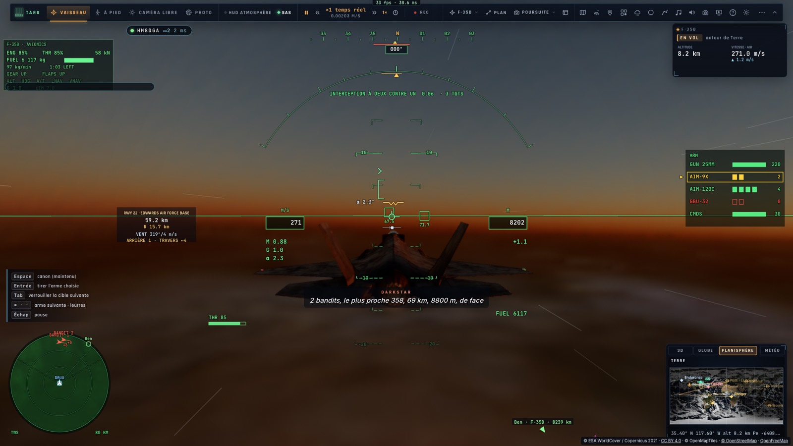
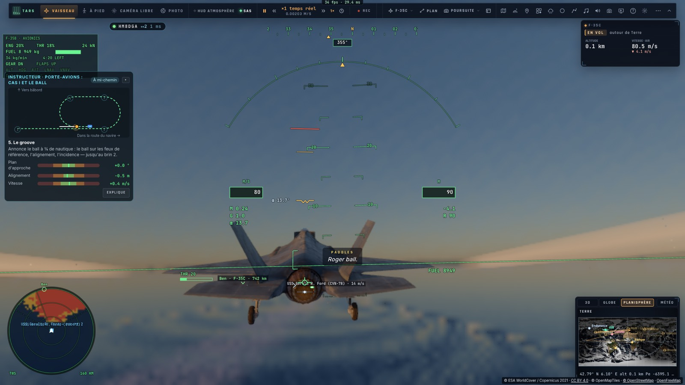
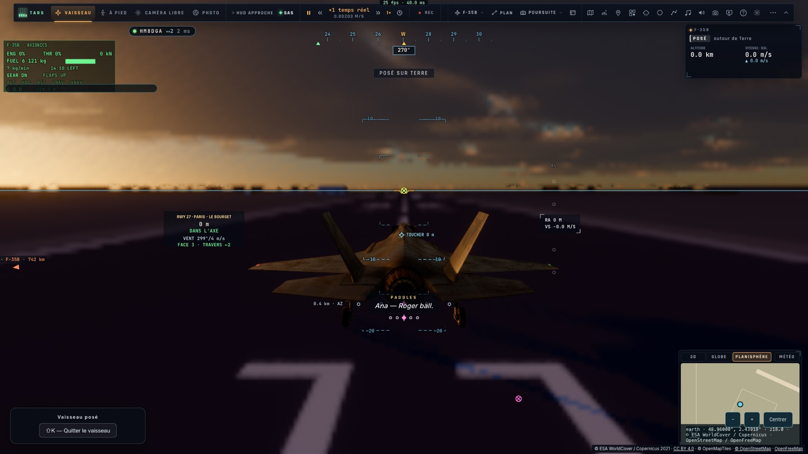

# I4 — Les voix des rôles, à la radio de la patrouille

*2026-10-16 — [PLAN-AVIATION-AAA](../../PLAN-AVIATION-AAA.md), phase I4.*

## Les rôles (`game/radio.ts`)
La radio de la patrouille ne parle plus d'une seule voix, celle de la tour. Chaque rôle a désormais :
- **sa voix** : une voix Deepgram par rôle (les quatre différentes en anglais ; le français n'en a que deux,
  partagées) ou, sans Deepgram, une autre voix système de la langue avec son débit et sa hauteur ;
- **son nom dans les sous-titres**, avec sa couleur ;
- **le grésillement radio**.

| Rôle | Nom dans les sous-titres | Ce qu'il dit |
|---|---|---|
| Ailier | **AILIER** | « Deux, en place », « Deux, contact, bandit, au 358, 70 km, 8840 m », ses tirs, ses victoires, ses dégâts |
| AWACS | **DARKSTAR** | la situation : les bandits nouveaux au radar par leur BRAA, les groupes, les sites SAM, les victoires confirmées, la *bogey dope* |
| Porte-avions | **MOTHER** | les récupérations par cas, les autorisations, les catapultages, les qualifications |
| Officier d'appontage | **PADDLES** | « Roger ball », « De la puissance ! », l'alignement, le *wave-off*, les notes et les brins |

- **Le rôle d'une annonce existante est reconnu à ses mots** (« Paddles : … », « F-35C, Mother : … », « Shooter : »),
  en anglais comme en français. Le nom du rôle est alors retiré du texte, puisque le sous-titre le porte ; un
  destinataire (« F-35C, … ») est gardé. Les ailiers passent leur rôle directement.
- **TARS ne garde que ce qui est à lui** : les missiles sur nous (dégagement, leurres), les coups reçus. La
  situation (bandits, groupes, SAM, victoires) passe à Darkstar.
- **Paddles parle en priorité** : ses appels coupent les autres, comme sur un vrai pont.
- **La *bogey dope*.** TARS (outil `weapons`, action `bogey_dope`) demande à Darkstar le bandit le plus proche ;
  Darkstar répond de sa voix, par exemple « Darkstar : bogey dope — 359, 67 km, 8800 m, travers, hostile, BANDIT 1 ». Son
  prompt lui dit de ne pas répéter leurs annonces.

## La radio de la patrouille, en réseau
- **Les annonces des rôles qui concernent notre avion** (nos ailiers, notre porte-avions, notre officier
  d'appontage) partent aux pilotes de la salle : un événement `radio`, avec le rôle et le texte.
- **Chacun les entend dans la voix du rôle, le nom du pilote devant** : « Ana — Roger ball. ».
- **Darkstar n'est pas partagé** : chacun a la sienne, tirée de son propre radar.
- **Le réglage *Rôles radio*** (F-35, activé par défaut). Désactivé, tout repasse par la seule voix de la tour,
  et TARS reprend la situation.

## Un défaut trouvé en route
- **L'ACAS automatique visait notre propre ailier en combat** (« AUTO ACAS — Deux »).
  - En combat, les ailiers IA sont aussi des appareils du monde de combat (`cmb:`, pair négatif), et l'ACAS d'A2
    n'excluait que leurs pistes `wng:`.
  - Ils sont maintenant exclus ; les pilotes de la salle (pairs positifs) restent surveillés.

## Mesuré
- **`tests/radio.test.ts`** :
  - le rôle reconnu dans les annonces anglaises et françaises (Paddles, Mother avec destinataire, « ici Mother »,
    Shooter, Darkstar ; la tour et les ailiers non préfixés) ;
  - la situation à Darkstar, les missiles à TARS ;
  - chaque voix de rôle existe chez Deepgram, et les quatre voix anglaises sont différentes ;
  - les rôles partagés.
- **`tests/e2e/radio.e2e.test.ts`** sur kerr-mini (les Alpes d'abord), deux pages dans une salle :
  - Ana en combat à deux contre un avec un ailier IA :
    - Darkstar annonce « 2 bandits, le plus proche 358, 69 km, 8800 m, de face » (sous-titre DARKSTAR) ;
    - la *bogey dope* donne « 359, 67 km, 8800 m » ;
    - l'ailier annonce « Deux, en place » et « Deux, contact, bandit, au 358, 70 km, 8840 m » ;
    - TARS ne dit plus aucun bandit, et l'ACAS ne vise plus l'ailier.
  - Ana en finale du Ford, sur l'autopilote d'appontage :
    - Mother : « F-35C, Charlie. Cas I, les brins — le meatball à trois quarts de mille. » ;
    - Paddles : « Roger ball. ».
  - **Ben entend tout cela dans sa salle** : « Ana — Deux, en place », « Ana — F-35C, Charlie… » (Mother),
    « Ana — Roger ball. » (Paddles).

## Écarts
- **Le français n'a que deux voix Deepgram** (Agathe, Hector) : Darkstar et Mother partagent l'une, l'ailier et
  Paddles l'autre. Le nom dans les sous-titres et le débit les distinguent.
- **Les appels du pilote lui-même** (« Initial, three miles », « The break »), comme l'ACAS, gardent la voix de la
  tour.
