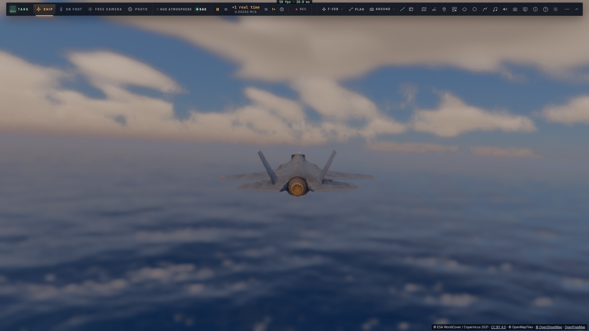
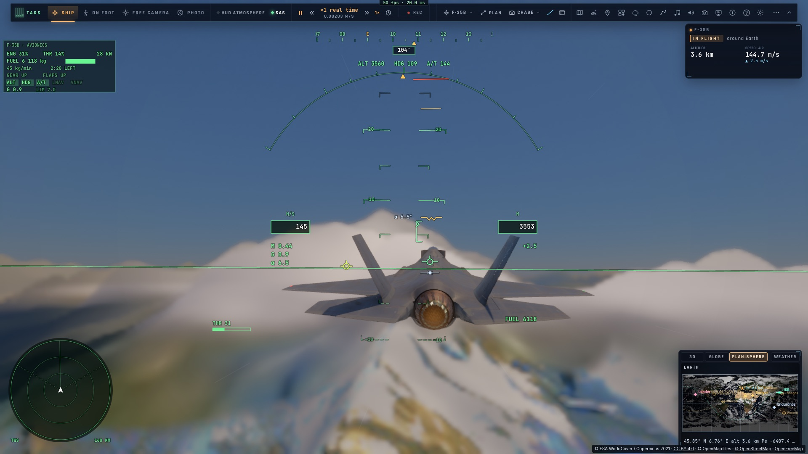
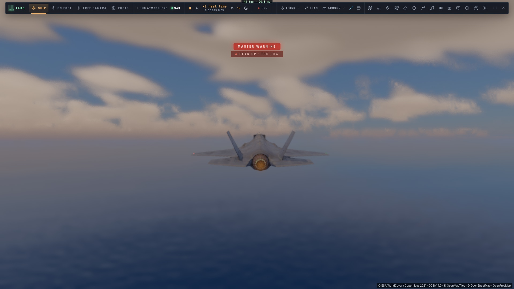
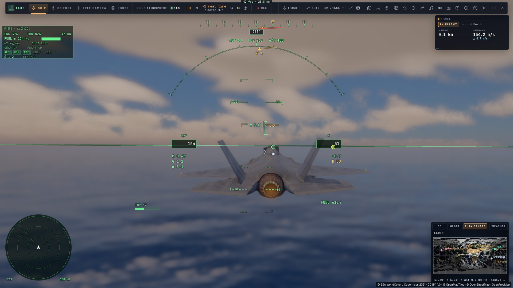
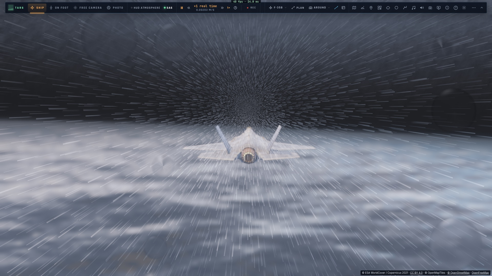
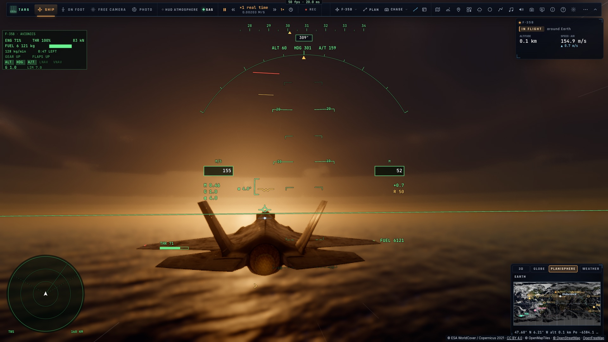

# M1 — La mer hyper-réaliste en vol

*2026-10-15 — [PLAN-AVIATION-AAA](../../PLAN-AVIATION-AAA.md), phase M.*

## Les vagues par FFT (`sea/spectrum.ts`, `sea/fft-gpu.ts`, `shaders/seafft.wgsl`)
- **Le spectre** :
  - la mer du vent et la houle sont chacune un **JONSWAP** (γ 3,3 et 6), calé pour que 4√m₀ redonne la hauteur
    significative demandée ;
  - chacune est étalée autour de sa direction (cos²ˢ, large pour la mer du vent, étroit pour la houle), en eau
    profonde ;
  - ses amplitudes aléatoires sont **tirées d'une graine fixe** : la même mer sur toutes les pages d'une salle.
- **Trois cascades de 256²** (périodes de 1024, 128 et 16 m), chacune avec sa propre bande de nombres d'onde : de
  la houle de 300 m aux vaguelettes de 12 cm, sans compter deux fois la même vague.
- **Sur le GPU, à chaque image** (`seafft.wgsl`) :
  - les modes à l'instant présent, puis les champs, deux réels par tableau complexe :
    - la hauteur ;
    - son déplacement horizontal (les crêtes pointues de Tessendorf) ;
    - ses pentes ;
    - les dérivées du déplacement, d'où le jacobien ;
  - les FFT inverses (lignes puis colonnes, 256 points en mémoire de groupe) ;
  - un tableau de textures de deux couches par cascade, (Dx, hauteur, Dz, J) et (pentes, leurs carrés), avec ses
    mips.
- **L'horloge des vagues** :
  - les pulsations sont des multiples de 2π sur 1024 s (le « temps de répétition » de Tessendorf) ;
  - le CPU envoie le temps modulo 1024 s, en float64, donc des phases exactes en float32 ;
  - c'était la panne : le temps de la scène (−1,3 milliard de s) rendait cos(ωt) absurde, et la texture restait
    vide ;
  - **en pause, tout s'arrête** (vagues, sillages, écume) et l'image converge.
- **Dans le noyau tracé** (`seaWavesFft`) :
  - le point ramené de son déplacement de crête ;
  - pour chaque cascade, les pentes au mip demandé par l'empreinte du pixel : leur moyenne donne la normale, leur
    second moment moins le carré de la moyenne donne la variance non résolue (LEAN, dans Cox–Munk) ;
  - **les moutons** là où la surface se replie : le jacobien passe sous un seuil calculé pour retrouver la
    couverture de Monahan au vent du moment, avec des traînées le long du vent.
- **L'empreinte de pixel de la mer**, deuxième panne trouvée :
  - le relief utilisait l'axe le plus long de l'ellipse de pixel (étiré des dizaines de fois en incidence
    rasante), multiplié par la taille du bloc temps réel ;
  - au-delà de 200 m, un pixel « couvrait » plus de 128 m de mer, et toutes les vagues étaient moyennées : la mer
    paraissait plate, anciennes vagues comprises ;
  - la mer a maintenant sa propre empreinte (moyenne des deux axes).
- **Le relief des vagues près de l'avion** (`seaSurfaceHit`) : sous 600 m et dans les 4 premiers km, le rayon est
  intersecté avec la surface déplacée (marche puis bissection). Une crête cache ce qui est derrière elle, coques
  des navires comprises.
- **Le ciel reflété** est la sonde lumineuse autour de l'appareil, avec ses vrais nuages. Le bleu de l'eau vient
  de la lumière qui y entre. La lumière traverse les crêtes en contre-jour.
- **Repli** (`Ciel › La Terre › Vagues de la mer par FFT`) : sur un appareil limité à moins de 19 textures, ou
  réglage désactivé, on retrouve les douze trains de vagues.

## L'état de la mer réel (`sea/marine.ts`)
- **L'API marine d'Open-Meteo** (sans clé) : hauteur, période et direction de la mer du vent et de la houle,
  heure par heure, sur la cellule de 0,25°. Un jour est chargé une fois par cellule.
- **À défaut** (terre, hors ligne, dates du jeu hors de portée), la mer que lève le vent : pleinement développée,
  Hs ≈ 0,21 U²/g et Tp ≈ 0,73 U.
- **Sa hauteur fait rouler les navires** de T3.

## Les tests
- **Les tests e2e attendent désormais que le ray tracer de la scène soit compilé** avant toute capture ou mesure
  (`renderer.tracerSettled`). Ils lisent l'état réel des noyaux et les étapes « Compilation du ray tracer » que
  montre la pastille, puis attendent trois images.
- **Ils affichent les FPS** sur tous les passages.
- **Le test de la mer commence par les Alpes** : on y voit le relief, puis viennent les quatre mers.

## Mesuré
- **`tests/sea-spectrum.test.ts`** :
  - Hs 2,50 m rendu pour 2,50 demandé (force 5 et houle) ;
  - 0,20 m pour une mer calme, 8,99 m pour une tempête de 9 m ;
  - aucun mode hors de sa bande ;
  - Σ|h̃₀|² vaut la moitié de la variance (0,204 m² pour 0,196) ;
  - la même graine donne la même mer ;
  - l'API marine : lecture, interpolation, directions « vers » ;
  - la mer du vent.
- **Relu sur le GPU en jeu** : écart-type des hauteurs de 0,54 m pour 0,56 attendu.
- **Coût GPU** (`tests/e2e/sea-cost`, force 5 à 60 m) :

  | | Passe FFT | Tracé avec FFT | Tracé avec les trains |
  |---|---|---|---|
  | **M1 Max** (ce poste, **chargé par une autre application GPU** : à refaire) | 0,33 ms | 11,0 ms | 10,0 ms |
  | **M1** (kerr-mini) | 1,71 ms | 14,1 ms | 15,6 ms |
- **Les quatre mers** (`tests/e2e/sea-fft`, après les Alpes), données en comparaison aux photos de référence :

- 1 199 tests unitaires passent. La descente lunaire (`landing-flight`) a échoué une fois sous la même charge, puis
  passe seule (7/7).

## Écarts
- **La comparaison avec les photos de référence reste à juger par toi** (critère de fin de M1).
- **Pas de couleur selon la profondeur** : la carte de relief écrête les fonds à 0 (`build-earth-relief.py`).
  Il faudra la reconstruire avec la bathymétrie (GEBCO ou ETOPO négatif) pour le turquoise des hauts-fonds.
- **Pas d'embruns** en volume. Les ombres des nuages sur la mer sont celles de la météo existante.
- **Sur le M1, la passe FFT coûte 1,7 ms.** On pourra la calculer une image sur deux ou alléger les mips.
- **Le relief des Alpes s'aplatit quand les tuiles de relief ne se chargent pas** (hors ligne). C'est un défaut à
  part, proposé en tâche séparée : il faut retomber sur le relief ETOPO.
