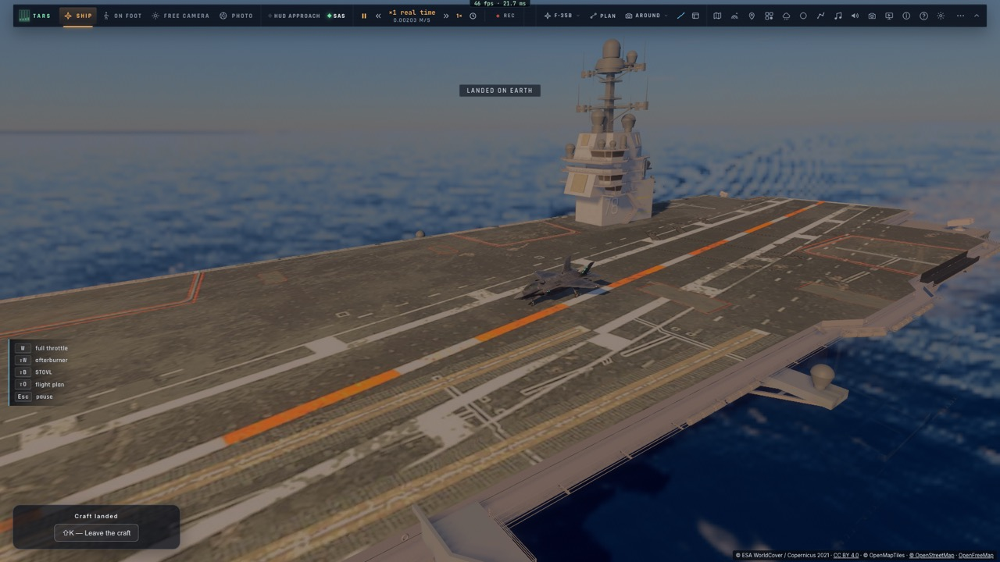
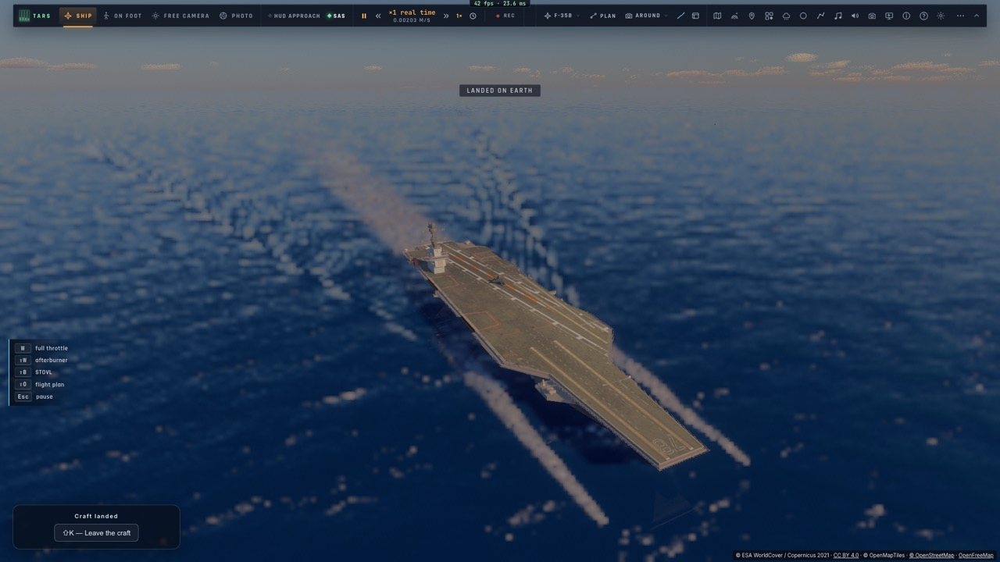
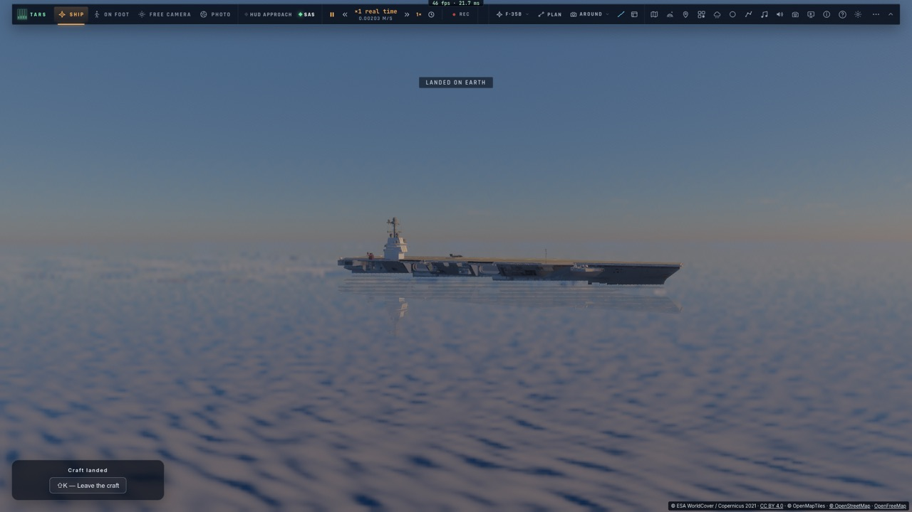
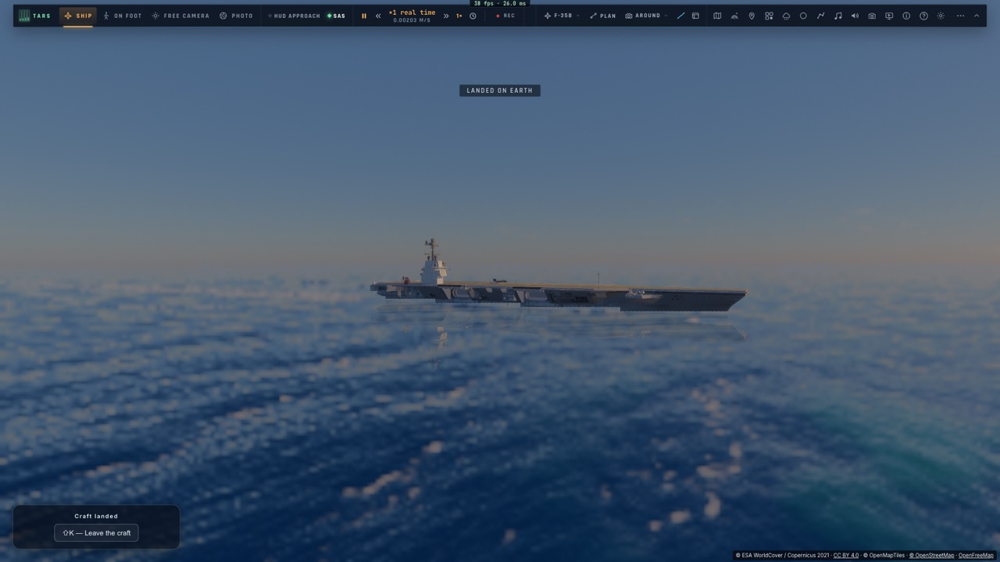
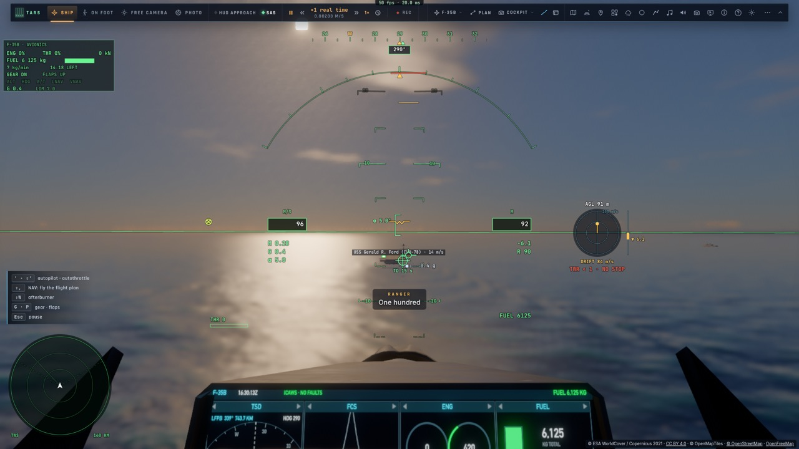
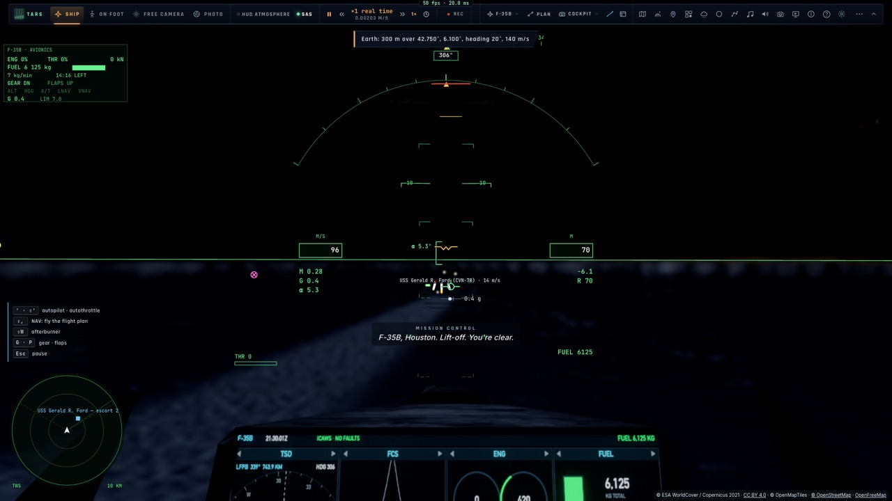
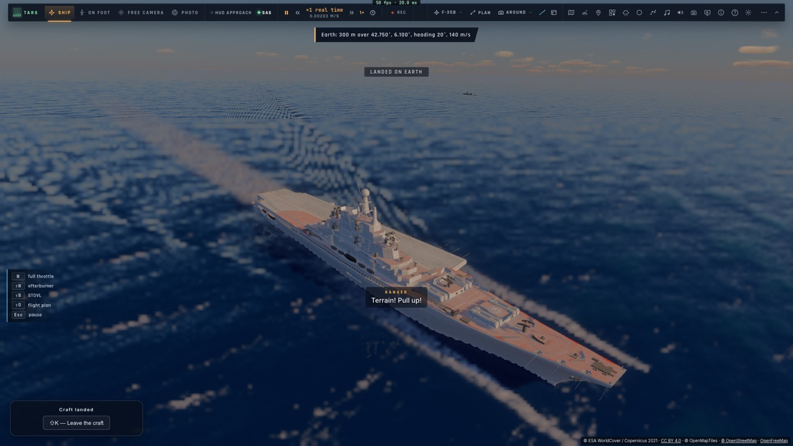
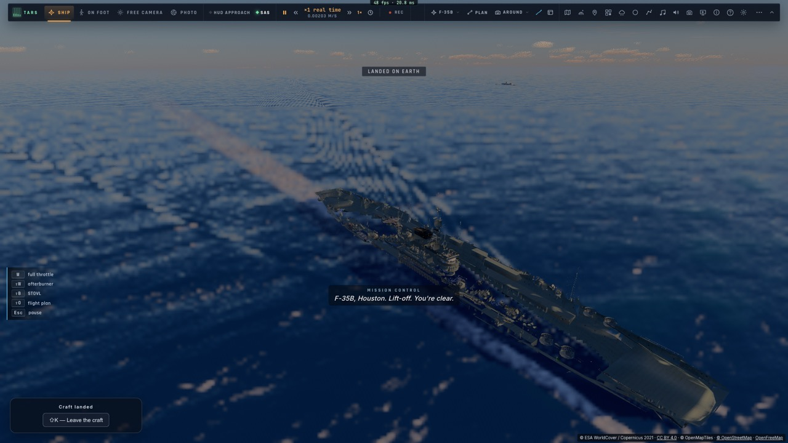

# M2 — Les porte-avions

*2026-10-15 — [PLAN-AVIATION-AAA](../../PLAN-AVIATION-AAA.md), phase M.*

## Les modèles (`scripts/build-carriers.py`, `scripts/build-carriers.ts`, `assets/carriers/`)
- **Trois porte-avions** :
  - **l'USS Gerald R. Ford** (333 m), depuis le modèle que tu as fourni (`Porte-avions Gerald R Ford.zip`, un FBX
    dans une archive RAR), meilleur que l'ancien ;
  - **le Kiev** (273 m), tel quel, sans ses avions et hélicoptères posés ;
  - **le HMS Implacable** (233,6 m), le second modèle que tu as fourni, en bonus.
- **Blender** retire les objets parasites, applique les transformations, décime (l'Implacable à 20 %) et relève la
  couleur moyenne de chaque matériau.
- **Le script Bun** :
  - met chaque navire à l'échelle et à sa ligne de flottaison ;
  - range ses textures dans le tableau de textures du trafic ;
  - code les matériaux sans texture en couleur plate ;
  - construit les **trois brins d'arrêt du Ford** (le vrai en a trois depuis 2017, pas quatre) ;
  - écrit la **carte du pont** au mètre : la hauteur de chaque cellule au-dessus de la flottaison, îlot compris.
- **Une frégate** s'ajoute aux navires de T3 (`build-ships.ts`), grise, pour l'escorte.

## En mer (`game/carrier.ts`, `controller/carriers.ts`)
- **Sa route est une fonction de l'horloge** : un point de départ, un cap, une vitesse, un instant. Elle est donc
  la même sur toutes les pages d'une salle.
  - Le partage réseau envoie un événement « cv » toutes les 5 s ; à la fusion, on garde le départ le plus ancien.
- **Il fait route face au vent** de la météo, à 26–28 nœuds. Il apparaît 4 km devant l'avion.
- **Il tangue, roule et pilonne** selon la hauteur de la mer de M1 (`shipMotion`), peu pour sa taille :
  0,2° de tangage au plus dans 2 m de mer.
- **Son escorte** : deux frégates, l'une sur sa hanche bâbord, l'autre devant tribord.
- **Au radar**, piste « cv », amie, avec ses escortes. **Son sillage** est celui de T3.
- **Ses feux** :
  - l'**IFLOLS** (le « meatball ») : la barre de référence et la boule, qui monte ou descend d'une cellule par
    quart de degré d'écart au plan de 3,5°, visible de l'arrière seulement ;
  - la nuit, les feux de bord du pont, de l'axe et de chute, et les feux de navigation.
- **Placement** : par TARS (outil « carrier » : faire apparaître, poser, état, retirer) ou par l'API (`carrierSpawn`,
  `carrierLand`, `carrierFinal`, en finale à une distance donnée sur le plan de descente).

## Le pont, plate-forme mobile (`system/our-surface.ts`, `controller/motion.ts`)
- **Une plate-forme** se déclare sur un corps avec son repère qui bouge. Ce qu'elle porte :
  - la hauteur au-dessus du pont, sa normale, sa vitesse ;
  - les conversions point et direction entre son repère et celui de la Terre.
- **Le train** la voit comme un sol : `gearHeight` prend le plus haut du pont et de la mer, et le contact des roues
  reçoit la normale et la vitesse du pont.
- **Posé sur le pont**, l'avion est porté par lui : sa place est fixée dans le repère du navire, et sa vitesse est
  celle du pont. Il en repart si le moteur le soulève ou le pousse.
- **La vrille à la pose, corrigée** (ton signalement) :
  - je réimposais à chaque image l'orientation **de la caméra**, figée dans le repère du pont ;
  - or la caméra chasse ou orbitale bouge autour de l'avion, et l'avion se déduit d'elle : il tournait d'autant,
    et l'écart se réinjectait à chaque image (mesuré dans le navigateur : jusqu'à 170° en 10 s) ;
  - maintenant l'attitude du moment est **transportée** par le mouvement du pont d'une image à l'autre, comme le sol
    ordinaire le fait avec la rotation de la Terre ;
  - à la pose, c'est **l'avion** qu'on oriente, à travers la matrice de la vue, et non la caméra : il était posé de
    travers de 3 à 11° (« pas droit »).

## Ombres et reflets (`ship.ts`, `ship.wgsl`, `trace.wgsl`)
- **Une seconde carte d'ombre**, à côté de la première dans la même texture (4096 × 2048) :
  - la moitié gauche entoure l'avion piloté et ses voisins, comme avant ;
  - la moitié droite entoure **le porte-avions le plus proche** (15 cm par texel), recalculée à chaque image ;
  - **l'avion projette son ombre sur le pont**, l'îlot sur le pont et sur l'avion, la coque sur la mer ;
  - **le rectangle d'ombre derrière le F-35** (ton signalement), corrigé : les points du pont plus loin que la
    profondeur de la carte, dans l'axe du soleil, étaient comparés à « rien » et passaient à l'ombre, ce qui
    dessinait l'empreinte carrée de la carte. Leur profondeur est désormais ramenée au fond de la carte : ils ne
    sont à l'ombre que si l'avion est vraiment entre eux et le soleil ;
  - ces ombres apparaissent dans le rendu des navires comme dans le lancer de rayons, sans nouvelle liaison de
    texture.
- **Les reflets dans la mer** :
  - les navires et l'avion sont redessinés en miroir sous le plan de la mer (l'ellipsoïde WGS84 à h = 0 sous
    l'avion) ;
  - chaque point est ombré comme le point réel vu depuis la caméra en miroir ;
  - seulement là où l'image tracée montre la mer, avec une tolérance aux crêtes en incidence rasante ;
  - leur poids : le Fresnel de l'eau (2 % à la verticale, la plupart en rasant), brisé en bandes par les vagues
    (davantage par grosse mer et pour les points hauts) ;
  - l'avion se reflète **sous 500 m et au-dessus de la mer** : bas et regardant vers le bas, le pilote voit son
    reflet (discret à la verticale, comme en vrai).

## Changer l'heure ne change pas le vol (`game/tools.ts` `jumpTo`)
- **Avant** : en vol près du sol, un saut d'horloge gardait l'avion fixe dans l'espace, et la Terre tournait
  dessous. À 50 m au-dessus de la mer en finale, il touchait l'eau (« the gear collapsed »).
- **Maintenant**, sous 100 km d'un corps solide, l'avion garde :
  - sa place au-dessus du même sol, à la même hauteur ;
  - son attitude ;
  - sa vitesse par rapport au sol qui tourne.
- **Les porte-avions gardent leur place** : leur départ est décalé du saut, puis ils reprennent leur route.
- **L'horloge du contrôleur suit à l'instant**, même en pause : avant, l'avion restait lu à l'ancienne heure
  jusqu'à la reprise.

## Mesuré
- **`tests/carrier.test.ts`** :
  - les ponts à leur franc-bord : Ford 18,4 m, Kiev 14,8 m, Implacable 12,5 m ;
  - l'îlot du Ford au-dessus du pont, à tribord ;
  - la route : 864 m en une minute à 14,4 m/s ;
  - posé sur le Ford à 28 nœuds dans 2 m de mer, cap −10° : **0,00 m de dérive en une minute, 0,00° d'écart de cap
    et d'inclinaison** ;
  - lâché de 3 m sur le pont en marche : il se pose et reste à 0,09 m de là où il a été lâché, sa référence à
    1,09 m du pont (le train fait 1,08 m) ;
  - le meatball : 0,000° sur le plan, une cellule tous les quarts de degré, invisible devant.
- **`tests/e2e/carriers.e2e.test.ts`** (kerr-mini, les Alpes d'abord, FPS affichés) :
  - le Ford apparaît, ami au radar ;
  - posé, puis vue chasse, orbitale et cockpit tour à tour : **0,00 m de dérive, cap −10,0°, inclinaison 0,0°** ;
  - la finale, la nuit, le Kiev et l'Implacable ;
  - **l'horloge reculée de 5 h en finale** à 50 m : 0,00 m d'écart de position, 0,00 m de hauteur, 0,00 m/s ; le
    porte-avions à 0,01 m ; toujours en vol 1,5 s après ;
  - le test passe de 2 min à 44 s ;
  - les images montrent 44 à 50 i/s sur le M1, avec le porte-avions, son ombre et son reflet.
- 1 205 tests unitaires passent ; typecheck et Biome propres.

## Écarts
- **Le Charles de Gaulle** n'est pas converti (son modèle est l'ancien, mobile).
- **Les brins et les catapultes ne sont pas simulés** : ce sera M3. Les déflecteurs de jet ne sont pas modélisés.
- **Le pont « à nous » en haute résolution** (antidérapant, usure) n'est pas fait : on garde les textures du
  modèle, qui sont déjà belles de près.
- **Placement** par TARS ou par l'API pour l'instant ; la carte et l'éditeur de mission viendront avec les missions.
- **Les reflets** :
  - un plan par image (la mer sous l'avion), sans distorsion des vagues pixel par pixel : des bandes ;
  - leur coût GPU n'est pas mesuré à part.
- **L'ombre d'un second porte-avions** : seule celle du plus proche est calculée.
