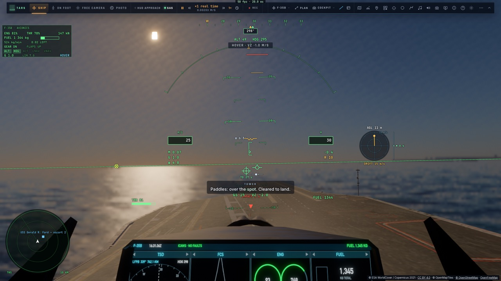
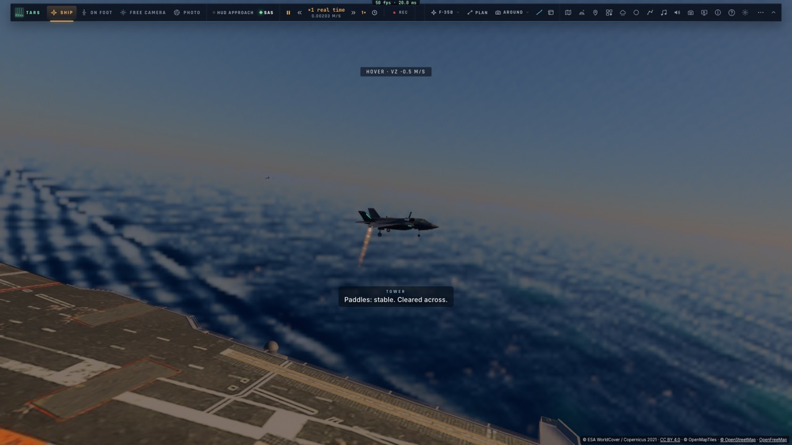
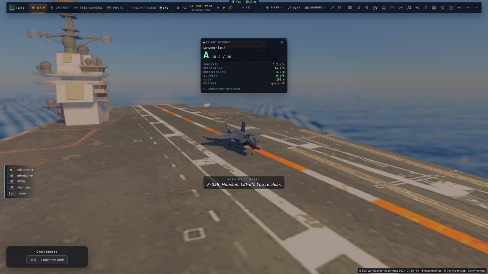

# M3a — L'appontage vertical du F-35B

*2026-10-15 — [PLAN-AVIATION-AAA](../../PLAN-AVIATION-AAA.md), phase M3, première étape.*

## Ce que fait le pilote automatique (`game/deckland.ts`, `controller/deckland.ts`)
- **Il vole la récupération du vrai F-35B sur un navire** :
  1. il rejoint un point d'entrée à 3,5 km derrière le porte-avions, sur sa hanche bâbord, à 150 m ;
  2. il remonte le long de bâbord en ralentissant (l'écart latéral à l'axe corrigé en continu) ;
  3. il passe en STOVL : les portes s'ouvrent, la soufflante s'engage, la tuyère pivote ;
  4. sous 65 m/s, la loi de stationnaire prend la main : stationnaire **le long du bord**, à 22 m du pont et 18 m
     au-dessus ;
  5. stable deux secondes, il **traverse** au-dessus de la tache ;
  6. stable au-dessus d'elle, il **descend** à 1,2 m/s par rapport au pont.
- **Tout est vu depuis le pont qui bouge** : chaque cible est un point du navire, et la vitesse voulue est celle
  de ce point (la route, le pilonnement, le tangage et le roulis compris) plus la fermeture. Il se pose donc sur
  un pont qui tangue.
- **La loi de stationnaire** accepte maintenant une vitesse sol imposée par un pilote automatique.
- **Trop lourd, il refuse** : 184 kN de poussée en stationnaire portent environ 17 t. Avec les réservoirs pleins
  (20,9 t), il dit combien de carburant brûler. Le vrai F-35B apponte avec environ 2 t de carburant.
- **Posé**, il réduit les gaz et quitte le mode STOVL ; les freins se serrent et le pont l'emporte.
  - Avant ce correctif, la loi de stationnaire laissait la manette à 12 % sur les roues. Les freins restaient
    desserrés, et l'avion roulait jusqu'à tomber à l'avant du pont. La manette est désormais à 0 sur les roues.
- **On l'engage avec la touche G (« Atterrir »)** quand un porte-avions est à moins de 30 km ; ailleurs, c'est
  l'atterrissage habituel. On peut aussi demander à TARS (« carrier », action « recover »).
  - Le manche ou la manette le coupent.
- **Une tache par porte-avions** : sur le Ford derrière l'îlot, hors de l'axe d'appontage ; sur le pont arrière
  du Kiev ; dans l'axe à l'arrière de l'Implacable.
  - Chacune est plate à 0,1 m près sur 16 m.
  - Elle est entourée de feux sur le pont pendant l'approche : ambre, puis verts quand l'avion est autorisé à se
    poser.

## L'officier d'appontage
- **Mother, puis « Paddles », à la radio** (la voix de la tour, sous-titrée) :
  - « Charlie » à l'engagement ;
  - le contact ;
  - « stationnaire le long du bord » ;
  - « autorisé à traverser » ;
  - « autorisé à vous poser » ;
  - puis la note.
- **La note** : **OK** à moins de 2,5 m de la tache et 2,5 m/s de vitesse verticale au contact, **Passable**
  jusqu'à 5 m et 3,5 m/s, sinon **Non noté**. Traduite en français.

## Mesuré
- **`tests/deckland.test.ts`** (sans navigateur), depuis 9 km à 300 m :

  | Porte-avions | Mer | Écart à la tache | Vitesse au contact | Note | Durée |
  |---|---|---|---|---|---|
  | Ford | 2 m | 0,05 m | 1,25 m/s | OK | 163 s |
  | Kiev | 1,5 m | 0,07 m | 1,08 m/s | OK | 161 s |
  | Implacable | 3 m | 0,01 m | 0,83 m/s | OK | 162 s |

  - Après la pose, l'avion glisse de 2 m pendant que le moteur retombe au ralenti, puis reste en place.
  - Réservoirs pleins, l'appontage est refusé : 20,9 t, 17,1 t au plus, 3 837 kg de carburant à brûler.
- **`tests/e2e/deckland.e2e.test.ts`** sur kerr-mini (les Alpes d'abord) : départ à 3,5 km derrière le Ford, posé
  en 112 s à 0,44 m de la tache, 1,21 m/s, note OK, avec toutes les annonces.
- 1 210 tests unitaires passent ; typecheck et Biome propres.

## Écarts
- **L'approche** fait encore une large boucle latérale (jusqu'à 500 m) pendant la décélération quand on arrive
  de côté.
- **L'approche de nuit et par mer forte sous forme de qualification** viendra en M3d.
- **Le décollage court** (M3b) et **le F-35C** avec la catapulte et les brins (M3c) restent à faire.
