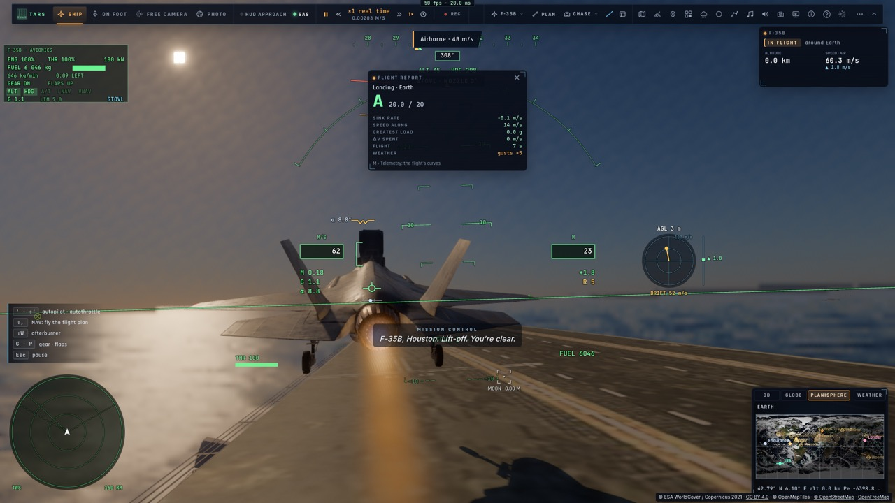
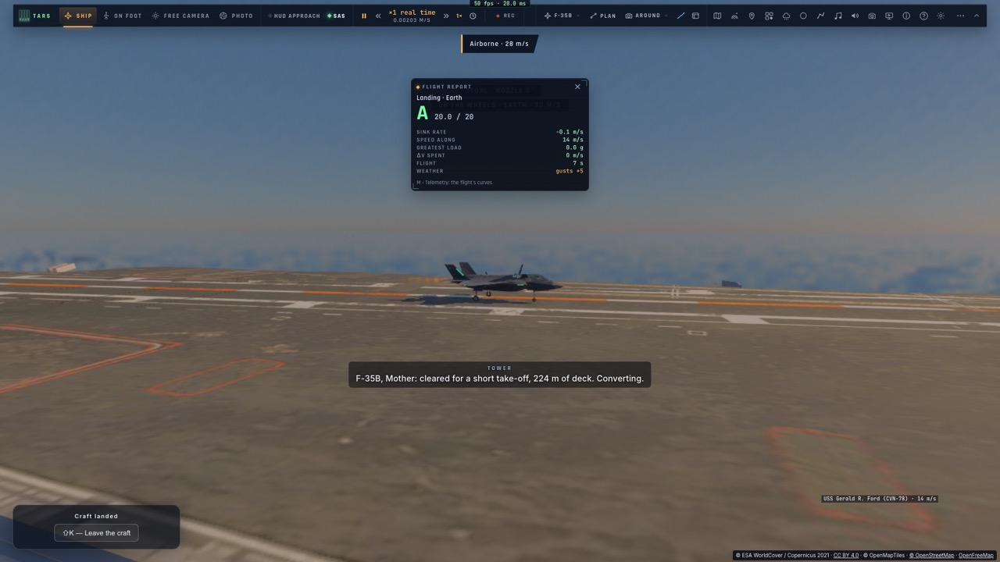
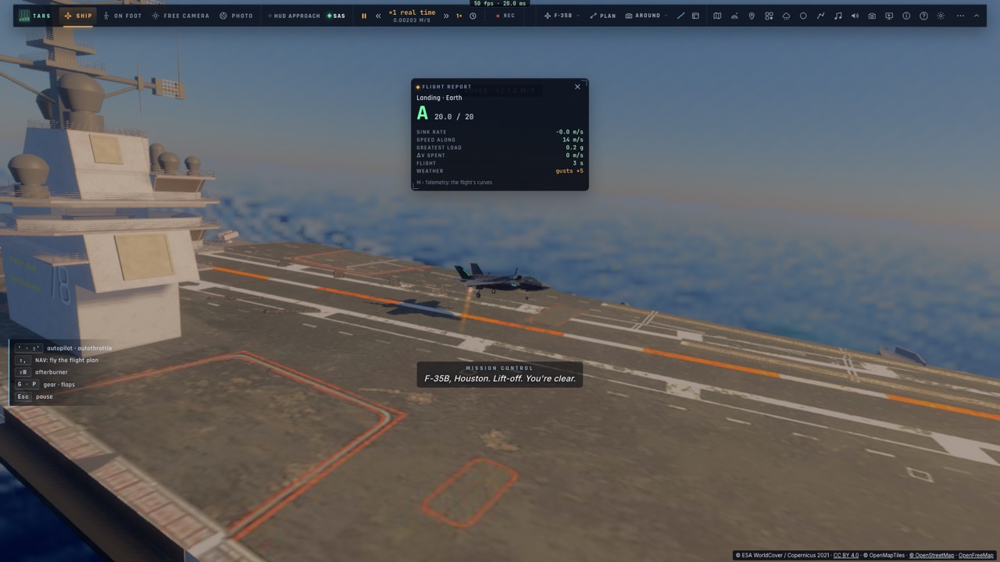

# M3b — Le décollage court (et vertical) du F-35B depuis le pont

*2026-10-15 — [PLAN-AVIATION-AAA](../../PLAN-AVIATION-AAA.md), phase M3, deuxième étape.*

## Ce que fait le pilote automatique (`controller/deckland.ts` `deckTakeoff`, `stoStep` ; `game/deckland.ts` `STO`)
- **Le décollage court (STO), comme le vrai** :
  1. **conversion** freins serrés : les portes, la soufflante, la tuyère vers l'arrière ;
  2. **roulage** plein gaz, tuyère vers l'arrière : toute sa poussée accélère, la soufflante allège les roues ;
  3. **rotation** à 52 m/s, ou à 45 m de la fin du pont dégagé : la tuyère vers le bas, le manche en arrière ;
  4. **en l'air**, la soufflante porte la moitié de la poussée. La tuyère revient vers l'arrière pour accélérer ; elle
     ne s'abaisse un peu que tant que l'avion s'enfonce. L'aile prend le poids en accélérant ; montée douce, puis
     la hauteur demandée une fois rapide ;
  5. **au-delà de 100 m/s**, mode STOVL coupé : vol classique.
- **La longueur de pont qu'il faut** : environ 150 m à 20,9 t (réservoirs pleins), avec le vent sur le pont ; elle
  varie comme le carré de la masse.
- **Le pont dégagé** : sa longueur s'arrête au premier obstacle sur toute l'envergure (±6 m : l'îlot, un mât), ou
  là où le pont cesse sous les roues.
  - C'était le défaut du Kiev : sa piste passait par l'avant de l'îlot, où le train heurtait la structure (18 m/s
    de vitesse verticale d'un coup).
- **Un couloir par porte-avions** : le Ford à 10 m sur bâbord, le Kiev à bâbord de l'îlot sur son pont arrière,
  l'Implacable un peu sur bâbord, pour que le saumon d'aile passe l'îlot.
- **Trop court pour sa masse, il décolle verticalement** s'il est assez léger pour le stationnaire :
  - montée verticale à 3 m/s jusqu'à 25 m au-dessus du pont, portée par la loi de stationnaire et entraînée par le
    pont ;
  - accélération à 2,5 m/s² dans l'axe ;
  - la loi relâchée au-delà de 80 m/s, puis la même montée que le STO ;
  - on peut aussi le demander.
- **Sinon, il refuse** en disant pourquoi : « 150 m de pont dégagé, 160 m nécessaires à 20,9 t — et trop lourd
  pour décoller verticalement (17,8 t au plus) ».
- **On l'engage** par le décollage du pilote automatique (« Décoller ») sur un pont, ou par TARS (« carrier »,
  action « takeoff », `vertical: true`). Le manche avant la rotation l'annule.
- **Mother à la radio** : l'autorisation (court, avec la longueur de pont, ou vertical), puis « en vol, beau
  décollage ». Traduit en français.

## Mesuré
- **`tests/deckland.test.ts`** (sans navigateur) :

  | Porte-avions | Carburant | Mer | Décollage | Point le plus bas au-dessus de la mer | Vol classique |
  |---|---|---|---|---|---|
  | Ford | plein | 2 m | 151 m (224 m dégagés) | 20 m | 100 m/s à 68 m, en 23 s |
  | Implacable | plein | 3 m | 142 m (205 m dégagés) | 14 m | 101 m/s à 70 m, en 23 s |
  | Kiev | plein | 1,5 m | refusé (150 m dégagés) | — | — |
  | Kiev | 1,8 t | 1,5 m | 116 m | 17 m | 102 m/s à 47 m |
  | Kiev, vertical demandé | 1,8 t | 1,5 m | à la verticale | — | 101 m/s à 76 m, en 38 s |
- **`tests/e2e/deckland.e2e.test.ts`** sur kerr-mini, à la suite de l'appontage :
  - un décollage court réservoirs pleins depuis le Ford, en montée à 63 m, mode STOVL coupé ;
  - puis un décollage vertical allégé.
- 1 215 tests unitaires passent ; typecheck et Biome propres.

## Écarts
- **Le tremplin** (le « ski-jump » du Queen Elizabeth) n'existe sur aucun de nos ponts : tous sont plats.
- **Le Kiev** n'a que 150 m dégagés à bâbord de l'îlot : réservoirs pleins, il ne fait rien.
- **Chaque placement sur le pont** affiche un rapport d'atterrissage (comme sur les images), et Houston annonce le
  « décollage » au mauvais moment.
