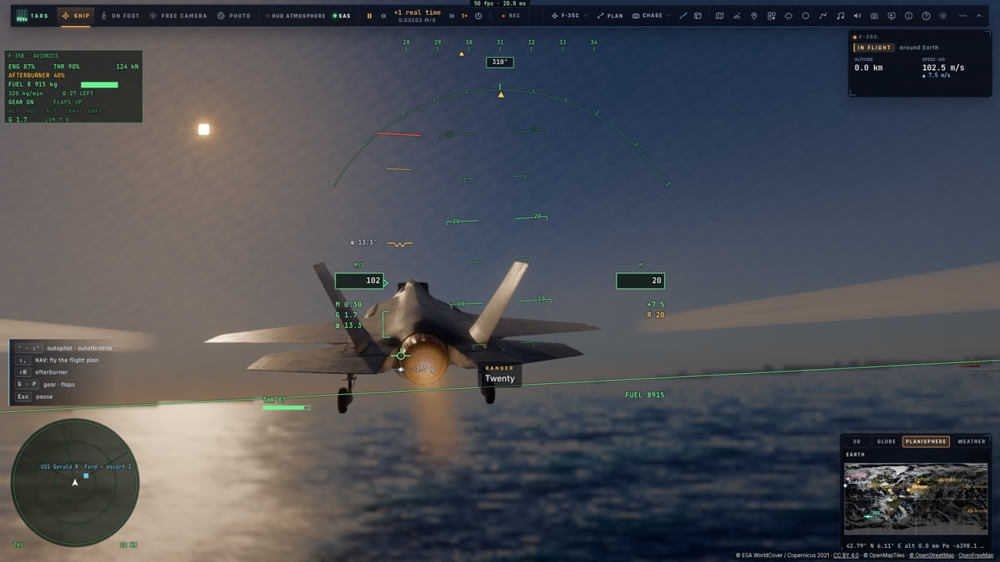
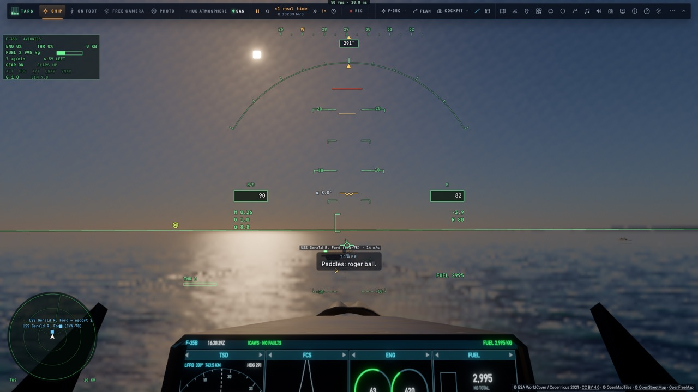
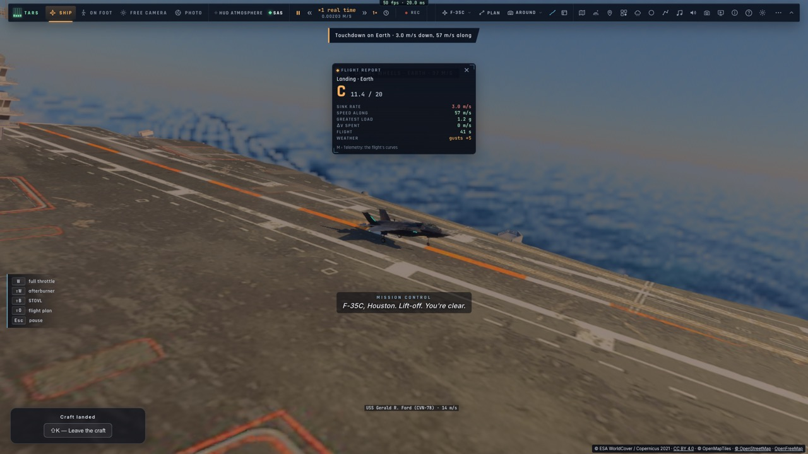
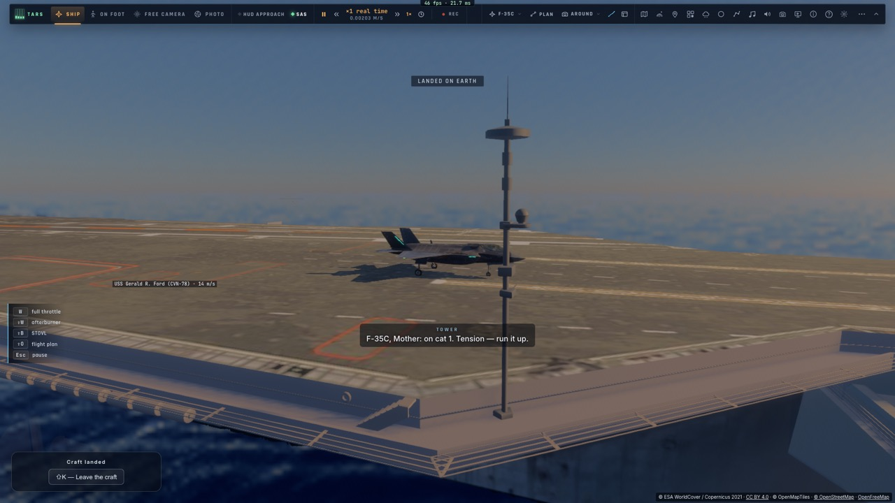

# M3c — Le F-35C : catapulte, brins d'arrêt, bolter et note de l'officier d'appontage

*2026-10-15 — [PLAN-AVIATION-AAA](../../PLAN-AVIATION-AAA.md), phase M3, troisième étape.*

## La variante F-35C (`f35/variant.ts`, réglage « Variante »)
- **Celui des porte-avions** :
  - une aile une fois et demie plus grande (62,1 m² et 13,1 m d'envergure, contre 42,7 m² et 10,7 m) ;
  - plus lourd (15,8 t à vide) ;
  - 9 t de carburant ;
  - une crosse d'appontage, pas de soufflante.
- **Appliquée à la définition de l'avion** (masse, carburant, aile) quand le réglage change ; le plein est refait.
- **Le mode STOVL et l'appontage vertical restent au F-35B.** Pour le C, « Atterrir » mène aux brins et
  « Décoller » à la catapulte.

## La catapulte (`controller/trap.ts` `catLaunch`, `controller/motion.ts`)
- **Les deux catapultes avant du Ford** (94 m de course chacune).
- **Le déroulement** :
  1. l'avion est posé sur la navette, retenu même plein gaz ;
  2. trois secondes de mise en tension (« Tension — run it up ») ;
  3. le « Shooter » lance : postcombustion, poussée continue jusqu'à **72 m/s par rapport au pont** en fin de course ;
  4. au lâcher, l'avion vole : une pente de montée de 8° tenue tout de suite (le vrai part « mains libres »),
     puis la tenue d'altitude et de vitesse.
- **La course se fait dans le repère du pont qui bouge** : le pont l'emporte, la navette l'accélère le long de
  sa direction.

## Les brins d'arrêt
- **La crosse** : sa pointe à 7,2 m derrière l'avion, au niveau des roues.
  - À chaque image, sa position sur le pont ; un brin est pris quand elle le franchit vers l'avant, au ras du pont
    et dans la largeur de la piste oblique.
  - Les trois brins du Ford ; la bonne cible est le deuxième.
  - Le point visé par le meatball est désormais entre le premier et le deuxième brin.
- **La traction du brin** s'ajoute aux forces du vol, constante, le long de l'axe de la piste. Elle est calculée
  pour arrêter l'avion en une centaine de mètres, **moteur plein gaz compris** : le pilote met les gaz au contact,
  en cas de bolter.
- **Crosse relevée** (`hookUp`) : aucun brin ne se prend.
- **Le bolter** : roulé au-delà du dernier brin, ou passé au-dessus sans toucher. Plein gaz, montée, et le tour
  recommence.

## L'approche automatique et l'officier d'appontage (`game/trap.ts`)
- **Le guidage** :
  - de loin, le point d'entrée à 4,5 km dans l'axe ;
  - derrière le navire, l'**interception de l'axe** comme un localizer (un angle selon l'écart, 45° au plus) ;
  - en finale, **aligné sur la piste oblique qui bouge** (deux boucles : la vitesse latérale voulue, puis
    l'inclinaison) ;
  - **sur le plan de 3,5°**, à la vitesse d'approche (portance à l'incidence d'approche : environ 70 m/s à 19 t).
- **Le plan, le meatball et l'alignement sont stabilisés**, comme la vraie optique : calculés sur la route du
  navire sans la houle. Seuls les brins sont sur le vrai pont.
- **L'officier d'appontage suit chaque passage**, celui du pilote automatique comme celui du pilote dès qu'il est
  en finale, train sorti. Ses annonces :
  - « roger ball » ;
  - « vous êtes bas », « vous êtes haut », « de la puissance ! » ;
  - « à droite pour l'alignement », « revenez à gauche » ;
  - la remise de gaz (trop bas ou décalé en courte finale) ;
  - « bolter, bolter, bolter ! ».
- **Sa note**, comme sur les vrais porte-avions :
  - les pires erreurs de pente et d'alignement au début, au milieu, en courte finale et à la rampe, plus le brin ;
  - **OK souligné** (5 points) : centré tout du long, brin 2 ; **OK** (4) ; **Passable** (3) ; **B** (bolter, 2,5) ;
    **Non noté** (2) ; **WO** (remise de gaz, 1) ; **Coupé** (0 : dangereusement bas à la rampe) ;
  - les points serviront aux qualifications (M3d).

## Mesuré
- **`tests/trap.test.ts`** (sans navigateur) :
  - les brins pris au franchissement (aucun en l'air ni hors de la piste) et les notes de chaque cas ;
  - **catapulte**, réservoirs pleins (24,9 t) : lâché après 5,25 s, au plus bas à 15,6 m au-dessus de la mer (le
    pont est à 18,5 m), 216 m et 16 m/s de montée 20 s après ;
  - **depuis 9 km, mer de 1,5 m** : pris par le brin 1, arrêté en 78 m, note OK ;
  - **crosse relevée** : bolter, un tour, puis pris par le brin 1 au passage suivant (Passable).
- **`tests/e2e/trap.e2e.test.ts`** sur kerr-mini (les Alpes d'abord) :
  - la catapulte, en montée à 99 m et 15 m/s ;
  - depuis la finale à 2,5 km : **brin 2, OK**.
- 1 220 tests unitaires passent ; typecheck et Biome propres.

## Écarts
- **Le modèle 3D reste celui du F-35B** (sans grande aile ni crosse visibles), et l'écran du cockpit affiche
  « F-35B ».
- **Seul le Ford a des brins et des catapultes.** Le Charles de Gaulle n'est pas converti, et les catapultes de
  milieu de pont du Ford ne sont pas faites.
- **La pente oscille de ±0,3°** en finale, et la crosse touche souvent le brin 1 (un peu bas à la rampe). Un
  passage centré prend le 2.
- **Après un bolter**, le tour est long (6 min environ) : il revient par le point d'entrée.
- **Le rapport de vol générique** note C un appontage à 3 m/s de vitesse verticale (normal sur porte-avions), et
  Houston annonce un « décollage » au mauvais moment.
