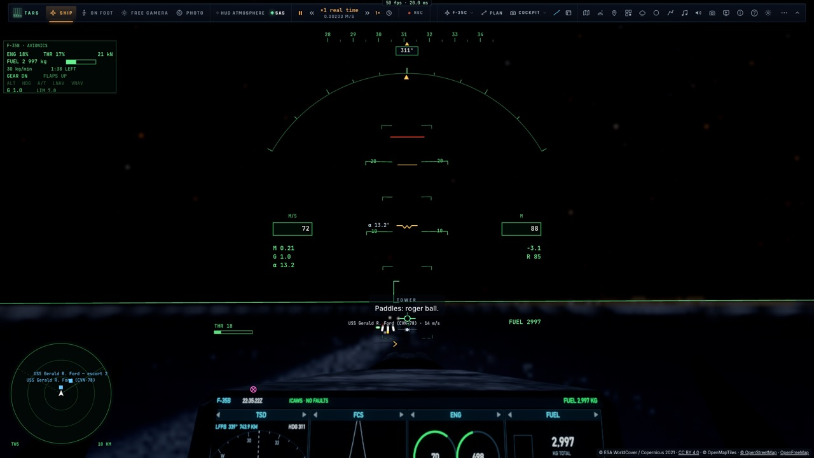
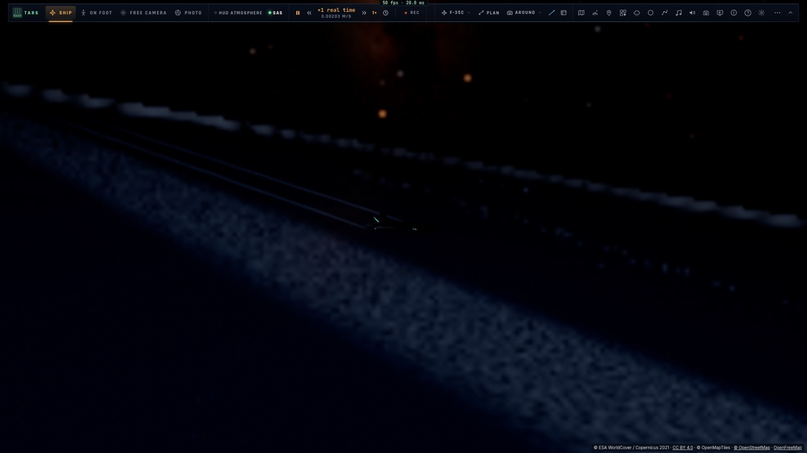
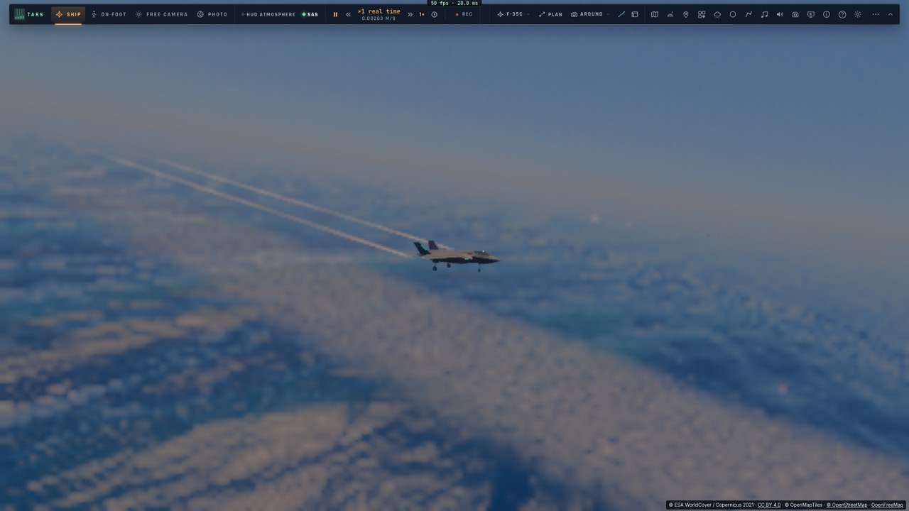

# M3d — Les qualifications d'appontage : jour, nuit, mer forte

*2026-10-15 — [PLAN-AVIATION-AAA](../../PLAN-AVIATION-AAA.md), phase M3, dernière étape. **M3 est fini.***

## Les qualifications (`game/quals.ts`, `controller/quals.ts`)
- **Quatre passages notés par l'officier d'appontage**, comme une vraie qualification :
  - **le F-35C** : des appontages sur les brins (un bolter et une remise de gaz comptent comme des passages), lancé
    à la catapulte entre deux ;
  - **le F-35B** : des appontages verticaux, avec un décollage court entre deux et son carburant de retour.
- **Trois qualifications** :
  - **le jour** ;
  - **la nuit** (23 h là où l'on est) ;
  - **la mer forte** : une houle de 4,4 m imposée à la mer (le pont tangue et pilonne), un vent de 9 m/s.
- **La note** : la moyenne des points des passages (OK souligné 5, OK 4, Passable 3, bolter 2,5, Non noté 2,
  remise de gaz 1, Coupé 0). **Qualifié à partir de 3,0 sans aucun passage coupé.** Mother l'annonce, et la
  meilleure note est gardée par qualification et par variante.
- **Le pilote automatique enchaîne** : quelques secondes sur le pont, le lancement (catapulte ou décollage court),
  le tour, l'approche, le passage suivant. Entre deux, un **ravitaillement moteur tournant** (« hot pump ») remet le
  carburant de la qualification.
- **Le pilote peut aussi voler lui-même** : l'officier d'appontage note chaque passage dès qu'il est en finale,
  train sorti.
- **On la lance** par TARS (« carrier », action « qual » : jour, nuit, mer ; l'heure réglée là où l'on est) ou par
  l'API (`qualStart`).

## Ce que la qualification a demandé au pilote automatique
- **L'approche après un lancement** : l'interception de l'axe démarrait trop près et en travers. Désormais :
  - un point d'entrée à 6 km ;
  - un virage anticipé (l'écart prévu 8 s plus tard) ;
  - la finale seulement une fois l'axe tenu (à moins de 60 m, et à moins de 6 m/s de vitesse latérale) ;
  - pendant l'interception, la descente vers la hauteur du plan.
- **La courte finale** : un léger surcroît de descente contre l'effet de sol du pont, qui faisait flotter l'avion
  au-dessus de la rampe.
- **Le carburant du F-35B en stationnaire** : la surpoussée de la soufflante était comptée comme une
  postcombustion (consommation triplée), soit 9 kg/s en stationnaire, quatre fois trop. Elle vient de l'arbre du
  moteur : elle consomme désormais comme lui.
- **Le carburant** est gardé quand l'avion est replacé sur la catapulte (avant, le plein était refait).

## Mesuré
- **`tests/quals.test.ts`** (sans navigateur), chaque qualification complète par le pilote automatique :

  | Qualification | Avion | Mer | Passages | Moyenne | Durée |
  |---|---|---|---|---|---|
  | jour | F-35C | 1,5 m | Non noté (brin 1), OK, OK, OK (brin 1) | 3,50, **qualifié** | 14 min |
  | nuit | F-35C | 1,5 m | Non noté, OK, OK, OK (brin 1) | 3,50, **qualifié** | 14 min |
  | mer forte | F-35C | 4,5 m | OK, OK (brin 3), OK, Passable (brin 1) | 3,75, **qualifié** | 14 min |
  | jour | F-35B | 1,5 m | OK, OK, OK, OK (0,0 à 0,1 m de la tache) | 4,00, **qualifié** | 16 min |

  - La moyenne varie un peu d'une exécution à l'autre (3,25 à 3,75 par mer forte). Le test exige quatre passages
    notés, trois brins pris au moins pour le C et une moyenne au-dessus de 2,5.
- **`tests/e2e/quals.e2e.test.ts`** sur kerr-mini, un passage chacun depuis la finale :
  - de nuit : brin 1, Passable ;
  - par mer forte (4,7 m) : brin 1, Non noté.
- 1 225 tests unitaires passent ; typecheck et Biome propres.

## M3 : fini
« Fini quand le pilote automatique se pose sur le pont qui tangue, et que les qualifications de jour, de nuit et
par mer forte ont leur note. » C'est fait :
- le F-35B en appontage vertical sur les trois ponts jusqu'à 3 m de mer ;
- le F-35C sur les brins jusqu'à 4,5 m ;
- les trois qualifications, notées et réussies par le pilote automatique.

## Écarts
- **La crosse touche souvent le brin 1** (un peu bas à la rampe). Un passage bien centré prend le 2, et la moyenne
  s'en ressent.
- **Le premier passage depuis 9 km** est souvent le moins bon : il arrive de côté.
- **Pas d'écran de qualification à soi** : l'annonce de Mother, le journal et TARS en tiennent lieu ; la meilleure
  note est gardée.
- **Le roulage jusqu'à la catapulte** est un placement direct.
