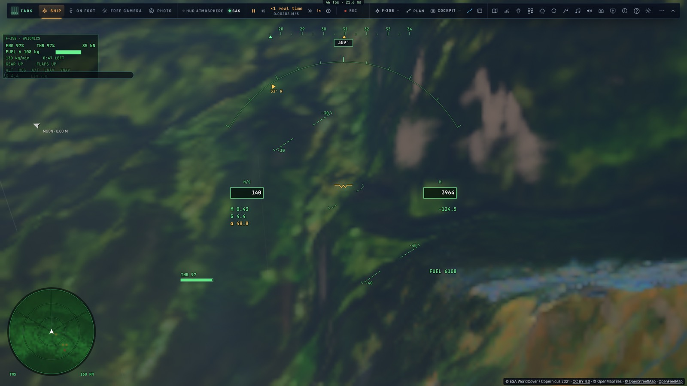
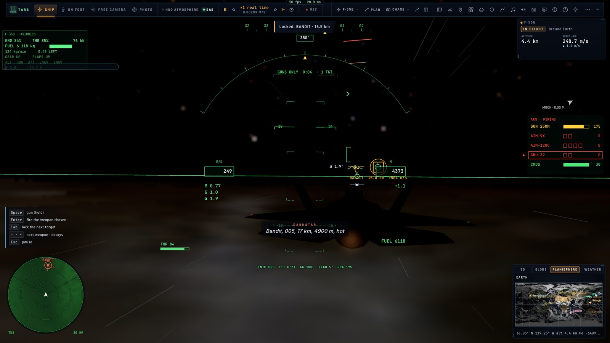

# La manette Xbox 360 pour le F-35

*2026-10-16 — [PLAN-AVIATION-AAA](../../PLAN-AVIATION-AAA.md), en marge de S3.*

## La disposition d'un chasseur (`input/jetpad.ts`)
Dès qu'on pilote le F-35 avec une manette (Xbox 360, Xbox, PlayStation : le mapping standard), elle prend cette
disposition. Un profil de commandes personnel pour cette manette garde la priorité.

| Commande | Effet |
|---|---|
| **Stick gauche** | tangage (tiré : cabrer) et roulis |
| **Stick droit** | la tête : on regarde où il pointe (150° à droite et à gauche, 80° en haut, 45° en bas), **elle revient droit devant dès qu'on le lâche** |
| **R3 maintenu** | le zoom (champ divisé par 2,5), **la vue revient dès qu'on le relâche** |
| **RT · LT** | plus · moins de gaz |
| **LB · RB** | palonnier gauche · droite, dosé sur un quart de seconde |
| **L3** | la postcombustion |
| **A** (maintenu) | le canon |
| **B** | tirer l'arme choisie (ou acquitter une alarme) |
| **X** | l'arme suivante |
| **Y** | appui bref : verrouiller la cible suivante · maintenu : l'interception |
| **Croix** | ▲ train · ▼ volets · ◀ leurres · ▶ aérofrein |
| **View** | la caméra suivante |
| **Menu** | appui bref : les tenues du pilote automatique · maintenu : les réglages |

Ce qui la rend plus fine qu'une simple correspondance de touches :
- **la tête est un ressort** : la vue suit le stick droit, adoucie sur 0,09 s, et revient à zéro quand il est lâché — on jette un œil à son équipier ou à la cible, puis on revient au HUD sans y penser ;
- **le zoom suit R3** en douceur (0,12 s) et rend le champ d'avant au relâcher ;
- **le palonnier monte et descend en rampe**, au lieu de cogner d'un coup ;
- **Y et Menu distinguent appui bref et appui long** (0,4 s), sans déclencher les deux.

L'aide des commandes (?) en a une section, en français et en anglais.

## Mesuré
- **`tests/jetpad.test.ts`** : les sticks et les gâchettes ; le palonnier à mi-course en 0,1 s, plein en 0,25 s, revenu à zéro ; la tête aux limites de sa course puis à zéro en moins d'une seconde ; le zoom ; chaque bouton son action, une seule même maintenu ; Y et Menu bref ou long ; le canon tenu.
- **Sur kerr-mini, `tests/e2e/jetpad.e2e.test.ts`**, une manette simulée par la page (les Alpes d'abord) :
  - RT : les gaz de 0,00 à 0,97 ;
  - le stick gauche à droite : 133° d'inclinaison en 1,5 s ;
  - le stick droit : la tête à 142° et 18°, revenue à 0 au lâcher ;
  - R3 : le champ de 60° à 24°, revenu à 60° ;
  - la croix : le train sorti puis rentré ;
  - en combat au canon : Y verrouille l'adversaire, A tire (220 → 161 obus).

## Écarts
- **Le retour de force** se limite à une vibration brève au verrouillage.
- **La dérive des sticks** est celle du filtre général des manettes (zone morte) ; pas de réglage propre au F-35.
