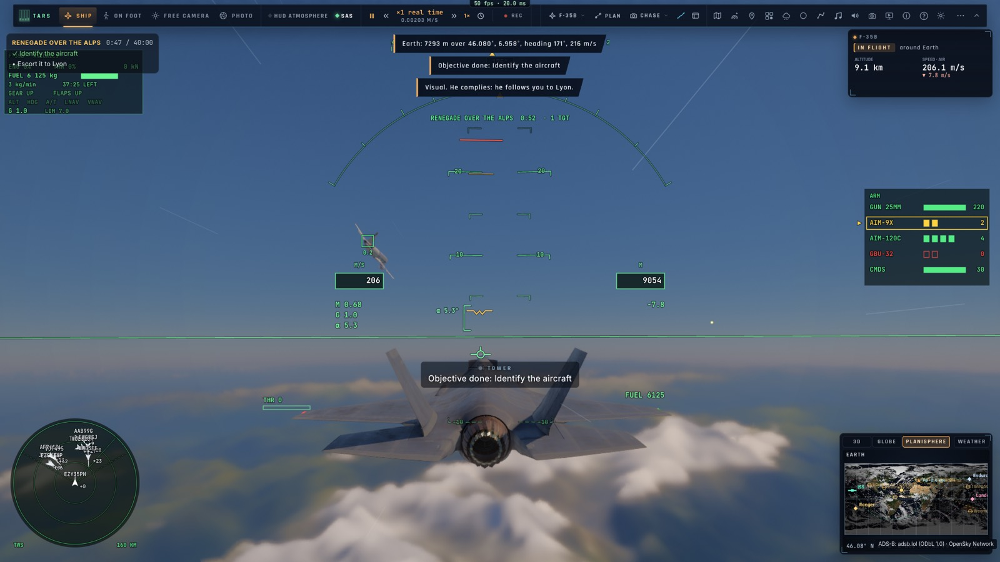
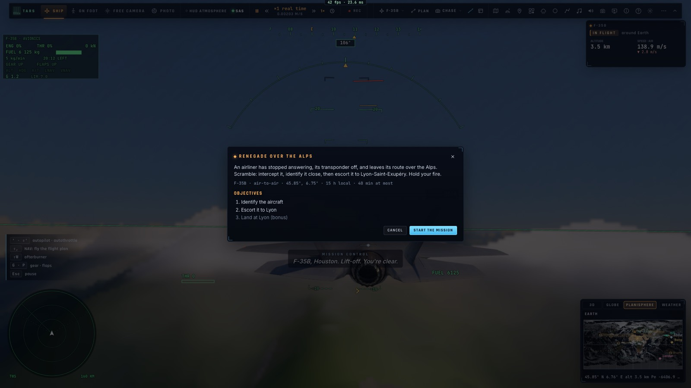
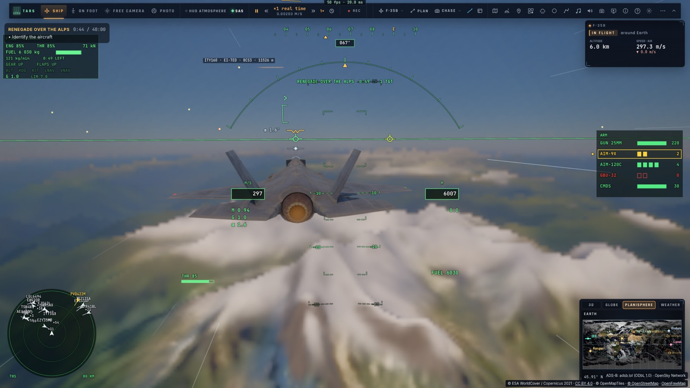
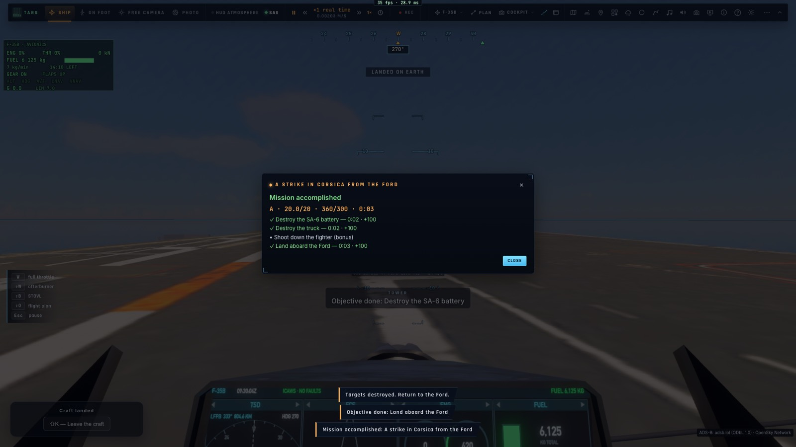

# P1 — Le moteur de missions

*2026-10-15 — [PLAN-AVIATION-AAA](../../PLAN-AVIATION-AAA.md), phase P1.*

## Une mission est une donnée (`game/mission.ts`)
- **Un JSON**, lisible et vérifié (`checkMission` : chaque référence d'unité ou d'objectif existe). Il contient :
  - le **briefing** ;
  - le **départ** : lieu, cap, vitesse, variante B ou C, emport (air-air, air-sol, canon), carburant, ou sur le
    pont d'un porte-avions ;
  - l'**heure** (une heure locale là-bas, ou une date) et la **météo** (préréglage, vent, nuages, houle) ;
  - les **unités** : porte-avions, drones, chasseurs, SAM, camions, bunkers, avions de ligne, et **un vol réel
    repris** ;
  - les **objectifs** et les **déclencheurs** ;
  - le temps alloué.
- **Les objectifs** :
  - **atteindre** une zone (et une altitude) ;
  - **détruire** des unités ;
  - **escorter** un appareil jusqu'à une zone, sans s'en éloigner plus de 30 s ;
  - **protéger** une unité pendant un temps ;
  - **identifier** un appareil de près ;
  - **se poser** : sur un porte-avions nommé, ou dans une zone.

  Un objectif peut en attendre un autre (`after`) ou être en **bonus** (`optional`, avec ses points).
- **Les déclencheurs** :
  - **quand** : un objectif atteint, un temps, une unité proche, une zone où l'on entre ;
  - **ce qu'ils font** :
    - dire un message (radio et écran) ;
    - faire apparaître une unité ;
    - **changer une trajectoire** (un cap, une altitude, une vitesse, ou vers un lieu) ;
    - **changer de camp** (ami, neutre, hostile) ;
    - **couper ou rallumer le transpondeur** ;
    - faire échouer ou gagner la mission.
- **La fin** :
  - **gagnée** quand tous les objectifs obligatoires sont atteints ;
  - **échouée** si l'avion est perdu, un objectif obligatoire manqué ou le temps dépassé.
- **Le débriefing** : chaque objectif avec son heure et ses points (100 par défaut), un bonus de temps, la moitié
  en cas d'échec. Une note sur 20 et une lettre, comme le rapport de vol.

## Dans le jeu (`controller/mission.ts`, `ui/airmission.ts`)
- **Les unités vivent dans le monde du combat** (celui des défis et des combats du F-35) :
  - les avions volent et suivent leur route ;
  - les SAM tirent ;
  - le radar les voit, avec leur camp (IFF) et leur transpondeur ;
  - un avion de ligne a son modèle (A320, CRJ900).

  Les porte-avions sont ceux de M2, en route.
- **Un vol réel repris** :
  - le vol demandé (indicatif ou code hexadécimal), sinon **le plus proche entendu** (en vol, au-dessus de
    3 000 m, à moins de 250 km) ;
  - il est **retiré du trafic dessiné** et continue sa route depuis l'endroit où il était, avec son cap, sa vitesse
    et son modèle. Le jeu le pilote désormais : il peut dévier, couper son transpondeur, devenir hostile ;
  - la mission l'attend jusqu'à 8 s. Si aucun vol n'est entendu (hors ligne, trafic coupé), l'appareil est placé
    là où la mission le dit.
- **Le lancement** :
  - le F-35, sa variante et son emport, pleins faits ;
  - la météo et l'heure de la mission ;
  - l'avion à son point de départ (ou sur le pont du porte-avions, une fois la carte du pont chargée) ;
  - le trafic réel allumé quand la mission en reprend un vol.
- **À l'écran** :
  - le **briefing** avant le départ (« Lancer la mission ») ;
  - les **objectifs en cours**, en haut à gauche, avec leur état (•, ✓, ✗) et le chronomètre ;
  - chaque message et chaque objectif atteint, dits par la tour et affichés ;
  - le **débriefing** à la fin.
- **En équipe sur le réseau** :
  - celui qui lance la mission l'envoie au salon (et la renvoie toutes les 10 s pour ceux qui arrivent) ;
  - les autres la volent avec lui, partis 80 m à sa droite ;
  - le même vol réel est repris partout (son code est mis dans la mission envoyée) ;
  - chaque page juge la mission dans son monde. Un objectif atteint par l'un l'est pour tous, et la fin est
    commune.
- **Trois missions fournies**, dans « Défis, combats, missions » :
  - **Renegade sur les Alpes** : un vol de ligne coupe son transpondeur et vire au sud. L'intercepter,
    l'identifier à moins de 900 m, puis l'escorter vers Lyon-Saint-Exupéry, où il se laisse conduire. En bonus :
    se poser à Lyon ;
  - **Frappe en Corse depuis le Ford** : détruire une batterie SA-6 et son camion en Balagne (deux GBU-32). Un
    chasseur ennemi décolle quand on approche de la côte (bonus : l'abattre). Puis apponter sur le Ford ;
  - **Escorte jusqu'à Ajaccio** : un Airbus gouvernemental à escorter à moins de 8 km. Deux drones hostiles
    surgissent au bout de 90 s (bonus : les abattre).
- **Par l'API** : `__bh.flight.missions` (`list`, `brief`, `fly(id ou JSON)`, `state`, `abort`, `last`).

## Mesuré
- **`tests/mission.test.ts`** (sans navigateur) :
  - les trois missions fournies sont valides ; les erreurs d'une mission mal formée sont dites ;
  - **les objectifs** :
    - un objectif attend celui dont il dépend ;
    - l'escorte échoue 30 s après s'être éloigné (le compteur repart quand on revient) ;
    - la protection dure son temps ;
    - l'appontage compte seulement sur le porte-avions nommé ;
  - **les déclencheurs** : une fois chacun, apparition, victoire ;
  - **les échecs** : avion perdu, temps dépassé ;
  - **le renegade volé en entier** dans le monde du combat : il vire au sud (165°), il est identifié à 320 s, il est
    escorté vers Lyon, et la mission est gagnée à 1 413 s, 20/20.
- **`tests/e2e/mission.e2e.test.ts`** sur kerr-mini (les Alpes d'abord, 85 s) :
  - le briefing, et un vrai clic sur « Lancer la mission » ;
  - **le vol réel EZY35PH repris** au-dessus des Alpes. Il coupe son transpondeur et vire à 171°. Rejoint, il est
    identifié, puis il tourne vers Lyon ;
  - la Corse : le SA-6 et le camion touchés, l'appontage, mission accomplie (20/20 A), et le débriefing affiché.
- 1 230 tests unitaires passent ; typecheck et Biome propres.

## Écarts
- **Pas de navire réel repris** : seuls les vols le sont, pas les navires de l'AIS.
- **Les vols repris se déroutent en ligne droite** vers le lieu demandé. Ils n'ont ni approche ni atterrissage.
- **Le jeu en équipe n'est pas mesuré entre deux Mac.** Le code partage la mission et ses objectifs, mais seul le
  solo est vérifié.
- **Les drones et chasseurs ennemis s'en prennent au joueur**, pas à l'appareil escorté.
- **Pas encore de carte de mission** (P2) **ni d'éditeur** (P3) : les missions se lancent depuis le panneau ou
  l'API.
