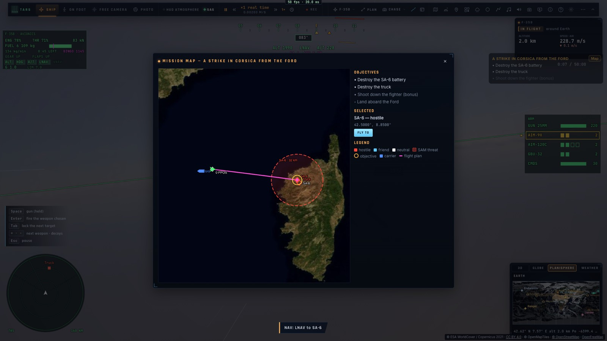
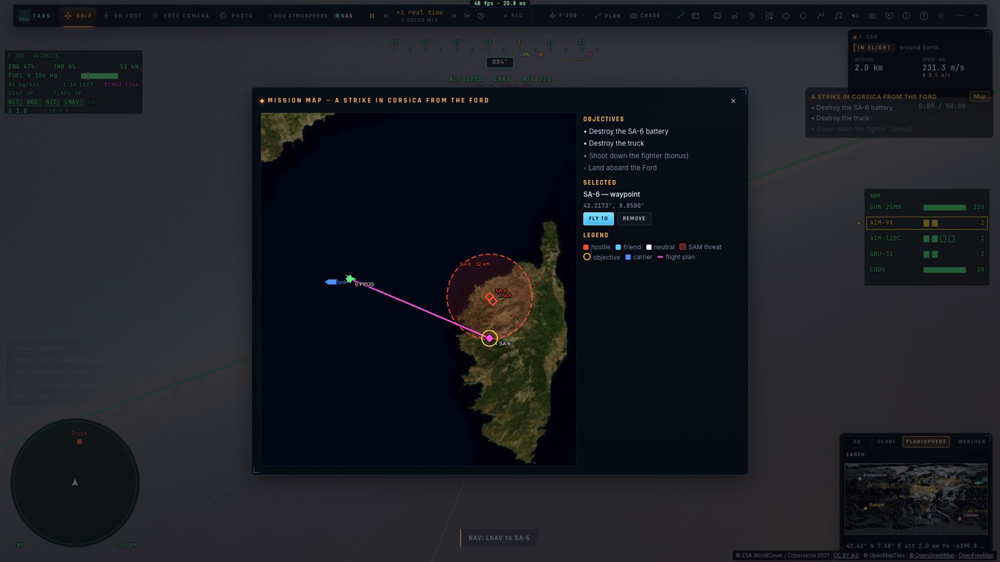
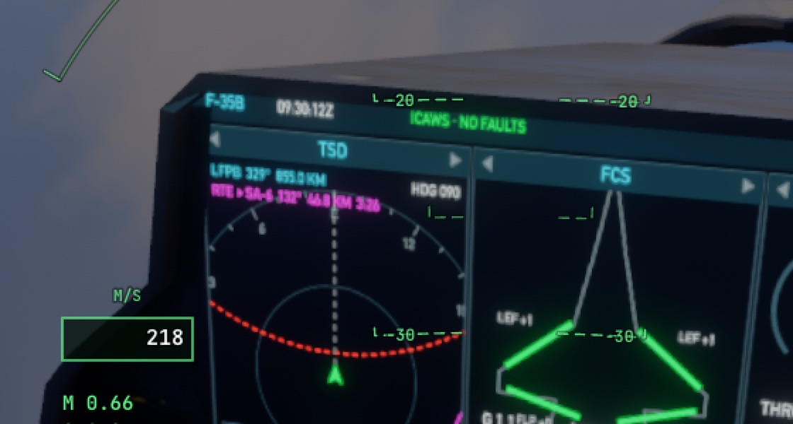
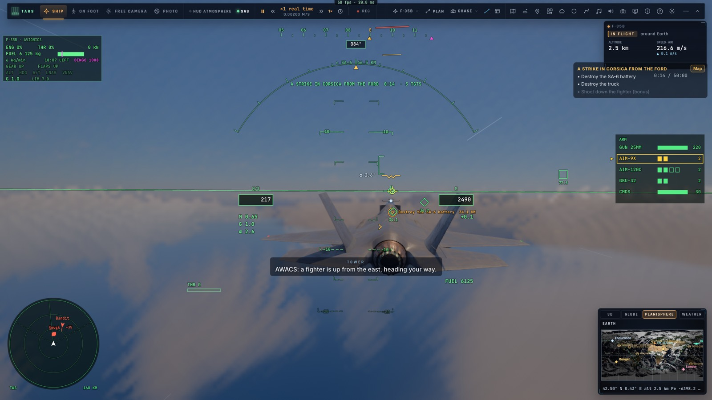

# P2 — La carte de mission

*2026-10-15 — [PLAN-AVIATION-AAA](../../PLAN-AVIATION-AAA.md), phase P2.*

## La carte (`ui/missionmap.ts`)
- **La carte de la Terre** (celle du plan de vol : imagerie, glisser, zoom). Elle s'ouvre par le bouton « Carte »
  du bloc des objectifs, par le menu de vol (« Carte de mission ») ou par l'API. Elle affiche la situation
  tactique, mise à jour en continu :
  - **les zones des objectifs** (orange) : les lieux à atteindre, la fin d'une escorte, un terrain où se poser.
    L'objectif en cours est en trait plein, celui qui attend en pointillé ;
  - **la portée des SAM** (rouge, en pointillé) : un cercle de 32 km (celle du missile), tant qu'il leur reste des
    missiles ;
  - **les unités** là où elles sont, avec leurs symboles OTAN :
    - hostile : losange rouge ;
    - ami : demi-cercle bleu ;
    - neutre : carré blanc ;
    - détruite : croix grise ;
    - un avion porte un trait dans le sens de sa route ;
  - **les porte-avions** en route, dans leur cap ;
  - **le trafic réel** : de petites flèches, avec les indicatifs quand on zoome ;
  - **le plan de vol** (la branche active en magenta) et **l'avion**, dans sa route.
- **On clique** une unité, une zone, un point du plan ou le sol : la sélection s'affiche avec ses coordonnées.
- **« Voler vers »** : le lieu est mis dans le plan comme le point suivant (si le plan est vide, il devient
  « position actuelle → lui »), en direct, et la navigation latérale (LNAV) s'engage, pilote automatique et
  automanette compris. Un point du plan peut aussi être retiré.
- **On glisse les points du plan** à la souris (ou au doigt). Pendant ce temps, la carte ne se déplace pas. Le
  guidage est recalculé au lâcher. (La carte, `ui/mapview.ts`, sait désormais faire glisser un objet.)
- **À côté** : les objectifs et leur état, la sélection et ses actions, la légende.

## La même chose dans l'avion
- **Le TSD du cockpit** (`f35/pcd.ts`) : les zones des objectifs en orange, la portée des SAM en rouge, en plus
  des pistes du radar (les unités) et du plan de vol.
- **Le HUD** (`ui/hud/symbology.ts`) montre l'**objectif en cours** :
  - un repère orange sur la bande de cap ;
  - **dans la vue en 3D**, un cercle et un losange orange posés à l'endroit de l'objectif, avec son nom et sa
    distance ;
  - quel que soit l'objectif : une zone, l'unité à détruire, à identifier ou à escorter (près de l'appareil
    escorté : la fin de l'escorte), le porte-avions où apponter.

  Calculé par `missionCue` (`controller/mission.ts`), relèvement et différence de hauteur compris (courbure de la
  Terre incluse).

## Mesuré
- **`tests/e2e/missionmap.e2e.test.ts`** sur kerr-mini (les Alpes d'abord, 27 s) :
  - la carte de la frappe en Corse : la portée du SA-6, le camion, le Ford ;
  - **un vrai clic** sur le SA-6 puis « Voler vers » : plan PPOS → SA-6, LNAV engagée vers le point 1 ;
  - **son point glissé à la souris** de 80 px vers le sud : de 42,500° à 42,217° ;
  - près de la côte, dans le cockpit, le TSD montre la portée du SA-6. Le repère de l'objectif est à 90°,
    34,6 km, dans la vue.
- 1 230 tests unitaires passent ; typecheck et Biome propres.

## Écarts
- **Pas de carte 3D à part.** La « 3D », c'est l'objectif marqué dans la vue (HUD) ; la vue 3D de la carte du
  vol (orbites, corps) n'a pas la couche mission.
- **« Voler vers » une unité qui bouge** vise l'endroit où elle était au clic. Pour la poursuivre, il y a
  l'interception du radar (C2).
- **Les zones et les unités de la mission ne se glissent pas** ; seuls les points du plan se glissent.
  L'éditeur (P3) les placera.
- **Le TSD montre les zones et les menaces, pas les porte-avions** (le radar les voit comme des navires).
