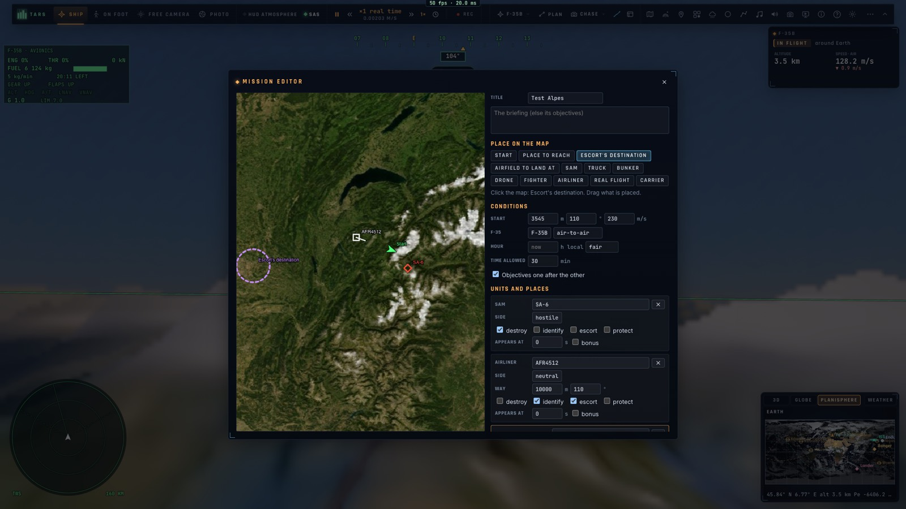
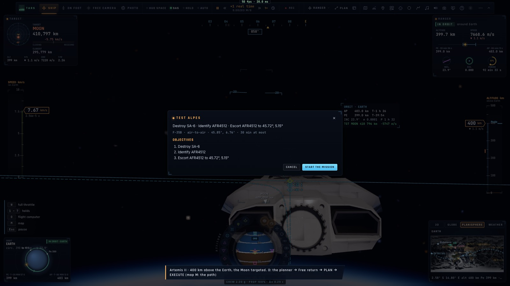
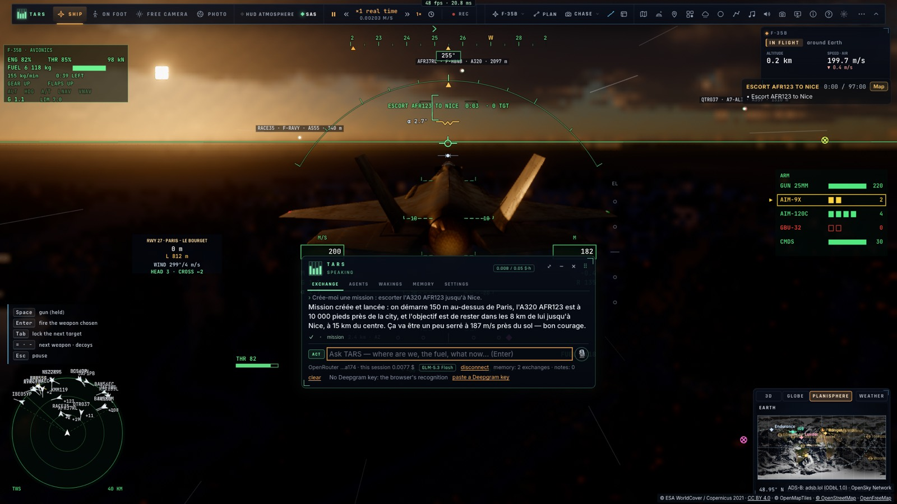

# P3 — Créer ses missions

*2026-10-15 — [PLAN-AVIATION-AAA](../../PLAN-AVIATION-AAA.md), phase P3.*



## L'éditeur (`ui/missioneditor.ts`, `game/missionedit.ts`)
- **Il s'ouvre** par « Créer une mission » dans « Défis, combats, missions », ou par « Modifier » sur une mission
  (une copie). TARS peut aussi l'ouvrir.
- **Sur la carte**, on choisit un outil puis on clique pour placer :
  - le départ ;
  - un lieu à atteindre, un terrain où se poser, la destination d'une escorte ;
  - les unités : SAM, camion, bunker, drone, chasseur, avion de ligne, vol réel (par son indicatif), porte-avions.

  Ce qui est placé se **glisse** à la souris ; un clic le sélectionne.
- **À côté, on règle les conditions** :
  - le titre et le briefing ;
  - le départ : altitude, cap, vitesse ;
  - la variante du F-35 et son emport ;
  - l'heure locale et la météo ;
  - le temps alloué ;
  - les objectifs **l'un après l'autre** (chacun attend le précédent) ou tous ensemble.
- **Pour chaque unité** :
  - son nom, son camp ;
  - l'altitude et le cap d'un avion ;
  - **ses objectifs**, cumulables : détruire, identifier, escorter jusqu'à la destination, protéger, apponter (un
    porte-avions) ;
  - **quand elle apparaît** (en secondes) ;
  - si elle est en bonus.

  Chaque lieu a son nom et son rayon. Les **messages** sont dits en route, à l'heure voulue.
- **Ce qui manque est fait** : les textes des objectifs (« Escorter AFR4512 jusqu'à Lyon »), le briefing. Un avion
  de ligne ou un vol réel escorté **part vers sa destination**. Ce qui ne va pas est affiché (une escorte sans
  destination, par exemple).
- **Les actions** :
  - **la voler** : le briefing, puis le départ ;
  - **copier son lien** ;
  - **la garder** parmi « mes missions », listées avec celles du jeu ;
  - l'exporter en JSON, ou coller un JSON pour le modifier.
- **Modifier une mission du jeu** la retrouve telle qu'elle était : ses unités, ses objectifs (un groupe de
  drones reste un seul objectif) et ses déclencheurs propres (la déviation du renegade, le chasseur qui décolle
  quand on approche de la côte).

## Le lien
- `…/#mission=…` contient la mission entière (son JSON en base64url). L'ouvrir lance le jeu, sans l'écran titre,
  **directement sur le briefing**. « Lancer la mission » place l'avion et la mission démarre.
- Un lien abîmé est signalé (« La mission de ce lien est illisible : … »).

## TARS crée une mission à la voix
- **Son outil `mission`** : lister, voler, créer, état, abandonner, carte, éditeur, lien.
- **« Créer »** : TARS écrit la mission à partir de ce que dit le pilote, en JSON, en laissant de côté ce qu'il ne
  sait pas.
  - Les **lieux nommés** sont trouvés : un terrain par son nom exact ou son code OACI, sinon une ville par la
    recherche de l'Atlas (« Nice »).
  - Le **départ** est l'endroit où l'on vole.
  - Un **vol réel sans position** est placé 25 km devant, au cas où il n'est pas entendu.
  - Le reste est complété (textes, temps alloué, emport : air-sol s'il y a des cibles au sol).
  - La mission est gardée, volée, et son lien rendu. Avec `fly: false`, elle s'ouvre dans l'éditeur.
- Par exemple, « une escorte de l'A320 AFR123 jusqu'à Nice » devient :
  ```json
  {"units":[{"id":"a","kind":"traffic","match":{"callsign":"AFR123"}}],
   "objectives":[{"kind":"escort","unit":"a","until":{"place":"Nice"}}]}
  ```
  Cela donne « Escorter AFR123 jusqu'à Nice ». L'avion repris est envoyé vers Nice, et le chasseur part de là où
  il est.




## Mesuré
- **`tests/missionedit.test.ts`** (sans navigateur) :
  - le lien aller-retour pour les trois missions fournies, et un lien abîmé signalé ;
  - un brouillon fait de rien : un SA-6, un vol réel identifié puis escorté, un chasseur qui apparaît à 120 s en
    bonus, un message. Les objectifs sont enchaînés, et l'escorte sans destination est signalée ;
  - **les trois missions fournies modifiées puis rendues** : les mêmes objectifs et unités, leurs déclencheurs
    gardés ;
  - **la mission dictée** (« escorte d'AFR123 jusqu'à Nice ») : Nice trouvée, départ où l'on vole, le vol envoyé
    vers Nice. Un lieu inconnu est signalé, et une frappe dictée part 40 km avant sa cible, en air-sol.
- **`tests/e2e/missioneditor.e2e.test.ts`** sur kerr-mini (les Alpes d'abord, 70 s) :
  - **l'éditeur ouvert par un vrai clic** sur « Créer une mission ». Les outils et les placements sur la carte se
    font aussi par vrais clics : un SA-6, un A320, la destination de l'escorte ;
  - son lien (1 650 caractères) **ouvert dans une nouvelle page** : le briefing tout de suite, puis la mission volée
    telle que faite (« Détruire SA-6 · Identifier AFR4512 (après) · Escorter AFR4512… (après) ») ;
  - **l'outil de TARS**, avec le croquis « escorte d'AFR123 jusqu'à Nice » : Nice trouvée par l'Atlas, mission
    volée ;
  - **TARS en direct** (OpenRouter, glm-5.3-flash), à qui l'on écrit « Crée-moi une mission : escorter l'A320
    AFR123 jusqu'à Nice. » : il appelle `mission`, et la mission est créée et lancée. Le vrai AFR123, entendu près
    de Paris, est repris ; l'escorte va jusqu'à Nice (rayon 15 km, à moins de 8 km de lui, 97 min).
  - Au premier essai, TARS avait fixé lui-même un départ à 150 m au-dessus de Paris. Corrigé : son outil lui dit
    de laisser le départ de côté, et un départ en vol est porté à 1 000 m et 150 m/s au moins.
- 1 230+ tests unitaires passent ; typecheck et Biome propres.

## Écarts
- **On ne dessine pas de route d'avion dans l'éditeur** : un avion vole tout droit, ou vers la destination s'il
  est escorté. Les routes à plusieurs points restent possibles en JSON.
- **Pas de déclencheur général dans l'éditeur** (« quand on entre dans telle zone, faire… ») : seulement les
  apparitions à l'heure et les messages. Les autres déclencheurs se font en JSON (ou par TARS), et l'éditeur
  garde ceux qu'il ne montre pas.
- **« Mes missions » restent dans ce navigateur** ; on les partage par lien.
