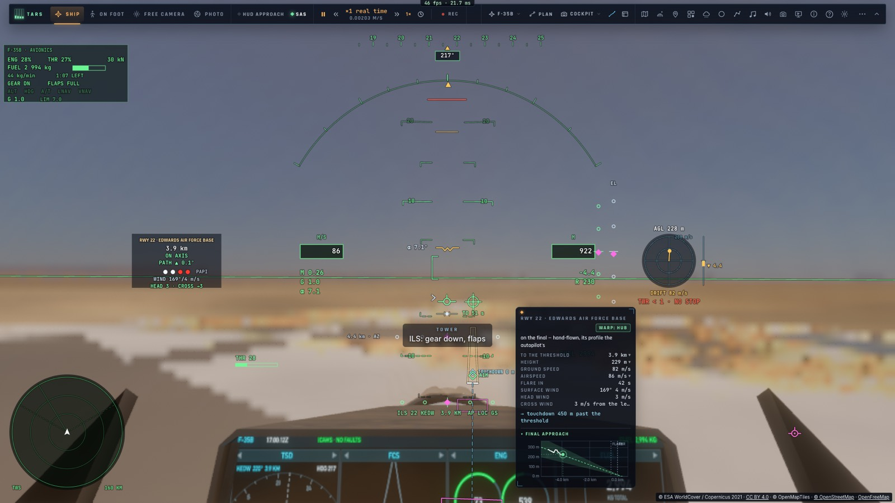
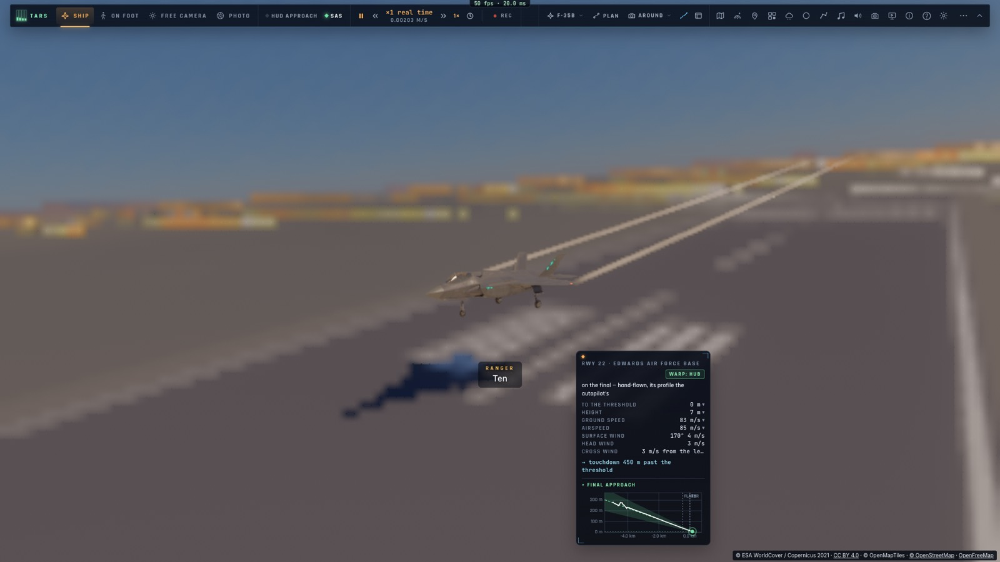
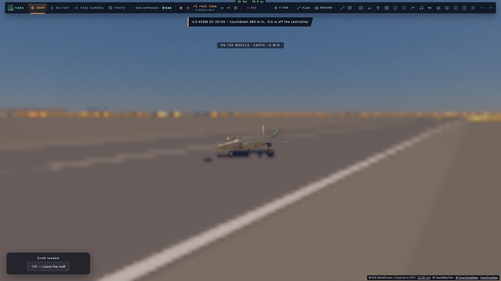

# P4a — L'ILS à 3°, les départs et arrivées, l'attente

*2026-10-15 — [PLAN-AVIATION-AAA](../../PLAN-AVIATION-AAA.md), phase P4, première étape.*

## L'approche ILS du F-35 (`game/ils.ts`, `controller/ils.ts`)
- **Le localizer et le glide à 3°**, lus comme un vrai récepteur :
  - l'antenne du localizer est 300 m après le bout de piste (2,5° de pleine échelle) ;
  - celle du glide est à 300 m du seuil (0,7° de pleine échelle) ;
  - les écarts sont en points, la courbure de la Terre comptée.
- **La procédure, volée par le pilote automatique** :
  1. vers le **point d'approche initiale** (IAF), à 18,5 km dans l'axe ;
  2. **l'attente** sur l'hippodrome à ce point si elle est demandée (des tours, ou jusqu'à l'autorisation) ;
  3. **l'interception du localizer**, menée comme un pilote (l'écart prévu 8 s plus tôt, 45° au plus) ;
  4. **le glide capté par-dessous**, puis le train et les volets au **point d'approche finale** (FAF, 9,3 km) ;
  5. la finale à la vitesse d'approche (celle de la masse du jet), alignée par deux boucles et un intégrateur
     contre le vent de travers ;
  6. **les minimums à 60 m** : instable (plus d'un point d'écart), c'est **la remise des gaz**. Elle a lieu aussi
     au seuil si l'avion n'est jamais descendu, ou passé le FAF sans glide. Il remonte à 600 m et recommence
     depuis l'IAF ;
  7. **l'arrondi** depuis 14 m, sa hauteur comptée aux roues et prévue 1,5 s plus tôt (le jet répond avec ce
     retard), les gaz réduits ;
  8. **le roulage freiné** jusqu'à l'arrêt, puis la note sur 20 (écarts sous le FAF, zone de toucher entre 150
     et 900 m, axe, taux de chute).
- **Déjà établi en finale** (dans l'axe, sur le glide), il continue sans repasser par l'IAF.
- **Le piste choisie** est celle demandée (OACI ou nom), sinon la plus proche à moins de 150 km, et son bout face
  au vent.
- **Le manche ou les gaz reprennent la main** : les aiguilles restent affichées.
- **Les annonces** (la tour, puis les annonces de l'avion) : « autorisé ILS 22 », « localizer capturé », « glide
  capturé », « train sorti, volets », « Minimums », « Arrondi », « Toucher », « Remise des gaz ».

## Au HUD
- **Les aiguilles de l'ILS** autour du centre : le glide à droite, le localizer en dessous, des losanges magenta
  (creux tant qu'ils ne sont pas reçus). En dessous : la piste, la distance et le mode (« ILS 22 KEDW 3,9 km AP
  LOC GS »).
- **L'aide à l'atterrissage existante** (carte de finale, PAPI, portes, courbe du profil) suivait le profil raide
  du Ranger, et disait « trop haut » au F-35 bien établi. Elle suit désormais le glide droit à 3° quand on vole
  en F-35 (`jetProfile`).

## Départs, arrivées, attente
- **« Procédures »** dans le plan de vol, ou par TARS : si le plan part d'un terrain, le **point de départ** (6 km
  dans l'axe de la piste, 900 m au-dessus) est ajouté. S'il y arrive, les **points d'arrivée** sont ajoutés (IAF
  et FAF dans l'axe de la piste face au vent, à leur altitude sur le glide).
- **La fin du plan** : l'IAF franchi en LNAV, **l'approche ILS prend la main**.
- **L'attente** sur l'hippodrome, demandée avec l'approche (« attendez au point initial »), puis « autorisé ».

## Commandes
- Le menu de vol : « Approche ILS » (la piste la plus proche).
- Le plan de vol : le bouton « Procédures ».
- **TARS, son outil `approach`** :
  - `ils` : une piste, et des tours d'attente si on veut ;
  - `clear`, `off`, `status` ;
  - `procedures` : les points de départ et d'arrivée ajoutés au plan.

## Mesuré
- **`tests/ils.test.ts`** (sans navigateur, F-35B à Edwards, piste 22, le sol plat au niveau du terrain) :

  | Départ | Ce qui se passe | Toucher | Note |
  |---|---|---|---|
  | à 30 km, 6 km de côté, en travers | localizer, glide, train, minimums, arrondi, arrêt (335 s) | 480 m, 0,8 m de l'axe, −1,1 m/s | 20/20 |
  | à 35 km, une attente demandée | un tour d'hippodrome (250 s), puis l'approche | dans la zone | 19,8/20 |
  | à 60 km, plan de vol + procédures | LNAV jusqu'à l'IAF (173 s), puis l'ILS | 469 m | 20/20 |
  | à 12,5 km, 2 500 m trop haut | « remise des gaz », remonte et repart vers l'IAF | — | — |
  | établi à 5 km | continue (84 s jusqu'à l'arrêt) | 436 m | 20/20 |

  - les aiguilles (un point de chaque côté) et les points d'approche sur l'axe.
- **`tests/e2e/ils.e2e.test.ts`** sur kerr-mini (les Alpes d'abord, 92 s) : depuis 5 km, à vitesse réelle, posé à
  469 m, à 0,5 m de l'axe, −1,0 m/s, 20/20.

## Écarts
- **Pas de vrais SID et STAR publiés** : un point de départ et deux points d'arrivée générés depuis la piste.
- **Pas de radiobalises ni de DME réels** : chaque piste du jeu a son ILS.
- **Les hippodromes de ravitaillement** attendent le ravitaillement en vol (phase S).
- La carte de finale garde quelques mots du Ranger (« pilotée à la main, sur le profil de l'autopilote »).
