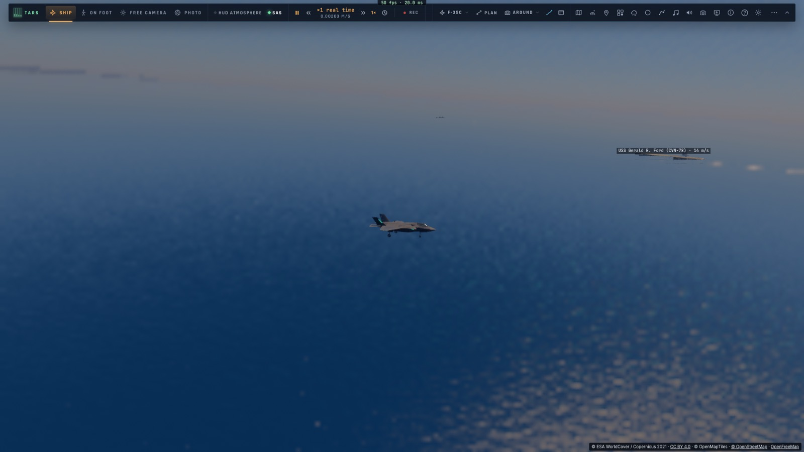
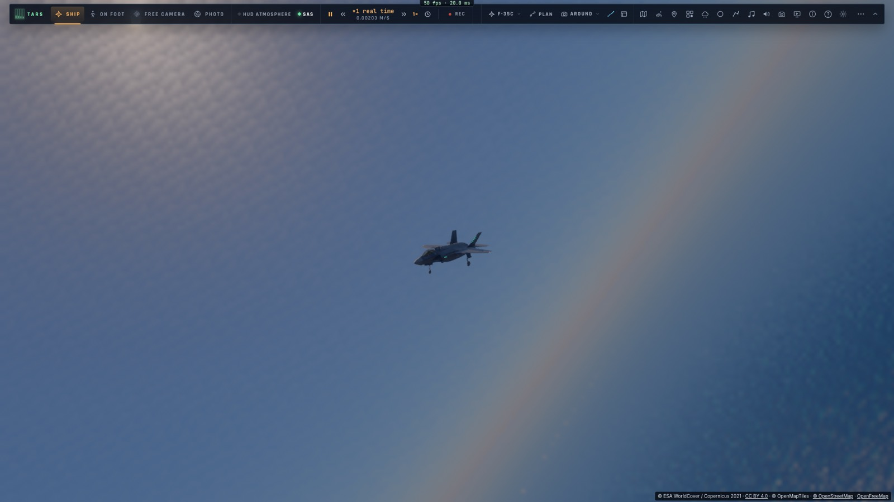
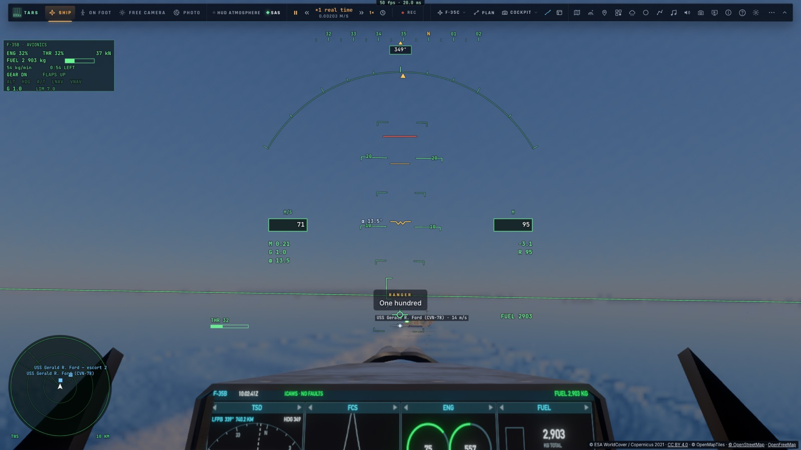
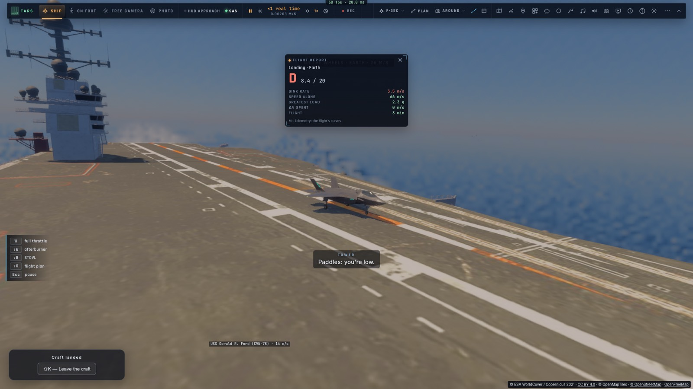

# P4b — Les approches du porte-avions : cas I, II et III

*2026-10-15 — [PLAN-AVIATION-AAA](../../PLAN-AVIATION-AAA.md), phase P4, deuxième étape. **P4 est fini.***

## Les trois cas de récupération (`game/trap.ts`, `controller/trap.ts`)
Ils sont volés par le pilote automatique du F-35C dans le repère du navire qui avance, sa route stabilisée,
jusqu'au groove. Ensuite, le guidage de M3c prend la main : l'interception de l'axe de la piste oblique, le plan
à 3,5°, le « ball » et les brins.

- **Cas I** (le jour, par beau temps) :
  1. **l'initiale** à 3 nautiques derrière le navire, dans sa route, à 800 ft et 350 kt ;
  2. **la remontée** le long de son flanc tribord ;
  3. **le break** passé l'étrave : un virage serré à gauche, en palier, à 60° d'inclinaison, qui ralentit ;
  4. **le downwind** à 600 ft, 1,2 nautique à bâbord, à la vitesse d'approche ;
  5. **le 180** commencé passé le travers de la zone d'appontage. C'est un virage descendant dont le rayon est
     recalculé à chaque instant (écart ÷ (1 − cos de l'angle restant)), pour finir tangent à l'axe de la piste
     oblique ;
  6. **le groove**, puis le « ball ».
- **Cas III** (la nuit, ou plafond bas, pluie, brouillard) :
  1. **le marshal** à 21 nautiques derrière, dans l'axe final, à 6 000 ft, avec une attente en hippodrome (autant
     de tours que demandé) ;
  2. « je quitte le marshal », puis **la descente** dans l'axe ;
  3. **à dix nautiques**, configuration d'atterrissage, puis **le palier à 1 200 ft** tenu jusqu'au plan de
     descente. La finale ne commence qu'une fois le plan descendu jusqu'à l'avion : avant, elle cabrait pour le
     rejoindre et la vitesse s'effondrait.
- **Cas II** (nuages) : la descente du cas III jusqu'à dix nautiques à 800 ft, puis l'initiale et le break du cas I.
- **Le cas est choisi par l'heure et le temps** : nuit (heure solaire avant 6 h 30 ou après 19 h 30) ou plafond bas
  → III, nuages → II, sinon I. On peut aussi l'imposer : TARS, outil `carrier`, `recover` avec `case` et
  `marshal`.
- **Après un bolter**, on repart par le même chemin : vers le break (cas I et II) ou par la descente (cas III).
- **Les annonces** : Mother annonce le cas ; puis « initiale, trois nautiques », « le break », « par le travers —
  train, volets, crosse », « le 180 — vers le groove », « je quitte le marshal », « dix nautiques — palier à
  1 200 ft ».
- **Les qualifications** (M3d) gardent leur approche directe depuis la porte : leurs notes mesurées ne changent pas.
- **Le train du F-35C est celui d'un avion embarqué** (limite 8 m/s au lieu de 4,5). Un appontage à 3,5 m/s n'est
  plus un « atterrissage dur, train endommagé ».

## Mesuré
- **`tests/trap.test.ts`** (sans navigateur, mer de 1 m) :

  | Cas | Départ | Branches volées | Durée | Brin, note |
  |---|---|---|---|---|
  | I | 7 km derrière, dans la route | initiale → remontée → break → downwind → 180 → groove | 175 s | 1, OK |
  | II | 30 km, en travers | descente → initiale → remontée → break → downwind → 180 → groove | 358 s | 1, OK |
  | III | 30 km, en travers | marshal → descente → groove (palier à 1 200 ft, puis le plan) | 395 s | 1, OK |
  | direct | 9 km | porte → finale (inchangé) | 129 s | 1, OK |

- **`tests/e2e/cases.e2e.test.ts`** sur kerr-mini (les Alpes d'abord, 3 min 7 s) : le cas I en entier à vitesse
  réelle, pris par le brin 1.
- 1 243 tests unitaires passent ; typecheck et Biome propres.

## P4 : fini
L'ILS et ses procédures (P4a), les cas I, II et III du porte-avions (P4b). Les hippodromes de ravitaillement
attendent le ravitaillement en vol (phase S).

## Écarts
- **Un seul avion dans le marshal** : pas de pile d'altitudes ni d'heures d'approche attendues pour une
  patrouille.
- **La porte de nuit** (le « bolter pattern » à 1 200 ft) : après un bolter, le cas III reprend la descente depuis
  dix nautiques.
- **Le rapport de vol générique** juge encore l'appontage comme un poser sur piste (D à 3,5 m/s) ; la note de
  l'officier d'appontage est la bonne.
- **Le break se fait à 60° en palier** sans les « 2 g » que l'on sent vraiment : la loi tient l'inclinaison.
