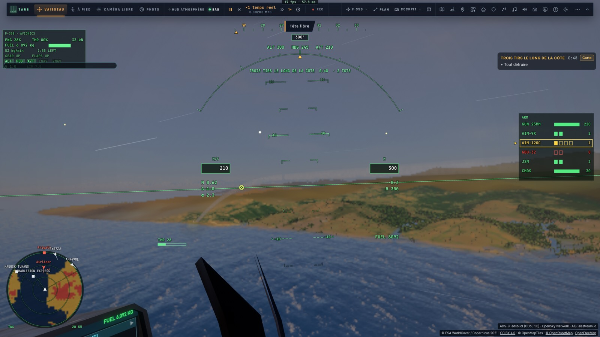
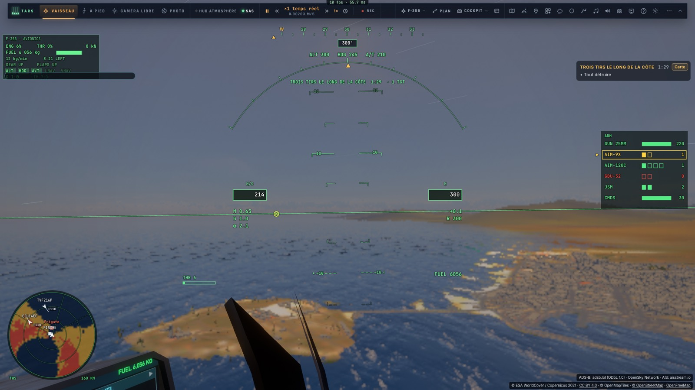
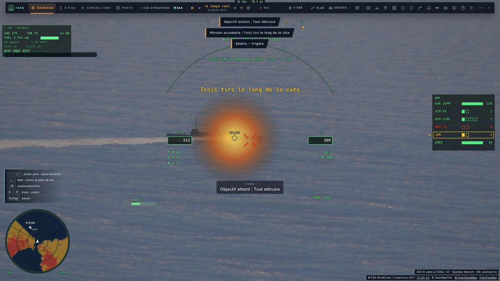
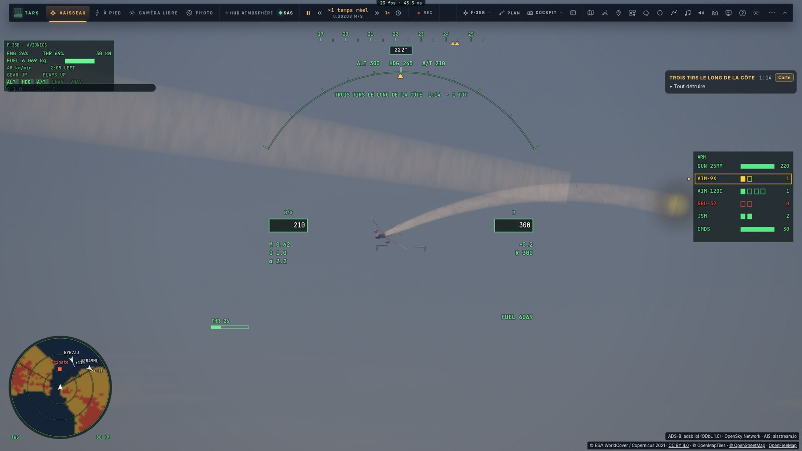
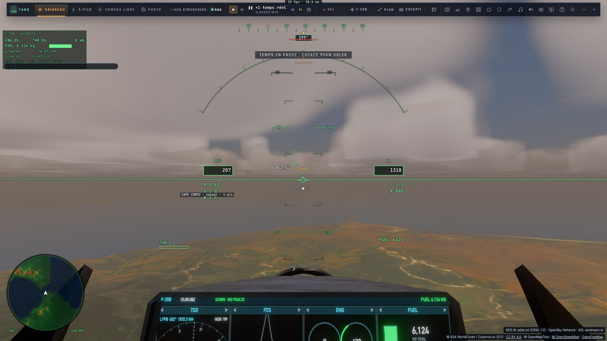
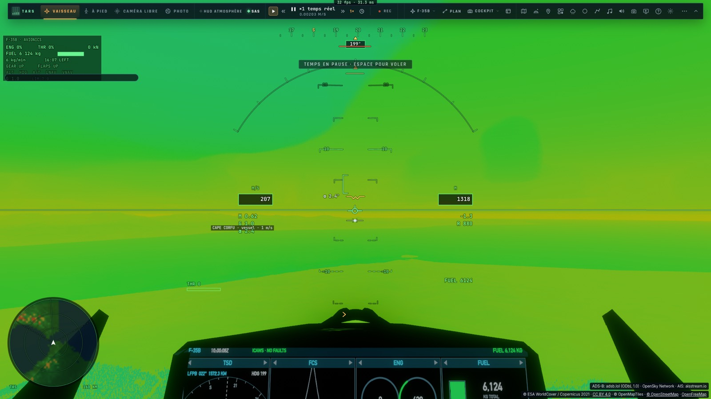
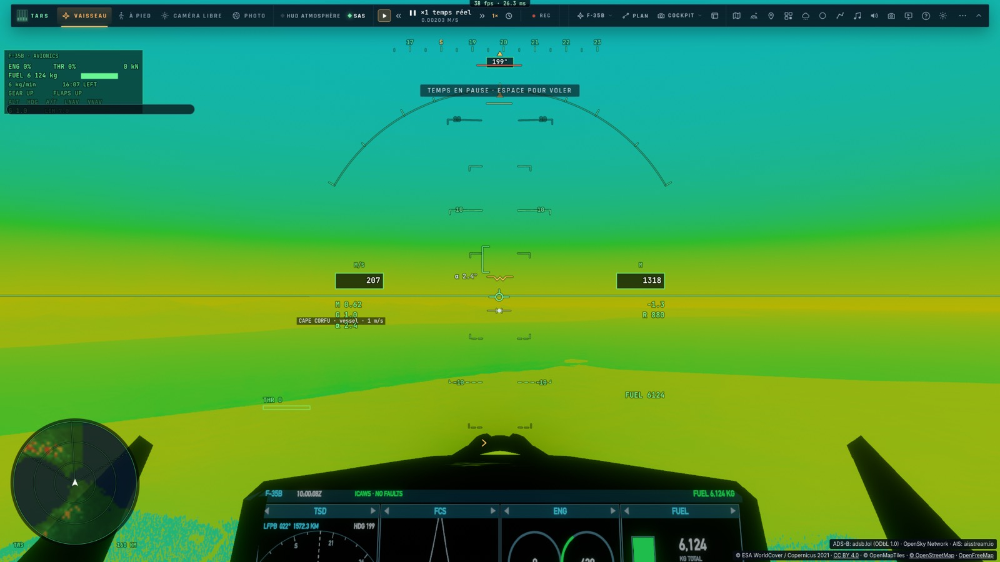
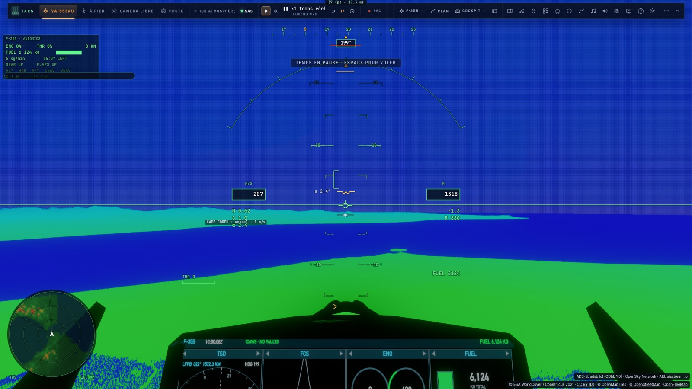
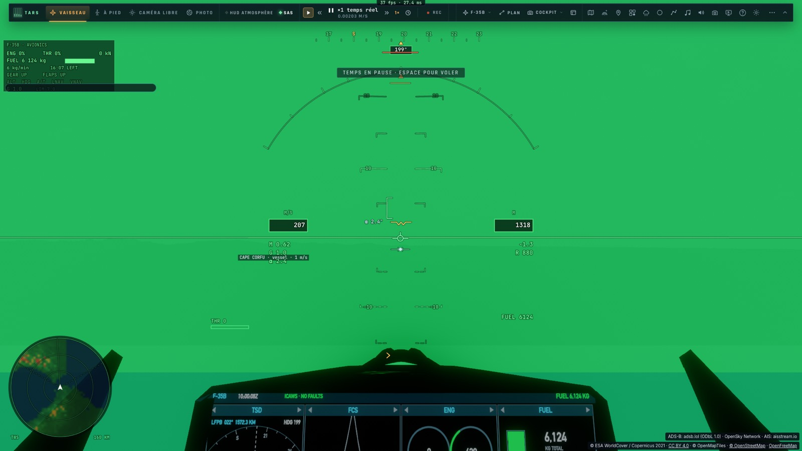
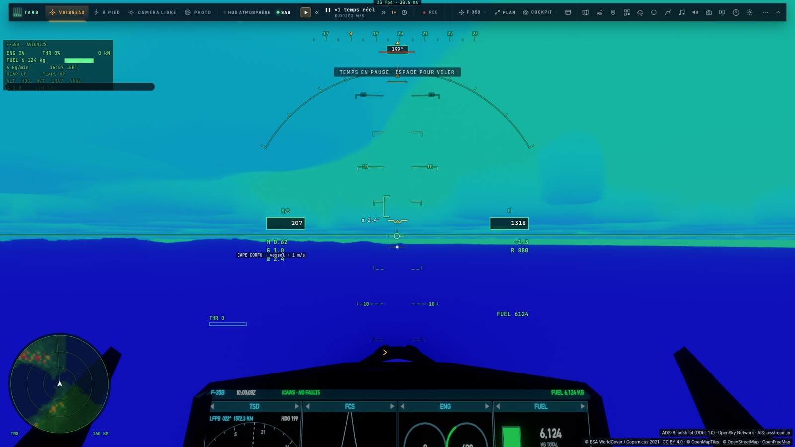

# Le rendu en vol bas : ce qui coûte en GPU

*2026-10-16 — [PLAN-AVIATION-AAA](../../PLAN-AVIATION-AAA.md), après « Le tir, en direct et en replay ». Mesures sur
kerr-mini (Mac mini M1, écran 1920×1080 à 50 Hz), image 1600×1000, vue cockpit.*

## Ce qui change dans le jeu
- **Le détail suit le regard** (`system/streaming-focus.ts` `gazeLead`) :
  - les fenêtres les plus fines du relief (`EarthTiles`) et la boîte du décor (arbres, bâtiments, routes) sont menées vers
    le point du sol que regarde la vue — jusqu'à 6 km, 1,25 tuile au plus par niveau —, plus seulement autour de l'avion ;
  - au zoom (tête verrouillée sur une cible à 5–10 km), le sol derrière la cible est chargé fin ;
  - `renderer.gazeStreaming` (vrai par défaut) pour comparer ; `streamingState.gazeM` dit de combien.
- **Les collines et les villes du bord de mer ne sont plus peintes en mer** (`trace.wgsl` `earthGround`) :
  - le masque de la mer vient de la carte globale (≈ 5 km par texel) ;
  - un sol que le relief fin met au-dessus du niveau de la mer (0,5–2 m) est de la terre ;
  - ce que le décor OSM dessine sur terre (rues, voies) aussi — Tarifa avait ses bâtiments posés sur la mer.

## Le test des trois tirs à Gibraltar
`tests/e2e/gibraltar-shots.e2e.test.ts` (≈ 4 min, les Alpes d'abord) :
- une ligne droite à 300 m au-dessus de la mer, de Punta Carnero vers Tanger, à 2,5 km de la côte espagnole puis au
  large du Maroc — le relief vérifié sous la route ;
- le trafic réel (avions, navires), quelques nuages, une houle de 1,5 m ;
- un drone (AIM-120 à 5 km), un avion de ligne (AIM-9X à 6,7 km), une frégate (JSM à 8,9 km), de face ;
- chacun ciblé comme un pilote : Tab jusqu'au verrouillage (le trafic réel donne d'autres pistes), = pour l'arme,
  Entrée ; la tête verrouillée dessus (⇧L) pour le tir, l'impact, la chute, le crash, puis relâchée ;
- un regard vers les collines entre deux tirs ;
- le temps par image et par phase en fin de test — en « RT max » (bloc automatique, 6 ou 4) : ≈ 40–45 ms, 21–22 fps
  en croisière, au tir et dans la chute, 28 fps au crash.

## Ce qui coûte

### Le rayon
- Tout le paysage (terrain, mer, nuages, atmosphère, décor) est tracé dans **une seule passe de calcul, un rayon
  par bloc de b×b pixels**. Le reste (raster de l'avion, reconstruction, temporel, affichage) est à pleine résolution.
- À ×2 (400 000 rayons), au-dessus des collines de Tarifa : **la passe trace prend ≈ 150 ms**, l'image ≈ 168 ms.
  - Le coût suit le nombre de rayons : échelle 0,5 (¼ des rayons) → 163 → 43 ms.
  - Soit **≈ 0,37 µs par rayon** sur le M1.
- **En ×1 (1,6 million de rayons) : ≈ 600 ms par image.** C'est ce qui empêche le temps réel en ×1, pas le
  raster ni le post-traitement. Pour 24 fps (40 ms), il faudrait un rayon 15 fois moins cher.

### Où va le travail d'un rayon (A/B de la passe trace à ×2)
| Changement | Passe trace | |
|---|---|---|
| tête levée vers le ciel (+35°) | 150 → 93 ms | −38 % |
| tête baissée vers le sol (−30°) | 150 → 225 ms | +49 % |
| décor (arbres, bâtiments, routes) coupé | 148 → 128 ms | −14 % |
| tuiles de relief réelles → carte globale | 151 → 179 ms | +18 % (la carte globale coûte plus : son relief procédural) |
| nuages volumétriques → plats | | −3 % |
| couverture nuageuse 0,3 → 0 | | −1 % |
| mer FFT → trains de vagues | | −2 % |
| météo nuageuse → beau temps | | ≈ 0 |
| surface Sentinel, ombres du décor | | ≈ 0 |

**C'est le rayon qui touche le sol qui coûte**, deux à trois fois un rayon de ciel.

### La vue coût par pixel
`renderer.costView` (`trace.wgsl` `COST_VIEW`, une variante du noyau à part : éteinte, ses compteurs sont hors du
noyau — mesuré, la passe trace reste à 148 ms) montre le travail de chaque rayon en carte de chaleur — noir rien,
bleu, cyan, vert, jaune, rouge beaucoup, échelle log. 1 le total pondéré ; 2 … 9 une sorte seule.

| L'image | Tout le travail |
|---|---|
|  |  |
| **Les hauteurs lues** (`earthH`) | **Les ombres du relief** |
|  |  |
| **L'air** | **Les nuages** |
|  |  |

Ce qu'elle montre :
- **les hauteurs du terrain lues** : ≈ 150 par rayon au sol (jaune), davantage à l'horizon, encore 10–40 par rayon de
  ciel. Chaque lecture parcourt les niveaux de tuiles et ajoute le détail procédural : c'est le poste principal ;
- **les ombres du relief** : ≈ 40 pas de plus par pixel de sol proche, chacun une hauteur lue ;
- **l'air** : ≈ 40 pas d'intégration sur chaque pixel, ciel et sol pareil ;
- **les nuages** : jusqu'à ≈ 40 pas dans le ciel, peu au sol ; la mer et le décor : peu ;
- **les pixels sous le cockpit opaque sont tracés quand même** (le bas de l'image en vue cockpit) : du travail perdu.

### Le raster et l'affichage
- **Le CPU n'est pas en cause** : ≈ 4 ms par boucle.
- **L'écran de kerr-mini est à 50 Hz** : les images s'enchaînent par paliers de 20 ms (50, 25, 16,7 fps). Une image de
  21 ms en prend 40 — d'où des mesures « bimodales » 22 / 39 ms à ×6. Les A/B de l'image entière disent donc seulement
  si elle tient dans 20 ou 40 ms ; la passe trace, elle, se mesure à part (horodatage d'une passe de calcul).
- **La verrière du F-35** : jusqu'à 16 ms dans l'état où l'image frôle les 20 ms, 2–4 ms ailleurs. Son shader est
  léger (reflet de l'image tracée inclus : 0 ms) : c'est la couche plein écran mélangée en MSAA ×4.
  `ship.debugSkip` (`"shadow"`, `"pre"`, `"hull"`, `"glass"`, `"glass-sr"`, `"glass-flat"`, `"plume"`) pour mesurer.
- Le trafic réel, le flou de mouvement, le streaming guidé par le regard : rien de mesurable.

## Ce qui donnerait de la qualité à 24 fps
Par ordre de gain attendu :
1. **Ne pas tracer sous le cockpit opaque** : un masque tiré du raster de l'image précédente — 15 à 25 % des rayons
   en vue cockpit, gratuit en qualité.
2. **L'air par une table** (perspective aérienne précalculée en 3D, à la Hillaire) au lieu de ≈ 40 pas par pixel.
3. **La marche du terrain** :
   - sauter le vide avec une pyramide de hauteurs max (le rayon saute les cases où il est au-dessus de tout) — de
     ≈ 150 lectures à quelques dizaines ;
   - ou, mieux, **rasteriser le terrain des tuiles** en premier passage : la profondeur donne le point touché à pleine
     résolution, le rayon ne fait que l'affiner et ombrer.
4. **Les ombres du relief** dans une carte (d'horizon ou d'ombre) par tuile, au lieu de 40 pas par pixel.
5. **La reprojection temporelle en vol bas** : aujourd'hui l'historique est jeté dès que le sol proche bouge de
   0,5 px (`taParallaxPx`) — toujours, en vol bas. La garder rendrait un ×3 proche d'un ×1 à l'œil.

## Outils
- `tests/e2e/perf-ab.e2e.test.ts` — A/B alternés, médianes, CPU et passe trace : `SET=trace` (le rayon, à ×2),
  `SET=ship` (le raster par morceaux), sinon la série d'ensemble ; `SUBS`, `ONLY`, `NOVSYNC`.
- `tests/e2e/shootdown-gpu.e2e.test.ts` — les trois tirs à ×8, ×6, ×4, ×3, ×2 : ≈ 26, 28, 44, 65, 121 ms en croisière.
- `tests/e2e/cost-view.e2e.test.ts` — les vues coût, image figée, aux Alpes puis à Tarifa.
- `docs/BH-API.md` : `costView`, `gazeStreaming`, `debugSkipShip`, `ship.debugSkip`, `taParallaxPx`.
