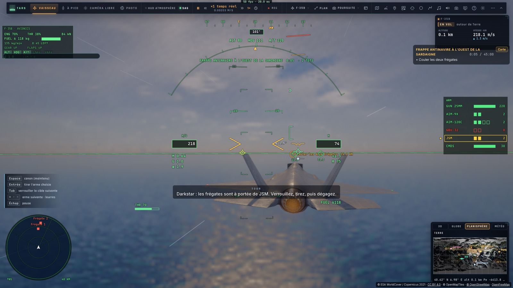
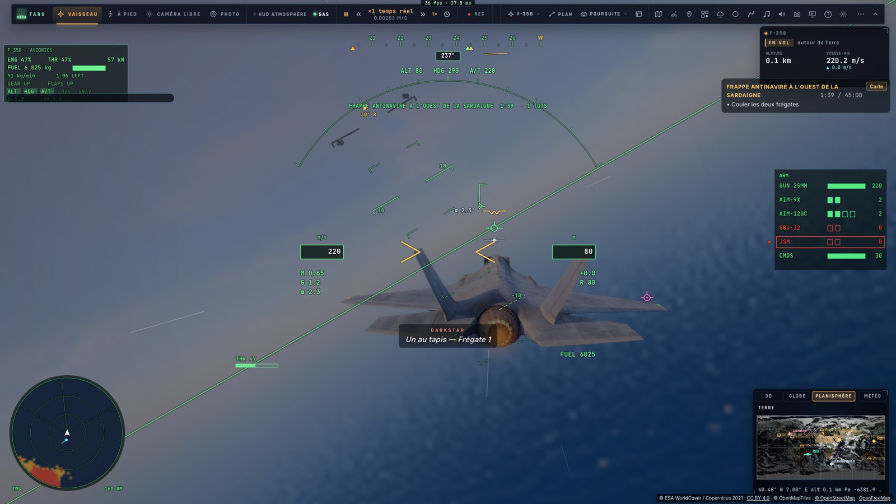
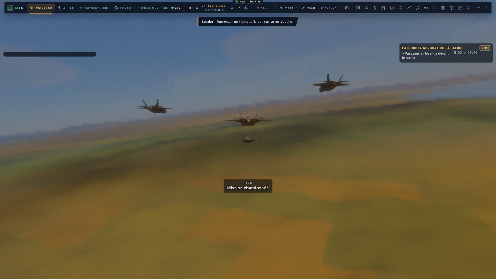
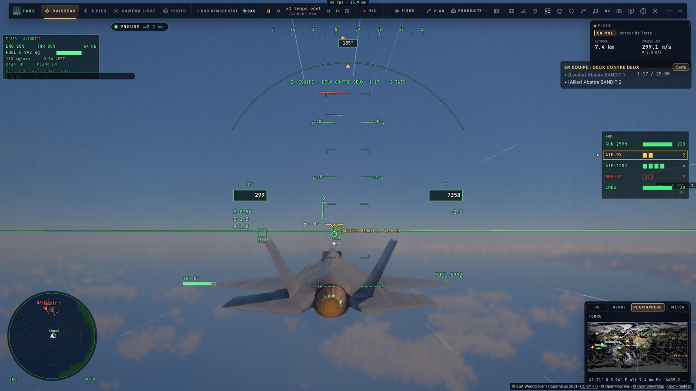

# S1 — Les missions d'exception

*2026-10-16 — [PLAN-AVIATION-AAA](../../PLAN-AVIATION-AAA.md), phase S1.*

## Dix nouvelles missions (treize au total)
Elles s'ajoutent à la carte « Défis, combats, missions » et à TARS. Elles sont bilingues.

| Mission | Ce qu'on y fait |
|---|---|
| **Escorte du VIP jusqu'à Nice** | Un Falcon gouvernemental (simulé) part de Toulon. À 60 s, un intercepteur décolle au nord et fonce sur lui. Il faut rester à moins de 6 km du VIP et abattre l'intercepteur ; s'il approche le VIP à moins de 3 km, la mission échoue. |
| **Red Air au large d'Hyères** | Combat contre des agresseurs simulés, un ailier IA avec nous : deux patrouilles de deux chasseurs, la seconde annoncée par Darkstar quand la première tombe. |
| **Frappe antinavire à l'ouest de la Sardaigne** | Deux frégates hostiles font route. On les coule avec deux JSM tirés au-delà de leurs SAM, en restant bas, puis on revient sur le Ford (bonus). |
| **Qualifications d'appontage** (jour, nuit, mer forte) | Les qualifications de M3d, devenues missions : le F-35C à 7 km sur l'arrière du Ford, quatre passages notés. Réussies avec une moyenne de 3,0 sans coupure, sinon échouées (la moyenne est dite). |
| **Patrouille acrobatique à Salon** | On mène un losange de quatre F-35 (trois ailiers IA) devant le public de Salon-de-Provence : trois passages sous 300 m, les équipiers à leur poste à moins de 40 m d'un bout à l'autre. |
| **En équipe : escorte et frappe en Corse** | Le *frappeur* détruit le site SAM puis le bunker ; l'*escorte* abat les deux chasseurs qui décollent à son approche. |
| **En équipe : deux contre deux** | Notre patrouille contre deux chasseurs au-dessus du golfe du Lion : le leader prend BANDIT 1, l'ailier BANDIT 2. Seul, un ailier IA nous suit. |
| **En équipe : défense du porte-avions** | Deux CAP au-dessus du Ford. Le raid nord vole droit sur le porte-avions, le raid sud arrive à 4 min. Aucun ne doit approcher à moins de 25 km ; il faut tenir 15 min. |

**La police du ciel** (intercepter, identifier et accompagner un intrus) existait déjà : c'est le *Renegade sur les Alpes*.

## Le moteur
**Les missions** (`game/mission.ts`) reçoivent :
- l'unité **navire** ;
- l'objectif **qualification** : il lance la qualification d'appontage de M3d, éventuellement avec l'autopilote, et
  il est réussi si la qualification l'est ;
- l'objectif **passages devant le public** : un passage compte en sortant de la zone, s'il a été fait sous la
  hauteur demandée avec le nombre d'équipiers à leur poste (à moins de 40 m) ;
- la condition **« une unité près d'une autre »**, pour un raid près du porte-avions ou un chasseur près du VIP
  (une unité abattue ne compte plus) ;
- **les ailiers IA et la formation au départ** ;
- **les rôles d'une mission en équipe**.

**Les rôles.** Chaque rôle a son nom, son briefing et son propre départ, et chaque objectif peut être attribué à un
rôle.
- En salle, celui qui lance la mission prend le premier rôle, les autres les suivants, dans l'ordre de leur place.
- Chaque objectif fait par l'un compte pour tous, comme en P1.
- Le briefing liste les rôles ; dans la liste des objectifs, chacun voit les siens, les autres en grisé, avec
  « [Ailier] », « [Frappeur] »…

**L'éditeur** propose désormais le navire ennemi et la configuration antinavire. Ce qu'il ne sait pas encore éditer
(ces nouveaux objectifs, les rôles, les ailiers) traverse la carte sans être perdu.

**TARS** les connaît tous dans son outil `mission`. Une mission qu'il compose avec un navire part en configuration
antinavire.

## Le navire et le JSM (une partie de C5–C6)
- **La frégate** est une cible du monde de combat :
  - elle fait route à 9 m/s, posée sur la mer ;
  - elle tire ses propres SAM (six) sur ce qui vole à plus de 150 m dans leur portée de 32 km : en restant bas, on
    passe dessous ;
  - au radar, elle apparaît comme un écho de surface ;
  - à l'écran, c'est le modèle de frégate des escortes du porte-avions, avec son sillage ;
  - touchée à mort, elle s'enfonce.
- **Le JSM** (Joint Strike Missile) :
  - un nouveau missile, pour la nouvelle configuration « antinavire » : 2 JSM, 2 AIM-120, 2 AIM-9X ;
  - il ne se tire que sur un navire verrouillé ;
  - il croise à 280 m/s environ au ras de l'eau (30 m) et ne plonge sur la cible que dans ses 5 derniers km ;
  - sa portée est de 160 km, et sa charge coule une frégate d'un coup ;
  - il s'affiche dans le panneau d'armement ; TARS sait le choisir et le tirer.

## Deux défauts trouvés en route
- **Le radar ne voyait pas les navires.** Son masquage par le relief comptait la courbure de la Terre à rebours :
  - il la retranchait à la hauteur de la ligne de visée au lieu de l'ajouter ;
  - un navire au ras de l'eau était donc caché par la mer elle-même, et toute cible lointaine paraissait plus
    cachée qu'elle ne l'est ;
  - c'est corrigé (avec un peu de réfraction), et les tests du radar et de l'interception passent.
- **Les répliques de mission** préfixées « Darkstar : », « AWACS : » ou « Mother : » passent maintenant par la voix
  de leur rôle (I4), et non plus par la tour.

## Mesuré
- **`tests/s1-missions.test.ts`** :
  - les treize missions sont valides ; les rôles et les objectifs de rôle sont vérifiés ;
  - la configuration antinavire ajoute 832 kg ;
  - **la frégate** : au ras de l'eau, à 60 km, aucun tir ; le JSM refusé sans navire verrouillé. Tiré à 68 km,
    il touche en 250 s (273 m/s de moyenne) et la frégate coule. Un avion à 4 000 m à 25 km se fait tirer dessus.
  - **la patrouille acrobatique** : un bon passage compte, un trop haut non, un avec un équipier hors poste non ;
    trois bons passages gagnent la mission.
  - **la défense du porte-avions** : un raid abattu près du Ford ne compte plus, un autre à 15 km fait échouer
    (« Un raid a atteint le Ford ») ;
  - **une qualification** de nuit : réussie à 3,5 ; échouée à 2,25, avec la moyenne dite.
- **`tests/e2e/s1-missions.e2e.test.ts`** sur kerr-mini (les Alpes d'abord) :
  - **la frappe antinavire** :
    - à 25 km des frégates, à 80 m ;
    - Frégate 1 verrouillée à 23,7 km, puis « JSM parti » ; Frégate 2 verrouillée à 30,8 km, puis « JSM parti » ;
    - les deux coulées en deux minutes, la mission gagnée ;
  - **la patrouille acrobatique** : le losange formé, les trois équipiers au poste, un passage bas devant le
    public compté ;
  - **en salle** :
    - Ana lance *Deux contre deux*, et Ben la rejoint automatiquement avec le rôle d'ailier ;
    - les rôles sont 0 et 1 ;
    - chez Ben : « [Leader] Abattre BANDIT 1 » en grisé, « [Ailier] Abattre BANDIT 2 » en clair.

## Écarts
- **Les raids ne tirent pas sur le porte-avions** : ils foncent dessus. Leur arrivée à 25 km fait échouer la
  mission.
- **Le JSM n'a pas de mode programmé** (points tournants, attaque coordonnée) : il va droit, au ras de l'eau.
- **Les équipiers de la patrouille acrobatique** tiennent leur poste en vol droit et en virage, mais pas encore
  dans les figures (boucle en losange).
- **Le 2 contre 2 humains contre humains** reste celui des matchs en salle (R3). Celui-ci oppose deux pilotes à
  deux chasseurs IA.
