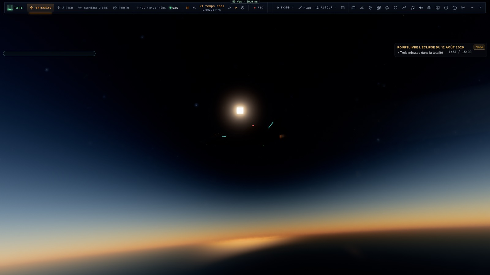
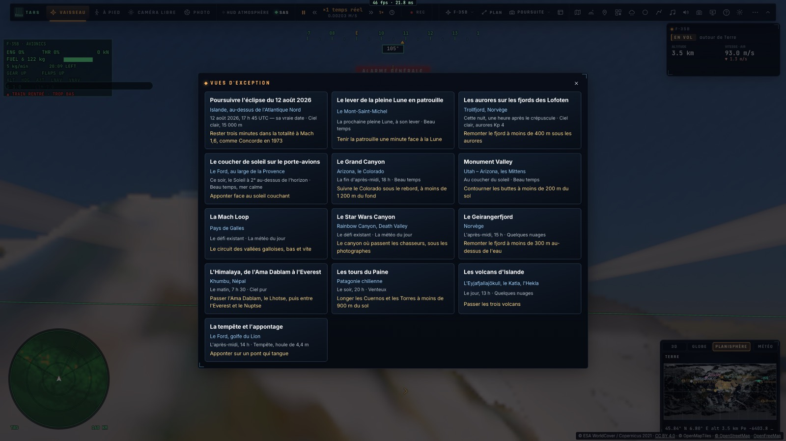
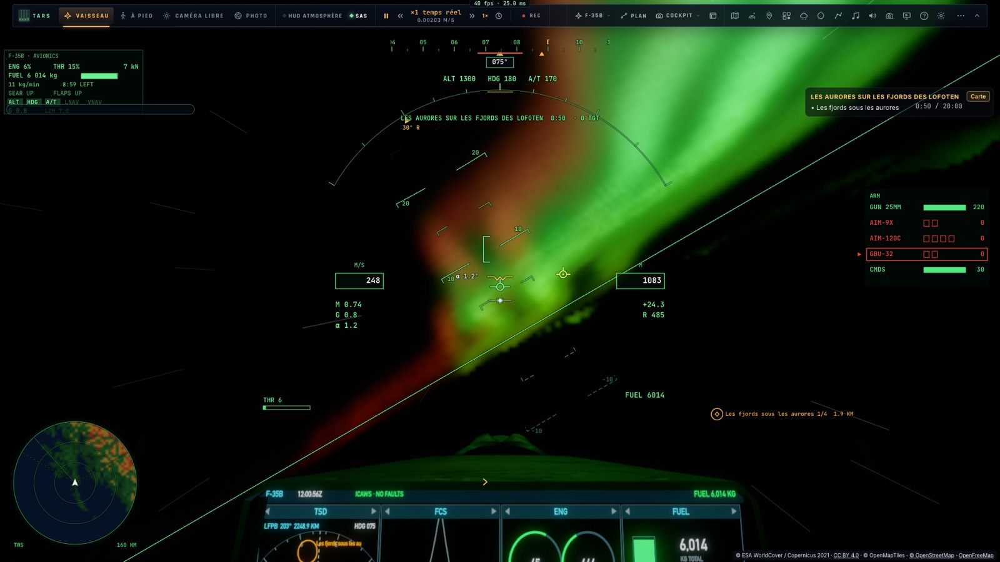
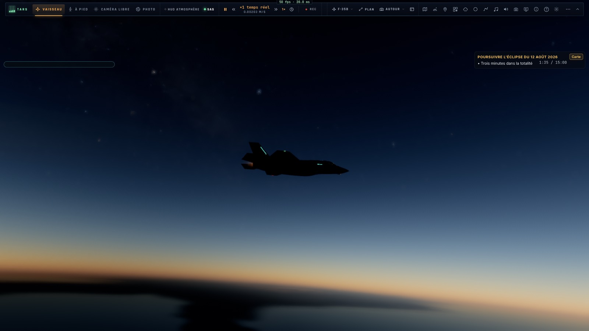
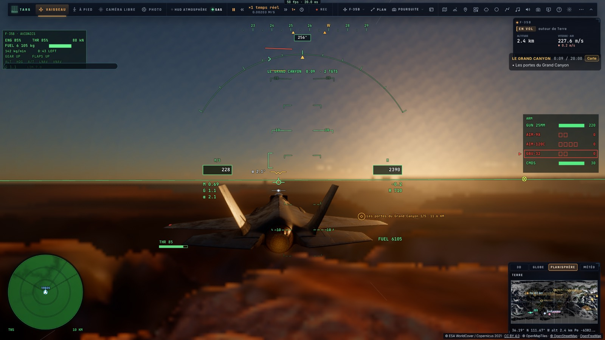

# S2 — Les vues d'exception

*2026-10-16 — [PLAN-AVIATION-AAA](../../PLAN-AVIATION-AAA.md), phase S2.*

## Treize scènes, chacune avec son heure, sa météo et son défi (`game/views.ts`)
Une page « Vues d'exception » (menu de vol, `__bh.flight.views`, et TARS par son outil `mission`) en présente les
fiches. Chacune est une mission fabriquée au moment du vol, son heure calculée par les éphémérides du jeu, ou un
défi existant.

| Scène | Heure, météo | Défi |
|---|---|---|
| **L'éclipse totale du 12 août 2026**, à sa vraie date | Départ sur la ligne de centralité près de l'Islande (65,5° N, 22,4° O), 2 min avant l'ombre, 15 000 m, cap sur sa course | Trois minutes dans la totalité à Mach 1,6, comme le Concorde 001 en 1973 |
| **Le lever de la pleine Lune en patrouille** | Prochaine pleine Lune, un quart d'heure après son lever, au-dessus du Mont-Saint-Michel, cap sur elle | Tenir la patrouille (deux équipiers en échelon) une minute face à la Lune |
| **Les aurores sur les fjords des Lofoten** | Cette nuit, une heure après le crépuscule nautique ; aurores Kp 4 | Remonter les fjords jusqu'au Trollfjord sous 400 m |
| **Le coucher de soleil sur le porte-avions** | Ce soir, le Soleil à 2° au-dessus de l'horizon, le Ford cap à l'ouest | Apponter (F-35C) face au soleil couchant |
| **Le Grand Canyon** | 18 h | Suivre le Colorado sous le rebord |
| **Monument Valley** | Au coucher du soleil | Contourner les buttes sous 200 m |
| **La Mach Loop**, **le Star Wars Canyon** | Les défis déjà présents | Le circuit gallois, le Rainbow Canyon |
| **Le Geirangerfjord** | 15 h, quelques nuages | Remonter le fjord sous 300 m |
| **L'Himalaya** | 7 h 30, ciel pur | L'Ama Dablam, le Lhotse, puis entre l'Everest et le Nuptse |
| **Les tours du Paine** | 20 h, vent | Longer les Cuernos et les Torres sous 900 m |
| **Les volcans d'Islande** | 13 h | L'Eyjafjallajökull, le Katla, l'Hekla |
| **La tempête et l'appontage** | Tempête, houle de 4,4 m | Apponter sur un pont qui tangue |

**Le moteur de mission** reçoit trois objectifs :
- **le parcours** : des portes à franchir dans l'ordre, chacune dans son rayon et sous une hauteur ; chaque porte est annoncée, et la suivante est montrée par le repère du HUD et sur la carte ;
- **l'éclipse** : les secondes passées dans la totalité, là où l'on vole ;
- **la patrouille tenue** : tant de secondes, tant d'équipiers à leur poste.

## Les aurores (`trace.wgsl` : `auroraLight`)
Un nouveau réglage, **Aurores** (0 à 9, comme l'indice Kp), est fixé aussi par les scènes.
- **L'ovale** entoure le pôle géomagnétique (80,8° N, 72,6° O). Il est centré sur la latitude magnétique 69° moins 1,1° par point de Kp.
- **Les rideaux** : des arcs repliés qui dérivent le long de la longitude magnétique, un arc plus pâle côté pôle, un autre côté équateur pendant les orages, et des rayons verticaux.
- **Les couleurs** : le vert de l'oxygène (557,7 nm), culminant à 110 km et s'estompant au-dessus ; ses sommets rouges (630 nm) vers 230 km, faibles en activité calme.
- **Le calcul** : la lumière est intégrée le long du rayon entre 90 et 330 km, cachée par les nuages vue d'en dessous, atténuée par l'air.
- **Le coût** : son code n'est compilé dans le noyau (un nouveau bit, 16384) que lorsqu'une aurore est demandée près de la Terre. Ses paramètres occupent deux composantes inutilisées (`bary.zw`).
  - Un premier essai avait pris `earth4.w`, en réalité le drapeau des nuages volumétriques.
  - Il a été corrigé avant d'être poussé.

## Vos trois remarques, corrigées
- **Le F-35 restait éclairé dans l'ombre de l'éclipse.** La lumière directe du Soleil sur l'avion (`keyLight`) tenait compte de la Terre, de l'air et du relief, mais pas de la Lune.
  - Elle est maintenant multipliée par la part du Soleil que la Lune laisse voir là où il vole.
  - En totalité, l'avion n'est plus qu'une silhouette sombre, éclairée par le seul ciel noir.
- **La mer suivait l'avion.** Le repère des vagues (la direction du vent) était recalculé à chaque image sur le plan tangent de la caméra elle-même, où la caméra est toujours à l'origine.
  - Mesuré : l'avion avançait de 450 m et sa place sur les vagues de 5 m. La houle restait donc collée sous lui, et ne bougeait pas non plus par rapport aux bateaux.
  - Le repère est désormais pris en un point d'ancrage fixe, rafraîchi tous les 50 km : l'avion avance de 325 m, sa place sur les vagues de 328 m.
- **Le trafic réel.** Il ne dépend pas des salles : la page interroge seule le relais `stream.samlepirate.org` dès qu'on pilote.
  - Les avions y arrivent (adsb.lol).
  - Les navires non : la clé aisstream du `.env` local ne sert qu'au serveur de développement. Le conteneur de production doit l'avoir dans les variables de sa pile Portainer (`AISSTREAM_API_KEY`, et `OPENSKY_CLIENT_ID` et `OPENSKY_CLIENT_SECRET` pour des avions plus robustes).

## Mesuré
- **`tests/s2-views.test.ts`** :
  - les treize vues : des missions valides ou les défis existants ;
  - **l'éclipse** : le départ au 12 août 2026 à 17 h 44 UTC, à 65,5° N, 22,4° O ; pas encore totale au départ, totale au même point deux minutes plus tard ;
  - **la Lune** : 2,7° au-dessus de l'horizon au départ (le 25 octobre, 16 h 36 UTC) ;
  - **les heures calculées** : la nuit des aurores, sous −14° de hauteur du Soleil ; le Soleil du porte-avions entre 2° et 4° ;
  - **le parcours** : une porte prise dans le désordre ou trop haut ne compte pas, les autres gagnent ;
  - **les secondes d'éclipse** et **la minute de patrouille** : une rupture remet le compteur à zéro.
- **Sur kerr-mini** :
  - **`tests/e2e/s2-views.e2e.test.ts`** :
    - la page et ses treize fiches ;
    - les aurores : le noyau compilé avec leur code, leurs rideaux dans la nuit ;
    - l'éclipse : la totalité atteinte au-dessus de l'Islande (21 s comptées dans l'e2e), la couronne et l'avion devenu silhouette ;
    - le lever de Lune en patrouille, le Grand Canyon au coucher du soleil, la tempête sur le Ford.
  - **`tests/e2e/sea-motion.e2e.test.ts`** : la place de l'avion sur les vagues avance d'autant qu'il vole.

## Écarts
- **S3** (le spectacle) reste à faire : les caméras du replay, le mode photo dans chaque scène, la bande-annonce automatique.
- **L'aurore est un modèle visuel**, sans données réelles : l'indice Kp en direct (NOAA) pourrait la piloter.
- **Le trafic réel est celui d'aujourd'hui**, même dans une scène datée (l'éclipse de 2026).
- **La Lune à 3° au-dessus de l'horizon** n'est qu'une lueur orangée à travers toute l'épaisseur de l'air.
