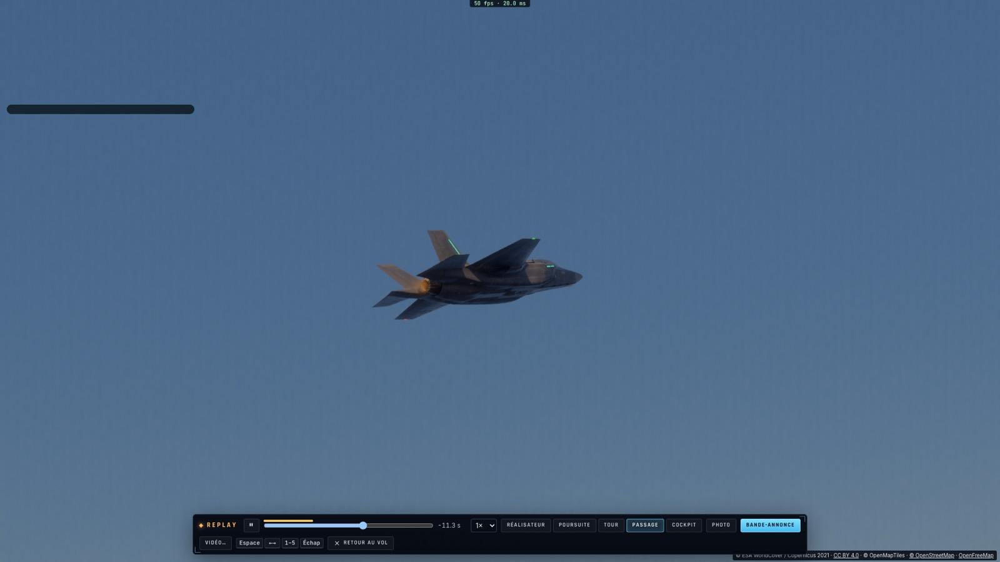
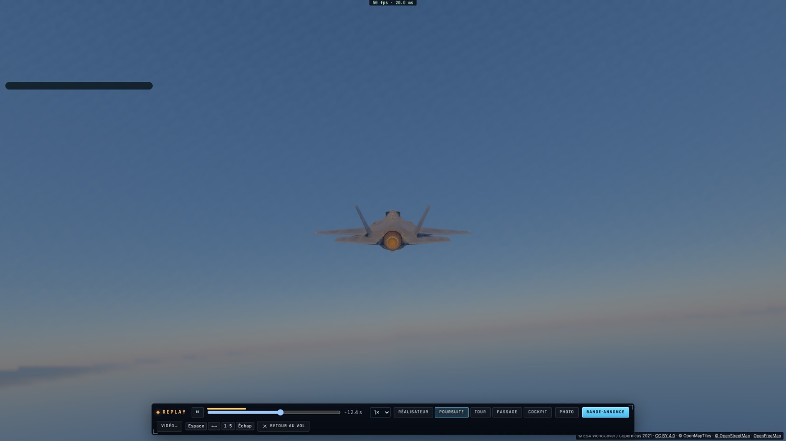
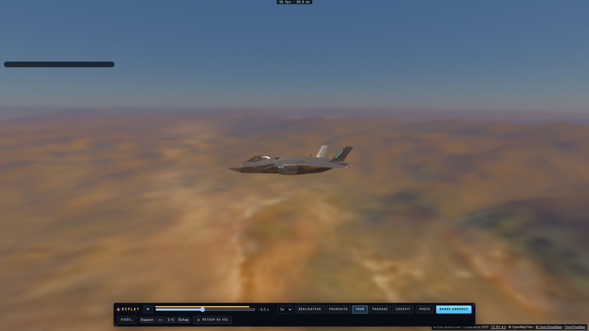
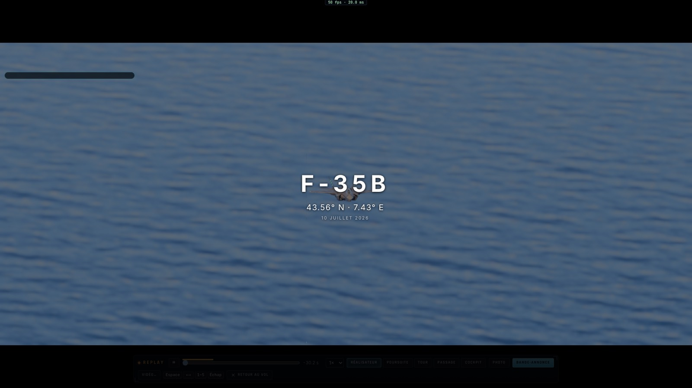
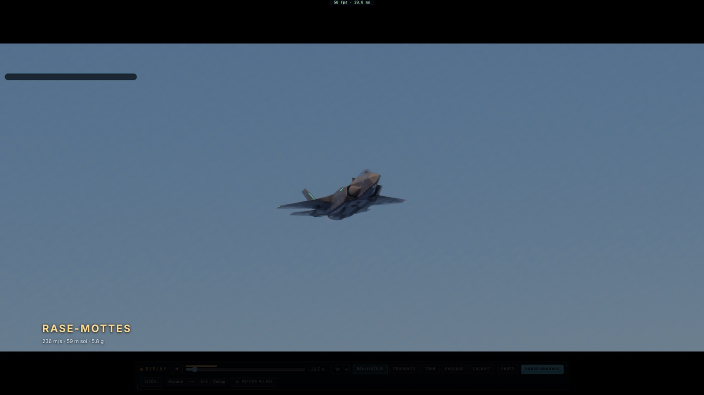
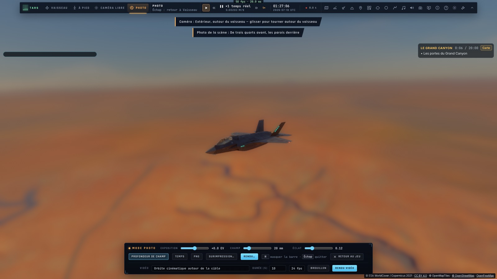

# S3 — Le spectacle

*2026-10-16 — [PLAN-AVIATION-AAA](../../PLAN-AVIATION-AAA.md), phase S3.*

## Le replay (`game/replay.ts`, `ui/replay.ts`)
Le jeu enregistre en continu les **deux dernières minutes et demie** de vol, à 60 images par seconde. Pour chaque image, il garde :
- la position de l'avion sur la Terre WGS84 et ses axes ;
- sa hauteur sol, sa vitesse, son Mach, son facteur de charge ;
- ce qui se passe : rafale, tir de missile, explosion proche, toucher des roues, ailiers en patrouille, postcombustion ;
- de quoi le redessiner tel qu'il était : sa pose, ses flammes, ses gouvernes et son train, les autres avions, les sillages des navires.

Une téléportation (nouvelle scène, mission) recommence l'enregistrement.

**Ouvert** depuis le menu de vol (Replay), par TARS (outil caméra : `replay`) ou par `__bh.flight.replay`.
- Pendant le replay, le vol est **gelé**, et il **reprend exactement là où il était** à la sortie.
- L'interface du vol disparaît. La sauvegarde automatique est suspendue.
- Une barre en bas de l'écran : lecture et pause, ralenti (½×, ¼×), ligne de temps avec les meilleurs moments marqués en ambre.
- Raccourcis : Espace, ← → (5 s), 1–5 (caméras), Échap (retour au vol).

**Les caméras :**

| Caméra | Ce qu'elle fait |
|---|---|
| **Poursuite** | Derrière l'avion et un peu au-dessus. Elle suit son nez avec un léger retard, ce qui fait sentir les virages. Horizon à plat. |
| **Tour** | Un tour complet autour de l'avion en 14 s, à 30 m, avec une hauteur qui ondule. |
| **Passage** | Posée là où l'avion passera 2,5 s plus tard : sur le côté (35 m plus 8 % de la vitesse), un peu en dessous, toujours au-dessus du sol. Elle le suit en ajustant le zoom : téléobjectif de loin, grand-angle au moment du passage. |
| **Cockpit** | La place du pilote. |
| **Réalisateur** | Coupe toutes les 3,2 à 5 s, selon ce que fait l'avion : passage s'il est bas et rapide, poursuite à l'approche d'une rafale, d'un tir ou d'une explosion, tour pendant un virage serré ou en patrouille. Jamais deux fois la même caméra de suite. |

## La bande-annonce
Le jeu cherche les **meilleurs moments** du vol : jusqu'à trois tranches de 8 s, séparées, rangées dans l'ordre du vol.
- **Chaque image reçoit une note** :
  - rase-mottes (selon la vitesse et la hauteur sol) ;
  - virage serré au-delà de 3 g ;
  - passage du mur du son à basse altitude ;
  - rafale, tir de missile, explosion, toucher des roues, patrouille.
- **Les événements comptent davantage** quand ils tombent vers le milieu de la tranche.
- **Un moment trop faible est écarté** (moins du quart du meilleur) : un vol de croisière ne fait qu'un seul moment.

**La bande-annonce les enchaîne** :
- en bandes cinéma ;
- avec un carton-titre (l'appareil, le lieu — ou le nom de la mission —, la date) ;
- avec, pour chaque moment, sa légende en bas : sa nature (Rase-mottes, Virage serré, Canon, Missile tiré, Abattu, Toucher des roues…) et ses chiffres dans les unités du joueur ;
- avec un carton de fin ;
- les plans choisis par le réalisateur.

**« Vidéo… »** la rend en film : la scène est remise en place, puis la bande-annonce devient une « prise » (`take.ts`) que le rendu vidéo existant traite à pleine qualité, avec les autres avions et les gouvernes de chaque image.

## Le mode photo dans chaque scène
Chacune des treize vues d'exception a désormais **son cadrage photo** (`ExceptionalView.photo`), affiché sur sa fiche (📷) :
- l'angle de la caméra autour de l'avion et sa distance ;
- le champ ;
- l'exposition, l'éclat, la profondeur de champ ;
- une phrase qui dit ce qu'on cadre.

Quelques exemples :
- l'éclipse : sous l'avion, la couronne derrière lui ;
- le lever de Lune : derrière la patrouille, au téléobjectif ;
- le Grand Canyon : de trois quarts avant, les parois derrière.

En ouvrant le mode photo pendant la scène, ce cadrage s'applique une fois ; on peut ensuite tout régler. Le bouton **Photo** du replay ouvre aussi le mode photo sur l'image arrêtée.

## Mesuré
- **`tests/replay.test.ts`** :
  - l'enregistrement : 150 s gardées, une image au plus tous les 60e de seconde, recommencé après une téléportation ;
  - les caméras sur les axes de l'avion :
    - la poursuite derrière et au-dessus, l'horizon à plat ;
    - le tour à 30 m ;
    - le passage : devant à plus de 300 m, puis à sa hauteur, puis derrière, au même point du monde ; un champ de moins de 10° de loin, de plus de 20° au passage ;
  - les moments : un combat abattu et un rase-mottes trouvés avant une croisière ; une croisière seule ne donne qu'un moment ;
  - le réalisateur : le passage pour le rase-mottes, la poursuite pour une rafale, le tour pour un virage serré, jamais deux fois la même caméra.
- **Sur kerr-mini, `tests/e2e/s3-replay.e2e.test.ts`** (6/6, les Alpes d'abord) :
  - **l'enregistrement** : un rase-mottes à 60 m au large de Nice puis une chandelle, 27,5 s sur 1 375 images ;
  - **le replay et ses caméras** : les quatre caméras, puis les coupes du réalisateur (tour, passage, poursuite) ; aucune annonce vocale pendant le replay ; à la sortie, le vol remis exactement en place, toujours à plus de 80 m/s ;
  - **la bande-annonce** : son titre, la légende « Rase-mottes · 236 m/s · 59 m sol · 5,8 g », sa fin ; puis sa vidéo brouillon de 239 images lancée et arrêtée ;
  - **un combat au canon rejoué** : l'adversaire dessiné dans le replay ;
  - **la photo du Grand Canyon** : vue « autour », 140°, champ de 60°, profondeur de champ.

## Écarts
- **Les traînées** (condensation, fumée des missiles) ne sont pas rejouées : elles sont calculées dans le repère de l'avion à l'instant même.
- **Les avions des autres joueurs** ne sont pas rejoués, et **le replay est refusé dans une salle**, où les autres continuent de voler.
- **Les écrans du cockpit** montrent l'état du vol en cours, pas celui du replay.
- **Une barre sombre en haut à gauche** apparaît sur toutes les captures de kerr-mini, en vol comme en rendu vidéo. Elle ne correspond à aucun élément de la page et est antérieure à S3.
