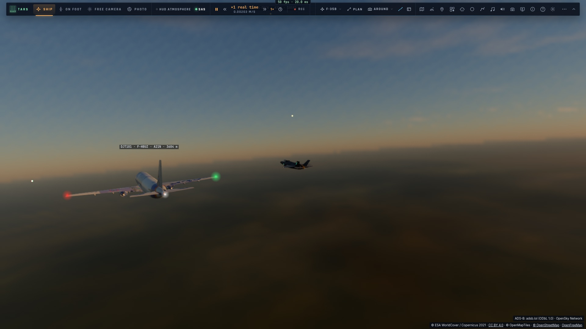
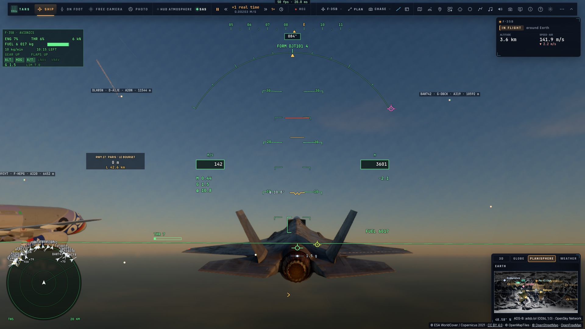

# T2 — Les avions dans le ciel

*2026-10-15 — [PLAN-AVIATION-AAA](../../PLAN-AVIATION-AAA.md), phase T.*

## Les modèles (`scripts/build-airliners.ts`, `ship.ts`, `game/airtypes.ts`)
- **L'A320** (GLB) et **le CRJ-900** (OBJ) fournis, convertis au format des appareils du jeu (`assets/traffic/`) :
  - dans le repère du vaisseau, à la taille réelle ;
  - leur livrée texturée (une texture par avion, en tableau sur le *binding* 26) ;
  - leurs feux en verre.
  - **Le train du CRJ, sorti dans le modèle, est retiré** : le trafic vole train rentré.
- **Chaque type OACI reçoit son modèle, à sa longueur**, ce qui donne aussi son envergure :
  - A318 à A388, 737, 757, 767, 777, 787 et MD-11 sur l'A320 ;
  - régionaux, jets d'affaires et avions légers sur le CRJ ;
  - un hélicoptère n'a que ses feux ;
  - un type inconnu est rangé selon sa catégorie de sillage.
- **Sa surface radar** dépend de sa longueur.

## Où il est : une minute de différé, et les lois du vol
On ne prolonge plus le dernier message, qui sautait à chaque nouveau. **Le trafic est montré une minute en
retard sur le temps réel** (*Jeu › Trafic › Avions en différé* : direct, 30 s, 1 min, 2 min). Ce moment est
toujours entouré de positions connues.

### Ce que reçoit la page (`traffic/feed.ts`)
- Chaque avion garde **son historique du dernier quart d'heure**, en ordre chronologique.
- **L'avion suivi** (le chef d'une formation, la cible du radar) reçoit en plus **sa trace récente** toutes les
  15 s, par `/traffic/trace` :
  - d'adsb.lol, un point toutes les quelques secondes, à 2–8 s du temps réel ;
  - à défaut, celle d'OpenSky.
- Les autres avions sont rafraîchis par les tuiles, toutes les 15 s.

### Le vol reconstruit (`game/flightpath.ts`)
Ce ne sont pas ses positions qu'on relie, mais **son vol** :
- sa vitesse sol, sa route et sa vitesse verticale sont chacune la courbe la plus lisse proche des messages
  (spline de lissage) :
  - un virage stabilisé devient une route qui croît en ligne droite ;
  - la mise en virage et la sortie de virage sont adoucies ;
  - les marches de 25 ft de l'altitude et le bruit de position disparaissent ;
- sa position est l'intégrale de ce vol, ramenée vers les positions annoncées par une correction lente ;
- un nouveau message ou une trace arrivée se fondent en 5 s, **sans saut**.

### Les lois du vol
- **Virage coordonné** : l'inclinaison vaut atan(V·ω/g), bornée à 30°, à la vitesse de roulis d'un avion de
  ligne.
- **Incidence** : celle que demande la portance pour son poids et son virage, selon la densité de l'air (ISA)
  et les volets à basse vitesse. Elle donne le nez au-dessus de la pente :
  - environ 4° en croisière ;
  - environ 5° en approche, sur une pente de −3° ;
  - un peu plus en virage.

### Les cas particuliers
- **Avant son premier message** (un avion qui vient d'apparaître), il est reculé depuis ce message, jusqu'à ce
  que sa trajectoire le rattrape.
- **En direct**, l'ancien prolongement reste (taux de virage ADS-B, biais de vitesse appris).
- **Au sol**, ses roues sont posées sur le relief.
- **Tout est sur l'ellipsoïde WGS84.** C'est désormais une règle du `CLAUDE.md` : la Terre du jeu est WGS84
  partout.

## Le dessin
- **Les douze plus proches dans 25 km** avec leur modèle.
- Au-delà, **un point lumineux** et ses feux.
- **Les étiquettes** (indicatif · immatriculation · type · altitude dans les unités choisies) dans 40 km.
- **Les feux**, placés là où le modèle les porte, à sa taille, avec le décalage de l'œil :
  - rouge au saumon gauche, vert au droit, blanc à la queue ;
  - le gyrophare rouge, les flashs blancs ;
  - les phares d'atterrissage sous 3 000 m.
  - Leur halo fait une trentaine de centimètres : un point au loin, plus une boule de près.
- **Les traînées de condensation** au-dessus de 6 km, selon l'air de chacun.
- **Au radar**, le trafic est neutre et répond au transpondeur.

## Voler avec lui
*Roue du radar › Formation sur la cible* sur un avion verrouillé : on se met à son aile, à la formation et au
poste choisis. L'écart tient compte de son envergure : deux demi-envergures plus 15 m.

## Mesuré
- **`tests/flightpath.test.ts`** : un vol réaliste (mise en virage en 5 s, descente). Messages toutes les 8 s,
  bruités de ±12 m, ±0,1 s et ±0,2°, altitude par pas de 25 ft. On reste :
  - à **9,2 m** de la vraie trajectoire, **4,8 m** en hauteur ;
  - incliné à **28,0° au milieu du virage** (vrai : 28,1°) ;
  - à un roulis de 4,3°/s au plus (le vrai : 5,6).

  Incidence : 4,0° en croisière, 5,4° en approche, 4,8° en virage à 30° (n = 1,15).
- **`tests/traffic-sky.test.ts`** :
  - en direct, prolongé 4 s dans son virage : 0,0 m de son message suivant ;
  - **une minute en retard**, messages toutes les 8 s à ±12 m : à **13,9 m** de là où il était, incliné 27,9°
    (28,1°), le pas d'une image à l'autre à **7 cm** de sa vitesse, donc sans saut ;
  - **en patrouille avec un A320 simulé** (un message toutes les 5 s), à son aile en 100 s, puis tenu à
    **3,0 m** pendant une minute.
- **`tests/traffic.test.ts`** :
  - le rythme d'adsb.lol imposé par le relais : 10 s entre deux demandes, 60 s de repos après un refus ;
  - la trace readsb : gzip, un champ absent compté comme absent et non comme 0, l'altitude baro corrigée ;
  - l'historique fusionné dans l'ordre, les anciens points compris ;
  - le nom conservé quand la source est plus pauvre.
- **Dans le jeu, sur kerr-mini, avec de vrais avions de ligne au-dessus de Paris** (`tests/e2e/traffic-formation`) :
  - **DJT101 F-HBUZ (A321neo)**, ses messages réels : à son aile en 101 s, tenu à **10,8 m** sur 20 s ;
    l'étiquette lit « DJT101 · F-HBUZ · A21N · 3604 m » ;
  - aux essais précédents, AFR78DU F-GKXT (A320) tenu à 12,4 m, SZN403 4L-MWB (B777) à 10,1 m.

  **L'altitude dessinée du chef est lisse au centimètre** d'une image à l'autre. Le reste de l'écart, ±10 m en
  hauteur sur ~8 s, vient de notre F-35 dans l'air réel (la météo de Paris), pas du trafic.
- 1 193 tests unitaires passent.

## Écarts
- **Le trafic au sol** est posé sur le relief, mais il n'a ni roulage ni modèle avec son train : le train est
  retiré, puisque le trafic vole train rentré.
- **Les hélicoptères** n'ont que leurs feux.
- **Une seule texture par modèle** : toutes les A320 portent la même livrée.
- **adsb.lol limite fort** : environ un refus sur deux à 6 s d'intervalle. Le relais n'envoie donc qu'une demande
  toutes les 10 s pour tout le serveur et passe à OpenSky quand on attend trop. Avec beaucoup de joueurs dans
  des zones différentes, il faudra un flux à soi (feeder ADS-B, abonnement).
